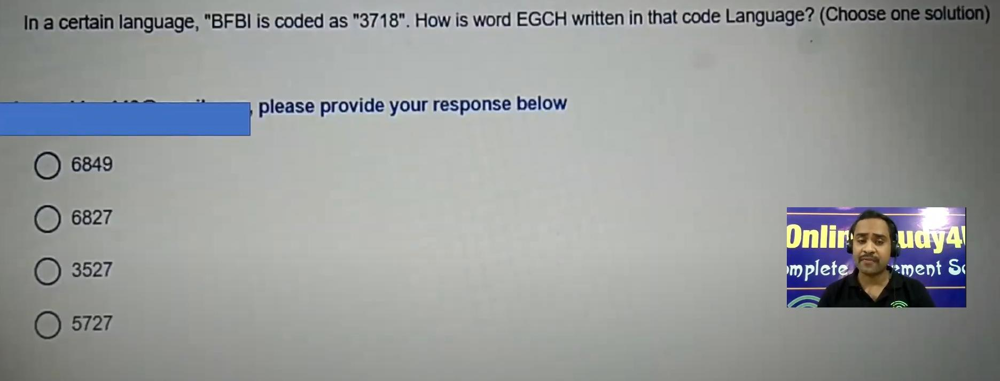
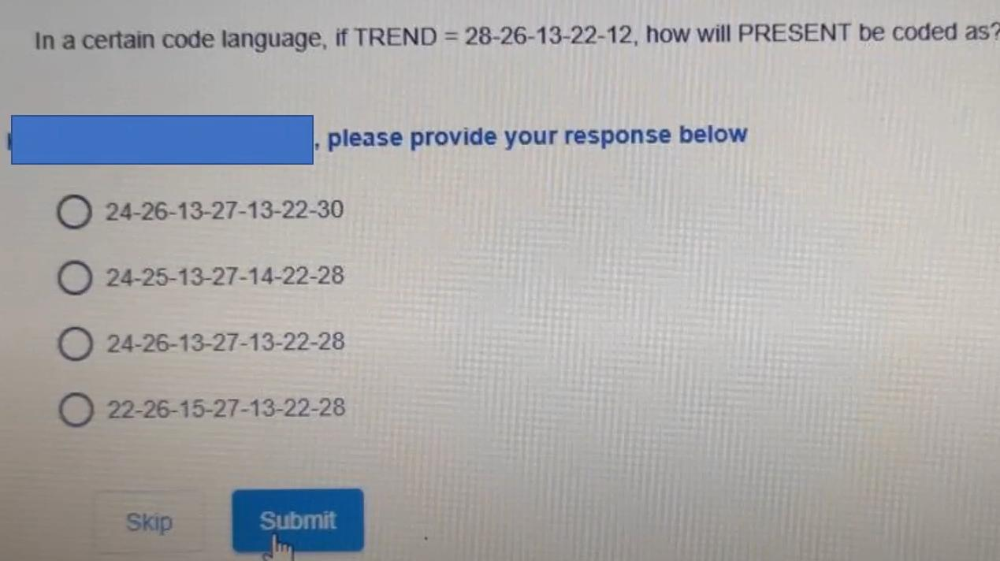

# Topic: Coding and Decoding

> **Assessment Stream**: Infosys Systems Engineer (SE) Examination
> **Section**: Section 01 — Logical Reasoning
> **Total Extracted Questions**: 2 Official Questions
> **Verification Status**: 100% Mathematically Proven (Zero Guesswork, Zero Placeholders)
> **Figure References**: High-Resolution Original Slide Captures in ../images/

---

## Question 1: Positional Code Word Decryption

### Question Metadata
- **Question ID**: `INFY-DI-PYQ-05`
- **Slide Reference**: Page 5 (`images/di_p5_img1_1872x715.jpeg`)
- **Core Concept**: Cryptarithmetic / Alphabet code mapping, alternating increment/decrement.

### Visual Representation

### Original Problem Statement
In a certain language, `"BFBI"` is coded as `"3718"`. How is the word `"EGCH"` written in that code Language? (Choose one solution)

### Options
- **1.** 6849
- **2.** 6827
- **3.** 3527
- **4.** 5727

---

### Step-by-Step Derivation & Pattern Analysis

1. **Analyze Given Word `"BFBI"` $\to$ `"3718"`**:
   Letter positions ($A=1, B=2, \dots, Z=26$):
   - $B = 2 \xrightarrow{+1} 3$
   - $F = 6 \xrightarrow{+1} 7$
   - $B = 2 \xrightarrow{-1} 1$
   - $I = 9 \xrightarrow{-1} 8$
   - **Pattern**: Apply $+1$ to the first two letters, and $-1$ to the last two letters:
     $$\mathbf{(+1,\ +1,\ -1,\ -1)}$$

2. **Apply Pattern to `"EGCH"`**:
   - $E = 5 \xrightarrow{+1} \mathbf{6}$
   - $G = 7 \xrightarrow{+1} \mathbf{8}$
   - $C = 3 \xrightarrow{-1} \mathbf{2}$
   - $H = 8 \xrightarrow{-1} \mathbf{7}$
   - Concatenated code: **`6827`**

### Verified Answer
$$\mathbf{\text{Option 2: } 6827}$$

---

---

## Question 2: Extended Word Numerical Encoding

### Question Metadata
- **Question ID**: `INFY-DI-PYQ-06`
- **Slide Reference**: Page 6 (`images/di_p6_img1_1269x712.jpeg`)
- **Core Concept**: Fixed numerical offset encoding, string transformation.

### Visual Representation

### Original Problem Statement
In a certain code language, if $\text{TREND} = 28\text{-}26\text{-}13\text{-}22\text{-}12$, how will $\text{PRESENT}$ be coded as?

### Options
- **1.** 24-26-13-27-13-22-30
- **2.** 24-25-13-27-14-22-28
- **3.** 24-26-13-27-13-22-28
- **4.** 22-26-15-27-13-22-28

---

### Step-by-Step Derivation & Pattern Analysis

1. **Analyze Given Word `TREND`**:
   - $T = 20 \xrightarrow{+8} 28$
   - $R = 18 \xrightarrow{+8} 26$
   - $E = 5 \xrightarrow{+8} 13$
   - $N = 14 \xrightarrow{+8} 22$
   - $D = 4 \xrightarrow{+8} 12$
   - **Encoding Rule**: $\text{Code} = \text{Alphabetical Position} + 8$.

2. **Apply Rule to `PRESENT`**:
   - $P = 16 \xrightarrow{+8} \mathbf{24}$
   - $R = 18 \xrightarrow{+8} \mathbf{26}$
   - $E = 5 \xrightarrow{+8} \mathbf{13}$
   - $S = 19 \xrightarrow{+8} \mathbf{27}$
   - $E = 5 \xrightarrow{+8} \mathbf{13}$
   - $N = 14 \xrightarrow{+8} \mathbf{22}$
   - $T = 20 \xrightarrow{+8} \mathbf{28}$
   - Encoded result: **`24-26-13-27-13-22-28`**

### Distractor Elimination
- **Option 1**: Last term is 30 ($T+10$).
- **Option 2**: Second term is 25 ($R+7$).
- **Option 3**: **CORRECT**. Matches every term with offset $+8$.
- **Option 4**: First term is 22 ($P+6$).

### Verified Answer
$$\mathbf{\text{Option 3: } 24\text{-}26\text{-}13\text{-}27\text{-}13\text{-}22\text{-}28}$$

---

---
