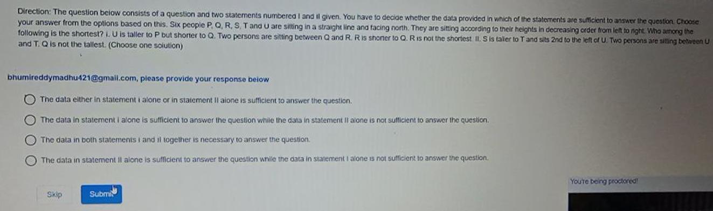

# Topic: Data Sufficiency

> **Assessment Stream**: Infosys Systems Engineer (SE) Examination
> **Section**: Section 01 — Logical Reasoning
> **Total Extracted Questions**: 1 Official Questions
> **Verification Status**: 100% Mathematically Proven (Zero Guesswork, Zero Placeholders)
> **Figure References**: High-Resolution Original Slide Captures in ../images/

---

## Question 1: Data Sufficiency — Height Ordering Linear Arrangement

### Question Metadata
- **Question ID**: `INFY-DI-PYQ-14`
- **Slide Reference**: Page 14 (`images/di_p14_img1_1323x394.jpeg`)
- **Core Concept**: Formal Data Sufficiency, 1D strictly ordered linear permutations.

### Visual Representation

### Original Problem Statement
**Direction**: The question below consists of a question and two statements numbered I and II given. You have to decide whether the data provided in which of the statements are sufficient to answer the question.
Six people $P, Q, R, S, T,$ and $U$ are sitting in a straight line and facing north. They are sitting according to their heights in decreasing order from left to right.  
**Question**: Who among the following is the shortest?

- **Statement I**: $U$ is taller to $P$ but shorter to $Q$. Two persons are sitting between $Q$ and $R$. $R$ is shorter to $Q$. $R$ is not the shortest.
- **Statement II**: $S$ is taller to $T$ and sits $2^{\text{nd}}$ to the left of $U$. Two persons are sitting between $U$ and $T$. $Q$ is not the tallest.

### Options
- **1.** The data either in statement I alone or in statement II alone is sufficient to answer the question.
- **2.** The data in statement I alone is sufficient to answer the question while the data in statement II alone is not sufficient to answer the question.
- **3.** The data in both statements I and II together is necessary to answer the question.
- **4.** The data in statement II alone is sufficient to answer the question while the data in statement I alone is not sufficient to answer the question.

---

### Step-by-Step Analytical Proof

Order: Left to right = Decreasing height = Position $1$ (Tallest) to Position $6$ (Shortest).

1. **Evaluate Statement I Alone**:
   - $Q > U > P \implies \text{pos}(Q) < \text{pos}(U) < \text{pos}(P)$.
   - Two persons between $Q$ and $R$, and $R$ shorter than $Q \implies \text{pos}(R) = \text{pos}(Q) + 3$.
   - $R$ is not the shortest $\implies \text{pos}(R) \ne 6$.
   - If $\text{pos}(Q) = 1 \implies \text{pos}(R) = 4$. Remaining positions for $P$ could be 5 or 6 (shortest could be $P, S,$ or $T$).
   - If $\text{pos}(Q) = 2 \implies \text{pos}(R) = 5$. Shortest position 6 remains indeterminate.
   - **Statement I alone is NOT sufficient**.

2. **Evaluate Statement II Alone**:
   - $S$ sits $2^{\text{nd}}$ to the left of $U$:
     $$\text{pos}(U) = \text{pos}(S) + 2$$
   - Two persons sit between $U$ and $T$:
     $$|\text{pos}(T) - \text{pos}(U)| = 3$$
   - Since $S$ is taller than $T$, $\text{pos}(S) < \text{pos}(T)$.
     - If $T$ were to the left of $U$: $\text{pos}(T) = \text{pos}(U) - 3 = \text{pos}(S) + 2 - 3 = \text{pos}(S) - 1$, meaning $T$ is taller than $S$, which violates the premise.
     - Therefore, $T$ MUST be to the right of $U$:
       $$\text{pos}(T) = \text{pos}(U) + 3$$
   - Substitute $\text{pos}(U) = \text{pos}(S) + 2$:
     $$\text{pos}(T) = \text{pos}(S) + 2 + 3 = \text{pos}(S) + 5$$
   - Since there are exactly $6$ positions ($1$ to $6$), and $\text{pos}(T) - \text{pos}(S) = 5$:
     $$\mathbf{\text{pos}(S) = 1 \quad (\text{Tallest})}$$
     $$\mathbf{\text{pos}(U) = 3}$$
     $$\mathbf{\text{pos}(T) = 6 \quad (\text{Shortest})}$$
   - Position $6$ is the shortest person in the line. Statement II establishes that **$T$ is unambiguously the shortest person**.
   - **Statement II alone is SUFFICIENT**.

### Verified Answer
$$\mathbf{\text{Option 4: Statement II alone is sufficient, Statement I alone is not sufficient}}$$

---

---
