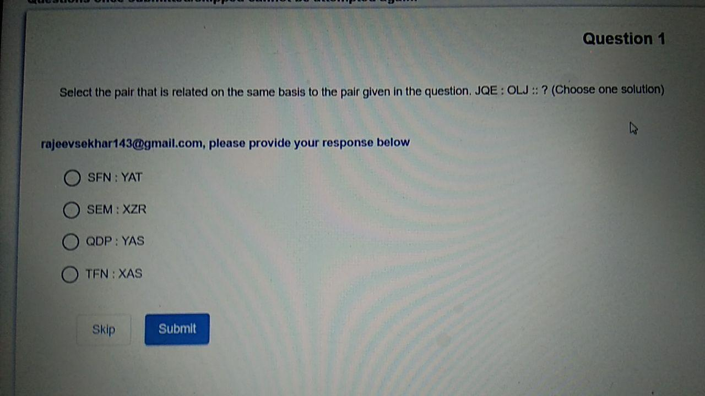
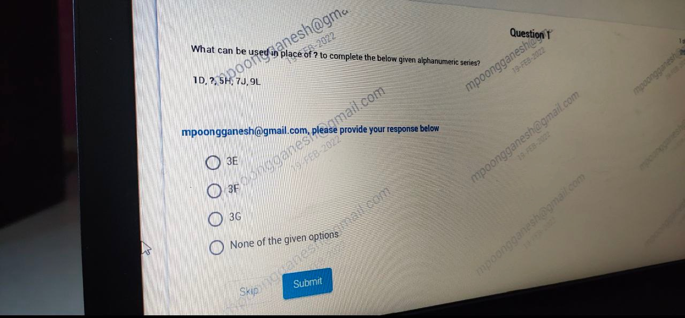

# Topic: Letter Analogy and Progressive Sequences

> **Assessment Stream**: Infosys Systems Engineer (SE) Examination
> **Section**: Section 01 — Logical Reasoning
> **Total Extracted Questions**: 2 Official Questions
> **Verification Status**: 100% Mathematically Proven (Zero Guesswork, Zero Placeholders)
> **Figure References**: High-Resolution Original Slide Captures in ../images/

---

## Question 1: Letter Analogy Positional Cipher

### Question Metadata
- **Question ID**: `INFY-DI-PYQ-03`
- **Slide Reference**: Page 3 (`images/di_p3_img1_1280x720.jpeg`)
- **Core Concept**: Alphabet position transformations, alternating offset analogy.

### Visual Representation

### Original Problem Statement
Select the pair that is related on the same basis to the pair given in the question:
$$\mathbf{JQE : OLJ :: ?}$$

### Options
- **1.** SFN : YAT
- **2.** SEM : XZR
- **3.** QDP : YAS
- **4.** TEN : XAS

---

### Step-by-Step Derivation & Pattern Analysis

1. **Analyze Given Relationship $JQE \to OLJ$**:
   Alphabetical positions ($A=1, B=2, \dots, Z=26$):
   - $J = 10 \xrightarrow{+5} O = 15$
   - $Q = 17 \xrightarrow{-5} L = 12$
   - $E = 5 \xrightarrow{+5} J = 10$
   - **Transformation Rule**: $(+5, -5, +5)$

2. **Evaluate Options against Rule $(+5, -5, +5)$**:
   - **Option 1 (`SFN : YAT`)**:
     $S(19) + 5 = 24 (X) \neq Y(25)$. *Invalid*.
   - **Option 2 (`SEM : XZR`)**:
     - $S(19) + 5 = 24 \implies \mathbf{X}$
     - $E(5) - 5 = 0 \equiv 26 \pmod{26} \implies \mathbf{Z}$
     - $M(13) + 5 = 18 \implies \mathbf{R}$
     - Result matches `XZR` exactly! *Valid*.
   - **Option 3 (`QDP : YAS`)**:
     $Q(17) + 5 = 22 (V) \neq Y(25)$. *Invalid*.
   - **Option 4 (`TEN : XAS`)**:
     $T(20) + 5 = 25 (Y) \neq X(24)$. *Invalid*.

### Verified Answer
$$\mathbf{\text{Option 2: } SEM : XZR}$$

---

---

## Question 2: Alphanumeric Progressive Sequence

### Question Metadata
- **Question ID**: `INFY-CLASS23-11`
- **Slide Reference**: Page 11 (`images/class23_p11_img1_1280x594.jpeg`)
- **Core Concept**: Split alphanumeric series decomposition.

### Visual Representation

### Original Problem Statement
What can be used in place of `?` to complete the below given alphanumeric series?
$$1\text{D},\ ?,\ 5\text{H},\ 7\text{J},\ 9\text{L}$$

### Options
- **1.** 3E
- **2.** 3F
- **3.** 3G
- **4.** None of the given options

---

### Step-by-Step Derivation

1. **Numerical Component**:
   Sequence of numbers: $1,\ ?,\ 5,\ 7,\ 9$
   Consecutive odd integers: $1 \xrightarrow{+2} \mathbf{3} \xrightarrow{+2} 5 \xrightarrow{+2} 7 \xrightarrow{+2} 9$.
   The number must be **$3$**.

2. **Alphabetical Component**:
   Alphabetical positions ($A=1, B=2, \dots$):
   $D = 4 \xrightarrow{+2} \mathbf{F = 6} \xrightarrow{+2} H = 8 \xrightarrow{+2} J = 10 \xrightarrow{+2} L = 12$.
   The letter must be **$F$**.

Combining numerical and alphabetical terms yields **`3F`**.

### Verified Answer
$$\mathbf{\text{Option 2: } 3F}$$

---

---
