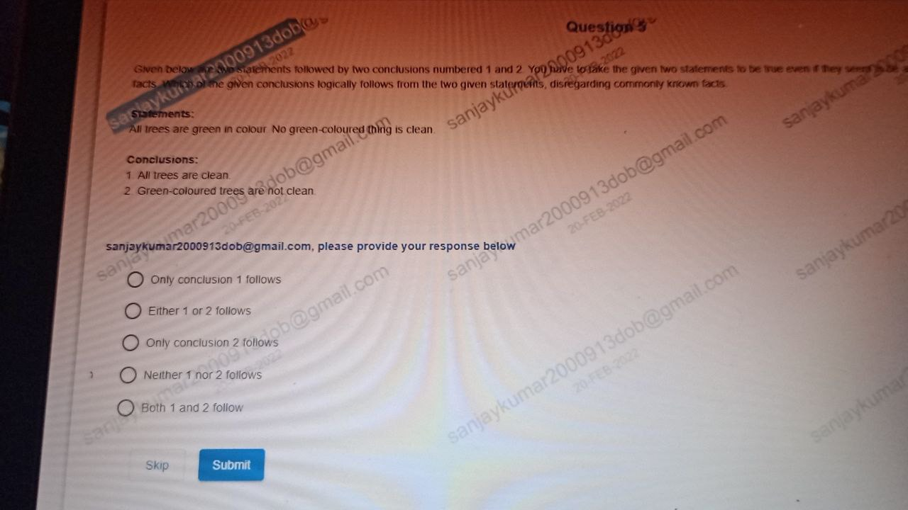

# Topic: Categorical Syllogism

> **Assessment Stream**: Infosys Systems Engineer (SE) Examination
> **Section**: Section 01 — Logical Reasoning
> **Total Extracted Questions**: 1 Official Questions
> **Verification Status**: 100% Mathematically Proven (Zero Guesswork, Zero Placeholders)
> **Figure References**: High-Resolution Original Slide Captures in ../images/

---

## Question 1: Formal Categorical Syllogism

### Question Metadata
- **Question ID**: `INFY-CLASS23-04`
- **Slide Reference**: Page 4 (`images/class23_p4_img1_1280x720.jpeg`)
- **Core Concept**: Syllogism, Universal Affirmative (A) and Universal Negative (E) propositions.

### Visual Representation

### Original Problem Statement
Given below are two statements followed by two conclusions numbered 1 and 2. You have to take the given two statements to be true even if they seem to be at variance from commonly known facts. Which of the given conclusions logically follows from the two given statements?

**Statements**:
- All trees are green in colour.
- No green-coloured thing is clean.

**Conclusions**:
1. All trees are clean.
2. Green-coloured trees are not clean.

### Options
- **1.** Only conclusion 1 follows
- **2.** Either 1 or 2 follows
- **3.** Only conclusion 2 follows
- **4.** Neither 1 nor 2 follows
- **5.** Both 1 and 2 follow

---

### Step-by-Step Logical Proof

1. **Set-Theoretic Formalization**:
   - Let $T$ be the set of Trees.
   - Let $G$ be the set of Green-coloured things.
   - Let $C$ be the set of Clean things.

2. **Premise Representation**:
   - Premise 1: $T \subseteq G$ (All trees are green).
   - Premise 2: $G \cap C = \emptyset$ (No green thing is clean).

3. **Evaluate Conclusions**:
   - **Conclusion 1 ("All trees are clean", $T \subseteq C$)**:
     Since $T \subseteq G$ and $G \cap C = \emptyset$, it follows by transitivity that $T \cap C = \emptyset$.
     Thus, no tree can be clean. Conclusion 1 is **strictly false**.
   - **Conclusion 2 ("Green-coloured trees are not clean")**:
     "Green-coloured trees" represents the subset $T \cap G$. Since $T \subseteq G$, $T \cap G = T$.
     Every element of $T \cap G$ belongs to $G$.
     Since no element of $G$ belongs to $C$ ($G \cap C = \emptyset$), no green-coloured tree can belong to $C$.
     Therefore, green-coloured trees are definitely not clean. Conclusion 2 **strictly follows**.

### Verified Answer
$$\mathbf{\text{Option 3: Only conclusion 2 follows}}$$

---

---
