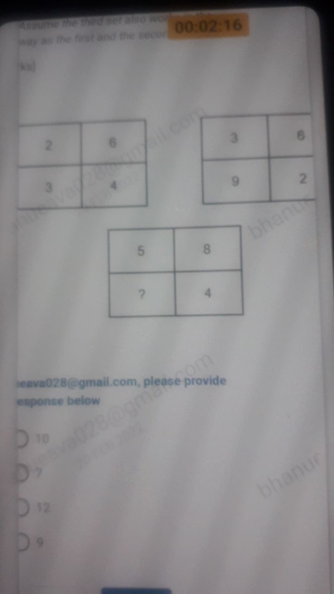
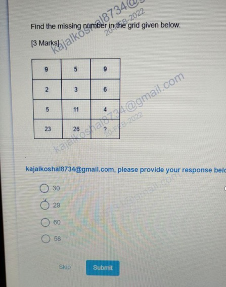
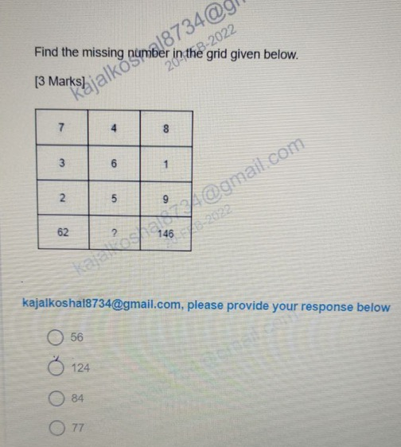
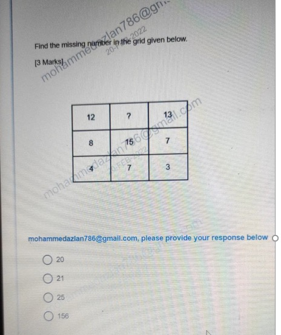
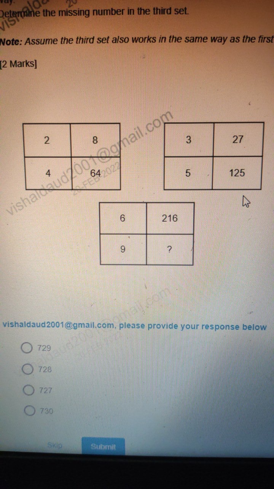

# Topic: Missing Number Grid Puzzles

> **Assessment Stream**: Infosys Systems Engineer (SE) Examination
> **Section**: Section 02 — Puzzle Solving
> **Total Extracted Questions**: 5 Official Questions
> **Verification Status**: 100% Mathematically Proven (Zero Guesswork, Zero Placeholders)
> **Figure References**: High-Resolution Original Slide Captures in ../images/

---

## Question 1: $2 \times 2$ Grid Product Conservation Puzzle

### Question Metadata
- **Question ID**: `INFY-CLASS23-12`
- **Slide Reference**: Page 12 (`images/class23_p12_img1_720x1280.jpeg`)
- **Core Concept**: Row-product equivalence in $2 \times 2$ matrices.

### Visual Representation

### Original Problem Statement
Determine the missing number in the third set.  
*Note: Assume the third set also works in the same way as the first and the second set.*

$$\text{Set 1: } \begin{array}{|c|c|} \hline 2 & 6 \\ \hline 3 & 4 \\ \hline \end{array} \qquad
\text{Set 2: } \begin{array}{|c|c|} \hline 3 & 6 \\ \hline 9 & 2 \\ \hline \end{array} \qquad
\text{Set 3: } \begin{array}{|c|c|} \hline 5 & 8 \\ \hline ? & 4 \\ \hline \end{array}$$

### Options
- **1.** 10
- **2.** 7
- **3.** 12
- **4.** 9

---

### Step-by-Step Mathematical Derivation

1. **Analyze Set 1**:
   $$\text{Top Row Product} = 2 \times 6 = 12$$
   $$\text{Bottom Row Product} = 3 \times 4 = 12$$
   $$\text{Rule}: R_1\text{ product} = R_2\text{ product}$$

2. **Verify Set 2**:
   $$\text{Top Row Product} = 3 \times 6 = 18$$
   $$\text{Bottom Row Product} = 9 \times 2 = 18$$
   Holds consistently!

3. **Apply to Set 3**:
   $$\text{Top Row Product} = 5 \times 8 = 40$$
   $$\text{Bottom Row Product} = ? \times 4 = 40 \implies ? = \frac{40}{4} = \mathbf{10}$$

### Verified Answer
$$\mathbf{\text{Option 1: } 10}$$

---

---

## Question 2: $4 \times 3$ Column-Product Linear Accumulator Grid

### Question Metadata
- **Question ID**: `INFY-CLASS23-13`
- **Slide Reference**: Page 13 (`images/class23_p13_img1_447x567.jpeg`)
- **Core Concept**: Vertical polynomial grid operations: $(R_1 \times R_2) + R_3 = R_4$.

### Visual Representation

### Original Problem Statement
Find the missing number in the grid given below. [3 Marks]

$$\begin{array}{|c|c|c|}
\hline
9 & 5 & 9 \\ \hline
2 & 3 & 6 \\ \hline
5 & 11 & 4 \\ \hline
23 & 26 & ? \\ \hline
\end{array}$$

### Options
- **1.** 30
- **2.** 29
- **3.** 60
- **4.** 58

---

### Step-by-Step Mathematical Derivation

Evaluate the column-wise operation $(R_1 \times R_2) + R_3 = R_4$:
1. **Column 1**:
   $$(9 \times 2) + 5 = 18 + 5 = \mathbf{23}$$
2. **Column 2**:
   $$(5 \times 3) + 11 = 15 + 11 = \mathbf{26}$$
3. **Column 3**:
   $$(9 \times 6) + 4 = 54 + 4 = \mathbf{58}$$

The missing number is **$58$**.

### Verified Answer
$$\mathbf{\text{Option 4: } 58}$$

---

---

## Question 3: $4 \times 3$ Columnar Sum-of-Squares Grid

### Question Metadata
- **Question ID**: `INFY-CLASS23-14`
- **Slide Reference**: Page 14 (`images/class23_p14_img1_504x562.jpeg`)
- **Core Concept**: Vertical quadratic sum operations: $\sum_{i=1}^3 R_i^2 = R_4$.

### Visual Representation

### Original Problem Statement
Find the missing number in the grid given below. [3 Marks]

$$\begin{array}{|c|c|c|}
\hline
7 & 4 & 8 \\ \hline
3 & 6 & 1 \\ \hline
2 & 5 & 9 \\ \hline
62 & ? & 146 \\ \hline
\end{array}$$

### Options
- **1.** 56
- **2.** 124
- **3.** 84
- **4.** 77

---

### Step-by-Step Mathematical Derivation

Evaluate the column-wise quadratic sum $R_1^2 + R_2^2 + R_3^2 = R_4$:
1. **Column 1**:
   $$7^2 + 3^2 + 2^2 = 49 + 9 + 4 = \mathbf{62}$$
2. **Column 3**:
   $$8^2 + 1^2 + 9^2 = 64 + 1 + 81 = \mathbf{146}$$
3. **Column 2**:
   $$4^2 + 6^2 + 5^2 = 16 + 36 + 25 = \mathbf{77}$$

The missing number is **$77$**.

### Verified Answer
$$\mathbf{\text{Option 4: } 77}$$

---

---

## Question 4: $3 \times 3$ Center-Balance Row Sum Grid

### Question Metadata
- **Question ID**: `INFY-CLASS23-15`
- **Slide Reference**: Page 15 (`images/class23_p15_img1_464x552.jpeg`)
- **Core Concept**: Row-wise flank summation to center element: $C_1 + C_3 = C_2$.

### Visual Representation

### Original Problem Statement
Find the missing number in the grid given below. [3 Marks]

$$\begin{array}{|c|c|c|}
\hline
12 & ? & 13 \\ \hline
8 & 15 & 7 \\ \hline
4 & 7 & 3 \\ \hline
\end{array}$$

### Options
- **1.** 20
- **2.** 21
- **3.** 25
- **4.** 156

---

### Step-by-Step Mathematical Derivation

Observe the row-wise summation: $\text{Left Element} + \text{Right Element} = \text{Center Element}$:
1. **Row 2**:
   $$8 + 7 = \mathbf{15}$$
2. **Row 3**:
   $$4 + 3 = \mathbf{7}$$
3. **Row 1**:
   $$12 + 13 = \mathbf{25}$$

The missing number is **$25$**.

### Verified Answer
$$\mathbf{\text{Option 3: } 25}$$

---

---

## Question 5: Columnar Cube Transformation Puzzle ($x \to x^3$)

### Question Metadata
- **Question ID**: `INFY-CLASS23-16`
- **Slide Reference**: Page 16 (`images/class23_p16_img1_720x1280.jpeg`)
- **Core Concept**: Power functions, cubic mapping.

### Visual Representation

### Original Problem Statement
Determine the missing number in the third set. [2 Marks]  
*Note: Assume the third set also works in the same way as the first and the second set.*

$$\text{Set 1: } \begin{array}{|c|c|} \hline 2 & 8 \\ \hline 4 & 64 \\ \hline \end{array} \qquad
\text{Set 2: } \begin{array}{|c|c|} \hline 3 & 27 \\ \hline 5 & 125 \\ \hline \end{array} \qquad
\text{Set 3: } \begin{array}{|c|c|} \hline 6 & 216 \\ \hline 9 & ? \\ \hline \end{array}$$

### Options
- **1.** 729
- **2.** 728
- **3.** 727
- **4.** 730

---

### Step-by-Step Mathematical Derivation

In each $2 \times 2$ block, the right column element is the cube of the corresponding left column element ($C_2 = C_1^3$):
1. **Set 1**:
   $$2^3 = 8,\quad 4^3 = 64$$
2. **Set 2**:
   $$3^3 = 27,\quad 5^3 = 125$$
3. **Set 3**:
   $$6^3 = 216,\quad 9^3 = 9 \times 9 \times 9 = \mathbf{729}$$

The missing number is **$729$**.

### Verified Answer
$$\mathbf{\text{Option 1: } 729}$$

---

---
