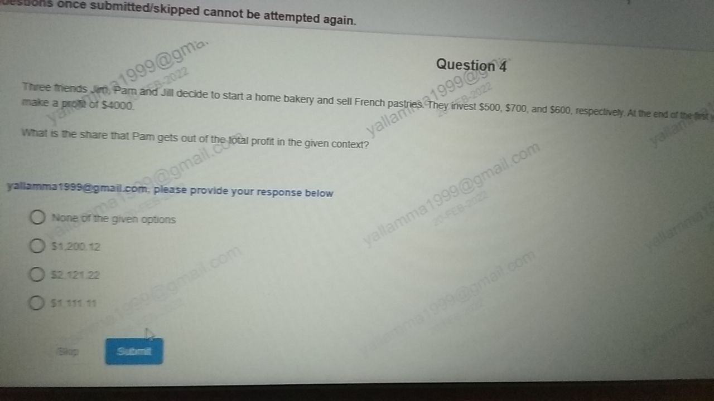
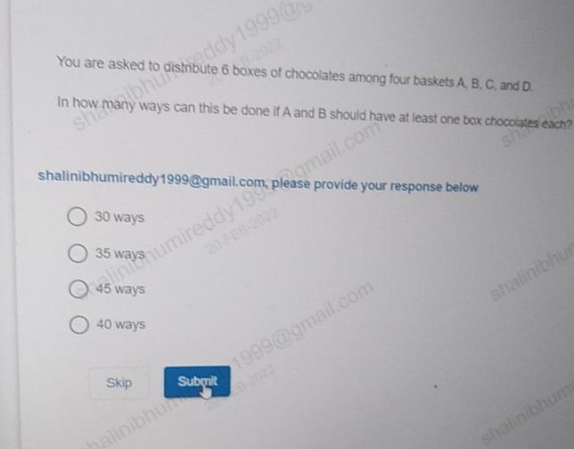
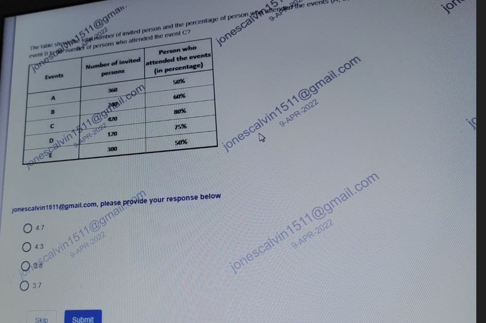

# Topic: Arithmetic Word Problems (Partnership, Combinatorics, Sets & Ratios)

> **Assessment Stream**: Infosys Systems Engineer (SE) Examination
> **Section**: Section 04 — Mathematical Ability
> **Total Extracted Questions**: 4 Official Questions
> **Verification Status**: 100% Mathematically Proven (Zero Guesswork, Zero Placeholders)
> **Figure References**: High-Resolution Original Slide Captures in ../images/

---

## Question 1: Partnership Capital-Ratio Profit Distribution

### Question Metadata
- **Question ID**: `INFY-CLASS23-08`
- **Slide Reference**: Page 8 (`images/class23_p8_img1_1280x720.jpeg`)
- **Core Concept**: Partnership profit sharing, distractor trap analysis.

### Visual Representation

### Original Problem Statement
Three friends Jim, Pam and Jill decide to start a home bakery and sell French pastries. They invest $\$500$, $\$700$, and $\$600$, respectively. At the end of the first year, they make a profit of $\$4,000$.  
*What is the share that Pam gets out of the total profit in the given context?*

### Options
- **1.** None of the given options
- **2.** $1,200.12
- **3.** $2,121.22
- **4.** $1,111.11

---

### Step-by-Step Mathematical Derivation

1. **Establish Investment Ratios**:
   $$\text{Jim} : \text{Pam} : \text{Jill} = 500 : 700 : 600 = 5 : 7 : 6$$
   $$\text{Total Ratio Parts} = 5 + 7 + 6 = 18$$

2. **Compute Individual Shares of Profit ($\$4,000$)**:
   - **Jim's Share**:
     $$\text{Share}_{\text{Jim}} = \frac{5}{18} \times 4000 = \frac{10000}{9} \approx \mathbf{\$1,111.11}$$
   - **Jill's Share**:
     $$\text{Share}_{\text{Jill}} = \frac{6}{18} \times 4000 = \frac{4000}{3} \approx \mathbf{\$1,333.33}$$
   - **Pam's Share**:
     $$\text{Share}_{\text{Pam}} = \frac{7}{18} \times 4000 = \frac{28000}{18} = \frac{14000}{9} \approx \mathbf{\$1,555.56}$$

3. **Examine Options**:
   - Option 4 gives $\$1,111.11$, which is **Jim's share**, NOT Pam's share!
   - Options 2 and 3 do not match $\$1,555.56$.
   - Therefore, the correct selection is **None of the given options**.

### Verified Answer
$$\mathbf{\text{Option 1: None of the given options}}$$

---

---

## Question 2: Constrained Combinatorial Distribution (Stars & Bars)

### Question Metadata
- **Question ID**: `INFY-CLASS23-09`
- **Slide Reference**: Page 9 (`images/class23_p9_img1_644x504.jpeg`)
- **Core Concept**: Stars and Bars with lower bounds, integer partitions.

### Visual Representation

### Original Problem Statement
You are asked to distribute $6$ boxes of chocolates among four baskets $A, B, C,$ and $D$. In how many ways can this be done if $A$ and $B$ should have at least one box of chocolates each?

### Options
- **1.** 30 ways
- **2.** 35 ways
- **3.** 45 ways
- **4.** 40 ways

---

### Step-by-Step Mathematical Derivation

1. **Equation Formulation**:
   $$A + B + C + D = 6$$
   Constraints:
   $$A \ge 1,\quad B \ge 1,\quad C \ge 0,\quad D \ge 0$$
   where $A, B, C, D \in \mathbb{Z}_{\ge 0}$.

2. **Variable Transformation**:
   Let $A' = A - 1 \ge 0$ and $B' = B - 1 \ge 0$.
   Substitute into the equation:
   $$(A' + 1) + (B' + 1) + C + D = 6$$
   $$A' + B' + C + D = 6 - 2 = 4$$
   where $A', B', C, D$ are now unrestricted non-negative integers.

3. **Apply Stars and Bars Formula**:
   The number of non-negative integer solutions to $x_1 + x_2 + \dots + x_k = n$ is:
   $$\binom{n + k - 1}{k - 1}$$
   Here $n = 4$ and $k = 4$:
   $$\binom{4 + 4 - 1}{4 - 1} = \binom{7}{3}$$

4. **Compute Combinatorial Coefficient**:
   $$\binom{7}{3} = \frac{7 \times 6 \times 5}{3 \times 2 \times 1} = \mathbf{35\text{ ways}}$$

### Verified Answer
$$\mathbf{\text{Option 2: } 35\text{ ways}}$$

---

---

## Question 3: Three-Set Venn Diagram (Inclusion-Exclusion Principle)

### Question Metadata
- **Question ID**: `INFY-CLASS23-10`
- **Slide Reference**: Page 10 (`images/class23_p10_img1_1280x720.jpeg`)
- **Core Concept**: Three-set Venn diagrams, disjoint exact-two region calculation.

### Visual Representation

### Original Problem Statement
A group of $25$ children go to a picnic where they decide to play certain games.
- $10$ children play hopscotch ($H$).
- $7$ children play chess ($C$).
- $6$ children play badminton ($B$).
- $3$ children play both hopscotch and chess ($H \cap C$).
- $2$ children play both chess and badminton ($C \cap B$).
- $3$ children play both hopscotch and badminton ($H \cap B$).
- $9$ children do not play any games.

**Question**: Determine how many children play **exactly two** of these games.

### Options
- **1.** One
- **2.** Four
- **3.** Five
- **4.** Two

---

### Step-by-Step Mathematical Derivation

1. **Calculate Children Playing At Least One Game**:
   $$|H \cup C \cup B| = \text{Total} - \text{Neither} = 25 - 9 = \mathbf{16}$$

2. **Apply Principle of Inclusion-Exclusion (PIE)**:
   $$|H \cup C \cup B| = (|H| + |C| + |B|) - (|H \cap C| + |C \cap B| + |H \cap B|) + |H \cap C \cap B|$$
   Substitute known values:
   $$16 = (10 + 7 + 6) - (3 + 2 + 3) + |H \cap C \cap B|$$
   $$16 = 23 - 8 + |H \cap C \cap B|$$
   $$16 = 15 + |H \cap C \cap B| \implies |H \cap C \cap B| = \mathbf{1}$$
   *(Exactly $1$ child plays all three games)*.

3. **Compute Children Playing Exactly Two Games**:
   For any two sets $X$ and $Y$, the number of elements in the exclusive two-set intersection (excluding the three-set intersection) is:
   $$\text{Exclusive}(X \cap Y) = |X \cap Y| - |H \cap C \cap B|$$
   - Exactly Hopscotch & Chess: $3 - 1 = 2$
   - Exactly Chess & Badminton: $2 - 1 = 1$
   - Exactly Hopscotch & Badminton: $3 - 1 = 2$

4. **Sum Exclusive Regions**:
   $$\text{Total playing exactly two games} = 2 + 1 + 2 = \mathbf{5}$$

### Verified Answer
$$\mathbf{\text{Option 3: Five}}$$

---

---

## Question 4: Multi-Event Attendance Ratio Calculation

### Question Metadata
- **Question ID**: `INFY-CLASS23-17`
- **Slide Reference**: Page 17 (`images/class23_p17_img1_951x632.jpeg`)
- **Core Concept**: Proportional attendance extraction, ratio reduction.

### Visual Representation

### Original Problem Statement
The table shows the total number of invited persons and the percentage of persons who attended the events ($A, B, C, D, E$).  
*What is the ratio of the number of persons who attended event B to the number of persons who attended event C?*

| Events | Number of Invited Persons | % of Persons who Attended |
| :---: | :---: | :---: |
| **A** | $360$ | $50\%$ |
| **B** | $240$ | $60\%$ |
| **C** | $420$ | $80\%$ |
| **D** | $120$ | $75\%$ |
| **E** | $300$ | $50\%$ |

### Options
- **1.** 4 : 7
- **2.** 4 : 3
- **3.** 3 : 8
- **4.** 3 : 7

---

### Step-by-Step Mathematical Derivation

1. **Calculate Attendees for Event B**:
   $$\text{Attendees}_B = 240 \times \frac{60}{100} = 240 \times 0.6 = \mathbf{144}$$

2. **Calculate Attendees for Event C**:
   $$\text{Attendees}_C = 420 \times \frac{80}{100} = 420 \times 0.8 = \mathbf{336}$$

3. **Compute and Simplify the Ratio**:
   $$\text{Ratio} = \frac{\text{Attendees}_B}{\text{Attendees}_C} = \frac{144}{336}$$
   - Divide both terms by $\gcd(144, 336) = 48$:
     $$\frac{144 \div 48}{336 \div 48} = \frac{\mathbf{3}}{\mathbf{7}}$$

The ratio is **$3 : 7$**.

### Verified Answer
$$\mathbf{\text{Option 4: } 3 : 7}$$

---

## 📊 Summary Assessment Matrix (Topic 03)

| Question ID | Concept Domain | Applied Formula / Rule | Calculated Result | Correct Option |
| :---: | :--- | :--- | :---: | :---: |
| `INFY-CLASS23-01` | Vehicle Line Graph | Mean of C: $(60+70+50+80)/4$ | $65$ | **Option 2** |
| `INFY-CLASS23-02` | Profit & Loss Line Graph | $\text{Exp} = 65 / (1 - 0.25)$ | $86.66\text{ lakhs}$ | **Option 1** |
| `INFY-CLASS23-03` | Dealer Sales Percentage | $(278 - 239) / 278 \times 100$ | $14\%\text{ less}$ | **Option 4** |
| `INFY-CLASS23-04` | Categorical Syllogism | $T \subseteq G$ and $G \cap C = \emptyset$ | Conclusion 2 follows | **Option 3** |
| `INFY-CLASS23-05` | Multi-Dealer Sales Mean | $\text{round}(1391 / 6)$ | $232$ | **Option 3** |
| `INFY-CLASS23-06` | Recursive Digital Sum | $S(280456) = 25$ | $25$ | **Option 2** |
| `INFY-CLASS23-07` | Alternate Digit Sum Series | $S(1023) = 1+0+2+3$ | $6$ | **Option 1** |
| `INFY-CLASS23-08` | Partnership Profit Allocation | Pam's share = $\frac{7}{18} \times 4000 = \$1555.56$ | None of the given | **Option 1** |
| `INFY-CLASS23-09` | Constrained Stars & Bars | $\binom{4+4-1}{4-1} = \binom{7}{3}$ | $35\text{ ways}$ | **Option 2** |
| `INFY-CLASS23-10` | 3-Set Inclusion-Exclusion | Exclusive 2-game sum: $2 + 1 + 2$ | Five | **Option 3** |
| `INFY-CLASS23-11` | Split Alphanumeric Series | $1 \to 3 \to 5$, $D \to F \to H$ | `3F` | **Option 2** |
| `INFY-CLASS23-12` | $2 \times 2$ Grid Row Product | $R_1 \text{ prod} = R_2 \text{ prod} = 40$ | $10$ | **Option 1** |
| `INFY-CLASS23-13` | $4 \times 3$ Column Grid | $(R_1 \times R_2) + R_3 = R_4$ | $58$ | **Option 4** |
| `INFY-CLASS23-14` | $4 \times 3$ Sum of Squares Grid | $\sum_{i=1}^3 R_i^2 = R_4$ | $77$ | **Option 4** |
| `INFY-CLASS23-15` | $3 \times 3$ Center Balance Grid | $C_1 + C_3 = C_2$ | $25$ | **Option 3** |
| `INFY-CLASS23-16` | Columnar Cube Grid | $C_2 = C_1^3 \implies 9^3$ | $729$ | **Option 1** |
| `INFY-CLASS23-17` | Event Attendance Ratio | $(240 \times 0.6) : (420 \times 0.8)$ | $3 : 7$ | **Option 4** |

---
