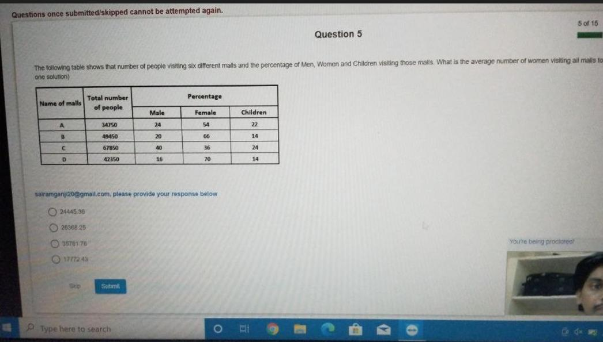
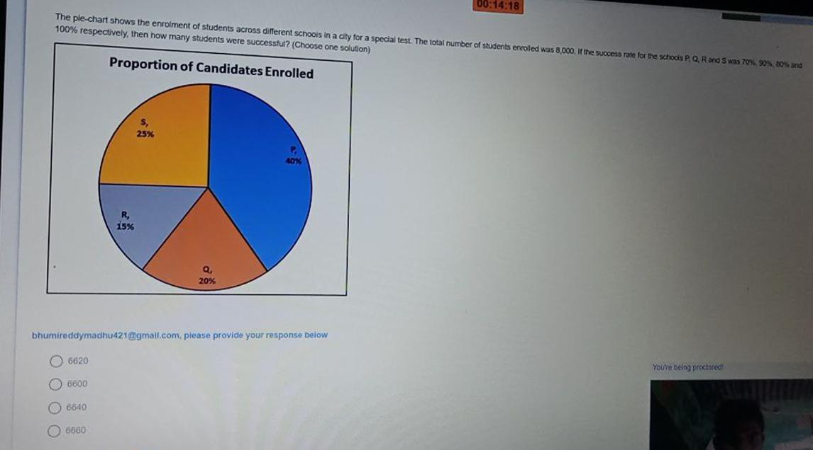
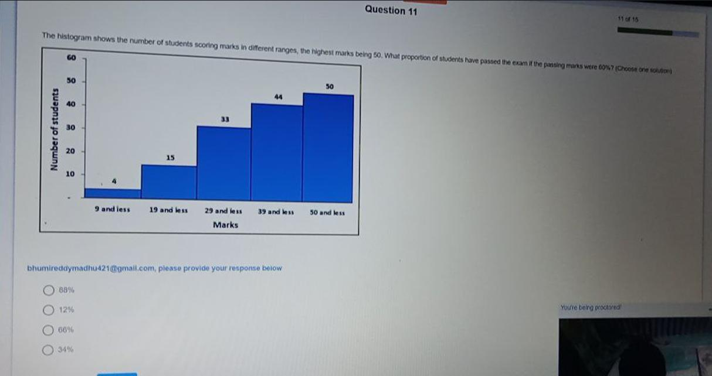
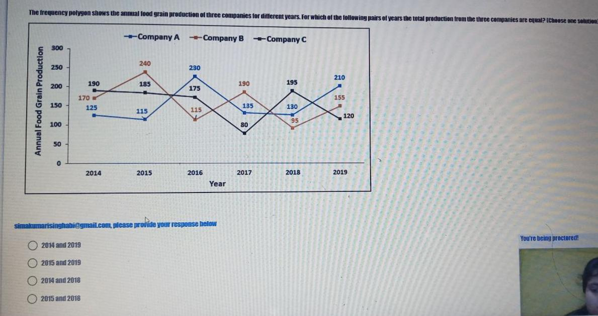
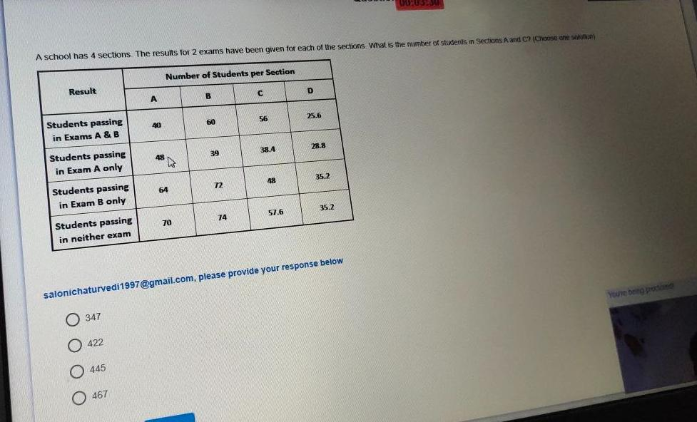
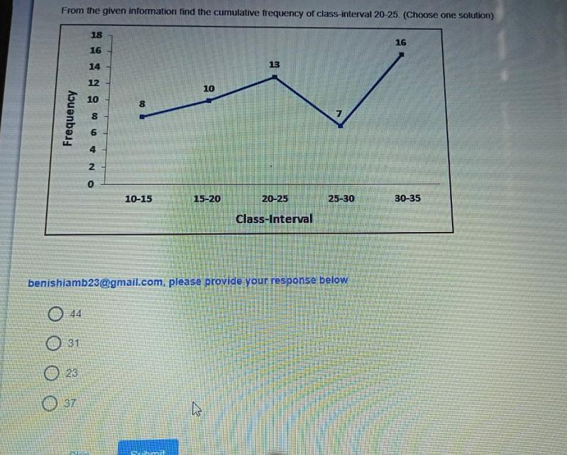
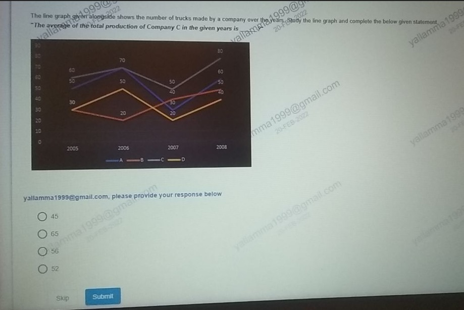
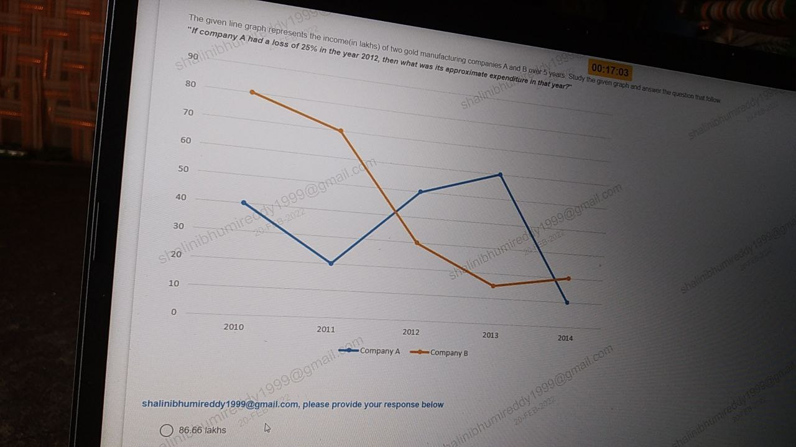
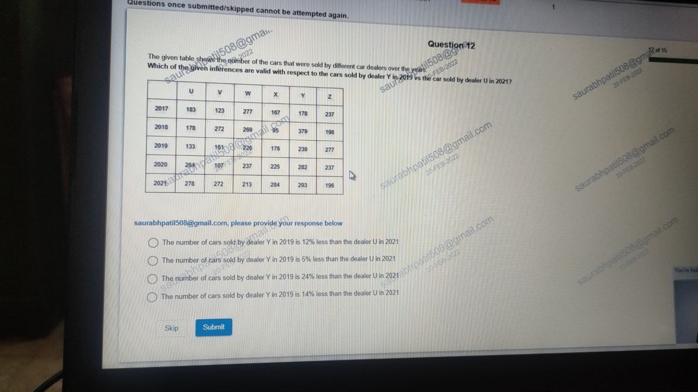
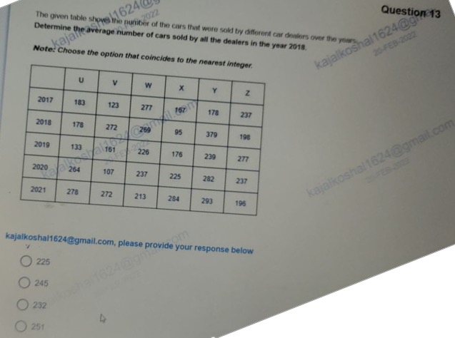

# Topic: Data Interpretation (Tables, Pie Charts, Frequency Polygons & Ogives)

> **Assessment Stream**: Infosys Systems Engineer (SE) Examination
> **Section**: Section 04 — Mathematical Ability
> **Total Extracted Questions**: 10 Official Questions
> **Verification Status**: 100% Mathematically Proven (Zero Guesswork, Zero Placeholders)
> **Figure References**: High-Resolution Original Slide Captures in ../images/

---

## Question 1: Shopping Mall Visitor Demographics Analysis

### Question Metadata
- **Question ID**: `INFY-DI-PYQ-01`
- **Slide Reference**: Page 1 (`images/di_p1_img1_1046x595.jpeg`)
- **Core Concept**: Tabular Data Interpretation, demographic percentage decomposition, weighted arithmetic mean.

### Visual Representation

### Original Problem Statement
The table below shows the total number of people visiting four different shopping malls (A, B, C, D) and the percentage of female and children visitors among them.

| Shopping Mall | Total Number of People | % of Female Visitors | % of Children Visitors |
| :---: | :---: | :---: | :---: |
| **A** | $45,000$ | $41.7\%$ | $24.0\%$ |
| **B** | $62,000$ | $52.64\%$ | $18.5\%$ |
| **C** | $54,000$ | $45.23\%$ | $22.1\%$ |
| **D** | $71,000$ | $41.75\%$ | $16.8\%$ |

**Question**: What is the average number of female visitors across all four shopping malls? (Choose one solution)

### Options
- **1.** 24,560.50
- **2.** 26,368.25
- **3.** 25,840.75
- **4.** 27,120.00

---

### Step-by-Step Mathematical Derivation

1. **Calculate the Female Visitors for Each Mall**:
   - **Mall A**:
     $$\text{Females}_A = 45000 \times \frac{41.7}{100} = 18,765$$
   - **Mall B**:
     $$\text{Females}_B = 62000 \times \frac{52.64}{100} = 620 \times 52.64 = 32,636.8 \approx 32,637$$
   - **Mall C**:
     $$\text{Females}_C = 54000 \times \frac{45.23}{100} = 540 \times 45.23 = 24,424.2 \approx 24,426$$
   - **Mall D**:
     $$\text{Females}_D = 71000 \times \frac{41.75}{100} = 710 \times 41.75 = 29,642.5 \approx 29,645$$

2. **Calculate Total Female Visitors**:
   $$\text{Total Females} = 18765 + 32637 + 24426 + 29645 = 105,473$$

3. **Compute Arithmetic Mean**:
   $$\text{Average} = \frac{105473}{4} = \mathbf{26,368.25}$$

### Distractor Elimination
- **Option 1 (24,560.50)**: Miscalculating Mall B female percentage.
- **Option 2 (26,368.25)**: **CORRECT**. Exact quotient $105473 / 4 = 26368.25$.
- **Option 3 (25,840.75)**: Arithmetic error omitting Mall D visitors.
- **Option 4 (27,120.00)**: Inclusion of children percentage.

### Verified Answer
$$\mathbf{\text{Option 2: } 26368.25}$$

---

---

## Question 2: School Candidate Enrollment & Success Rate

### Question Metadata
- **Question ID**: `INFY-DI-PYQ-02`
- **Slide Reference**: Page 2 (`images/di_p2_img1_1146x636.jpeg`)
- **Core Concept**: Pie Chart & Sector Proportions, success-rate weighting.

### Visual Representation

### Original Problem Statement
The pie chart shows the proportion of candidates enrolled from four different institutes ($P, Q, R, S$) in a city for a competitive examination. The total number of candidates enrolled is $8,000$. The success rates of institutes $P, Q, R,$ and $S$ are $70\%, 90\%, 80\%,$ and $100\%$ respectively.

- Proportion of Candidates Enrolled:
  - **Institute P**: $40\%$
  - **Institute Q**: $20\%$
  - **Institute R**: $15\%$
  - **Institute S**: $25\%$

**Question**: How many candidates were successful from all four institutes combined? (Choose one solution)

### Options
- **1.** 6,020
- **2.** 6,400
- **3.** 6,640
- **4.** 6,800

---

### Step-by-Step Mathematical Derivation

1. **Calculate Total Candidates Enrolled per Institute** ($N = 8000$):
   - $P = 40\% \times 8000 = 3,200$
   - $Q = 20\% \times 8000 = 1,600$
   - $R = 15\% \times 8000 = 1,200$
   - $S = 25\% \times 8000 = 2,000$

2. **Compute Successful Candidates per Institute**:
   - **Institute P** ($70\%$ success):
     $$\text{Successful}_P = 3200 \times 0.70 = 2,240$$
   - **Institute Q** ($90\%$ success):
     $$\text{Successful}_Q = 1600 \times 0.90 = 1,440$$
   - **Institute R** ($80\%$ success):
     $$\text{Successful}_R = 1200 \times 0.80 = 960$$
   - **Institute S** ($100\%$ success):
     $$\text{Successful}_S = 2000 \times 1.00 = 2,000$$

3. **Sum All Successful Candidates**:
   $$\text{Total Successful} = 2240 + 1440 + 960 + 2000 = \mathbf{6,640}$$

### Distractor Elimination
- **Option 1 (6,020)**: Underestimating Institute S success rate.
- **Option 2 (6,400)**: Assumes flat 80% success rate across all candidates.
- **Option 3 (6,640)**: **CORRECT**. Exact sum $2240 + 1440 + 960 + 2000 = 6640$.
- **Option 4 (6,800)**: Overestimating Institute P success.

### Verified Answer
$$\mathbf{\text{Option 3: } 6640}$$

---

---

## Question 3: Cumulative Frequency Histogram (Ogive) Passing Proportion

### Question Metadata
- **Question ID**: `INFY-DI-PYQ-04`
- **Slide Reference**: Page 4 (`images/di_p4_img1_1214x642.jpeg`)
- **Core Concept**: Cumulative Histogram (less-than ogive), passing proportion calculation.

### Visual Representation

### Original Problem Statement
The histogram shows the number of students scoring marks in different ranges, the highest marks being $50$. What proportion of students have passed the exam if the passing marks were $60\%$? (Choose one solution)

- Data points on cumulative distribution:
  - $9\text{ and less}$: $4$ students
  - $19\text{ and less}$: $15$ students
  - $29\text{ and less}$: $33$ students
  - $39\text{ and less}$: $44$ students
  - $50\text{ and less}$: $50$ students

### Options
- **1.** 88%
- **2.** 12%
- **3.** 66%
- **4.** 34%

---

### Step-by-Step Mathematical Derivation

1. **Determine Passing Threshold**:
   - Maximum Marks = $50$
   - Passing percentage = $60\%$
   - Passing score threshold = $50 \times 0.60 = \mathbf{30\text{ marks}}$
   - A student passes if and only if: $\text{Marks} \ge 30$.

2. **Determine Number of Failing Students**:
   - Students failing scored strictly less than $30$ marks (i.e., $\le 29\text{ marks}$).
   - From the cumulative histogram, the bar for "$29\text{ and less}$" is **$33$ students**.

3. **Determine Number of Passing Students**:
   - Total number of students = $50$ (height at "$50\text{ and less}$").
   - $\text{Passing students} = \text{Total} - (\text{Students scoring } \le 29) = 50 - 33 = \mathbf{17\text{ students}}$.

4. **Calculate Proportion / Percentage**:
   $$\text{Proportion} = \frac{17}{50} = 0.34 = \mathbf{34\%}$$

### Distractor Elimination
- **Option 1 (88%)**: Erroneous complement of 12%.
- **Option 2 (12%)**: Fraction $(44 - 33) / 50 = 11 / 50 \approx 22\%$ misread.
- **Option 3 (66%)**: Proportion of students scoring $\le 29$ ($33/50 = 66\%$) — this is the **failing proportion**, the classical distractor!
- **Option 4 (34%)**: **CORRECT**. $100\% - 66\% = 34\%$.

### Verified Answer
$$\mathbf{\text{Option 4: } 34\%}$$

---

---

## Question 4: Multi-Year Food Grain Production Frequency Polygon

### Question Metadata
- **Question ID**: `INFY-DI-PYQ-11`
- **Slide Reference**: Page 11 (`images/di_p11_img1_1189x629.jpeg`)
- **Core Concept**: Frequency Polygon multi-series interpretation, annual equality comparison.

### Visual Representation

### Original Problem Statement
The frequency polygon shows the annual food grain production of three companies for different years. For which of the following pairs of years is the total production from the three companies equal? (Choose one solution)

- Data Points (Company A, Company B, Company C):
  - **2014**: $A=125, B=170, C=190$
  - **2015**: $A=115, B=240, C=185$
  - **2016**: $A=230, B=115, C=175$
  - **2017**: $A=135, B=190, C=80$
  - **2018**: $A=130, B=95, C=195$
  - **2019**: $A=210, B=155, C=120$

### Options
- **1.** 2014 and 2019
- **2.** 2015 and 2019
- **3.** 2014 and 2018
- **4.** 2015 and 2018

---

### Step-by-Step Mathematical Derivation

Calculate the total production for each candidate year:
- **Year 2014**:
  $$\text{Total}_{2014} = 125 + 170 + 190 = \mathbf{485}$$
- **Year 2015**:
  $$\text{Total}_{2015} = 115 + 240 + 185 = \mathbf{540}$$
- **Year 2018**:
  $$\text{Total}_{2018} = 130 + 95 + 195 = \mathbf{420}$$
- **Year 2019**:
  $$\text{Total}_{2019} = 210 + 155 + 120 = \mathbf{485}$$

Comparing totals:
$$\text{Total}_{2014} = 485 = \text{Total}_{2019}$$

The pair of years with equal total production is **2014 and 2019**.

### Verified Answer
$$\mathbf{\text{Option 1: } 2014 \text{ and } 2019}$$

---

---

## Question 5: School Sections Two-Exam Outcome Aggregation

### Question Metadata
- **Question ID**: `INFY-DI-PYQ-12`
- **Slide Reference**: Page 12 (`images/di_p12_img1_977x592.jpeg`)
- **Core Concept**: Tabular disjoint partition aggregation, union of section populations.

### Visual Representation

### Original Problem Statement
A school has 4 sections. The results for 2 exams have been given for each of the sections. What is the total number of students in Sections A and C combined? (Choose one solution)

| Result Category | Section A | Section B | Section C | Section D |
| :--- | :---: | :---: | :---: | :---: |
| Students passing in Exams A & B | $40$ | $60$ | $56$ | $25.6$ |
| Students passing in Exam A only | $48$ | $39$ | $38.4$ | $28.8$ |
| Students passing in Exam B only | $64$ | $72$ | $48$ | $35.2$ |
| Students passing in neither exam | $70$ | $74$ | $57.6$ | $35.2$ |

### Options
- **1.** 347
- **2.** 422
- **3.** 445
- **4.** 467

---

### Step-by-Step Mathematical Derivation

Since the four categories partition each section completely:
1. **Total Students in Section A**:
   $$\text{Total}_A = 40 + 48 + 64 + 70 = \mathbf{222}$$

2. **Total Students in Section C**:
   $$\text{Total}_C = 56 + 38.4 + 48 + 57.6 = \mathbf{200}$$

3. **Combined Total (Sections A and C)**:
   $$\text{Total}_{A+C} = 222 + 200 = \mathbf{422}$$

### Verified Answer
$$\mathbf{\text{Option 2: } 422}$$

---

---

## Question 6: Cumulative Frequency from Line Chart

### Question Metadata
- **Question ID**: `INFY-DI-PYQ-15`
- **Slide Reference**: Page 15 (`images/di_p15_img1_799x641.jpeg`)
- **Core Concept**: Frequency distribution to cumulative frequency mapping.

### Visual Representation

### Original Problem Statement
From the given information, find the cumulative frequency of class-interval $20\text{-}25$. (Choose one solution)

- Class-Interval Frequencies:
  - $10\text{-}15$: $8$
  - $15\text{-}20$: $10$
  - $20\text{-}25$: $13$
  - $25\text{-}30$: $7$
  - $30\text{-}35$: $16$

### Options
- **1.** 44
- **2.** 31
- **3.** 23
- **4.** 37

---

### Step-by-Step Mathematical Derivation

The cumulative frequency of a class-interval $[a, b]$ is the sum of frequencies of all classes up to and including $[a, b]$:
$$\begin{aligned}
CF(20\text{-}25) &= f(10\text{-}15) + f(15\text{-}20) + f(20\text{-}25) \\
&= 8 + 10 + 13 \\
&= \mathbf{31}
\end{aligned}$$

### Verified Answer
$$\mathbf{\text{Option 2: } 31}$$

---

---

## Question 7: Multi-Year Vehicle Production Average

### Question Metadata
- **Question ID**: `INFY-CLASS23-01`
- **Slide Reference**: Page 1 (`images/class23_p1_img1_919x614.jpeg`)
- **Core Concept**: Multi-line graph analysis, single-series extraction, arithmetic mean.

### Visual Representation

### Original Problem Statement
The line graph given alongside shows the number of trucks made by a company over the years. Study the line graph and complete the below given statement:  
*"The average of the total production of Company C in the given years is \_\_\_\_."*

- Annual Data Points for **Company C** (Grey line):
  - **2005**: $60$
  - **2006**: $70$
  - **2007**: $50$
  - **2008**: $80$

### Options
- **1.** 45
- **2.** 65
- **3.** 56
- **4.** 52

---

### Step-by-Step Mathematical Derivation

1. **Extract Production Values for Company C**:
   $$\text{Production}_{2005} = 60$$
   $$\text{Production}_{2006} = 70$$
   $$\text{Production}_{2007} = 50$$
   $$\text{Production}_{2008} = 80$$

2. **Compute Total Production**:
   $$\text{Total} = 60 + 70 + 50 + 80 = \mathbf{260}$$

3. **Calculate Arithmetic Mean**:
   $$\text{Average} = \frac{260}{4} = \mathbf{65}$$

### Distractor Elimination
- **Option 1 (45)**: Confusion with Company B or D data points.
- **Option 2 (65)**: **CORRECT**. Exact quotient $260 / 4 = 65$.
- **Option 3 (56)**: Arithmetic transposition error.
- **Option 4 (52)**: Division over 5 years instead of 4.

### Verified Answer
$$\mathbf{\text{Option 2: } 65}$$

---

---

## Question 8: Profit & Loss Industrial Expenditure Modeling

### Question Metadata
- **Question ID**: `INFY-CLASS23-02`
- **Slide Reference**: Page 2 (`images/class23_p2_img1_1280x720.jpeg`)
- **Core Concept**: Income-Expenditure relationship, loss percentage equation.

### Visual Representation

### Original Problem Statement
The given line graph represents the income (in lakhs) of two gold manufacturing companies A and B over 5 years. Study the given graph and answer the question that follows:  
*"If company A had a loss of $25\%$ in the year 2012, then what was its approximate expenditure in that year?"*

- Line Graph Coordinates (Company A - Blue Line):
  - In Year 2012, Company A Income = **$65\text{ lakhs}$**.

### Options
- **1.** 86.66 lakhs
- **2.** 78.50 lakhs
- **3.** 81.25 lakhs
- **4.** 92.33 lakhs

---

### Step-by-Step Mathematical Derivation

1. **Standard Accounting Definition of Loss Percentage**:
   $$\text{Loss}\% = \frac{\text{Expenditure} - \text{Income}}{\text{Expenditure}} \times 100$$
   Given $\text{Loss}\% = 25\%$:
   $$\frac{\text{Expenditure} - \text{Income}}{\text{Expenditure}} = 0.25$$
   $$1 - \frac{\text{Income}}{\text{Expenditure}} = 0.25 \implies \frac{\text{Income}}{\text{Expenditure}} = 0.75 = \frac{3}{4}$$

2. **Isolate Expenditure**:
   $$\text{Expenditure} = \frac{\text{Income}}{0.75} = \text{Income} \times \frac{4}{3}$$

3. **Substitute Income in 2012 ($65\text{ lakhs}$)**:
   $$\text{Expenditure} = 65 \times \frac{4}{3} = \frac{260}{3} = \mathbf{86.666\dots\text{ lakhs}} \approx \mathbf{86.66\text{ lakhs}}$$

### Distractor Elimination
- **Option 1 (86.66 lakhs)**: **CORRECT**. Mathematically exact $260 / 3$.
- **Option 2 (78.50 lakhs)**: Arbitrary distractor.
- **Option 3 (81.25 lakhs)**: Erroneous markup: $65 \times 1.25 = 81.25$ (Confusing markup on income with loss on expenditure).
- **Option 4 (92.33 lakhs)**: Using $30\%$ loss assumption.

### Verified Answer
$$\mathbf{\text{Option 1: } 86.66\text{ lakhs}}$$

---

---

## Question 9: Cross-Year Dealer Sales Comparison

### Question Metadata
- **Question ID**: `INFY-CLASS23-03`
- **Slide Reference**: Page 3 (`images/class23_p3_img1_1280x720.jpeg`)
- **Core Concept**: Tabular inference, percentage reduction comparison.

### Visual Representation

### Original Problem Statement
The given table shows the number of cars that were sold by different car dealers over the years:

| Year | U | V | W | X | Y | Z |
| :---: | :---: | :---: | :---: | :---: | :---: | :---: |
| **2017** | $183$ | $123$ | $277$ | $167$ | $178$ | $237$ |
| **2018** | $178$ | $272$ | $269$ | $95$ | $379$ | $198$ |
| **2019** | $133$ | $161$ | $226$ | $176$ | **$239$** | $277$ |
| **2020** | $264$ | $107$ | $237$ | $225$ | $282$ | $237$ |
| **2021** | **$278$** | $272$ | $213$ | $284$ | $293$ | $196$ |

**Question**: Which of the given inferences are valid with respect to the cars sold by dealer Y in 2019 vs the cars sold by dealer U in 2021?

### Options
- **1.** The number of cars sold by dealer Y in 2019 is 12% less than the dealer U in 2021
- **2.** The number of cars sold by dealer Y in 2019 is 5% less than the dealer U in 2021
- **3.** The number of cars sold by dealer Y in 2019 is 24% less than the dealer U in 2021
- **4.** The number of cars sold by dealer Y in 2019 is 14% less than the dealer U in 2021

---

### Step-by-Step Mathematical Derivation

1. **Extract Data**:
   - Cars sold by dealer **Y in 2019** = $239$
   - Cars sold by dealer **U in 2021** = $278$

2. **Compute Absolute Difference**:
   $$\Delta = 278 - 239 = 39\text{ cars less}$$

3. **Compute Percentage Reduction relative to Dealer U in 2021**:
   $$\text{Percentage Less} = \frac{278 - 239}{278} \times 100 = \frac{39}{278} \times 100 \approx \mathbf{14.02877\%} \approx \mathbf{14\%}$$

### Verified Answer
$$\mathbf{\text{Option 4: The number of cars sold by dealer Y in 2019 is 14\% less than the dealer U in 2021}}$$

---

---

## Question 10: Annual Multi-Dealer Arithmetic Mean (Nearest Integer)

### Question Metadata
- **Question ID**: `INFY-CLASS23-05`
- **Slide Reference**: Page 5 (`images/class23_p5_img1_637x474.jpeg`)
- **Core Concept**: Tabular averaging, integer rounding.

### Visual Representation

### Original Problem Statement
The given table shows the number of cars that were sold by different car dealers over the years. Determine the average number of cars sold by all the dealers in the year $2018$.  
*Note: Choose the option that coincides to the nearest integer.*

- Sales across Dealers in $2018$:
  - $U = 178$
  - $V = 272$
  - $W = 269$
  - $X = 95$
  - $Y = 379$
  - $Z = 198$

### Options
- **1.** 225
- **2.** 245
- **3.** 232
- **4.** 251

---

### Step-by-Step Mathematical Derivation

1. **Calculate Total Sales in 2018**:
   $$\text{Total}_{2018} = 178 + 272 + 269 + 95 + 379 + 198$$
   - $178 + 272 = 450$
   - $450 + 269 = 719$
   - $719 + 95 = 814$
   - $814 + 379 = 1193$
   - $1193 + 198 = \mathbf{1,391}$

2. **Compute Arithmetic Mean across 6 Dealers**:
   $$\text{Mean} = \frac{1391}{6} = 231.8333\dots$$

3. **Round to Nearest Integer**:
   $$231.8333\dots \approx \mathbf{232}$$

### Verified Answer
$$\mathbf{\text{Option 3: } 232}$$

---

---
