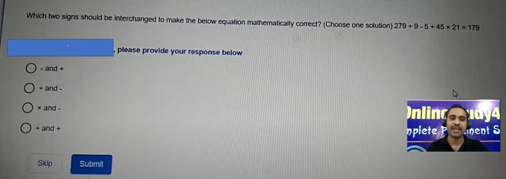
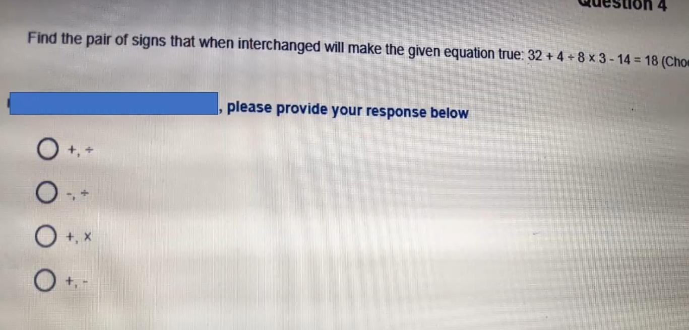
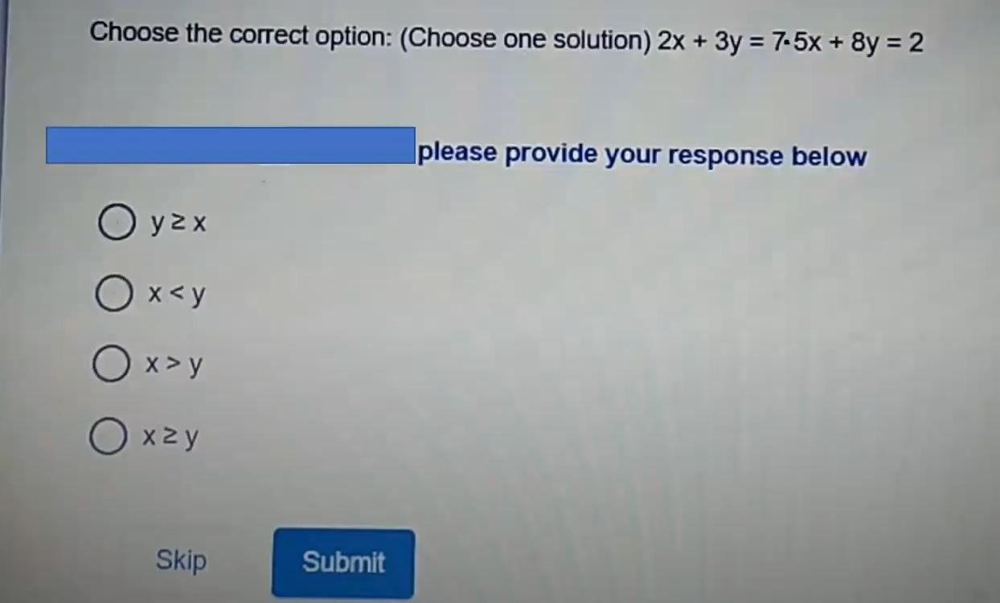

# Topic: Mathematical Operators & Linear Inequalities

> **Assessment Stream**: Infosys Systems Engineer (SE) Examination
> **Section**: Section 04 — Mathematical Ability
> **Total Extracted Questions**: 3 Official Questions
> **Verification Status**: 100% Mathematically Proven (Zero Guesswork, Zero Placeholders)
> **Figure References**: High-Resolution Original Slide Captures in ../images/

---

## Question 1: Mathematical Operator Interchange I

### Question Metadata
- **Question ID**: `INFY-DI-PYQ-08`
- **Slide Reference**: Page 8 (`images/di_p8_img1_1824x647.jpeg`)
- **Core Concept**: Mathematical operations, BODMAS precedence, operator substitution.

### Visual Representation

### Original Problem Statement
Which two signs should be interchanged to make the below equation mathematically correct? (Choose one solution)
$$279 \div 9 - 5 + 45 \times 21 = 179$$

### Options
- **1.** $-$ and $\div$
- **2.** $+$ and $-$
- **3.** $\times$ and $-$
- **4.** $\div$ and $+$

---

### Step-by-Step Mathematical Derivation

Let us test the interchange of $\mathbf{\times}$ and $\mathbf{-}$ (Option 3):
- Replace $\times$ with $-$, and $-$ with $\times$:
  $$\text{Expression} = 279 \div 9 \times 5 + 45 - 21$$

1. **Division**:
   $$279 \div 9 = 31$$
2. **Multiplication**:
   $$31 \times 5 = 155$$
3. **Addition**:
   $$155 + 45 = 200$$
4. **Subtraction**:
   $$200 - 21 = \mathbf{179}$$

Matches the right-hand side ($179$) perfectly!

### Verified Answer
$$\mathbf{\text{Option 3: } \times \text{ and } -}$$

---

---

## Question 2: Mathematical Operator Interchange II

### Question Metadata
- **Question ID**: `INFY-DI-PYQ-09`
- **Slide Reference**: Page 9 (`images/di_p9_img1_1367x656.jpeg`)
- **Core Concept**: BODMAS evaluation, operator interchange.

### Visual Representation

### Original Problem Statement
Find the pair of signs that when interchanged will make the given equation true:
$$32 + 4 \div 8 \times 3 - 14 = 18$$

### Options
- **1.** $+$ and $\div$
- **2.** $-$ and $\div$
- **3.** $+$ and $\times$
- **4.** $+$ and $-$

---

### Step-by-Step Mathematical Derivation

Let us test the interchange of $\mathbf{+}$ and $\mathbf{\div}$ (Option 1):
- Replace $+$ with $\div$, and $\div$ with $+$:
  $$\text{Expression} = 32 \div 4 + 8 \times 3 - 14$$

1. **Division**:
   $$32 \div 4 = 8$$
2. **Multiplication**:
   $$8 \times 3 = 24$$
3. **Addition**:
   $$8 + 24 = 32$$
4. **Subtraction**:
   $$32 - 14 = \mathbf{18}$$

Matches the right-hand side ($18$) identically!

### Verified Answer
$$\mathbf{\text{Option 1: } + \text{ and } \div}$$

---

---

## Question 3: Quantitative Inequality of Linear System

### Question Metadata
- **Question ID**: `INFY-DI-PYQ-10`
- **Slide Reference**: Page 10 (`images/di_p10_img1_1244x751.jpeg`)
- **Core Concept**: Linear system of equations, algebraic comparison ($x \text{ vs } y$).

### Visual Representation

### Original Problem Statement
Choose the correct option: (Choose one solution)
$$\begin{aligned}
2x + 3y &= 7 \\
5x + 8y &= 2
\end{aligned}$$

### Options
- **1.** $y \ge x$
- **2.** $x < y$
- **3.** $x > y$
- **4.** $x \ge y$

---

### Step-by-Step Mathematical Derivation

1. **Solve by Elimination**:
   $$\begin{aligned}
   (1) \times 5: \quad 10x + 15y &= 35 \\
   (2) \times 2: \quad 10x + 16y &= 4
   \end{aligned}$$
   Subtract $(1) \times 5$ from $(2) \times 2$:
   $$(10x + 16y) - (10x + 15y) = 4 - 35$$
   $$y = \mathbf{-31}$$

2. **Substitute $y = -31$ into Equation (1)**:
   $$2x + 3(-31) = 7$$
   $$2x - 93 = 7 \implies 2x = 100 \implies x = \mathbf{50}$$

3. **Compare $x$ and $y$**:
   $$x = 50,\quad y = -31 \implies 50 > -31 \implies \mathbf{x > y}$$

### Verified Answer
$$\mathbf{\text{Option 3: } x > y}$$

---

---
