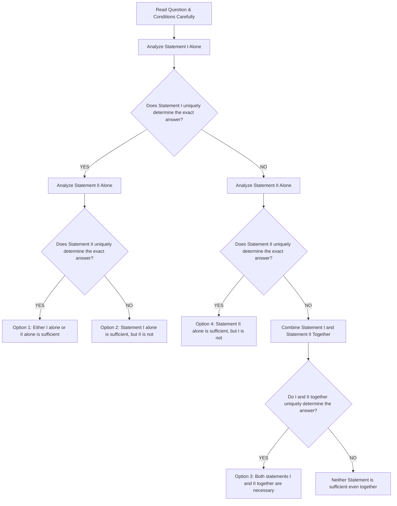

# Topic 00: Infosys Previous Questions — Master Formulas & Shortcut Cheatsheet

> **Document Type**: Comprehensive Theoretical & Computational Formula Sheet  
> **Target Sub-sections**: Pseudocode, Data Interpretation, Logical Reasoning, Numerical Ability  
> **Source Grounding**: Infosys Official Assessment Patterns & 100% Extracted Question Taxonomies  
> **Verification Status**: 100% Mathematically & Formally Rigorous  

---

## 📑 Table of Contents
1. [Bitwise Architecture & Operator Precedence (Pseudocode)](#1-bitwise-architecture--operator-precedence-pseudocode)
2. [Recurrence Relations & Stack Evaluation](#2-recurrence-relations--stack-evaluation)
3. [Language Specifications & Grammar Traps (C/C++)](#3-language-specifications--grammar-traps-cc)
4. [Data Interpretation & Ogive Calculus](#4-data-interpretation--ogive-calculus)
5. [Financial & Business Arithmetic Formulas](#5-financial--business-arithmetic-formulas)
6. [Constrained Combinatorics & Partitions](#6-constrained-combinatorics--partitions)
7. [Set Theory & 3-Set Venn Inclusion-Exclusion](#7-set-theory--3-set-venn-inclusion-exclusion)
8. [Number Series & Finite Difference Calculus](#8-number-series--finite-difference-calculus)
9. [Mathematical Matrix & Grid Pattern Taxonomies](#9-mathematical-matrix--grid-pattern-taxonomies)
10. [Data Sufficiency Strategic Decision Tree](#10-data-sufficiency-strategic-decision-tree)

---

## 1. Bitwise Architecture & Operator Precedence (Pseudocode)

### Bitwise Operator Truth Table
For two bits $x, y \in \{0, 1\}$:

| $x$ | $y$ | $x \ \& \ y$ (AND) | $x \mid y$ (OR) | $x \oplus y$ (XOR `^`) | $\sim x$ (1's Complement) |
| :---: | :---: | :---: | :---: | :---: | :---: |
| $0$ | $0$ | $0$ | $0$ | $0$ | $1$ |
| $0$ | $1$ | $0$ | $1$ | $1$ | $1$ |
| $1$ | $0$ | $0$ | $1$ | $1$ | $0$ |
| $1$ | $1$ | $1$ | $1$ | $0$ | $0$ |

### Fundamental Bitwise Theorems
1. **Self-Inverse Law of XOR**:
   $$x \oplus x = 0,\quad x \oplus 0 = x,\quad x \oplus y = y \oplus x$$
2. **Bitwise Arithmetic Identity**:
   $$x + y = (x \oplus y) + 2(x \ \& \ y)$$
3. **Infosys Shortcut**:
   $$6 \oplus 5 = (0110_2 \oplus 0101_2) = 0011_2 = 3$$
   $$4 \ \& \ 2 = (0100_2 \ \& \ 0010_2) = 0000_2 = 0$$

### Operator Precedence Hierarchy (Highest to Lowest)
1. Parentheses `()`
2. Postfix `++`, `--`
3. Prefix `++`, `--`, Unary `+`, `-`, Bitwise NOT `~`, Logical NOT `!`
4. Multiplicative `*`, `/`, `%`
5. Additive `+`, `-`
6. Bitwise Shifts `<<`, `>>`
7. Relational `<`, `<=`, `>`, `>=`
8. Equality `==`, `!=`
9. Bitwise AND `&`
10. Bitwise XOR `^`
11. Bitwise OR `|`
12. Logical AND `&&`
13. Logical OR `||`
14. Conditional / Ternary `? :`
15. Assignment `=`, `+=`, `-=`, etc.

---

## 2. Recurrence Relations & Stack Evaluation

### 1. Classical Fibonacci Sequence
- **Recurrence**:
  $$F(0) = 0,\quad F(1) = 1,\quad F(n) = F(n-1) + F(n-2) \quad (n \ge 2)$$
- **Closed-Form Binet Formula**:
  $$F(n) = \frac{\phi^n - \psi^n}{\sqrt{5}}, \quad \phi = \frac{1 + \sqrt{5}}{2} \approx 1.6180339887$$
- **Precomputed Reference Values**:
  $$\begin{array}{c|c|c|c|c|c|c|c|c|c|c|c}
  n & 0 & 1 & 2 & 3 & 4 & 5 & 6 & 7 & 8 & 9 & 10 \\ \hline
  F(n) & 0 & 1 & 1 & 2 & 3 & 5 & 8 & 13 & \mathbf{21} & 34 & 55
  \end{array}$$

### 2. Peano Multiplication by Successive Addition
- **Recurrence**:
  $$\text{fun}(1, y) = y,\quad \text{fun}(x, y) = y + \text{fun}(x-1, y) \implies \text{fun}(x, y) = x \cdot y$$
- For $x=9, y=9 \implies \text{fun}(9, 9) = 9 \times 9 = 81$.

### 3. Nested Modular Recursion Invariant
- For $\text{fun}(n)$ where even $n$ calls $\text{fun}(\text{fun}(n-1))$ and base cases return $n$ for $n \in \{0, 1\}$:
  $$\text{fun}(2) = \text{fun}(\text{fun}(1)) = \text{fun}(1) = 1$$

---

## 3. Language Specifications & Grammar Traps (C/C++)

### Ternary Conditional Expression Rule (ISO/IEC 9899:2011 §6.5.15)
- **Grammar Specification**:
  $$\text{conditional-expression} : \text{logical-OR-expression } ? \text{ expression } : \text{ conditional-expression}$$
- **Grammatical Trap**:
  - `return <expr>;` is a **jump statement** (`§6.8.6.4`), **NOT** an expression.
  - An expression operand of `?:` cannot contain a statement.
  - Syntax `x > y ? printf("%d", x) : (return z);` is **illegal** and yields:
    `error: expected expression before 'return'` (Compilation Error).

---

## 4. Data Interpretation & Ogive Calculus

### 1. Cumulative Frequency (Less-Than Ogive)
- Let $F(x)$ denote the cumulative frequency up to mark $x$:
  $$F(x) = \sum_{t \le x} f(t)$$
- **Passing Proportion Rule**:
  If passing mark is $M$, passing proportion is:
  $$\text{Proportion Passed} = \frac{N - F(M - 1)}{N}$$
  - For $N = 50$, passing mark $60\% \implies M = 30$.
  - Given $F(29) = 33$:
    $$\text{Passed} = 50 - 33 = 17 \implies \text{Proportion} = \frac{17}{50} = \mathbf{34\%}$$

### 2. Percentage Less Than Relative Base
$$\text{Percentage Less} = \frac{\text{Base Value} - \text{Compared Value}}{\text{Base Value}} \times 100$$
- E.g., Dealer Y in 2019 ($239$) vs Dealer U in 2021 ($278$):
  $$\frac{278 - 239}{278} \times 100 = \frac{39}{278} \times 100 \approx 14.03\% \approx \mathbf{14\%}$$

---

## 5. Financial & Business Arithmetic Formulas

### 1. Industrial Profit and Loss on Turnover
In corporate operations:
- **Income** ($I$) is Revenue / Turnover.
- **Expenditure** ($E$) is Operating Cost.
- **Profit** occurs when $I > E \implies \text{Profit}\% = \frac{I - E}{E} \times 100$.
- **Loss** occurs when $E > I \implies \text{Loss}\% = \frac{E - I}{E} \times 100$.

**Expenditure Derivation from Loss Percentage**:
$$\frac{E - I}{E} = \frac{\text{Loss}\%}{100} \implies 1 - \frac{I}{E} = L \implies \frac{I}{E} = 1 - L$$
$$\mathbf{E = \frac{I}{1 - L}}$$
- E.g., If Loss $= 25\%$ ($L = 0.25$) and Income $= 65\text{ lakhs}$:
  $$E = \frac{65}{1 - 0.25} = \frac{65}{0.75} = \frac{260}{3} = \mathbf{86.66\text{ lakhs}}$$

### 2. Multi-Partner Profit Sharing
If partners invest capitals $C_1, C_2, \dots, C_k$ for durations $T_1, T_2, \dots, T_k$:
$$\text{Profit Ratio} = C_1 T_1 : C_2 T_2 : \dots : C_k T_k$$
- Partner $i$'s share of Total Profit $P_{\text{total}}$:
  $$\text{Share}_i = \frac{C_i T_i}{\sum_{j=1}^k C_j T_j} \times P_{\text{total}}$$
- E.g., Investments $\$500 : \$700 : \$600 = 5 : 7 : 6$ (Sum $= 18$), Profit $= \$4,000$:
  $$\text{Pam's share} = \frac{7}{18} \times 4000 = \mathbf{\$1,555.56}$$

---

## 6. Constrained Combinatorics & Partitions

### Stars and Bars with Lower Bounds
Number of integer solutions to:
$$x_1 + x_2 + \dots + x_k = n \quad \text{subject to } x_i \ge b_i$$

**Transformation**:
Let $x_i' = x_i - b_i \ge 0$.
$$x_1' + x_2' + \dots + x_k' = n - \sum_{i=1}^k b_i = n'$$
Number of non-negative integer solutions:
$$\mathbf{N = \binom{n' + k - 1}{k - 1}}$$

- E.g., Distribute $6$ boxes among $4$ baskets ($A, B, C, D$) with $A \ge 1, B \ge 1, C \ge 0, D \ge 0$:
  $$n' = 6 - (1 + 1 + 0 + 0) = 4, \quad k = 4$$
  $$N = \binom{4 + 4 - 1}{4 - 1} = \binom{7}{3} = \frac{7 \times 6 \times 5}{3 \times 2 \times 1} = \mathbf{35\text{ ways}}$$

---

## 7. Set Theory & 3-Set Venn Inclusion-Exclusion

### 1. Principle of Inclusion-Exclusion (PIE) for 3 Sets
$$|A \cup B \cup C| = |A| + |B| + |C| - (|A \cap B| + |B \cap C| + |A \cap C|) + |A \cap B \cap C|$$

### 2. Partition of Set Space
Let:
- $s_1 = |A| + |B| + |C|$
- $s_2 = |A \cap B| + |B \cap C| + |A \cap C|$
- $s_3 = |A \cap B \cap C|$

Then:
1. **At least one**:
   $$|A \cup B \cup C| = s_1 - s_2 + s_3$$
2. **Exactly one**:
   $$\text{Exactly } 1 = s_1 - 2s_2 + 3s_3$$
3. **Exactly two**:
   $$\mathbf{\text{Exactly } 2 = s_2 - 3s_3}$$
   *(Equivalently: $(|A \cap B| - s_3) + (|B \cap C| - s_3) + (|A \cap C| - s_3)$)*
4. **All three**:
   $$\text{Exactly } 3 = s_3$$

- E.g., In picnic problem:
  $$|A \cup B \cup C| = 25 - 9 = 16,\quad s_1 = 10 + 7 + 6 = 23,\quad s_2 = 3 + 2 + 3 = 8$$
  $$16 = 23 - 8 + s_3 \implies s_3 = 1$$
  $$\text{Exactly } 2 = s_2 - 3s_3 = 8 - 3(1) = \mathbf{5}$$

---

## 8. Number Series & Finite Difference Calculus

### 1. Polynomial Sequence of Degree 3 ($n^3 + n^2 + n$)
- If the $k^{\text{th}}$ differences $\Delta^k$ are constant, the sequence is a polynomial of degree $k$:
  $$\Delta^3 T_n = \text{constant} \implies T_n = a n^3 + b n^2 + c n + d$$
- **Canonical Infosys Form**:
  $$T_n = n^3 + n^2 + n = n(n^2 + n + 1)$$
  $$\begin{array}{c|c|c|c|c|c|c|c}
  n & 1 & 2 & 3 & 4 & 5 & \mathbf{6} & 7 \\ \hline
  T_n & 3 & 14 & 39 & 84 & 155 & \mathbf{258} & 399
  \end{array}$$

### 2. Dual Interleaved Sequences
- Terms in odd and even positions obey distinct linear progressions:
  $$T_{2k-1} = T_{2k-3} + d_1, \quad T_{2k} = T_{2k-2} + d_2$$
- E.g., $15, 17, 23, 22, 31, \mathbf{27}, 39, 32$:
  - Odd: $15 \xrightarrow{+8} 23 \xrightarrow{+8} 31 \xrightarrow{+8} 39$
  - Even: $17 \xrightarrow{+5} 22 \xrightarrow{+5} \mathbf{27} \xrightarrow{+5} 32$

### 3. Iterative Digit Sum (Digital Root)
- Sum of digits function $S(n)$:
  $$S(280456) = 2 + 8 + 0 + 4 + 5 + 6 = \mathbf{25} \implies S(25) = 2 + 5 = \mathbf{7}$$
- In interleaved pairs: $T_{2k} = S(T_{2k-1})$:
  $$S(870) = 15,\quad S(263) = 11,\quad S(951) = 15,\quad S(1023) = 1+0+2+3 = \mathbf{6}$$

---

## 9. Mathematical Matrix & Grid Pattern Taxonomies

| Grid Architecture | Archetype Formula | Example from PYQ |
| :--- | :--- | :--- |
| **$2 \times 2$ Product Balance** | $R_1 \text{ product} = R_2 \text{ product}$ | $\text{Set 3: } 5 \times 8 = 40; ? \times 4 = 40 \implies ? = \mathbf{10}$ |
| **$2 \times 2$ Columnar Cube** | $C_2 = C_1^3$ | $2 \to 8, 3 \to 27, 4 \to 64, \mathbf{9 \to 729}$ |
| **$4 \times 3$ Product-Sum Column** | $(R_1 \times R_2) + R_3 = R_4$ | $(9 \times 6) + 4 = 54 + 4 = \mathbf{58}$ |
| **$4 \times 3$ Sum of Squares Column** | $\sum_{i=1}^3 R_i^2 = R_4$ | $4^2 + 6^2 + 5^2 = 16 + 36 + 25 = \mathbf{77}$ |
| **$3 \times 3$ Row Flank Balance** | $C_1 + C_3 = C_2$ | $12 + 13 = \mathbf{25}$ |

---

## 10. Data Sufficiency Strategic Decision Tree

### Golden Rules for Linear Ordering Sufficiency
1. In a strictly ordered line of length $N$ (e.g., $N=6$, positions $1$ to $6$):
2. If two individuals $S$ and $T$ satisfy $\text{pos}(T) - \text{pos}(S) = N - 1 = 5$, then $S$ MUST occupy position $1$ and $T$ MUST occupy position $6$.
3. When unique extremes are fixed by boundary conditions, position $6$ (the shortest) is uniquely determined without needing any intermediate values!
