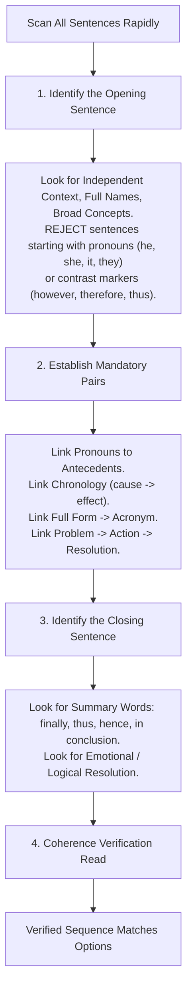

# Topic 00: Infosys Verbal Ability — Master Rules, Grammar Invariants & Shortcut Cheatsheet

> **Document Type**: Comprehensive Theoretical & Pedagogical Grammar Cheatsheet  
> **Target Sub-sections**: Spotting Errors, Sentence Correction, Para Jumbles, Active/Passive Voice, Direct/Indirect Speech, Critical Reasoning, Written Ability Test (WAT)  
> **Source Grounding**: Infosys Mock Test Series, Official Exam Patterns, Official Strategy Guide (Pages 44–47)  
> **Verification Status**: 100% Linguistically Rigorous (CEFR C1/C2 Grammar Standards)  

---

## 📑 Table of Contents
1. [The 12 Golden Rules of Subject-Verb Agreement](#1-the-12-golden-rules-of-subject-verb-agreement)
2. [The 4 Conditional Sentence Architectures](#2-the-4-conditional-sentence-architectures)
3. [The Latin Comparatives Law](#3-the-latin-comparatives-law)
4. [Master Table of Fixed Prepositions & Collocations](#4-master-table-of-fixed-prepositions--collocations)
5. [Active to Passive Voice Tense Transformation Grid](#5-active-to-passive-voice-tense-transformation-grid)
6. [Direct to Indirect Speech Backshift Matrix](#6-direct-to-indirect-speech-backshift-matrix)
7. [Para Jumble Algorithmic Solver (Official Strategy)](#7-para-jumble-algorithmic-solver-official-strategy)
8. [High-Frequency Vocabulary, Roots & One-Word Substitutions](#8-high-frequency-vocabulary-roots--one-word-substitutions)
9. [Critical Reasoning Decision Matrix](#9-critical-reasoning-decision-matrix)
10. [Infosys Written Ability Test (WAT) Essay Architecture](#10-infosys-written-ability-test-wat-essay-architecture)

---

## 1. The 12 Golden Rules of Subject-Verb Agreement

### Rule 1: Distributive Pronouns are Strictly Singular
- **Pronouns**: *Each, Every, Everyone, Someone, Anyone, No one, Nobody, Somebody, Anybody, Either, Neither*.
- When followed by a plural prepositional phrase (`Each of + [Plural Noun]`), the grammatical head remains **singular**:
  $$\mathbf{\text{Each / Every one / Neither of}} + [\text{Plural Noun}] + \mathbf{\text{Singular Verb}}$$
- *Examples*:
  - *Each of the players **is** given a certificate.* (Not *are*)
  - *Neither of the two brothers **has** arrived.* (Not *have*)
  - *Every one of the students **is** going on the trip.* (Not *are*)

### Rule 2: Parenthetical Intervening Phrases Do Not Compound Subjects
- When a subject is joined with another noun using:
  - *as well as, along with, together with, with, in addition to, accompanied by, including, except, rather than*
- The verb agrees **strictly with the first subject**:
  - *She, as well as her friends, **is** invited.* (Subject = *She* $\implies$ Singular)
  - *The report, along with the documents, **was** submitted.* (Subject = *The report* $\implies$ Singular)
  - *The teachers, together with the principal, **were** present.* (Subject = *The teachers* $\implies$ Plural)

### Rule 3: Correlative Conjunctions & The Proximity Principle
- With *Neither... nor*, *Either... or*, *Not only... but also*:
- The verb agrees in number and person with the **nearest subject**:
  - *Neither the teacher nor the students **were** present.* (Nearest subject = *the students* $\implies$ Plural)
  - *Neither the students nor the teacher **was** present.* (Nearest subject = *the teacher* $\implies$ Singular)

### Rule 4: Invariable Plural Collective Nouns
- Certain collective nouns look singular but are **invariably plural**:
  - *The police, cattle, clergy, gentry, poultry, folk, vermin, people*.
  - *The police **have** arrested the thief.* (NEVER *The police has*)
  - *The cattle **are** grazing in the meadow.*

### Rule 5: Unitary vs. Divided Collective Assemblies
- Nouns like *committee, jury, team, board, audience, family, council*:
  - If acting unanimously as a single entity $\implies$ **Singular Verb**:
    - *The committee **has** reached a decision.*
  - If members are divided in opinion or acting individually $\implies$ **Plural Verb**:
    - *The committee **were** divided in their opinions.*

### Rule 6: Plural in Form, Singular in Meaning
- Names of sciences, academic subjects, diseases, games, and titles:
  - *Mathematics, Physics, Economics, Ethics, Politics, News, Innings, Measles, Rickets, Billiards, Gulliver's Travels*.
  - *Mathematics **is** an intriguing subject.* (Not *are*)
  - *No news **is** good news.*

### Rule 7: Compound Expressions Expressing a Single Idea
- When two nouns connected by *and* express a unified concept:
  - *Bread and butter, Slow and steady, Time and tide, Rice and curry, Horse and carriage*.
  - *Bread and butter **is** his staple diet.*
  - *Slow and steady **wins** the race.*

### Rule 8: The Construction "One of the + Plural Noun + Singular Verb"
- Selection of one from many:
  - *One of the students **is** absent today.*
  - *Singapore is blessed with one of the finest natural **harbors**.* (Noun is plural)
- **Relative Clause Exception**:
  - *He is one of those men who **are** always ready to help.* (The antecedent of *who* is *men* $\implies$ Plural verb).
  - *He is the **only one** of those men who **is** ready to help.* (Restricted by *only one* $\implies$ Singular verb).

### Rule 9: Fractions and Percentages
- *Half of, Some of, Most of, Two-thirds of, A percentage of*:
  - Verb agrees with the noun following *of*:
    - *Two-thirds of the book **has** been read.* (Uncountable/Singular)
    - *Two-thirds of the students **have** passed.* (Plural countable)

### Rule 10: "A Number of" vs. "The Number of"
- **`A number of`** = Many / Several $\implies$ **Plural Verb**:
  - *A number of students **have** arrived.*
- **`The number of`** = A specific numerical figure $\implies$ **Singular Verb**:
  - *The number of students in the class **is** forty.*

### Rule 11: Quantifiers with Countable vs. Uncountable Nouns
- **`Few / A few / The few`** $\to$ Plural Countable Nouns:
  - *for a few minutes* (Not *for a few minute*).
- **`Little / A little / The little`** $\to$ Singular Uncountable Nouns:
  - *a little water*, *a little milk*.

### Rule 12: Expressions of Time, Money, Distance, Weight as a Whole
- When considered as a single collective aggregate amount:
  - *Ten miles **is** a long distance to walk.*
  - *Five thousand dollars **is** a huge sum.*
  - *Two hours **is** sufficient time for the test.*

---

## 2. The 4 Conditional Sentence Architectures

| Conditional Type | If-Clause Tense | Main Clause Verb Construction | Contextual Function | PYQ Archetype |
| :--- | :--- | :--- | :--- | :--- |
| **Zero Conditional** | Simple Present ($V_1$) | Simple Present ($V_1$) | Universal / Scientific Truths | *If water boils, it turns to steam.* |
| **First Conditional** | Simple Present ($V_1$) | $\text{will / can / may} + V_1$ | Realistic Future Possibility | *If it rains, we will cancel the match.* |
| **Second Conditional** | Simple Past ($V_2$ / *were*) | $\text{would / could / might} + V_1$ | Hypothetical / Imaginary Present | *If I were rich, I would travel the world.* |
| **Third Conditional** | Past Perfect ($\text{had} + V_3$) | $\mathbf{\text{would have}} + V_3$ | Unfulfilled Past / Past Regret | *If I had studied harder, I would have passed.* |

---

## 3. The Latin Comparatives Law

Adjectives ending in `-ior` borrowed from Latin comparative forms do NOT follow standard Germanic comparative patterns:
1. They cannot be modified by *more* (redundant comparative).
2. They are **strictly followed by `to`**, NEVER by `than`.

$$\mathbf{\text{Senior / Junior / Superior / Inferior / Prior / Anterior / Posterior}} + \mathbf{\text{to}} \quad (\text{NEVER } \mathbf{\text{than}})$$

- *Incorrect*: *She is senior than me by two years.*
- *Correct*: **She is senior to me by two years.**
- *Incorrect*: *He is junior than me in service.*
- *Correct*: **He is junior to me in service.**
- *Incorrect*: *This fabric is superior than that.*
- *Correct*: **This fabric is superior to that.**

### The Law of "Prefer"
$$\text{Subject} + \mathbf{\text{prefer}} + \text{Noun}_1 / V\text{-ing} + \mathbf{\text{to}} + \text{Noun}_2 / V\text{-ing}$$
- *Incorrect*: *She prefers tea than / over coffee.*
- *Correct*: **She prefers tea to coffee.**

---

## 4. Master Table of Fixed Prepositions & Collocations

| Verb / Adjective | Fixed Preposition | Meaning & Complementation | Exam Trap / Incorrect Usage |
| :--- | :---: | :--- | :--- |
| **Insist** | **`on`** | To demand forcefully: *insist on doing* | *insist to do / insist for doing* ❌ |
| **Good / Bad** | **`at`** | Proficiency in a skill: *good at dancing* | *good in dancing* ❌ |
| **Interested** | **`in`** | Curiosity/engagement: *interested in music* | *interested with / interested to* ❌ |
| **Married** | **`to`** | Spousal relationship: *married to a doctor* | *married with a doctor* ❌ |
| **Come into** | **`effect`** | To become operative: *come into effect* | *come in effect / come to effect* ❌ |
| **Call upon** | **`on / upon`** | Formal civic appeal: *called upon citizens* | *called out citizens* ❌ |
| **Abide** | **`by`** | To obey rules: *abide by the regulations* | *abide with the rules* ❌ |
| **Refrain / Abstain**| **`from`** | To avoid an action: *refrain from smoking* | *refrain to smoke* ❌ |
| **Congratulate** | **`on`** | Praising achievement: *congratulate on success* | *congratulate for success* ❌ |
| **Accused** | **`of`** | Charged with crime: *accused of theft* | *accused for theft* ❌ |
| **Differ** | **`with / from`** | Differ *from* a thing; differ *with* a person | *differ than* ❌ |
| **Look forward** | **`to (+ V-ing)`** | Anticipating: *look forward to meeting you* | *look forward to meet you* ❌ |

---

## 5. Active to Passive Voice Tense Transformation Grid

$$\text{Active Formula}: \text{Subject} + \text{Verb} + \text{Object} \implies \text{Passive Formula}: \text{Object} + [\text{Auxiliary Be}] + \mathbf{V_3} + [\text{by Subject}]$$

| Tense Category | Active Voice Structure | Passive Voice Structure | PYQ Demonstration |
| :--- | :--- | :--- | :--- |
| **Simple Present** | $S + V_1(s/es) + O$ | $O + \text{is/am/are} + V_3$ | *They paint walls $\to$ Walls are painted.* |
| **Present Continuous** | $S + \text{is/am/are} + V\text{-ing} + O$ | $O + \text{is/am/are} + \mathbf{being} + V_3$ | *They are painting the walls $\to$ The walls are being painted.* |
| **Present Perfect** | $S + \text{has/have} + V_3 + O$ | $O + \text{has/have} + \mathbf{been} + V_3$ | *They have painted walls $\to$ Walls have been painted.* |
| **Simple Past** | $S + V_2 + O$ | $O + \text{was/were} + V_3$ | *They painted walls $\to$ Walls were painted.* |
| **Past Continuous** | $S + \text{was/were} + V\text{-ing} + O$ | $O + \text{was/were} + \mathbf{being} + V_3$ | *They were painting $\to$ Walls were being painted.* |
| **Past Perfect** | $S + \text{had} + V_3 + O$ | $O + \text{had} + \mathbf{been} + V_3$ | *They had painted $\to$ Walls had been painted.* |
| **Simple Future** | $S + \text{will/shall} + V_1 + O$ | $O + \text{will/shall} + \mathbf{be} + V_3$ | *They will paint $\to$ Walls will be painted.* |
| **Modals** | $S + \text{Modal} + V_1 + O$ | $O + \text{Modal} + \mathbf{be} + V_3$ | *They can solve it $\to$ It can be solved.* |

---

## 6. Direct to Indirect Speech Backshift Matrix

### When Reporting Verb is in the Past Tense (*said, told, stated*):
1. **Tense Backshifts**:
   - Simple Present ($V_1$) $\longrightarrow$ **Simple Past ($V_2$)**
   - Present Continuous ($\text{is/am/are} + V\text{-ing}$) $\longrightarrow$ **Past Continuous ($\text{was/were} + V\text{-ing}$)**
   - Present Perfect ($\text{has/have} + V_3$) $\longrightarrow$ **Past Perfect ($\text{had} + V_3$)**
   - Simple Past ($V_2$) $\longrightarrow$ **Past Perfect ($\text{had} + V_3$)**
   - Past Continuous ($\text{was/were} + V\text{-ing}$) $\longrightarrow$ **Past Perfect Continuous ($\text{had been} + V\text{-ing}$)**
2. **Modal Auxiliary Shifts**:
   - $\text{will} \longrightarrow \mathbf{\text{would}}$
   - $\text{can} \longrightarrow \mathbf{\text{could}}$
   - $\text{may} \longrightarrow \mathbf{\text{might}}$
   - $\text{shall} \longrightarrow \mathbf{\text{should / would}}$
3. **Deictic Time and Place Shifts**:

| Direct Speech Term | Indirect Speech Transformation |
| :--- | :--- |
| **tomorrow** | **the next day / the following day** |
| **yesterday** | **the day before / the previous day** |
| **today** | **that day** |
| **tonight** | **that night** |
| **now** | **then** |
| **this / these** | **that / those** |
| **here** | **there** |
| **ago** | **before** |

- *Direct*: *He said, “I will call you tomorrow.”*
- *Indirect*: **He said that he would call me the next day.**

---

## 7. Para Jumble Algorithmic Solver (Official Strategy)



### The 4 Mandatory Pairing Rules:
1. **Noun-to-Pronoun Bridge**: A sentence naming an entity (*Daniel, Ramesh, The farmer*) must precede a sentence referring to them by pronoun (*He, him, his*).
2. **General to Specific**: A general concept (*Sustainable development*) precedes specific technical details (*The three pillars*).
3. **Chronological Event Ordering**: Action 1 (*loaded the cart*) $\to$ Action 2 (*went to the market*) $\to$ Action 3 (*negotiated price*) $\to$ Action 4 (*pleased with earnings*).
4. **Discourse Connectors**: *On the one hand... On the other hand*; *First... Secondly... Finally*; *Because of this... Therefore*.

---

## 8. High-Frequency Vocabulary, Roots & One-Word Substitutions

### Core PYQ Vocabulary Disambiguation Table

| Word | Part of Speech | Etymological Root | Synonym | Antonym | Contextual Sentence |
| :--- | :---: | :--- | :--- | :--- | :--- |
| **Relinquish** | Verb | Latin *relinquere* (to leave behind) | Renounce, Yield, Surrender | **Possess, Retain, Claim** | *He relinquished his rights to the estate.* |
| **Meticulous** | Adjective | Latin *meticulosus* (fearful/timid) | Diligent, Precise, Scrupulous | **Slovenly, Slipshod, Careless** | *Her research was meticulous in every detail.* |
| **Audacity** | Noun | Latin *audacia* (boldness) | **Boldness, Daring, Temerity** | Timidity, Cowardice, Fear | *He had the audacity to question the verdict.* |
| **Polyglot** | Noun | Greek *polu-* (many) + *glōtta* (tongue) | Multilingual speaker | Monoglot | *The diplomat was a renowned polyglot.* |
| **Extempore** | Adjective/Adv | Latin *ex tempore* (out of time) | Impromptu, Spontaneous, Unrehearsed | Prepared, Rehearsed, Scripted | *She delivered an extempore address.* |
| **Imposter** | Noun | Latin *imponere* (to deceive/impose) | Charlatan, Fraud, Pretender | Authentic expert, Scholar | *The medical imposter was exposed.* |

### Confusable Word Pairs
- **Affect vs. Effect**:
  - `Affect` (Verb): *The cold weather **affects** my joints.*
  - `Effect` (Noun): *The medicine had an immediate **effect**.*
- **It's vs. Its**:
  - `It's` = Contraction of *It is / It has*: *It's raining outside.*
  - `Its` = Possessive Determiner: *The dog wagged its tail.*

---

## 9. Critical Reasoning Decision Matrix

```text
┌────────────────────────────────────────────────────────────────────────────────┐
│                       CRITICAL REASONING TAXONOMY                              │
├───────────────────┬──────────────────────────────────┬─────────────────────────┤
│ QUESTION TYPE     │ DEFINITION & NATURE              │ GOLDEN RULE             │
├───────────────────┼──────────────────────────────────┼─────────────────────────┤
│ INFERENCE         │ What MUST be true strictly based │ Never assume outside    │
│                   │ on the facts stated in the text. │ facts. Avoid extreme    │
│                   │ Conservative, factual deduction. │ words (only, always).   │
├───────────────────┼──────────────────────────────────┼─────────────────────────┤
│ ASSUMPTION        │ The unstated bridge between the  │ Negation Test: If you   │
│                   │ premises and the conclusion.     │ negate the assumption,  │
│                   │ Taken for granted by speaker.    │ the argument collapses. │
├───────────────────┼──────────────────────────────────┼─────────────────────────┤
│ COURSE OF ACTION  │ A pragmatic, realistic step to   │ Must solve problem      │
│                   │ solve the problem stated.        │ without causing a       │
│                   │ Feasible and proportional.       │ worse secondary crisis. │
└───────────────────┴──────────────────────────────────┴─────────────────────────┘
```

---

## 10. Infosys Written Ability Test (WAT) Essay Architecture

### Target Specs: 150–200 Words in 15–20 Minutes

```text
┌────────────────────────────────────────────────────────────────────────┐
│               FOUR-PARAGRAPH WAT ESSAY STRUCTURE TEMPLATE              │
├───────────────────┬───────────────┬────────────────────────────────────┤
│ PARAGRAPH         │ TARGET WORDS  │ CORE FUNCTION                      │
├───────────────────┼───────────────┼────────────────────────────────────┤
│ 1. Introduction   │ 35–45 Words   │ Thesis statement + Formal def.     │
│ 2. Primary Body   │ 60–70 Words   │ Core benefits, impact & evidence.  │
│ 3. Counterbalance │ 40–50 Words   │ Challenges, ethics & prerequisites.│
│ 4. Conclusion     │ 30–40 Words   │ Synthesis & forward-looking vision.│
└───────────────────┴───────────────┴────────────────────────────────────┘
```

### 5 Critical Scoring Checklist Items:
1. **Word Count Compliance**: Stay strictly between $150$ and $200$ words ($180\text{–}190$ is the sweet spot).
2. **Zero Informalisms**: Avoid contractions (*don't*, *can't*), slang, and colloquial phrases.
3. **Complex Sentence Variety**: Use subordinate clauses (*Although, Whereas, Furthermore, Inasmuch as*).
4. **Strong Connectors**: Employ cohesive transitions (*Consequently, In contrast, Simultaneously, Ultimately*).
5. **No Unsupported Emotional Bias**: Maintain an analytical, objective corporate tone.
