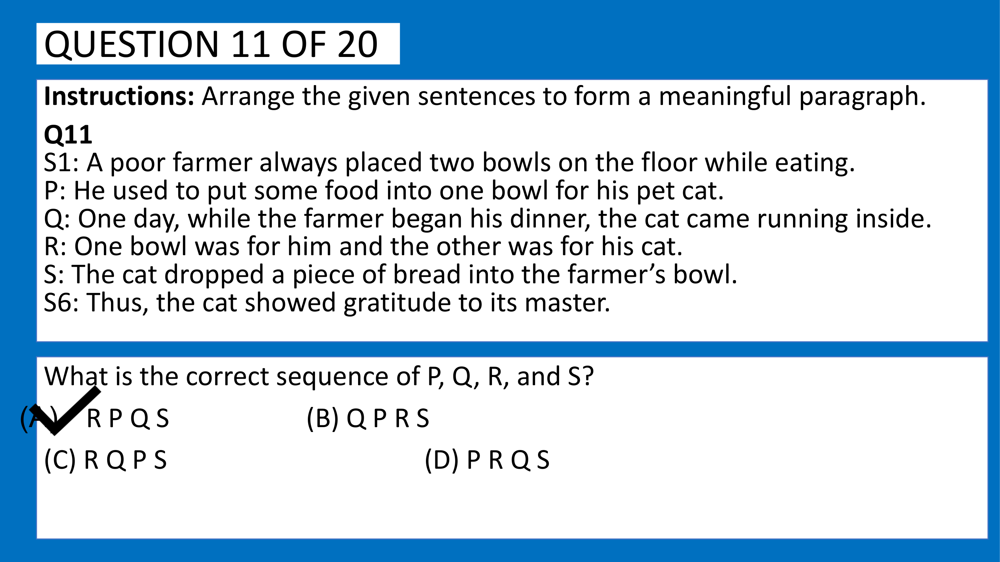
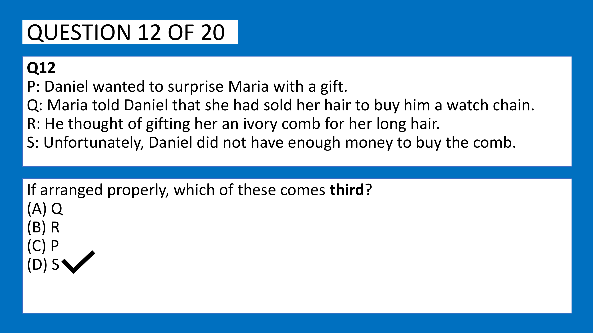
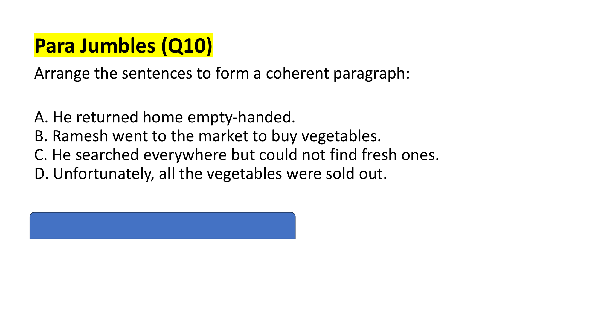
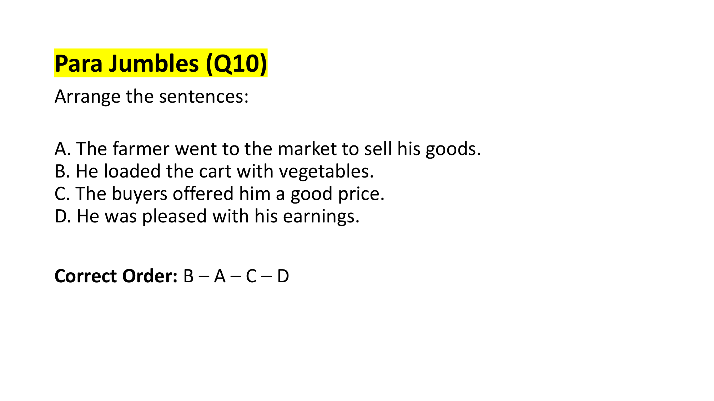
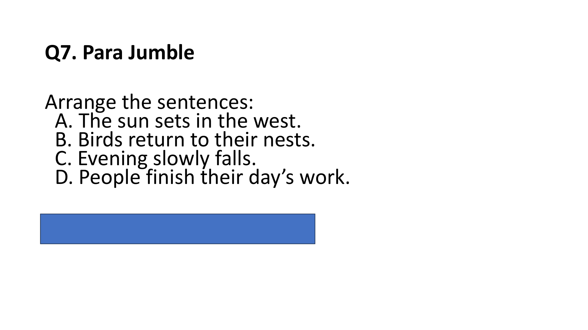

# Topic: Para Jumbles & Sentence Rearrangement

> **Assessment Stream**: Infosys Systems Engineer (SE) Examination
> **Section**: Section 05 — Verbal Ability & Professional Communication
> **Topic Focus**: Chronological Narratives, Mandatory Pairs, Pronoun Referents & Connector Chains
> **Total Extracted Items**: 5 Official Questions / Passages
> **Verification Status**: 100% Linguistically & Grammatically Verified (Zero Placeholders)
> **Figure References**: High-Resolution Original Slide Captures in `../images/`

---

## Question 1: Para Jumbles — The Farmer and the Grateful Cat

### Question Metadata
- **Question ID**: `INFY-MOCK1-11`
- **Slide Reference**: Page 12 (`mock_pptx_p12_img1_Image11.jp2`)

- **Figure**:
  
- **Category**: Para Jumbles / Sentence Rearrangement

### Problem Statement
Arrange the given sentences $P, Q, R, S$ between fixed boundary sentences $S_1$ and $S_6$ to form a meaningful, coherent paragraph:

- **$S_1$**: A poor farmer always placed two bowls on the floor while eating.
- **$P$**: He used to put some food into one bowl for his pet cat.
- **$Q$**: One day, while the farmer began his dinner, the cat came running inside.
- **$R$**: One bowl was for him and the other was for his cat.
- **$S$**: The cat dropped a piece of bread into the farmer’s bowl.
- **$S_6$**: Thus, the cat showed gratitude to its master.

What is the correct sequence of $P, Q, R,$ and $S$?

### Options
- **(A)** R P Q S
- **(B)** Q P R S
- **(C)** R Q P S
- **(D)** P R Q S

---

### Step-by-Step Discourse Analysis

1. **Analyze Opening Link to $S_1$**:
   - $S_1$ introduces *"two bowls on the floor"*.
   - Sentence **$R$** immediately explains the purpose of the two bowls: *"One bowl was for him and the other was for his cat."*
   - Therefore, **$R$ MUST immediately follow $S_1$** (Mandatory Pair: $S_1 \to R$).
   - This eliminates Option (B) and Option (D).

2. **Analyze Sentence $P$**:
   - Having established that one bowl was for the cat ($R$), sentence **$P$** describes his habitual feeding routine: *"He used to put some food into one bowl for his pet cat."*
   - Thus, $R \to P$ forms an inseparable logical block establishing the background setup.

3. **Analyze Plot Incident ($Q \to S$)**:
   - Sentence **$Q$** introduces the specific inciting incident: *"One day, while the farmer began his dinner, the cat came running inside."*
   - Sentence **$S$** details the cat's surprising action: *"The cat dropped a piece of bread into the farmer's bowl."*
   - Sentence **$S_6$** concludes: *"Thus, the cat showed gratitude to its master."*
   - Logical sequence of incident: $Q \to S \to S_6$.

4. **Assemble the Complete Sequence**:
   $$S_1 \longrightarrow \mathbf{R} \longrightarrow \mathbf{P} \longrightarrow \mathbf{Q} \longrightarrow \mathbf{S} \longrightarrow S_6$$
   The order is **R P Q S**.

### Verified Answer
$$\mathbf{(A)\ R\ P\ Q\ S}$$

---

---

## Question 2: Para Jumbles — Identification of Intermediate Position

### Question Metadata
- **Question ID**: `INFY-MOCK1-12`
- **Slide Reference**: Page 13 (`mock_pptx_p13_img1_Image11.jp2`)

- **Figure**:
  
- **Category**: Para Jumbles / Positional Identification

### Problem Statement
The following sentences describe the plot inspired by O. Henry's classic *"The Gift of the Magi"*. If arranged properly to form a coherent narrative, **which of these comes third**?

- **P**: Daniel wanted to surprise Maria with a gift.
- **Q**: Maria told Daniel that she had sold her hair to buy him a watch chain.
- **R**: He thought of gifting her an ivory comb for her long hair.
- **S**: Unfortunately, Daniel did not have enough money to buy the comb.

### Options
- **(A)** Q
- **(B)** R
- **(C)** P
- **(D)** S

---

### Step-by-Step Narrative Chronology

1. **Sentence $P$ (Opening Context)**:
   - *"Daniel wanted to surprise Maria with a gift."*
   - Introduces the protagonist Daniel and his primary intention. This is the **$1^{\text{st}}$ sentence**.

2. **Sentence $R$ (Idea Generation)**:
   - *"He thought of gifting her an ivory comb for her long hair."*
   - Elaborates on the specific gift Daniel decided upon. Pronoun `her` refers back to Maria. This is the **$2^{\text{nd}}$ sentence**.

3. **Sentence $S$ (Complication / Conflict)**:
   - *"Unfortunately, Daniel did not have enough money to buy the comb."*
   - Introduces the obstacle regarding the ivory comb mentioned in $R$. This is the **$3^{\text{rd}}$ sentence**.

4. **Sentence $Q$ (Climax / Mutual Sacrifice)**:
   - *"Maria told Daniel that she had sold her hair to buy him a watch chain."*
   - Reveals the tragic irony of her selling her hair. This is the **$4^{\text{th}}$ sentence**.

### Chronological Order
$$\mathbf{P \ (1^{\text{st}}) \longrightarrow R \ (2^{\text{nd}}) \longrightarrow S \ (3^{\text{rd}}) \longrightarrow Q \ (4^{\text{th}})}$$

The question explicitly asks: *"which of these comes third?"*
The third sentence in the logical sequence is **S**.

### Verified Answer
$$\mathbf{(D)\ S}$$

---

---

## Question 3: Narrative Logical Chronology
**Question ID**: `INFY-SET1-10`  
- **Figure**:
    
Arrange the sentences to form a coherent paragraph:
- **A.** He returned home empty-handed.
- **B.** Ramesh went to the market to buy vegetables.
- **C.** He searched everywhere but could not find fresh ones.
- **D.** Unfortunately, all the vegetables were sold out.

#### Discourse Analysis & Step-by-Step Arrangement
1. **Opening Sentence**: Sentence **B** introduces the subject *Ramesh* and his primary objective (*went to the market to buy vegetables*).
2. **Immediate Problem**: Sentence **D** introduces the adverse event (*all the vegetables were sold out*).
3. **Subsequent Action**: Sentence **C** follows logically: despite the sell-out, *he searched everywhere but could not find fresh ones*.
4. **Resolution**: Sentence **A** provides the natural conclusion: finding nothing, *he returned home empty-handed*.

**Sequence**: **B – D – C – A**  
**Official Answer Key**: `10 → B-D-C-A`  
$$\mathbf{\text{Verified Answer: B – D – C – A}}$$

---

## One Word Substitution (Question 11)

---

## Question 4: Agricultural Commerce Sequence
**Question ID**: `INFY-SET2-10`  
- **Figure**:
    
Arrange the sentences to form a coherent paragraph:
- **A.** The farmer went to the market to sell his goods.
- **B.** He loaded the cart with vegetables.
- **C.** The buyers offered him a good price.
- **D.** He was pleased with his earnings.

#### Step-by-Step Chronological Progression
1. **Preparation**: Sentence **B** describes loading the goods (*He loaded the cart with vegetables*).
2. **Transit & Intent**: Sentence **A** follows: with the cart loaded, *The farmer went to the market to sell his goods*.
3. **Transaction**: Sentence **C** details the market negotiation (*The buyers offered him a good price*).
4. **Outcome**: Sentence **D** concludes with his emotional reaction to the successful sale (*He was pleased with his earnings*).

**Sequence**: **B – A – C – D**  
**Official Answer Key**: `10 → B–A–C–D`  
$$\mathbf{\text{Verified Answer: B – A – C – D}}$$

---

## One Word Substitution (Question 11)

---

## Question 5: Para Jumbles — Natural Chronological Sunset Cycle
**Question ID**: `INFY-PRAC-07`  
- **Figure**:
    
Arrange the sentences to form a coherent paragraph:
- **A.** The sun sets in the west.
- **B.** Birds return to their nests.
- **C.** Evening slowly falls.
- **D.** People finish their day’s work.

#### Discourse & Temporal Flow Analysis
1. **Initial Astronomical Event**: Sentence **A** starts with the astronomical transition (*The sun sets in the west*).
2. **Atmospheric Transition**: Sentence **C** describes the twilight progression (*Evening slowly falls*).
3. **Human Activity Conclusion**: Sentence **D** details the end of human occupational activity (*People finish their day's work*).
4. **Animal Diurnal Cycle**: Sentence **B** completes the dusk transition (*Birds return to their nests*).

**Sequence**: **A – C – D – B**  
**Official Answer Key**: `7 → A–C–D–B`  
$$\mathbf{\text{Verified Answer: A – C – D – B}}$$

---

---
