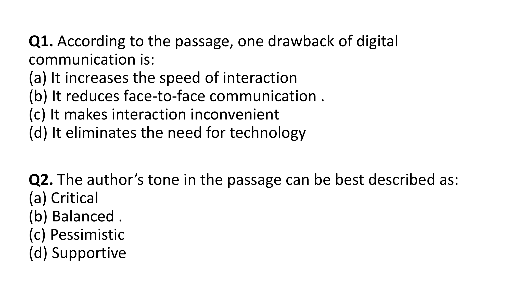
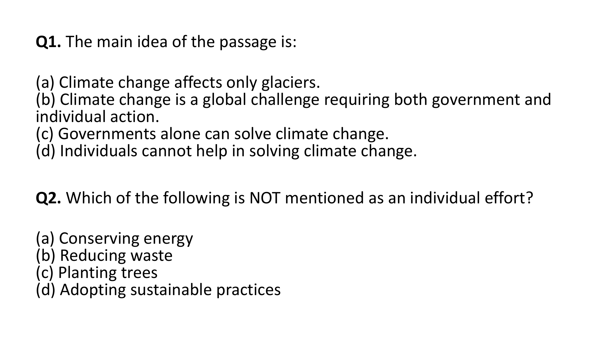
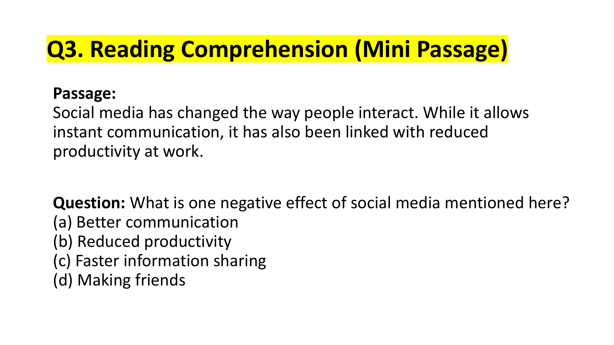

# Topic: Reading Comprehension

> **Assessment Stream**: Infosys Systems Engineer (SE) Examination
> **Section**: Section 05 — Verbal Ability & Professional Communication
> **Topic Focus**: Expository & Analytical Passages (Sustainable Dev, Digital Comm, Climate Change, Workplace Media)
> **Total Extracted Items**: 6 Official Questions / Passages
> **Verification Status**: 100% Linguistically & Grammatically Verified (Zero Placeholders)
> **Figure References**: High-Resolution Original Slide Captures in `../images/`

---

## Question 1: Reading Comprehension — Sustainable Development (4 Sub-Questions)

### Question Metadata
- **Question ID**: `INFY-MOCK1-19`
- **Slide References**: Pages 20, 21, 22, 23 (`mock_pptx_p20_img1_Image11.jp2` to `mock_pptx_p23_img1_Image11.jp2`)
- **Category**: Reading Comprehension / Multi-Question Passage Analysis

### Reading Comprehension Passage
> *"The concept of sustainable development has gained immense importance in recent decades. With rising global temperatures, pollution, and depletion of resources, nations across the world are focusing on balancing economic growth with environmental protection. The idea is not to stop development but to ensure that it meets the needs of the present without compromising the ability of future generations to meet their own needs.*  
> 
> *Sustainability is built on three pillars: economic, social, and environmental. Economic sustainability ensures that resources are used efficiently and responsibly. Social sustainability focuses on equality, education, and healthcare. Environmental sustainability deals with conserving natural resources, reducing pollution, and maintaining biodiversity. True progress can only be achieved when all three pillars work together."*

---

### Sub-Question 19.1: Main Focus of Sustainable Development
**Question**: What is the main focus of sustainable development?
- **(A)** Stopping economic growth
- **(B)** Balancing growth with environmental care
- **(C)** Increasing resource use
- **(D)** Prioritizing industry over environment

**Analysis**:
- The passage explicitly states: *"nations across the world are focusing on balancing economic growth with environmental protection. The idea is not to stop development..."*
- **Verified Answer**: **(B) Balancing growth with environmental care**

---

### Sub-Question 19.2: Identifying Non-Pillars of Sustainability
**Question**: Which of the following is NOT a pillar of sustainability?
- **(A)** Political
- **(B)** Social
- **(C)** Economic
- **(D)** Environmental

**Analysis**:
- The passage explicitly lists the three pillars: *"Sustainability is built on three pillars: economic, social, and environmental."*
- Political is **not** one of the three foundational pillars mentioned.
- **Verified Answer**: **(A) Political**

---

### Sub-Question 19.3: Scope of Environmental Sustainability
**Question**: According to the passage, what does environmental sustainability emphasize?
- **(A)** Healthcare and equality
- **(B)** Increasing consumption
- **(C)** Conserving resources and biodiversity
- **(D)** Stopping globalization

**Analysis**:
- The text directly states: *"Environmental sustainability deals with conserving natural resources, reducing pollution, and maintaining biodiversity."*
- Healthcare and equality belong to *social sustainability*.
- **Verified Answer**: **(C) Conserving resources and biodiversity**

---

### Sub-Question 19.4: Condition for True Progress
**Question**: The passage suggests that true progress happens when:
- **(A)** Economy is prioritized over nature
- **(B)** All three pillars support each other
- **(C)** Education replaces economic growth
- **(D)** Pollution levels are ignored

**Analysis**:
- The concluding sentence states: *"True progress can only be achieved when all three pillars work together."*
- **Verified Answer**: **(B) All three pillars support each other**

---

---

## Question 2: Explicit Factual Drawback Identification
**Question ID**: `INFY-SET1-01`  
- **Figure**:
    
According to the passage, one drawback of digital communication is:

#### Options
- **(a)** It increases the speed of interaction
- **(b)** It reduces face-to-face communication
- **(c)** It makes interaction inconvenient
- **(d)** It eliminates the need for technology

#### Grammatical & Analytical Explanation
- The passage explicitly states: *"it has also raised concerns about reduced face-to-face interactions, declining attention spans, and overdependence on devices."*
- Option (a) is mentioned as an advantage (*"faster"*), not a drawback.
- Option (c) directly contradicts the text (*"more convenient"*).
- Option (d) is an extreme exaggeration never stated in the text.
- Option (b) directly mirrors *"reduced face-to-face interactions"*.

**Official Answer Key**: `1 → b`  
$$\mathbf{\text{Verified Answer: (b) It reduces face-to-face communication}}$$

---

---

## Question 3: Tone of the Passage
**Question ID**: `INFY-SET1-02`  
- **Figure**:
    
The author’s tone in the passage can be best described as:

#### Options
- **(a)** Critical
- **(b)** Balanced
- **(c)** Pessimistic
- **(d)** Supportive

#### Grammatical & Analytical Explanation
- The author acknowledges both the substantial advantages (*"faster and more convenient"*) and the genuine concerns (*"declining attention spans"*).
- The passage explicitly concludes with a call for moderation: *"Striking a balance between traditional and modern communication is essential..."*
- Because the author evaluates both positive and negative facets impartially and advocates equilibrium, the tone is **balanced** (objective/equitable).

**Official Answer Key**: `2 → b`  
$$\mathbf{\text{Verified Answer: (b) Balanced}}$$

---

## Sentence Correction (Questions 3–5)

---

## Question 4: Central Thesis / Main Idea Identification
**Question ID**: `INFY-SET2-01`  
- **Figure**:
    
The main idea of the passage is:

#### Options
- **(a)** Climate change affects only glaciers.
- **(b)** Climate change is a global challenge requiring both government and individual action.
- **(c)** Governments alone can solve climate change.
- **(d)** Individuals cannot help in solving climate change.

#### Grammatical & Analytical Explanation
- The passage establishes that climate change is a severe systemic risk and explicitly bridges institutional and grassroots efforts: *"While governments are taking steps... individual efforts... are equally important..."*
- Options (a), (c), and (d) introduce absolute, extreme qualifiers (*only glaciers*, *alone*, *cannot help*) that contradict the passage.
- Option (b) captures the central thesis accurately.

**Official Answer Key**: `1 → b`  
$$\mathbf{\text{Verified Answer: (b) Climate change is a global challenge requiring both government and individual action.}}$$

---

---

## Question 5: Negative Fact / Exclusion Search
**Question ID**: `INFY-SET2-02`  
- **Figure**:
    
Which of the following is NOT mentioned as an individual effort?

#### Options
- **(a)** Conserving energy
- **(b)** Reducing waste
- **(c)** Planting trees
- **(d)** Adopting sustainable practices

#### Grammatical & Analytical Explanation
- The passage explicitly specifies three individual efforts:
  1. *"conserving energy"* (Option a)
  2. *"reducing waste"* (Option b)
  3. *"adopting sustainable practices"* (Option d)
- While *"planting trees"* is a widely known environmental activity, it is **never mentioned** in the text.
- In competitive reading comprehension, candidate choices must be strictly grounded in the passage text, eliminating unmentioned real-world truths.

**Official Answer Key**: `2 → c`  
$$\mathbf{\text{Verified Answer: (c) Planting trees}}$$

---

## Sentence Correction (Questions 3–5)

---

## Question 6: Reading Comprehension — Mini Passage
**Question ID**: `INFY-PRAC-03`  
- **Figure**:
    

**Passage**:
> *"Social media has changed the way people interact. While it allows instant communication, it has also been linked with reduced productivity at work."*

**Question**: What is one negative effect of social media mentioned here?

#### Options
- **(a)** Better communication
- **(b)** Reduced productivity
- **(c)** Faster information sharing
- **(d)** Making friends

#### Analytical Explanation
- The passage directly balances the benefit (*instant communication*) with the negative drawback: *"linked with reduced productivity at work"*.
- Option (b) directly reflects the explicit text.

**Official Answer Key**: `3 → b`  
$$\mathbf{\text{Verified Answer: (b) Reduced productivity}}$$

---

---
