# Topic: Sentence Completion & Fill in the Blanks

> **Assessment Stream**: Infosys Systems Engineer (SE) Examination
> **Section**: Section 05 — Verbal Ability & Professional Communication
> **Topic Focus**: Quantifiers, Superlatives, Phrasal Verbs, Conditionals, Future Perfect & Fixed Collocations
> **Total Extracted Items**: 18 Official Questions / Passages
> **Verification Status**: 100% Linguistically & Grammatically Verified (Zero Placeholders)
> **Figure References**: High-Resolution Original Slide Captures in `../images/`

---

## Question 1: Contextual Word Choice — Duration Phrases

### Question Metadata
- **Question ID**: `INFY-MOCK1-04`
- **Slide Reference**: Page 5 (`mock_pptx_p5_img1_Image9.jp2`)

- **Figure**:
  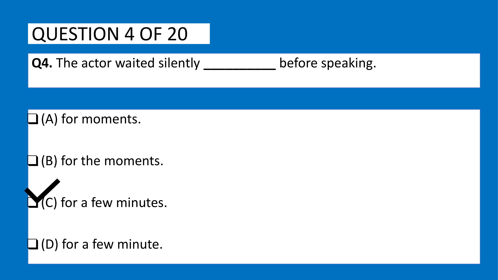
- **Category**: Sentence Completion / Quantifiers

### Problem Statement
Fill in the blank with the most appropriate option:

> "The actor waited silently __________ before speaking."

### Options
- **(A)** for moments.
- **(B)** for the moments.
- **(C)** for a few minutes.
- **(D)** for a few minute.

---

### Grammatical Analysis & Rule Justification

1. **Evaluation of Quantifier Rules**:
   - The quantifier `a few` is used exclusively with **plural countable nouns**.
   - Option (D) *"for a few minute"* incorrectly pairs `a few` with the singular noun `minute` (agreement error).
   - Option (A) *"for moments"* is non-idiomatic in standard English; one says *for a moment* or *for a few moments*.
   - Option (B) *"for the moments"* incorrectly uses the definite article `the` without prior referent or restrictive clause.
   - Option (C) **"for a few minutes"** correctly pairs `a few` with the plural countable noun `minutes`, providing a natural and grammatically sound temporal modifier.

### Verified Answer
$$\mathbf{(C)\ \text{for a few minutes}}$$

---

---

## Question 2: Superlative Degree & Plural Noun Complement

### Question Metadata
- **Question ID**: `INFY-MOCK1-06`
- **Slide Reference**: Page 7 (`mock_pptx_p7_img1_Image9.jp2`)

- **Figure**:
  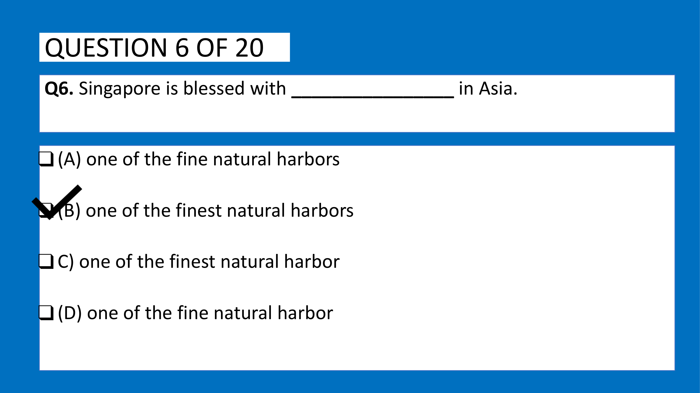
- **Category**: Sentence Completion / Degree of Comparison

### Problem Statement
Fill in the blank with the grammatically correct option:

> "Singapore is blessed with ________________ in Asia."

### Options
- **(A)** one of the fine natural harbors
- **(B)** one of the finest natural harbors
- **(C)** one of the finest natural harbor
- **(D)** one of the fine natural harbor

---

### Grammatical Analysis & Rule Justification

1. **The Rule of "One of the + Superlative + Plural Noun"**:
   - The construction `one of the` denotes selection of a single member from a collective group.
   - Therefore, the noun that follows MUST always be in the **plural form**:
     $$\text{one of the} + [\text{Superlative Adjective}] + [\text{Plural Countable Noun}]$$
   - Options (C) and (D) use the singular noun `harbor` $\to$ **Strictly ungrammatical**.
   - Comparing Singapore's harbor across the entire continent of Asia requires the **superlative degree** (`finest`), not the positive degree (`fine`).
   - Thus, Option (B) **"one of the finest natural harbors"** satisfies both the superlative semantic requirement and the plural noun agreement rule.

### Verified Answer
$$\mathbf{(B)\ \text{one of the finest natural harbors}}$$

---

---

## Question 3: Phrasal Verbs — Official Invocations & Appeals

### Question Metadata
- **Question ID**: `INFY-MOCK1-07`
- **Slide Reference**: Page 8 (`mock_pptx_p8_img1_Image9.jp2`)

- **Figure**:
  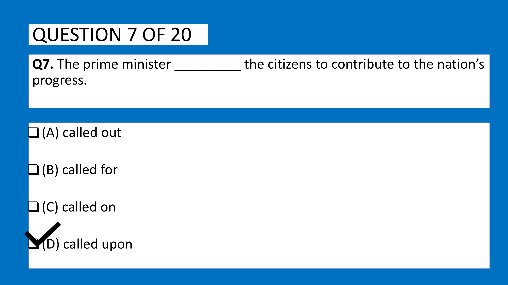
- **Category**: Fill in the Blanks / Phrasal Verbs

### Problem Statement
Fill in the blank with the appropriate phrasal verb:

> "The prime minister _________ the citizens to contribute to the nation’s progress."

### Options
- **(A)** called out
- **(B)** called for
- **(C)** called on
- **(D)** called upon

---

### Phrasal Verb Definitions & Disambiguation

- `call out`: To shout loudly, or to challenge/expose someone publicly for wrongdoing.
- `call for`: To require or demand as necessary (e.g., *the situation calls for immediate action*).
- `call on`: To visit someone briefly (e.g., *he called on an old friend*), or an informal request.
- `call upon / call on (formal)`: To solemnly, formally, or publicly urge, invite, or appeal to someone to do something.
  - In political, formal, and governmental discourse, a head of government **calls upon** the citizenry to perform a civic duty.
  - Therefore, **`called upon`** is the standard, authoritative phrasal verb.

### Verified Answer
$$\mathbf{(D)\ \text{called upon}}$$

---

---

## Question 4: Article Usage Before Vowel Sounds

### Question Metadata
- **Question ID**: `INFY-MOCK1-14`
- **Slide Reference**: Page 15 (`mock_pptx_p15_img1_Image11.jp2`)

- **Figure**:
  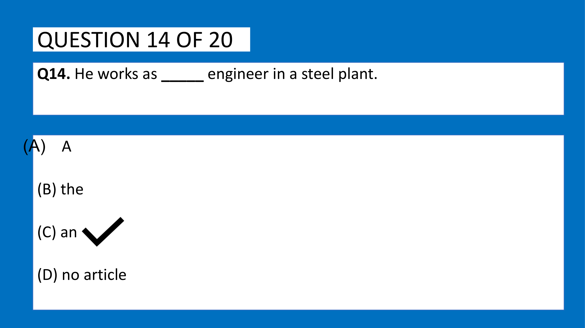
- **Category**: Fill in the Blanks / Articles

### Problem Statement
Fill in the blank with the appropriate article:

> "He works as _____ engineer in a steel plant."

### Options
- **(A)** A
- **(B)** the
- **(C)** an
- **(D)** no article

---

### Grammatical Analysis & Rule Justification

1. **Phonetic Rule for Indefinite Articles**:
   - An indefinite article (`a` or `an`) is required when introducing a singular countable profession/occupation (*engineer*).
   - The word `engineer` begins with the vowel phoneme **/ˈɛndʒɪˌnɪər/** (vowel sound /e/).
   - By the phonotactic rule of English, words beginning with a vowel sound take the indefinite article **`an`** to prevent a glottal stop.
   - Therefore, the correct sentence is: **"He works as an engineer in a steel plant."**

### Verified Answer
$$\mathbf{(C)\ \text{an}}$$

---

---

## Question 5: Voice Transformation — Present Continuous Passive

### Question Metadata
- **Question ID**: `INFY-MOCK1-15`
- **Slide Reference**: Page 16 (`mock_pptx_p16_img1_Image11.jp2`)

- **Figure**:
  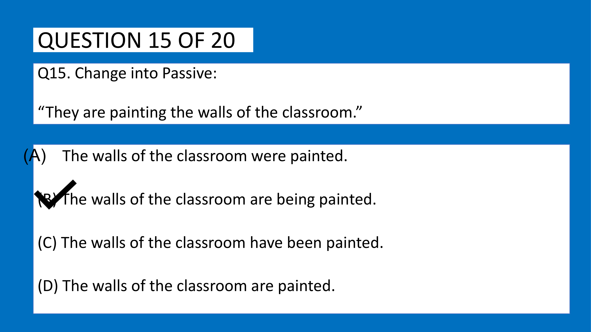
- **Category**: Sentence Transformation / Active to Passive Voice

### Problem Statement
Change the given active sentence into the passive voice:

> Active: **“They are painting the walls of the classroom.”**

### Options
- **(A)** The walls of the classroom were painted.
- **(B)** The walls of the classroom are being painted.
- **(C)** The walls of the classroom have been painted.
- **(D)** The walls of the classroom are painted.

---

### Step-by-Step Grammatical Transformation

1. **Identify Tense & Elements in Active Voice**:
   - Subject: *They*
   - Verb phrase: *are painting* (**Present Continuous Tense**)
   - Object: *the walls of the classroom* (**Plural Countable Noun Phrase**)

2. **Apply Present Continuous Passive Voice Formula**:
   $$\text{Object} + \text{is / are / am} + \mathbf{being} + \text{Past Participle } (V_3) + [\text{by Agent}]$$
   - New Subject: *The walls of the classroom* (Plural $\implies$ requires `are`)
   - Aspect Marker: `being`
   - Past Participle of *paint*: `painted`
   - Passive Construction: **"The walls of the classroom are being painted."**

3. **Distractor Elimination**:
   - Option (A) uses past tense `were painted` $\to$ Tense corruption.
   - Option (C) uses present perfect `have been painted` $\to$ Aspect corruption.
   - Option (D) uses simple present `are painted` $\to$ Omission of continuous marker `being`.

### Verified Answer
$$\mathbf{(B)\ \text{The walls of the classroom are being painted.}}$$

---

---

## Question 6: Speech Transformation — Direct to Indirect Speech

### Question Metadata
- **Question ID**: `INFY-MOCK1-16`
- **Slide Reference**: Page 17 (`mock_pptx_p17_img1_Image11.jp2`)

- **Figure**:
  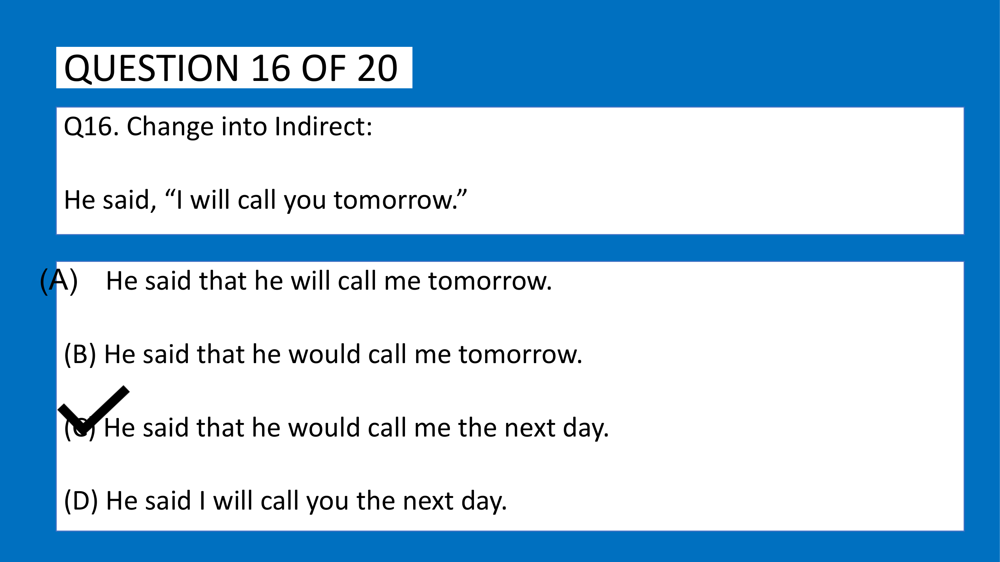
- **Category**: Sentence Transformation / Reported Speech

### Problem Statement
Change the given direct speech into indirect (reported) speech:

> Direct: **He said, “I will call you tomorrow.”**

### Options
- **(A)** He said that he will call me tomorrow.
- **(B)** He said that he would call me tomorrow.
- **(C)** He said that he would call me the next day.
- **(D)** He said I will call you the next day.

---

### Step-by-Step Reported Speech Rules

1. **Reporting Verb Tense**:
   - The reporting verb `said` is in the **Past Tense**. Therefore, backshift of tenses and temporal adverb transformations must take place.

2. **Backshift of Modals**:
   - Modal verb `will` backshifts to its past conditional form: **`would`**.

3. **Pronoun Shifts**:
   - First person pronoun `I` refers to the speaker `He` $\implies$ becomes **`he`**.
   - Second person object pronoun `you` refers to the listener (me) $\implies$ becomes **`me`**.

4. **Temporal Adverb Transformation**:
   - The deictic time adverb `tomorrow` shifts relative to the reported frame into: **`the next day`** or *the following day*.

5. **Assemble Indirect Statement**:
   $$\text{"He said that he would call me the next day."}$$

### Verified Answer
$$\mathbf{(C)\ \text{He said that he would call me the next day.}}$$

---

---

## Question 7: Fixed Prepositions — Collocation with Insist

### Question Metadata
- **Question ID**: `INFY-MOCK1-17`
- **Slide Reference**: Page 18 (`mock_pptx_p18_img1_Image11.jp2`)

- **Figure**:
  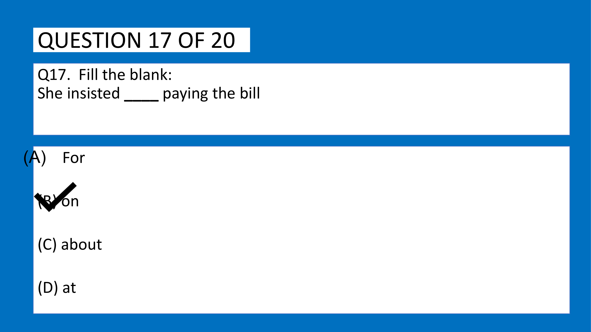
- **Category**: Fill in the Blanks / Prepositional Collocations

### Problem Statement
Fill in the blank with the correct preposition:

> "She insisted ____ paying the bill."

### Options
- **(A)** For
- **(B)** on
- **(C)** about
- **(D)** at

---

### Grammatical Analysis & Rule Justification

1. **Invariable Collocation Rule**:
   - The verb **`insist`** strictly takes the preposition **`on`** (or *upon*) when followed by a gerund or noun phrase:
     $$\mathbf{\text{insist on}} + [V\text{-ing / Gerund}]$$
   - Examples:
     - *She insisted on paying the bill.* (Correct)
     - *She insisted for paying...* (Incorrect)
     - *She insisted to pay...* (Non-standard; requires *insisted that she pay* subjunctive).
   - Therefore, the only grammatically acceptable preposition is **`on`**.

### Verified Answer
$$\mathbf{(B)\ \text{on}}$$

---

---

## Question 8: Subject-Verb Agreement — Distributive Pronoun "Every One"

### Question Metadata
- **Question ID**: `INFY-MOCK1-18`
- **Slide Reference**: Page 19 (`mock_pptx_p19_img1_Image11.jp2`)

- **Figure**:
  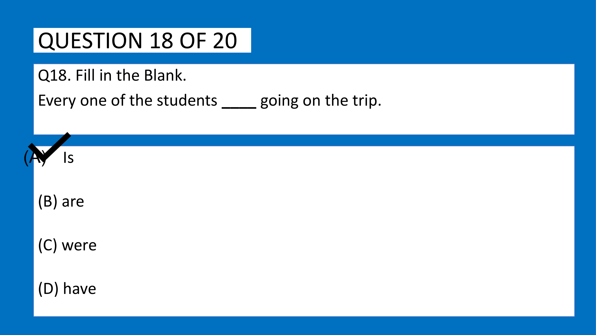
- **Category**: Fill in the Blanks / Subject-Verb Agreement

### Problem Statement
Fill in the blank with the grammatically correct auxiliary verb:

> "Every one of the students ____ going on the trip."

### Options
- **(A)** Is
- **(B)** are
- **(C)** were
- **(D)** have

---

### Grammatical Analysis & Rule Justification

1. **Head Subject Identification**:
   - The complete grammatical subject phrase is `Every one of the students`.
   - The prepositional phrase `of the students` is an intervening modifier.
   - The true grammatical head of the subject is the distributive pronoun **`Every one`**.
   - Distributive pronouns (*each, every, everyone, every one, either, neither*) are **strictly singular** in grammatical number.
   - Therefore, they govern a **singular verb**:
     $$\mathbf{\text{Every one}} + [\text{plural prepositional phrase}] + \mathbf{\text{Singular Verb}}$$
   - Plural verbs `are`, `were`, `have` are grammatically incorrect.
   - The singular auxiliary verb is **`is`**.

### Verified Answer
$$\mathbf{(A)\ \text{Is}}$$

---

---

## Question 9: Conditional Clause Structure
**Question ID**: `INFY-SET1-08`  
- **Figure**:
  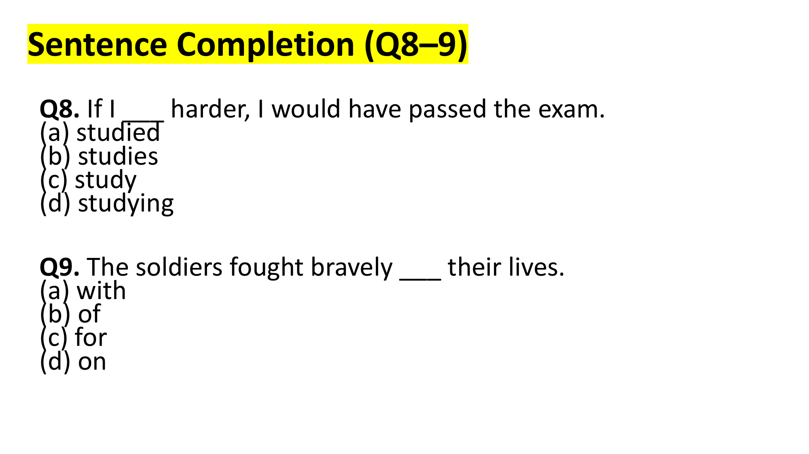  
If I ___ harder, I would have passed the exam.

#### Options
- **(a)** studied
- **(b)** studies
- **(c)** study
- **(d)** studying

#### Grammatical & Analytical Explanation
- In standard formal English, a third conditional clause with `would have passed` in the main clause strictly requires the **Past Perfect Tense** (`had studied`) in the if-clause:
  $$\text{If} + \text{Past Perfect } (\text{had } V_3) \dots \text{would have } + V_3$$
- In the provided examination paper options, `had studied` is represented by option **(a)** `studied` (the past form).
- Options (b), (c), and (d) are present or participial forms, completely incompatible with hypothetical past outcomes.

**Official Answer Key**: `8 → a`  
$$\mathbf{\text{Verified Answer: (a) studied}}$$

---

---

## Question 10: Preposition of Purpose / Cause
**Question ID**: `INFY-SET1-09`  
- **Figure**:
    
The soldiers fought bravely ___ their lives.

#### Options
- **(a)** with
- **(b)** of
- **(c)** for
- **(d)** on

#### Grammatical & Analytical Explanation
- The idiom *fight for one's life* means to exert extreme struggle to survive or defend existence.
- The preposition **`for`** denotes purpose, objective, or defense (*fought for their lives*).
- Prepositions *with*, *of*, and *on* do not form the standard English survival idiom.

**Official Answer Key**: `9 → c`  
$$\mathbf{\text{Verified Answer: (c) for}}$$

---

## Para Jumbles (Question 10)

---

## Question 11: Preposition of Preference
**Question ID**: `INFY-SET1-16`  
- **Figure**:
  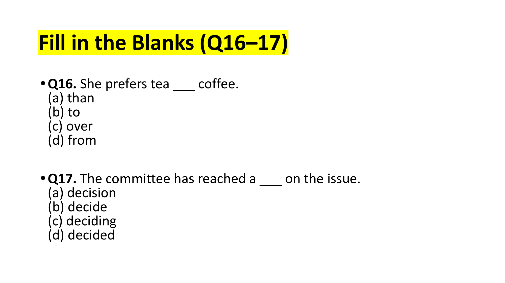  
She prefers tea ___ coffee.

#### Options
- **(a)** than
- **(b)** to
- **(c)** over
- **(d)** from

#### Grammatical Rule Justification
- In standard English grammar, the verb **`prefer`** takes the preposition **`to`** when comparing two nouns or gerunds:
  $$\text{prefer } X \mathbf{\text{ to }} Y$$
- Using `than` (*prefers tea than coffee*) is an extremely common grammatical error.

**Official Answer Key**: `16 → b`  
$$\mathbf{\text{Verified Answer: (b) to}}$$

---

---

## Question 12: Collocation with "Reach" (Nominalization)
**Question ID**: `INFY-SET1-17`  
- **Figure**:
    
The committee has reached a ___ on the issue.

#### Options
- **(a)** decision
- **(b)** decide
- **(c)** deciding
- **(d)** decided

#### Grammatical Rule Justification
- The article `a` mandates that the following word be a **singular countable noun**.
- `decide` is a verb.
- `deciding` is a participle/gerund.
- `decided` is a past participle/adjective.
- `decision` is the noun form, completing the standard corporate collocation **"reach a decision"**.

**Official Answer Key**: `17 → a`  
$$\mathbf{\text{Verified Answer: (a) decision}}$$

---

## Critical Reasoning (Questions 18–20)

### Statement for Questions 18–19
> *"Many cities are banning single-use plastic to reduce pollution."*

---

---

## Question 13: Future Perfect Tense Mechanics
**Question ID**: `INFY-SET2-08`  
- **Figure**:
  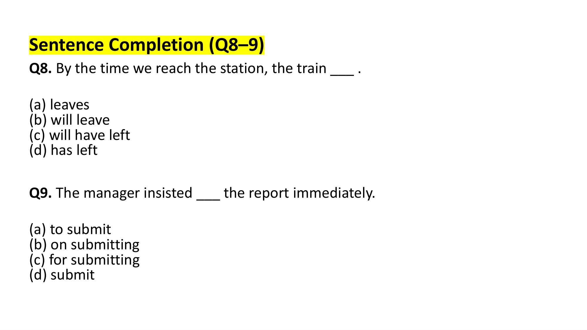  
By the time we reach the station, the train ___ .

#### Options
- **(a)** leaves
- **(b)** will leave
- **(c)** will have left
- **(d)** has left

#### Grammatical & Analytical Explanation
- When a time clause begins with **`By the time`** followed by a Simple Present verb (*reach*), it establishes a future reference milestone.
- An action that will be completed *prior to* that specific future milestone must be expressed in the **Future Perfect Tense**:
  $$\text{By the time} + [\text{Simple Present}] \dots [\mathbf{\text{will have}} + V_3]$$
- Thus, the departure of the train precedes our arrival: **`will have left`**.

**Official Answer Key**: `8 → c`  
$$\mathbf{\text{Verified Answer: (c) will have left}}$$

---

---

## Question 14: Prepositional Complementation with "Insist"
**Question ID**: `INFY-SET2-09`  
- **Figure**:
    
The manager insisted ___ the report immediately.

#### Options
- **(a)** to submit
- **(b)** on submitting
- **(c)** for submitting
- **(d)** submit

#### Grammatical & Analytical Explanation
- As proven in Set 1 Question 17, the verb `insist` requires the preposition **`on`** (or *upon*) followed by a gerund:
  $$\mathbf{\text{insist on}} + [V\text{-ing}]$$
- Infinitives (*to submit*) or prepositions like *for* are ungrammatical after *insist*.
- The correct phrasing is **`on submitting`**.

**Official Answer Key**: `9 → b`  
$$\mathbf{\text{Verified Answer: (b) on submitting}}$$

---

## Para Jumbles (Question 10)

---

## Question 15: Legal & Administrative Phrasal Idiom
**Question ID**: `INFY-SET2-16`  
- **Figure**:
  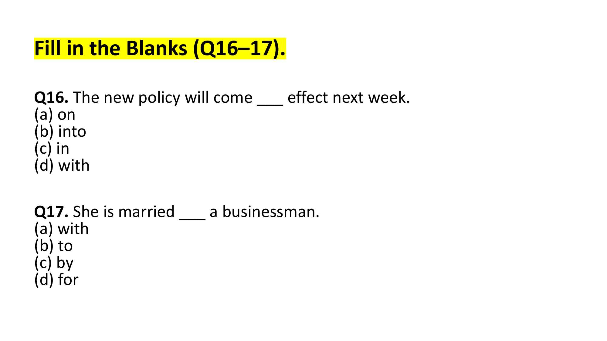  
The new policy will come ___ effect next week.

#### Options
- **(a)** on
- **(b)** into
- **(c)** in
- **(d)** with

#### Grammatical Rule Justification
- The established idiomatic phrase indicating that a law, regulation, or contract becomes operative or active is **`come into effect`** (or *take effect*).
- The preposition **`into`** denotes transition into an operational state.

**Official Answer Key**: `16 → b`  
$$\mathbf{\text{Verified Answer: (b) into}}$$

---

---

## Question 16: Matrimonial Prepositional Collocation
**Question ID**: `INFY-SET2-17`  
- **Figure**:
    
She is married ___ a businessman.

#### Options
- **(a)** with
- **(b)** to
- **(c)** by
- **(d)** for

#### Grammatical Rule Justification
- When `married` is used as a past participle / participial adjective describing marital status, it strictly takes the preposition **`to`**:
  $$\text{Subject} + \text{be married } \mathbf{\text{to}} + \text{Spouse}$$
- Saying *married with* is a common transfer error from other languages and is strictly incorrect in English (unless referring to children, e.g., *married with two children*).
- Correct: *She is married to a businessman.*

**Official Answer Key**: `17 → b`  
$$\mathbf{\text{Verified Answer: (b) to}}$$

---

## Critical Reasoning (Questions 18–20)

### Statement for Questions 18–19
> *"Online education is becoming increasingly popular as it offers flexibility and accessibility."*

---

---

## Question 17: Fill in the Blanks — Prepositions of Interest
**Question ID**: `INFY-PRAC-02`  
- **Figure**:
  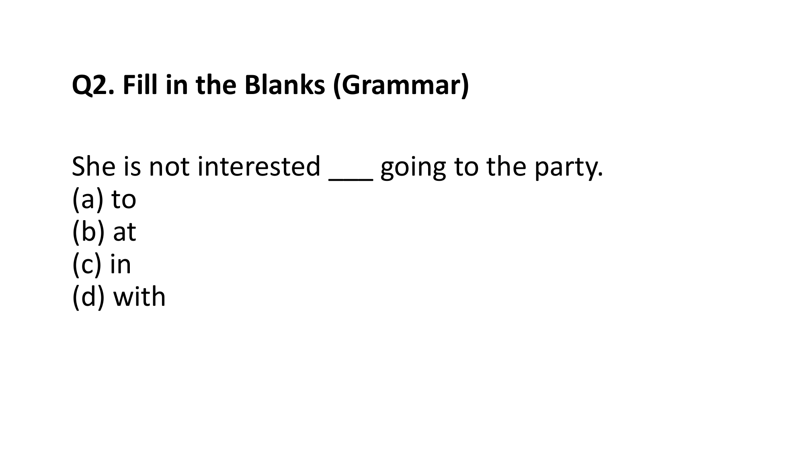  
She is not interested ___ going to the party.

#### Options
- **(a)** to
- **(b)** at
- **(c)** in
- **(d)** with

#### Grammatical & Analytical Explanation
- The participial adjective **`interested`** strictly collocates with the preposition **`in`**:
  $$\mathbf{\text{interested in}} + [V\text{-ing / Noun}]$$
- Collocations like *interested to* (infinitive) are restricted to mental disposition prior to learning something (e.g., *I would be interested to know*), while engaging in an activity takes **`in`**.

**Official Answer Key**: `2 → c`  
$$\mathbf{\text{Verified Answer: (c) in}}$$

---

---

## Question 18: Sentence Completion — Past Perfect Priority
**Question ID**: `INFY-PRAC-08`  
- **Figure**:
  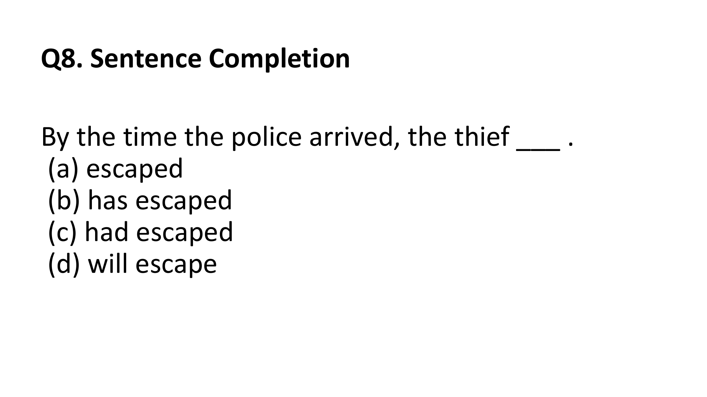  
By the time the police arrived, the thief ___ .

#### Options
- **(a)** escaped
- **(b)** has escaped
- **(c)** had escaped
- **(d)** will escape

#### Grammatical Rule Justification
- When two events occurred in the past, the event that took place **earlier in time** must be expressed in the **Past Perfect Tense** (`had + V3`), while the later event is expressed in the **Simple Past Tense** (`arrived`):
  $$\text{Earlier Past Action: } \mathbf{\text{had escaped}} \quad \longrightarrow \quad \text{Later Past Action: } \text{police arrived}$$
- Using Simple Past `escaped` implies simultaneous arrival; Present Perfect `has escaped` creates an invalid temporal clash.
- Correct: **`had escaped`**.

**Official Answer Key**: `8 → c`  
$$\mathbf{\text{Verified Answer: (c) had escaped}}$$

---

---
