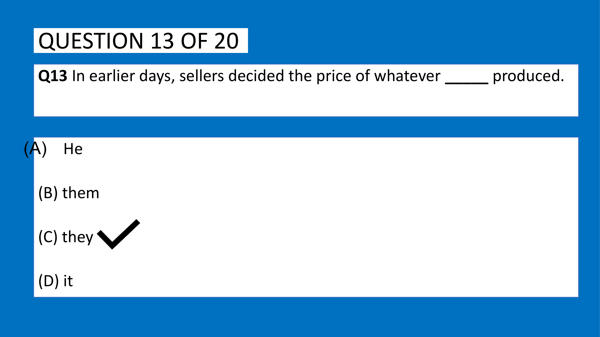
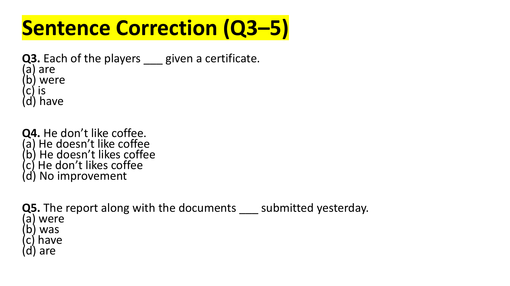
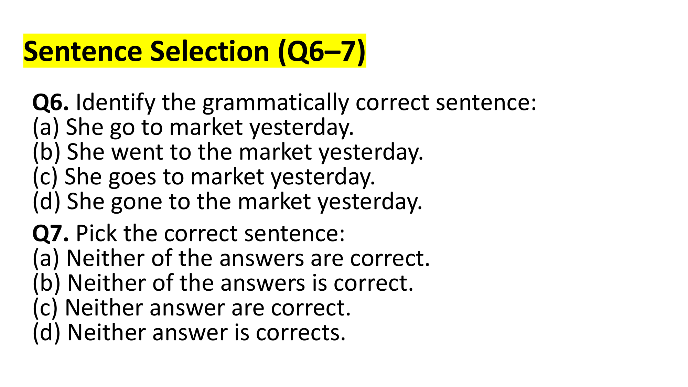
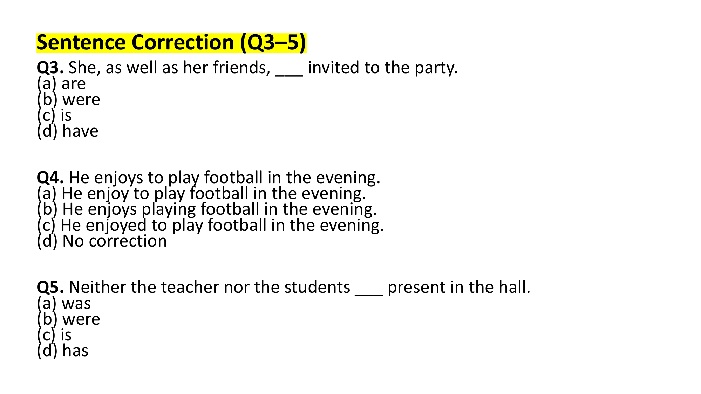
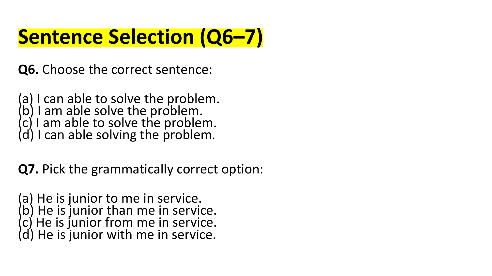
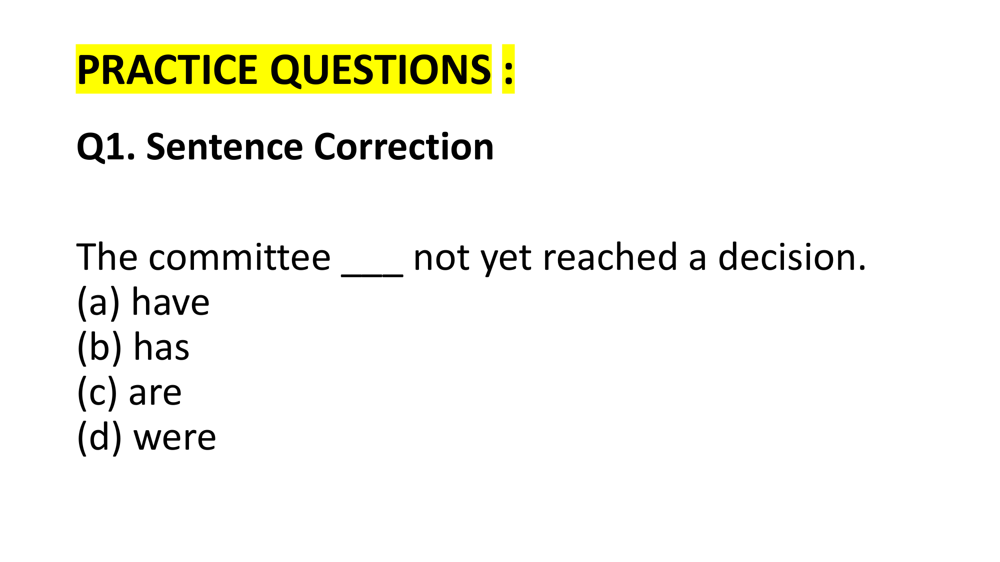
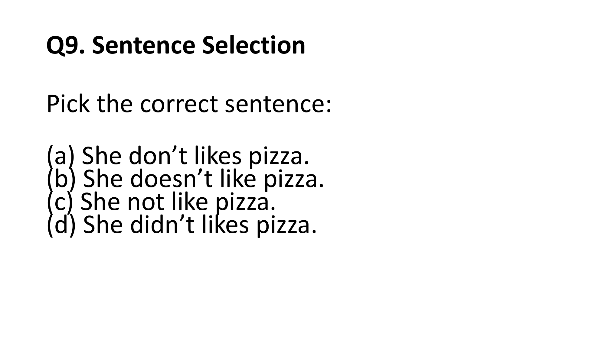
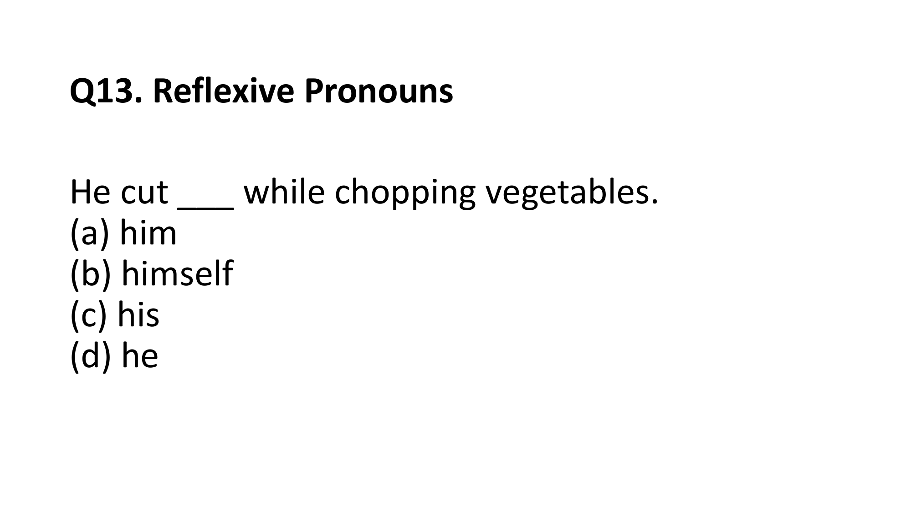
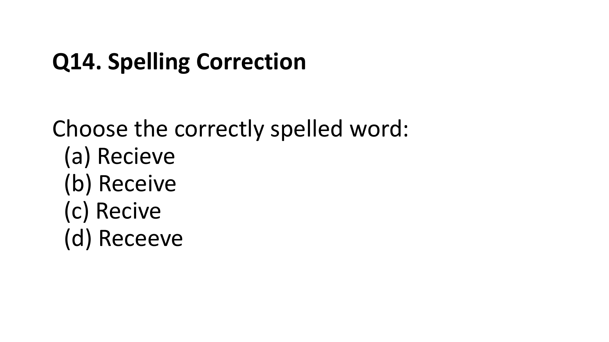

# Topic: Sentence Correction & Grammar Fundamentals

> **Assessment Stream**: Infosys Systems Engineer (SE) Examination
> **Section**: Section 05 — Verbal Ability & Professional Communication
> **Topic Focus**: Subject-Verb Agreement, Distributive Pronouns, Parentheticals, Modals & Tenses
> **Total Extracted Items**: 15 Official Questions / Passages
> **Verification Status**: 100% Linguistically & Grammatically Verified (Zero Placeholders)
> **Figure References**: High-Resolution Original Slide Captures in `../images/`

---

## Question 1: Pronoun-Antecedent Agreement

### Question Metadata
- **Question ID**: `INFY-MOCK1-13`
- **Slide Reference**: Page 14 (`mock_pptx_p14_img1_Image11.jp2`)

- **Figure**:
  
- **Category**: Fill in the Blanks / Pronoun Agreement

### Problem Statement
Fill in the blank with the appropriate pronoun:

> "In earlier days, sellers decided the price of whatever _____ produced."

### Options
- **(A)** He
- **(B)** them
- **(C)** they
- **(D)** it

---

### Grammatical Analysis & Rule Justification

1. **Antecedent Identification**:
   - The subject of the main clause is **`sellers`**, which is a **plural noun**.
2. **Case Requirement**:
   - The blank serves as the **subject** of the dependent clause `whatever _____ produced`.
   - A subject requires a pronoun in the **nominative (subjective) case**.
   - Option (B) `them` is in the objective case $\to$ Incorrect.
   - Option (A) `He` is singular $\to$ Disagrees with plural antecedent *sellers*.
   - Option (D) `it` is neuter singular $\to$ Disagrees with human plural antecedent *sellers*.
   - Option (C) **`they`** is third-person plural nominative, agreeing in number and case with *sellers*.

### Verified Answer
$$\mathbf{(C)\ \text{they}}$$

---

---

## Question 2: Subject-Verb Agreement with "Each of"
**Question ID**: `INFY-SET1-03`  
- **Figure**:
    
Each of the players ___ given a certificate.

#### Options
- **(a)** are
- **(b)** were
- **(c)** is
- **(d)** have

#### Grammatical & Analytical Explanation
- In the construction `Each of + [Plural Noun]`, the head of the subject is the distributive pronoun **`Each`**.
- Distributive pronouns consider individuals one at a time and are grammatically **singular**.
- Therefore, `Each` requires the singular verb **`is`**.
- Plural forms `are`, `were`, and `have` represent agreement errors.

**Official Answer Key**: `3 → c`  
$$\mathbf{\text{Verified Answer: (c) is}}$$

---

---

## Question 3: Third-Person Singular Auxiliary Negation
**Question ID**: `INFY-SET1-04`  
- **Figure**:
    
He don’t like coffee.

#### Options
- **(a)** He doesn’t like coffee
- **(b)** He doesn’t likes coffee
- **(c)** He don’t likes coffee
- **(d)** No improvement

#### Grammatical & Analytical Explanation
- In the present simple tense, third-person singular subjects (*He, She, It*) take the auxiliary verb **`does`** (negated: **`doesn't`**).
- After the auxiliary verb `does / doesn't`, the main verb must remain in its **base (bare infinitive) form** without any `-s` or `-es` suffix (*like*).
- Option (b) incorrectly appends `-s` to the main verb (*doesn't likes*).
- Option (a) correctly uses `He doesn't like coffee`.

**Official Answer Key**: `4 → a`  
$$\mathbf{\text{Verified Answer: (a) He doesn’t like coffee}}$$

---

---

## Question 4: Intervening Parenthetical Prepositional Phrases
**Question ID**: `INFY-SET1-05`  
- **Figure**:
    
The report along with the documents ___ submitted yesterday.

#### Options
- **(a)** were
- **(b)** was
- **(c)** have
- **(d)** are

#### Grammatical & Analytical Explanation
- When a subject is followed by quasi-connectors or parenthetical expressions such as *along with, together with, as well as, in addition to, accompanied by*, these phrases do **not** compound the subject.
- The true subject is **`The report`** (singular countable noun).
- The time adverb `yesterday` establishes the past tense.
- The singular past tense passive auxiliary is **`was`** (*was submitted*).

**Official Answer Key**: `5 → b`  
$$\mathbf{\text{Verified Answer: (b) was}}$$

---

## Sentence Selection (Questions 6–7)

---

## Question 5: Simple Past Tense Marker Alignment
**Question ID**: `INFY-SET1-06`  
- **Figure**:
    
Identify the grammatically correct sentence:

#### Options
- **(a)** She go to market yesterday.
- **(b)** She went to the market yesterday.
- **(c)** She goes to market yesterday.
- **(d)** She gone to the market yesterday.

#### Grammatical & Analytical Explanation
- The specific past time adverbial **`yesterday`** mandates the **Simple Past Tense** ($V_2$).
- The past tense of the irregular verb *go* is **`went`**.
- `go` (Option a) and `goes` (Option c) are present tense forms.
- `gone` (Option d) is a past participle ($V_3$) and cannot stand alone without an auxiliary verb (*has/had*).
- Furthermore, standard English requires the definite article before *market* (*to the market*).

**Official Answer Key**: `6 → b`  
$$\mathbf{\text{Verified Answer: (b) She went to the market yesterday.}}$$

---

---

## Question 6: Agreement with Distributive Pronoun "Neither"
**Question ID**: `INFY-SET1-07`  
- **Figure**:
    
Pick the correct sentence:

#### Options
- **(a)** Neither of the answers are correct.
- **(b)** Neither of the answers is correct.
- **(c)** Neither answer are correct.
- **(d)** Neither answer is corrects.

#### Grammatical & Analytical Explanation
- `Neither of + [Plural Noun Phrase]` denotes *not one nor the other of two*.
- Standard formal English mandates that `Neither` functions as a singular subject, taking a **singular verb** (`is`).
- Using `are` (Options a and c) is a colloquial attraction error.
- Option (d) contains an invalid plural adjective `corrects`.
- Option (b) **"Neither of the answers is correct."** is strictly grammatical.

**Official Answer Key**: `7 → b`  
$$\mathbf{\text{Verified Answer: (b) Neither of the answers is correct.}}$$

---

## Sentence Completion (Questions 8–9)

---

## Question 7: Subject-Verb Agreement with "As well as"
**Question ID**: `INFY-SET2-03`  
- **Figure**:
    
She, as well as her friends, ___ invited to the party.

#### Options
- **(a)** are
- **(b)** were
- **(c)** is
- **(d)** have

#### Grammatical & Analytical Explanation
- When two nouns or pronouns are joined by expressions like *as well as, with, together with, along with, in addition to*, the verb agrees strictly with the **first subject**.
- The first subject is **`She`** (third-person singular).
- The plural phrase `her friends` is grammatically parenthetical and enclosed by commas.
- Therefore, the verb must be singular: **`is`**.
- Using plural forms `are`, `were`, or `have` violates the primary subject agreement rule.

**Official Answer Key**: `3 → c`  
$$\mathbf{\text{Verified Answer: (c) is}}$$

---

---

## Question 8: Verbs Followed Strictly by Gerunds
**Question ID**: `INFY-SET2-04`  
- **Figure**:
    
He enjoys to play football in the evening.

#### Options
- **(a)** He enjoy to play football in the evening.
- **(b)** He enjoys playing football in the evening.
- **(c)** He enjoyed to play football in the evening.
- **(d)** No correction

#### Grammatical & Analytical Explanation
- In English grammar, certain transitive verbs (such as *enjoy, avoid, consider, admit, appreciate, mind, postpone, finish*) are followed by a **gerund** ($V\text{-ing}$), NEVER by an infinitive (*to + verb*):
  $$\mathbf{\text{enjoy}} + [V\text{-ing / Gerund}]$$
- Correct: *He enjoys playing football...*
- Incorrect: *He enjoys to play football...*
- Option (b) rectifies the complementation pattern flawlessly.

**Official Answer Key**: `4 → b`  
$$\mathbf{\text{Verified Answer: (b) He enjoys playing football in the evening.}}$$

---

---

## Question 9: Correlative Conjunctions & The Proximity Rule
**Question ID**: `INFY-SET2-05`  
- **Figure**:
    
Neither the teacher nor the students ___ present in the hall.

#### Options
- **(a)** was
- **(b)** were
- **(c)** is
- **(d)** has

#### Grammatical & Analytical Explanation
- When two subjects are connected by the correlative conjunction **`Neither... nor`** (or *Either... or*), the verb agrees in number and person with the **nearest subject** (the *Rule of Proximity*).
- Subject 1: *the teacher* (Singular)
- Subject 2: *the students* (Plural — immediately adjacent to the verb)
- Because `the students` is plural, the past tense plural verb **`were`** is required.
- Singular verbs `was`, `is`, `has` violate the proximity principle.

**Official Answer Key**: `5 → b`  
$$\mathbf{\text{Verified Answer: (b) were}}$$

---

## Sentence Selection (Questions 6–7)

---

## Question 10: Elimination of Modal Redundancy ("Can able to")
**Question ID**: `INFY-SET2-06`  
- **Figure**:
    
Choose the correct sentence:

#### Options
- **(a)** I can able to solve the problem.
- **(b)** I am able solve the problem.
- **(c)** I am able to solve the problem.
- **(d)** I can able solving the problem.

#### Grammatical & Analytical Explanation
- The modal auxiliary **`can`** and the phrasal adjective **`able to`** express the exact same semantic modality: *capability / capacity*.
- Combining them (*can able to*) creates a glaring tautology / pleonasm in English.
- Correct forms:
  - *I can solve the problem.*
  - *I am able to solve the problem.*
- Option (b) omits the required infinitive marker `to` (*able solve*).
- Option (c) **"I am able to solve the problem."** is the sole grammatical construction.

**Official Answer Key**: `6 → c`  
$$\mathbf{\text{Verified Answer: (c) I am able to solve the problem.}}$$

---

---

## Question 11: Comparative Degree of Latin Adjectives
**Question ID**: `INFY-SET2-07`  
- **Figure**:
    
Pick the grammatically correct option:

#### Options
- **(a)** He is junior to me in service.
- **(b)** He is junior than me in service.
- **(c)** He is junior from me in service.
- **(d)** He is junior with me in service.

#### Grammatical & Analytical Explanation
- Adjectives derived from Latin comparatives ending in `-ior` (*junior, senior, superior, inferior, prior*) take the preposition **`to`** to indicate comparative relation.
- Using `than`, `from`, or `with` is strictly erroneous.
- Option (a) adheres to standard English grammar.

**Official Answer Key**: `7 → a`  
$$\mathbf{\text{Verified Answer: (a) He is junior to me in service.}}$$

---

## Sentence Completion (Questions 8–9)

---

## Question 12: Sentence Correction — Collective Noun Unified Action
**Question ID**: `INFY-PRAC-01`  
- **Figure**:
    
The committee ___ not yet reached a decision.

#### Options
- **(a)** have
- **(b)** has
- **(c)** are
- **(d)** were

#### Grammatical & Analytical Explanation
- In American and formal business English, collective nouns (*committee, jury, board, council, team*) are treated as **singular** when acting as a unified entity.
- Here, the committee acts as a single cohesive unit to reach a consensus (*a decision*).
- Therefore, the singular auxiliary verb **`has`** is grammatically mandatory.
- If the individual members were in disagreement (e.g., *the committee were divided in their opinions*), a plural verb would be permissible.

**Official Answer Key**: `1 → b`  
$$\mathbf{\text{Verified Answer: (b) has}}$$

---

---

## Question 13: Sentence Selection — Auxiliary Negation Invariant
**Question ID**: `INFY-PRAC-09`  
- **Figure**:
    
Pick the correct sentence:

#### Options
- **(a)** She don’t likes pizza.
- **(b)** She doesn’t like pizza.
- **(c)** She not like pizza.
- **(d)** She didn’t likes pizza.

#### Grammatical Rule Justification
- In the present tense, third-person singular *She* requires auxiliary `does` + negation `not` $\to$ **`doesn't`**.
- The main verb following an auxiliary verb must be in the **bare infinitive** form (*like*).
- Options (a) and (d) corrupt the main verb with an unnecessary suffix `-s` (*likes*).
- Option (b) is the sole grammatically flawless sentence.

**Official Answer Key**: `9 → b`  
$$\mathbf{\text{Verified Answer: (b) She doesn’t like pizza.}}$$

---

---

## Question 14: Reflexive Pronoun Invariants
**Question ID**: `INFY-PRAC-13`  
- **Figure**:
    
He cut ___ while chopping vegetables.

#### Options
- **(a)** him
- **(b)** himself
- **(c)** his
- **(d)** he

#### Grammatical Rule Justification
- When the subject (*He*) and the direct object of a transitive verb (*cut*) refer to the exact same person, English requires a **reflexive pronoun**.
- Using `him` (*He cut him*) would mean he cut another male person.
- The masculine third-person singular reflexive pronoun is **`himself`**.

**Official Answer Key**: `13 → b`  
$$\mathbf{\text{Verified Answer: (b) himself}}$$

---

---

## Question 15: Orthography — Spelling Invariants
**Question ID**: `INFY-PRAC-14`  
- **Figure**:
    
Choose the correctly spelled word:

#### Options
- **(a)** Recieve
- **(b)** Receive
- **(c)** Recive
- **(d)** Receeve

#### Morphological & Spelling Rule
- Classical mnemonic rule: **"I before E, except after C, or when sounding like A as in neighbor and weigh."**
- In the word **`Receive`**, the diphthong immediately follows the consonant letter **`c`**.
- Therefore, `e` precedes `i`: **`r-e-c-e-i-v-e`**.
- Spelling it *recieve* is one of the most common orthographic errors in written English.

**Official Answer Key**: `14 → b`  
$$\mathbf{\text{Verified Answer: (b) Receive}}$$

---

---
