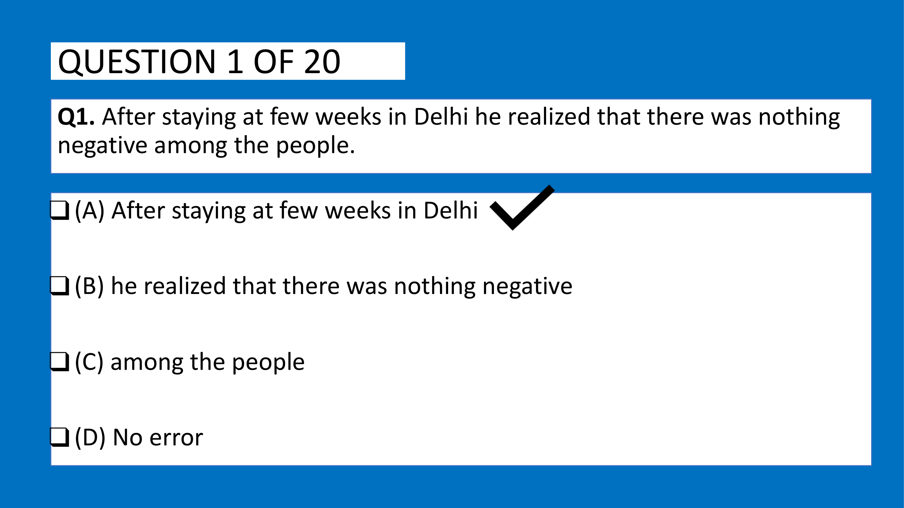
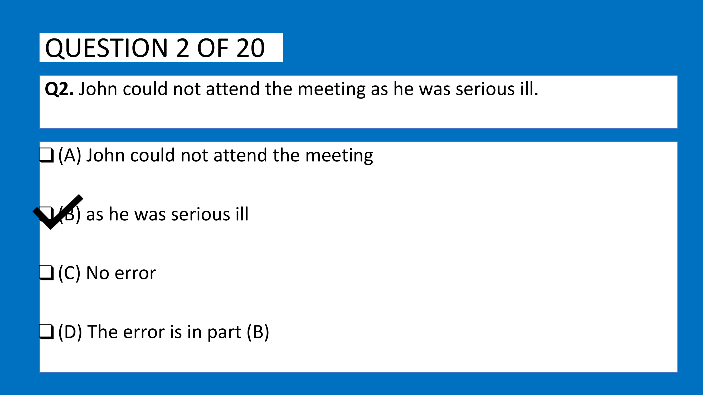
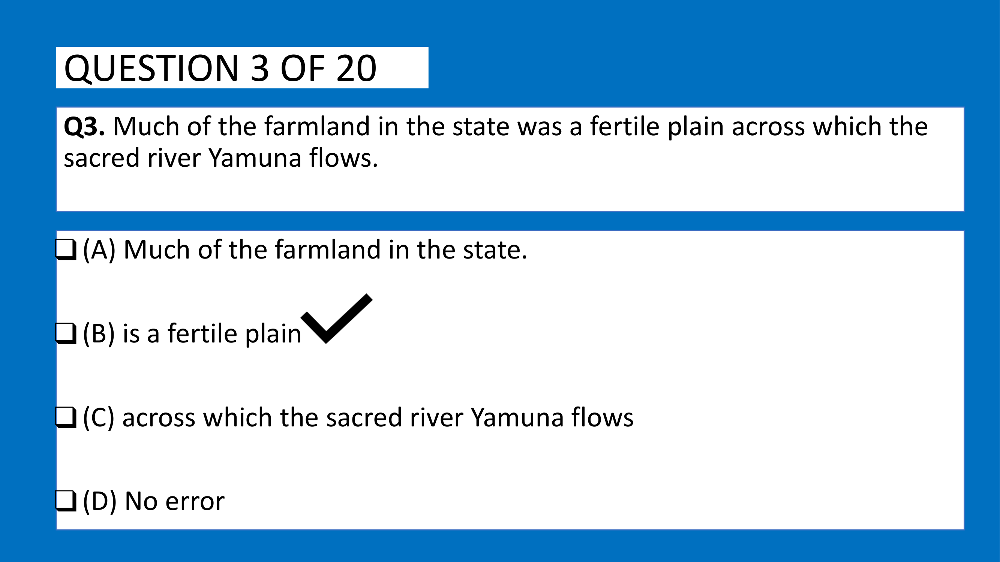
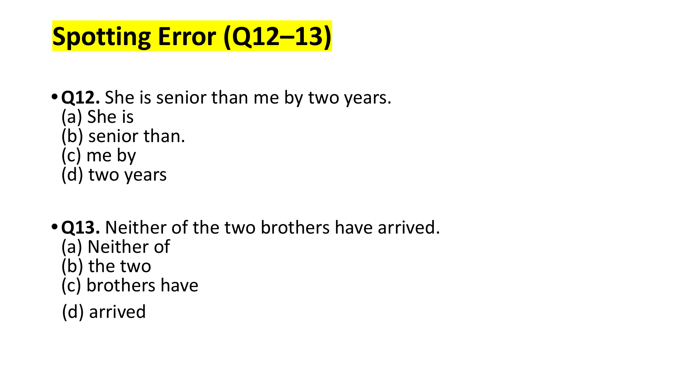
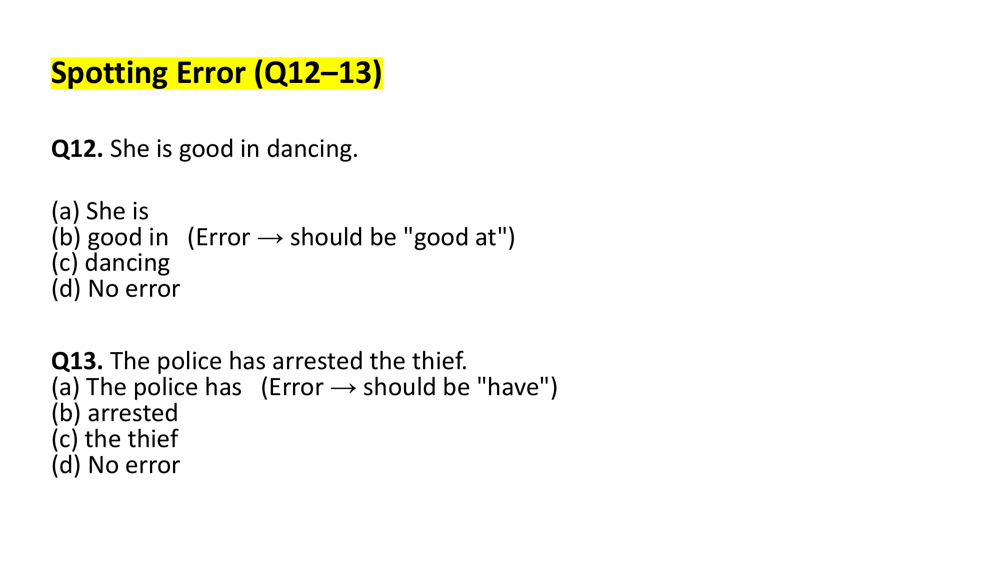
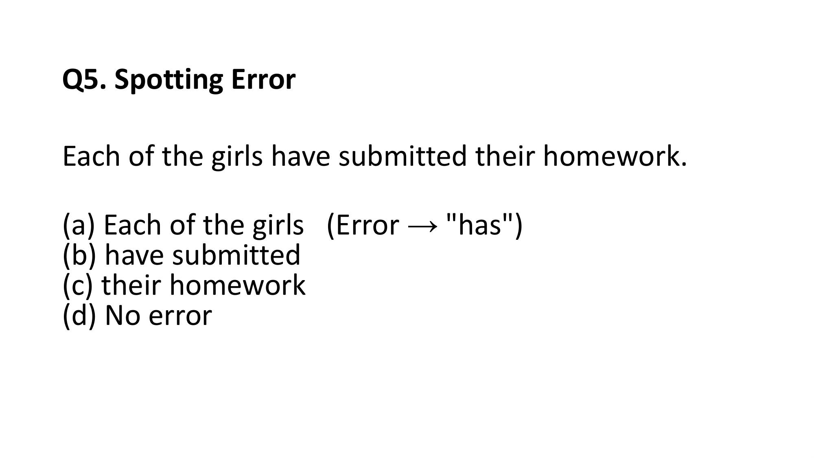

# Topic: Spotting Errors

> **Assessment Stream**: Infosys Systems Engineer (SE) Examination
> **Section**: Section 05 — Verbal Ability & Professional Communication
> **Topic Focus**: Prepositional Duration, Modifier Adverbs, General Truths, Comparative Prepositions & Collective Plurals
> **Total Extracted Items**: 8 Official Questions / Passages
> **Verification Status**: 100% Linguistically & Grammatically Verified (Zero Placeholders)
> **Figure References**: High-Resolution Original Slide Captures in `../images/`

---

## Question 1: Spotting Error — Prepositional Usage in Time Expressions

### Question Metadata
- **Question ID**: `INFY-MOCK1-01`
- **Slide Reference**: Page 2 (`mock_pptx_p2_img1_Image9.jp2`)

- **Figure**:
  
- **Category**: Spotting Error / Prepositions

### Problem Statement
Identify the part of the sentence that contains a grammatical error:

> "After staying at few weeks in Delhi he realized that there was nothing negative among the people."

### Options
- **(A)** After staying at few weeks in Delhi
- **(B)** he realized that there was nothing negative
- **(C)** among the people
- **(D)** No error

---

### Grammatical Analysis & Rule Justification

1. **Error Identification in Part (A)**:
   - The phrase *"staying at few weeks"* contains two distinct grammatical errors:
     - **Incorrect Preposition**: The preposition `at` is used for specific spatial points or exact clock times (e.g., *at the station*, *at 5 PM*). For a duration of time, the preposition `for` must be used (e.g., *for a few weeks*).
     - **Missing Indefinite Article**: In English, `few` (without an article) has a negative meaning implying *almost none* or *hardly any*. The phrase `a few` has a positive meaning implying *some / several*.
   - The correct idiomatic construction is: **"After staying for a few weeks in Delhi..."**

2. **Analysis of Other Segments**:
   - Part (B) *"he realized that there was nothing negative"*: Completely grammatical; past tense `realized` correctly aligns with past state `there was`.
   - Part (C) *"among the people"*: `among` correctly refers to an indefinite collective group of individuals (*the people*).

### Verified Answer
$$\mathbf{(A)\ \text{After staying at few weeks in Delhi}}$$

---

---

## Question 2: Spotting Error — Adjective vs. Adverb Modification

### Question Metadata
- **Question ID**: `INFY-MOCK1-02`
- **Slide Reference**: Page 3 (`mock_pptx_p3_img1_Image9.jp2`)

- **Figure**:
  
- **Category**: Spotting Error / Adverbs

### Problem Statement
Identify the part of the sentence that contains a grammatical error:

> "John could not attend the meeting as he was serious ill."

### Options
- **(A)** John could not attend the meeting
- **(B)** as he was serious ill
- **(C)** No error
- **(D)** The error is in part (B)

---

### Grammatical Analysis & Rule Justification

1. **Error Identification in Part (B)**:
   - In the predicate *"he was serious ill"*, the word `ill` functions as a **predicate adjective** describing John's physical state.
   - In standard English grammar, an adjective must be modified by an **adverb**, never by another adjective.
   - `serious` is an adjective. Its corresponding adverbial form is **`seriously`**.
   - Therefore, modifying the adjective `ill` requires the adverb `seriously`: **"as he was seriously ill"**.

2. **Analysis of Other Segments**:
   - Part (A) *"John could not attend the meeting"*: Grammatically sound modal auxiliary construction (`could not` + base verb `attend`).
   - The error is located specifically in **Part (B)**.

### Verified Answer
$$\mathbf{(B)\ \text{as he was serious ill \quad [Correct Form: seriously ill]}}$$

---

---

## Question 3: Spotting Error — Tense Consistency & General Truths

### Question Metadata
- **Question ID**: `INFY-MOCK1-03`
- **Slide Reference**: Page 4 (`mock_pptx_p4_img1_Image9.jp2`)

- **Figure**:
  
- **Category**: Spotting Error / Tense Alignment

### Problem Statement
Identify the part of the sentence that contains a grammatical error:

> "Much of the farmland in the state was a fertile plain across which the sacred river Yamuna flows."

### Options
- **(A)** Much of the farmland in the state.
- **(B)** is a fertile plain
- **(C)** across which the sacred river Yamuna flows
- **(D)** No error

---

### Grammatical Analysis & Rule Justification

1. **Error Identification**:
   - The original statement states: *"Much of the farmland in the state was a fertile plain across which the sacred river Yamuna flows."*
   - Geographic descriptions and topographical enduring realities represent **universal geographical facts**.
   - A geographical plain does not cease to be a fertile plain while the river continues to flow across it in the present tense (`flows`).
   - The past tense verb `was` in the main clause creates an unwarranted temporal clash with the relative clause present tense verb `flows`.
   - The verb must be in the simple present tense: **`is a fertile plain`**.
   - The error is in the main verb tense choice, corrected by option **(B)**.

### Verified Answer
$$\mathbf{(B)\ \text{is a fertile plain \quad [Tense alignment for enduring geographical fact]}}$$

---

---

## Question 4: Latin Comparatives Followed by "To"
**Question ID**: `INFY-SET1-12`  
- **Figure**:
    
She is senior than me by two years.

#### Options
- **(a)** She is
- **(b)** senior than.
- **(c)** me by
- **(d)** two years

#### Grammatical Rule Justification
- Adjectives of Latin origin ending in `-ior` (*senior, junior, superior, inferior, prior, anterior, posterior*) are followed by the preposition **`to`**, NEVER by the conjunction `than`.
- Correct Form: **"She is senior to me by two years."**
- The error is in part **(b)**.

**Official Answer Key**: `12 → b`  
$$\mathbf{\text{Verified Answer: (b) senior than \quad [Correct Form: senior to]}}$$

---

---

## Question 5: Subject-Verb Agreement with "Neither of the"
**Question ID**: `INFY-SET1-13`  
- **Figure**:
    
Neither of the two brothers have arrived.

#### Options
- **(a)** Neither of
- **(b)** the two
- **(c)** brothers have
- **(d)** arrived

#### Grammatical Rule Justification
- As established in Question 7, `Neither of` refers to each individual singly and requires a **singular verb**.
- The auxiliary `have` is plural. It must be replaced by the singular auxiliary **`has`**.
- Correct Form: **"Neither of the two brothers has arrived."**
- The error resides in segment **(c)**.

**Official Answer Key**: `13 → c`  
$$\mathbf{\text{Verified Answer: (c) brothers have \quad [Correct Form: brothers has]}}$$

---

## Verbal Analogies (Questions 14–15)

---

## Question 6: Prepositions of Proficiency ("Good at")
**Question ID**: `INFY-SET2-12`  
- **Figure**:
    
She is good in dancing.

#### Options
- **(a)** She is
- **(b)** good in
- **(c)** dancing
- **(d)** No error

#### Grammatical Rule Justification
- In English, when expressing skill, proficiency, or aptitude in a discipline, sport, art, or subject, the adjective `good` strictly collocates with the preposition **`at`**:
  $$\mathbf{\text{good at}} + [V\text{-ing / Discipline}]$$
- Examples: *good at mathematics*, *good at swimming*, *good at dancing*.
- `good in` is non-standard (except when referring to performance within a bounded physical container or moral character).
- The error is in part **(b)** (should be *good at*).

**Official Answer Key**: `12 → b`  
$$\mathbf{\text{Verified Answer: (b) good in \quad [Correct Form: good at]}}$$

---

---

## Question 7: Collective Noun Agreement ("The Police")
**Question ID**: `INFY-SET2-13`  
- **Figure**:
    
The police has arrested the thief.

#### Options
- **(a)** The police has
- **(b)** arrested
- **(c)** the thief
- **(d)** No error

#### Grammatical Rule Justification
- In English grammar, **`police`** is an invariant **plural collective noun**. It has no singular form (*a police* is impossible; one must say *a police officer*).
- Consequently, `the police` ALWAYS takes a **plural verb**:
  $$\mathbf{\text{The police}} + \mathbf{\text{have / are / were}}$$
- Using singular `has` is a major grammatical violation.
- The error is in part **(a)** (should be *The police have*).

**Official Answer Key**: `13 → a`  
$$\mathbf{\text{Verified Answer: (a) The police has \quad [Correct Form: The police have]}}$$

---

## Verbal Analogies (Questions 14–15)

---

## Question 8: Spotting Error — Distributive Subject Number
**Question ID**: `INFY-PRAC-05`  
- **Figure**:
    
Each of the girls have submitted their homework.

#### Options
- **(a)** Each of the girls
- **(b)** have submitted
- **(c)** their homework
- **(d)** No error

#### Grammatical Rule Justification
- The subject of the sentence is the distributive pronoun **`Each`**, which is grammatically singular.
- The intervening plural prepositional phrase `of the girls` does not alter the singularity of the subject.
- The verb must agree with `Each`, requiring singular **`has submitted`** instead of plural `have submitted`.
- In strict traditional grammar, the pronoun also shifts from plural *their* to singular *her* (*has submitted her homework*).
- The official key identifies **(a)** as the site of the error nexus (where *Each of the girls* dictates the singular predicate).

**Official Answer Key**: `5 → a`  
$$\mathbf{\text{Verified Answer: (a) Each of the girls \quad [Predicate Error: have submitted } \to \mathbf{\text{has submitted]}}$$

---

---
