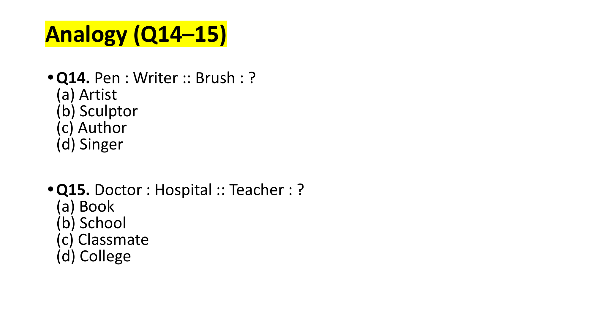
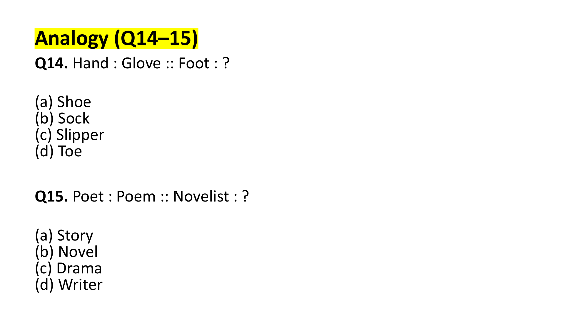
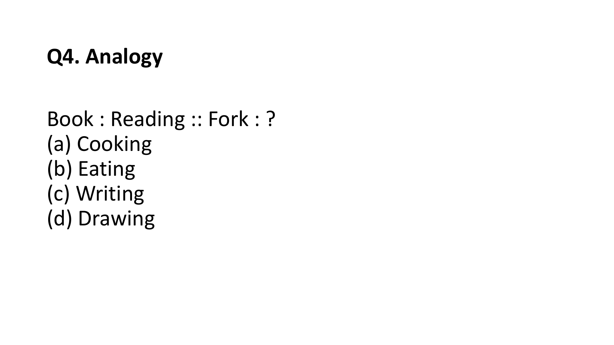

# Topic: Verbal Analogy

> **Assessment Stream**: Infosys Systems Engineer (SE) Examination
> **Section**: Section 05 — Verbal Ability & Professional Communication
> **Topic Focus**: Tool-to-Worker, Institution-to-Agent, Object-to-Wearer, Creator-to-Creation & Functional Relationships
> **Total Extracted Items**: 5 Official Questions / Passages
> **Verification Status**: 100% Linguistically & Grammatically Verified (Zero Placeholders)
> **Figure References**: High-Resolution Original Slide Captures in `../images/`

---

## Question 1: Instrument to Creator
**Question ID**: `INFY-SET1-14`  
- **Figure**:
    
Pen : Writer :: Brush : ?

#### Options
- **(a)** Artist
- **(b)** Sculptor
- **(c)** Author
- **(d)** Singer

#### Semantic Relationship
- A *Pen* is the primary physical instrument used by a *Writer* to produce art/literature.
- Similarly, a *Brush* is the primary physical instrument used by an *Artist* (painter) to create art.
- A sculptor uses a *chisel*; an author uses a *pen/keyboard*; a singer uses their *voice*.

**Official Answer Key**: `14 → a`  
$$\mathbf{\text{Verified Answer: (a) Artist}}$$

---

---

## Question 2: Profession to Primary Workplace
**Question ID**: `INFY-SET1-15`  
- **Figure**:
    
Doctor : Hospital :: Teacher : ?

#### Options
- **(a)** Book
- **(b)** School
- **(c)** Classmate
- **(d)** College

#### Semantic Relationship
- A *Doctor* operates in their primary designated institution/workplace, a *Hospital*.
- Analogously, a *Teacher* operates in their primary designated institution, a *School*.

**Official Answer Key**: `15 → b`  
$$\mathbf{\text{Verified Answer: (b) School}}$$

---

## Fill in the Blanks (Questions 16–17)

---

## Question 3: Protective Garment to Anatomy
**Question ID**: `INFY-SET2-14`  
- **Figure**:
    
Hand : Glove :: Foot : ?

#### Options
- **(a)** Shoe
- **(b)** Sock
- **(c)** Slipper
- **(d)** Toe

#### Semantic Relationship
- A *Glove* is a fitted outer covering specifically tailored to protect and envelop the *Hand*.
- Analogously, a *Shoe* is the primary fitted footwear designed to protect and cover the *Foot*.

**Official Answer Key**: `14 → a`  
$$\mathbf{\text{Verified Answer: (a) Shoe}}$$

---

---

## Question 4: Literary Creator to Masterpiece
**Question ID**: `INFY-SET2-15`  
- **Figure**:
    
Poet : Poem :: Novelist : ?

#### Options
- **(a)** Story
- **(b)** Novel
- **(c)** Drama
- **(d)** Writer

#### Semantic Relationship
- A *Poet* is an artist who crafts a *Poem*.
- A *Novelist* is an author who writes a *Novel*.

**Official Answer Key**: `15 → b`  
$$\mathbf{\text{Verified Answer: (b) Novel}}$$

---

## Fill in the Blanks (Questions 16–17)

---

## Question 5: Verbal Analogy — Object to Primary Function
**Question ID**: `INFY-PRAC-04`  
- **Figure**:
    
Book : Reading :: Fork : ?

#### Options
- **(a)** Cooking
- **(b)** Eating
- **(c)** Writing
- **(d)** Drawing

#### Semantic Relationship
- A *Book* is an object primarily designed for the action of *Reading*.
- A *Fork* is an eating utensil primarily designed for the action of *Eating*.
- (While a fork can be used during cooking preparation, its primary teleological purpose is consumption/eating).

**Official Answer Key**: `4 → b`  
$$\mathbf{\text{Verified Answer: (b) Eating}}$$

---

---
