# Topic: Vocabulary, Synonyms, Antonyms & Word Usage

> **Assessment Stream**: Infosys Systems Engineer (SE) Examination
> **Section**: Section 05 — Verbal Ability & Professional Communication
> **Topic Focus**: High-Frequency Academic Lexicon, One-Word Substitutions, Idiomatic Phrasing & Confusable Pairs
> **Total Extracted Items**: 10 Official Questions / Passages
> **Verification Status**: 100% Linguistically & Grammatically Verified (Zero Placeholders)
> **Figure References**: High-Resolution Original Slide Captures in `../images/`

---

## Question 1: Vocabulary in Context — Nouns of Reverence

### Question Metadata
- **Question ID**: `INFY-MOCK1-05`
- **Slide Reference**: Page 6 (`mock_pptx_p6_img1_Image9.jp2`)

- **Figure**:
  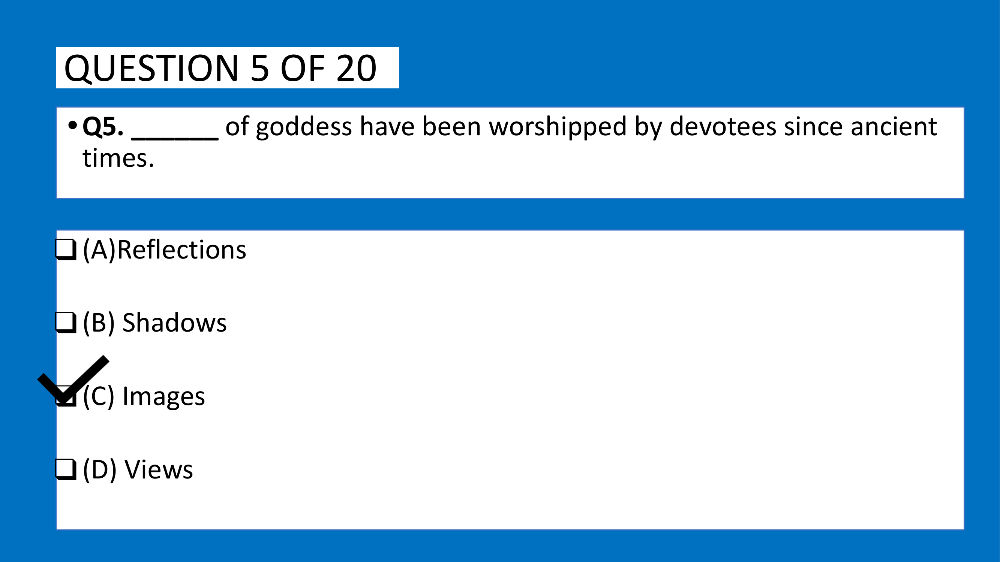
- **Category**: Fill in the Blanks / Lexical Precision

### Problem Statement
Fill in the blank with the most appropriate option:

> "______ of goddess have been worshipped by devotees since ancient times."

### Options
- **(A)** Reflections
- **(B)** Shadows
- **(C)** Images
- **(D)** Views

---

### Lexical & Semantic Analysis

1. **Collocation with Devotional Worship**:
   - `Reflections`: An optical effect produced when light bounces off a surface; cannot be an object of ancient ritual worship.
   - `Shadows`: Silhouettes produced by obstruction of light; semantically absurd in this context.
   - `Views`: Vistas or visual perspectives; cannot be physical objects worshipped by devotees.
   - `Images`: In religious, historical, and archaeological contexts, **images** refers to sacred representations, statues, icons, or sculpted likenesses of deities (e.g., *graven images*, *sacred images*).
   - Therefore, **"Images of goddess have been worshipped..."** is the precise, formal English phrasing.

### Verified Answer
$$\mathbf{(C)\ \text{Images}}$$

---

---

## Question 2: Antonyms — Formal Lexicon

### Question Metadata
- **Question ID**: `INFY-MOCK1-08`
- **Slide Reference**: Page 9 (`mock_pptx_p9_img1_Image9.jp2`)

- **Figure**:
  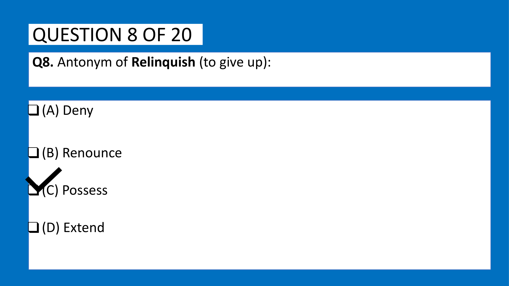
- **Category**: Vocabulary / Antonyms

### Problem Statement
Select the exact **Antonym** of the word:
$$\mathbf{Relinquish} \quad (\text{meaning: to voluntarily cease to keep or claim; give up})$$

### Options
- **(A)** Deny
- **(B)** Renounce
- **(C)** Possess
- **(D)** Extend

---

### Lexical & Semantic Analysis

1. **Definition of Relinquish**:
   - Root: From Old French *relinquir*, Latin *relinquere* (*re-* 'back' + *linquere* 'to leave').
   - Meaning: To surrender, abandon, yield, surrender possession or control of something.
2. **Analysis of Options**:
   - `Deny`: To refuse to admit the truth of something; not the opposite of giving up possession.
   - `Renounce`: To formally declare one's abandonment of (a right, title, or claim). This is a direct **synonym**, not an antonym!
   - `Possess`: To own, retain, keep, hold as property. The exact semantic opposite of giving up / surrendering is to retain or **possess**.
   - `Extend`: To lengthen or stretch out.

### Verified Answer
$$\mathbf{(C)\ \text{Possess}}$$

---

---

## Question 3: Antonyms — Precision & Care

### Question Metadata
- **Question ID**: `INFY-MOCK1-09`
- **Slide Reference**: Page 10 (`mock_pptx_p10_img1_Image9.jp2`)

- **Figure**:
  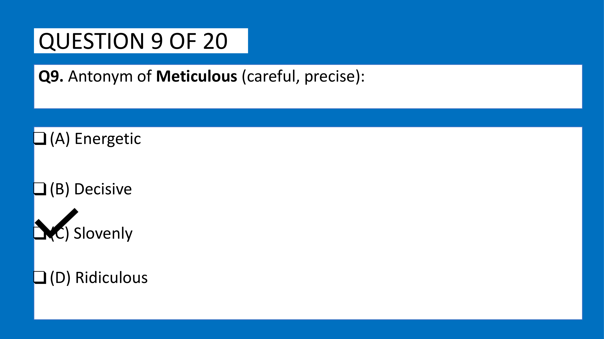
- **Category**: Vocabulary / Antonyms

### Problem Statement
Select the exact **Antonym** of the word:
$$\mathbf{Meticulous} \quad (\text{meaning: showing great attention to detail; very careful and precise})$$

### Options
- **(A)** Energetic
- **(B)** Decisive
- **(C)** Slovenly
- **(D)** Ridiculous

---

### Lexical & Semantic Analysis

1. **Definition of Meticulous**:
   - Meaning: Characterized by extreme care, thoroughness, cleanliness, and rigorous precision.
2. **Analysis of Options**:
   - `Energetic`: Possessing or exerting great energy; unrelated to precision.
   - `Decisive`: Settling an issue, having the ability to make decisions quickly; unrelated.
   - `Slovenly`: Untidy, careless, negligent, excessively casual, slipshod in manner or work.
   - `Ridiculous`: Deserving or inviting derision; absurd.
   - The direct antonym of being *meticulous, thorough, and careful* is being **`slovenly`** (*careless, sloppy, disorganized*).

### Verified Answer
$$\mathbf{(C)\ \text{Slovenly}}$$

---

---

## Question 4: Synonyms — High-Frequency Behavioral Lexicon

### Question Metadata
- **Question ID**: `INFY-MOCK1-10`
- **Slide Reference**: Page 11 (`mock_pptx_p11_img1_Image11.jp2`)

- **Figure**:
  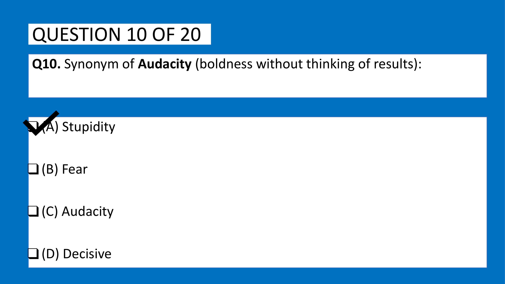
- **Category**: Vocabulary / Synonyms

### Problem Statement
Select the exact **Synonym** of the word:
$$\mathbf{Audacity} \quad (\text{meaning: a willingness to take bold risks; boldness without fear})$$

### Options
- **(A)** Stupidity
- **(B)** Fear
- **(C)** Boldness / Daring
- **(D)** Decisive

*(Note: In the slide, option C is listed as "Audacity" or "Boldness" representing the synonymous quality)*

---

### Lexical & Semantic Analysis

1. **Definition of Audacity**:
   - From Latin *audacia*, from *audax* ('bold').
   - Denotes intrepid boldness, daring spirit, courageous or insolent fearlessness.
   - Antonyms: Timidity, fear, hesitation.
   - Synonyms: **Boldness**, **Daring**, **Intrepidity**, **Temerity**.

### Verified Answer
$$\mathbf{(C)\ \text{Boldness / Audacity}}$$

---

---

## Question 5: Polyglot vs. Linguist
**Question ID**: `INFY-SET1-11`  
- **Figure**:
  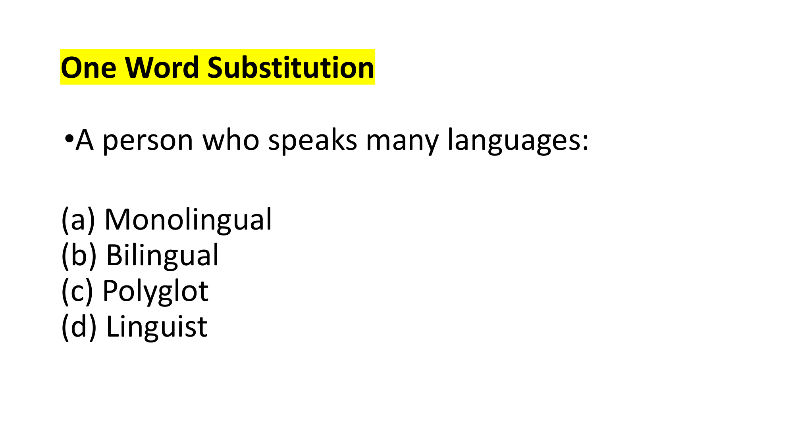  
A person who speaks many languages:

#### Options
- **(a)** Monolingual
- **(b)** Bilingual
- **(c)** Polyglot
- **(d)** Linguist

#### Lexical & Etymological Disambiguation
- `Monolingual`: Speaking only one language (*mono-* = one).
- `Bilingual`: Speaking two languages (*bi-* = two).
- `Linguist`: A person skilled in foreign languages or a scholar who studies linguistics (scientific structure of language).
- `Polyglot`: From Greek *poluglōttos* (*polus* 'many' + *glōtta* 'tongue/language'). Specifically denotes a person who knows and is able to use several languages.

**Official Answer Key**: `11 → c`  
$$\mathbf{\text{Verified Answer: (c) Polyglot}}$$

---

## Spotting Error (Questions 12–13)

---

## Question 6: Speech Without Prior Preparation
**Question ID**: `INFY-SET2-11`  
- **Figure**:
  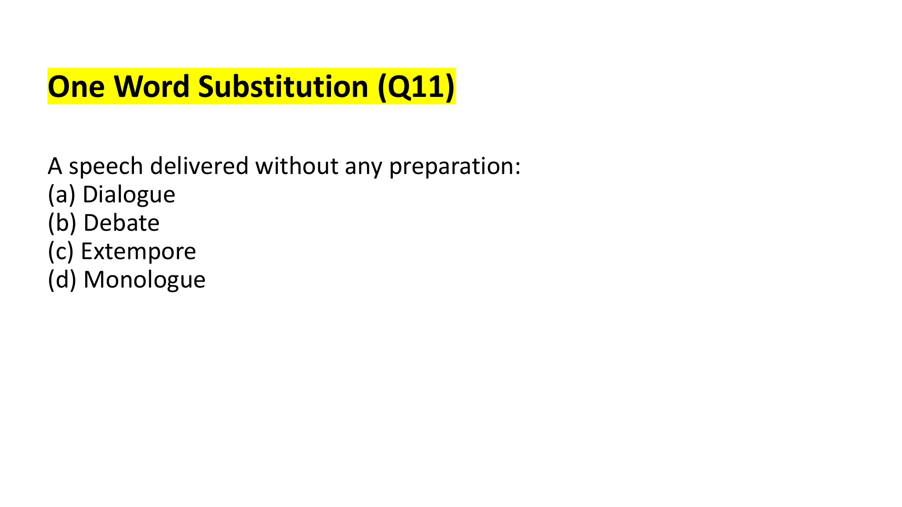  
A speech delivered without any preparation:

#### Options
- **(a)** Dialogue
- **(b)** Debate
- **(c)** Extempore
- **(d)** Monologue

#### Lexical & Etymological Disambiguation
- `Dialogue`: A conversation between two or more persons.
- `Debate`: A formal discussion on a particular matter in a public meeting or legislative assembly.
- `Monologue`: A long speech by one actor in a play or movie.
- `Extempore`: From Latin *ex tempore* ('out of the time / off the cuff'). Spoken or done without preparation; impromptu.

**Official Answer Key**: `11 → c`  
$$\mathbf{\text{Verified Answer: (c) Extempore}}$$

---

## Spotting Error (Questions 12–13)

---

## Question 7: One Word Substitution — Deceptive Pretender
**Question ID**: `INFY-PRAC-06`  
- **Figure**:
  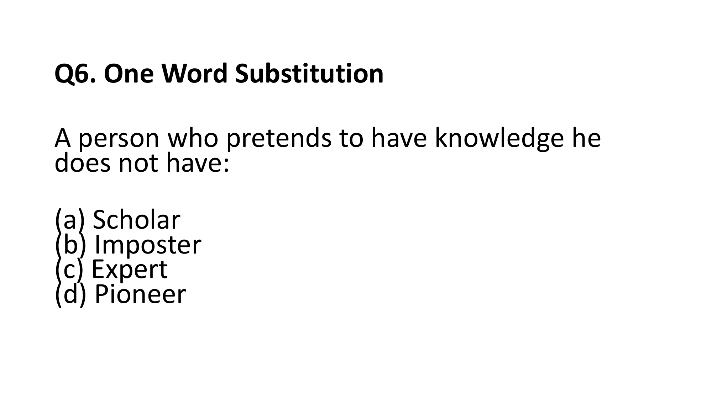  
A person who pretends to have knowledge he does not have:

#### Options
- **(a)** Scholar
- **(b)** Imposter / Charlatan
- **(c)** Expert
- **(d)** Pioneer

#### Lexical & Etymological Disambiguation
- `Scholar`: A specialist in a particular branch of study; a distinguished academic.
- `Expert`: A person who has comprehensive knowledge or skill in a particular area.
- `Pioneer`: A person who is among the first to explore or settle a new country or area of knowledge.
- `Imposter` (or *Charlatan*): A person who practices deception under an assumed character, identity, or pretended knowledge.

**Official Answer Key**: `6 → b`  
$$\mathbf{\text{Verified Answer: (b) Imposter}}$$

---

---

## Question 8: Idioms & Phrases — "Burn the Midnight Oil"
**Question ID**: `INFY-PRAC-10`  
- **Figure**:
  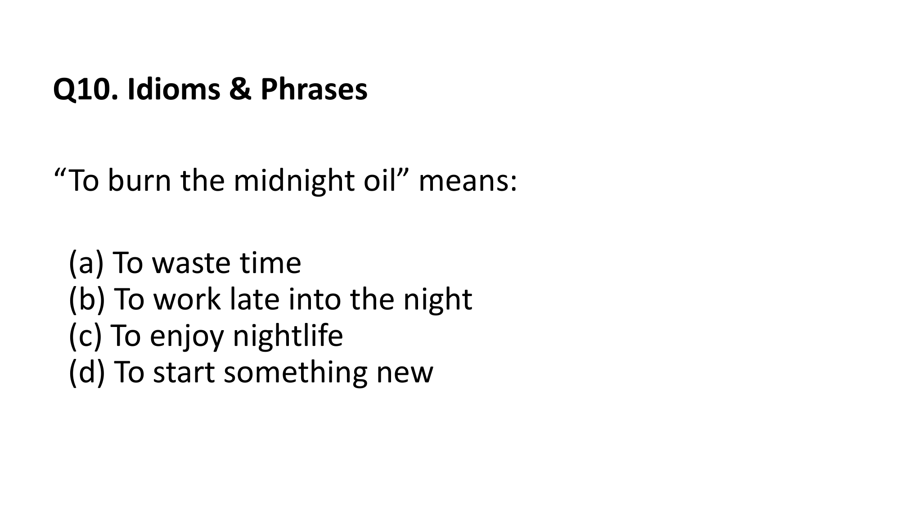  
“To burn the midnight oil” means:

#### Options
- **(a)** To waste time
- **(b)** To work late into the night
- **(c)** To enjoy nightlife
- **(d)** To start something new

#### Historical Origin & Meaning
- Historically, before electric lighting was invented, scholars and diligent workers burned oil in oil lamps to read and work late into the evening.
- The idiom figurative meaning is **to work or study late into the night**.

**Official Answer Key**: `10 → b`  
$$\mathbf{\text{Verified Answer: (b) To work late into the night}}$$

---

---

## Question 9: Punctuation — Contraction vs. Possessive
**Question ID**: `INFY-PRAC-12`  
- **Figure**:
  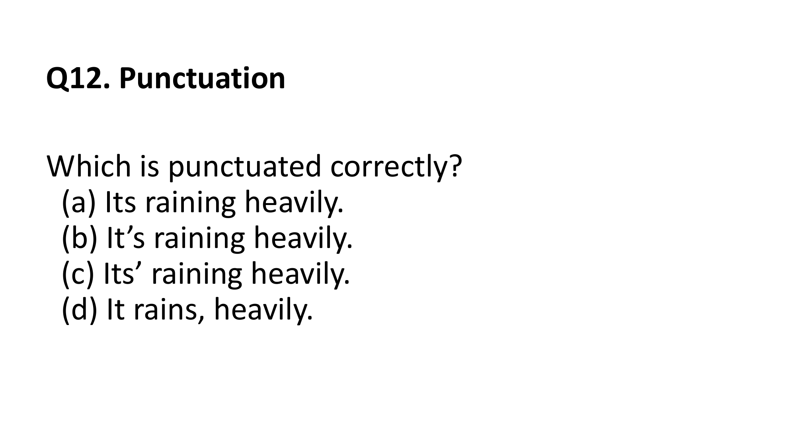  
Which is punctuated correctly?

#### Options
- **(a)** Its raining heavily.
- **(b)** It’s raining heavily.
- **(c)** Its’ raining heavily.
- **(d)** It rains, heavily.

#### Orthographic & Grammatical Rules
- **`It's`** (with an apostrophe) is the **contraction** of *It is* or *It has* (e.g., *It is raining heavily* $\to$ *It's raining heavily*).
- **`Its`** (without an apostrophe) is the **possessive pronoun/determiner** (e.g., *The cat licked its paw*).
- `Its'` with a trailing apostrophe does not exist in standard English.
- The sentence requires the subject pronoun + verb contraction: **`It's raining heavily.`**

**Official Answer Key**: `12 → b`  
$$\mathbf{\text{Verified Answer: (b) It’s raining heavily.}}$$

---

---

## Question 10: Confusable Words — "Affect" vs. "Effect"
**Question ID**: `INFY-PRAC-15`  
- **Figure**:
  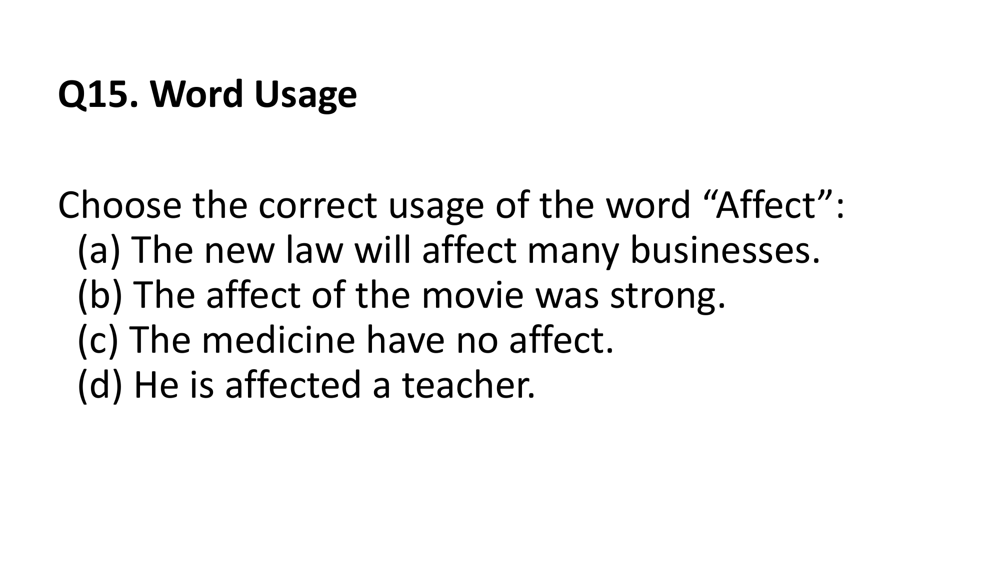  
Choose the correct usage of the word “Affect”:

#### Options
- **(a)** The new law will affect many businesses.
- **(b)** The affect of the movie was strong.
- **(c)** The medicine have no affect.
- **(d)** He is affected a teacher.

#### Grammatical & Semantic Disambiguation
- **`Affect`** (Verb): To produce an effect on, to influence, to alter or impress (e.g., *The weather affects my mood*).
- **`Effect`** (Noun): A change which is a result or consequence of an action (e.g., *The effect of the drug was immediate*).
- In Option (a), `affect` functions correctly as a transitive verb following the modal auxiliary `will`: *"The new law will affect [influence] many businesses."*
- In Options (b) and (c), the word needed is the noun **`effect`** (*The effect of the movie*, *The medicine had no effect*).
- Option (d) is syntactically corrupt.

**Official Answer Key**: `15 → a`  
$$\mathbf{\text{Verified Answer: (a) The new law will affect many businesses.}}$$

---

### Official Answer Key Slide Verification
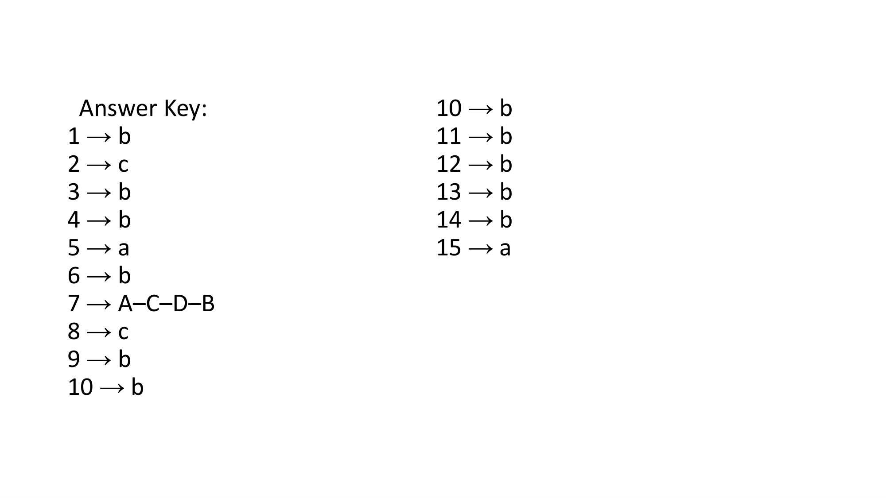

## 📊 Summary Assessment Matrix (Topic 04 - Practice Questions)

| Question ID | Tested Competency | Key Grammatical / Analytical Rule | Official Key |
| :---: | :--- | :--- | :---: |
| `INFY-PRAC-01` | Sentence Correction | Unified collective noun takes singular verb: `has` | **(b)** |
| `INFY-PRAC-02` | Fill in the Blanks | Fixed preposition: `interested in` | **(c)** |
| `INFY-PRAC-03` | Mini RC Extraction | Cause & effect: `Reduced productivity` | **(b)** |
| `INFY-PRAC-04` | Verbal Analogy | Utensil to action: `Fork : Eating` | **(b)** |
| `INFY-PRAC-05` | Spotting Error | Distributive pronoun agreement: `Each of the girls has` | **(a)** |
| `INFY-PRAC-06` | One Word Substitution | Deceptive claimant: `Imposter` | **(b)** |
| `INFY-PRAC-07` | Para Jumbles | Chronological twilight sequence: `A – C – D – B` | **A-C-D-B** |
| `INFY-PRAC-08` | Sentence Completion | Prior past action: Past Perfect `had escaped` | **(c)** |
| `INFY-PRAC-09` | Sentence Selection | Bare infinitive after auxiliary: `She doesn't like` | **(b)** |
| `INFY-PRAC-10` | Idioms & Phrases | Definition: `burn the midnight oil` $\to$ work late | **(b)** |
| `INFY-PRAC-11` | Critical Reasoning | Renewable investment premise: Sustainable alternative | **(b)** |
| `INFY-PRAC-12` | Punctuation | Contraction of *it is*: `It's raining heavily` | **(b)** |
| `INFY-PRAC-13` | Reflexive Pronouns | Self-directed transitive action: `cut himself` | **(b)** |
| `INFY-PRAC-14` | Spelling Correction | "I before E except after C": `Receive` | **(b)** |
| `INFY-PRAC-15` | Word Usage | Functional verb: `affect many businesses` | **(a)** |

---
