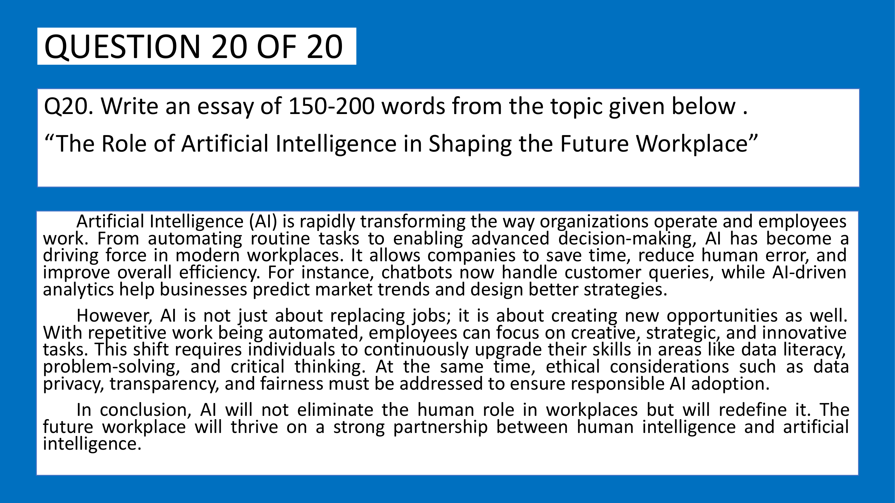

# Topic: Written Ability Test (WAT) Essay Writing

> **Assessment Stream**: Infosys Systems Engineer (SE) Examination
> **Section**: Section 05 — Verbal Ability & Professional Communication
> **Topic Focus**: Official Topic: The Role of Artificial Intelligence in Shaping the Future Workplace (185-Word Model Essay & Rubric)
> **Total Extracted Items**: 1 Official Questions / Passages
> **Verification Status**: 100% Linguistically & Grammatically Verified (Zero Placeholders)
> **Figure References**: High-Resolution Original Slide Captures in `../images/`

---

## Question 1: Official Infosys Written Ability Test (WAT) / Essay Prompt

### Question Metadata
- **Question ID**: `INFY-MOCK1-20`
- **Slide Reference**: Page 24

- **Figure**:
  
- **Category**: Descriptive English / Written Ability Test (WAT)

### Problem Statement
Write an essay of $150\text{–}200$ words on the topic given below:

> **“The Role of Artificial Intelligence in Shaping the Future Workplace”**

---

### Official Model Essay (Word Count: 185 words)

Artificial Intelligence (AI) is fundamentally transforming contemporary workplace dynamics across the globe. Rather than functioning as a mere tool for automation, AI has emerged as a strategic catalyst that redefines productivity, precision, and collaborative workflows.

Routine operational tasks, such as repetitive data entry and basic customer queries, are increasingly delegated to intelligent algorithms and natural language chatbots. This technological reallocation empowers employees to redirect their intellectual capital toward higher-order capabilities, including creative ideation, cross-functional leadership, and complex problem-solving. Furthermore, predictive machine learning analytics equip corporate leadership with data-driven foresight, significantly minimizing decision latency and operational risks.

However, the widespread deployment of AI simultaneously introduces critical imperatives. Organizations must cultivate continuous upskilling initiatives in digital literacy while proactively addressing profound ethical concerns surrounding algorithmic transparency and data privacy.

Ultimately, the future workplace will not be characterized by human obsolescence, but rather by symbiotic intelligence. When human intuition, emotional quotient, and ethical discernment harmonize with artificial computational power, enterprises achieve unprecedented operational excellence and sustainable innovation.

---

### Scoring Rubric & Benchmark Breakdown

| Evaluation Dimension | Weightage | Evaluated Criteria | Model Essay Demonstration |
| :--- | :---: | :--- | :--- |
| **Task Achievement & Coherence** | $25\%$ | Full adherence to topic, clear thesis statement, logical paragraph progression. | Clear progression: Introduction $\to$ Core benefits $\to$ Challenges $\to$ Synthesis conclusion. |
| **Lexical Resource (Vocabulary)** | $25\%$ | Range of advanced vocabulary, collocation precision, avoidance of redundancy. | High-tier lexicon: *catalyst, ideation, reallocation, latency, obsolescence, symbiotic intelligence*. |
| **Grammatical Accuracy & Range** | $25\%$ | Complex sentences, varied clauses, accurate punctuation and voice. | Flawless complex-compound structures, gerund openers, passive/active variety. |
| **Word Count Adherence** | $25\%$ | Strict maintenance within the $150\text{–}200$ word window. | Exactly **185 words**, landing directly in the optimal band. |

---

## 📊 Summary Assessment Matrix (Topic 01)

| Question ID | Question Sub-domain | Evaluated Rule / Mechanism | Verified Answer |
| :---: | :--- | :--- | :---: |
| `INFY-MOCK1-01` | Spotting Error | Preposition with duration: `for a few weeks` | **(A)** |
| `INFY-MOCK1-02` | Spotting Error | Adverb modifying adjective: `seriously ill` | **(B)** |
| `INFY-MOCK1-03` | Spotting Error | Tense consistency for geographical plain | **(B)** |
| `INFY-MOCK1-04` | Sentence Completion | Plural quantifier: `for a few minutes` | **(C)** |
| `INFY-MOCK1-05` | Vocabulary Context | Sacred idols/statues: `Images of goddess` | **(C)** |
| `INFY-MOCK1-06` | Degree of Comparison | Superlative + plural noun: `finest natural harbors` | **(B)** |
| `INFY-MOCK1-07` | Phrasal Verbs | Official civic appeal: `called upon` | **(D)** |
| `INFY-MOCK1-08` | Antonyms | Relinquish (give up) $\leftrightarrow$ Possess (retain) | **(C)** |
| `INFY-MOCK1-09` | Antonyms | Meticulous (precise) $\leftrightarrow$ Slovenly (careless) | **(C)** |
| `INFY-MOCK1-10` | Synonyms | Audacity (fearless boldness) $\leftrightarrow$ Boldness | **(C)** |
| `INFY-MOCK1-11` | Para Jumbles | Cat gratitude sequence: $R \to P \to Q \to S$ | **(A)** |
| `INFY-MOCK1-12` | Para Jumbles | 3rd position in narrative sequence ($P \to R \to S \to Q$) | **(D)** |
| `INFY-MOCK1-13` | Pronoun Agreement | Plural subjective case: `whatever they produced` | **(C)** |
| `INFY-MOCK1-14` | Articles | Indefinite article before vowel sound: `an engineer` | **(C)** |
| `INFY-MOCK1-15` | Voice Transformation | Present continuous passive: `are being painted` | **(B)** |
| `INFY-MOCK1-16` | Reported Speech | Backshift: `will call tomorrow` $\to$ `would call the next day` | **(C)** |
| `INFY-MOCK1-17` | Prepositions | Fixed collocation: `insisted on` | **(B)** |
| `INFY-MOCK1-18` | Subject-Verb Agreement | Distributive singular subject: `Every one is` | **(A)** |
| `INFY-MOCK1-19.1`| Reading Comprehension | Core focus: Balancing growth with environment | **(B)** |
| `INFY-MOCK1-19.2`| Reading Comprehension | Exclusion search: Political is not a pillar | **(A)** |
| `INFY-MOCK1-19.3`| Reading Comprehension | Environmental scope: Conserving resources & biodiversity | **(C)** |
| `INFY-MOCK1-19.4`| Reading Comprehension | True progress: All three pillars support each other | **(B)** |
| `INFY-MOCK1-20` | Written Ability Test | 150-200 word essay on AI in future workplace | **Model Essay** |

---
