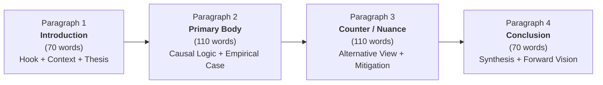

# Section 05 – Reference, Formulas & Exam Cheatsheet
## Topic 00: Infosys Verbal Ability & Essay Assessment Master Rules & Cheatsheet
**Target Exam:** Infosys Systems Engineer (SE) & Specialist Programmer (SP)  
**Domain:** Section 05 – Verbal Ability & Written Ability Test (Grammar & Essay)  
**Standard:** Infosys Standardized English Proficiency & Syntactic Evaluation Framework  

---

## 👑 1. Subject–Verb Agreement Golden Decision Matrix

| Rule Category | Grammatical Principle | Formula / Syntax Rule | Canonical Exam Example |
|:---|:---|:---|:---|
| **Basic Agreement** | Subject number dictates verb number | Singular Subject $\rightarrow$ Singular Verb; Plural $\rightarrow$ Plural | *The criteria **are** clear; the datum **is** verified.* |
| **Distributive Pronouns** | Distributives are grammatically singular | *Each, Every, Either, Neither, Someone, Nobody* $\rightarrow$ Singular Verb | *Each of the participants **has** submitted the form.* |
| **One of the + Plural Noun** | Subject is 'One', not the plural object | *One of + Plural Noun* $\rightarrow$ **Singular Verb** | *One of the candidates **is** absent today.* |
| **One of the... Who/That** | Relative pronoun modifies plural noun | *One of the + Plural Noun + Who/That* $\rightarrow$ **Plural Verb** | *He is one of the employees who **have** excelled.* |
| **The Only One of the... Who** | Restrictive 'only' isolates single agent | *The only one of + Plural Noun + Who* $\rightarrow$ **Singular Verb** | *He is the only one of the workers who **has** stayed.* |
| **Correlative Conjunctions** | Rule of Proximity (agrees with nearer subject) | *Either...or / Neither...nor / Not only...but also* $\rightarrow$ Verb agrees with $S_2$ | *Neither the manager nor the engineers **were** ready.* |
| **Parenthetical Additions** | Intervening phrases do not alter main subject | *Subject + (along with, as well as, together with, in addition to, besides) + Noun* $\rightarrow$ Verb agrees with **Main Subject** | *The CEO, along with his directors, **is** attending.* |
| **A number of vs The number of** | Indefinite collection vs Definite count | *A number of + Plural Noun* $\rightarrow$ **Plural Verb** *The number of + Plural Noun* $\rightarrow$ **Singular Verb** | *A number of issues **have** arisen.* *The number of defects **has** decreased.* |
| **Collective Nouns** | Unified action vs Individual discord | Acting as single unit $\rightarrow$ **Singular** Acting as separate individuals $\rightarrow$ **Plural** | *The committee **has** made its decision.* *The jury **were** divided in their opinions.* |
| **Plural in Form, Singular in Meaning** | Nouns ending in '-s' denoting disciplines/diseases | *Mathematics, Physics, Economics, Politics, News, Measles* $\rightarrow$ **Singular Verb** | *The news **was** shocking to everyone.* |

---

## ⏱️ 2. Tenses, Conditionals & Inversion Formulas Matrix

### 2.1 Conditional Sentence Structures

| Conditional Type | If-Clause (Condition) | Main Clause (Result) | Inversion Formula (No 'If') | High-Frequency Exam Example |
|:---:|:---|:---|:---|:---|
| **Zero** | Simple Present ($V_1$) | Simple Present ($V_1$) | - | *If you heat ice, it **melts**.* |
| **First (Realistic)** | Simple Present ($V_1$) | Future Simple (*will / can + $V_1$*) | *Should + Subject + $V_1$* | *If he **submits** on time, he **will pass**.* *(**Should** he submit on time, he will pass.)* |
| **Second (Hypothetical)** | Simple Past ($V_2$ / *Were*) | Conditional (*would / could + $V_1$*) | *Were + Subject + (to $V_1$ / Noun)* | *If I **were** you, I **would accept**.* *(**Were** I you, I would accept.)* |
| **Third (Past Unreal)** | Past Perfect (*had + $V_3$*) | Perfect Conditional (*would have + $V_3$*) | *Had + Subject + $V_3$* | *If she **had known**, she **would have helped**.* *(**Had** she known, she would have helped.)* |

### 2.2 Negative Adverbial Fronting Inversions
When negative, restrictive, or correlative adverbials initiate a clause, subject-auxiliary inversion is mandatory:

$$\text{Negative Adverbial} + \text{Auxiliary Verb} + \text{Subject} + \text{Main Verb}$$

| Initial Negative Phrase | Inversion Structure | Correlative Conjunction | Correct Exam Sentence |
|:---|:---|:---:|:---|
| **No sooner** | *No sooner had + S + $V_3$* | **than** | *No sooner **had he arrived than** the meeting commenced.* |
| **Hardly / Scarcely / Barely** | *Hardly had + S + $V_3$* | **when** | *Hardly **had we started when** the power failed.* |
| **Seldom / Rarely** | *Seldom do/does/did + S + $V_1$* | - | *Seldom **have I seen** such extraordinary discipline.* |
| **Under no circumstances** | *Under no circumstances should/can + S + $V_1$* | - | *Under no circumstances **should employees disclose** private keys.* |
| **Not only** | *Not only did/is/was + S + V* | **but also** | *Not only **did he pass**, but he also topped the state.* |

---

## ⚖️ 3. The Mandative Subjunctive Mood Rule

> [!IMPORTANT]
> **Subjunctive Formula:** Verbs and adjectives expressing order, demand, insistence, recommendation, or necessity are followed by a *that*-clause utilizing the **base form of the verb** ($V_1$), with zero inflection (no *-s*, no *-ed*, and *be* instead of *is/was*).

$$\text{Subject} + [\text{Mandative Verb}] + \text{that} + \text{Subject}_2 + \mathbf{V_1 \text{ (Base Form)}}$$

- **Mandative Verbs:** *demand, insist, recommend, suggest, urge, require, mandate, request, propose*.
- **Mandative Adjectives:** *imperative, essential, vital, crucial, mandatory, necessary*.

| Incorrect Exam Trap | Correct Subjunctive Form | Grammatical Rationale |
|:---|:---|:---|
| *The manager insisted that he **submits** the report.* | *The manager insisted that he **submit** the report.* | Subjunctive demands base verb *submit*, not third-person singular *submits*. |
| *It is vital that she **is** present at the hearing.* | *It is vital that she **be** present at the hearing.* | Subjunctive demands base form *be*, not indicative *is*. |
| *The doctor recommended that he **takes** a complete rest.* | *The doctor recommended that he **take** a complete rest.* | Base form *take* required after reporting verb *recommended*. |

---

## 🎯 4. Prepositional Collocations & Idiomatic Combinations

| Adjective / Verb | Mandatory Preposition | Prohibited Exam Trap | Illustrative Context |
|:---|:---:|:---:|:---|
| **Good / Bad / Skilled** | **at** | *in* (Incorrect: *good in math*) | *She is extraordinarily good **at** calculus.* |
| **Senior / Junior / Superior / Inferior** | **to** | *than* (Incorrect: *senior than me*) | *He is five years senior **to** me in seniority.* |
| **Prefer / Preferable** | **to** | *than* (Incorrect: *prefer tea than coffee*) | *I prefer architectural modularity **to** monoliths.* |
| **Cope** | **with** | *up with* (Incorrect: *cope up with*) | *He struggled to cope **with** the rigorous workload.* |
| **Comprise** | *(No preposition)* | *of* (Incorrect: *the book comprises of*) | *The syllabus **comprises** five modules.* (*is composed of*) |
| **Different** | **from** | *than* / *to* | *This architecture is significantly different **from** the legacy one.* |
| **Abstain / Refrain** | **from** | *to* / *of* | *Drivers must refrain **from** using mobile devices.* |
| **Congruent / Consistent** | **with** | *to* / *for* | *The experimental findings were consistent **with** the hypothesis.* |
| **Accused** | **of** | *for* (Incorrect: *accused for theft*) | *The official was accused **of** administrative negligence.* |
| **Congratulate** | **on** | *for* (Incorrect: *congratulate for*) | *We congratulated her **on** securing the promotion.* |

---

## 🚫 5. Redundancy Traps & Indianisms Elimination Catalog

| Redundant / Non-Standard Phrase | Standard Concise English | Linguistic Error Identified |
|:---|:---|:---|
| *Cope up with* | **Cope with** | Prepositional redundancy (Indianism) |
| *Revert back* | **Revert** | Lexical tautology ('re-' already means back) |
| *Return back* | **Return** | Redundant directional adverb |
| *Discuss about* | **Discuss** | Transitive verb taking direct noun object |
| *Order for food* | **Order food** | Transitive verb requiring zero preposition |
| *Comprise of* | **Comprise / Consist of** | Confusion between active comprise and composed of |
| *Passed out from college* | **Graduated from college** | Semantic mismatch ('pass out' = lose consciousness) |
| *More better / Most unique* | **Better / Unique** | Double comparative / Non-gradable absolute adjective |
| *Reason is because...* | **Reason is that...** | Tautological connective redundancy |

---

## 💡 6. Essential Placement Idioms & Phrasal Verbs Matrix

| Idiomatic Expression | Literal Origin / Figurative Meaning | Practical Exam Usage Sentence |
|:---|:---|:---|
| **Hit the nail on the head** | State the exact truth; diagnose correctly | *The lead architect hit the nail on the head regarding the bottleneck.* |
| **Bite the bullet** | Face an inevitable hardship with courage | *Management decided to bite the bullet and rewrite the legacy codebase.* |
| **A blessing in disguise** | Apparent misfortune yielding beneficial outcome | *Failing the initial trial was a blessing in disguise as it exposed edge cases.* |
| **Break the ice** | Relieve interpersonal tension in a group | *The interactive workshop served to break the ice among new recruits.* |
| **Spill the beans** | Inadvertently disclose confidential information | *The junior developer accidentally spilled the beans on the upcoming release.* |
| **A white elephant** | Extremely costly possession devoid of utility | *The decommissioned mainframe server turned into a white elephant.* |
| **A bone of contention** | Persistent subject of bitter dispute | *Resource allocation across cloud zones remained a bone of contention.* |
| **At the eleventh hour** | At the latest possible critical juncture | *The security patch was pushed at the eleventh hour before deployment.* |
| **Burn the midnight oil** | Study or perform laborious work late into the night | *The engineering team burned the midnight oil to meet the sprint deadline.* |
| **Once in a blue moon** | With exceptional rarity | *Unscheduled zero-day downtime occurs once in a blue moon.* |

---

## 🧬 7. Classical Etymological Roots for Rapid Vocabulary Decoding

| Root Element | Linguistic Origin | Core Meaning | Standard Exam Vocabulary Derivations |
|:---:|:---:|:---|:---|
| **Phil- / -phile** | Greek | Love, affinity, affection | *Bibliophile* (book lover), *Philanthropist* (lover of mankind), *Philology* |
| **Mis- / Miso-** | Greek | Hatred, aversion, contempt | *Misanthrope* (hater of humanity), *Misogynist* (hater of women) |
| **Omni-** | Latin | All, universally pervasive | *Omniscient* (all-knowing), *Omnipotent* (all-powerful), *Omnipresent* |
| **Loqu- / Locut-** | Latin | Speech, oral articulation | *Loquacious* (extremely talkative), *Eloquent* (persuasively spoken), *Colloquial* |
| **Chron-** | Greek | Time, temporal progression | *Chronological* (ordered by time), *Synchronous* (concurrent), *Anachronism* |
| **Mal-** | Latin | Bad, defective, harmful | *Malevolent* (wishing evil), *Malfeasance* (wrongdoing), *Malfunction* |
| **Bene-** | Latin | Good, favorable, well | *Benevolent* (kindly), *Benefactor* (patron), *Beneficial* |
| **Vor- / -vore** | Latin | Swallow, devour, feed upon | *Voracious* (insatiable appetite), *Carnivore*, *Herbivore*, *Omnivore* |

---

## 📝 8. Infosys Essay Writing (WAT) 4-Paragraph Blueprint & Rubric

| Essay Dimension | Prescribed Metric | Operational Recommendation |
|:---|:---:|:---|
| **Target Length** | **300 – 400 words** | Strive for ~350 words; guarantees depth without losing time. |
| **Paragraph Count** | **Strictly 4 Paragraphs** | Avoid single monolithic block; avoid hyper-fragmented 1-sentence paragraphs. |
| **Discourse Markers** | **Academic Connectives** | Use *'Underpinning this phenomenon is...'*, *'Conversely'*, *'Consequently'*, *'Furthermore'*. |
| **Tone & Style** | **Objective & Analytical** | Avoid colloquial slang, SMS shorthand, excessive emotional hyperbole, and second-person direct address (*'you'*). |