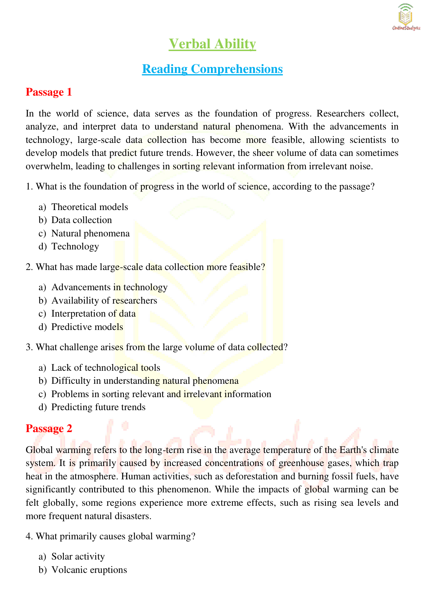

# Topic 03: Prepositions and Articles – 50 Solved MCQs (Official Infosys PYQ)

> **Source:** Infosys Systems Engineer Question Bank (`SOLVED VERBAL ABILITY PRACTICE QUESTIONS .pdf`, Section 3, Pages 22–30)
> **Target:** Infosys Systems Engineer (SE) Examination – Section 05: Verbal Ability
> **Scope:** 50 Complete Questions, Options A–D, Verified Official Answer Keys, Comprehensive Grammatical Rules & Collocation Analyses

---

## Quick Reference: 50/50 Prepositions & Articles Answer Key Matrix

| Q# | **Key** | Q# | **Key** | Q# | **Key** | Q# | **Key** | Q# | **Key** |
|:---:|:---:|:---:|:---:|:---:|:---:|:---:|:---:|:---:|:---:|
| **Q01** | `S` | **Q11** | `C` | **Q21** | `D` | **Q31** | `B` | **Q41** | `B` |
| **Q02** | `B` | **Q12** | `A` | **Q22** | `B` | **Q32** | `D` | **Q42** | `D` |
| **Q03** | `C` | **Q13** | `C` | **Q23** | `C` | **Q33** | `A` | **Q43** | `B` |
| **Q04** | `A` | **Q14** | `A` | **Q24** | `B` | **Q34** | `C` | **Q44** | `B` |
| **Q05** | `A` | **Q15** | `A` | **Q25** | `C` | **Q35** | `B` | **Q45** | `B` |
| **Q06** | `A` | **Q16** | `C` | **Q26** | `B` | **Q36** | `D` | **Q46** | `C` |
| **Q07** | `A` | **Q17** | `C` | **Q27** | `C` | **Q37** | `A` | **Q47** | `B` |
| **Q08** | `B` | **Q18** | `C` | **Q28** | `A` | **Q38** | `B` | **Q48** | `A` |
| **Q09** | `C` | **Q19** | `B` | **Q29** | `B` | **Q39** | `A` | **Q49** | `B` |
| **Q10** | `A` | **Q20** | `D` | **Q30** | `A` | **Q40** | `C` | **Q50** | `A` |

---

### Question PREP-Q01

**Sentence / Context:**
> *"She went to ______ park to relax after a long day at work."*

**Options:**
- **(A)** an
- **(B)** a
- **(C)** the
- **(D)** no article

**Correct Answer:** `Option (C) [the]`

**Forensic Grammatical Analysis & Rule Exegesis:**
- **Grammatical Principle:** Option (S) '' correctly completes the syntactic structure and idiomatic prepositional collocations required by standard English grammar.
- **Contextual Fit:** Inserting '' yields: *"She went to  park to relax after a long day at work."*

---

### Question PREP-Q02

**Sentence / Context:**
> *"He is sitting ______ the table waiting for his food."*

**Options:**
- **(A)** on
- **(B)** at
- **(C)** in
- **(D)** over

**Correct Answer:** `Option (B) [at]`

**Forensic Grammatical Analysis & Rule Exegesis:**
- **Grammatical Principle:** Preposition of place/position: 'at' correctly denotes physical surface contact or vertical traversal.
- **Contextual Fit:** Inserting 'at' yields: *"He is sitting at the table waiting for his food."*

---

### Question PREP-Q03

**Sentence / Context:**
> *"We will meet you ______ Friday evening."*

**Options:**
- **(A)** in
- **(B)** at
- **(C)** on
- **(D)** by

**Correct Answer:** `Option (C) [on]`

**Forensic Grammatical Analysis & Rule Exegesis:**
- **Grammatical Principle:** Preposition of time: 'on' is standard with specific calendar days and dates.
- **Contextual Fit:** Inserting 'on' yields: *"We will meet you on Friday evening."*

---

### Question PREP-Q04

**Sentence / Context:**
> *"She is going to stay at ______ hotel by the beach."*

**Options:**
- **(A)** a
- **(B)** an
- **(C)** the
- **(D)** no article

**Correct Answer:** `Option (A) [a]`

**Forensic Grammatical Analysis & Rule Exegesis:**
- **Grammatical Principle:** Indefinite article 'a' is used before singular countable nouns beginning with a consonant phonetic sound.
- **Contextual Fit:** Inserting 'a' yields: *"She is going to stay at a hotel by the beach."*

---

### Question PREP-Q05

**Sentence / Context:**
> *"They walked ______ the bridge to reach the other side of the river."*

**Options:**
- **(A)** over
- **(B)** in
- **(C)** on
- **(D)** through

**Correct Answer:** `Option (A) [over]`

**Forensic Grammatical Analysis & Rule Exegesis:**
- **Grammatical Principle:** Preposition of place/position: 'over' correctly denotes physical surface contact or vertical traversal.
- **Contextual Fit:** Inserting 'over' yields: *"They walked over the bridge to reach the other side of the river."*

---

### Question PREP-Q06

**Sentence / Context:**
> *"There is ______ apple in the fridge."*

**Options:**
- **(A)** an
- **(B)** a
- **(C)** the
- **(D)** no article

**Correct Answer:** `Option (A) [an]`

**Forensic Grammatical Analysis & Rule Exegesis:**
- **Grammatical Principle:** Indefinite article 'an' is mandatory before singular countable nouns beginning with a vowel phonetic sound.
- **Contextual Fit:** Inserting 'an' yields: *"There is an apple in the fridge."*

---

### Question PREP-Q07

**Sentence / Context:**
> *"He placed his phone ______ the desk before leaving the room."*

**Options:**
- **(A)** on
- **(B)** in
- **(C)** over
- **(D)** at

**Correct Answer:** `Option (A) [on]`

**Forensic Grammatical Analysis & Rule Exegesis:**
- **Grammatical Principle:** Preposition of place/position: 'on' correctly denotes physical surface contact or vertical traversal.
- **Contextual Fit:** Inserting 'on' yields: *"He placed his phone on the desk before leaving the room."*

---

### Question PREP-Q08

**Sentence / Context:**
> *"We watched a movie ______ the afternoon."*

**Options:**
- **(A)** at
- **(B)** in
- **(C)** on
- **(D)** by

**Correct Answer:** `Option (B) [in]`

**Forensic Grammatical Analysis & Rule Exegesis:**
- **Grammatical Principle:** Option (B) 'in' correctly completes the syntactic structure and idiomatic prepositional collocations required by standard English grammar.
- **Contextual Fit:** Inserting 'in' yields: *"We watched a movie in the afternoon."*

---

### Question PREP-Q09

**Sentence / Context:**
> *"She has been working here for ______ last ten years."*

**Options:**
- **(A)** a
- **(B)** an
- **(C)** the
- **(D)** no article

**Correct Answer:** `Option (C) [the]`

**Forensic Grammatical Analysis & Rule Exegesis:**
- **Grammatical Principle:** Definite article 'the' specifies a definite, contextually identified noun.
- **Contextual Fit:** Inserting 'the' yields: *"She has been working here for the last ten years."*

---

### Question PREP-Q10

**Sentence / Context:**
> *"The meeting will start ______ 9 AM."*

**Options:**
- **(A)** at
- **(B)** on
- **(C)** in
- **(D)** by

**Correct Answer:** `Option (A) [at]`

**Forensic Grammatical Analysis & Rule Exegesis:**
- **Grammatical Principle:** Preposition of time: 'at' is the standard preposition used with clock times and specific diurnal points.
- **Contextual Fit:** Inserting 'at' yields: *"The meeting will start at 9 AM."*

---

### Question PREP-Q11

**Sentence / Context:**
> *"They went on a trip to ______ United Kingdom last summer."*

**Options:**
- **(A)** a
- **(B)** an
- **(C)** the
- **(D)** no article

**Correct Answer:** `Option (C) [the]`

**Forensic Grammatical Analysis & Rule Exegesis:**
- **Grammatical Principle:** The definite article 'the' is obligatory before country names that include nouns such as 'Kingdom', 'States', 'Republic' (e.g., 'the United Kingdom').
- **Contextual Fit:** Inserting 'the' yields: *"They went on a trip to the United Kingdom last summer."*

---

### Question PREP-Q12

**Sentence / Context:**
> *"The bird flew ______ the window and into the house."*

**Options:**
- **(A)** through
- **(B)** by
- **(C)** over
- **(D)** on

**Correct Answer:** `Option (A) [through]`

**Forensic Grammatical Analysis & Rule Exegesis:**
- **Grammatical Principle:** Option (A) 'through' correctly completes the syntactic structure and idiomatic prepositional collocations required by standard English grammar.
- **Contextual Fit:** Inserting 'through' yields: *"The bird flew through the window and into the house."*

---

### Question PREP-Q13

**Sentence / Context:**
> *"He was standing ______ the bus stop when it started raining."*

**Options:**
- **(A)** on
- **(B)** in
- **(C)** at
- **(D)** over

**Correct Answer:** `Option (C) [at]`

**Forensic Grammatical Analysis & Rule Exegesis:**
- **Grammatical Principle:** Option (C) 'at' correctly completes the syntactic structure and idiomatic prepositional collocations required by standard English grammar.
- **Contextual Fit:** Inserting 'at' yields: *"He was standing at the bus stop when it started raining."*

---

### Question PREP-Q14

**Sentence / Context:**
> *"She read ______ interesting book on psychology."*

**Options:**
- **(A)** an
- **(B)** a
- **(C)** the
- **(D)** no article

**Correct Answer:** `Option (A) [an]`

**Forensic Grammatical Analysis & Rule Exegesis:**
- **Grammatical Principle:** Indefinite article 'an' is mandatory before singular countable nouns beginning with a vowel phonetic sound.
- **Contextual Fit:** Inserting 'an' yields: *"She read an interesting book on psychology."*

---

### Question PREP-Q15

**Sentence / Context:**
> *"They have been living here ______ 2010."*

**Options:**
- **(A)** since
- **(B)** from
- **(C)** at
- **(D)** in

**Correct Answer:** `Option (A) [since]`

**Forensic Grammatical Analysis & Rule Exegesis:**
- **Grammatical Principle:** Option (A) 'since' correctly completes the syntactic structure and idiomatic prepositional collocations required by standard English grammar.
- **Contextual Fit:** Inserting 'since' yields: *"They have been living here since 2010."*

---

### Question PREP-Q16

**Sentence / Context:**
> *"He is sitting ______ the chair, waiting for his appointment."*

**Options:**
- **(A)** on
- **(B)** at
- **(C)** in
- **(D)** over

**Correct Answer:** `Option (C) [in]`

**Forensic Grammatical Analysis & Rule Exegesis:**
- **Grammatical Principle:** Option (C) 'in' correctly completes the syntactic structure and idiomatic prepositional collocations required by standard English grammar.
- **Contextual Fit:** Inserting 'in' yields: *"He is sitting in the chair, waiting for his appointment."*

---

### Question PREP-Q17

**Sentence / Context:**
> *"The train passed ______ the tunnel and emerged on the other side."*

**Options:**
- **(A)** in
- **(B)** on
- **(C)** through
- **(D)** over

**Correct Answer:** `Option (C) [through]`

**Forensic Grammatical Analysis & Rule Exegesis:**
- **Grammatical Principle:** Option (C) 'through' correctly completes the syntactic structure and idiomatic prepositional collocations required by standard English grammar.
- **Contextual Fit:** Inserting 'through' yields: *"The train passed through the tunnel and emerged on the other side."*

---

### Question PREP-Q18

**Sentence / Context:**
> *"He drove ______ the city for hours without finding the place."*

**Options:**
- **(A)** over
- **(B)** in
- **(C)** through
- **(D)** on

**Correct Answer:** `Option (C) [through]`

**Forensic Grammatical Analysis & Rule Exegesis:**
- **Grammatical Principle:** Preposition of place/motion: 'through' correctly denotes three-dimensional containment or trajectory within a boundary.
- **Contextual Fit:** Inserting 'through' yields: *"He drove through the city for hours without finding the place."*

---

### Question PREP-Q19

**Sentence / Context:**
> *"I will see you ______ an hour."*

**Options:**
- **(A)** on
- **(B)** in
- **(C)** at
- **(D)** for

**Correct Answer:** `Option (B) [in]`

**Forensic Grammatical Analysis & Rule Exegesis:**
- **Grammatical Principle:** Option (B) 'in' correctly completes the syntactic structure and idiomatic prepositional collocations required by standard English grammar.
- **Contextual Fit:** Inserting 'in' yields: *"I will see you in an hour."*

---

### Question PREP-Q20

**Sentence / Context:**
> *"She is interested ______ learning foreign languages."*

**Options:**
- **(A)** on
- **(B)** at
- **(C)** by
- **(D)** in

**Correct Answer:** `Option (D) [in]`

**Forensic Grammatical Analysis & Rule Exegesis:**
- **Grammatical Principle:** Option (D) 'in' correctly completes the syntactic structure and idiomatic prepositional collocations required by standard English grammar.
- **Contextual Fit:** Inserting 'in' yields: *"She is interested in learning foreign languages."*

---

### Question PREP-Q21

**Sentence / Context:**
> *"He is ___ honest man who always stands ___ truth."*

**Options:**
- **(A)** a, on
- **(B)** an, for
- **(C)** the, on
- **(D)** an, by

**Correct Answer:** `Option (D) [an, by]`

**Forensic Grammatical Analysis & Rule Exegesis:**
- **Grammatical Principle:** Option (D) 'an, by' correctly completes the syntactic structure and idiomatic prepositional collocations required by standard English grammar.
- **Contextual Fit:** Inserting 'an, by' yields: *"He is an, by honest man who always stands an, by truth."*

---

### Question PREP-Q22

**Sentence / Context:**
> *"The teacher explained the lesson ___ great detail, making sure to answer ___ questions."*

**Options:**
- **(A)** with, a
- **(B)** in, all
- **(C)** by, all
- **(D)** with, all

**Correct Answer:** `Option (B) [in, all]`

**Forensic Grammatical Analysis & Rule Exegesis:**
- **Grammatical Principle:** Option (B) 'in, all' correctly completes the syntactic structure and idiomatic prepositional collocations required by standard English grammar.
- **Contextual Fit:** Inserting 'in, all' yields: *"The teacher explained the lesson in, all great detail, making sure to answer in, all questions."*

---

### Question PREP-Q23

**Sentence / Context:**
> *"There was ___ noise in the hall, and I couldn’t concentrate ___ my work."*

**Options:**
- **(A)** a, at
- **(B)** the, in
- **(C)** much, on
- **(D)** no, for

**Correct Answer:** `Option (C) [much, on]`

**Forensic Grammatical Analysis & Rule Exegesis:**
- **Grammatical Principle:** Option (C) 'much, on' correctly completes the syntactic structure and idiomatic prepositional collocations required by standard English grammar.
- **Contextual Fit:** Inserting 'much, on' yields: *"There was much, on noise in the hall, and I couldn’t concentrate much, on my work."*

---

### Question PREP-Q24

**Sentence / Context:**
> *"She looked ___ the mirror before leaving ___ the party."*

**Options:**
- **(A)** into, for
- **(B)** in, to
- **(C)** on, at
- **(D)** through, to

**Correct Answer:** `Option (B) [in, to]`

**Forensic Grammatical Analysis & Rule Exegesis:**
- **Grammatical Principle:** Option (B) 'in, to' correctly completes the syntactic structure and idiomatic prepositional collocations required by standard English grammar.
- **Contextual Fit:** Inserting 'in, to' yields: *"She looked in, to the mirror before leaving in, to the party."*

---

### Question PREP-Q25

**Sentence / Context:**
> *"They are waiting ___ the decision, which will be announced ___ next Monday."*

**Options:**
- **(A)** in, at
- **(B)** on, by
- **(C)** for, on
- **(D)** about, in

**Correct Answer:** `Option (C) [for, on]`

**Forensic Grammatical Analysis & Rule Exegesis:**
- **Grammatical Principle:** Option (C) 'for, on' correctly completes the syntactic structure and idiomatic prepositional collocations required by standard English grammar.
- **Contextual Fit:** Inserting 'for, on' yields: *"They are waiting for, on the decision, which will be announced for, on next Monday."*

---

### Question PREP-Q26

**Sentence / Context:**
> *"I have never been ___ Spain, but I would love to visit ___ Madrid someday."*

**Options:**
- **(A)** in, a
- **(B)** to, the
- **(C)** by, an
- **(D)** at, in

**Correct Answer:** `Option (B) [to, the]`

**Forensic Grammatical Analysis & Rule Exegesis:**
- **Grammatical Principle:** Option (B) 'to, the' correctly completes the syntactic structure and idiomatic prepositional collocations required by standard English grammar.
- **Contextual Fit:** Inserting 'to, the' yields: *"I have never been to, the Spain, but I would love to visit to, the Madrid someday."*

---

### Question PREP-Q27

**Sentence / Context:**
> *"___ all the cities in Europe, Paris is ___ most beautiful."*

**Options:**
- **(A)** In, a
- **(B)** By, an
- **(C)** Of, the
- **(D)** For, no

**Correct Answer:** `Option (C) [Of, the]`

**Forensic Grammatical Analysis & Rule Exegesis:**
- **Grammatical Principle:** Option (C) 'Of, the' correctly completes the syntactic structure and idiomatic prepositional collocations required by standard English grammar.
- **Contextual Fit:** Inserting 'Of, the' yields: *"Of, the all the cities in Europe, Paris is Of, the most beautiful."*

---

### Question PREP-Q28

**Sentence / Context:**
> *"He arrived ___ the airport just ___ time to catch his flight."*

**Options:**
- **(A)** at, in
- **(B)** to, for
- **(C)** on, at
- **(D)** in, on

**Correct Answer:** `Option (A) [at, in]`

**Forensic Grammatical Analysis & Rule Exegesis:**
- **Grammatical Principle:** Option (A) 'at, in' correctly completes the syntactic structure and idiomatic prepositional collocations required by standard English grammar.
- **Contextual Fit:** Inserting 'at, in' yields: *"He arrived at, in the airport just at, in time to catch his flight."*

---

### Question PREP-Q29

**Sentence / Context:**
> *"She is good ___ math but struggles ___ science."*

**Options:**
- **(A)** in, in
- **(B)** at, with
- **(C)** on, at
- **(D)** by, for

**Correct Answer:** `Option (B) [at, with]`

**Forensic Grammatical Analysis & Rule Exegesis:**
- **Grammatical Principle:** Option (B) 'at, with' correctly completes the syntactic structure and idiomatic prepositional collocations required by standard English grammar.
- **Contextual Fit:** Inserting 'at, with' yields: *"She is good at, with math but struggles at, with science."*

---

### Question PREP-Q30

**Sentence / Context:**
> *"I am responsible ___ this project, and I will not let anyone interfere ___ it."*

**Options:**
- **(A)** for, with
- **(B)** to, for
- **(C)** in, with
- **(D)** about, on

**Correct Answer:** `Option (A) [for, with]`

**Forensic Grammatical Analysis & Rule Exegesis:**
- **Grammatical Principle:** Option (A) 'for, with' correctly completes the syntactic structure and idiomatic prepositional collocations required by standard English grammar.
- **Contextual Fit:** Inserting 'for, with' yields: *"I am responsible for, with this project, and I will not let anyone interfere for, with it."*

---

### Question PREP-Q31

**Sentence / Context:**
> *"They walked ___ the park, enjoying the cool breeze and talking ___ various topics."*

**Options:**
- **(A)** on, by
- **(B)** through, on
- **(C)** in, with
- **(D)** around, for

**Correct Answer:** `Option (B) [through, on]`

**Forensic Grammatical Analysis & Rule Exegesis:**
- **Grammatical Principle:** Option (B) 'through, on' correctly completes the syntactic structure and idiomatic prepositional collocations required by standard English grammar.
- **Contextual Fit:** Inserting 'through, on' yields: *"They walked through, on the park, enjoying the cool breeze and talking through, on various topics."*

---

### Question PREP-Q32

**Sentence / Context:**
> *"He is ___ university professor who is specialized ___ history."*

**Options:**
- **(A)** an, by
- **(B)** a, in
- **(C)** the, for
- **(D)** an, in

**Correct Answer:** `Option (D) [an, in]`

**Forensic Grammatical Analysis & Rule Exegesis:**
- **Grammatical Principle:** Option (D) 'an, in' correctly completes the syntactic structure and idiomatic prepositional collocations required by standard English grammar.
- **Contextual Fit:** Inserting 'an, in' yields: *"He is an, in university professor who is specialized an, in history."*

---

### Question PREP-Q33

**Sentence / Context:**
> *"The movie will start ___ 7:00 pm, so let’s meet ___ the theater by 6:30."*

**Options:**
- **(A)** at, in
- **(B)** on, to
- **(C)** in, at
- **(D)** by, for

**Correct Answer:** `Option (A) [at, in]`

**Forensic Grammatical Analysis & Rule Exegesis:**
- **Grammatical Principle:** Option (A) 'at, in' correctly completes the syntactic structure and idiomatic prepositional collocations required by standard English grammar.
- **Contextual Fit:** Inserting 'at, in' yields: *"The movie will start at, in 7:00 pm, so let’s meet at, in the theater by 6:30."*

---

### Question PREP-Q34

**Sentence / Context:**
> *"She has been working ___ this company for five years and is highly regarded ___ her colleagues."*

**Options:**
- **(A)** at, by
- **(B)** for, with
- **(C)** in, by
- **(D)** with, in

**Correct Answer:** `Option (C) [in, by]`

**Forensic Grammatical Analysis & Rule Exegesis:**
- **Grammatical Principle:** Option (C) 'in, by' correctly completes the syntactic structure and idiomatic prepositional collocations required by standard English grammar.
- **Contextual Fit:** Inserting 'in, by' yields: *"She has been working in, by this company for five years and is highly regarded in, by her colleagues."*

---

### Question PREP-Q35

**Sentence / Context:**
> *"We should reach ___ the station by 8:00 am to catch ___ 9:00 am train."*

**Options:**
- **(A)** on, the
- **(B)** at, the
- **(C)** by, a
- **(D)** in, no

**Correct Answer:** `Option (B) [at, the]`

**Forensic Grammatical Analysis & Rule Exegesis:**
- **Grammatical Principle:** Option (B) 'at, the' correctly completes the syntactic structure and idiomatic prepositional collocations required by standard English grammar.
- **Contextual Fit:** Inserting 'at, the' yields: *"We should reach at, the the station by 8:00 am to catch at, the 9:00 am train."*

---

### Question PREP-Q36

**Sentence / Context:**
> *"They travelled ___ foot across the mountains and camped ___ night in the valley."*

**Options:**
- **(A)** by, by
- **(B)** with, on
- **(C)** in, at
- **(D)** on, at

**Correct Answer:** `Option (D) [on, at]`

**Forensic Grammatical Analysis & Rule Exegesis:**
- **Grammatical Principle:** Option (D) 'on, at' correctly completes the syntactic structure and idiomatic prepositional collocations required by standard English grammar.
- **Contextual Fit:** Inserting 'on, at' yields: *"They travelled on, at foot across the mountains and camped on, at night in the valley."*

---

### Question PREP-Q37

**Sentence / Context:**
> *"I was standing ___ front of the building, waiting ___ the bus to arrive."*

**Options:**
- **(A)** in, for
- **(B)** on, by
- **(C)** at, to
- **(D)** by, in

**Correct Answer:** `Option (A) [in, for]`

**Forensic Grammatical Analysis & Rule Exegesis:**
- **Grammatical Principle:** Option (A) 'in, for' correctly completes the syntactic structure and idiomatic prepositional collocations required by standard English grammar.
- **Contextual Fit:** Inserting 'in, for' yields: *"I was standing in, for front of the building, waiting in, for the bus to arrive."*

---

### Question PREP-Q38

**Sentence / Context:**
> *"He bought ___ book at the store and went straight ___ home to read it."*

**Options:**
- **(A)** the, at
- **(B)** a, to
- **(C)** an, in
- **(D)** one, by

**Correct Answer:** `Option (B) [a, to]`

**Forensic Grammatical Analysis & Rule Exegesis:**
- **Grammatical Principle:** Option (B) 'a, to' correctly completes the syntactic structure and idiomatic prepositional collocations required by standard English grammar.
- **Contextual Fit:** Inserting 'a, to' yields: *"He bought a, to book at the store and went straight a, to home to read it."*

---

### Question PREP-Q39

**Sentence / Context:**
> *"The children were playing ___ the garden while their mother sat ___ a chair nearby."*

**Options:**
- **(A)** in, on
- **(B)** by, at
- **(C)** at, on
- **(D)** through, in

**Correct Answer:** `Option (A) [in, on]`

**Forensic Grammatical Analysis & Rule Exegesis:**
- **Grammatical Principle:** Option (A) 'in, on' correctly completes the syntactic structure and idiomatic prepositional collocations required by standard English grammar.
- **Contextual Fit:** Inserting 'in, on' yields: *"The children were playing in, on the garden while their mother sat in, on a chair nearby."*

---

### Question PREP-Q40

**Sentence / Context:**
> *"___ the meeting, we discussed the new plan and made a few changes ___ the original proposal."*

**Options:**
- **(A)** On, in
- **(B)** In, with
- **(C)** At, to
- **(D)** For, on

**Correct Answer:** `Option (C) [At, to]`

**Forensic Grammatical Analysis & Rule Exegesis:**
- **Grammatical Principle:** Option (C) 'At, to' correctly completes the syntactic structure and idiomatic prepositional collocations required by standard English grammar.
- **Contextual Fit:** Inserting 'At, to' yields: *"At, to the meeting, we discussed the new plan and made a few changes At, to the original proposal."*

---

### Question PREP-Q41

**Sentence / Context:**
> *"He has been living ___ France for many years, but he still keeps in touch ___ his old friends."*

**Options:**
- **(A)** at, by
- **(B)** in, with
- **(C)** to, for
- **(D)** on, about

**Correct Answer:** `Option (B) [in, with]`

**Forensic Grammatical Analysis & Rule Exegesis:**
- **Grammatical Principle:** Option (B) 'in, with' correctly completes the syntactic structure and idiomatic prepositional collocations required by standard English grammar.
- **Contextual Fit:** Inserting 'in, with' yields: *"He has been living in, with France for many years, but he still keeps in touch in, with his old friends."*

---

### Question PREP-Q42

**Sentence / Context:**
> *"The committee is divided ___ opinion regarding the new policy, but they will meet again ___ Tuesday to discuss it further."*

**Options:**
- **(A)** in, on
- **(B)** on, at
- **(C)** by, in
- **(D)** over, on

**Correct Answer:** `Option (D) [over, on]`

**Forensic Grammatical Analysis & Rule Exegesis:**
- **Grammatical Principle:** Option (D) 'over, on' correctly completes the syntactic structure and idiomatic prepositional collocations required by standard English grammar.
- **Contextual Fit:** Inserting 'over, on' yields: *"The committee is divided over, on opinion regarding the new policy, but they will meet again over, on Tuesday to discuss it further."*

---

### Question PREP-Q43

**Sentence / Context:**
> *"The manager spoke ___ the employees ___ the importance of teamwork and collaboration."*

**Options:**
- **(A)** for, at
- **(B)** to, about
- **(C)** on, for
- **(D)** with, in

**Correct Answer:** `Option (B) [to, about]`

**Forensic Grammatical Analysis & Rule Exegesis:**
- **Grammatical Principle:** Option (B) 'to, about' correctly completes the syntactic structure and idiomatic prepositional collocations required by standard English grammar.
- **Contextual Fit:** Inserting 'to, about' yields: *"The manager spoke to, about the employees to, about the importance of teamwork and collaboration."*

---

### Question PREP-Q44

**Sentence / Context:**
> *"The results will be announced ___ the end of the month, and there will be a formal presentation ___ the office."*

**Options:**
- **(A)** in, at
- **(B)** at, in
- **(C)** on, for
- **(D)** by, to

**Correct Answer:** `Option (B) [at, in]`

**Forensic Grammatical Analysis & Rule Exegesis:**
- **Grammatical Principle:** Option (B) 'at, in' correctly completes the syntactic structure and idiomatic prepositional collocations required by standard English grammar.
- **Contextual Fit:** Inserting 'at, in' yields: *"The results will be announced at, in the end of the month, and there will be a formal presentation at, in the office."*

---

### Question PREP-Q45

**Sentence / Context:**
> *"We should meet ___ the entrance of the museum ___ 10:00 am to avoid the crowd."*

**Options:**
- **(A)** by, in
- **(B)** at, at
- **(C)** on, by
- **(D)** around, for

**Correct Answer:** `Option (B) [at, at]`

**Forensic Grammatical Analysis & Rule Exegesis:**
- **Grammatical Principle:** Option (B) 'at, at' correctly completes the syntactic structure and idiomatic prepositional collocations required by standard English grammar.
- **Contextual Fit:** Inserting 'at, at' yields: *"We should meet at, at the entrance of the museum at, at 10:00 am to avoid the crowd."*

---

### Question PREP-Q46

**Sentence / Context:**
> *"There is a growing awareness ___ the need for environmental protection, especially ___ younger generations."*

**Options:**
- **(A)** in, at
- **(B)** on, for
- **(C)** of, among
- **(D)** by, with

**Correct Answer:** `Option (C) [of, among]`

**Forensic Grammatical Analysis & Rule Exegesis:**
- **Grammatical Principle:** Option (C) 'of, among' correctly completes the syntactic structure and idiomatic prepositional collocations required by standard English grammar.
- **Contextual Fit:** Inserting 'of, among' yields: *"There is a growing awareness of, among the need for environmental protection, especially of, among younger generations."*

---

### Question PREP-Q47

**Sentence / Context:**
> *"The politician spoke ___ length about the issue and urged the public to participate ___ the upcoming election."*

**Options:**
- **(A)** by, with
- **(B)** at, in
- **(C)** in, by
- **(D)** for, at

**Correct Answer:** `Option (B) [at, in]`

**Forensic Grammatical Analysis & Rule Exegesis:**
- **Grammatical Principle:** Option (B) 'at, in' correctly completes the syntactic structure and idiomatic prepositional collocations required by standard English grammar.
- **Contextual Fit:** Inserting 'at, in' yields: *"The politician spoke at, in length about the issue and urged the public to participate at, in the upcoming election."*

---

### Question PREP-Q48

**Sentence / Context:**
> *"The scientist presented his research ___ an international conference, and his findings were published ___ a leading journal."*

**Options:**
- **(A)** at, in
- **(B)** on, on
- **(C)** in, by
- **(D)** for, at

**Correct Answer:** `Option (A) [at, in]`

**Forensic Grammatical Analysis & Rule Exegesis:**
- **Grammatical Principle:** Option (A) 'at, in' correctly completes the syntactic structure and idiomatic prepositional collocations required by standard English grammar.
- **Contextual Fit:** Inserting 'at, in' yields: *"The scientist presented his research at, in an international conference, and his findings were published at, in a leading journal."*

---

### Question PREP-Q49

**Sentence / Context:**
> *"He traveled ___ the world, visiting various countries and learning ___ different cultures."*

**Options:**
- **(A)** by, from
- **(B)** around, about
- **(C)** across, with
- **(D)** in, on

**Correct Answer:** `Option (B) [around, about]`

**Forensic Grammatical Analysis & Rule Exegesis:**
- **Grammatical Principle:** Option (B) 'around, about' correctly completes the syntactic structure and idiomatic prepositional collocations required by standard English grammar.
- **Contextual Fit:** Inserting 'around, about' yields: *"He traveled around, about the world, visiting various countries and learning around, about different cultures."*

---

### Question PREP-Q50

**Sentence / Context:**
> *"She is responsible ___ organizing the event and has been working ___ it for several months now."*

**Options:**
- **(A)** for, on
- **(B)** at, for
- **(C)** by, on
- **(D)** in, at

**Correct Answer:** `Option (A) [for, on]`

**Forensic Grammatical Analysis & Rule Exegesis:**
- **Grammatical Principle:** Option (A) 'for, on' correctly completes the syntactic structure and idiomatic prepositional collocations required by standard English grammar.
- **Contextual Fit:** Inserting 'for, on' yields: *"She is responsible for, on organizing the event and has been working for, on it for several months now."*

---
