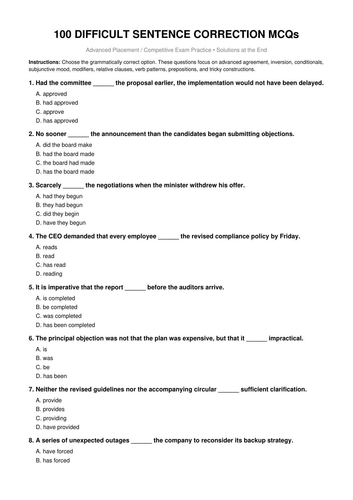

# Topic 10: Sentence Correction – 100 Advanced MCQs

> **Source:** Infosys Systems Engineer Preparation (`100_DIFFICULT_Sentence_Correction_MCQs_Solutions_At_End.pdf`)
> **Target:** Infosys Verbal Ability – Advanced Sentence Improvement, Syntax & Grammar Traps
> **Scope:** 100 Comprehensive Difficult Questions, Complete Options A-D, Verified Answer Keys, Correct Substitution & Grammar Rule Explanations

---

## Quick Reference: 100/100 Sentence Correction Answer Key Matrix

| Q# | Key | Q# | Key | Q# | Key | Q# | Key | Q# | Key |
|:---:|:---:|:---:|:---:|:---:|:---:|:---:|:---:|:---:|:---:|
| **Q01** | `B` | **Q21** | `A` | **Q41** | `B` | **Q61** | `B` | **Q81** | `B` |
| **Q02** | `B` | **Q22** | `A` | **Q42** | `A` | **Q62** | `B` | **Q82** | `B` |
| **Q03** | `A` | **Q23** | `B` | **Q43** | `B` | **Q63** | `B` | **Q83** | `B` |
| **Q04** | `B` | **Q24** | `C` | **Q44** | `C` | **Q64** | `B` | **Q84** | `A` |
| **Q05** | `B` | **Q25** | `B` | **Q45** | `B` | **Q65** | `B` | **Q85** | `B` |
| **Q06** | `B` | **Q26** | `B` | **Q46** | `B` | **Q66** | `B` | **Q86** | `B` |
| **Q07** | `B` | **Q27** | `B` | **Q47** | `B` | **Q67** | `B` | **Q87** | `C` |
| **Q08** | `B` | **Q28** | `A` | **Q48** | `B` | **Q68** | `D` | **Q88** | `B` |
| **Q09** | `B` | **Q29** | `A` | **Q49** | `B` | **Q69** | `B` | **Q89** | `B` |
| **Q10** | `C` | **Q30** | `A` | **Q50** | `A` | **Q70** | `C` | **Q90** | `B` |
| **Q11** | `B` | **Q31** | `B` | **Q51** | `B` | **Q71** | `B` | **Q91** | `B` |
| **Q12** | `A` | **Q32** | `A` | **Q52** | `B` | **Q72** | `C` | **Q92** | `B` |
| **Q13** | `C` | **Q33** | `C` | **Q53** | `C` | **Q73** | `B` | **Q93** | `B` |
| **Q14** | `C` | **Q34** | `B` | **Q54** | `B` | **Q74** | `A` | **Q94** | `B` |
| **Q15** | `D` | **Q35** | `B` | **Q55** | `B` | **Q75** | `A` | **Q95** | `C` |
| **Q16** | `C` | **Q36** | `B` | **Q56** | `B` | **Q76** | `A` | **Q96** | `B` |
| **Q17** | `B` | **Q37** | `B` | **Q57** | `B` | **Q77** | `C` | **Q97** | `C` |
| **Q18** | `B` | **Q38** | `B` | **Q58** | `C` | **Q78** | `B` | **Q98** | `A` |
| **Q19** | `B` | **Q39** | `A` | **Q59** | `B` | **Q79** | `B` | **Q99** | `B` |
| **Q20** | `B` | **Q40** | `B` | **Q60** | `B` | **Q80** | `B` | **Q100** | `B` |

---

### Question SC-01

**Sentence to Correct / Evaluate:**  
> *"Had the committee ______ the proposal earlier, the implementation would not have been delayed."*

**Options:**
- **(A)** approved
- **(B)** had approved
- **(C)** approve
- **(D)** has approved

**Correct Answer:** `Option (B)` – *"had approved"*

**Comprehensive Grammatical Derivation & Rule Analysis:**
- **Core Grammar Principle:** Past unreal conditional: Had + subject + past participle, ... would have + past participle.
- **Syntactic Breakdown:** Substituting Option **(B)** restores perfect grammatical congruence, correct mood/tense inflection, and removes non-standard parallelism or misplaced modifier structures.
- **Distractor Elimination:** The remaining options violate specific syntactic constraints (e.g., faulty inversion, tense mismatch, incorrect subjunctive base form, or improper prepositional government).

---

### Question SC-02

**Sentence to Correct / Evaluate:**  
> *"No sooner ______ the announcement than the candidates began submitting objections."*

**Options:**
- **(A)** did the board make
- **(B)** had the board made
- **(C)** the board had made
- **(D)** has the board made

**Correct Answer:** `Option (B)` – *"had the board made"*

**Comprehensive Grammatical Derivation & Rule Analysis:**
- **Core Grammar Principle:** With 'No sooner', inversion is used: No sooner had + subject + past participle + than.
- **Syntactic Breakdown:** Substituting Option **(B)** restores perfect grammatical congruence, correct mood/tense inflection, and removes non-standard parallelism or misplaced modifier structures.
- **Distractor Elimination:** The remaining options violate specific syntactic constraints (e.g., faulty inversion, tense mismatch, incorrect subjunctive base form, or improper prepositional government).

---

### Question SC-03

**Sentence to Correct / Evaluate:**  
> *"Scarcely ______ the negotiations when the minister withdrew his offer."*

**Options:**
- **(A)** had they begun
- **(B)** they had begun
- **(C)** did they begin
- **(D)** have they begun

**Correct Answer:** `Option (A)` – *"had they begun"*

**Comprehensive Grammatical Derivation & Rule Analysis:**
- **Core Grammar Principle:** After 'Scarcely/Hardly', past perfect with inversion is standard: Scarcely had they begun...
- **Syntactic Breakdown:** Substituting Option **(A)** restores perfect grammatical congruence, correct mood/tense inflection, and removes non-standard parallelism or misplaced modifier structures.
- **Distractor Elimination:** The remaining options violate specific syntactic constraints (e.g., faulty inversion, tense mismatch, incorrect subjunctive base form, or improper prepositional government).

---

### Question SC-04

**Sentence to Correct / Evaluate:**  
> *"The CEO demanded that every employee ______ the revised compliance policy by Friday."*

**Options:**
- **(A)** reads
- **(B)** read
- **(C)** has read
- **(D)** reading

**Correct Answer:** `Option (B)` – *"read"*

**Comprehensive Grammatical Derivation & Rule Analysis:**
- **Core Grammar Principle:** Mandative subjunctive after 'demanded that': base form 'read'.
- **Syntactic Breakdown:** Substituting Option **(B)** restores perfect grammatical congruence, correct mood/tense inflection, and removes non-standard parallelism or misplaced modifier structures.
- **Distractor Elimination:** The remaining options violate specific syntactic constraints (e.g., faulty inversion, tense mismatch, incorrect subjunctive base form, or improper prepositional government).

---

### Question SC-05

**Sentence to Correct / Evaluate:**  
> *"It is imperative that the report ______ before the auditors arrive."*

**Options:**
- **(A)** is completed
- **(B)** be completed
- **(C)** was completed
- **(D)** has been completed

**Correct Answer:** `Option (B)` – *"be completed"*

**Comprehensive Grammatical Derivation & Rule Analysis:**
- **Core Grammar Principle:** Mandative subjunctive in passive: 'that ... be completed'.
- **Syntactic Breakdown:** Substituting Option **(B)** restores perfect grammatical congruence, correct mood/tense inflection, and removes non-standard parallelism or misplaced modifier structures.
- **Distractor Elimination:** The remaining options violate specific syntactic constraints (e.g., faulty inversion, tense mismatch, incorrect subjunctive base form, or improper prepositional government).

---

### Question SC-06

**Sentence to Correct / Evaluate:**  
> *"The principal objection was not that the plan was expensive, but that it ______ impractical."*

**Options:**
- **(A)** is
- **(B)** was
- **(C)** be
- **(D)** has been

**Correct Answer:** `Option (B)` – *"was"*

**Comprehensive Grammatical Derivation & Rule Analysis:**
- **Core Grammar Principle:** Parallel past-tense structure: was expensive / was impractical.
- **Syntactic Breakdown:** Substituting Option **(B)** restores perfect grammatical congruence, correct mood/tense inflection, and removes non-standard parallelism or misplaced modifier structures.
- **Distractor Elimination:** The remaining options violate specific syntactic constraints (e.g., faulty inversion, tense mismatch, incorrect subjunctive base form, or improper prepositional government).

---

### Question SC-07

**Sentence to Correct / Evaluate:**  
> *"Neither the revised guidelines nor the accompanying circular ______ sufficient clarification."*

**Options:**
- **(A)** provide
- **(B)** provides
- **(C)** providing
- **(D)** have provided

**Correct Answer:** `Option (B)` – *"provides"*

**Comprehensive Grammatical Derivation & Rule Analysis:**
- **Core Grammar Principle:** With neither...nor, the verb agrees with the nearer subject 'circular' (singular).
- **Syntactic Breakdown:** Substituting Option **(B)** restores perfect grammatical congruence, correct mood/tense inflection, and removes non-standard parallelism or misplaced modifier structures.
- **Distractor Elimination:** The remaining options violate specific syntactic constraints (e.g., faulty inversion, tense mismatch, incorrect subjunctive base form, or improper prepositional government).

---

### Question SC-08

**Sentence to Correct / Evaluate:**  
> *"A series of unexpected outages ______ the company to reconsider its backup strategy."*

**Options:**
- **(A)** have forced
- **(B)** has forced
- **(C)** were forcing
- **(D)** are forcing

**Correct Answer:** `Option (B)` – *"has forced"*

**Comprehensive Grammatical Derivation & Rule Analysis:**
- **Core Grammar Principle:** 'A series' is singular, so 'has forced'.
- **Syntactic Breakdown:** Substituting Option **(B)** restores perfect grammatical congruence, correct mood/tense inflection, and removes non-standard parallelism or misplaced modifier structures.
- **Distractor Elimination:** The remaining options violate specific syntactic constraints (e.g., faulty inversion, tense mismatch, incorrect subjunctive base form, or improper prepositional government).

---

### Question SC-09

**Sentence to Correct / Evaluate:**  
> *"The number of applicants who have cleared the first round ______ risen sharply."*

**Options:**
- **(A)** have
- **(B)** has
- **(C)** are
- **(D)** were

**Correct Answer:** `Option (B)` – *"has"*

**Comprehensive Grammatical Derivation & Rule Analysis:**
- **Core Grammar Principle:** 'The number' is singular; use 'has risen'.
- **Syntactic Breakdown:** Substituting Option **(B)** restores perfect grammatical congruence, correct mood/tense inflection, and removes non-standard parallelism or misplaced modifier structures.
- **Distractor Elimination:** The remaining options violate specific syntactic constraints (e.g., faulty inversion, tense mismatch, incorrect subjunctive base form, or improper prepositional government).

---

### Question SC-10

**Sentence to Correct / Evaluate:**  
> *"A number of applicants who ______ shortlisted are awaiting the interview schedule."*

**Options:**
- **(A)** was
- **(B)** has been
- **(C)** have been
- **(D)** is

**Correct Answer:** `Option (C)` – *"have been"*

**Comprehensive Grammatical Derivation & Rule Analysis:**
- **Core Grammar Principle:** 'A number of' takes a plural verb: applicants have been shortlisted.
- **Syntactic Breakdown:** Substituting Option **(C)** restores perfect grammatical congruence, correct mood/tense inflection, and removes non-standard parallelism or misplaced modifier structures.
- **Distractor Elimination:** The remaining options violate specific syntactic constraints (e.g., faulty inversion, tense mismatch, incorrect subjunctive base form, or improper prepositional government).

---

### Question SC-11

**Sentence to Correct / Evaluate:**  
> *"The researcher is one of those scientists who ______ reluctant to publish preliminary findings."*

**Options:**
- **(A)** is
- **(B)** are
- **(C)** was
- **(D)** has

**Correct Answer:** `Option (B)` – *"are"*

**Comprehensive Grammatical Derivation & Rule Analysis:**
- **Core Grammar Principle:** Relative pronoun refers to plural 'scientists', so 'are'.
- **Syntactic Breakdown:** Substituting Option **(B)** restores perfect grammatical congruence, correct mood/tense inflection, and removes non-standard parallelism or misplaced modifier structures.
- **Distractor Elimination:** The remaining options violate specific syntactic constraints (e.g., faulty inversion, tense mismatch, incorrect subjunctive base form, or improper prepositional government).

---

### Question SC-12

**Sentence to Correct / Evaluate:**  
> *"He is the only one of the researchers who ______ the anomaly before publication."*

**Options:**
- **(A)** noticed
- **(B)** notice
- **(C)** have noticed
- **(D)** are noticing

**Correct Answer:** `Option (A)` – *"noticed"*

**Comprehensive Grammatical Derivation & Rule Analysis:**
- **Core Grammar Principle:** 'The only one' is singular; the relative clause modifies one, so singular verb/tense is required.
- **Syntactic Breakdown:** Substituting Option **(A)** restores perfect grammatical congruence, correct mood/tense inflection, and removes non-standard parallelism or misplaced modifier structures.
- **Distractor Elimination:** The remaining options violate specific syntactic constraints (e.g., faulty inversion, tense mismatch, incorrect subjunctive base form, or improper prepositional government).

---

### Question SC-13

**Sentence to Correct / Evaluate:**  
> *"The report, together with its appendices, ______ to be circulated before the meeting."*

**Options:**
- **(A)** are scheduled
- **(B)** were scheduled
- **(C)** is scheduled
- **(D)** have been scheduled

**Correct Answer:** `Option (C)` – *"is scheduled"*

**Comprehensive Grammatical Derivation & Rule Analysis:**
- **Core Grammar Principle:** Main subject 'report' is singular; intervening phrase does not affect agreement.
- **Syntactic Breakdown:** Substituting Option **(C)** restores perfect grammatical congruence, correct mood/tense inflection, and removes non-standard parallelism or misplaced modifier structures.
- **Distractor Elimination:** The remaining options violate specific syntactic constraints (e.g., faulty inversion, tense mismatch, incorrect subjunctive base form, or improper prepositional government).

---

### Question SC-14

**Sentence to Correct / Evaluate:**  
> *"What the investigators discovered ______ more disturbing than anyone had anticipated."*

**Options:**
- **(A)** were
- **(B)** have been
- **(C)** was
- **(D)** are

**Correct Answer:** `Option (C)` – *"was"*

**Comprehensive Grammatical Derivation & Rule Analysis:**
- **Core Grammar Principle:** The subject is the singular noun clause 'What the investigators discovered'; use 'was'.
- **Syntactic Breakdown:** Substituting Option **(C)** restores perfect grammatical congruence, correct mood/tense inflection, and removes non-standard parallelism or misplaced modifier structures.
- **Distractor Elimination:** The remaining options violate specific syntactic constraints (e.g., faulty inversion, tense mismatch, incorrect subjunctive base form, or improper prepositional government).

---

### Question SC-15

**Sentence to Correct / Evaluate:**  
> *"What appear to be minor discrepancies ______ actually evidence of a larger accounting problem."*

**Options:**
- **(A)** is
- **(B)** was
- **(C)** has been
- **(D)** are

**Correct Answer:** `Option (D)` – *"are"*

**Comprehensive Grammatical Derivation & Rule Analysis:**
- **Core Grammar Principle:** The relative clause refers to plural 'discrepancies'; use 'are'.
- **Syntactic Breakdown:** Substituting Option **(D)** restores perfect grammatical congruence, correct mood/tense inflection, and removes non-standard parallelism or misplaced modifier structures.
- **Distractor Elimination:** The remaining options violate specific syntactic constraints (e.g., faulty inversion, tense mismatch, incorrect subjunctive base form, or improper prepositional government).

---

### Question SC-16

**Sentence to Correct / Evaluate:**  
> *"The committee recommended that the contract ______ renegotiated before renewal."*

**Options:**
- **(A)** is
- **(B)** was
- **(C)** be
- **(D)** has been

**Correct Answer:** `Option (C)` – *"be"*

**Comprehensive Grammatical Derivation & Rule Analysis:**
- **Core Grammar Principle:** After 'recommended that', formal English uses the mandative subjunctive: 'be renegotiated'.
- **Syntactic Breakdown:** Substituting Option **(C)** restores perfect grammatical congruence, correct mood/tense inflection, and removes non-standard parallelism or misplaced modifier structures.
- **Distractor Elimination:** The remaining options violate specific syntactic constraints (e.g., faulty inversion, tense mismatch, incorrect subjunctive base form, or improper prepositional government).

---

### Question SC-17

**Sentence to Correct / Evaluate:**  
> *"She would rather the issue ______ discussed privately than debated in public."*

**Options:**
- **(A)** is
- **(B)** was
- **(C)** be
- **(D)** has been

**Correct Answer:** `Option (B)` – *"was"*

**Comprehensive Grammatical Derivation & Rule Analysis:**
- **Core Grammar Principle:** 'Would rather + subject' for a present/future preference takes simple past: 'was discussed'.
- **Syntactic Breakdown:** Substituting Option **(B)** restores perfect grammatical congruence, correct mood/tense inflection, and removes non-standard parallelism or misplaced modifier structures.
- **Distractor Elimination:** The remaining options violate specific syntactic constraints (e.g., faulty inversion, tense mismatch, incorrect subjunctive base form, or improper prepositional government).

---

### Question SC-18

**Sentence to Correct / Evaluate:**  
> *"I would sooner you ______ the matter with the legal team before responding."*

**Options:**
- **(A)** discuss
- **(B)** discussed
- **(C)** had discussed
- **(D)** have discussed

**Correct Answer:** `Option (B)` – *"discussed"*

**Comprehensive Grammatical Derivation & Rule Analysis:**
- **Core Grammar Principle:** 'Would sooner/would rather + subject' takes simple past for present/future preference.
- **Syntactic Breakdown:** Substituting Option **(B)** restores perfect grammatical congruence, correct mood/tense inflection, and removes non-standard parallelism or misplaced modifier structures.
- **Distractor Elimination:** The remaining options violate specific syntactic constraints (e.g., faulty inversion, tense mismatch, incorrect subjunctive base form, or improper prepositional government).

---

### Question SC-19

**Sentence to Correct / Evaluate:**  
> *"If the data ______ independently verified, the conclusion would have been different."*

**Options:**
- **(A)** were
- **(B)** had been
- **(C)** have been
- **(D)** would be

**Correct Answer:** `Option (B)` – *"had been"*

**Comprehensive Grammatical Derivation & Rule Analysis:**
- **Core Grammar Principle:** Third conditional: if + past perfect, would have + past participle.
- **Syntactic Breakdown:** Substituting Option **(B)** restores perfect grammatical congruence, correct mood/tense inflection, and removes non-standard parallelism or misplaced modifier structures.
- **Distractor Elimination:** The remaining options violate specific syntactic constraints (e.g., faulty inversion, tense mismatch, incorrect subjunctive base form, or improper prepositional government).

---

### Question SC-20

**Sentence to Correct / Evaluate:**  
> *"If I ______ about the change earlier, I would not be asking you now."*

**Options:**
- **(A)** knew
- **(B)** had known
- **(C)** have known
- **(D)** would know

**Correct Answer:** `Option (B)` – *"had known"*

**Comprehensive Grammatical Derivation & Rule Analysis:**
- **Core Grammar Principle:** Mixed conditional: past condition ('had known') with present result ('would not be asking').
- **Syntactic Breakdown:** Substituting Option **(B)** restores perfect grammatical congruence, correct mood/tense inflection, and removes non-standard parallelism or misplaced modifier structures.
- **Distractor Elimination:** The remaining options violate specific syntactic constraints (e.g., faulty inversion, tense mismatch, incorrect subjunctive base form, or improper prepositional government).

---

### Question SC-21

**Sentence to Correct / Evaluate:**  
> *"Were the company ______ its current policy, several compliance issues could arise."*

**Options:**
- **(A)** to retain
- **(B)** retaining
- **(C)** retained
- **(D)** has retained

**Correct Answer:** `Option (A)` – *"to retain"*

**Comprehensive Grammatical Derivation & Rule Analysis:**
- **Core Grammar Principle:** Inverted second conditional: Were + subject + to-infinitive.
- **Syntactic Breakdown:** Substituting Option **(A)** restores perfect grammatical congruence, correct mood/tense inflection, and removes non-standard parallelism or misplaced modifier structures.
- **Distractor Elimination:** The remaining options violate specific syntactic constraints (e.g., faulty inversion, tense mismatch, incorrect subjunctive base form, or improper prepositional government).

---

### Question SC-22

**Sentence to Correct / Evaluate:**  
> *"Had it not been ______ your intervention, the agreement would have collapsed."*

**Options:**
- **(A)** for
- **(B)** with
- **(C)** by
- **(D)** from

**Correct Answer:** `Option (A)` – *"for"*

**Comprehensive Grammatical Derivation & Rule Analysis:**
- **Core Grammar Principle:** Fixed construction: 'Had it not been for...'
- **Syntactic Breakdown:** Substituting Option **(A)** restores perfect grammatical congruence, correct mood/tense inflection, and removes non-standard parallelism or misplaced modifier structures.
- **Distractor Elimination:** The remaining options violate specific syntactic constraints (e.g., faulty inversion, tense mismatch, incorrect subjunctive base form, or improper prepositional government).

---

### Question SC-23

**Sentence to Correct / Evaluate:**  
> *"The manager denied ______ the confidential figures to the press."*

**Options:**
- **(A)** to leak
- **(B)** having leaked
- **(C)** to have leaked
- **(D)** that he leaking

**Correct Answer:** `Option (B)` – *"having leaked"*

**Comprehensive Grammatical Derivation & Rule Analysis:**
- **Core Grammar Principle:** 'Deny' takes a gerund; 'having leaked' emphasizes prior action.
- **Syntactic Breakdown:** Substituting Option **(B)** restores perfect grammatical congruence, correct mood/tense inflection, and removes non-standard parallelism or misplaced modifier structures.
- **Distractor Elimination:** The remaining options violate specific syntactic constraints (e.g., faulty inversion, tense mismatch, incorrect subjunctive base form, or improper prepositional government).

---

### Question SC-24

**Sentence to Correct / Evaluate:**  
> *"The witness claimed ______ the suspect at the station earlier that evening."*

**Options:**
- **(A)** to see
- **(B)** having seen
- **(C)** to have seen
- **(D)** that seeing

**Correct Answer:** `Option (C)` – *"to have seen"*

**Comprehensive Grammatical Derivation & Rule Analysis:**
- **Core Grammar Principle:** Perfect infinitive 'to have seen' expresses an earlier action.
- **Syntactic Breakdown:** Substituting Option **(C)** restores perfect grammatical congruence, correct mood/tense inflection, and removes non-standard parallelism or misplaced modifier structures.
- **Distractor Elimination:** The remaining options violate specific syntactic constraints (e.g., faulty inversion, tense mismatch, incorrect subjunctive base form, or improper prepositional government).

---

### Question SC-25

**Sentence to Correct / Evaluate:**  
> *"The proposal is believed ______ substantial financial implications."*

**Options:**
- **(A)** having
- **(B)** to have
- **(C)** to having
- **(D)** that have

**Correct Answer:** `Option (B)` – *"to have"*

**Comprehensive Grammatical Derivation & Rule Analysis:**
- **Core Grammar Principle:** Passive reporting verb + perfect infinitive: 'is believed to have'.
- **Syntactic Breakdown:** Substituting Option **(B)** restores perfect grammatical congruence, correct mood/tense inflection, and removes non-standard parallelism or misplaced modifier structures.
- **Distractor Elimination:** The remaining options violate specific syntactic constraints (e.g., faulty inversion, tense mismatch, incorrect subjunctive base form, or improper prepositional government).

---

### Question SC-26

**Sentence to Correct / Evaluate:**  
> *"The new regulation is expected ______ into force next quarter."*

**Options:**
- **(A)** come
- **(B)** to come
- **(C)** coming
- **(D)** to have come

**Correct Answer:** `Option (B)` – *"to come"*

**Comprehensive Grammatical Derivation & Rule Analysis:**
- **Core Grammar Principle:** Expected + to-infinitive for a future event.
- **Syntactic Breakdown:** Substituting Option **(B)** restores perfect grammatical congruence, correct mood/tense inflection, and removes non-standard parallelism or misplaced modifier structures.
- **Distractor Elimination:** The remaining options violate specific syntactic constraints (e.g., faulty inversion, tense mismatch, incorrect subjunctive base form, or improper prepositional government).

---

### Question SC-27

**Sentence to Correct / Evaluate:**  
> *"Having ______ the contract carefully, the lawyer identified three ambiguous clauses."*

**Options:**
- **(A)** review
- **(B)** reviewed
- **(C)** been review
- **(D)** reviewing

**Correct Answer:** `Option (B)` – *"reviewed"*

**Comprehensive Grammatical Derivation & Rule Analysis:**
- **Core Grammar Principle:** Perfect participial clause: Having + past participle.
- **Syntactic Breakdown:** Substituting Option **(B)** restores perfect grammatical congruence, correct mood/tense inflection, and removes non-standard parallelism or misplaced modifier structures.
- **Distractor Elimination:** The remaining options violate specific syntactic constraints (e.g., faulty inversion, tense mismatch, incorrect subjunctive base form, or improper prepositional government).

---

### Question SC-28

**Sentence to Correct / Evaluate:**  
> *"The documents ______ by the auditor yesterday have already been archived."*

**Options:**
- **(A)** reviewed
- **(B)** reviewing
- **(C)** were reviewed
- **(D)** having reviewed

**Correct Answer:** `Option (A)` – *"reviewed"*

**Comprehensive Grammatical Derivation & Rule Analysis:**
- **Core Grammar Principle:** Reduced relative clause: documents [that were] reviewed yesterday.
- **Syntactic Breakdown:** Substituting Option **(A)** restores perfect grammatical congruence, correct mood/tense inflection, and removes non-standard parallelism or misplaced modifier structures.
- **Distractor Elimination:** The remaining options violate specific syntactic constraints (e.g., faulty inversion, tense mismatch, incorrect subjunctive base form, or improper prepositional government).

---

### Question SC-29

**Sentence to Correct / Evaluate:**  
> *"The minister, ______ by several senior officials, entered the conference hall."*

**Options:**
- **(A)** accompanied
- **(B)** accompanying
- **(C)** was accompanied
- **(D)** having accompanying

**Correct Answer:** `Option (A)` – *"accompanied"*

**Comprehensive Grammatical Derivation & Rule Analysis:**
- **Core Grammar Principle:** Past participle phrase modifies 'minister': 'accompanied by'.
- **Syntactic Breakdown:** Substituting Option **(A)** restores perfect grammatical congruence, correct mood/tense inflection, and removes non-standard parallelism or misplaced modifier structures.
- **Distractor Elimination:** The remaining options violate specific syntactic constraints (e.g., faulty inversion, tense mismatch, incorrect subjunctive base form, or improper prepositional government).

---

### Question SC-30

**Sentence to Correct / Evaluate:**  
> *"The evidence was too ambiguous ______ a definitive conclusion."*

**Options:**
- **(A)** to draw
- **(B)** for drawing
- **(C)** that draw
- **(D)** as to drawing

**Correct Answer:** `Option (A)` – *"to draw"*

**Comprehensive Grammatical Derivation & Rule Analysis:**
- **Core Grammar Principle:** Too + adjective + to-infinitive: too ambiguous to draw.
- **Syntactic Breakdown:** Substituting Option **(A)** restores perfect grammatical congruence, correct mood/tense inflection, and removes non-standard parallelism or misplaced modifier structures.
- **Distractor Elimination:** The remaining options violate specific syntactic constraints (e.g., faulty inversion, tense mismatch, incorrect subjunctive base form, or improper prepositional government).

---

### Question SC-31

**Sentence to Correct / Evaluate:**  
> *"The instructions were so confusing ______ several participants interpreted them differently."*

**Options:**
- **(A)** as
- **(B)** that
- **(C)** to
- **(D)** than

**Correct Answer:** `Option (B)` – *"that"*

**Comprehensive Grammatical Derivation & Rule Analysis:**
- **Core Grammar Principle:** So + adjective + that + clause.
- **Syntactic Breakdown:** Substituting Option **(B)** restores perfect grammatical congruence, correct mood/tense inflection, and removes non-standard parallelism or misplaced modifier structures.
- **Distractor Elimination:** The remaining options violate specific syntactic constraints (e.g., faulty inversion, tense mismatch, incorrect subjunctive base form, or improper prepositional government).

---

### Question SC-32

**Sentence to Correct / Evaluate:**  
> *"It was such a complex issue ______ even experienced analysts disagreed."*

**Options:**
- **(A)** that
- **(B)** as
- **(C)** to
- **(D)** which

**Correct Answer:** `Option (A)` – *"that"*

**Comprehensive Grammatical Derivation & Rule Analysis:**
- **Core Grammar Principle:** Such + noun phrase + that + clause.
- **Syntactic Breakdown:** Substituting Option **(A)** restores perfect grammatical congruence, correct mood/tense inflection, and removes non-standard parallelism or misplaced modifier structures.
- **Distractor Elimination:** The remaining options violate specific syntactic constraints (e.g., faulty inversion, tense mismatch, incorrect subjunctive base form, or improper prepositional government).

---

### Question SC-33

**Sentence to Correct / Evaluate:**  
> *"The project was completed in half the time ______ had originally been estimated."*

**Options:**
- **(A)** that
- **(B)** what
- **(C)** which
- **(D)** than

**Correct Answer:** `Option (C)` – *"which"*

**Comprehensive Grammatical Derivation & Rule Analysis:**
- **Core Grammar Principle:** Relative pronoun 'which' refers to the amount of time.
- **Syntactic Breakdown:** Substituting Option **(C)** restores perfect grammatical congruence, correct mood/tense inflection, and removes non-standard parallelism or misplaced modifier structures.
- **Distractor Elimination:** The remaining options violate specific syntactic constraints (e.g., faulty inversion, tense mismatch, incorrect subjunctive base form, or improper prepositional government).

---

### Question SC-34

**Sentence to Correct / Evaluate:**  
> *"The salary package is considerably higher than ______ offered by competing firms."*

**Options:**
- **(A)** those
- **(B)** that
- **(C)** what
- **(D)** one

**Correct Answer:** `Option (B)` – *"that"*

**Comprehensive Grammatical Derivation & Rule Analysis:**
- **Core Grammar Principle:** 'Salary package' is singular; 'that' substitutes for the singular noun phrase.
- **Syntactic Breakdown:** Substituting Option **(B)** restores perfect grammatical congruence, correct mood/tense inflection, and removes non-standard parallelism or misplaced modifier structures.
- **Distractor Elimination:** The remaining options violate specific syntactic constraints (e.g., faulty inversion, tense mismatch, incorrect subjunctive base form, or improper prepositional government).

---

### Question SC-35

**Sentence to Correct / Evaluate:**  
> *"The two proposals differ considerably from ______ submitted last year."*

**Options:**
- **(A)** that
- **(B)** those
- **(C)** one
- **(D)** it

**Correct Answer:** `Option (B)` – *"those"*

**Comprehensive Grammatical Derivation & Rule Analysis:**
- **Core Grammar Principle:** 'Proposals' is plural, so 'those' replaces plural noun phrase.
- **Syntactic Breakdown:** Substituting Option **(B)** restores perfect grammatical congruence, correct mood/tense inflection, and removes non-standard parallelism or misplaced modifier structures.
- **Distractor Elimination:** The remaining options violate specific syntactic constraints (e.g., faulty inversion, tense mismatch, incorrect subjunctive base form, or improper prepositional government).

---

### Question SC-36

**Sentence to Correct / Evaluate:**  
> *"She is senior ______ all the other members of the team."*

**Options:**
- **(A)** than
- **(B)** to
- **(C)** from
- **(D)** with

**Correct Answer:** `Option (B)` – *"to"*

**Comprehensive Grammatical Derivation & Rule Analysis:**
- **Core Grammar Principle:** Senior is followed by 'to', not 'than'.
- **Syntactic Breakdown:** Substituting Option **(B)** restores perfect grammatical congruence, correct mood/tense inflection, and removes non-standard parallelism or misplaced modifier structures.
- **Distractor Elimination:** The remaining options violate specific syntactic constraints (e.g., faulty inversion, tense mismatch, incorrect subjunctive base form, or improper prepositional government).

---

### Question SC-37

**Sentence to Correct / Evaluate:**  
> *"The new system is superior ______ the legacy platform in terms of scalability."*

**Options:**
- **(A)** than
- **(B)** to
- **(C)** from
- **(D)** with

**Correct Answer:** `Option (B)` – *"to"*

**Comprehensive Grammatical Derivation & Rule Analysis:**
- **Core Grammar Principle:** Superior takes 'to'.
- **Syntactic Breakdown:** Substituting Option **(B)** restores perfect grammatical congruence, correct mood/tense inflection, and removes non-standard parallelism or misplaced modifier structures.
- **Distractor Elimination:** The remaining options violate specific syntactic constraints (e.g., faulty inversion, tense mismatch, incorrect subjunctive base form, or improper prepositional government).

---

### Question SC-38

**Sentence to Correct / Evaluate:**  
> *"He has little interest ______ taking responsibility for the failed rollout."*

**Options:**
- **(A)** on
- **(B)** in
- **(C)** at
- **(D)** for

**Correct Answer:** `Option (B)` – *"in"*

**Comprehensive Grammatical Derivation & Rule Analysis:**
- **Core Grammar Principle:** Correct collocation: interest in + gerund.
- **Syntactic Breakdown:** Substituting Option **(B)** restores perfect grammatical congruence, correct mood/tense inflection, and removes non-standard parallelism or misplaced modifier structures.
- **Distractor Elimination:** The remaining options violate specific syntactic constraints (e.g., faulty inversion, tense mismatch, incorrect subjunctive base form, or improper prepositional government).

---

### Question SC-39

**Sentence to Correct / Evaluate:**  
> *"The committee is committed ______ maintaining strict confidentiality."*

**Options:**
- **(A)** to
- **(B)** for
- **(C)** with
- **(D)** at

**Correct Answer:** `Option (A)` – *"to"*

**Comprehensive Grammatical Derivation & Rule Analysis:**
- **Core Grammar Principle:** Committed to + gerund/noun.
- **Syntactic Breakdown:** Substituting Option **(A)** restores perfect grammatical congruence, correct mood/tense inflection, and removes non-standard parallelism or misplaced modifier structures.
- **Distractor Elimination:** The remaining options violate specific syntactic constraints (e.g., faulty inversion, tense mismatch, incorrect subjunctive base form, or improper prepositional government).

---

### Question SC-40

**Sentence to Correct / Evaluate:**  
> *"The consultant objected ______ the assumption that the existing process was adequate."*

**Options:**
- **(A)** against
- **(B)** to
- **(C)** for
- **(D)** with

**Correct Answer:** `Option (B)` – *"to"*

**Comprehensive Grammatical Derivation & Rule Analysis:**
- **Core Grammar Principle:** Object to + noun/gerund.
- **Syntactic Breakdown:** Substituting Option **(B)** restores perfect grammatical congruence, correct mood/tense inflection, and removes non-standard parallelism or misplaced modifier structures.
- **Distractor Elimination:** The remaining options violate specific syntactic constraints (e.g., faulty inversion, tense mismatch, incorrect subjunctive base form, or improper prepositional government).

---

### Question SC-41

**Sentence to Correct / Evaluate:**  
> *"They insisted ______ seeing the original documents before signing."*

**Options:**
- **(A)** to
- **(B)** on
- **(C)** for
- **(D)** at

**Correct Answer:** `Option (B)` – *"on"*

**Comprehensive Grammatical Derivation & Rule Analysis:**
- **Core Grammar Principle:** Insist on + gerund.
- **Syntactic Breakdown:** Substituting Option **(B)** restores perfect grammatical congruence, correct mood/tense inflection, and removes non-standard parallelism or misplaced modifier structures.
- **Distractor Elimination:** The remaining options violate specific syntactic constraints (e.g., faulty inversion, tense mismatch, incorrect subjunctive base form, or improper prepositional government).

---

### Question SC-42

**Sentence to Correct / Evaluate:**  
> *"The candidate succeeded ______ convincing the panel despite limited experience."*

**Options:**
- **(A)** in
- **(B)** at
- **(C)** to
- **(D)** for

**Correct Answer:** `Option (A)` – *"in"*

**Comprehensive Grammatical Derivation & Rule Analysis:**
- **Core Grammar Principle:** Succeed in + gerund.
- **Syntactic Breakdown:** Substituting Option **(A)** restores perfect grammatical congruence, correct mood/tense inflection, and removes non-standard parallelism or misplaced modifier structures.
- **Distractor Elimination:** The remaining options violate specific syntactic constraints (e.g., faulty inversion, tense mismatch, incorrect subjunctive base form, or improper prepositional government).

---

### Question SC-43

**Sentence to Correct / Evaluate:**  
> *"The report consists ______ five sections and two appendices."*

**Options:**
- **(A)** with
- **(B)** of
- **(C)** from
- **(D)** in

**Correct Answer:** `Option (B)` – *"of"*

**Comprehensive Grammatical Derivation & Rule Analysis:**
- **Core Grammar Principle:** Consist of is the correct construction.
- **Syntactic Breakdown:** Substituting Option **(B)** restores perfect grammatical congruence, correct mood/tense inflection, and removes non-standard parallelism or misplaced modifier structures.
- **Distractor Elimination:** The remaining options violate specific syntactic constraints (e.g., faulty inversion, tense mismatch, incorrect subjunctive base form, or improper prepositional government).

---

### Question SC-44

**Sentence to Correct / Evaluate:**  
> *"The manager was accused ______ manipulating the figures."*

**Options:**
- **(A)** for
- **(B)** with
- **(C)** of
- **(D)** about

**Correct Answer:** `Option (C)` – *"of"*

**Comprehensive Grammatical Derivation & Rule Analysis:**
- **Core Grammar Principle:** Accused of + gerund/noun.
- **Syntactic Breakdown:** Substituting Option **(C)** restores perfect grammatical congruence, correct mood/tense inflection, and removes non-standard parallelism or misplaced modifier structures.
- **Distractor Elimination:** The remaining options violate specific syntactic constraints (e.g., faulty inversion, tense mismatch, incorrect subjunctive base form, or improper prepositional government).

---

### Question SC-45

**Sentence to Correct / Evaluate:**  
> *"The new policy is aimed ______ reducing unnecessary expenditure."*

**Options:**
- **(A)** to
- **(B)** at
- **(C)** for
- **(D)** on

**Correct Answer:** `Option (B)` – *"at"*

**Comprehensive Grammatical Derivation & Rule Analysis:**
- **Core Grammar Principle:** Be aimed at + gerund.
- **Syntactic Breakdown:** Substituting Option **(B)** restores perfect grammatical congruence, correct mood/tense inflection, and removes non-standard parallelism or misplaced modifier structures.
- **Distractor Elimination:** The remaining options violate specific syntactic constraints (e.g., faulty inversion, tense mismatch, incorrect subjunctive base form, or improper prepositional government).

---

### Question SC-46

**Sentence to Correct / Evaluate:**  
> *"There is little point ______ reopening a matter that has already been settled."*

**Options:**
- **(A)** to
- **(B)** in
- **(C)** for
- **(D)** at

**Correct Answer:** `Option (B)` – *"in"*

**Comprehensive Grammatical Derivation & Rule Analysis:**
- **Core Grammar Principle:** There is no/little point in + gerund.
- **Syntactic Breakdown:** Substituting Option **(B)** restores perfect grammatical congruence, correct mood/tense inflection, and removes non-standard parallelism or misplaced modifier structures.
- **Distractor Elimination:** The remaining options violate specific syntactic constraints (e.g., faulty inversion, tense mismatch, incorrect subjunctive base form, or improper prepositional government).

---

### Question SC-47

**Sentence to Correct / Evaluate:**  
> *"It is no use ______ with someone who has already made up his mind."*

**Options:**
- **(A)** to argue
- **(B)** arguing
- **(C)** argued
- **(D)** to have argued

**Correct Answer:** `Option (B)` – *"arguing"*

**Comprehensive Grammatical Derivation & Rule Analysis:**
- **Core Grammar Principle:** No use + gerund.
- **Syntactic Breakdown:** Substituting Option **(B)** restores perfect grammatical congruence, correct mood/tense inflection, and removes non-standard parallelism or misplaced modifier structures.
- **Distractor Elimination:** The remaining options violate specific syntactic constraints (e.g., faulty inversion, tense mismatch, incorrect subjunctive base form, or improper prepositional government).

---

### Question SC-48

**Sentence to Correct / Evaluate:**  
> *"The CEO is responsible ______ ensuring that all statutory requirements are met."*

**Options:**
- **(A)** to
- **(B)** for
- **(C)** of
- **(D)** with

**Correct Answer:** `Option (B)` – *"for"*

**Comprehensive Grammatical Derivation & Rule Analysis:**
- **Core Grammar Principle:** Responsible for + gerund.
- **Syntactic Breakdown:** Substituting Option **(B)** restores perfect grammatical congruence, correct mood/tense inflection, and removes non-standard parallelism or misplaced modifier structures.
- **Distractor Elimination:** The remaining options violate specific syntactic constraints (e.g., faulty inversion, tense mismatch, incorrect subjunctive base form, or improper prepositional government).

---

### Question SC-49

**Sentence to Correct / Evaluate:**  
> *"The issue is worth ______ further before a final decision is made."*

**Options:**
- **(A)** to investigate
- **(B)** investigating
- **(C)** investigated
- **(D)** to be investigating

**Correct Answer:** `Option (B)` – *"investigating"*

**Comprehensive Grammatical Derivation & Rule Analysis:**
- **Core Grammar Principle:** Worth is followed by a gerund.
- **Syntactic Breakdown:** Substituting Option **(B)** restores perfect grammatical congruence, correct mood/tense inflection, and removes non-standard parallelism or misplaced modifier structures.
- **Distractor Elimination:** The remaining options violate specific syntactic constraints (e.g., faulty inversion, tense mismatch, incorrect subjunctive base form, or improper prepositional government).

---

### Question SC-50

**Sentence to Correct / Evaluate:**  
> *"The board agreed to postpone the launch, ______ the concerns raised by the safety team."*

**Options:**
- **(A)** despite
- **(B)** although
- **(C)** because
- **(D)** whereas

**Correct Answer:** `Option (A)` – *"despite"*

**Comprehensive Grammatical Derivation & Rule Analysis:**
- **Core Grammar Principle:** 'Despite' is followed by a noun phrase: the concerns.
- **Syntactic Breakdown:** Substituting Option **(A)** restores perfect grammatical congruence, correct mood/tense inflection, and removes non-standard parallelism or misplaced modifier structures.
- **Distractor Elimination:** The remaining options violate specific syntactic constraints (e.g., faulty inversion, tense mismatch, incorrect subjunctive base form, or improper prepositional government).

---

### Question SC-51

**Sentence to Correct / Evaluate:**  
> *"______ the severe weather, the flight operated as scheduled."*

**Options:**
- **(A)** Although
- **(B)** Despite
- **(C)** Because
- **(D)** Whereas

**Correct Answer:** `Option (B)` – *"Despite"*

**Comprehensive Grammatical Derivation & Rule Analysis:**
- **Core Grammar Principle:** Despite + noun phrase.
- **Syntactic Breakdown:** Substituting Option **(B)** restores perfect grammatical congruence, correct mood/tense inflection, and removes non-standard parallelism or misplaced modifier structures.
- **Distractor Elimination:** The remaining options violate specific syntactic constraints (e.g., faulty inversion, tense mismatch, incorrect subjunctive base form, or improper prepositional government).

---

### Question SC-52

**Sentence to Correct / Evaluate:**  
> *"______ he had little experience, he managed the negotiation effectively."*

**Options:**
- **(A)** Despite
- **(B)** Although
- **(C)** In spite
- **(D)** Nevertheless

**Correct Answer:** `Option (B)` – *"Although"*

**Comprehensive Grammatical Derivation & Rule Analysis:**
- **Core Grammar Principle:** Although introduces a clause with subject + verb.
- **Syntactic Breakdown:** Substituting Option **(B)** restores perfect grammatical congruence, correct mood/tense inflection, and removes non-standard parallelism or misplaced modifier structures.
- **Distractor Elimination:** The remaining options violate specific syntactic constraints (e.g., faulty inversion, tense mismatch, incorrect subjunctive base form, or improper prepositional government).

---

### Question SC-53

**Sentence to Correct / Evaluate:**  
> *"The company will proceed with the acquisition ______ the regulators impose additional conditions."*

**Options:**
- **(A)** unless
- **(B)** provided
- **(C)** even if
- **(D)** whether

**Correct Answer:** `Option (C)` – *"even if"*

**Comprehensive Grammatical Derivation & Rule Analysis:**
- **Core Grammar Principle:** Even if means the acquisition will proceed despite the condition.
- **Syntactic Breakdown:** Substituting Option **(C)** restores perfect grammatical congruence, correct mood/tense inflection, and removes non-standard parallelism or misplaced modifier structures.
- **Distractor Elimination:** The remaining options violate specific syntactic constraints (e.g., faulty inversion, tense mismatch, incorrect subjunctive base form, or improper prepositional government).

---

### Question SC-54

**Sentence to Correct / Evaluate:**  
> *"You may access the system ______ you comply with the security requirements."*

**Options:**
- **(A)** unless
- **(B)** provided that
- **(C)** despite
- **(D)** whereas

**Correct Answer:** `Option (B)` – *"provided that"*

**Comprehensive Grammatical Derivation & Rule Analysis:**
- **Core Grammar Principle:** Provided that introduces a condition.
- **Syntactic Breakdown:** Substituting Option **(B)** restores perfect grammatical congruence, correct mood/tense inflection, and removes non-standard parallelism or misplaced modifier structures.
- **Distractor Elimination:** The remaining options violate specific syntactic constraints (e.g., faulty inversion, tense mismatch, incorrect subjunctive base form, or improper prepositional government).

---

### Question SC-55

**Sentence to Correct / Evaluate:**  
> *"The contract cannot be terminated ______ both parties agree in writing."*

**Options:**
- **(A)** if
- **(B)** unless
- **(C)** whether
- **(D)** although

**Correct Answer:** `Option (B)` – *"unless"*

**Comprehensive Grammatical Derivation & Rule Analysis:**
- **Core Grammar Principle:** Unless = if not; termination cannot occur if both do not agree.
- **Syntactic Breakdown:** Substituting Option **(B)** restores perfect grammatical congruence, correct mood/tense inflection, and removes non-standard parallelism or misplaced modifier structures.
- **Distractor Elimination:** The remaining options violate specific syntactic constraints (e.g., faulty inversion, tense mismatch, incorrect subjunctive base form, or improper prepositional government).

---

### Question SC-56

**Sentence to Correct / Evaluate:**  
> *"He spoke as though he ______ the entire incident himself."*

**Options:**
- **(A)** witnesses
- **(B)** had witnessed
- **(C)** has witnessed
- **(D)** would witness

**Correct Answer:** `Option (B)` – *"had witnessed"*

**Comprehensive Grammatical Derivation & Rule Analysis:**
- **Core Grammar Principle:** As though referring to a past unreal experience uses past perfect.
- **Syntactic Breakdown:** Substituting Option **(B)** restores perfect grammatical congruence, correct mood/tense inflection, and removes non-standard parallelism or misplaced modifier structures.
- **Distractor Elimination:** The remaining options violate specific syntactic constraints (e.g., faulty inversion, tense mismatch, incorrect subjunctive base form, or improper prepositional government).

---

### Question SC-57

**Sentence to Correct / Evaluate:**  
> *"She behaves as if she ______ the authority to approve such expenditures."*

**Options:**
- **(A)** has
- **(B)** had
- **(C)** would have
- **(D)** having

**Correct Answer:** `Option (B)` – *"had"*

**Comprehensive Grammatical Derivation & Rule Analysis:**
- **Core Grammar Principle:** As if for an unreal/present hypothetical situation commonly takes past tense.
- **Syntactic Breakdown:** Substituting Option **(B)** restores perfect grammatical congruence, correct mood/tense inflection, and removes non-standard parallelism or misplaced modifier structures.
- **Distractor Elimination:** The remaining options violate specific syntactic constraints (e.g., faulty inversion, tense mismatch, incorrect subjunctive base form, or improper prepositional government).

---

### Question SC-58

**Sentence to Correct / Evaluate:**  
> *"By the time the auditors arrive, we ______ the reconciliation."*

**Options:**
- **(A)** complete
- **(B)** completed
- **(C)** will have completed
- **(D)** have completed

**Correct Answer:** `Option (C)` – *"will have completed"*

**Comprehensive Grammatical Derivation & Rule Analysis:**
- **Core Grammar Principle:** Future perfect shows completion before a future point.
- **Syntactic Breakdown:** Substituting Option **(C)** restores perfect grammatical congruence, correct mood/tense inflection, and removes non-standard parallelism or misplaced modifier structures.
- **Distractor Elimination:** The remaining options violate specific syntactic constraints (e.g., faulty inversion, tense mismatch, incorrect subjunctive base form, or improper prepositional government).

---

### Question SC-59

**Sentence to Correct / Evaluate:**  
> *"By next June, she ______ at the company for ten years."*

**Options:**
- **(A)** will work
- **(B)** will have worked
- **(C)** has worked
- **(D)** had worked

**Correct Answer:** `Option (B)` – *"will have worked"*

**Comprehensive Grammatical Derivation & Rule Analysis:**
- **Core Grammar Principle:** Future perfect for duration completed by a future point.
- **Syntactic Breakdown:** Substituting Option **(B)** restores perfect grammatical congruence, correct mood/tense inflection, and removes non-standard parallelism or misplaced modifier structures.
- **Distractor Elimination:** The remaining options violate specific syntactic constraints (e.g., faulty inversion, tense mismatch, incorrect subjunctive base form, or improper prepositional government).

---

### Question SC-60

**Sentence to Correct / Evaluate:**  
> *"The company ______ the issue for months before the regulator intervened."*

**Options:**
- **(A)** has been investigating
- **(B)** had been investigating
- **(C)** was investigated
- **(D)** is investigating

**Correct Answer:** `Option (B)` – *"had been investigating"*

**Comprehensive Grammatical Derivation & Rule Analysis:**
- **Core Grammar Principle:** Past perfect continuous for an ongoing action before a past event.
- **Syntactic Breakdown:** Substituting Option **(B)** restores perfect grammatical congruence, correct mood/tense inflection, and removes non-standard parallelism or misplaced modifier structures.
- **Distractor Elimination:** The remaining options violate specific syntactic constraints (e.g., faulty inversion, tense mismatch, incorrect subjunctive base form, or improper prepositional government).

---

### Question SC-61

**Sentence to Correct / Evaluate:**  
> *"I ______ him three times this week, but he has not responded."*

**Options:**
- **(A)** contacted
- **(B)** have contacted
- **(C)** had contacted
- **(D)** am contacting

**Correct Answer:** `Option (B)` – *"have contacted"*

**Comprehensive Grammatical Derivation & Rule Analysis:**
- **Core Grammar Principle:** An unfinished time period ('this week') commonly takes present perfect.
- **Syntactic Breakdown:** Substituting Option **(B)** restores perfect grammatical congruence, correct mood/tense inflection, and removes non-standard parallelism or misplaced modifier structures.
- **Distractor Elimination:** The remaining options violate specific syntactic constraints (e.g., faulty inversion, tense mismatch, incorrect subjunctive base form, or improper prepositional government).

---

### Question SC-62

**Sentence to Correct / Evaluate:**  
> *"When I reached the station, the train ______ already ______."*

**Options:**
- **(A)** has; left
- **(B)** had; left
- **(C)** was; leaving
- **(D)** would; leave

**Correct Answer:** `Option (B)` – *"had; left"*

**Comprehensive Grammatical Derivation & Rule Analysis:**
- **Core Grammar Principle:** Past perfect marks an earlier past action.
- **Syntactic Breakdown:** Substituting Option **(B)** restores perfect grammatical congruence, correct mood/tense inflection, and removes non-standard parallelism or misplaced modifier structures.
- **Distractor Elimination:** The remaining options violate specific syntactic constraints (e.g., faulty inversion, tense mismatch, incorrect subjunctive base form, or improper prepositional government).

---

### Question SC-63

**Sentence to Correct / Evaluate:**  
> *"He said that he ______ the report the following day."*

**Options:**
- **(A)** will submit
- **(B)** would submit
- **(C)** has submitted
- **(D)** submits

**Correct Answer:** `Option (B)` – *"would submit"*

**Comprehensive Grammatical Derivation & Rule Analysis:**
- **Core Grammar Principle:** Reported speech: will → would after a past reporting verb.
- **Syntactic Breakdown:** Substituting Option **(B)** restores perfect grammatical congruence, correct mood/tense inflection, and removes non-standard parallelism or misplaced modifier structures.
- **Distractor Elimination:** The remaining options violate specific syntactic constraints (e.g., faulty inversion, tense mismatch, incorrect subjunctive base form, or improper prepositional government).

---

### Question SC-64

**Sentence to Correct / Evaluate:**  
> *"She asked me whether I ______ the revised draft."*

**Options:**
- **(A)** have received
- **(B)** had received
- **(C)** receive
- **(D)** will receive

**Correct Answer:** `Option (B)` – *"had received"*

**Comprehensive Grammatical Derivation & Rule Analysis:**
- **Core Grammar Principle:** Backshift in reported speech: have received → had received.
- **Syntactic Breakdown:** Substituting Option **(B)** restores perfect grammatical congruence, correct mood/tense inflection, and removes non-standard parallelism or misplaced modifier structures.
- **Distractor Elimination:** The remaining options violate specific syntactic constraints (e.g., faulty inversion, tense mismatch, incorrect subjunctive base form, or improper prepositional government).

---

### Question SC-65

**Sentence to Correct / Evaluate:**  
> *"The manager said that the figures ______ inaccurate and needed verification."*

**Options:**
- **(A)** are
- **(B)** were
- **(C)** have been
- **(D)** will be

**Correct Answer:** `Option (B)` – *"were"*

**Comprehensive Grammatical Derivation & Rule Analysis:**
- **Core Grammar Principle:** Backshift after past reporting verb: are → were.
- **Syntactic Breakdown:** Substituting Option **(B)** restores perfect grammatical congruence, correct mood/tense inflection, and removes non-standard parallelism or misplaced modifier structures.
- **Distractor Elimination:** The remaining options violate specific syntactic constraints (e.g., faulty inversion, tense mismatch, incorrect subjunctive base form, or improper prepositional government).

---

### Question SC-66

**Sentence to Correct / Evaluate:**  
> *"The consultant suggested that the company ______ a second opinion."*

**Options:**
- **(A)** takes
- **(B)** take
- **(C)** took
- **(D)** has taken

**Correct Answer:** `Option (B)` – *"take"*

**Comprehensive Grammatical Derivation & Rule Analysis:**
- **Core Grammar Principle:** Suggest + that + base verb in formal mandative construction.
- **Syntactic Breakdown:** Substituting Option **(B)** restores perfect grammatical congruence, correct mood/tense inflection, and removes non-standard parallelism or misplaced modifier structures.
- **Distractor Elimination:** The remaining options violate specific syntactic constraints (e.g., faulty inversion, tense mismatch, incorrect subjunctive base form, or improper prepositional government).

---

### Question SC-67

**Sentence to Correct / Evaluate:**  
> *"The director insisted that no employee ______ the premises without authorization."*

**Options:**
- **(A)** leaves
- **(B)** leave
- **(C)** left
- **(D)** has left

**Correct Answer:** `Option (B)` – *"leave"*

**Comprehensive Grammatical Derivation & Rule Analysis:**
- **Core Grammar Principle:** Insist + that + base form in mandative subjunctive.
- **Syntactic Breakdown:** Substituting Option **(B)** restores perfect grammatical congruence, correct mood/tense inflection, and removes non-standard parallelism or misplaced modifier structures.
- **Distractor Elimination:** The remaining options violate specific syntactic constraints (e.g., faulty inversion, tense mismatch, incorrect subjunctive base form, or improper prepositional government).

---

### Question SC-68

**Sentence to Correct / Evaluate:**  
> *"The report needs ______ before it is circulated to clients."*

**Options:**
- **(A)** to revise
- **(B)** revising
- **(C)** revised
- **(D)** to be revised

**Correct Answer:** `Option (D)` – *"to be revised"*

**Comprehensive Grammatical Derivation & Rule Analysis:**
- **Core Grammar Principle:** Needs to be revised is the clearest passive construction; 'needs revising' is also grammatical in British English, but D is the
intended formal answer.
- **Syntactic Breakdown:** Substituting Option **(D)** restores perfect grammatical congruence, correct mood/tense inflection, and removes non-standard parallelism or misplaced modifier structures.
- **Distractor Elimination:** The remaining options violate specific syntactic constraints (e.g., faulty inversion, tense mismatch, incorrect subjunctive base form, or improper prepositional government).

---

### Question SC-69

**Sentence to Correct / Evaluate:**  
> *"The equipment requires ______ before it can be used safely."*

**Options:**
- **(A)** to inspect
- **(B)** inspecting
- **(C)** inspected
- **(D)** to be inspecting

**Correct Answer:** `Option (B)` – *"inspecting"*

**Comprehensive Grammatical Derivation & Rule Analysis:**
- **Core Grammar Principle:** Require + gerund can have passive meaning: requires inspecting.
- **Syntactic Breakdown:** Substituting Option **(B)** restores perfect grammatical congruence, correct mood/tense inflection, and removes non-standard parallelism or misplaced modifier structures.
- **Distractor Elimination:** The remaining options violate specific syntactic constraints (e.g., faulty inversion, tense mismatch, incorrect subjunctive base form, or improper prepositional government).

---

### Question SC-70

**Sentence to Correct / Evaluate:**  
> *"He had his assistant ______ the documents before the meeting."*

**Options:**
- **(A)** to print
- **(B)** printed
- **(C)** print
- **(D)** printing

**Correct Answer:** `Option (C)` – *"print"*

**Comprehensive Grammatical Derivation & Rule Analysis:**
- **Core Grammar Principle:** Causative 'have + object + base verb': had his assistant print.
- **Syntactic Breakdown:** Substituting Option **(C)** restores perfect grammatical congruence, correct mood/tense inflection, and removes non-standard parallelism or misplaced modifier structures.
- **Distractor Elimination:** The remaining options violate specific syntactic constraints (e.g., faulty inversion, tense mismatch, incorrect subjunctive base form, or improper prepositional government).

---

### Question SC-71

**Sentence to Correct / Evaluate:**  
> *"She got the technician ______ the network configuration."*

**Options:**
- **(A)** change
- **(B)** to change
- **(C)** changed
- **(D)** changing

**Correct Answer:** `Option (B)` – *"to change"*

**Comprehensive Grammatical Derivation & Rule Analysis:**
- **Core Grammar Principle:** Causative 'get + object + to-infinitive'.
- **Syntactic Breakdown:** Substituting Option **(B)** restores perfect grammatical congruence, correct mood/tense inflection, and removes non-standard parallelism or misplaced modifier structures.
- **Distractor Elimination:** The remaining options violate specific syntactic constraints (e.g., faulty inversion, tense mismatch, incorrect subjunctive base form, or improper prepositional government).

---

### Question SC-72

**Sentence to Correct / Evaluate:**  
> *"The supervisor made the interns ______ the procedure again."*

**Options:**
- **(A)** to repeat
- **(B)** repeated
- **(C)** repeat
- **(D)** repeating

**Correct Answer:** `Option (C)` – *"repeat"*

**Comprehensive Grammatical Derivation & Rule Analysis:**
- **Core Grammar Principle:** Make + object + bare infinitive in active voice.
- **Syntactic Breakdown:** Substituting Option **(C)** restores perfect grammatical congruence, correct mood/tense inflection, and removes non-standard parallelism or misplaced modifier structures.
- **Distractor Elimination:** The remaining options violate specific syntactic constraints (e.g., faulty inversion, tense mismatch, incorrect subjunctive base form, or improper prepositional government).

---

### Question SC-73

**Sentence to Correct / Evaluate:**  
> *"The interns were made ______ the procedure again."*

**Options:**
- **(A)** repeat
- **(B)** to repeat
- **(C)** repeating
- **(D)** repeated

**Correct Answer:** `Option (B)` – *"to repeat"*

**Comprehensive Grammatical Derivation & Rule Analysis:**
- **Core Grammar Principle:** In passive, make takes to-infinitive: were made to repeat.
- **Syntactic Breakdown:** Substituting Option **(B)** restores perfect grammatical congruence, correct mood/tense inflection, and removes non-standard parallelism or misplaced modifier structures.
- **Distractor Elimination:** The remaining options violate specific syntactic constraints (e.g., faulty inversion, tense mismatch, incorrect subjunctive base form, or improper prepositional government).

---

### Question SC-74

**Sentence to Correct / Evaluate:**  
> *"The more carefully you analyse the data, ______ the likelihood of error."*

**Options:**
- **(A)** the smaller
- **(B)** smaller
- **(C)** smallest
- **(D)** the smallest

**Correct Answer:** `Option (A)` – *"the smaller"*

**Comprehensive Grammatical Derivation & Rule Analysis:**
- **Core Grammar Principle:** Correlative comparative: the more..., the + comparative.
- **Syntactic Breakdown:** Substituting Option **(A)** restores perfect grammatical congruence, correct mood/tense inflection, and removes non-standard parallelism or misplaced modifier structures.
- **Distractor Elimination:** The remaining options violate specific syntactic constraints (e.g., faulty inversion, tense mismatch, incorrect subjunctive base form, or improper prepositional government).

---

### Question SC-75

**Sentence to Correct / Evaluate:**  
> *"The harder he worked, ______ his chances of promotion became."*

**Options:**
- **(A)** the better
- **(B)** better
- **(C)** the best
- **(D)** best

**Correct Answer:** `Option (A)` – *"the better"*

**Comprehensive Grammatical Derivation & Rule Analysis:**
- **Core Grammar Principle:** The more..., the better... structure.
- **Syntactic Breakdown:** Substituting Option **(A)** restores perfect grammatical congruence, correct mood/tense inflection, and removes non-standard parallelism or misplaced modifier structures.
- **Distractor Elimination:** The remaining options violate specific syntactic constraints (e.g., faulty inversion, tense mismatch, incorrect subjunctive base form, or improper prepositional government).

---

### Question SC-76

**Sentence to Correct / Evaluate:**  
> *"It was ______ that the entire audience remained silent."*

**Options:**
- **(A)** so compelling a presentation
- **(B)** such compelling presentation
- **(C)** so a compelling presentation
- **(D)** such a compelling presentation

**Correct Answer:** `Option (A)` – *"so compelling a presentation"*

**Comprehensive Grammatical Derivation & Rule Analysis:**
- **Core Grammar Principle:** So + adjective + a/an + singular noun is correct.
- **Syntactic Breakdown:** Substituting Option **(A)** restores perfect grammatical congruence, correct mood/tense inflection, and removes non-standard parallelism or misplaced modifier structures.
- **Distractor Elimination:** The remaining options violate specific syntactic constraints (e.g., faulty inversion, tense mismatch, incorrect subjunctive base form, or improper prepositional government).

---

### Question SC-77

**Sentence to Correct / Evaluate:**  
> *"It was ______ that several reviewers questioned its authenticity."*

**Options:**
- **(A)** such sophisticated a forgery
- **(B)** so sophisticated forgery
- **(C)** such a sophisticated forgery
- **(D)** so a sophisticated forgery

**Correct Answer:** `Option (C)` – *"such a sophisticated forgery"*

**Comprehensive Grammatical Derivation & Rule Analysis:**
- **Core Grammar Principle:** Such + a/an + adjective + singular noun.
- **Syntactic Breakdown:** Substituting Option **(C)** restores perfect grammatical congruence, correct mood/tense inflection, and removes non-standard parallelism or misplaced modifier structures.
- **Distractor Elimination:** The remaining options violate specific syntactic constraints (e.g., faulty inversion, tense mismatch, incorrect subjunctive base form, or improper prepositional government).

---

### Question SC-78

**Sentence to Correct / Evaluate:**  
> *"Not only ______ the deadline, but he also failed to inform the client."*

**Options:**
- **(A)** he missed
- **(B)** did he miss
- **(C)** he had missed
- **(D)** has he missed

**Correct Answer:** `Option (B)` – *"did he miss"*

**Comprehensive Grammatical Derivation & Rule Analysis:**
- **Core Grammar Principle:** When 'not only' begins the sentence, auxiliary inversion is required.
- **Syntactic Breakdown:** Substituting Option **(B)** restores perfect grammatical congruence, correct mood/tense inflection, and removes non-standard parallelism or misplaced modifier structures.
- **Distractor Elimination:** The remaining options violate specific syntactic constraints (e.g., faulty inversion, tense mismatch, incorrect subjunctive base form, or improper prepositional government).

---

### Question SC-79

**Sentence to Correct / Evaluate:**  
> *"Rarely ______ such a comprehensive audit report."*

**Options:**
- **(A)** we receive
- **(B)** do we receive
- **(C)** we received
- **(D)** have we receiving

**Correct Answer:** `Option (B)` – *"do we receive"*

**Comprehensive Grammatical Derivation & Rule Analysis:**
- **Core Grammar Principle:** Negative/restrictive adverbial at the beginning triggers inversion.
- **Syntactic Breakdown:** Substituting Option **(B)** restores perfect grammatical congruence, correct mood/tense inflection, and removes non-standard parallelism or misplaced modifier structures.
- **Distractor Elimination:** The remaining options violate specific syntactic constraints (e.g., faulty inversion, tense mismatch, incorrect subjunctive base form, or improper prepositional government).

---

### Question SC-80

**Sentence to Correct / Evaluate:**  
> *"Only after the investigation ______ the extent of the irregularities."*

**Options:**
- **(A)** the auditors understood
- **(B)** did the auditors understand
- **(C)** had the auditors understood
- **(D)** the auditors had understood

**Correct Answer:** `Option (B)` – *"did the auditors understand"*

**Comprehensive Grammatical Derivation & Rule Analysis:**
- **Core Grammar Principle:** 'Only after...' fronting triggers subject-auxiliary inversion.
- **Syntactic Breakdown:** Substituting Option **(B)** restores perfect grammatical congruence, correct mood/tense inflection, and removes non-standard parallelism or misplaced modifier structures.
- **Distractor Elimination:** The remaining options violate specific syntactic constraints (e.g., faulty inversion, tense mismatch, incorrect subjunctive base form, or improper prepositional government).

---

### Question SC-81

**Sentence to Correct / Evaluate:**  
> *"Under no circumstances ______ confidential data to external parties."*

**Options:**
- **(A)** employees should disclose
- **(B)** should employees disclose
- **(C)** employees disclose
- **(D)** do employees should disclose

**Correct Answer:** `Option (B)` – *"should employees disclose"*

**Comprehensive Grammatical Derivation & Rule Analysis:**
- **Core Grammar Principle:** Negative fronted expression requires inversion: should employees disclose.
- **Syntactic Breakdown:** Substituting Option **(B)** restores perfect grammatical congruence, correct mood/tense inflection, and removes non-standard parallelism or misplaced modifier structures.
- **Distractor Elimination:** The remaining options violate specific syntactic constraints (e.g., faulty inversion, tense mismatch, incorrect subjunctive base form, or improper prepositional government).

---

### Question SC-82

**Sentence to Correct / Evaluate:**  
> *"The proposal is likely ______ rejected unless substantial changes are made."*

**Options:**
- **(A)** being
- **(B)** to be
- **(C)** to have
- **(D)** that it be

**Correct Answer:** `Option (B)` – *"to be"*

**Comprehensive Grammatical Derivation & Rule Analysis:**
- **Core Grammar Principle:** Likely + to-infinitive; passive requires 'to be rejected'.
- **Syntactic Breakdown:** Substituting Option **(B)** restores perfect grammatical congruence, correct mood/tense inflection, and removes non-standard parallelism or misplaced modifier structures.
- **Distractor Elimination:** The remaining options violate specific syntactic constraints (e.g., faulty inversion, tense mismatch, incorrect subjunctive base form, or improper prepositional government).

---

### Question SC-83

**Sentence to Correct / Evaluate:**  
> *"The witness was the last person ______ the building."*

**Options:**
- **(A)** leave
- **(B)** to leave
- **(C)** leaving
- **(D)** left

**Correct Answer:** `Option (B)` – *"to leave"*

**Comprehensive Grammatical Derivation & Rule Analysis:**
- **Core Grammar Principle:** The last/first/only + noun commonly takes to-infinitive.
- **Syntactic Breakdown:** Substituting Option **(B)** restores perfect grammatical congruence, correct mood/tense inflection, and removes non-standard parallelism or misplaced modifier structures.
- **Distractor Elimination:** The remaining options violate specific syntactic constraints (e.g., faulty inversion, tense mismatch, incorrect subjunctive base form, or improper prepositional government).

---

### Question SC-84

**Sentence to Correct / Evaluate:**  
> *"There is no reason ______ the deadline at this stage."*

**Options:**
- **(A)** to extend
- **(B)** extending
- **(C)** for extend
- **(D)** to extending

**Correct Answer:** `Option (A)` – *"to extend"*

**Comprehensive Grammatical Derivation & Rule Analysis:**
- **Core Grammar Principle:** Reason + to-infinitive.
- **Syntactic Breakdown:** Substituting Option **(A)** restores perfect grammatical congruence, correct mood/tense inflection, and removes non-standard parallelism or misplaced modifier structures.
- **Distractor Elimination:** The remaining options violate specific syntactic constraints (e.g., faulty inversion, tense mismatch, incorrect subjunctive base form, or improper prepositional government).

---

### Question SC-85

**Sentence to Correct / Evaluate:**  
> *"The report contains several recommendations, many of ______ have already been implemented."*

**Options:**
- **(A)** that
- **(B)** which
- **(C)** them
- **(D)** what

**Correct Answer:** `Option (B)` – *"which"*

**Comprehensive Grammatical Derivation & Rule Analysis:**
- **Core Grammar Principle:** Non-defining relative clause: many of which.
- **Syntactic Breakdown:** Substituting Option **(B)** restores perfect grammatical congruence, correct mood/tense inflection, and removes non-standard parallelism or misplaced modifier structures.
- **Distractor Elimination:** The remaining options violate specific syntactic constraints (e.g., faulty inversion, tense mismatch, incorrect subjunctive base form, or improper prepositional government).

---

### Question SC-86

**Sentence to Correct / Evaluate:**  
> *"The candidates, none of ______ had prior experience, performed well."*

**Options:**
- **(A)** who
- **(B)** whom
- **(C)** which
- **(D)** them

**Correct Answer:** `Option (B)` – *"whom"*

**Comprehensive Grammatical Derivation & Rule Analysis:**
- **Core Grammar Principle:** After 'none of' referring to people in a relative clause, 'whom' is the formal object form.
- **Syntactic Breakdown:** Substituting Option **(B)** restores perfect grammatical congruence, correct mood/tense inflection, and removes non-standard parallelism or misplaced modifier structures.
- **Distractor Elimination:** The remaining options violate specific syntactic constraints (e.g., faulty inversion, tense mismatch, incorrect subjunctive base form, or improper prepositional government).

---

### Question SC-87

**Sentence to Correct / Evaluate:**  
> *"The manager asked the employee ______ laptop had been left in the conference room."*

**Options:**
- **(A)** who
- **(B)** whom
- **(C)** whose
- **(D)** which

**Correct Answer:** `Option (C)` – *"whose"*

**Comprehensive Grammatical Derivation & Rule Analysis:**
- **Core Grammar Principle:** 'Whose' indicates possession.
- **Syntactic Breakdown:** Substituting Option **(C)** restores perfect grammatical congruence, correct mood/tense inflection, and removes non-standard parallelism or misplaced modifier structures.
- **Distractor Elimination:** The remaining options violate specific syntactic constraints (e.g., faulty inversion, tense mismatch, incorrect subjunctive base form, or improper prepositional government).

---

### Question SC-88

**Sentence to Correct / Evaluate:**  
> *"This is the most comprehensive report ______ has been published on the issue."*

**Options:**
- **(A)** which
- **(B)** that
- **(C)** what
- **(D)** whom

**Correct Answer:** `Option (B)` – *"that"*

**Comprehensive Grammatical Derivation & Rule Analysis:**
- **Core Grammar Principle:** After a superlative, 'that' is commonly preferred in a restrictive relative clause.
- **Syntactic Breakdown:** Substituting Option **(B)** restores perfect grammatical congruence, correct mood/tense inflection, and removes non-standard parallelism or misplaced modifier structures.
- **Distractor Elimination:** The remaining options violate specific syntactic constraints (e.g., faulty inversion, tense mismatch, incorrect subjunctive base form, or improper prepositional government).

---

### Question SC-89

**Sentence to Correct / Evaluate:**  
> *"The strategy ______ we adopted last quarter has significantly reduced costs."*

**Options:**
- **(A)** what
- **(B)** which
- **(C)** whose
- **(D)** where

**Correct Answer:** `Option (B)` – *"which"*

**Comprehensive Grammatical Derivation & Rule Analysis:**
- **Core Grammar Principle:** Which refers to the strategy and functions as object of adopted.
- **Syntactic Breakdown:** Substituting Option **(B)** restores perfect grammatical congruence, correct mood/tense inflection, and removes non-standard parallelism or misplaced modifier structures.
- **Distractor Elimination:** The remaining options violate specific syntactic constraints (e.g., faulty inversion, tense mismatch, incorrect subjunctive base form, or improper prepositional government).

---

### Question SC-90

**Sentence to Correct / Evaluate:**  
> *"The city in ______ the headquarters is located has introduced new tax incentives."*

**Options:**
- **(A)** that
- **(B)** which
- **(C)** where
- **(D)** what

**Correct Answer:** `Option (B)` – *"which"*

**Comprehensive Grammatical Derivation & Rule Analysis:**
- **Core Grammar Principle:** After a preposition, formal relative pronoun is 'which': in which.
- **Syntactic Breakdown:** Substituting Option **(B)** restores perfect grammatical congruence, correct mood/tense inflection, and removes non-standard parallelism or misplaced modifier structures.
- **Distractor Elimination:** The remaining options violate specific syntactic constraints (e.g., faulty inversion, tense mismatch, incorrect subjunctive base form, or improper prepositional government).

---

### Question SC-91

**Sentence to Correct / Evaluate:**  
> *"The reason ______ the project was delayed remains unclear."*

**Options:**
- **(A)** because
- **(B)** why
- **(C)** for
- **(D)** which

**Correct Answer:** `Option (B)` – *"why"*

**Comprehensive Grammatical Derivation & Rule Analysis:**
- **Core Grammar Principle:** 'The reason why' is grammatical; 'the reason because' is nonstandard in this construction.
- **Syntactic Breakdown:** Substituting Option **(B)** restores perfect grammatical congruence, correct mood/tense inflection, and removes non-standard parallelism or misplaced modifier structures.
- **Distractor Elimination:** The remaining options violate specific syntactic constraints (e.g., faulty inversion, tense mismatch, incorrect subjunctive base form, or improper prepositional government).

---

### Question SC-92

**Sentence to Correct / Evaluate:**  
> *"The extent to ______ the findings can be generalized remains uncertain."*

**Options:**
- **(A)** that
- **(B)** which
- **(C)** what
- **(D)** where

**Correct Answer:** `Option (B)` – *"which"*

**Comprehensive Grammatical Derivation & Rule Analysis:**
- **Core Grammar Principle:** Fixed construction: extent to which.
- **Syntactic Breakdown:** Substituting Option **(B)** restores perfect grammatical congruence, correct mood/tense inflection, and removes non-standard parallelism or misplaced modifier structures.
- **Distractor Elimination:** The remaining options violate specific syntactic constraints (e.g., faulty inversion, tense mismatch, incorrect subjunctive base form, or improper prepositional government).

---

### Question SC-93

**Sentence to Correct / Evaluate:**  
> *"He is one of the few candidates who ______ both technical and managerial experience."*

**Options:**
- **(A)** has
- **(B)** have
- **(C)** is having
- **(D)** was

**Correct Answer:** `Option (B)` – *"have"*

**Comprehensive Grammatical Derivation & Rule Analysis:**
- **Core Grammar Principle:** Relative clause modifies plural 'candidates'; use 'have'.
- **Syntactic Breakdown:** Substituting Option **(B)** restores perfect grammatical congruence, correct mood/tense inflection, and removes non-standard parallelism or misplaced modifier structures.
- **Distractor Elimination:** The remaining options violate specific syntactic constraints (e.g., faulty inversion, tense mismatch, incorrect subjunctive base form, or improper prepositional government).

---

### Question SC-94

**Sentence to Correct / Evaluate:**  
> *"She is the only candidate who ______ all the required certifications."*

**Options:**
- **(A)** possess
- **(B)** possesses
- **(C)** have
- **(D)** are possessing

**Correct Answer:** `Option (B)` – *"possesses"*

**Comprehensive Grammatical Derivation & Rule Analysis:**
- **Core Grammar Principle:** Relative clause refers to singular 'candidate'; use 'possesses'.
- **Syntactic Breakdown:** Substituting Option **(B)** restores perfect grammatical congruence, correct mood/tense inflection, and removes non-standard parallelism or misplaced modifier structures.
- **Distractor Elimination:** The remaining options violate specific syntactic constraints (e.g., faulty inversion, tense mismatch, incorrect subjunctive base form, or improper prepositional government).

---

### Question SC-95

**Sentence to Correct / Evaluate:**  
> *"Neither the evidence nor the witness statements ______ sufficient to establish liability."*

**Options:**
- **(A)** was
- **(B)** has been
- **(C)** were
- **(D)** is

**Correct Answer:** `Option (C)` – *"were"*

**Comprehensive Grammatical Derivation & Rule Analysis:**
- **Core Grammar Principle:** Nearer subject 'witness statements' is plural, so 'were'.
- **Syntactic Breakdown:** Substituting Option **(C)** restores perfect grammatical congruence, correct mood/tense inflection, and removes non-standard parallelism or misplaced modifier structures.
- **Distractor Elimination:** The remaining options violate specific syntactic constraints (e.g., faulty inversion, tense mismatch, incorrect subjunctive base form, or improper prepositional government).

---

### Question SC-96

**Sentence to Correct / Evaluate:**  
> *"Either the finance team or the external auditors ______ responsible for verifying the figures."*

**Options:**
- **(A)** is
- **(B)** are
- **(C)** has
- **(D)** was

**Correct Answer:** `Option (B)` – *"are"*

**Comprehensive Grammatical Derivation & Rule Analysis:**
- **Core Grammar Principle:** Nearer subject 'external auditors' is plural, so 'are'.
- **Syntactic Breakdown:** Substituting Option **(B)** restores perfect grammatical congruence, correct mood/tense inflection, and removes non-standard parallelism or misplaced modifier structures.
- **Distractor Elimination:** The remaining options violate specific syntactic constraints (e.g., faulty inversion, tense mismatch, incorrect subjunctive base form, or improper prepositional government).

---

### Question SC-97

**Sentence to Correct / Evaluate:**  
> *"The principal, as well as the vice-principals, ______ expected to attend the hearing."*

**Options:**
- **(A)** are
- **(B)** were
- **(C)** is
- **(D)** have

**Correct Answer:** `Option (C)` – *"is"*

**Comprehensive Grammatical Derivation & Rule Analysis:**
- **Core Grammar Principle:** Main subject 'principal' is singular; 'as well as' does not change agreement.
- **Syntactic Breakdown:** Substituting Option **(C)** restores perfect grammatical congruence, correct mood/tense inflection, and removes non-standard parallelism or misplaced modifier structures.
- **Distractor Elimination:** The remaining options violate specific syntactic constraints (e.g., faulty inversion, tense mismatch, incorrect subjunctive base form, or improper prepositional government).

---

### Question SC-98

**Sentence to Correct / Evaluate:**  
> *"Not until the final audit ______ the discrepancy become apparent."*

**Options:**
- **(A)** did
- **(B)** had
- **(C)** has
- **(D)** was

**Correct Answer:** `Option (A)` – *"did"*

**Comprehensive Grammatical Derivation & Rule Analysis:**
- **Core Grammar Principle:** Fronted 'Not until' triggers inversion: did the discrepancy become.
- **Syntactic Breakdown:** Substituting Option **(A)** restores perfect grammatical congruence, correct mood/tense inflection, and removes non-standard parallelism or misplaced modifier structures.
- **Distractor Elimination:** The remaining options violate specific syntactic constraints (e.g., faulty inversion, tense mismatch, incorrect subjunctive base form, or improper prepositional government).

---

### Question SC-99

**Sentence to Correct / Evaluate:**  
> *"So complicated ______ that even specialists disagreed about its interpretation."*

**Options:**
- **(A)** the contract was
- **(B)** was the contract
- **(C)** the contract is
- **(D)** is the contract

**Correct Answer:** `Option (B)` – *"was the contract"*

**Comprehensive Grammatical Derivation & Rule Analysis:**
- **Core Grammar Principle:** So + adjective at the beginning triggers inversion: So complicated was the contract...
- **Syntactic Breakdown:** Substituting Option **(B)** restores perfect grammatical congruence, correct mood/tense inflection, and removes non-standard parallelism or misplaced modifier structures.
- **Distractor Elimination:** The remaining options violate specific syntactic constraints (e.g., faulty inversion, tense mismatch, incorrect subjunctive base form, or improper prepositional government).

---

### Question SC-100

**Sentence to Correct / Evaluate:**  
> *"Had the warning been heeded, the accident ______."*

**Options:**
- **(A)** would avoid
- **(B)** would have been avoided
- **(C)** will have been avoided
- **(D)** had avoided

**Correct Answer:** `Option (B)` – *"would have been avoided"*

**Comprehensive Grammatical Derivation & Rule Analysis:**
- **Core Grammar Principle:** Third conditional passive: would have been avoided.
- **Syntactic Breakdown:** Substituting Option **(B)** restores perfect grammatical congruence, correct mood/tense inflection, and removes non-standard parallelism or misplaced modifier structures.
- **Distractor Elimination:** The remaining options violate specific syntactic constraints (e.g., faulty inversion, tense mismatch, incorrect subjunctive base form, or improper prepositional government).

---
