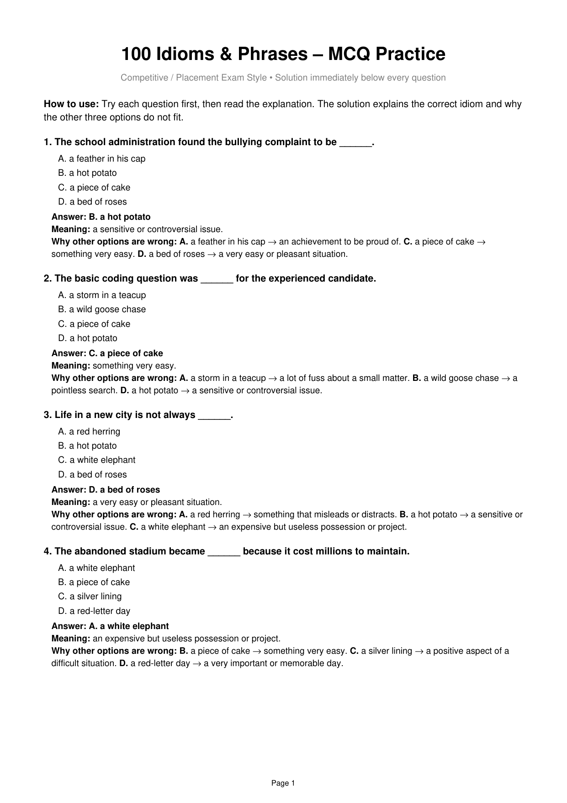

# Topic 11: Idioms and Phrases – 100 Advanced MCQs with Detailed Exegesis

> **Source:** Infosys Systems Engineer Preparation (`100_Idioms_and_Phrases_MCQ_With_Explanations_Below_Each.pdf`)
> **Target:** Infosys Systems Engineer (SE) Examination – Section 05: Verbal Ability
> **Scope:** 100 Complete Placement Questions, Options A–D, Verified Official Answer Keys, Figurative Semantics, Idiomatic Definitions & Full Distractor Refutations

---

## Quick Reference: 100/100 Idioms & Phrases Answer Key Matrix

| Q# | **Key** | Q# | **Key** | Q# | **Key** | Q# | **Key** | Q# | **Key** |
|:---:|:---:|:---:|:---:|:---:|:---:|:---:|:---:|:---:|:---:|
| **Q001** | `B` | **Q021** | `B` | **Q041** | `B` | **Q061** | `B` | **Q081** | `B` |
| **Q002** | `C` | **Q022** | `C` | **Q042** | `C` | **Q062** | `C` | **Q082** | `C` |
| **Q003** | `D` | **Q023** | `D` | **Q043** | `D` | **Q063** | `D` | **Q083** | `D` |
| **Q004** | `A` | **Q024** | `A` | **Q044** | `A` | **Q064** | `A` | **Q084** | `A` |
| **Q005** | `B` | **Q025** | `B` | **Q045** | `B` | **Q065** | `B` | **Q085** | `B` |
| **Q006** | `C` | **Q026** | `C` | **Q046** | `C` | **Q066** | `C` | **Q086** | `C` |
| **Q007** | `D` | **Q027** | `D` | **Q047** | `D` | **Q067** | `D` | **Q087** | `D` |
| **Q008** | `A` | **Q028** | `A` | **Q048** | `A` | **Q068** | `A` | **Q088** | `A` |
| **Q009** | `B` | **Q029** | `B` | **Q049** | `B` | **Q069** | `B` | **Q089** | `B` |
| **Q010** | `C` | **Q030** | `C` | **Q050** | `C` | **Q070** | `C` | **Q090** | `C` |
| **Q011** | `D` | **Q031** | `D` | **Q051** | `D` | **Q071** | `D` | **Q091** | `D` |
| **Q012** | `A` | **Q032** | `A` | **Q052** | `A` | **Q072** | `A` | **Q092** | `A` |
| **Q013** | `B` | **Q033** | `B` | **Q053** | `B` | **Q073** | `B` | **Q093** | `B` |
| **Q014** | `C` | **Q034** | `C` | **Q054** | `C` | **Q074** | `C` | **Q094** | `C` |
| **Q015** | `D` | **Q035** | `D` | **Q055** | `D` | **Q075** | `D` | **Q095** | `D` |
| **Q016** | `A` | **Q036** | `A` | **Q056** | `A` | **Q076** | `A` | **Q096** | `A` |
| **Q017** | `B` | **Q037** | `B` | **Q057** | `B` | **Q077** | `B` | **Q097** | `B` |
| **Q018** | `C` | **Q038** | `C` | **Q058** | `C` | **Q078** | `C` | **Q098** | `C` |
| **Q019** | `D` | **Q039** | `D` | **Q059** | `D` | **Q079** | `D` | **Q099** | `D` |
| **Q020** | `A` | **Q040** | `A` | **Q060** | `A` | **Q080** | `A` | **Q100** | `A` |

---

### Question IDM-Q001

**Contextual Sentence / Prompt:**
> *"The school administration found the bullying complaint to be ______."*

**Options:**
- **(A)** a feather in his cap
- **(B)** a hot potato
- **(C)** a piece of cake
- **(D)** a bed of roses

**Correct Idiom:** `Option (B) [a hot potato]`

**In-Depth Idiomatic Exegesis & Distractor Analysis:**
- **Core Meaning:** a sensitive or controversial issue.
- **Distractor Refutations:** A. a feather in his cap → an achievement to be proud of. C. a piece of cake → something very easy. D. a bed of roses → a very easy or pleasant situation.

---

### Question IDM-Q002

**Contextual Sentence / Prompt:**
> *"The basic coding question was ______ for the experienced candidate."*

**Options:**
- **(A)** a storm in a teacup
- **(B)** a wild goose chase
- **(C)** a piece of cake
- **(D)** a hot potato

**Correct Idiom:** `Option (C) [a piece of cake]`

**In-Depth Idiomatic Exegesis & Distractor Analysis:**
- **Core Meaning:** something very easy.
- **Distractor Refutations:** A. a storm in a teacup → a lot of fuss about a small matter. B. a wild goose chase → a pointless search. D. a hot potato → a sensitive or controversial issue.

---

### Question IDM-Q003

**Contextual Sentence / Prompt:**
> *"Life in a new city is not always ______."*

**Options:**
- **(A)** a red herring
- **(B)** a hot potato
- **(C)** a white elephant
- **(D)** a bed of roses

**Correct Idiom:** `Option (D) [a bed of roses]`

**In-Depth Idiomatic Exegesis & Distractor Analysis:**
- **Core Meaning:** a very easy or pleasant situation.
- **Distractor Refutations:** A. a red herring → something that misleads or distracts. B. a hot potato → a sensitive or controversial issue. C. a white elephant → an expensive but useless possession or project.

---

### Question IDM-Q004

**Contextual Sentence / Prompt:**
> *"The abandoned stadium became ______ because it cost millions to maintain."*

**Options:**
- **(A)** a white elephant
- **(B)** a piece of cake
- **(C)** a silver lining
- **(D)** a red-letter day

**Correct Idiom:** `Option (A) [a white elephant]`

**In-Depth Idiomatic Exegesis & Distractor Analysis:**
- **Core Meaning:** an expensive but useless possession or project.
- **Distractor Refutations:** B. a piece of cake → something very easy. C. a silver lining → a positive aspect of a difficult situation. D. a red-letter day → a very important or memorable day.

---

### Question IDM-Q005

**Contextual Sentence / Prompt:**
> *"The clue about the old car was ______ and sent the detective in the wrong direction."*

**Options:**
- **(A)** a piece of cake
- **(B)** a red herring
- **(C)** a feather in his cap
- **(D)** a bed of roses

**Correct Idiom:** `Option (B) [a red herring]`

**In-Depth Idiomatic Exegesis & Distractor Analysis:**
- **Core Meaning:** something that misleads or distracts.
- **Distractor Refutations:** A. a piece of cake → something very easy. C. a feather in his cap → an achievement to be proud of. D. a bed of roses → a very easy or pleasant situation.

---

### Question IDM-Q006

**Contextual Sentence / Prompt:**
> *"Missing that flight was ______ because she met her future employer later."*

**Options:**
- **(A)** a wet blanket
- **(B)** a wild goose chase
- **(C)** a blessing in disguise
- **(D)** a hot potato

**Correct Idiom:** `Option (C) [a blessing in disguise]`

**In-Depth Idiomatic Exegesis & Distractor Analysis:**
- **Core Meaning:** something that seems bad but has a good result.
- **Distractor Refutations:** A. a wet blanket → a person who spoils others' enjoyment. B. a wild goose chase → a pointless search. D. a hot potato → a sensitive or controversial issue.

---

### Question IDM-Q007

**Contextual Sentence / Prompt:**
> *"Their argument turned out to be ______ and ended quickly."*

**Options:**
- **(A)** a white elephant
- **(B)** a red-letter day
- **(C)** a piece of cake
- **(D)** a storm in a teacup

**Correct Idiom:** `Option (D) [a storm in a teacup]`

**In-Depth Idiomatic Exegesis & Distractor Analysis:**
- **Core Meaning:** a lot of fuss about a small matter.
- **Distractor Refutations:** A. a white elephant → an expensive but useless possession or project. B. a red-letter day → a very important or memorable day. C. a piece of cake → something very easy.

---

### Question IDM-Q008

**Contextual Sentence / Prompt:**
> *"The false address sent the police on ______."*

**Options:**
- **(A)** a wild goose chase
- **(B)** a silver lining
- **(C)** a feather in his cap
- **(D)** a bed of roses

**Correct Idiom:** `Option (A) [a wild goose chase]`

**In-Depth Idiomatic Exegesis & Distractor Analysis:**
- **Core Meaning:** a pointless search.
- **Distractor Refutations:** B. a silver lining → a positive aspect of a difficult situation. C. a feather in his cap → an achievement to be proud of. D. a bed of roses → a very easy or pleasant situation.

---

### Question IDM-Q009

**Contextual Sentence / Prompt:**
> *"The noisy neighbour became ______ for the family."*

**Options:**
- **(A)** a blessing in disguise
- **(B)** a thorn in the flesh
- **(C)** a red-letter day
- **(D)** a piece of cake

**Correct Idiom:** `Option (B) [a thorn in the flesh]`

**In-Depth Idiomatic Exegesis & Distractor Analysis:**
- **Core Meaning:** a persistent source of annoyance.
- **Distractor Refutations:** A. a blessing in disguise → something that seems bad but has a good result. C. a red-letter day → a very important or memorable day. D. a piece of cake → something very easy.

---

### Question IDM-Q010

**Contextual Sentence / Prompt:**
> *"The unpaid bill became ______ between the partners."*

**Options:**
- **(A)** a silver lining
- **(B)** a white elephant
- **(C)** a bone of contention
- **(D)** a hot potato

**Correct Idiom:** `Option (C) [a bone of contention]`

**In-Depth Idiomatic Exegesis & Distractor Analysis:**
- **Core Meaning:** a subject causing disagreement.
- **Distractor Refutations:** A. a silver lining → a positive aspect of a difficult situation. B. a white elephant → an expensive but useless possession or project. D. a hot potato → a sensitive or controversial issue.

---

### Question IDM-Q011

**Contextual Sentence / Prompt:**
> *"Winning the national award was ______ for the young scientist."*

**Options:**
- **(A)** a wet blanket
- **(B)** a red herring
- **(C)** a storm in a teacup
- **(D)** a feather in his cap

**Correct Idiom:** `Option (D) [a feather in his cap]`

**In-Depth Idiomatic Exegesis & Distractor Analysis:**
- **Core Meaning:** an achievement to be proud of.
- **Distractor Refutations:** A. a wet blanket → a person who spoils others' enjoyment. B. a red herring → something that misleads or distracts. C. a storm in a teacup → a lot of fuss about a small matter.

---

### Question IDM-Q012

**Contextual Sentence / Prompt:**
> *"The company's first international launch was ______."*

**Options:**
- **(A)** a red-letter day
- **(B)** a wild goose chase
- **(C)** a piece of cake
- **(D)** a hot potato → a sensitive or controversial issue.

**Correct Idiom:** `Option (A) [a red-letter day]`

**In-Depth Idiomatic Exegesis & Distractor Analysis:**
- **Core Meaning:** a very important or memorable day.
- **Distractor Refutations:** B. a wild goose chase → a pointless search. C. a piece of cake → something very easy.

---

### Question IDM-Q013

**Contextual Sentence / Prompt:**
> *"His constant complaints made him ______ at the party."*

**Options:**
- **(A)** a red herring
- **(B)** a wet blanket
- **(C)** a feather in his cap
- **(D)** a silver lining

**Correct Idiom:** `Option (B) [a wet blanket]`

**In-Depth Idiomatic Exegesis & Distractor Analysis:**
- **Core Meaning:** a person who spoils others' enjoyment.
- **Distractor Refutations:** A. a red herring → something that misleads or distracts. C. a feather in his cap → an achievement to be proud of. D. a silver lining → a positive aspect of a difficult situation.

---

### Question IDM-Q014

**Contextual Sentence / Prompt:**
> *"The only ______ was that nobody was injured in the accident."*

**Options:**
- **(A)** a bone of contention
- **(B)** a wild goose chase
- **(C)** a silver lining
- **(D)** a white elephant

**Correct Idiom:** `Option (C) [a silver lining]`

**In-Depth Idiomatic Exegesis & Distractor Analysis:**
- **Core Meaning:** a positive aspect of a difficult situation.
- **Distractor Refutations:** A. a bone of contention → a subject causing disagreement. B. a wild goose chase → a pointless search. D. a white elephant → an expensive but useless possession or project.

---

### Question IDM-Q015

**Contextual Sentence / Prompt:**
> *"We have finished the main task, so let's ______."*

**Options:**
- **(A)** spill the beans
- **(B)** jump the gun → act too soon. C. burn bridges → destroy a relationship or possibility of returning.
- **(C)** burn bridges
- **(D)** call it a day

**Correct Idiom:** `Option (D) [call it a day]`

**In-Depth Idiomatic Exegesis & Distractor Analysis:**
- **Core Meaning:** stop working for the day.
- **Distractor Refutations:** A. spill the beans → an expression with a different meaning from the one required here.

---

### Question IDM-Q016

**Contextual Sentence / Prompt:**
> *"The trainer told a joke to ______ at the beginning of the workshop."*

**Options:**
- **(A)** break the ice
- **(B)** cut corners
- **(C)** miss the boat
- **(D)** bite the bullet

**Correct Idiom:** `Option (A) [break the ice]`

**In-Depth Idiomatic Exegesis & Distractor Analysis:**
- **Core Meaning:** make people feel more comfortable.
- **Distractor Refutations:** B. cut corners → do something cheaply/carelessly by skipping proper steps. C. miss the boat → lose an opportunity. D. bite the bullet → face a difficult situation bravely.

---

### Question IDM-Q017

**Contextual Sentence / Prompt:**
> *"The analyst ______ when she identified poor planning as the main cause."*

**Options:**
- **(A)** pull someone's leg
- **(B)** hit the nail on the head
- **(C)** beat around the bush
- **(D)** throw in the towel

**Correct Idiom:** `Option (B) [hit the nail on the head]`

**In-Depth Idiomatic Exegesis & Distractor Analysis:**
- **Core Meaning:** identify something exactly.
- **Distractor Refutations:** A. pull someone's leg → an expression with a different meaning from the one required here. C. beat around the bush → avoid saying something directly. D. throw in the towel → give up.

---

### Question IDM-Q018

**Contextual Sentence / Prompt:**
> *"Stop ______ and tell me what actually happened."*

**Options:**
- **(A)** going cold turkey
- **(B)** hitting the sack
- **(C)** beating around the bush
- **(D)** calling the shots

**Correct Idiom:** `Option (C) [beating around the bush]`

**In-Depth Idiomatic Exegesis & Distractor Analysis:**
- **Core Meaning:** avoid saying something directly.
- **Distractor Refutations:** A. going cold turkey → an expression with a different meaning from the one required here. B. hitting the sack → an expression with a different meaning from the one required here. D. calling the shots → an expression with a different meaning from the one required here.

---

### Question IDM-Q019

**Contextual Sentence / Prompt:**
> *"Ravi accidentally ______ about the surprise party."*

**Options:**
- **(A)** cut the mustard
- **(B)** kept his powder dry
- **(C)** hit the jackpot
- **(D)** spilled the beans

**Correct Idiom:** `Option (D) [spilled the beans]`

**In-Depth Idiomatic Exegesis & Distractor Analysis:**
- **Core Meaning:** reveal a secret.
- **Distractor Refutations:** A. cut the mustard → an expression with a different meaning from the one required here. B. kept his powder dry → an expression with a different meaning from the one required here. C. hit the jackpot → had great success or obtained something valuable.

---

### Question IDM-Q020

**Contextual Sentence / Prompt:**
> *"He ______ just before giving his first public speech."*

**Options:**
- **(A)** got cold feet
- **(B)** called it a day
- **(C)** brought home the bacon → an expression with a different meaning from the one required here. D. saw eye to eye → an expression with a different meaning from the one required here.
- **(D)** saw eye to eye

**Correct Idiom:** `Option (A) [got cold feet]`

**In-Depth Idiomatic Exegesis & Distractor Analysis:**
- **Core Meaning:** become nervous before doing something.
- **Distractor Refutations:** B. called it a day → an expression with a different meaning from the one required here.

---

### Question IDM-Q021

**Contextual Sentence / Prompt:**
> *"She decided to ______ and pay the unexpected repair bill."*

**Options:**
- **(A)** break the bank
- **(B)** bite the bullet
- **(C)** miss the boat
- **(D)** pull the plug → an expression with a different meaning from the one required here.

**Correct Idiom:** `Option (B) [bite the bullet]`

**In-Depth Idiomatic Exegesis & Distractor Analysis:**
- **Core Meaning:** face a difficult situation bravely.
- **Distractor Refutations:** A. break the bank → cost a very large amount. C. miss the boat → lose an opportunity.

---

### Question IDM-Q022

**Contextual Sentence / Prompt:**
> *"I did not want to attend, but my friends ______."*

**Options:**
- **(A)** hit the sack
- **(B)** read the riot act
- **(C)** twisted my arm
- **(D)** cut corners

**Correct Idiom:** `Option (C) [twisted my arm]`

**In-Depth Idiomatic Exegesis & Distractor Analysis:**
- **Core Meaning:** persuade someone.
- **Distractor Refutations:** A. hit the sack → go to bed. B. read the riot act → strongly reprimand or warn. D. cut corners → do something cheaply/carelessly by skipping proper steps.

---

### Question IDM-Q023

**Contextual Sentence / Prompt:**
> *"Don't ______; the mistake can be corrected easily."*

**Options:**
- **(A)** keep an eye on
- **(B)** call it a day
- **(C)** go the extra mile
- **(D)** make a mountain out of a molehill

**Correct Idiom:** `Option (D) [make a mountain out of a molehill]`

**In-Depth Idiomatic Exegesis & Distractor Analysis:**
- **Core Meaning:** exaggerate a small problem.
- **Distractor Refutations:** A. keep an eye on → watch carefully. B. call it a day → stop working for the day. C. go the extra mile → an expression with a different meaning from the one required here.

---

### Question IDM-Q024

**Contextual Sentence / Prompt:**
> *"The two managers do not always ______ on financial matters."*

**Options:**
- **(A)** see eye to eye
- **(B)** throw in the towel
- **(C)** go bananas
- **(D)** draw a blank

**Correct Idiom:** `Option (A) [see eye to eye]`

**In-Depth Idiomatic Exegesis & Distractor Analysis:**
- **Core Meaning:** agree completely.
- **Distractor Refutations:** B. throw in the towel → give up. C. go bananas → an expression with a different meaning from the one required here. D. draw a blank → an expression with a different meaning from the one required here.

---

### Question IDM-Q025

**Contextual Sentence / Prompt:**
> *"I am exhausted, so I am going to ______ early."*

**Options:**
- **(A)** hit the nail on the head
- **(B)** hit the sack
- **(C)** hit the roof
- **(D)** hit the jackpot

**Correct Idiom:** `Option (B) [hit the sack]`

**In-Depth Idiomatic Exegesis & Distractor Analysis:**
- **Core Meaning:** go to bed.
- **Distractor Refutations:** A. hit the nail on the head → identify something exactly. C. hit the roof → became extremely angry. D. hit the jackpot → had great success or obtained something valuable.

---

### Question IDM-Q026

**Contextual Sentence / Prompt:**
> *"Please ______ and tell us whether the proposal was accepted."*

**Options:**
- **(A)** put on airs
- **(B)** spill the beans
- **(C)** cut to the chase
- **(D)** beat around the bush

**Correct Idiom:** `Option (C) [cut to the chase]`

**In-Depth Idiomatic Exegesis & Distractor Analysis:**
- **Core Meaning:** get to the main point.
- **Distractor Refutations:** A. put on airs → behave as if one is more important. B. spill the beans → an expression with a different meaning from the one required here. D. beat around the bush → avoid saying something directly.

---

### Question IDM-Q027

**Contextual Sentence / Prompt:**
> *"His angry reply only ______ during the argument."*

**Options:**
- **(A)** kept the wolf from the door
- **(B)** broke the ice
- **(C)** called it a day
- **(D)** added fuel to the fire

**Correct Idiom:** `Option (D) [added fuel to the fire]`

**In-Depth Idiomatic Exegesis & Distractor Analysis:**
- **Core Meaning:** make a bad situation worse.
- **Distractor Refutations:** A. kept the wolf from the door → an expression with a different meaning from the one required here. B. broke the ice → an expression with a different meaning from the one required here. C. called it a day → an expression with a different meaning from the one required here.

---

### Question IDM-Q028

**Contextual Sentence / Prompt:**
> *"After several failed attempts, the team decided to ______."*

**Options:**
- **(A)** throw in the towel
- **(B)** test the waters
- **(C)** call the shots
- **(D)** keep an eye on

**Correct Idiom:** `Option (A) [throw in the towel]`

**In-Depth Idiomatic Exegesis & Distractor Analysis:**
- **Core Meaning:** give up.
- **Distractor Refutations:** B. test the waters → try something cautiously first. C. call the shots → an expression with a different meaning from the one required here. D. keep an eye on → watch carefully.

---

### Question IDM-Q029

**Contextual Sentence / Prompt:**
> *"You should ______ the claims made in that advertisement."*

**Options:**
- **(A)** break the bank
- **(B)** take them with a grain of salt
- **(C)** hit the sack
- **(D)** go the extra mile

**Correct Idiom:** `Option (B) [take them with a grain of salt]`

**In-Depth Idiomatic Exegesis & Distractor Analysis:**
- **Core Meaning:** not accept something as completely true.
- **Distractor Refutations:** A. break the bank → cost a very large amount. C. hit the sack → go to bed. D. go the extra mile → an expression with a different meaning from the one required here.

---

### Question IDM-Q030

**Contextual Sentence / Prompt:**
> *"Ignoring the safety warning is ______."*

**Options:**
- **(A)** calling it a day
- **(B)** keeping the ball rolling → an expression with a different meaning from the one required here. D. seeing eye to eye → an expression with a different meaning from the one required here.
- **(C)** playing with fire
- **(D)** seeing eye to eye

**Correct Idiom:** `Option (C) [playing with fire]`

**In-Depth Idiomatic Exegesis & Distractor Analysis:**
- **Core Meaning:** take a dangerous risk.
- **Distractor Refutations:** A. calling it a day → an expression with a different meaning from the one required here.

---

### Question IDM-Q031

**Contextual Sentence / Prompt:**
> *"She was ______ after receiving the scholarship."*

**Options:**
- **(A)** under the weather
- **(B)** in hot water
- **(C)** at a loss
- **(D)** on cloud nine

**Correct Idiom:** `Option (D) [on cloud nine]`

**In-Depth Idiomatic Exegesis & Distractor Analysis:**
- **Core Meaning:** extremely happy.
- **Distractor Refutations:** A. under the weather → feeling unwell. B. in hot water → in trouble. C. at a loss → confused or unsure what to do.

---

### Question IDM-Q032

**Contextual Sentence / Prompt:**
> *"I am feeling ______ today and will stay home."*

**Options:**
- **(A)** under the weather
- **(B)** on cloud nine
- **(C)** in the red
- **(D)** in black and white

**Correct Idiom:** `Option (A) [under the weather]`

**In-Depth Idiomatic Exegesis & Distractor Analysis:**
- **Core Meaning:** feeling unwell.
- **Distractor Refutations:** B. on cloud nine → extremely happy. C. in the red → in financial loss or debt. D. in black and white → in writing or clearly documented.

---

### Question IDM-Q033

**Contextual Sentence / Prompt:**
> *"Please ______ the equipment while I speak to the supervisor."*

**Options:**
- **(A)** jump the gun
- **(B)** keep an eye on
- **(C)** spill the beans
- **(D)** burn bridges

**Correct Idiom:** `Option (B) [keep an eye on]`

**In-Depth Idiomatic Exegesis & Distractor Analysis:**
- **Core Meaning:** watch carefully.
- **Distractor Refutations:** A. jump the gun → act too soon. C. spill the beans → an expression with a different meaning from the one required here. D. burn bridges → destroy a relationship or possibility of returning.

---

### Question IDM-Q034

**Contextual Sentence / Prompt:**
> *"The resignation came ______ and surprised everyone."*

**Options:**
- **(A)** in the red
- **(B)** once in a blue moon
- **(C)** out of the blue
- **(D)** by the book

**Correct Idiom:** `Option (C) [out of the blue]`

**In-Depth Idiomatic Exegesis & Distractor Analysis:**
- **Core Meaning:** unexpectedly.
- **Distractor Refutations:** A. in the red → in financial loss or debt. B. once in a blue moon → very rarely. D. by the book → according to the rules.

---

### Question IDM-Q035

**Contextual Sentence / Prompt:**
> *"He visits his hometown only ______."*

**Options:**
- **(A)** at the drop of a hat
- **(B)** through thick and thin
- **(C)** by leaps and bounds
- **(D)** once in a blue moon

**Correct Idiom:** `Option (D) [once in a blue moon]`

**In-Depth Idiomatic Exegesis & Distractor Analysis:**
- **Core Meaning:** very rarely.
- **Distractor Refutations:** A. at the drop of a hat → immediately, without hesitation. B. through thick and thin → through good and bad times. C. by leaps and bounds → very rapidly.

---

### Question IDM-Q036

**Contextual Sentence / Prompt:**
> *"The company has been ______ since last year."*

**Options:**
- **(A)** in the red
- **(B)** on the ball
- **(C)** in the pink
- **(D)** under wraps

**Correct Idiom:** `Option (A) [in the red]`

**In-Depth Idiomatic Exegesis & Distractor Analysis:**
- **Core Meaning:** in financial loss or debt.
- **Distractor Refutations:** B. on the ball → alert and quick to understand. C. in the pink → an expression with a different meaning from the one required here. D. under wraps → kept secret.

---

### Question IDM-Q037

**Contextual Sentence / Prompt:**
> *"The officer always does everything ______."*

**Options:**
- **(A)** under the table
- **(B)** by the book
- **(C)** out of the blue → unexpectedly. D. at sea → confused or uncertain.
- **(D)** at sea

**Correct Idiom:** `Option (B) [by the book]`

**In-Depth Idiomatic Exegesis & Distractor Analysis:**
- **Core Meaning:** according to the rules.
- **Distractor Refutations:** A. under the table → an expression with a different meaning from the one required here.

---

### Question IDM-Q038

**Contextual Sentence / Prompt:**
> *"The agreement is there ______ in the contract."*

**Options:**
- **(A)** on thin ice
- **(B)** out of the blue
- **(C)** in black and white
- **(D)** through thick and thin

**Correct Idiom:** `Option (C) [in black and white]`

**In-Depth Idiomatic Exegesis & Distractor Analysis:**
- **Core Meaning:** in writing or clearly documented.
- **Distractor Refutations:** A. on thin ice → in a risky situation. B. out of the blue → unexpectedly. D. through thick and thin → through good and bad times.

---

### Question IDM-Q039

**Contextual Sentence / Prompt:**
> *"The new assistant is really ______ and rarely misses a detail."*

**Options:**
- **(A)** under a cloud
- **(B)** in a pickle
- **(C)** at a loss
- **(D)** on the ball

**Correct Idiom:** `Option (D) [on the ball]`

**In-Depth Idiomatic Exegesis & Distractor Analysis:**
- **Core Meaning:** alert and quick to understand.
- **Distractor Refutations:** A. under a cloud → under suspicion or facing disgrace. B. in a pickle → in a difficult situation. C. at a loss → confused or unsure what to do.

---

### Question IDM-Q040

**Contextual Sentence / Prompt:**
> *"The employee was ______ after violating the safety rules."*

**Options:**
- **(A)** in hot water
- **(B)** on cloud nine
- **(C)** in the pink
- **(D)** off the hook

**Correct Idiom:** `Option (A) [in hot water]`

**In-Depth Idiomatic Exegesis & Distractor Analysis:**
- **Core Meaning:** in trouble.
- **Distractor Refutations:** B. on cloud nine → extremely happy. C. in the pink → an expression with a different meaning from the one required here. D. off the hook → free from blame or responsibility.

---

### Question IDM-Q041

**Contextual Sentence / Prompt:**
> *"We are all ______ because the deadline has been moved forward."*

**Options:**
- **(A)** in black and white
- **(B)** in the same boat
- **(C)** on the ball
- **(D)** under wraps

**Correct Idiom:** `Option (B) [in the same boat]`

**In-Depth Idiomatic Exegesis & Distractor Analysis:**
- **Core Meaning:** in the same difficult situation.
- **Distractor Refutations:** A. in black and white → in writing or clearly documented. C. on the ball → alert and quick to understand. D. under wraps → kept secret.

---

### Question IDM-Q042

**Contextual Sentence / Prompt:**
> *"The board decided to ______ the failed project."*

**Options:**
- **(A)** bring home the bacon
- **(B)** test the waters
- **(C)** pull the plug on
- **(D)** keep the ball rolling

**Correct Idiom:** `Option (C) [pull the plug on]`

**In-Depth Idiomatic Exegesis & Distractor Analysis:**
- **Core Meaning:** stop or terminate.
- **Distractor Refutations:** A. bring home the bacon → earn money to support a family. B. test the waters → try something cautiously first. D. keep the ball rolling → keep a process going.

---

### Question IDM-Q043

**Contextual Sentence / Prompt:**
> *"Let's approve the next step to ______."*

**Options:**
- **(A)** throw in the towel
- **(B)** hit the roof
- **(C)** cut corners
- **(D)** keep the ball rolling

**Correct Idiom:** `Option (D) [keep the ball rolling]`

**In-Depth Idiomatic Exegesis & Distractor Analysis:**
- **Core Meaning:** keep a process going.
- **Distractor Refutations:** A. throw in the towel → give up. B. hit the roof → became extremely angry. C. cut corners → do something cheaply/carelessly by skipping proper steps.

---

### Question IDM-Q044

**Contextual Sentence / Prompt:**
> *"I cannot ______ this noise any longer."*

**Options:**
- **(A)** put up with
- **(B)** go cold turkey
- **(C)** miss the boat
- **(D)** call the shots

**Correct Idiom:** `Option (A) [put up with]`

**In-Depth Idiomatic Exegesis & Distractor Analysis:**
- **Core Meaning:** tolerate.
- **Distractor Refutations:** B. go cold turkey → stop a habit suddenly and completely. C. miss the boat → lose an opportunity. D. call the shots → an expression with a different meaning from the one required here.

---

### Question IDM-Q045

**Contextual Sentence / Prompt:**
> *"Both parents work hard to ______."*

**Options:**
- **(A)** jump the gun
- **(B)** bring home the bacon
- **(C)** beat a dead horse
- **(D)** break the ice

**Correct Idiom:** `Option (B) [bring home the bacon]`

**In-Depth Idiomatic Exegesis & Distractor Analysis:**
- **Core Meaning:** earn money to support a family.
- **Distractor Refutations:** A. jump the gun → act too soon. C. beat a dead horse → an expression with a different meaning from the one required here. D. break the ice → make people feel more comfortable.

---

### Question IDM-Q046

**Contextual Sentence / Prompt:**
> *"There is no use ______ after the mistake has happened."*

**Options:**
- **(A)** calling the shots
- **(B)** going the extra mile
- **(C)** crying over spilt milk
- **(D)** cutting corners

**Correct Idiom:** `Option (C) [crying over spilt milk]`

**In-Depth Idiomatic Exegesis & Distractor Analysis:**
- **Core Meaning:** regret something that cannot be changed.
- **Distractor Refutations:** A. calling the shots → an expression with a different meaning from the one required here. B. going the extra mile → an expression with a different meaning from the one required here. D. cutting corners → an expression with a different meaning from the one required here.

---

### Question IDM-Q047

**Contextual Sentence / Prompt:**
> *"Many companies ______ and started offering AI tools."*

**Options:**
- **(A)** hit the sack
- **(B)** went under the weather
- **(C)** called it a day
- **(D)** jumped on the bandwagon

**Correct Idiom:** `Option (D) [jumped on the bandwagon]`

**In-Depth Idiomatic Exegesis & Distractor Analysis:**
- **Core Meaning:** join a popular trend.
- **Distractor Refutations:** A. hit the sack → go to bed. B. went under the weather → an expression with a different meaning from the one required here. C. called it a day → an expression with a different meaning from the one required here.

---

### Question IDM-Q048

**Contextual Sentence / Prompt:**
> *"The support team always ______ to help customers."*

**Options:**
- **(A)** goes the extra mile
- **(B)** cuts corners
- **(C)** misses the boat
- **(D)** throws in the towel

**Correct Idiom:** `Option (A) [goes the extra mile]`

**In-Depth Idiomatic Exegesis & Distractor Analysis:**
- **Core Meaning:** make an additional effort.
- **Distractor Refutations:** B. cuts corners → an expression with a different meaning from the one required here. C. misses the boat → an expression with a different meaning from the one required here. D. throws in the towel → an expression with a different meaning from the one required here.

---

### Question IDM-Q049

**Contextual Sentence / Prompt:**
> *"Apply now or you may ______."*

**Options:**
- **(A)** keep your chin up
- **(B)** miss the boat
- **(C)** break the ice
- **(D)** hit the jackpot

**Correct Idiom:** `Option (B) [miss the boat]`

**In-Depth Idiomatic Exegesis & Distractor Analysis:**
- **Core Meaning:** lose an opportunity.
- **Distractor Refutations:** A. keep your chin up → an expression with a different meaning from the one required here. C. break the ice → make people feel more comfortable. D. hit the jackpot → had great success or obtained something valuable.

---

### Question IDM-Q050

**Contextual Sentence / Prompt:**
> *"It is wiser to ______ than reopen the dispute."*

**Options:**
- **(A)** call the shots
- **(B)** spill the beans → an expression with a different meaning from the one required here. D. open a can of worms → create a complicated set of problems.
- **(C)** let sleeping dogs lie
- **(D)** open a can of worms

**Correct Idiom:** `Option (C) [let sleeping dogs lie]`

**In-Depth Idiomatic Exegesis & Distractor Analysis:**
- **Core Meaning:** avoid restarting an old conflict.
- **Distractor Refutations:** A. call the shots → an expression with a different meaning from the one required here.

---

### Question IDM-Q051

**Contextual Sentence / Prompt:**
> *"The audit ______ several hidden accounting errors."*

**Options:**
- **(A)** put on airs
- **(B)** ran out of steam
- **(C)** went cold turkey
- **(D)** brought to light

**Correct Idiom:** `Option (D) [brought to light]`

**In-Depth Idiomatic Exegesis & Distractor Analysis:**
- **Core Meaning:** reveal or discover.
- **Distractor Refutations:** A. put on airs → behave as if one is more important. B. ran out of steam → lost energy or enthusiasm. C. went cold turkey → an expression with a different meaning from the one required here.

---

### Question IDM-Q052

**Contextual Sentence / Prompt:**
> *"He tends to ______ when important guests arrive."*

**Options:**
- **(A)** put on airs
- **(B)** keep an eye on
- **(C)** hit the sack
- **(D)** make ends meet

**Correct Idiom:** `Option (A) [put on airs]`

**In-Depth Idiomatic Exegesis & Distractor Analysis:**
- **Core Meaning:** behave as if one is more important.
- **Distractor Refutations:** B. keep an eye on → watch carefully. C. hit the sack → go to bed. D. make ends meet → an expression with a different meaning from the one required here.

---

### Question IDM-Q053

**Contextual Sentence / Prompt:**
> *"The campaign ______ after several months."*

**Options:**
- **(A)** called the shots
- **(B)** ran out of steam
- **(C)** hit the jackpot
- **(D)** broke the ice

**Correct Idiom:** `Option (B) [ran out of steam]`

**In-Depth Idiomatic Exegesis & Distractor Analysis:**
- **Core Meaning:** lose energy or enthusiasm.
- **Distractor Refutations:** A. called the shots → an expression with a different meaning from the one required here. C. hit the jackpot → had great success or obtained something valuable. D. broke the ice → an expression with a different meaning from the one required here.

---

### Question IDM-Q054

**Contextual Sentence / Prompt:**
> *"The supervisor ______ for repeatedly arriving late."*

**Options:**
- **(A)** put him on ice
- **(B)** let him off the hook → release him from blame or punishment. D. gave him the green light → an expression with a different meaning from the one required here.
- **(C)** took him to task
- **(D)** gave him the green light

**Correct Idiom:** `Option (C) [took him to task]`

**In-Depth Idiomatic Exegesis & Distractor Analysis:**
- **Core Meaning:** strongly criticize or reprimand.
- **Distractor Refutations:** A. put him on ice → an expression with a different meaning from the one required here.

---

### Question IDM-Q055

**Contextual Sentence / Prompt:**
> *"The proposal ______ because it ignored traditional safety practices."*

**Options:**
- **(A)** hit the sack
- **(B)** made ends meet
- **(C)** cut the mustard
- **(D)** went against the grain

**Correct Idiom:** `Option (D) [went against the grain]`

**In-Depth Idiomatic Exegesis & Distractor Analysis:**
- **Core Meaning:** conflict with usual beliefs or preferences.
- **Distractor Refutations:** A. hit the sack → go to bed. B. made ends meet → an expression with a different meaning from the one required here. C. cut the mustard → an expression with a different meaning from the one required here.

---

### Question IDM-Q056

**Contextual Sentence / Prompt:**
> *"The board finally ______ to the construction plan."*

**Options:**
- **(A)** gave the green light
- **(B)** put a lid on
- **(C)** held its horses
- **(D)** called the shots

**Correct Idiom:** `Option (A) [gave the green light]`

**In-Depth Idiomatic Exegesis & Distractor Analysis:**
- **Core Meaning:** give permission to proceed.
- **Distractor Refutations:** B. put a lid on → an expression with a different meaning from the one required here. C. held its horses → an expression with a different meaning from the one required here. D. called the shots → an expression with a different meaning from the one required here.

---

### Question IDM-Q057

**Contextual Sentence / Prompt:**
> *"The committee decided to ______ the proposal until next month."*

**Options:**
- **(A)** go bananas
- **(B)** put the proposal on ice
- **(C)** bring home the bacon
- **(D)** hit the roof

**Correct Idiom:** `Option (B) [put the proposal on ice]`

**In-Depth Idiomatic Exegesis & Distractor Analysis:**
- **Core Meaning:** postpone something.
- **Distractor Refutations:** A. go bananas → an expression with a different meaning from the one required here. C. bring home the bacon → earn money to support a family. D. hit the roof → became extremely angry.

---

### Question IDM-Q058

**Contextual Sentence / Prompt:**
> *"______! We need to verify the figures first."*

**Options:**
- **(A)** Cut corners
- **(B)** Break the bank
- **(C)** Hold your horses
- **(D)** Spill the beans

**Correct Idiom:** `Option (C) [Hold your horses]`

**In-Depth Idiomatic Exegesis & Distractor Analysis:**
- **Core Meaning:** wait or be patient.
- **Distractor Refutations:** A. Cut corners → an expression with a different meaning from the one required here. B. Break the bank → an expression with a different meaning from the one required here. D. Spill the beans → an expression with a different meaning from the one required here.

---

### Question IDM-Q059

**Contextual Sentence / Prompt:**
> *"Buying the top model will ______."*

**Options:**
- **(A)** hit the roof
- **(B)** cut to the chase
- **(C)** draw a blank → an expression with a different meaning from the one required here.
- **(D)** break the bank

**Correct Idiom:** `Option (D) [break the bank]`

**In-Depth Idiomatic Exegesis & Distractor Analysis:**
- **Core Meaning:** cost a very large amount.
- **Distractor Refutations:** A. hit the roof → became extremely angry. B. cut to the chase → get to the main point.

---

### Question IDM-Q060

**Contextual Sentence / Prompt:**
> *"Dad will ______ when he sees the damaged car."*

**Options:**
- **(A)** hit the roof
- **(B)** hit the sack
- **(C)** hit the jackpot
- **(D)** hit the nail on the head

**Correct Idiom:** `Option (A) [hit the roof]`

**In-Depth Idiomatic Exegesis & Distractor Analysis:**
- **Core Meaning:** become extremely angry.
- **Distractor Refutations:** B. hit the sack → go to bed. C. hit the jackpot → had great success or obtained something valuable. D. hit the nail on the head → identify something exactly.

---

### Question IDM-Q061

**Contextual Sentence / Prompt:**
> *"When asked for the password, I ______."*

**Options:**
- **(A)** went the extra mile
- **(B)** drew a blank
- **(C)** hit the jackpot
- **(D)** called it a day

**Correct Idiom:** `Option (B) [drew a blank]`

**In-Depth Idiomatic Exegesis & Distractor Analysis:**
- **Core Meaning:** be unable to remember or find an answer.
- **Distractor Refutations:** A. went the extra mile → an expression with a different meaning from the one required here. C. hit the jackpot → had great success or obtained something valuable. D. called it a day → an expression with a different meaning from the one required here.

---

### Question IDM-Q062

**Contextual Sentence / Prompt:**
> *"The small company ______ with its new app."*

**Options:**
- **(A)** cut to the chase
- **(B)** was under the weather
- **(C)** hit the jackpot
- **(D)** went cold turkey

**Correct Idiom:** `Option (C) [hit the jackpot]`

**In-Depth Idiomatic Exegesis & Distractor Analysis:**
- **Core Meaning:** have great success or obtain something valuable.
- **Distractor Refutations:** A. cut to the chase → get to the main point. B. was under the weather → an expression with a different meaning from the one required here. D. went cold turkey → an expression with a different meaning from the one required here.

---

### Question IDM-Q063

**Contextual Sentence / Prompt:**
> *"He decided to ______ and stop using social media."*

**Options:**
- **(A)** call the shots
- **(B)** put on airs → behave as if one is more important. C. burn bridges → destroy a relationship or possibility of returning.
- **(C)** burn bridges
- **(D)** go cold turkey

**Correct Idiom:** `Option (D) [go cold turkey]`

**In-Depth Idiomatic Exegesis & Distractor Analysis:**
- **Core Meaning:** stop a habit suddenly and completely.
- **Distractor Refutations:** A. call the shots → an expression with a different meaning from the one required here.

---

### Question IDM-Q064

**Contextual Sentence / Prompt:**
> *"As project leader, Maya ______."*

**Options:**
- **(A)** calls the shots
- **(B)** cries over spilt milk
- **(C)** runs out of steam
- **(D)** misses the boat

**Correct Idiom:** `Option (A) [calls the shots]`

**In-Depth Idiomatic Exegesis & Distractor Analysis:**
- **Core Meaning:** make important decisions.
- **Distractor Refutations:** B. cries over spilt milk → an expression with a different meaning from the one required here. C. runs out of steam → an expression with a different meaning from the one required here. D. misses the boat → an expression with a different meaning from the one required here.

---

### Question IDM-Q065

**Contextual Sentence / Prompt:**
> *"You are ______ after ignoring the manager's final warning."*

**Options:**
- **(A)** in the clear
- **(B)** on thin ice
- **(C)** on cloud nine
- **(D)** in the pink

**Correct Idiom:** `Option (B) [on thin ice]`

**In-Depth Idiomatic Exegesis & Distractor Analysis:**
- **Core Meaning:** in a risky situation.
- **Distractor Refutations:** A. in the clear → free from danger, blame, or difficulty. C. on cloud nine → extremely happy. D. in the pink → an expression with a different meaning from the one required here.

---

### Question IDM-Q066

**Contextual Sentence / Prompt:**
> *"The details of the new product are still ______."*

**Options:**
- **(A)** in the red
- **(B)** out of the blue
- **(C)** under wraps
- **(D)** in the same boat

**Correct Idiom:** `Option (C) [under wraps]`

**In-Depth Idiomatic Exegesis & Distractor Analysis:**
- **Core Meaning:** kept secret.
- **Distractor Refutations:** A. in the red → in financial loss or debt. B. out of the blue → unexpectedly. D. in the same boat → in the same difficult situation.

---

### Question IDM-Q067

**Contextual Sentence / Prompt:**
> *"The investigation proved that the employee was ______."*

**Options:**
- **(A)** in hot water
- **(B)** at sea
- **(C)** in a pickle
- **(D)** in the clear

**Correct Idiom:** `Option (D) [in the clear]`

**In-Depth Idiomatic Exegesis & Distractor Analysis:**
- **Core Meaning:** free from danger, blame, or difficulty.
- **Distractor Refutations:** A. in hot water → in trouble. B. at sea → confused or uncertain. C. in a pickle → in a difficult situation.

---

### Question IDM-Q068

**Contextual Sentence / Prompt:**
> *"I was ______ when the computer suddenly stopped working."*

**Options:**
- **(A)** at a loss
- **(B)** on the ball
- **(C)** over the moon
- **(D)** in black and white

**Correct Idiom:** `Option (A) [at a loss]`

**In-Depth Idiomatic Exegesis & Distractor Analysis:**
- **Core Meaning:** confused or unsure what to do.
- **Distractor Refutations:** B. on the ball → alert and quick to understand. C. over the moon → an expression with a different meaning from the one required here. D. in black and white → in writing or clearly documented.

---

### Question IDM-Q069

**Contextual Sentence / Prompt:**
> *"We were ______ when the only car broke down."*

**Options:**
- **(A)** at the drop of a hat
- **(B)** in a pickle
- **(C)** on the mend
- **(D)** in the pink

**Correct Idiom:** `Option (B) [in a pickle]`

**In-Depth Idiomatic Exegesis & Distractor Analysis:**
- **Core Meaning:** in a difficult situation.
- **Distractor Refutations:** A. at the drop of a hat → immediately, without hesitation. C. on the mend → recovering from illness or injury. D. in the pink → an expression with a different meaning from the one required here.

---

### Question IDM-Q070

**Contextual Sentence / Prompt:**
> *"After the operation, he is slowly ______."*

**Options:**
- **(A)** under wraps
- **(B)** in the red
- **(C)** on the mend
- **(D)** on thin ice

**Correct Idiom:** `Option (C) [on the mend]`

**In-Depth Idiomatic Exegesis & Distractor Analysis:**
- **Core Meaning:** recovering from illness or injury.
- **Distractor Refutations:** A. under wraps → kept secret. B. in the red → in financial loss or debt. D. on thin ice → in a risky situation.

---

### Question IDM-Q071

**Contextual Sentence / Prompt:**
> *"The students were ______ after hearing the good news."*

**Options:**
- **(A)** at loggerheads
- **(B)** under a cloud
- **(C)** in a fix
- **(D)** in high spirits

**Correct Idiom:** `Option (D) [in high spirits]`

**In-Depth Idiomatic Exegesis & Distractor Analysis:**
- **Core Meaning:** cheerful and happy.
- **Distractor Refutations:** A. at loggerheads → in strong disagreement. B. under a cloud → under suspicion or facing disgrace. C. in a fix → an expression with a different meaning from the one required here.

---

### Question IDM-Q072

**Contextual Sentence / Prompt:**
> *"The two departments are ______ over the budget."*

**Options:**
- **(A)** at loggerheads
- **(B)** on the ball
- **(C)** in the pink
- **(D)** under wraps

**Correct Idiom:** `Option (A) [at loggerheads]`

**In-Depth Idiomatic Exegesis & Distractor Analysis:**
- **Core Meaning:** in strong disagreement.
- **Distractor Refutations:** B. on the ball → alert and quick to understand. C. in the pink → an expression with a different meaning from the one required here. D. under wraps → kept secret.

---

### Question IDM-Q073

**Contextual Sentence / Prompt:**
> *"The official remained ______ after the investigation."*

**Options:**
- **(A)** a piece of cake
- **(B)** under a cloud
- **(C)** on cloud nine
- **(D)** in high spirits

**Correct Idiom:** `Option (B) [under a cloud]`

**In-Depth Idiomatic Exegesis & Distractor Analysis:**
- **Core Meaning:** under suspicion or facing disgrace.
- **Distractor Refutations:** A. a piece of cake → something very easy. C. on cloud nine → extremely happy. D. in high spirits → cheerful and happy.

---

### Question IDM-Q074

**Contextual Sentence / Prompt:**
> *"The first exercise was ______."*

**Options:**
- **(A)** a close shave
- **(B)** a wild goose chase → a pointless search. D. a storm in a teacup → a lot of fuss about a small matter.
- **(C)** as easy as pie
- **(D)** a storm in a teacup

**Correct Idiom:** `Option (C) [as easy as pie]`

**In-Depth Idiomatic Exegesis & Distractor Analysis:**
- **Core Meaning:** very easy.
- **Distractor Refutations:** A. a close shave → an expression with a different meaning from the one required here.

---

### Question IDM-Q075

**Contextual Sentence / Prompt:**
> *"True friends stay together ______."*

**Options:**
- **(A)** at the drop of a hat
- **(B)** by leaps and bounds
- **(C)** under the table
- **(D)** through thick and thin

**Correct Idiom:** `Option (D) [through thick and thin]`

**In-Depth Idiomatic Exegesis & Distractor Analysis:**
- **Core Meaning:** through good and bad times.
- **Distractor Refutations:** A. at the drop of a hat → immediately, without hesitation. B. by leaps and bounds → very rapidly. C. under the table → an expression with a different meaning from the one required here.

---

### Question IDM-Q076

**Contextual Sentence / Prompt:**
> *"She is ready to travel ______."*

**Options:**
- **(A)** at the drop of a hat
- **(B)** by the book
- **(C)** in black and white
- **(D)** once in a blue moon

**Correct Idiom:** `Option (A) [at the drop of a hat]`

**In-Depth Idiomatic Exegesis & Distractor Analysis:**
- **Core Meaning:** immediately, without hesitation.
- **Distractor Refutations:** B. by the book → according to the rules. C. in black and white → in writing or clearly documented. D. once in a blue moon → very rarely.

---

### Question IDM-Q077

**Contextual Sentence / Prompt:**
> *"The company's online sales have grown ______."*

**Options:**
- **(A)** in a pickle
- **(B)** by leaps and bounds
- **(C)** under a cloud
- **(D)** at loggerheads

**Correct Idiom:** `Option (B) [by leaps and bounds]`

**In-Depth Idiomatic Exegesis & Distractor Analysis:**
- **Core Meaning:** very rapidly.
- **Distractor Refutations:** A. in a pickle → in a difficult situation. C. under a cloud → under suspicion or facing disgrace. D. at loggerheads → in strong disagreement.

---

### Question IDM-Q078

**Contextual Sentence / Prompt:**
> *"The two runners were ______ near the finish line."*

**Options:**
- **(A)** in the red
- **(B)** off the hook
- **(C)** neck and neck
- **(D)** under the weather

**Correct Idiom:** `Option (C) [neck and neck]`

**In-Depth Idiomatic Exegesis & Distractor Analysis:**
- **Core Meaning:** very close or equal in a competition.
- **Distractor Refutations:** A. in the red → in financial loss or debt. B. off the hook → free from blame or responsibility. D. under the weather → feeling unwell.

---

### Question IDM-Q079

**Contextual Sentence / Prompt:**
> *"The company will ______ before launching nationally."*

**Options:**
- **(A)** spill the beans
- **(B)** hit the sack → go to bed. C. put on airs → behave as if one is more important.
- **(C)** put on airs
- **(D)** test the waters

**Correct Idiom:** `Option (D) [test the waters]`

**In-Depth Idiomatic Exegesis & Distractor Analysis:**
- **Core Meaning:** try something cautiously first.
- **Distractor Refutations:** A. spill the beans → an expression with a different meaning from the one required here.

---

### Question IDM-Q080

**Contextual Sentence / Prompt:**
> *"Never ______ when dealing with electrical safety."*

**Options:**
- **(A)** cut corners
- **(B)** keep an eye on
- **(C)** go the extra mile
- **(D)** call it a day

**Correct Idiom:** `Option (A) [cut corners]`

**In-Depth Idiomatic Exegesis & Distractor Analysis:**
- **Core Meaning:** do something cheaply or carelessly by skipping proper steps.
- **Distractor Refutations:** B. keep an eye on → watch carefully. C. go the extra mile → an expression with a different meaning from the one required here. D. call it a day → stop working for the day.

---

### Question IDM-Q081

**Contextual Sentence / Prompt:**
> *"The mediator tried to ______ between the two teams."*

**Options:**
- **(A)** throw in the towel
- **(B)** smooth things over
- **(C)** hit the roof
- **(D)** miss the boat

**Correct Idiom:** `Option (B) [smooth things over]`

**In-Depth Idiomatic Exegesis & Distractor Analysis:**
- **Core Meaning:** reduce tension or resolve disagreement.
- **Distractor Refutations:** A. throw in the towel → give up. C. hit the roof → became extremely angry. D. miss the boat → lose an opportunity.

---

### Question IDM-Q082

**Contextual Sentence / Prompt:**
> *"After breaking the rules, he had to ______."*

**Options:**
- **(A)** jump the gun
- **(B)** go bananas
- **(C)** face the music
- **(D)** keep the wolf from the door

**Correct Idiom:** `Option (C) [face the music]`

**In-Depth Idiomatic Exegesis & Distractor Analysis:**
- **Core Meaning:** accept the consequences.
- **Distractor Refutations:** A. jump the gun → act too soon. B. go bananas → an expression with a different meaning from the one required here. D. keep the wolf from the door → have enough money for basic needs.

---

### Question IDM-Q083

**Contextual Sentence / Prompt:**
> *"She works two jobs to ______."*

**Options:**
- **(A)** hit the jackpot
- **(B)** break the bank
- **(C)** pull someone's leg
- **(D)** keep the wolf from the door

**Correct Idiom:** `Option (D) [keep the wolf from the door]`

**In-Depth Idiomatic Exegesis & Distractor Analysis:**
- **Core Meaning:** have enough money for basic needs.
- **Distractor Refutations:** A. hit the jackpot → had great success or obtained something valuable. B. break the bank → cost a very large amount. C. pull someone's leg → an expression with a different meaning from the one required here.

---

### Question IDM-Q084

**Contextual Sentence / Prompt:**
> *"Do not ______ before the official announcement."*

**Options:**
- **(A)** jump the gun
- **(B)** call it a day
- **(C)** hit the sack
- **(D)** go the extra mile

**Correct Idiom:** `Option (A) [jump the gun]`

**In-Depth Idiomatic Exegesis & Distractor Analysis:**
- **Core Meaning:** act too soon.
- **Distractor Refutations:** B. call it a day → stop working for the day. C. hit the sack → go to bed. D. go the extra mile → an expression with a different meaning from the one required here.

---

### Question IDM-Q085

**Contextual Sentence / Prompt:**
> *"The crowd ______ when the singer appeared."*

**Options:**
- **(A)** called the shots
- **(B)** went bananas
- **(C)** kept its cards close
- **(D)** was in the red

**Correct Idiom:** `Option (B) [went bananas]`

**In-Depth Idiomatic Exegesis & Distractor Analysis:**
- **Core Meaning:** become very excited or behave wildly.
- **Distractor Refutations:** A. called the shots → an expression with a different meaning from the one required here. C. kept its cards close → an expression with a different meaning from the one required here. D. was in the red → an expression with a different meaning from the one required here.

---

### Question IDM-Q086

**Contextual Sentence / Prompt:**
> *"The negotiator ______ during the talks."*

**Options:**
- **(A)** broke the ice
- **(B)** called it a day → an expression with a different meaning from the one required here. D. hit the nail on the head → identify something exactly.
- **(C)** kept his cards close to his chest
- **(D)** hit the nail on the head

**Correct Idiom:** `Option (C) [kept his cards close to his chest]`

**In-Depth Idiomatic Exegesis & Distractor Analysis:**
- **Core Meaning:** keep one's intentions secret.
- **Distractor Refutations:** A. broke the ice → an expression with a different meaning from the one required here.

---

### Question IDM-Q087

**Contextual Sentence / Prompt:**
> *"Relax! I was only ______ when I said I had resigned."*

**Options:**
- **(A)** cutting corners
- **(B)** calling the shots → an expression with a different meaning from the one required here. C. throwing in the towel → an expression with a different meaning from the one required here.
- **(C)** throwing in the towel
- **(D)** pulling your leg

**Correct Idiom:** `Option (D) [pulling your leg]`

**In-Depth Idiomatic Exegesis & Distractor Analysis:**
- **Core Meaning:** tease or joke with someone.
- **Distractor Refutations:** A. cutting corners → an expression with a different meaning from the one required here.

---

### Question IDM-Q088

**Contextual Sentence / Prompt:**
> *"The coach ______ after the team ignored instructions."*

**Options:**
- **(A)** read the riot act
- **(B)** kept the ball rolling
- **(C)** went cold turkey
- **(D)** took it with a grain of salt

**Correct Idiom:** `Option (A) [read the riot act]`

**In-Depth Idiomatic Exegesis & Distractor Analysis:**
- **Core Meaning:** strongly reprimand or warn.
- **Distractor Refutations:** B. kept the ball rolling → an expression with a different meaning from the one required here. C. went cold turkey → an expression with a different meaning from the one required here. D. took it with a grain of salt → an expression with a different meaning from the one required here.

---

### Question IDM-Q089

**Contextual Sentence / Prompt:**
> *"The old machine no longer ______."*

**Options:**
- **(A)** keeps the wolf from the door
- **(B)** cuts the mustard
- **(C)** breaks the ice
- **(D)** hits the sack

**Correct Idiom:** `Option (B) [cuts the mustard]`

**In-Depth Idiomatic Exegesis & Distractor Analysis:**
- **Core Meaning:** meet the required standard.
- **Distractor Refutations:** A. keeps the wolf from the door → an expression with a different meaning from the one required here. C. breaks the ice → an expression with a different meaning from the one required here. D. hits the sack → an expression with a different meaning from the one required here.

---

### Question IDM-Q090

**Contextual Sentence / Prompt:**
> *"The evidence proved she was ______."*

**Options:**
- **(A)** on thin ice
- **(B)** under a cloud
- **(C)** off the hook
- **(D)** in hot water

**Correct Idiom:** `Option (C) [off the hook]`

**In-Depth Idiomatic Exegesis & Distractor Analysis:**
- **Core Meaning:** free from blame or responsibility.
- **Distractor Refutations:** A. on thin ice → in a risky situation. B. under a cloud → under suspicion or facing disgrace. D. in hot water → in trouble.

---

### Question IDM-Q091

**Contextual Sentence / Prompt:**
> *"Without the instructions, the new employee was completely ______."*

**Options:**
- **(A)** on cloud nine
- **(B)** in the clear
- **(C)** under wraps
- **(D)** at sea

**Correct Idiom:** `Option (D) [at sea]`

**In-Depth Idiomatic Exegesis & Distractor Analysis:**
- **Core Meaning:** confused or uncertain.
- **Distractor Refutations:** A. on cloud nine → extremely happy. B. in the clear → free from danger, blame, or difficulty. C. under wraps → kept secret.

---

### Question IDM-Q092

**Contextual Sentence / Prompt:**
> *"He was ______ after failing the final interview."*

**Options:**
- **(A)** down in the dumps
- **(B)** in the pink
- **(C)** on the ball
- **(D)** in the clear

**Correct Idiom:** `Option (A) [down in the dumps]`

**In-Depth Idiomatic Exegesis & Distractor Analysis:**
- **Core Meaning:** sad or unhappy.
- **Distractor Refutations:** B. in the pink → an expression with a different meaning from the one required here. C. on the ball → alert and quick to understand. D. in the clear → free from danger, blame, or difficulty.

---

### Question IDM-Q093

**Contextual Sentence / Prompt:**
> *"The new measures may ______ future attacks."*

**Options:**
- **(A)** break the ice
- **(B)** ward off
- **(C)** spill the beans
- **(D)** pull the plug on

**Correct Idiom:** `Option (B) [ward off]`

**In-Depth Idiomatic Exegesis & Distractor Analysis:**
- **Core Meaning:** prevent or avoid something undesirable.
- **Distractor Refutations:** A. break the ice → make people feel more comfortable. C. spill the beans → an expression with a different meaning from the one required here. D. pull the plug on → stop or terminate.

---

### Question IDM-Q094

**Contextual Sentence / Prompt:**
> *"The evidence seems to ______ her version of events."*

**Options:**
- **(A)** call it a day
- **(B)** put on airs
- **(C)** bear out
- **(D)** cut corners

**Correct Idiom:** `Option (C) [bear out]`

**In-Depth Idiomatic Exegesis & Distractor Analysis:**
- **Core Meaning:** confirm or support.
- **Distractor Refutations:** A. call it a day → stop working for the day. B. put on airs → behave as if one is more important. D. cut corners → do something cheaply/carelessly by skipping proper steps.

---

### Question IDM-Q095

**Contextual Sentence / Prompt:**
> *"Please ______ the report before submitting it."*

**Options:**
- **(A)** hit the roof
- **(B)** throw in the towel
- **(C)** go bananas
- **(D)** go over

**Correct Idiom:** `Option (D) [go over]`

**In-Depth Idiomatic Exegesis & Distractor Analysis:**
- **Core Meaning:** review or examine carefully.
- **Distractor Refutations:** A. hit the roof → became extremely angry. B. throw in the towel → give up. C. go bananas → an expression with a different meaning from the one required here.

---

### Question IDM-Q096

**Contextual Sentence / Prompt:**
> *"The date of the event is still ______."*

**Options:**
- **(A)** up in the air
- **(B)** in black and white
- **(C)** on cloud nine
- **(D)** by the book

**Correct Idiom:** `Option (A) [up in the air]`

**In-Depth Idiomatic Exegesis & Distractor Analysis:**
- **Core Meaning:** undecided or uncertain.
- **Distractor Refutations:** B. in black and white → in writing or clearly documented. C. on cloud nine → extremely happy. D. by the book → according to the rules.

---

### Question IDM-Q097

**Contextual Sentence / Prompt:**
> *"The sudden cancellation ______ the entire team."*

**Options:**
- **(A)** brought home the bacon
- **(B)** threw the entire team into a tailspin
- **(C)** put on airs
- **(D)** kept the ball rolling

**Correct Idiom:** `Option (B) [threw the entire team into a tailspin]`

**In-Depth Idiomatic Exegesis & Distractor Analysis:**
- **Core Meaning:** put someone into confusion or disorder.
- **Distractor Refutations:** A. brought home the bacon → an expression with a different meaning from the one required here. C. put on airs → behave as if one is more important. D. kept the ball rolling → an expression with a different meaning from the one required here.

---

### Question IDM-Q098

**Contextual Sentence / Prompt:**
> *"My old laptop finally ______ during the presentation."*

**Options:**
- **(A)** called the shots
- **(B)** hit the nail on the head
- **(C)** gave up the ghost
- **(D)** broke the ice

**Correct Idiom:** `Option (C) [gave up the ghost]`

**In-Depth Idiomatic Exegesis & Distractor Analysis:**
- **Core Meaning:** stop working or die.
- **Distractor Refutations:** A. called the shots → an expression with a different meaning from the one required here. B. hit the nail on the head → identify something exactly. D. broke the ice → an expression with a different meaning from the one required here.

---

### Question IDM-Q099

**Contextual Sentence / Prompt:**
> *"The negotiator decided to ______ until more evidence appeared."*

**Options:**
- **(A)** jump the gun
- **(B)** spill the beans
- **(C)** cut the mustard
- **(D)** keep his powder dry

**Correct Idiom:** `Option (D) [keep his powder dry]`

**In-Depth Idiomatic Exegesis & Distractor Analysis:**
- **Core Meaning:** remain prepared and avoid acting too soon.
- **Distractor Refutations:** A. jump the gun → act too soon. B. spill the beans → an expression with a different meaning from the one required here. C. cut the mustard → an expression with a different meaning from the one required here.

---

### Question IDM-Q100

**Contextual Sentence / Prompt:**
> *"The extra practice helped ______ the lost time."*

**Options:**
- **(A)** make up for
- **(B)** put on airs
- **(C)** run out of steam
- **(D)** draw a blank

**Correct Idiom:** `Option (A) [make up for]`

**In-Depth Idiomatic Exegesis & Distractor Analysis:**
- **Core Meaning:** compensate for something.
- **Distractor Refutations:** B. put on airs → behave as if one is more important. C. run out of steam → an expression with a different meaning from the one required here. D. draw a blank → an expression with a different meaning from the one required here.

---
