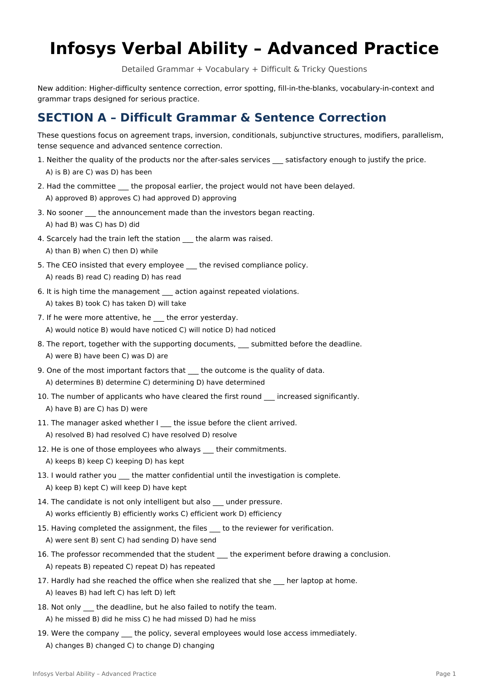

# Topic 12: Advanced Grammar & Tricky Vocabulary Hard Practice – 40 Solved MCQs

> **Source:** Infosys Systems Engineer Preparation (`Infosys_Verbal_Ability_Detailed_Grammar_Vocab_Hard_Practice.pdf`)
> **Target:** Infosys Systems Engineer (SE) Examination – Section 05: Verbal Ability
> **Scope:** 40 Questions (Section A: 25 High-Difficulty Grammar Traps + Section B: 15 Advanced Contextual Vocab), Options A–D, Verified Official Answer Keys, Subjunctive Inversions & Precise Exegesis

---

## Quick Reference: 40/40 Advanced Practice Answer Key Matrix

| Q# | **Key** | Q# | **Key** | Q# | **Key** | Q# | **Key** |
|:---:|:---:|:---:|:---:|:---:|:---:|:---:|:---:|
| **Q01** | `B` | **Q11** | `B` | **Q21** | `C` | **Q31** | `B` |
| **Q02** | `A` | **Q12** | `B` | **Q22** | `B` | **Q32** | `B` |
| **Q03** | `B` | **Q13** | `B` | **Q23** | `A` | **Q33** | `B` |
| **Q04** | `B` | **Q14** | `A` | **Q24** | `B` | **Q34** | `A` |
| **Q05** | `B` | **Q15** | `A` | **Q25** | `C` | **Q35** | `B` |
| **Q06** | `B` | **Q16** | `C` | **Q26** | `B` | **Q36** | `A` |
| **Q07** | `B` | **Q17** | `B` | **Q27** | `C` | **Q37** | `B` |
| **Q08** | `C` | **Q18** | `B` | **Q28** | `B` | **Q38** | `B` |
| **Q09** | `B` | **Q19** | `C` | **Q29** | `B` | **Q39** | `A` |
| **Q10** | `C` | **Q20** | `B` | **Q30** | `C` | **Q40** | `C` |

---

## Section A: High-Difficulty Grammar, Inversion & Agreement Traps (Q01 – Q25)

### Question ADV-Q01

**Contextual Prompt / Sentence:**
> *"Neither the quality of the products nor the after-sales services ___ satisfactory enough to justify the price."*

**Options:**
- **(A)** is
- **(B)** are
- **(C)** was
- **(D)** has been

**Correct Answer:** `Option (B) [are]`

**Forensic Grammatical Analysis & Rule Exegesis:**
- **Grammatical Principle:** With neither...nor, the verb agrees with the nearer subject: services → are.

---

### Question ADV-Q02

**Contextual Prompt / Sentence:**
> *"Had the committee ___ the proposal earlier, the project would not have been delayed."*

**Options:**
- **(A)** approved
- **(B)** approves
- **(C)** had approved
- **(D)** approving

**Correct Answer:** `Option (A) [approved]`

**Forensic Grammatical Analysis & Rule Exegesis:**
- **Grammatical Principle:** Third conditional inversion: Had + subject + V3. 'Had the committee approved...'

---

### Question ADV-Q03

**Contextual Prompt / Sentence:**
> *"No sooner ___ the announcement made than the investors began reacting."*

**Options:**
- **(A)** had
- **(B)** was
- **(C)** has
- **(D)** did

**Correct Answer:** `Option (B) [was]`

**Forensic Grammatical Analysis & Rule Exegesis:**
- **Grammatical Principle:** Fixed structure: No sooner had...than. Here the passive structure is 'was the announcement made'.

---

### Question ADV-Q04

**Contextual Prompt / Sentence:**
> *"Scarcely had the train left the station ___ the alarm was raised."*

**Options:**
- **(A)** than
- **(B)** when
- **(C)** then
- **(D)** while

**Correct Answer:** `Option (B) [when]`

**Forensic Grammatical Analysis & Rule Exegesis:**
- **Grammatical Principle:** Fixed pair: scarcely/hardly/barely...when.

---

### Question ADV-Q05

**Contextual Prompt / Sentence:**
> *"The CEO insisted that every employee ___ the revised compliance policy."*

**Options:**
- **(A)** reads
- **(B)** read
- **(C)** reading
- **(D)** has read

**Correct Answer:** `Option (B) [read]`

**Forensic Grammatical Analysis & Rule Exegesis:**
- **Grammatical Principle:** After 'insisted that' in formal subjunctive usage, use the base verb: read.

---

### Question ADV-Q06

**Contextual Prompt / Sentence:**
> *"It is high time the management ___ action against repeated violations."*

**Options:**
- **(A)** takes
- **(B)** took
- **(C)** has taken
- **(D)** will take

**Correct Answer:** `Option (B) [took]`

**Forensic Grammatical Analysis & Rule Exegesis:**
- **Grammatical Principle:** It is high time + past tense: 'It is high time management took action.'

---

### Question ADV-Q07

**Contextual Prompt / Sentence:**
> *"If he were more attentive, he ___ the error yesterday."*

**Options:**
- **(A)** would notice
- **(B)** would have noticed
- **(C)** will notice
- **(D)** had noticed

**Correct Answer:** `Option (B) [would have noticed]`

**Forensic Grammatical Analysis & Rule Exegesis:**
- **Grammatical Principle:** Mixed conditional: unreal present condition + unreal past result → would have noticed.

---

### Question ADV-Q08

**Contextual Prompt / Sentence:**
> *"The report, together with the supporting documents, ___ submitted before the deadline."*

**Options:**
- **(A)** were
- **(B)** have been
- **(C)** was
- **(D)** are

**Correct Answer:** `Option (C) [was]`

**Forensic Grammatical Analysis & Rule Exegesis:**
- **Grammatical Principle:** Main subject is singular 'report'; together with does not change it.

---

### Question ADV-Q09

**Contextual Prompt / Sentence:**
> *"One of the most important factors that ___ the outcome is the quality of data."*

**Options:**
- **(A)** determines
- **(B)** determine
- **(C)** determining
- **(D)** have determined

**Correct Answer:** `Option (B) [determine]`

**Forensic Grammatical Analysis & Rule Exegesis:**
- **Grammatical Principle:** 'Factors' is plural and is the subject of 'determine'.

---

### Question ADV-Q10

**Contextual Prompt / Sentence:**
> *"The number of applicants who have cleared the first round ___ increased significantly."*

**Options:**
- **(A)** have
- **(B)** are
- **(C)** has
- **(D)** were

**Correct Answer:** `Option (C) [has]`

**Forensic Grammatical Analysis & Rule Exegesis:**
- **Grammatical Principle:** The number of + singular verb → has.

---

### Question ADV-Q11

**Contextual Prompt / Sentence:**
> *"The manager asked whether I ___ the issue before the client arrived."*

**Options:**
- **(A)** resolved
- **(B)** had resolved
- **(C)** have resolved
- **(D)** resolve

**Correct Answer:** `Option (B) [had resolved]`

**Forensic Grammatical Analysis & Rule Exegesis:**
- **Grammatical Principle:** The resolving happened before another past event → past perfect.

---

### Question ADV-Q12

**Contextual Prompt / Sentence:**
> *"He is one of those employees who always ___ their commitments."*

**Options:**
- **(A)** keeps
- **(B)** keep
- **(C)** keeping
- **(D)** has kept

**Correct Answer:** `Option (B) [keep]`

**Forensic Grammatical Analysis & Rule Exegesis:**
- **Grammatical Principle:** 'Those employees' is plural → keep.

---

### Question ADV-Q13

**Contextual Prompt / Sentence:**
> *"I would rather you ___ the matter confidential until the investigation is complete."*

**Options:**
- **(A)** keep
- **(B)** kept
- **(C)** will keep
- **(D)** have kept

**Correct Answer:** `Option (B) [kept]`

**Forensic Grammatical Analysis & Rule Exegesis:**
- **Grammatical Principle:** Would rather + subject + past tense for present/future preference.

---

### Question ADV-Q14

**Contextual Prompt / Sentence:**
> *"The candidate is not only intelligent but also ___ under pressure."*

**Options:**
- **(A)** works efficiently
- **(B)** efficiently works
- **(C)** efficient work
- **(D)** efficiency

**Correct Answer:** `Option (A) [works efficiently]`

**Forensic Grammatical Analysis & Rule Exegesis:**
- **Grammatical Principle:** Parallel structure: not only intelligent but also works efficiently.

---

### Question ADV-Q15

**Contextual Prompt / Sentence:**
> *"Having completed the assignment, the files ___ to the reviewer for verification."*

**Options:**
- **(A)** were sent
- **(B)** sent
- **(C)** had sending
- **(D)** have send

**Correct Answer:** `Option (A) [were sent]`

**Forensic Grammatical Analysis & Rule Exegesis:**
- **Grammatical Principle:** The files receive the action → passive: were sent.

---

### Question ADV-Q16

**Contextual Prompt / Sentence:**
> *"The professor recommended that the student ___ the experiment before drawing a conclusion."*

**Options:**
- **(A)** repeats
- **(B)** repeated
- **(C)** repeat
- **(D)** has repeated

**Correct Answer:** `Option (C) [repeat]`

**Forensic Grammatical Analysis & Rule Exegesis:**
- **Grammatical Principle:** Recommend that + base verb is standard formal subjunctive usage.

---

### Question ADV-Q17

**Contextual Prompt / Sentence:**
> *"Hardly had she reached the office when she realized that she ___ her laptop at home."*

**Options:**
- **(A)** leaves
- **(B)** had left
- **(C)** has left
- **(D)** left

**Correct Answer:** `Option (B) [had left]`

**Forensic Grammatical Analysis & Rule Exegesis:**
- **Grammatical Principle:** Leaving the laptop happened before realizing it → had left.

---

### Question ADV-Q18

**Contextual Prompt / Sentence:**
> *"Not only ___ the deadline, but he also failed to notify the team."*

**Options:**
- **(A)** he missed
- **(B)** did he miss
- **(C)** he had missed
- **(D)** had he miss

**Correct Answer:** `Option (B) [did he miss]`

**Forensic Grammatical Analysis & Rule Exegesis:**
- **Grammatical Principle:** Negative/limiting expression at the beginning causes inversion: did he miss.

---

### Question ADV-Q19

**Contextual Prompt / Sentence:**
> *"Were the company ___ the policy, several employees would lose access immediately."*

**Options:**
- **(A)** changes
- **(B)** changed
- **(C)** to change
- **(D)** changing

**Correct Answer:** `Option (C) [to change]`

**Forensic Grammatical Analysis & Rule Exegesis:**
- **Grammatical Principle:** Formal conditional inversion: Were the company to change...

---

### Question ADV-Q20

**Contextual Prompt / Sentence:**
> *"The evidence suggests that neither the manager nor the analysts ___ aware of the discrepancy."*

**Options:**
- **(A)** was
- **(B)** were
- **(C)** has been
- **(D)** is

**Correct Answer:** `Option (B) [were]`

**Forensic Grammatical Analysis & Rule Exegesis:**
- **Grammatical Principle:** Nearer subject is analysts → were.

---

### Question ADV-Q21

**Contextual Prompt / Sentence:**
> *"It was the repeated system failures that ___ the management to reconsider the architecture."*

**Options:**
- **(A)** force
- **(B)** has forced
- **(C)** forced
- **(D)** forcing

**Correct Answer:** `Option (C) [forced]`

**Forensic Grammatical Analysis & Rule Exegesis:**
- **Grammatical Principle:** Subject is 'system failures' but relative clause structure and completed past event require forced.

---

### Question ADV-Q22

**Contextual Prompt / Sentence:**
> *"By the time the auditors arrive next Monday, the team ___ all the records."*

**Options:**
- **(A)** will organize
- **(B)** will have organized
- **(C)** organized
- **(D)** has organized

**Correct Answer:** `Option (B) [will have organized]`

**Forensic Grammatical Analysis & Rule Exegesis:**
- **Grammatical Principle:** By a future deadline → future perfect: will have organized.

---

### Question ADV-Q23

**Contextual Prompt / Sentence:**
> *"The consultant advised us to avoid ___ conclusions before all the data had been examined."*

**Options:**
- **(A)** drawing
- **(B)** to draw
- **(C)** draw
- **(D)** drew

**Correct Answer:** `Option (A) [drawing]`

**Forensic Grammatical Analysis & Rule Exegesis:**
- **Grammatical Principle:** Avoid + gerund.

---

### Question ADV-Q24

**Contextual Prompt / Sentence:**
> *"Despite ___ repeatedly, the vendor failed to provide the required documents."*

**Options:**
- **(A)** reminding
- **(B)** being reminded
- **(C)** reminded
- **(D)** having remind

**Correct Answer:** `Option (B) [being reminded]`

**Forensic Grammatical Analysis & Rule Exegesis:**
- **Grammatical Principle:** The vendor was reminded → passive gerund: being reminded.

---

### Question ADV-Q25

**Contextual Prompt / Sentence:**
> *"The project was completed in less time than ___ originally estimated."*

**Options:**
- **(A)** was
- **(B)** it was
- **(C)** had been
- **(D)** was it

**Correct Answer:** `Option (C) [had been]`

**Forensic Grammatical Analysis & Rule Exegesis:**
- **Grammatical Principle:** Comparison with an earlier estimate: than had been originally estimated.

---

## Section B: Difficult Vocabulary in Context & Nuance Traps (Q26 – Q40)

### Question ADV-Q26

**Contextual Prompt / Sentence:**
> *"Choose the closest meaning of Ubiquitous."*

**Options:**
- **(A)** Rare
- **(B)** Present everywhere
- **(C)** Temporary
- **(D)** Uncertain

**Correct Answer:** `Option (B) [Present everywhere]`

**Forensic Grammatical Analysis & Rule Exegesis:**
- **Semantic Breakdown:** Ubiquitous = present or found everywhere.

---

### Question ADV-Q27

**Contextual Prompt / Sentence:**
> *"Choose the antonym of Pragmatic."*

**Options:**
- **(A)** Practical
- **(B)** Realistic
- **(C)** Idealistic
- **(D)** Sensible

**Correct Answer:** `Option (C) [Idealistic]`

**Forensic Grammatical Analysis & Rule Exegesis:**
- **Semantic Breakdown:** Pragmatic = practical; antonym = idealistic.

---

### Question ADV-Q28

**Contextual Prompt / Sentence:**
> *"His explanation was so equivocal that nobody could determine his actual position. Equivocal means:"*

**Options:**
- **(A)** Clear
- **(B)** Ambiguous
- **(C)** Honest
- **(D)** Detailed

**Correct Answer:** `Option (B) [Ambiguous]`

**Forensic Grammatical Analysis & Rule Exegesis:**
- **Semantic Breakdown:** Equivocal = open to more than one interpretation; ambiguous.

---

### Question ADV-Q29

**Contextual Prompt / Sentence:**
> *"Choose the closest meaning of Meticulous."*

**Options:**
- **(A)** Careless
- **(B)** Extremely careful
- **(C)** Quick
- **(D)** Flexible

**Correct Answer:** `Option (B) [Extremely careful]`

**Forensic Grammatical Analysis & Rule Exegesis:**
- **Semantic Breakdown:** Meticulous = very careful and precise.

---

### Question ADV-Q30

**Contextual Prompt / Sentence:**
> *"Choose the antonym of Ephemeral."*

**Options:**
- **(A)** Temporary
- **(B)** Brief
- **(C)** Permanent
- **(D)** Short-lived

**Correct Answer:** `Option (C) [Permanent]`

**Forensic Grammatical Analysis & Rule Exegesis:**
- **Semantic Breakdown:** Ephemeral = short-lived; antonym = permanent.

---

### Question ADV-Q31

**Contextual Prompt / Sentence:**
> *"The manager's decision was arbitrary. This means the decision was:"*

**Options:**
- **(A)** Based on a consistent principle
- **(B)** Random or based on personal choice
- **(C)** Legally required
- **(D)** Carefully documented

**Correct Answer:** `Option (B) [Random or based on personal choice]`

**Forensic Grammatical Analysis & Rule Exegesis:**
- **Semantic Breakdown:** Arbitrary = based on random/personal choice rather than consistent reasoning.

---

### Question ADV-Q32

**Contextual Prompt / Sentence:**
> *"Choose the closest meaning of Inadvertent."*

**Options:**
- **(A)** Intentional
- **(B)** Accidental
- **(C)** Immediate
- **(D)** Repeated

**Correct Answer:** `Option (B) [Accidental]`

**Forensic Grammatical Analysis & Rule Exegesis:**
- **Semantic Breakdown:** Inadvertent = accidental/unintentional.

---

### Question ADV-Q33

**Contextual Prompt / Sentence:**
> *"The word ameliorate most nearly means:"*

**Options:**
- **(A)** Worsen
- **(B)** Improve
- **(C)** Delay
- **(D)** Replace

**Correct Answer:** `Option (B) [Improve]`

**Forensic Grammatical Analysis & Rule Exegesis:**
- **Semantic Breakdown:** Ameliorate = improve or make better.

---

### Question ADV-Q34

**Contextual Prompt / Sentence:**
> *"Choose the antonym of Obfuscate."*

**Options:**
- **(A)** Clarify
- **(B)** Confuse
- **(C)** Conceal
- **(D)** Complicate

**Correct Answer:** `Option (A) [Clarify]`

**Forensic Grammatical Analysis & Rule Exegesis:**
- **Semantic Breakdown:** Obfuscate = make unclear; antonym = clarify.

---

### Question ADV-Q35

**Contextual Prompt / Sentence:**
> *"A cogent argument is one that is:"*

**Options:**
- **(A)** Weak
- **(B)** Convincing and logically strong
- **(C)** Emotional only
- **(D)** Unrelated

**Correct Answer:** `Option (B) [Convincing and logically strong]`

**Forensic Grammatical Analysis & Rule Exegesis:**
- **Semantic Breakdown:** Cogent = clear, logical and convincing.

---

### Question ADV-Q36

**Contextual Prompt / Sentence:**
> *"Choose the closest meaning of Tenacious."*

**Options:**
- **(A)** Persistent
- **(B)** Fragile
- **(C)** Indifferent
- **(D)** Hesitant

**Correct Answer:** `Option (A) [Persistent]`

**Forensic Grammatical Analysis & Rule Exegesis:**
- **Semantic Breakdown:** Tenacious = persistent/determined.

---

### Question ADV-Q37

**Contextual Prompt / Sentence:**
> *"The phrase read between the lines means:"*

**Options:**
- **(A)** Read quickly
- **(B)** Find the hidden meaning
- **(C)** Skip details
- **(D)** Memorize text

**Correct Answer:** `Option (B) [Find the hidden meaning]`

**Forensic Grammatical Analysis & Rule Exegesis:**
- **Semantic Breakdown:** Read between the lines = infer an unstated meaning. Q Ans. Explanation

---

### Question ADV-Q38

**Contextual Prompt / Sentence:**
> *"A person who deliberately avoids work is a:"*

**Options:**
- **(A)** Philanthropist
- **(B)** Procrastinator
- **(C)** Optimist
- **(D)** Linguist

**Correct Answer:** `Option (B) [Procrastinator]`

**Forensic Grammatical Analysis & Rule Exegesis:**
- **Semantic Breakdown:** Procrastinator = one who delays or puts off tasks.

---

### Question ADV-Q39

**Contextual Prompt / Sentence:**
> *"Choose the word that best completes the sentence: 'The witness gave a ___ account, leaving no room for doubt.'"*

**Options:**
- **(A)** lucid
- **(B)** obscure
- **(C)** tenuous
- **(D)** dubious

**Correct Answer:** `Option (A) [lucid]`

**Forensic Grammatical Analysis & Rule Exegesis:**
- **Semantic Breakdown:** Lucid = clear and easy to understand.

---

### Question ADV-Q40

**Contextual Prompt / Sentence:**
> *"Choose the best word: 'The evidence was too ___ to support such a serious allegation.'"*

**Options:**
- **(A)** compelling
- **(B)** conclusive
- **(C)** tenuous
- **(D)** definitive

**Correct Answer:** `Option (C) [tenuous]`

**Forensic Grammatical Analysis & Rule Exegesis:**
- **Semantic Breakdown:** Tenuous = weak or insufficiently supported.

---

## Advanced Exam Strategy & Traps Summary

> [!TIP]
> **Infosys Advanced Verbal Exam Rule:** For difficult grammar questions, first isolate the core grammatical subject and principal finite verb by stripping away prepositional phrases, appositives, and parenthetical clauses (e.g., *'along with'*, *'as well as'*, *'in addition to'*). Then verify inversion rules (e.g., *'Had the committee...'*, *'No sooner had...'*) and mandative subjunctive structures (e.g., *'insist that he be present'*).
