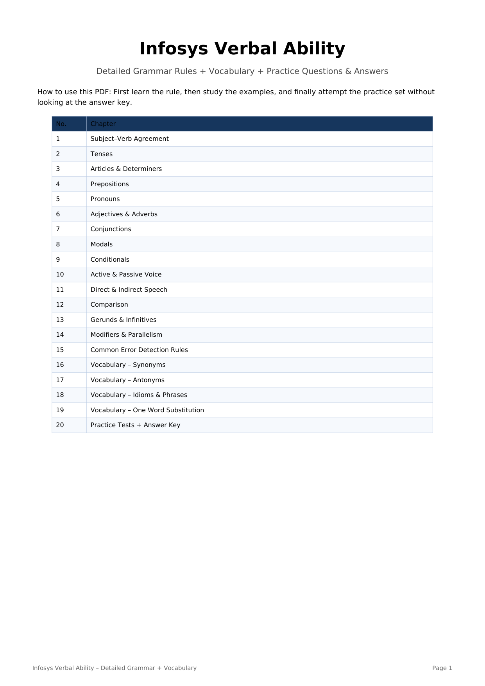

# Topic 13: Comprehensive English Grammar Master Rules & Practice Sets

> **Source:** Infosys Systems Engineer Preparation (`Infosys_Verbal_Ability_Rules_Detailed_Grammar_Vocab_Practice_Updated.pdf`)
> **Target:** Infosys Systems Engineer (SE) Examination – Section 05: Verbal Ability
> **Scope:** 19 Complete Core Grammar Chapters (Rules, Exceptions, Formula Tables, Idioms & OWS Lists) + 30 Solved Examination Questions (Practice Test 1: 20 Grammar + Practice Test 2: 10 Vocab), Complete Options A–D, Verified Answer Keys & In-Depth Exegesis

---

## Master Grammar Syllabus Overview

| Chapter # | Core Domain | Key Target Rules & Syntactic Traps |
|:---:|:---|:---|
| **01** | **Subject–Verb Agreement** | Basic agreement, Each/Every, One of + plural noun, A number of vs The number of, Either/Neither, Along with / As well as |
| **02** | **Tenses & Sequence of Tenses** | Simple Present (Habitual/Universal), Present Perfect vs Past Simple, Past Perfect anteriority, Future Continuous, Conditional Backshift |
| **03** | **Articles & Determiners** | Phonetic A/An, Definite Article 'The', Zero Article, Few vs A Few, Little vs A Little, Much vs Many, Fewer vs Less |
| **04** | **Modifiers & Parallelism** | Dangling Participles, Misplaced Adverbs (*only, almost*), Squinting Modifiers, Coordinate Series Parallelism |
| **05** | **Pronouns & Case** | Subjective vs Objective Case, Reflexive Pronouns, Relative Pronouns (*Who vs Whom vs Whose vs Which vs That*), Indefinite Pronouns |
| **06** | **Adjectives & Adverbs** | Good vs Well, Hard vs Hardly, Late vs Lately, Too vs Very, Comparative/Superlative Degrees, Correlative Comparatives |
| **07** | **Conjunctions & Correlatives** | FANBOYS, Subordinating Conjunctions, *Either...or, Neither...nor, Not only...but also, No sooner...than, Scarcely...when* |
| **08** | **Prepositions & Fixed Collocations** | Prepositions of Time (*At, On, In, For, Since*), Prepositions of Place, *Between vs Among, Beside vs Besides, Senior to, Good at* |
| **09** | **Conditionals & Inversion** | Zero Conditional, First Conditional (*If + Present, Will + V1*), Second Conditional, Third Conditional (*Had + V3, Would have + V3*), Inverted Conditionals |
| **10** | **Active & Passive Voice** | Object-Subject Transposition, Tense Conversions, Modal Passives, Intransitive Non-Passivizability |
| **11** | **Direct & Indirect Speech** | Reporting Verbs, Backshifting Tense Rules, Pronoun Conversions, Temporal and Spatial Deictic Shifts |
| **12** | **High-Frequency Idioms Catalog** | 12 Essential Placement Idioms, Definitions & Contextual Formulations |
| **13** | **High-Frequency One Word Substitutions** | 10 Foundational Placement Nomenclature Terms & Etymologies |

---

## Comprehensive Grammar Rules Reference (Chapters 01 – 13)

### Section Part 1

Infosys Verbal Ability
Detailed Grammar Rules + Vocabulary + Practice Questions & Answers
How to use this PDF: First learn the rule, then study the examples, and finally attempt the practice set without
looking at the answer key.
No.
Chapter
1
Subject–Verb Agreement
2
Tenses
3
Articles & Determiners
4
Prepositions
5
Pronouns
6
Adjectives & Adverbs
7
Conjunctions
8
Modals
9
Conditionals
10
Active & Passive Voice
11
Direct & Indirect Speech
12
Comparison
13
Gerunds & Infinitives
14
Modifiers & Parallelism
15
Common Error Detection Rules
16
Vocabulary – Synonyms
17
Vocabulary – Antonyms
18
Vocabulary – Idioms & Phrases
19
Vocabulary – One Word Substitution
20
Practice Tests + Answer Key

---

### Section Part 2

1. Subject–Verb Agreement
Rule 1 – Basic agreement: A singular subject takes a singular verb; a plural subject takes a plural verb.
Example: The student works hard. / The students work hard.
Rule 2 – Each/Every: Each, every, everyone, everybody, anyone, someone, nobody, either and neither are
generally singular.
Example: Every candidate has an ID. / Neither answer is correct.
Rule 3 – One of: One of + plural noun takes a singular verb.
Example: One of the students is absent.
Rule 4 – A number / The number: A number of + plural verb; the number of + singular verb.
Example: A number of students are absent. / The number of students is rising.
Rule 5 – Either/Neither: With either...or / neither...nor, the verb generally agrees with the nearer subject.
Example: Neither the manager nor the employees are ready.
Rule 6 – As well as / Along with: These expressions do not change the number of the main subject.
Example: The manager, along with his assistants, is present.
Rule 7 – Collective nouns: A collective noun is singular when the group acts as one unit.
Example: The committee has approved the plan.
Rule 8 – Time, money, distance: A single amount treated as one unit usually takes a singular verb.
Example: Ten kilometres is a long distance.
Rule 9 – There is/are: The verb agrees with the real subject after it.
Example: There are many reasons. / There is one reason.
2. Tenses
Present Simple: Use for habits, routines, facts and general truths. Structure: V1 / V1+s.
Example: She works every day. Water boils at 100°C.
Present Continuous: am/is/are + V-ing; action happening now or temporarily.
Example: They are preparing for the exam.
Present Perfect: has/have + V3; completed action with present relevance or unspecified time.
Example: I have finished my work.
Present Perfect Continuous: has/have been + V-ing; action continuing over a period.
Example: She has been studying for three hours.
Past Simple: Completed action at a definite past time.
Example: He visited Pune last week.
Past Continuous: was/were + V-ing; action in progress at a past time.
Example: I was reading when he called.
Past Perfect: had + V3; earlier of two past actions.
Example: The train had left before we arrived.
Past Perfect Continuous: had been + V-ing; ongoing action before another past event.
Example: He had been waiting for an hour before she came.
Future Simple: will + V1; prediction, promise or spontaneous decision.
Example: I will call you tomorrow.
Future Perfect: will have + V3; action completed before a future point.
Example: By Friday, I will have completed the work.
High-frequency trap: After did/did not, use V1. After a modal, use V1.
Example: Did he go? / He can solve it.
3. Articles & Determiners

---

### Section Part 3

A / An: Use according to sound, not spelling. A before consonant sound; an before vowel sound.
Example: a university, a European; an hour, an MBA.
The: Use for a specific/known thing, unique things, superlatives, ordinals and certain geographical names.
Example: the sun, the first chapter, the best answer.
No article: Plural or uncountable nouns used generally often take no article.
Example: Books are useful. Milk is nutritious.
Few / A few: Few = almost none; a few = some.
Example: Few students understood it. / A few students understood it.
Little / A little: Little = almost none; a little = some.
Example: There is little hope. / There is a little hope.
Much / Many: Much with uncountable nouns; many with countable nouns.
Example: much information; many questions.
Fewer / Less: Fewer with countable nouns; less with uncountable quantities.
Example: fewer mistakes; less water.
4. Prepositions
At / On / In: At = exact time; on = day/date; in = month/year/long period.
Example: at 8:00, on Monday, in 2026.
Since / For: Since = starting point; for = duration.
Example: since 2020; for six years.
By / Until: By = not later than; until = up to a point in time.
Example: Finish by Friday. / Wait until Friday.
Between / Among: Between is commonly used for two or distinct individuals; among for a group.
Example: between Ravi and Amit; among the students.
In / Into: In often indicates position; into indicates movement to the inside.
Example: He is in the room. / He went into the room.
On / Onto: On indicates position; onto indicates movement to a surface.
Example: The book is on the table. / Put it onto the table.
Fixed combinations: Learn common adjective/verb + preposition combinations.
Example: good at, interested in, depend on, responsible for, capable of, afraid of.
5. Pronouns
Agreement: Pronoun must agree with its antecedent in number and person.
Example: Every student must bring his or her ID.
Subject/object case: Use I/he/she/we/they as subjects; me/him/her/us/them as objects.
Example: She and I went. / The teacher called him and me.
Who/Whom: Who is subject; whom is object in formal usage.
Example: Who called you? / Whom did you meet?
Reflexive pronouns: Use when subject and object are the same, or for emphasis.
Example: She hurt herself. / I myself did it.
Pronoun ambiguity: The pronoun should clearly refer to one noun.
Example: Avoid: Ravi told Amit that he was late.
6. Adjectives & Adverbs
Adjective: Describes a noun/pronoun.
Example: a careful student

---

### Section Part 4

Adverb: Modifies a verb, adjective or another adverb.
Example: He writes carefully.
Good / Well: Good is generally an adjective; well is generally an adverb.
Example: She is a good singer. / She sings well.
Hard / Hardly: Hard = with effort; hardly = almost not.
Example: He works hard. / He hardly works.
Late / Lately: Late = not on time; lately = recently.
Example: He arrived late. / Have you seen him lately?
Too / Very: Too often indicates excess; very intensifies.
Example: too difficult to solve; very difficult.
7. Conjunctions
FANBOYS: For, And, Nor, But, Or, Yet, So are coordinating conjunctions.
Example: He studied hard, but he missed the bus.
Correlative conjunctions: either...or, neither...nor, both...and, not only...but also.
Example: She is both intelligent and hardworking.
Although / but: Do not normally use although and but together in standard correction questions.
Example: Although it rained, we went out.
Because / so: Do not normally use because and so together for the same causal link.
Example: Because he was late, he missed the bus.
Unless: Unless means if not.
Example: Unless you study, you may not pass.
8. Modals
Can / Could: Can = ability/permission; could = past ability or polite request.
Example: She can swim. / Could you help me?
May / Might: Possibility; might often sounds less certain.
Example: It may rain. / It might rain later.
Must / Should: Must = strong necessity; should = advice/expectation.
Example: You must carry your ID. / You should revise.
Would: Polite requests, preferences, hypothetical situations and some past-future contexts.
Example: Would you help me?
Modal + V1: Never use V2/V3 directly after a modal.
Example: He can solve it, not can solved it.
9. Conditionals
Zero conditional: If + present, present; general truths.
Example: If you heat ice, it melts.
First conditional: If + present, will + V1; real/possible future.
Example: If you study, you will pass.
Second conditional: If + past, would + V1; hypothetical present/future.
Example: If I had time, I would travel.
Third conditional: If + had + V3, would have + V3; unreal past.
Example: If she had studied, she would have passed.
Mixed conditional: A past condition may have a present result.
Example: If I had studied medicine, I would be a doctor now.

---

### Section Part 5

10. Active & Passive Voice
Basic conversion: Object of active becomes subject of passive; use the correct form of be + V3.
Example: The manager approved the plan. → The plan was approved by the manager.
Present simple: am/is/are + V3.
Example: They make cars. → Cars are made.
Past simple: was/were + V3.
Example: She wrote the letter. → The letter was written.
Present perfect: has/have been + V3.
Example: They have completed it. → It has been completed.
Modal: modal + be + V3.
Example: You must follow the rules. → The rules must be followed.
Important: Only transitive verbs normally form passive voice because an object is required.
Example: He slept. → No normal passive form.
11. Direct & Indirect Speech
Statements: With a past reporting verb, tense often shifts back.
Example: He said, “I am busy.” → He said that he was busy.
Common tense shifts: am/is→was; are→were; have/has→had; will→would; can→could.
Example: She said she would come.
Time/place shifts: today→that day; tomorrow→the next day; yesterday→the previous day; now→then; here→there.
Example: He said he would come the next day.
Questions: Use statement word order after the reporting verb.
Example: He asked where I was. (Not where was I.)
Commands: Use told/ordered/asked + object + to + V1.
Example: He said, “Open the door.” → He told me to open the door.
12. Comparison
Positive: as + adjective + as.
Example: Riya is as tall as Neha.
Comparative: -er or more + adjective + than.
Example: This is better than that.
Superlative: -est or most + adjective; normally with 'the'.
Example: She is the most talented student.
Irregular forms: good→better→best; bad→worse→worst; little→less→least; many/much→more→most.
Example: This is the best option.
Avoid double forms: Do not use more better, most easiest, etc.
Example: Correct: much better; easiest.
Prefer: Prefer X to Y.
Example: I prefer tea to coffee.
13. Gerunds & Infinitives
Gerund: V-ing functioning as a noun.
Example: Reading improves vocabulary.
Gerund after preposition: After a preposition, use V-ing.

---

### Section Part 6

Example: He is interested in learning.
Verbs followed by gerund: enjoy, avoid, admit, suggest, consider, finish, mind.
Example: She enjoys reading.
Verbs followed by infinitive: want, decide, hope, plan, promise, agree, refuse.
Example: They decided to leave.
Used to: used to + V1 = past habit; be used to + V-ing/noun = accustomed.
Example: I used to play. / I am used to waking early.
Suggest: Suggest + V-ing or suggest that + subject + base verb; not suggest to do.
Example: He suggested taking a break.
14. Modifiers & Parallelism
Modifier placement: Put the modifier close to the word it describes.
Example: Walking home, I saw the rain start. (Not: Walking home, the rain...)
Parallelism: Items joined by and/or or in lists should have the same grammatical form.
Example: She likes reading, writing and speaking.
Correlative parallelism: not only X but also X; either X or X.
Example: He is not only smart but also hardworking.
Dangling modifier: The opening phrase must logically describe the subject that follows.
Example: After finishing the work, Ravi went home.
15. High-Frequency Error Rules
Rule A: One of + plural noun + singular verb.
Example: One of the players is injured.
Rule B: Each of + plural noun + singular verb.
Example: Each of the students has a book.
Rule C: A pair of + singular verb.
Example: A pair of shoes is on the floor.
Rule D: Scarcely/Hardly/Barely ... when; No sooner ... than.
Example: No sooner had he arrived than the meeting began.
Rule E: Between you and me; after a preposition use object form.
Example: This is between you and me.
Rule F: Advice/information/furniture are generally uncountable.
Example: some advice, useful information, new furniture.
Rule G: News is singular.
Example: The news is surprising.
Rule H: Police is generally plural when referring to officers as a group.
Example: The police are investigating.

---

### Section Part 7

16. Vocabulary – Synonyms
Word
Synonym
Meaning
Abundant
Plentiful
Available in large quantity
Accurate
Precise
Correct and exact
Brief
Concise
Short and to the point
Cautious
Careful
Avoiding unnecessary risk
Diligent
Hardworking
Showing steady effort
Eloquent
Articulate
Fluent or persuasive in speaking/writing
Feasible
Practical
Possible and workable
Fragile
Delicate
Easily broken/damaged
Genuine
Authentic
Real or genuine
Hostile
Unfriendly
Opposed or aggressive
Inevitable
Unavoidable
Certain to happen
Obsolete
Outdated
No longer in use
Reluctant
Unwilling
Not willing
Rapid
Swift
Very fast
Scarce
Rare
Available in small quantity
Significant
Important
Sufficiently important
Transparent
Clear
Easy to understand or see through
Versatile
Adaptable
Able to perform many functions
Vigilant
Alert
Watchful and careful
Vital
Essential
Extremely important
17. Vocabulary – Antonyms
Word
Antonym
Ancient
Modern
Artificial
Natural
Expand
Contract
Frequent
Rare
Generous
Stingy
Guilty
Innocent
Humble
Arrogant
Include
Exclude
Permanent
Temporary
Rigid
Flexible
Victory
Defeat
Visible
Invisible
Optimistic
Pessimistic
Superior
Inferior
Complex
Simple
18. Idioms & Phrases

---

### Section Part 8

Idiom
Meaning
A blessing in disguise
Something that seems bad but turns out beneficial.
Break the ice
Start a friendly conversation or reduce tension.
Hit the nail on the head
Say/do exactly the right thing.
Once in a blue moon
Very rarely.
Piece of cake
Very easy.
Spill the beans
Reveal a secret.
Under the weather
Feeling unwell.
Burn the midnight oil
Work/study late at night.
Bite the bullet
Face a difficult situation bravely.
Call it a day
Stop working for the day.
In hot water
In trouble.
At the eleventh hour
At the last possible moment.
19. One Word Substitution
Description
Word
One who loves books
Bibliophile
One who cannot read or write
Illiterate
One who speaks many languages
Polyglot
A person who knows everything
Omniscient
A place where books are kept
Library
A speech made without preparation
Extempore
A government by the people
Democracy
A person who hates mankind
Misanthrope
A person who looks at the bright side
Optimist
A person who looks at the dark side
Pessimist

---

## Quick Reference: 30/30 Grammar & Vocab Practice Answer Key Matrix

| Q# | **Key** | Q# | **Key** | Q# | **Key** | Q# | **Key** | Q# | **Key** | Q# | **Key** |
|:---:|:---:|:---:|:---:|:---:|:---:|:---:|:---:|:---:|:---:|:---:|:---:|
| **Q01** | `C` | **Q06** | `C` | **Q11** | `C` | **Q16** | `B` | **Q21** | `B` | **Q26** | `C` |
| **Q02** | `B` | **Q07** | `B` | **Q12** | `B` | **Q17** | `C` | **Q22** | `C` | **Q27** | `B` |
| **Q03** | `D` | **Q08** | `C` | **Q13** | `B` | **Q18** | `B` | **Q23** | `B` | **Q28** | `A` |
| **Q04** | `B` | **Q09** | `B` | **Q14** | `B` | **Q19** | `B` | **Q24** | `A` | **Q29** | `B` |
| **Q05** | `C` | **Q10** | `A` | **Q15** | `C` | **Q20** | `C` | **Q25** | `B` | **Q30** | `B` |

---

## Practice Test 1: Advanced English Grammar MCQs (Q01 – Q20)

### Question RUL-Q01

**Contextual Prompt / Sentence:**
> *"Each of the employees ___ required to submit the form."*

**Options:**
- **(A)** are
- **(B)** were
- **(C)** is
- **(D)** have

**Correct Answer:** `Option (C) [is]`

**Forensic Rule Exegesis:**
- **Grammatical Principle:** Each is singular → is.

---

### Question RUL-Q02

**Contextual Prompt / Sentence:**
> *"She did not ___ the email yesterday."*

**Options:**
- **(A)** sent
- **(B)** send
- **(C)** sends
- **(D)** sending

**Correct Answer:** `Option (B) [send]`

**Forensic Rule Exegesis:**
- **Grammatical Principle:** After did not, use V1 → send.

---

### Question RUL-Q03

**Contextual Prompt / Sentence:**
> *"The manager, along with his assistants, ___ attending the meeting."*

**Options:**
- **(A)** are
- **(B)** were
- **(C)** have
- **(D)** is

**Correct Answer:** `Option (D) [is]`

**Forensic Rule Exegesis:**
- **Grammatical Principle:** Main subject is manager; along with does not change it.

---

### Question RUL-Q04

**Contextual Prompt / Sentence:**
> *"I have lived here ___ 2020."*

**Options:**
- **(A)** for
- **(B)** since
- **(C)** from
- **(D)** by

**Correct Answer:** `Option (B) [since]`

**Forensic Rule Exegesis:**
- **Grammatical Principle:** Since + starting point.

---

### Question RUL-Q05

**Contextual Prompt / Sentence:**
> *"He is good ___ mathematics."*

**Options:**
- **(A)** in
- **(B)** on
- **(C)** at
- **(D)** for

**Correct Answer:** `Option (C) [at]`

**Forensic Rule Exegesis:**
- **Grammatical Principle:** Correct combination: good at.

---

### Question RUL-Q06

**Contextual Prompt / Sentence:**
> *"If you study hard, you ___ the exam."*

**Options:**
- **(A)** passed
- **(B)** would pass
- **(C)** will pass
- **(D)** had passed

**Correct Answer:** `Option (C) [will pass]`

**Forensic Rule Exegesis:**
- **Grammatical Principle:** First conditional: if + present, will + V1.

---

### Question RUL-Q07

**Contextual Prompt / Sentence:**
> *"She suggested ___ a break."*

**Options:**
- **(A)** to take
- **(B)** taking
- **(C)** took
- **(D)** take

**Correct Answer:** `Option (B) [taking]`

**Forensic Rule Exegesis:**
- **Grammatical Principle:** Suggest is followed by V-ing or that-clause.

---

### Question RUL-Q08

**Contextual Prompt / Sentence:**
> *"Neither the teacher nor the students ___ ready."*

**Options:**
- **(A)** is
- **(B)** was
- **(C)** are
- **(D)** has

**Correct Answer:** `Option (C) [are]`

**Forensic Rule Exegesis:**
- **Grammatical Principle:** Verb agrees with nearer subject: students.

---

### Question RUL-Q09

**Contextual Prompt / Sentence:**
> *"The work ___ by the team yesterday."*

**Options:**
- **(A)** completed
- **(B)** was completed
- **(C)** is completing
- **(D)** has complete

**Correct Answer:** `Option (B) [was completed]`

**Forensic Rule Exegesis:**
- **Grammatical Principle:** Past passive: was + V3.

---

### Question RUL-Q10

**Contextual Prompt / Sentence:**
> *"He asked me where I ___."*

**Options:**
- **(A)** was
- **(B)** am
- **(C)** were
- **(D)** be

**Correct Answer:** `Option (A) [was]`

**Forensic Rule Exegesis:**
- **Grammatical Principle:** Indirect question uses statement order: where I was.

---

### Question RUL-Q11

**Contextual Prompt / Sentence:**
> *"This is ___ best solution."*

**Options:**
- **(A)** a
- **(B)** an
- **(C)** the
- **(D)** no article

**Correct Answer:** `Option (C) [the]`

**Forensic Rule Exegesis:**
- **Grammatical Principle:** Superlative normally takes the.

---

### Question RUL-Q12

**Contextual Prompt / Sentence:**
> *"There ___ many reasons for the delay."*

**Options:**
- **(A)** is
- **(B)** are
- **(C)** was
- **(D)** has

**Correct Answer:** `Option (B) [are]`

**Forensic Rule Exegesis:**
- **Grammatical Principle:** Real subject is reasons → are.

---

### Question RUL-Q13

**Contextual Prompt / Sentence:**
> *"She is senior ___ me."*

**Options:**
- **(A)** than
- **(B)** to
- **(C)** from
- **(D)** with

**Correct Answer:** `Option (B) [to]`

**Forensic Rule Exegesis:**
- **Grammatical Principle:** Correct expression: senior to.

---

### Question RUL-Q14

**Contextual Prompt / Sentence:**
> *"I am used to ___ early."*

**Options:**
- **(A)** wake
- **(B)** waking
- **(C)** woke
- **(D)** have wake

**Correct Answer:** `Option (B) [waking]`

**Forensic Rule Exegesis:**
- **Grammatical Principle:** Be used to + gerund/noun.

---

### Question RUL-Q15

**Contextual Prompt / Sentence:**
> *"No sooner had he arrived ___ the meeting began."*

**Options:**
- **(A)** when
- **(B)** then
- **(C)** than
- **(D)** but

**Correct Answer:** `Option (C) [than]`

**Forensic Rule Exegesis:**
- **Grammatical Principle:** No sooner...than.

---

### Question RUL-Q16

**Contextual Prompt / Sentence:**
> *"A number of students ___ absent today."*

**Options:**
- **(A)** is
- **(B)** are
- **(C)** was
- **(D)** has

**Correct Answer:** `Option (B) [are]`

**Forensic Rule Exegesis:**
- **Grammatical Principle:** A number of + plural verb.

---

### Question RUL-Q17

**Contextual Prompt / Sentence:**
> *"The number of applicants ___ increasing."*

**Options:**
- **(A)** are
- **(B)** were
- **(C)** is
- **(D)** have

**Correct Answer:** `Option (C) [is]`

**Forensic Rule Exegesis:**
- **Grammatical Principle:** The number of + singular verb.

---

### Question RUL-Q18

**Contextual Prompt / Sentence:**
> *"She sings very ___."*

**Options:**
- **(A)** good
- **(B)** well
- **(C)** betterly
- **(D)** best

**Correct Answer:** `Option (B) [well]`

**Forensic Rule Exegesis:**
- **Grammatical Principle:** Well modifies the verb sings.

---

### Question RUL-Q19

**Contextual Prompt / Sentence:**
> *"If I had known, I ___ helped you."*

**Options:**
- **(A)** will have
- **(B)** would have
- **(C)** would
- **(D)** had

**Correct Answer:** `Option (B) [would have]`

**Forensic Rule Exegesis:**
- **Grammatical Principle:** Third conditional: would have + V3.

---

### Question RUL-Q20

**Contextual Prompt / Sentence:**
> *"Between you and ___, this plan needs improvement."*

**Options:**
- **(A)** I
- **(B)** myself
- **(C)** me
- **(D)** mine

**Correct Answer:** `Option (C) [me]`

**Forensic Rule Exegesis:**
- **Grammatical Principle:** Preposition between requires object form me.

---

## Practice Test 2: High-Frequency Vocabulary & Idioms MCQs (Q21 – Q30)

### Question RUL-Q21

**Contextual Prompt / Sentence:**
> *"Choose the synonym of Diligent."*

**Options:**
- **(A)** Lazy
- **(B)** Hardworking
- **(C)** Careless
- **(D)** Weak

**Correct Answer:** `Option (B) [Hardworking]`

**Forensic Rule Exegesis:**
- **Semantic Breakdown:** Diligent = hardworking.

---

### Question RUL-Q22

**Contextual Prompt / Sentence:**
> *"Choose the antonym of Scarce."*

**Options:**
- **(A)** Rare
- **(B)** Limited
- **(C)** Abundant
- **(D)** Small

**Correct Answer:** `Option (C) [Abundant]`

**Forensic Rule Exegesis:**
- **Semantic Breakdown:** Scarce = limited; antonym = abundant.

---

### Question RUL-Q23

**Contextual Prompt / Sentence:**
> *"'Break the ice' means:"*

**Options:**
- **(A)** Become angry
- **(B)** Start a friendly interaction
- **(C)** End a meeting
- **(D)** Create a problem

**Correct Answer:** `Option (B) [Start a friendly interaction]`

**Forensic Rule Exegesis:**
- **Semantic Breakdown:** Break the ice = start a friendly interaction.

---

### Question RUL-Q24

**Contextual Prompt / Sentence:**
> *"A person who loves books is called a:"*

**Options:**
- **(A)** Bibliophile
- **(B)** Misanthrope
- **(C)** Polyglot
- **(D)** Optimist

**Correct Answer:** `Option (A) [Bibliophile]`

**Forensic Rule Exegesis:**
- **Semantic Breakdown:** Bibliophile = book lover.

---

### Question RUL-Q25

**Contextual Prompt / Sentence:**
> *"Choose the synonym of Feasible."*

**Options:**
- **(A)** Impossible
- **(B)** Practical
- **(C)** Uncertain
- **(D)** Dangerous

**Correct Answer:** `Option (B) [Practical]`

**Forensic Rule Exegesis:**
- **Semantic Breakdown:** Feasible = practical/possible.

---

### Question RUL-Q26

**Contextual Prompt / Sentence:**
> *"Choose the antonym of Rigid."*

**Options:**
- **(A)** Strict
- **(B)** Hard
- **(C)** Flexible
- **(D)** Fixed

**Correct Answer:** `Option (C) [Flexible]`

**Forensic Rule Exegesis:**
- **Semantic Breakdown:** Rigid = inflexible; antonym = flexible.

---

### Question RUL-Q27

**Contextual Prompt / Sentence:**
> *"'At the eleventh hour' means:"*

**Options:**
- **(A)** Very early
- **(B)** At the last moment
- **(C)** At noon
- **(D)** After eleven days

**Correct Answer:** `Option (B) [At the last moment]`

**Forensic Rule Exegesis:**
- **Semantic Breakdown:** At the eleventh hour = at the last moment.

---

### Question RUL-Q28

**Contextual Prompt / Sentence:**
> *"Choose the synonym of Vigilant."*

**Options:**
- **(A)** Alert
- **(B)** Sleepy
- **(C)** Confused
- **(D)** Careless

**Correct Answer:** `Option (A) [Alert]`

**Forensic Rule Exegesis:**
- **Semantic Breakdown:** Vigilant = alert/watchful.

---

### Question RUL-Q29

**Contextual Prompt / Sentence:**
> *"A person who speaks many languages is a:"*

**Options:**
- **(A)** Linguist
- **(B)** Polyglot
- **(C)** Bibliophile
- **(D)** Novice

**Correct Answer:** `Option (B) [Polyglot]`

**Forensic Rule Exegesis:**
- **Semantic Breakdown:** Polyglot = person who speaks many languages.

---

### Question RUL-Q30

**Contextual Prompt / Sentence:**
> *"'Spill the beans' means:"*

**Options:**
- **(A)** Waste food
- **(B)** Reveal a secret
- **(C)** Make a mistake
- **(D)** Work hard

**Correct Answer:** `Option (B) [Reveal a secret]`

**Forensic Rule Exegesis:**
- **Semantic Breakdown:** Spill the beans = reveal a secret.

---
