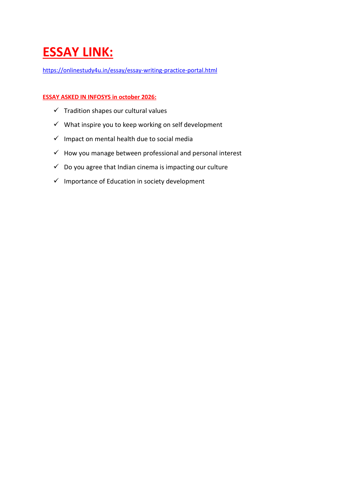
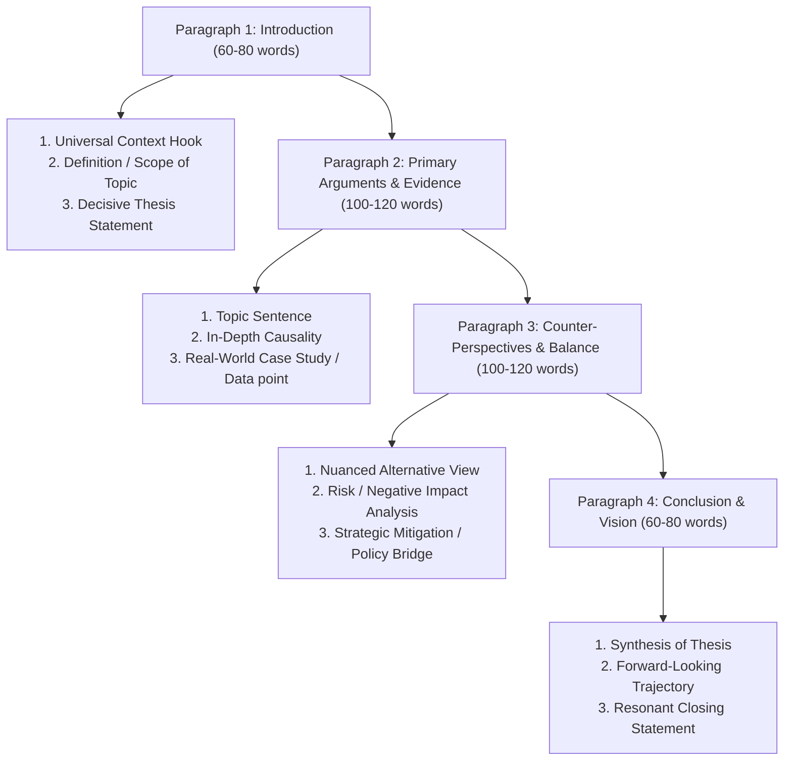

# Topic 14: Infosys Essay Writing Mastery & Authentic October 2026 PYQ

> **Source:** Infosys Systems Engineer Preparation (`ESSAYLINK.pdf` & Official OnlineStudy4U Portal)
> **Target:** Infosys Systems Engineer (SE) Examination – Section 05: Written Ability Test (WAT) / Essay Writing
> **Official Practice Portal:** [OnlineStudy4U Essay Writing Practice Portal](https://onlinestudy4u.in/essay/essay-writing-practice-portal.html)
> **Scope:** Official October 2026 Essay Prompts, Architectural Blueprint, Evaluation Rubrics, Vocabulary Enhancers, and 6 Complete High-Scoring Model Essays

---

## 1. Infosys Written Ability Test (WAT) Architecture & Evaluation Rubric

In the Infosys Systems Engineer examination, the Essay Writing / Written Ability Test assesses a candidate's English proficiency, cognitive coherence, logical articulation, and ability to structure professional thoughts under timed conditions.

### Examination Parameters
- **Allocated Time:** 20 – 30 Minutes
- **Prescribed Word Count:** 300 – 400 words (Writing below 250 words results in automatic penalty; exceeding 450 words indicates poor editorial control)
- **Platform Environment:** In-browser text editor (Spellcheck, Grammarly, and copy-paste shortcuts are disabled)

### Evaluation Criteria & Weightage Matrix

| Assessment Dimension | Weight | Critical Evaluative Standards |
|:---|:---:|:---|
| **Content & Relevance** | **30%** | Direct addressing of the prompt without drifting; logical progression of arguments; concrete real-world evidence and empirical examples. |
| **Grammatical Accuracy & Syntax Range** | **30%** | Zero morphological errors; correct subject-verb agreement; compound-complex sentence structures; appropriate punctuation and tense consistency. |
| **Coherence, Cohesion & Structure** | **25%** | Logical paragraph division (Introduction, 2 Body Paragraphs, Conclusion); seamless transitional discourse markers (*furthermore, conversely, consequently, nevertheless*). |
| **Lexical Resource & Vocabulary** | **15%** | Sophisticated academic/professional terminology used naturally without ostentatious, forced jargon; avoidance of conversational slang and clichés. |

---

## 2. The 4-Paragraph High-Scoring Structural Blueprint

---

## 3. The 6 Authentic Infosys October 2026 Essay Prompts & Complete Model Essays

---

### Essay 01: Tradition Shapes Our Cultural Values

> **Prompt:** *"Tradition shapes our cultural values. Discuss the extent to which traditional practices contribute to societal identity and ethical foundations in modern times."*

#### Complete High-Scoring Model Essay (342 words)

Culture is the collective memory of a civilization, and traditions serve as the vital arteries through which ancestral wisdom, ethical convictions, and communal customs are transmitted across generations. Far from being archaic relics of the past, traditions provide the foundational scaffolding upon which societal values—such as filial piety, mutual respect, and ecological stewardship—are constructed and sustained.

Primary among the contributions of tradition is the establishment of an enduring communal identity. In an increasingly globalized world characterized by cultural homogenization, local rituals, festive observances, and familial customs anchor individuals to their heritage. For instance, collective celebrations such as Diwali in India or Thanksgiving in North America transcend mere festivity; they actively cultivate empathy, communal cohesion, and shared accountability. Moreover, traditional ethical codes, often codified in philosophical narratives and folklore, instill universal virtues such as truthfulness and compassion long before formal jurisprudence enters an individual's consciousness.

However, a critical distinction must be drawn between living, progressive traditions and dogmatic, regressive orthodoxies. Historical customs that perpetuate gender disparity, social stratification, or superstitious prejudice cannot be defended under the guise of cultural preservation. True cultural vitality does not require blind adherence to antiquity; rather, it demands active moral discernment. Progressive societies continuously refine and adapt their customs to harmonize with constitutional rights and universal human dignity, discarding oppressive practices while preserving profound moral tenets.

In conclusion, traditions remain the indispensable bedrock of our cultural values, providing humanity with moral compasses and psychological belonging amidst turbulent technological disruptions. By embracing critical retrospection—preserving timeless ethical wisdom while shedding obsolete dogmas—modern societies can ensure that tradition continues to enlighten rather than entomb human progress.

---

### Essay 02: What Inspires You to Keep Working on Self Development

> **Prompt:** *"What inspires you to keep working on self development? Reflect on the personal, professional, and intellectual catalysts that drive lifelong learning."*

#### Complete High-Scoring Model Essay (348 words)

In an era characterized by exponential technological advancements and dynamic market disruptions, the pursuit of self-development is no longer an optional personal enrichment; it is an existential imperative. The primary catalyst that fuels my persistent commitment to self-evolution is the innate desire to expand my intellectual horizon and unlock latent human potential in service of societal advancement.

At an intellectual and cognitive level, the joy of intellectual mastery serves as a profound intrinsic motivator. Embracing challenging domains—whether mastering complex algorithmic architectures, acquiring data analytics fluencies, or honing communication precision—provides an unmatched sense of fulfillment. In the contemporary digital economy, where technological half-lives are diminishing rapidly, complacency leads directly to irrelevance. Engaging in continuous learning through technical certifications, analytical problem-solving, and reflective retrospection transforms unforeseen industrial disruptions into fertile opportunities for professional leadership.

Equally vital is the moral and societal dimension of self-development. True personal growth extends beyond individual ambition; it directly amplifies one's capacity to add value to organizations and communities. When an individual elevates their emotional resilience, ethical maturity, and collaborative competence, they become an anchor of stability and innovative problem-solving in multidisciplinary engineering teams. Furthermore, encountering setbacks and personal vulnerabilities acts not as a deterrent, but as an indispensable pedagogical mechanism that refines resilience and humbles the ego.

Ultimately, self-development is not a static destination with a definitive finish line, but a lifelong voyage of purposeful refinement. What inspires me to relentlessly work on self-development each day is the profound realization that our capabilities are malleable, and by continuously cultivating competence, discipline, and empathy, we not only actualize our personal destiny but also contribute meaningfully to the progress of our civilization.

---

### Essay 03: Impact on Mental Health Due to Social Media

> **Prompt:** *"Impact on mental health due to social media. Analyze the psychological, social, and emotional ramifications of algorithmic digital connectivity on contemporary youth."*

#### Complete High-Scoring Model Essay (355 words)

The advent of digital social platforms has fundamentally reshaped human communication, democratizing access to global discourse and dissolving geographical boundaries. Nevertheless, beneath the glossy facade of perpetual connectivity lies a burgeoning psychological crisis. Pervasive engagement with algorithmically curated feeds has precipitated alarming escalations in anxiety, depressive symptoms, and social alienation among adolescents and young professionals.

The primary mechanism underpinning this psychological distress is the pervasive culture of social comparison. Platforms such as Instagram and LinkedIn present meticulously curated, hyper-filtered highlights of peers' lives, creating an artificial standard of success, beauty, and happiness. Consequently, users frequently succumb to 'toxic comparison syndrome' and the chronic Fear of Missing Out (FOMO), which systematically erodes self-worth and breeds acute impostor anxiety. Furthermore, the neurochemical architecture of social platforms—engineered around variable reward schedules of 'likes' and notifications—fosters behavioral addiction, disrupting sleep hygiene and diminishing sustained attentional focus.

Conversely, it would be reductive to dismiss social media as an unmitigated psychological detriment. For marginalized communities, neurodivergent individuals, and geographically isolated researchers, digital platforms provide essential support ecosystems, mental health awareness campaigns, and professional mentorship networks. Social media effectively dismantles the long-standing stigma surrounding mental health discussions, enabling individuals to seek therapy and vocalize struggles that were historically suppressed.

Mitigating the adverse ramifications of social media necessitates a multi-tiered paradigm shift. Technologically, platform developers must be held ethically accountable for addictive interface design and predatory recommendation engines. Individually, users must cultivate digital literacy and conscious digital hygiene—treating virtual spaces as selective tools rather than proxies for human intimacy. Ultimately, preserving mental equilibrium in the hyper-connected era demands that we master technology rather than permit its algorithms to master our psychological well-being.

---

### Essay 04: How You Manage Between Professional and Personal Interest

> **Prompt:** *"How you manage between professional and personal interest. Discuss practical strategies, psychological boundaries, and time-management frameworks for harmonious integration."*

#### Complete High-Scoring Model Essay (346 words)

In the contemporary hyper-connected corporate landscape, where remote workstations and mobile notifications have blurred the boundaries between the office and the home, balancing professional responsibilities with personal passions has become one of life's most formidable challenges. Achieving equilibrium between career ambition and personal interests requires deliberate boundary setting, disciplined time architecture, and a philosophical shift from 'work-life balance' to 'work-life harmony.'

The bedrock of effective balance is rigorous prioritization and time-blocking. Utilizing frameworks such as the Eisenhower Matrix allows one to categorize daily demands into what is genuinely urgent versus what is strategically important. During professional hours, applying deep-work techniques and single-tasking maximizes cognitive productivity, ensuring that critical engineering milestones and deliverables are completed without spilling into personal time. Conversely, non-negotiable temporal boundaries must be established for personal interests—such as physical exercise, creative writing, or familial engagement. Guarding these windows from reactive professional intrusions prevents cognitive exhaustion and sustains chronic enthusiasm.

Furthermore, professional excellence and personal fulfillment should not be perceived as zero-sum adversaries; rather, they are mutually reinforcing domains. Pursuing structured personal interests—such as sports, music, or literature—stimulates divergent thinking, reduces cortisol levels, and enhances emotional intelligence. An engineer who engages in artistic hobbies or athletic pursuits returns to workplace challenges with renewed neuroplasticity and creative problem-solving acumen. Burnout is rarely caused by hard work alone; it is caused by the total eclipse of personal identity by professional obligations.

In conclusion, managing the interface between professional duties and personal passions demands continuous, proactive calibration. By establishing unyielding psychological boundaries, practicing ruthless temporal prioritization, and recognizing that personal well-being is the engine of professional endurance, one can forge a sustainable, multifaceted life of professional achievement and profound personal joy.

---

### Essay 05: Do You Agree That Indian Cinema Is Impacting Our Culture

> **Prompt:** *"Do you agree that Indian cinema is impacting our culture? Evaluate the sociological, behavioural, and ideological influences of the cinematic medium on Indian society."*

#### Complete High-Scoring Model Essay (351 words)

Cinema in India is not merely an artistic entertainment medium; it is a pervasive socio-cultural phenomenon that functions simultaneously as a mirror and a catalyst for societal metamorphosis. From fashion and linguistic idioms to deep-seated ideological debates regarding caste, gender, and national identity, Indian cinema exerts an indisputable, profound impact on the ethos and cultural fabric of the nation.

Foremost among cinema's cultural impacts is its ability to challenge entrenched social orthodoxies and accelerate progressive reforms. Throughout cinematic history, groundbreaking narratives have challenged patriarchal paradigms, cast light on rural injustices, and dismantled long-standing taboos surrounding mental health, menstruation, and LGBTQ+ rights. Commercial and parallel cinema alike have served as vehicles for mass sensitization, fostering empathy across socio-economic strata. Furthermore, cinematic music, celebrations, and festive iconography have established a unified pan-Indian cultural vocabulary, enabling citizens of diverse linguistic backgrounds to share collective cultural milestones.

Nevertheless, the medium's profound influence carries significant vulnerabilities when commercial imperatives supersede ethical responsibility. Historically, mainstream cinema has occasionally normalized toxic masculinity, glamorized stalking as romantic persistence, and perpetuated reductive regional stereotypes. Furthermore, the glorification of lavish consumerism, substance abuse, and sensationalized violence can distort the impressionable value systems of adolescent audiences. When films validate regressive social tropes for box-office returns, they actively delay imperative social evolution.

Ultimately, cinema and culture exist in a state of reciprocal symbiosis: cinema reflects the subconscious aspirations of the society that produces it, while simultaneously shaping the values of the audience that consumes it. As modern audiences demand greater narrative authenticity and ethical responsibility, Indian cinema is increasingly maturing into a formidable instrument of cultural enlightenment—one that celebrates pluralism, inspires critical introspection, and elevates the collective moral conscience of the nation.

---

### Essay 06: Importance of Education in Society Development

> **Prompt:** *"Importance of Education in society development. Discuss how universal, quality education drives economic prosperity, social equity, and democratic citizenship."*

#### Complete High-Scoring Model Essay (358 words)

Education is the paramount engine of human civilization and the foundational catalyst for sustainable societal transformation. Across historical epochs, societies that prioritized the enlightenment and intellectual empowerment of their populace have flourished economically, socially, and democratically, while those that neglected pedagogy languished in poverty and dogmatic stagnation.

Economically, quality education serves as the ultimate equalizer and poverty-alleviation mechanism. In an increasingly knowledge-driven global economy, primary, secondary, and tertiary education equips citizens with technical fluencies, analytical acumen, and innovative entrepreneurial skills necessary for high-value productivity. Educated workforces drive industrial innovation, stimulate foreign direct investment, and create robust economic ecosystems. Moreover, empowering women through education yields exponential socio-economic dividends: literate mothers significantly enhance family health outcomes, reduce infant mortality rates, and break the intergenerational cycle of poverty.

Beyond economic metrics, education is indispensable for cultivating social cohesion and robust democratic institutions. A well-designed curriculum dismantles historical prejudices based on caste, race, gender, and creed, fostering mutual tolerance, civic consciousness, and empathy. Education nurtures critical thinking, teaching individuals to scrutinize dogma, resist populist demagoguery, and participate meaningfully in democratic governance. An illiterate electorate is easily manipulated by disinformation; an educated citizenry demands transparency, upholds the rule of law, and champions fundamental human rights.

However, to realize its transformative potential, educational systems must transcend obsolete rote-learning methodologies. Modern education must integrate ethical literacy, environmental consciousness, emotional intelligence, and technological adaptability into its core pedagogy. Governments must guarantee equitable infrastructural access, ensuring that socio-economic status does not dictate the quality of schooling a child receives.

In conclusion, education is not an auxiliary expenditure for a society; it is the most vital capital investment a nation can undertake. By cultivating the intellect, conscience, and creative potential of every citizen, education lays the immutable bedrock for a prosperous, egalitarian, and progressive global society.

---

## 4. Key Stylistic & Vocabulary Enhancers for 100% Score in Infosys WAT

| Objective | Common Cliché (Avoid) | High-Scoring Academic Alternative (Use) |
|:---|:---|:---|
| **Expressing Cause** | *Due to this reason...* | *Underpinning this phenomenon is... / Precipitated by...* |
| **Contrasting Views** | *On the other hand...* | *Conversely, / A critical counterpoint emerges when...* |
| **Highlighting Growth** | *It is getting bigger and bigger...* | *Exhibits exponential proliferation / burgeons significantly* |
| **Demonstrating Importance** | *It is very important for us...* | *Serves as an indispensable imperative / fundamental cornerstone* |
| **Synthesizing Thoughts** | *At last, I want to say that...* | *In essence, synthesis reveals that... / Decisively, evidence suggests...* |