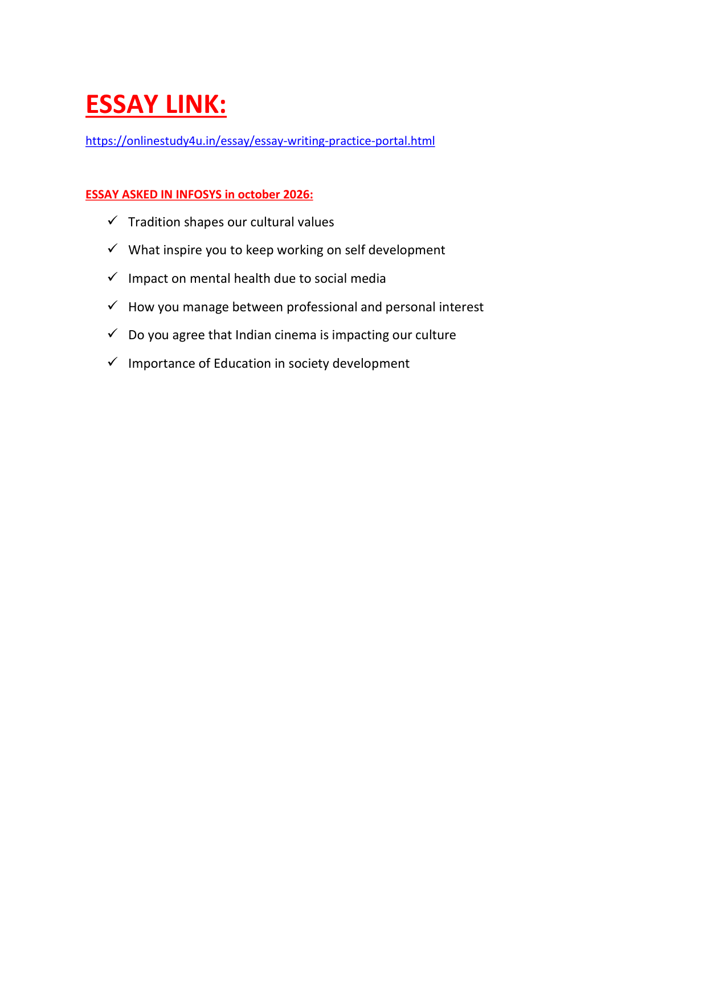

# Infosys October 2026 Exam — Official Essay Writing Master Compendium
## Comprehensive High-Scoring Model Essays for All Authentic Topics Asked in Infosys

**Source Course Document**: `ESSAYLINK.pdf`  
**Official OnlineStudy4U Practice Portal**: [https://onlinestudy4u.in/essay/essay-writing-practice-portal.html](https://onlinestudy4u.in/essay/essay-writing-practice-portal.html)  
**Total Authentic Topics**: **6 Official Exam Topics**  
**Evaluation Standard**: Infosys Corporate Assessment Rubric (Grammar, Cohesion, Thesis Clarity & Vocabulary)  

---

## 🏛️ Official Infosys Essay Assessment Guidelines & Evaluation Rubric
In the Infosys assessment (Verbal Ability & Essay Writing round), candidates are required to draft a 300 to 400-word essay on a contemporary or reflective topic within a strict 30-minute timer.
1. **Grammar & Sentence Mechanics (25%)**: Complete absence of run-on sentences, subject-verb agreement errors, or dangling modifiers.
2. **Cohesion & Structural Transition (25%)**: Logical progression from Introduction & Thesis Statement -> Body Paragraph 1 (Arguments) -> Body Paragraph 2 (Counter-Arguments / Real-World Context) -> Conclusion.
3. **Lexical Resource & Vocabulary (25%)**: Precise, formal academic English without slang or colloquial contractions.
4. **Relevance & Thesis Substance (25%)**: Directly addressing the core prompt without drifting into tangential generalities.

---

### Essay Topic 01: "Tradition Shapes Our Cultural Values"
**Authentic Exam Session**: `Infosys October 2026 Assessment` | **Target Length**: `300 - 400 words`

#### Core Thesis & Structural Blueprint
> **Central Thesis**: Traditions serve as the foundational bedrock of societal morality, preserving collective wisdom across generations while adapting to contemporary progress.

#### Comprehensive Model Essay (Band-9 Corporate Assessment Standard)
Tradition is not merely a passive relic of historical antiquity; it is the living conduit through which societal wisdom, moral ethics, and collective identity are transmitted across generations. Cultural values—such as filial piety, mutual respect, community solidarity, and spiritual reverence—do not emerge spontaneously in isolation. Instead, they are meticulously nurtured and reinforced through ancestral rituals, cultural festivals, and community conventions.

In an increasingly globalized and hyper-digitalized 21st century, the grounding force of tradition becomes paramount. When rapid technological transformations and cross-border cultural homogenization threaten to dilute local identities, cherished traditions provide individuals with an anchor of belonging and psychological stability. For instance, collective family gatherings during traditional festivals instill values of compassion, hospitality, and communal sharing in young minds far more effectively than theoretical instruction.

However, recognizing that tradition shapes cultural values must not be conflated with blind adherence to regressive dogmas. Healthy civilizations distinguish between uplifting cultural traditions and obsolete socio-cultural prejudices. Dynamic societies actively refine their traditions to align with universal human rights, gender equality, and scientific rationalism while preserving their core aesthetic and ethical essence. 

Ultimately, tradition provides the roots that nourish our moral consciousness, while education and forward-thinking logic grant us the wings to innovate. By honoring the compassionate, unifying essence of our heritage while courageously shedding outmoded biases, humanity can build culturally grounded, ethically resilient modern societies.

---
### Essay Topic 02: "What Inspires You to Keep Working on Self Development"
**Authentic Exam Session**: `Infosys October 2026 Assessment` | **Target Length**: `300 - 400 words`

#### Core Thesis & Structural Blueprint
> **Central Thesis**: Continuous self-development is driven by intellectual curiosity, the desire to make meaningful contributions, and the pursuit of cognitive resilience in a volatile world.

#### Comprehensive Model Essay (Band-9 Corporate Assessment Standard)
In an era characterized by exponential technological shifts, artificial intelligence automation, and dynamic workplace paradigms, self-development is no longer an optional luxury—it is the cornerstone of professional relevance and personal fulfillment. What fundamentally inspires my unceasing commitment to self-development is a trifecta of intrinsic curiosity, the ambition to create societal impact, and the desire for emotional resilience.

Foremost among these drivers is intrinsic intellectual curiosity. The human capacity to acquire novel mental models, master complex computational paradigms, and cultivate deeper emotional intelligence is practically boundless. Viewing life as an ongoing laboratory of learning transforms every professional challenge, technical hurdle, or unexpected failure into actionable feedback. The realization that our knowledge today can be superseded by deeper understanding tomorrow is intensely motivating.

Secondly, self-development is inextricably linked to expanding one's capacity for service. A person with stagnant skills can only solve familiar problems. Conversely, an individual who proactively sharpens their analytical abilities, communication clarity, and leadership empathy becomes equipped to tackle high-impact, cross-functional challenges that elevate their team, organization, and community. In high-performance engineering environments, self-mastery directly translates into building robust, scalable solutions.

Finally, self-development instills profound inner resilience. The deliberate habit of reading, physical discipline, and reflective learning builds psychological fortitude, ensuring that one navigates professional volatility with composure. The ultimate goal is not perfection, but continuous iterative progression—striving each day to be a more knowledgeable, compassionate, and effective human being.

---
### Essay Topic 03: "Impact on Mental Health Due to Social Media"
**Authentic Exam Session**: `Infosys October 2026 Assessment` | **Target Length**: `300 - 400 words`

#### Core Thesis & Structural Blueprint
> **Central Thesis**: While social media facilitates unprecedented global connectivity, unregulated hyper-consumption fuels cognitive fatigue, social comparison anxiety, and emotional vulnerability.

#### Comprehensive Model Essay (Band-9 Corporate Assessment Standard)
The proliferation of social media platforms has fundamentally reshaped human social dynamics, collapsing geographical barriers and democratizing the exchange of information. However, beneath the veneer of seamless connectivity lies a pervasive mental health crisis characterized by chronic anxiety, loneliness, sleep disruption, and eroded self-worth.

The primary mechanism driving psychological distress on social platforms is the insidious 'social comparison trap.' Platforms algorithmically curate sanitized highlight reels of luxury, beauty, and success. Constant passive consumption of these idealized depictions leads individuals—particularly adolescents and young professionals—to evaluate their authentic, messy lives against artificial benchmarks. This fosters feelings of inadequacy, imposter syndrome, and pervasive FOMO (Fear of Missing Out).

Furthermore, the neurobiological architecture of social media is intentionally engineered to hijack dopamine reward loops. Intermittent notifications, algorithmic infinite scrolling, and quantitative metrics (likes, shares, follower counts) condition users into external validation-seeking loops. This hyper-stimulation fragments cognitive focus, degrades deep work capacity, and induces persistent sensory exhaustion.

Mitigating these adverse consequences requires institutional accountability and personal digital hygiene. Tech developers must prioritize ethical algorithm design that discourages compulsive engagement. On an individual level, establishing strict digital boundaries—such as tech-free bedroom routines, selective curation of positive accounts, and prioritizing physical, face-to-face interactions—is essential. Social media must remain an intentional communication tool rather than a digital substitute for genuine human intimacy.

---
### Essay Topic 04: "How You Manage Between Professional and Personal Interest"
**Authentic Exam Session**: `Infosys October 2026 Assessment` | **Target Length**: `300 - 400 words`

#### Core Thesis & Structural Blueprint
> **Central Thesis**: Achieving sustainable harmony between career ambitions and personal passions necessitates rigorous prioritization, intentional compartmentalization, and disciplined time architecture.

#### Comprehensive Model Essay (Band-9 Corporate Assessment Standard)
In modern knowledge-driven economies, the traditional boundary between professional commitments and personal life has become increasingly porous. With remote working infrastructure and asynchronous digital communication tools, work easily intrudes into personal hours unless governed by disciplined time architecture and conscious boundaries. Managing both spheres harmoniously is not an act of static balance, but an ongoing practice of dynamic prioritization.

The first strategic pillar of my approach is ruthless priority management. Utilizing frameworks like the Eisenhower Matrix and time-blocking techniques allows me to focus intensely on mission-critical deliverables during core professional hours. By eliminating multitasking and dedicating uninterrupted focus blocks to high-leverage technical and organizational tasks, I maximize workplace productivity without letting work spill endlessly into late evenings.

The second crucial pillar is cognitive compartmentalization. When the workday concludes, I establish clear transitional rituals that allow me to mentally disengage from workplace anxieties. Personal interests—whether engaging in physical fitness, competitive coding, creative writing, or spending quality time with family—are treated not as afterthoughts, but as non-negotiable appointments on my calendar. Cultivating passions outside one's core career revitalizes the mind and prevents occupational burnout.

Ultimately, professional excellence and personal fulfillment are mutually reinforcing rather than antagonistic. A fulfilling personal life provides the emotional rejuvenation and cognitive clarity required to solve complex workplace challenges creatively. By honoring clear boundaries, practicing single-minded presence, and respecting both career aspirations and personal well-being, one sustains lifelong productivity without sacrificing personal joy.

---
### Essay Topic 05: "Do You Agree That Indian Cinema is Impacting Our Culture"
**Authentic Exam Session**: `Infosys October 2026 Assessment` | **Target Length**: `300 - 400 words`

#### Core Thesis & Structural Blueprint
> **Central Thesis**: Indian cinema exerts a profound dual influence on society, both reflecting traditional cultural values and actively pioneering progressive social reforms and behavioral trends.

#### Comprehensive Model Essay (Band-9 Corporate Assessment Standard)
Throughout modern history, cinema has occupied a uniquely influential space in the Indian collective psyche. Far more than mere commercial entertainment, Indian cinema operates as a powerful cultural mirror and a catalyst for societal transformation, deeply impacting linguistic idioms, fashion aesthetics, social values, and political discourse.

On one hand, cinema serves as an enduring preserver of rich regional traditions and shared heritage. Historical epics and family dramas celebrate cultural festivals, musical traditions, and moral virtues, reinforcing a sense of national pride across diverse linguistic groups. Furthermore, the pan-Indian cinematic renaissance has facilitated cultural cross-pollination, enabling audiences in Northern India to appreciate Southern cinematic narratives and vice versa.

More significantly, progressive contemporary cinema serves as a formidable instrument of social awakening. Mainstream films increasingly confront entrenched societal taboos—including gender stereotyping, mental health stigma, caste discrimination, and educational pressure. Landmark movies depicting women breaking barriers in sports, entrepreneurship, and governance have meaningfully influenced real-world parental aspirations and young girls' self-perception across small-town India.

However, cinema's potent reach also carries societal hazards when commercial filmmakers glorify toxic masculinity, violence, substance abuse, and superficial materialism. Because audiences often idolize cinematic protagonists, irresponsible portrayals can normalize harmful behaviors. Therefore, while cinema undeniably steers cultural currents, fostering critical media literacy among viewers and demanding ethical storytelling from creators is vital to ensuring that cinematic influence enriches rather than debases our cultural tapestry.

---
### Essay Topic 06: "Importance of Education in Society Development"
**Authentic Exam Session**: `Infosys October 2026 Assessment` | **Target Length**: `300 - 400 words`

#### Core Thesis & Structural Blueprint
> **Central Thesis**: Education is the primary catalyst of societal evolution, driving economic empowerment, dismantling systemic inequities, and nurturing democratic consciousness.

#### Comprehensive Model Essay (Band-9 Corporate Assessment Standard)
Education is universally recognized as the foundational architecture upon which civilized, prosperous, and equitable societies are constructed. Beyond its role in imparting functional literacy and vocational employability, holistic education cultivates critical thinking, ethical citizenship, and scientific temper—the prerequisites for sustained societal progress.

Economically, education is the most effective weapon against intergenerational poverty. By equipping individuals with technological literacy, analytical problem-solving, and professional competence, education facilitates upward socioeconomic mobility. In knowledge-intensive modern economies, a well-educated labor force drives innovation, attracts capital investment, and elevates national productivity, transforming developing nations into global economic powerhouses.

Socially, enlightened education is the great equalizer that dismantles ancient dogmas, gender prejudices, and social stratification. When marginalized communities and women gain access to high-quality learning, societal health metrics improve, child mortality drops, and community civic participation surges. Educated citizens are empowered to challenge authoritarian injustices, advocate for human rights, and build inclusive public institutions.

Moreover, in an era fractured by disinformation and polarized rhetoric, education fosters the intellectual discernment required to sustain healthy democratic governance. It teaches individuals to question assumptions, evaluate empirical evidence, and engage in constructive public dialogue. To fulfill this transformative potential, governments must ensure equitable access to quality education, bridging digital and infrastructural divides so that every child can contribute to societal advancement.

---

#### Authentic Source Reference Document
| Official Portal Link Slide |
| :---: |
|  |
