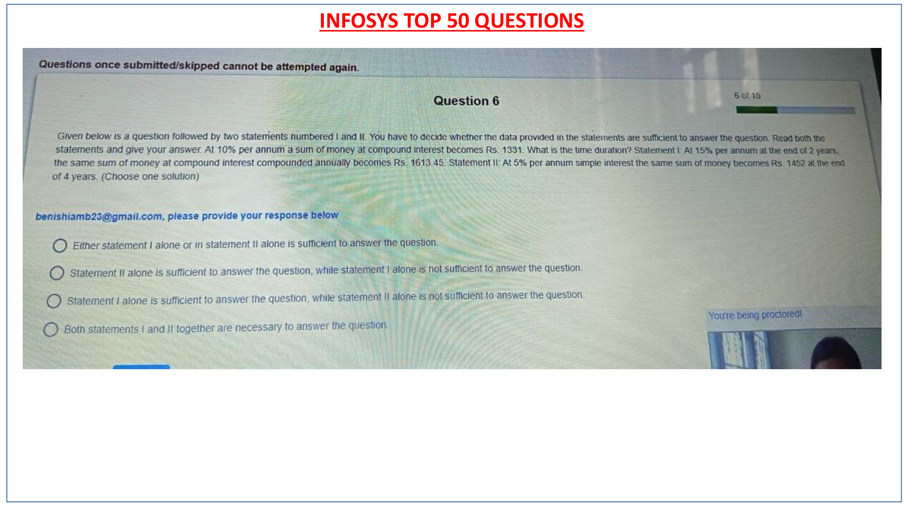
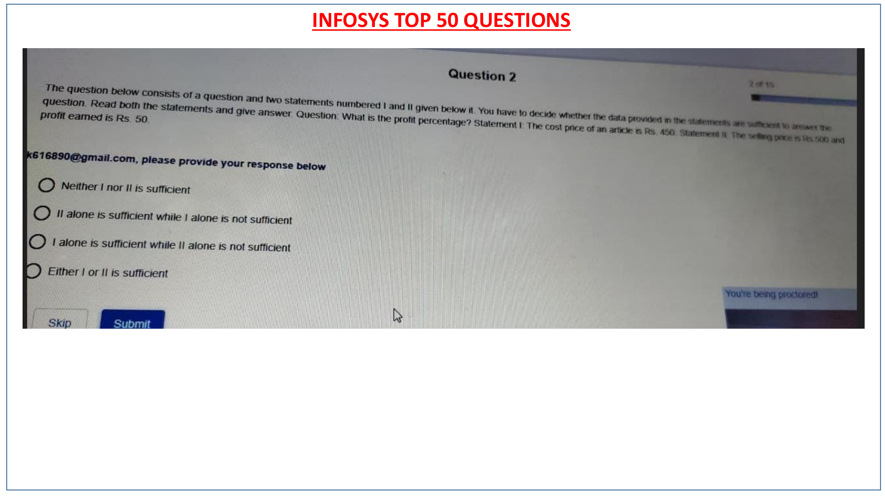
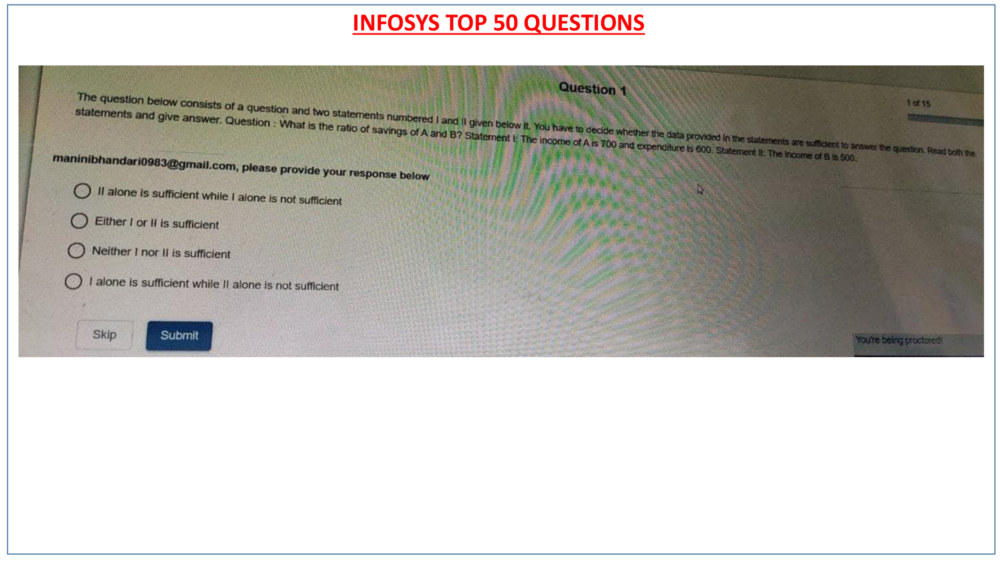
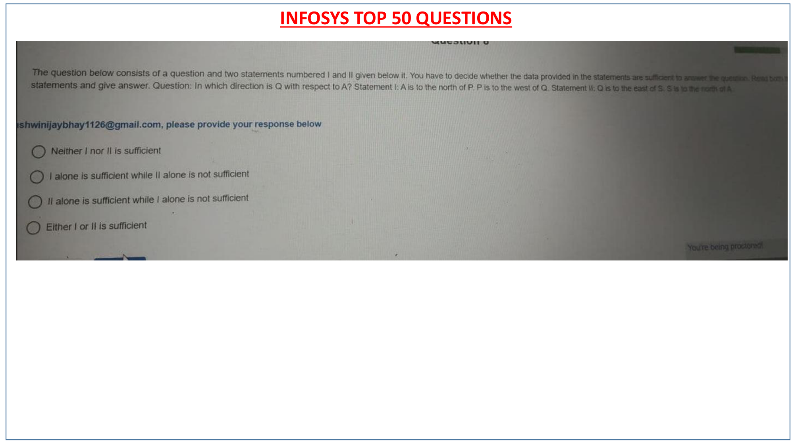
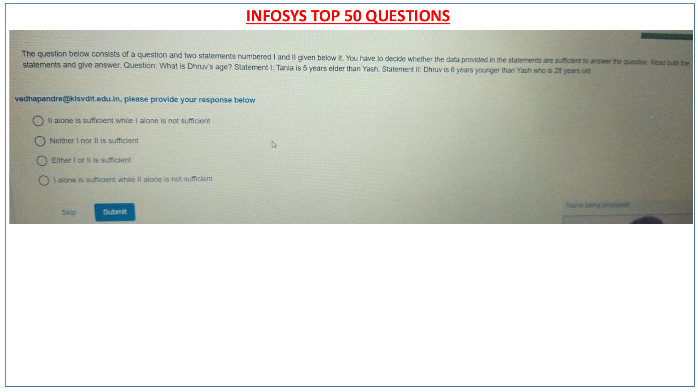
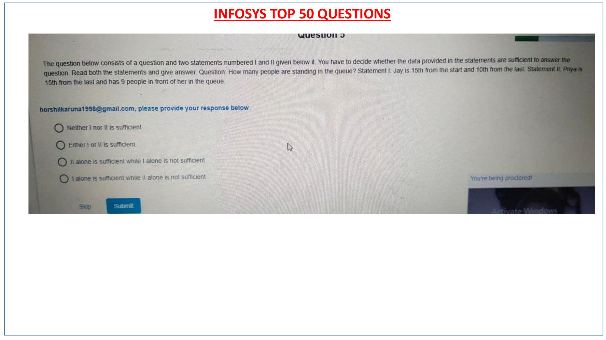

# Infosys Top 50 PYQ — Topic 03: Data Sufficiency
## Rigorous Two-Statement Sufficiency Evaluations & Analysis

**Section**: Data Sufficiency & Analytical Reasoning  
**Total Questions**: **6 Solved Problems**  
**Topics Covered**: Profit Percentage, Compound Interest, Savings Ratios, Direction Coordinates, Age Problems, Queue Ranking  
**Source Document**: `INFOSYS TOP 50 QUESTIONS PYQ.pdf`  

---

### Question 18: Data Sufficiency — Compound Interest (Page 18)
**Authentic Slide Figure**: [`INFOSYS_TOP_50_page_18.png`](images/INFOSYS_TOP_50_page_18.png)

#### Problem Statement
```text
At 10% per annum a sum of money at compound interest becomes Rs. 1331. What is the time duration?
Statement I: The principal amount is Rs. 1000.
Statement II: The interest earned is Rs. 331.
```

#### Multiple Choice Options
- **(A)** `Statement I alone is sufficient`
- **(B)** `Statement II alone is sufficient`
- **(C)** `Either Statement I alone or II alone is sufficient`
- **(D)** `Both Statements I and II together are not sufficient`

#### Verified Solution & Answer Key
> **Correct Option**: **(C) `Either Statement I alone or Statement II alone is sufficient`**

#### Step-by-Step Mathematical & Logical Derivation
```text
1. From Statement I: P = 1000, A = 1331, R = 10% -> 1331 = 1000(1.1)^n -> n = 3 years (Sufficient).
2. From Statement II: CI = 331 -> P = 1331 - 331 = 1000 -> n = 3 years (Sufficient).
3. Either statement alone yields the answer.
```

#### Authentic Live Exam Slide Figure
| Exam Slide Capture (Page 18) |
| :---: |
|  |

---
### Question 32: Data Sufficiency — Profit Percentage (Page 32)
**Authentic Slide Figure**: [`INFOSYS_TOP_50_page_32.png`](images/INFOSYS_TOP_50_page_32.png)

#### Problem Statement
```text
What is the profit percentage?
Statement I: The cost price of the article is Rs. 200.
Statement II: The profit earned is Rs. 50.
```

#### Multiple Choice Options
- **(A)** `Statement I alone is sufficient`
- **(B)** `Statement II alone is sufficient`
- **(C)** `Both Statements I and II together are necessary`
- **(D)** `Neither is sufficient`

#### Verified Solution & Answer Key
> **Correct Option**: **(C) `Both Statements I and II together are necessary`**

#### Step-by-Step Mathematical & Logical Derivation
```text
1. Profit % = (Profit / CP) * 100.
2. Statement I gives only CP = 200 (Insufficient).
3. Statement II gives only Profit = 50 (Insufficient).
4. Combining both: Profit % = (50 / 200) * 100 = 25% (Sufficient).
```

#### Authentic Live Exam Slide Figure
| Exam Slide Capture (Page 32) |
| :---: |
|  |

---
### Question 33: Data Sufficiency — Savings Ratio (Page 33)
**Authentic Slide Figure**: [`INFOSYS_TOP_50_page_33.png`](images/INFOSYS_TOP_50_page_33.png)

#### Problem Statement
```text
What is the ratio of savings of A and B?
Statement I: The income of A and B are in the ratio 3:4.
Statement II: The expenditure of A and B are in the ratio 2:3.
```

#### Multiple Choice Options
- **(A)** `Statement I alone is sufficient`
- **(B)** `Statement II alone is sufficient`
- **(C)** `Both together are sufficient`
- **(D)** `Neither Statement I nor II nor together is sufficient`

#### Verified Solution & Answer Key
> **Correct Option**: **(D) `Neither Statement I nor II nor together is sufficient`**

#### Step-by-Step Mathematical & Logical Derivation
```text
1. Savings = Income - Expenditure.
2. Incomes = 3x, 4x. Expenditures = 2y, 3y.
3. Savings ratio = (3x - 2y)/(4x - 3y), which depends on the unknown ratio x/y.
4. Hence, data is insufficient even when combined.
```

#### Authentic Live Exam Slide Figure
| Exam Slide Capture (Page 33) |
| :---: |
|  |

---
### Question 40: Data Sufficiency — Direction Coordinates (Page 40)
**Authentic Slide Figure**: [`INFOSYS_TOP_50_page_40.png`](images/INFOSYS_TOP_50_page_40.png)

#### Problem Statement
```text
In which direction is Q with respect to A?
Statement I: A is to the north of P. P is to the west of Q.
Statement II: Q is to the east of S. S is to the south of A.
```

#### Multiple Choice Options
- **(A)** `Statement I alone is sufficient`
- **(B)** `Statement II alone is sufficient`
- **(C)** `Either Statement I alone or II alone is sufficient`
- **(D)** `Both together are not sufficient`

#### Verified Solution & Answer Key
> **Correct Option**: **(C) `Either Statement I alone or Statement II alone is sufficient`**

#### Step-by-Step Mathematical & Logical Derivation
```text
1. From Statement I: A is North of P, Q is East of P -> Q is South-East of A (Sufficient).
2. From Statement II: S is South of A, Q is East of S -> Q is South-East of A (Sufficient).
3. Either statement alone is sufficient.
```

#### Authentic Live Exam Slide Figure
| Exam Slide Capture (Page 40) |
| :---: |
|  |

---
### Question 43: Data Sufficiency — Age Problems (Page 43)
**Authentic Slide Figure**: [`INFOSYS_TOP_50_page_43.png`](images/INFOSYS_TOP_50_page_43.png)

#### Problem Statement
```text
What is Dhruv's age?
Statement I: Tania is 5 years elder than Yash.
Statement II: Dhruv is 6 years younger than Yash, who is 28 years old.
```

#### Multiple Choice Options
- **(A)** `Statement I alone is sufficient`
- **(B)** `Statement II alone is sufficient`
- **(C)** `Both together are necessary`
- **(D)** `Neither is sufficient`

#### Verified Solution & Answer Key
> **Correct Option**: **(B) `Statement II alone is sufficient`**

#### Step-by-Step Mathematical & Logical Derivation
```text
1. Statement I gives relationship between Tania and Yash (No mention of Dhruv -> Insufficient).
2. Statement II gives Yash = 28 years, and Dhruv = Yash - 6 = 28 - 6 = 22 years (Sufficient).
3. Statement II alone is sufficient.
```

#### Authentic Live Exam Slide Figure
| Exam Slide Capture (Page 43) |
| :---: |
|  |

---
### Question 44: Data Sufficiency — Queue Ranking (Page 44)
**Authentic Slide Figure**: [`INFOSYS_TOP_50_page_44.png`](images/INFOSYS_TOP_50_page_44.png)

#### Problem Statement
```text
How many people are standing in the queue?
Statement I: Jay is 15th from the start and 10th from the end.
Statement II: Priya is 15th from the end and has 9 people in front of her.
```

#### Multiple Choice Options
- **(A)** `Statement I alone is sufficient`
- **(B)** `Statement II alone is sufficient`
- **(C)** `Either Statement I alone or II alone is sufficient`
- **(D)** `Both together are necessary`

#### Verified Solution & Answer Key
> **Correct Option**: **(C) `Either Statement I alone or Statement II alone is sufficient`**

#### Step-by-Step Mathematical & Logical Derivation
```text
1. From Statement I: Total = (Rank from start) + (Rank from end) - 1 = 15 + 10 - 1 = 24 people (Sufficient).
2. From Statement II: Priya is 10th from start (since 9 in front) and 15th from end -> Total = 10 + 15 - 1 = 24 people (Sufficient).
3. Either statement alone is sufficient.
```

#### Authentic Live Exam Slide Figure
| Exam Slide Capture (Page 44) |
| :---: |
|  |

---
