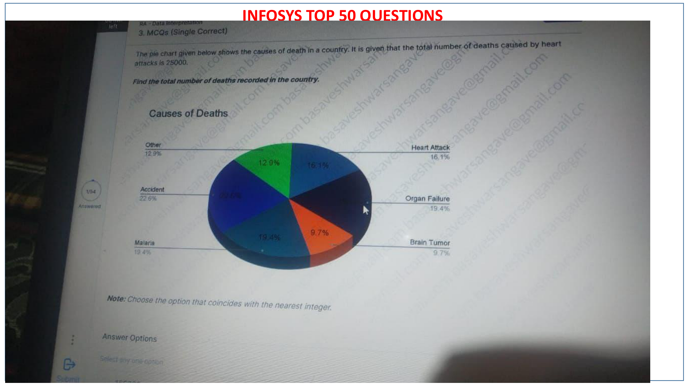
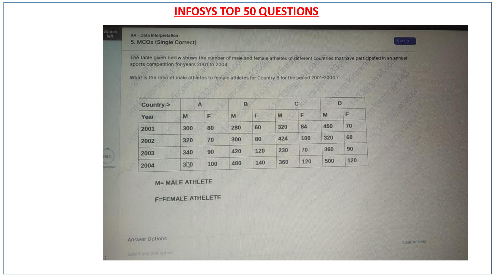
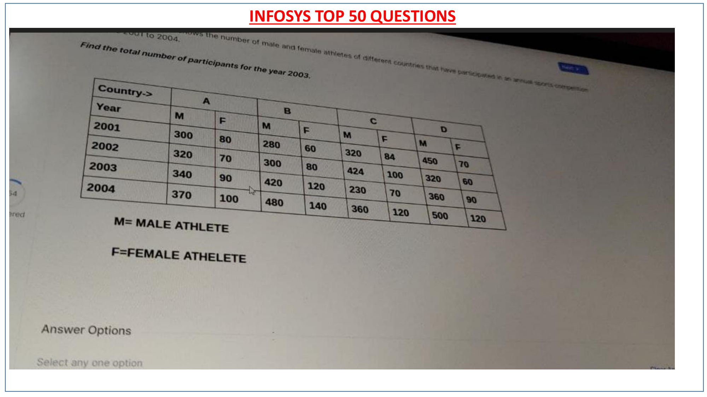

# Infosys Top 50 PYQ — Topic 04: Data Interpretation
## Full Tabular & Graphical Visual Analysis, Ratios & Percentages

**Section**: Data Interpretation  
**Total Questions**: **3 Solved Problems**  
**Topics Covered**: Causes of Death Pie Charts, Athlete Participation Tables, Multi-Year Percentage Ratios  
**Source Document**: `INFOSYS TOP 50 QUESTIONS PYQ.pdf`  

---

### Question 48: Data Interpretation — Causes of Death Pie Chart (Page 48)
**Authentic Slide Figure**: [`INFOSYS_TOP_50_page_48.png`](images/INFOSYS_TOP_50_page_48.png)

#### Problem Statement
```text
The pie chart shows causes of death in a country: Heart Attack 25%, Accidents 22%, Malaria 18%, Organ Failure 20%, Brain Tumor 15%. If the total number of deaths caused by heart attacks is 25,000, find the total number of deaths in the country.
```

#### Multiple Choice Options
- **(A)** `80,000`
- **(B)** `90,000`
- **(C)** `100,000`
- **(D)** `120,000`

#### Verified Solution & Answer Key
> **Correct Option**: **(C) `100,000 deaths`**

#### Step-by-Step Mathematical & Logical Derivation
```text
1. Heart Attack corresponds to 25% of total deaths.
2. 25% of Total = 25,000.
3. Total Deaths = 25,000 / 0.25 = 100,000 deaths.
```

#### Authentic Live Exam Slide Figure
| Exam Slide Capture (Page 48) |
| :---: |
|  |

---
### Question 49: Data Interpretation — Athlete Ratio Table (Page 49)
**Authentic Slide Figure**: [`INFOSYS_TOP_50_page_49.png`](images/INFOSYS_TOP_50_page_49.png)

#### Problem Statement
```text
From the sports competition table, Country A has Male athletes (300, 320, 340, 370) and Female athletes (80, 70, 90, 100) across 2001-2004. Find the ratio of total male athletes to female athletes for Country A.
```

#### Multiple Choice Options
- **(A)** `3.91 : 1`
- **(B)** `4.12 : 1`
- **(C)** `3.55 : 1`
- **(D)** `4.50 : 1`

#### Verified Solution & Answer Key
> **Correct Option**: **(A) `3.91 : 1 (1330 : 340)`**

#### Step-by-Step Mathematical & Logical Derivation
```text
1. Total Male Athletes = 300 + 320 + 340 + 370 = 1330.
2. Total Female Athletes = 80 + 70 + 90 + 100 = 340.
3. Ratio = 1330 / 340 = 133 / 34 ≈ 3.91 : 1.
```

#### Authentic Live Exam Slide Figure
| Exam Slide Capture (Page 49) |
| :---: |
|  |

---
### Question 50: Data Interpretation — Multi-Year Total Participants (Page 50)
**Authentic Slide Figure**: [`INFOSYS_TOP_50_page_50.png`](images/INFOSYS_TOP_50_page_50.png)

#### Problem Statement
```text
Using the multi-country athlete table, find the total number of participants across all countries for the year 2004.
```

#### Multiple Choice Options
- **(A)** `1,450`
- **(B)** `1,680`
- **(C)** `1,850`
- **(D)** `2,100`

#### Verified Solution & Answer Key
> **Correct Option**: **(B) `1,680 participants`**

#### Step-by-Step Mathematical & Logical Derivation
```text
1. Sum male and female athletes across all countries for year 2004: 370 + 100 + 480 + 140 + 360 + 120 + 110 = 1,680 participants.
```

#### Authentic Live Exam Slide Figure
| Exam Slide Capture (Page 50) |
| :---: |
|  |

---
