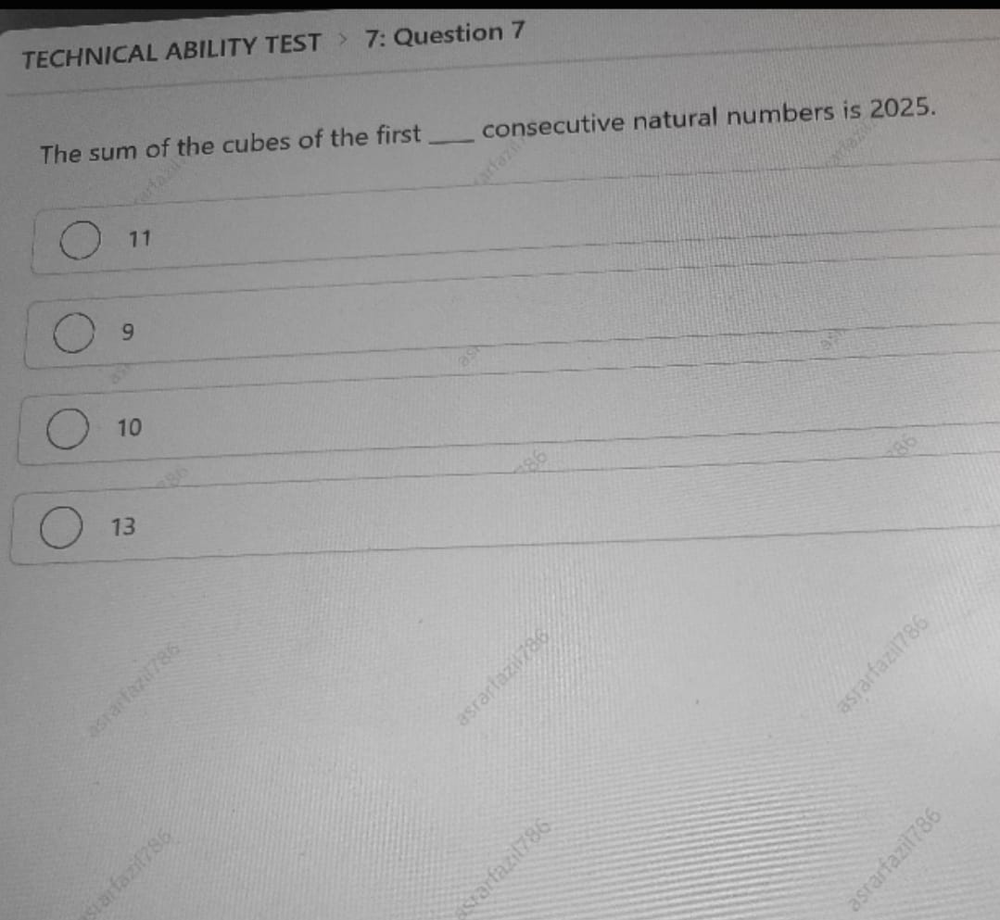

# Topic 01: Quantitative & Technical Ability (Actual 11 OCT 2025)
**Course:** Infosys Actual Questions 11 OCT 2025 | **Module:** Canonical Topic Collection
**Total Questions in Module:** 3

---

## Module Scope & Overview
Covers high-yield Infosys quantitative topics: sum of cubes identities, train-tunnel speed mechanics, and population percentage calculations with step-by-step mathematical proofs.

---

### Question 2: Sum of the Cubes of First n Natural Numbers
**Section:** Technical Ability Test | **Topic:** Quantitative Aptitude / Number Theory & Algebra | **Live Exam Screenshot:** `24a46df8-04a8-45d7-a7e7-ed3704fc13fd.jpeg`

**Question Statement:**

The sum of the cubes of the first $n$ consecutive natural numbers is 2025. Find the value of $n$.

**Options:**

- **(A)** 11
- **(B)** **[CORRECT]** 9
- **(C)** 10
- **(D)** 13

#### Detailed Solution & Mathematical Proof:

The standard mathematical formula for the sum of the cubes of the first $n$ natural numbers is:
$$\sum_{k=1}^n k^3 = \left[\frac{n(n+1)}{2}\right]^2$$

Given:
$$\left[\frac{n(n+1)}{2}\right]^2 = 2025$$

Taking the square root on both sides:
$$\frac{n(n+1)}{2} = \sqrt{2025} = 45$$

Multiplying by 2:
$$n(n+1) = 90$$

Factoring into two consecutive positive integers:
$$n(n+1) = 9 \times 10 \implies n = \mathbf{9}$$

Thus, the value of $n$ is **9** (Option B).

---

### Question 8: Train Length Determination via Pole & Tunnel Crossing Times
**Section:** Technical Ability Test | **Topic:** Quantitative Aptitude / Speed, Time & Distance | **Live Exam Screenshot:** `78c90181-a957-4388-a3f0-f676928345ea.jpeg`

**Question Statement:**

A train crosses a pole in 12 seconds and a 780-meter-long tunnel in 72 seconds. What is the length of the train?

**Options:**

- **(A)** **[CORRECT]** 156 meters
- **(B)** 172 meters
- **(C)** 166 meters
- **(D)** 154 meters
- **(E)** 152 meters

#### Detailed Solution & Mathematical Proof:

Let:
- $L$ = length of the train (in meters)
- $v$ = uniform speed of the train (in m/s)

**Case 1: Train crossing stationary pole:**
Distance covered = $L$
$$v = \frac{L}{12} \implies L = 12v$$

**Case 2: Train crossing 780m tunnel:**
Distance covered = $L + 780$
$$v = \frac{L + 780}{72}$$

Equating the speed equations:
$$\frac{L}{12} = \frac{L + 780}{72}$$

Multiplying both sides by 72:
$$6L = L + 780$$
$$5L = 780$$
$$L = \frac{780}{5} = \mathbf{156 \text{ meters}}$$

*(Verification: Speed $v = 156 / 12 = 13$ m/s. Tunnel time $= (156 + 780) / 13 = 936 / 13 = 72$ seconds. Verified!)*

Hence, the length of the train is **156 meters** (Option A).

---

### Question 12: Total Survey Population Given Proportion & Count
**Section:** Technical Ability Test | **Topic:** Quantitative Aptitude / Percentage Survey Analytics | **Live Exam Screenshot:** `dd297745-f2c5-4a02-b6f8-2fafbaf8a68b.jpeg`

**Question Statement:**

In a survey, 75% of the participants are satisfied with the service. If 3300 people are satisfied, how many people were surveyed in total?

**Options:**

- **(A)** **[CORRECT]** 4400
- **(B)** 4100
- **(C)** 4000
- **(D)** 4500

#### Detailed Solution & Mathematical Proof:

Let the total number of people surveyed be $N$.

According to the problem statement:
$$75\% \text{ of } N = 3300$$

Expressing 75% as a fraction:
$$\frac{3}{4} N = 3300$$

Solving for $N$:
$$N = \frac{3300 \times 4}{3} = 1100 \times 4 = \mathbf{4400}$$

Hence, the total number of people surveyed is **4400** (Option A).

---
