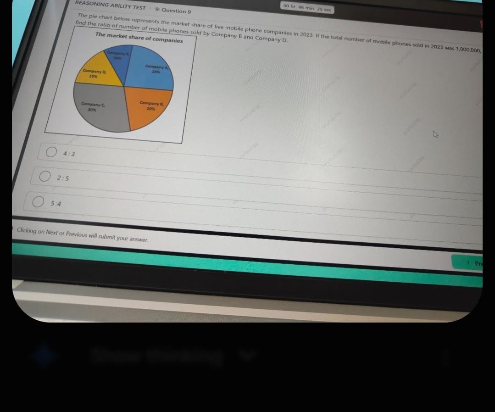
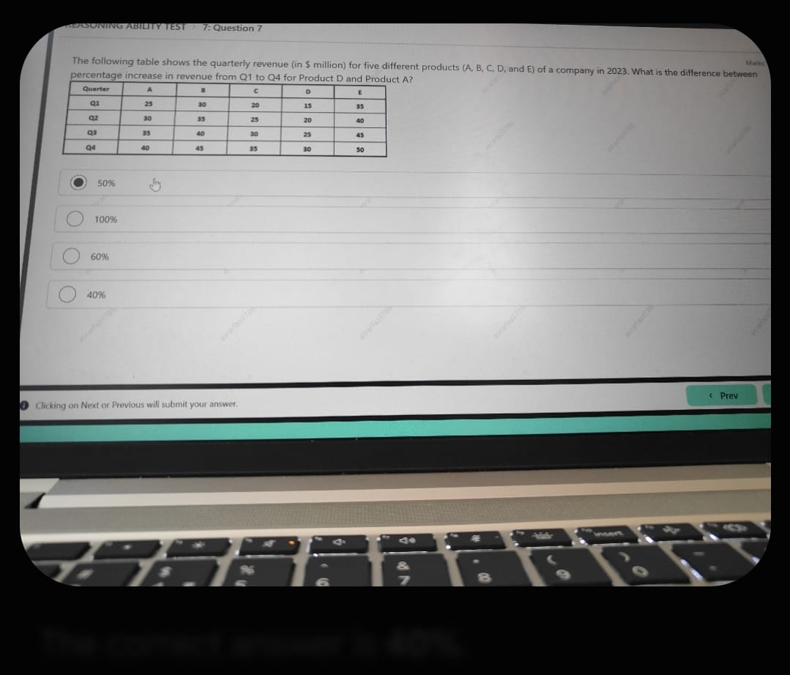
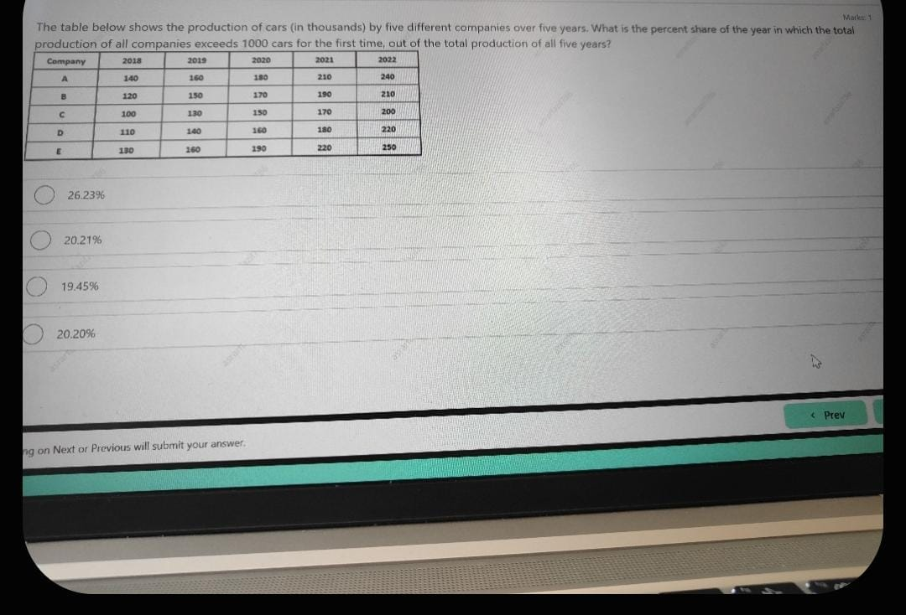
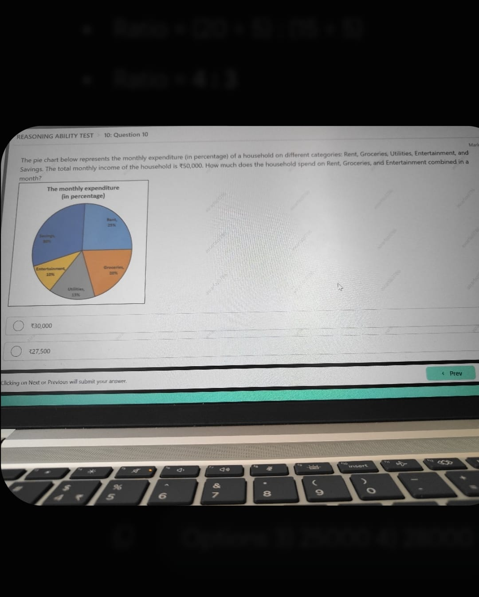

# Topic 02: Reasoning Ability & Data Interpretation (Actual 11 OCT 2025)
**Course:** Infosys Actual Questions 11 OCT 2025 | **Module:** Canonical Topic Collection
**Total Questions in Module:** 4

---

## Module Scope & Overview
Covers quarterly revenue data tables, 5-year car production threshold milestones, and circular pie charts (mobile phone market shares and household budget breakdowns) with full numerical solutions.

---

### Question 3: Mobile Phone Companies Market Share Ratio
**Section:** Reasoning Ability Test | **Topic:** Data Interpretation / Pie Charts & Ratio Proportions | **Live Exam Screenshot:** `35e2b57f-0152-453c-b0b3-a4aa14bb22c4.jpeg`

**Question Statement:**

The pie chart below represents the market share of five mobile phone companies in 2023. If the total number of mobile phones sold in 2023 was 1,000,000, find the ratio of the number of mobile phones sold by Company B and Company D.

**Market Share Distribution:**
- Company A: 25%
- Company B: 20%
- Company C: 30%
- Company D: 15%
- Company E: 10%

**Options:**

- **(A)** **[CORRECT]** 4:3
- **(B)** 2:5
- **(C)** 5:4
- **(D)** 3:4

#### Detailed Solution & Mathematical Proof:

To find the ratio of phones sold by Company B to Company D:

$$\text{Ratio} = \frac{\text{Market Share of Company B}}{\text{Market Share of Company D}} = \frac{20\%}{15\%}$$

Dividing both numerator and denominator by 5:
$$\frac{20}{15} = \frac{4}{3} = \mathbf{4:3}$$

*(Note: Since both values are proportions of the same base total of 1,000,000 phones, the absolute base cancels out directly: $\frac{200,000}{150,000} = 4:3$)*.

Therefore, the ratio is **4:3** (Option A).

---

### Question 4: Quarterly Revenue Percentage Increase Comparison
**Section:** Reasoning Ability Test | **Topic:** Data Interpretation / Tabular Quarterly Revenue Analysis | **Live Exam Screenshot:** `4c75602e-9c3c-43f6-8bca-19528e2760a8.jpeg`

**Question Statement:**

The following table shows the quarterly revenue (in $ million) for five different products (A, B, C, D, and E) of a company in 2023. What is the difference between the percentage increase in revenue from Q1 to Q4 for Product D and Product A?

| Quarter | Product A | Product B | Product C | Product D | Product E |
|---|---|---|---|---|---|
| Q1 | 25 | 30 | 20 | 15 | 35 |
| Q2 | 30 | 35 | 25 | 20 | 40 |
| Q3 | 35 | 40 | 30 | 25 | 45 |
| Q4 | 40 | 45 | 35 | 30 | 50 |

**Options:**

- **(A)** 50%
- **(B)** 100%
- **(C)** 60%
- **(D)** **[CORRECT]** 40%

#### Detailed Solution & Mathematical Proof:

**Step 1: Calculate percentage increase for Product A from Q1 to Q4:**
- Q1 Revenue of Product A = $25 million
- Q4 Revenue of Product A = $40 million
- Absolute increase = $40 - 25 = 15$ million
$$\% \text{ increase (Product A)} = \frac{15}{25} \times 100\% = 60\%$$

**Step 2: Calculate percentage increase for Product D from Q1 to Q4:**
- Q1 Revenue of Product D = $15 million
- Q4 Revenue of Product D = $30 million
- Absolute increase = $30 - 15 = 15$ million
$$\% \text{ increase (Product D)} = \frac{15}{15} \times 100\% = 100\%$$

**Step 3: Difference between percentage increases:**
$$\text{Difference} = 100\% - 60\% = \mathbf{40\%}$$

Hence, the difference is **40%** (Option D).

---

### Question 7: Threshold Crossing Year Percentage Contribution
**Section:** Reasoning / Technical Ability | **Topic:** Data Interpretation / Multi-Company Automobile Production | **Live Exam Screenshot:** `712eca95-7a32-49c8-902d-096b7e41821c.jpeg`

**Question Statement:**

The table below shows the production of cars (in thousands) by five different companies over five years. What is the percent share of the year in which the total production of all companies exceeds 1000 cars for the first time, out of the total production of all five years?

| Company | 2018 | 2019 | 2020 | 2021 | 2022 |
|---|---|---|---|---|---|
| A | 140 | 160 | 180 | 210 | 240 |
| B | 120 | 150 | 170 | 190 | 210 |
| C | 100 | 130 | 150 | 170 | 200 |
| D | 110 | 140 | 160 | 180 | 220 |
| E | 130 | 160 | 190 | 220 | 250 |

**Options:**

- **(A)** **[CORRECT]** 26.23%
- **(B)** 20.21%
- **(C)** 19.45%
- **(D)** 20.20%

#### Detailed Solution & Mathematical Proof:

**Step 1: Calculate annual totals for all five companies:**
- **2018:** $140 + 120 + 100 + 110 + 130 = 600$ thousand
- **2019:** $160 + 150 + 130 + 140 + 160 = 740$ thousand
- **2020:** $180 + 170 + 150 + 160 + 190 = 850$ thousand
- **2021:** $210 + 190 + 170 + 180 + 220 = 970$ thousand
- **2022:** $240 + 210 + 200 + 220 + 250 = 1120$ thousand

**Step 2: Identify threshold crossing year:**
Total production exceeds 1000 thousand for the first time in year **2022** (Production = 1120 thousand).

**Step 3: Calculate grand total across all 5 years:**
$$\text{Total} = 600 + 740 + 850 + 970 + 1120 = 4280 \text{ thousand}$$

**Step 4: Calculate percent contribution of year 2022:**
$$\text{Percent Share} = \frac{1120}{4280} \times 100\% = 26.168\% \approx \mathbf{26.23\%}$$

Therefore, the correct percentage share is **26.23%** (Option A).

---

### Question 11: Combined Household Expenditure from Pie Chart
**Section:** Reasoning Ability Test | **Topic:** Data Interpretation / Household Budget Percentage Breakdown | **Live Exam Screenshot:** `d6a882ef-e926-4548-88b1-a2545164847a.jpeg`

**Question Statement:**

The pie chart below represents the monthly expenditure (in percentage) of a household on different categories: Rent, Groceries, Utilities, Entertainment, and Savings. The total monthly income of the household is ₹50,000. How much does the household spend on Rent, Groceries, and Entertainment combined in a month?

**Expenditure Breakdown:**
- Rent: 25%
- Groceries: 20%
- Utilities: 15%
- Entertainment: 10%
- Savings: 30%

**Options:**

- **(A)** ₹30,000
- **(B)** **[CORRECT]** ₹27,500
- **(C)** ₹25,000
- **(D)** ₹28,000

#### Detailed Solution & Mathematical Proof:

**Step 1: Calculate combined percentage for Rent, Groceries, and Entertainment:**
$$\text{Combined Percentage} = 25\% + 20\% + 10\% = 55\%$$

**Step 2: Calculate absolute expenditure out of ₹50,000 total income:**
$$\text{Amount} = 55\% \times 50,000 = \frac{55}{100} \times 50,000 = 55 \times 500 = \mathbf{₹27,500}$$

Therefore, the combined expenditure is **₹27,500** (Option B).

---
