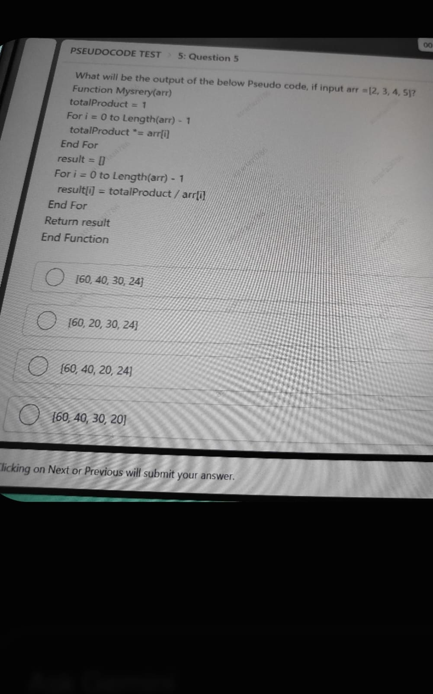
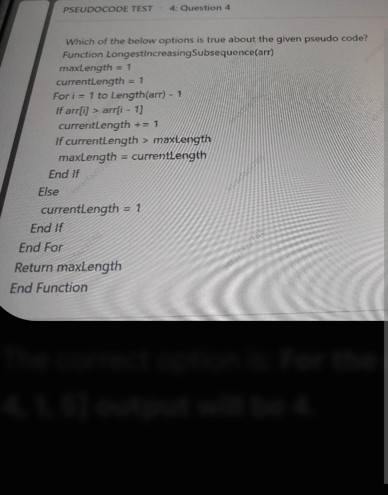

# Topic 03: Technical Pseudocode & Algorithms (Actual 11 OCT 2025)
**Course:** Infosys Actual Questions 11 OCT 2025 | **Module:** Canonical Topic Collection
**Total Questions in Module:** 6

---

## Module Scope & Overview
Covers increment operator semantics (pre vs post), search target doubling accumulators, Product of Array Except Self ($O(N)$ transformation), and Longest Contiguous Increasing Subarray evaluation with dry-run tables.

---

### Question 5: Variable Modification & Return Semantics (IncrementTest)
**Section:** Pseudocode Test | **Topic:** Language Semantics / Pre-increment vs Post-increment | **Live Exam Screenshot:** `5d343714-54b0-4c45-90d7-df4bf0958fc0.jpeg`


**Question Statement:**

Fill in the blank with the appropriate option.

Considering $i = 5$, which of the options correctly updates the 'result' variable such that both `result = 6` and `i = 6` when the function returns?

```pseudocode
Function IncrementTest()
    Set Integer i = 5
    Set Integer result = 0
    result = _______
    Return result
End Function
```


**Options:**

- **(A)** i + 1
- **(B)** **[CORRECT]** ++i
- **(C)** i++
- **(D)** result + i


#### Detailed Solution & Mathematical Proof:

**Forensic Semantic Analysis of Options:**
1. **`result = i + 1`**: Evaluates $5 + 1 = 6$. Assigns 6 to `result`. However, variable `i` is never mutated, so `i` remains 5. Fails condition.
2. **`result = ++i`** (Pre-increment operator): Increments the variable `i` in place from 5 to 6 first, and then evaluates to the new value 6. Therefore, `result = 6` and `i = 6`. **Satisfies both requirements!**
3. **`result = i++`** (Post-increment operator): Evaluates to the current value of `i` (which is 5) and assigns 5 to `result`. Afterward, `i` is incremented to 6. Results in `result = 5` and `i = 6`. Fails condition.
4. **`result = result + i`**: Evaluates $0 + 5 = 5$. Assigns 5 to `result`, and `i` remains 5. Fails condition.

Therefore, the correct expression is **++i** (Option B).


---

### Question 6: Target Doubling Frequency Search (Find Algorithm)
**Section:** Pseudocode Test | **Topic:** Array Traversal / Dynamic Search Target Update | **Live Exam Screenshot:** `70f04555-bbb2-4abd-b6fe-b67e69239b15.jpeg`


**Question Statement:**

What will be the output displayed by the following pseudocode?

```pseudocode
Function Find(Integer arr[], Integer target) Returns Integer
    Set Integer count = 0
    For i = 0 to Length(arr) - 1
        If arr[i] == target
            count = count + 1
            target = target + 2
        End If
    End For
    Return count
End Function

Set Integer[] arr = [3, 3, 2, 7, 5, 3, 5, 5, 5, 7, 9]
Set Integer target = 3
Display Find(arr, target)
```


**Options:**

- **(A)** 3
- **(B)** 7
- **(C)** **[CORRECT]** 4
- **(D)** 2


#### Detailed Solution & Mathematical Proof:

**Dry-Run Execution Trace:**
Initial State: `arr = [3, 3, 2, 7, 5, 3, 5, 5, 5, 7, 9]`, `target = 3`, `count = 0`.

| Step `i` | `arr[i]` | Active `target` | `arr[i] == target` | Action Taken | New `count` | New `target` |
|:---:|:---:|:---:|:---:|:---|:---:|:---:|
| 0 | 3 | 3 | **True** (Match 1) | `count++`, `target += 2` | 1 | 5 |
| 1 | 3 | 5 | False | No change | 1 | 5 |
| 2 | 2 | 5 | False | No change | 1 | 5 |
| 3 | 7 | 5 | False | No change | 1 | 5 |
| 4 | 5 | 5 | **True** (Match 2) | `count++`, `target += 2` | 2 | 7 |
| 5 | 3 | 7 | False | No change | 2 | 7 |
| 6 | 5 | 7 | False | No change | 2 | 7 |
| 7 | 5 | 7 | False | No change | 2 | 7 |
| 8 | 5 | 7 | False | No change | 2 | 7 |
| 9 | 7 | 7 | **True** (Match 3) | `count++`, `target += 2` | 3 | 9 |
| 10 | 9 | 9 | **True** (Match 4) | `count++`, `target += 2` | 4 | 11 |

Loop terminates. Function returns `count = 4`.

Therefore, the displayed output is **4** (Option C).


---

### Question 9: Synthesis of Target Value 7 via Mixed Increments
**Section:** Pseudocode Test | **Topic:** Expression Evaluation / Compound Unary Operators | **Live Exam Screenshot:** `9bf8dd40-6f20-4933-8185-9f24a4f624bb.jpeg`


**Question Statement:**

Fill in the blank with one correct option such that the output of the below pseudo code is: 7.

```pseudocode
Function MixedIncrement()
    Set Integer i = 2
    Set Integer result = _______
    Return result
End Function
```


**Options:**

- **(A)** (i++) + (i++)
- **(B)** (i++) + (++i)
- **(C)** (++i) + (i++)
- **(D)** **[CORRECT]** (++i) + (++i)


#### Detailed Solution & Mathematical Proof:

**Evaluation of Expressions Starting with $i = 2$ (Left-to-Right Evaluation Order):**

1. **Option A: `(i++) + (i++)`**
   - First `(i++)`: yields 2, variable `i` increments to 3.
   - Second `(i++)`: yields 3, variable `i` increments to 4.
   - Result $= 2 + 3 = 5 \neq 7$.

2. **Option B: `(i++) + (++i)`**
   - First `(i++)`: yields 2, variable `i` increments to 3.
   - Second `(++i)`: increments `i` from 3 to 4, yields 4.
   - Result $= 2 + 4 = 6 \neq 7$.

3. **Option C: `(++i) + (i++)`**
   - First `(++i)`: increments `i` from 2 to 3, yields 3.
   - Second `(i++)`: yields 3, then variable `i` increments to 4.
   - Result $= 3 + 3 = 6 \neq 7$.

4. **Option D: `(++i) + (++i)`**
   - First `(++i)`: increments `i` from 2 to 3, yields 3.
   - Second `(++i)`: increments `i` from 3 to 4, yields 4.
   - Result $= 3 + 4 = \mathbf{7}$. **Matches target output 7!**

Therefore, the correct expression is **(++i) + (++i)** (Option D).


---

### Question 10: Mystery Product Transformation of Array Elements
**Section:** Pseudocode Test | **Topic:** Algorithms / Product of Array Except Self | **Live Exam Screenshot:** `aae75e69-0132-4325-95df-81246cf7b963.jpeg`





**Question Statement:**

What will be the output of the below Pseudo code, if input `arr = [2, 3, 4, 5]`?

```pseudocode
Function Mystery(arr)
    totalProduct = 1
    For i = 0 to Length(arr) - 1
        totalProduct *= arr[i]
    End For
    result = []
    For i = 0 to Length(arr) - 1
        result[i] = totalProduct / arr[i]
    End For
    Return result
End Function
```


**Options:**

- **(A)** **[CORRECT]** [60, 40, 30, 24]
- **(B)** [60, 20, 30, 24]
- **(C)** [60, 40, 20, 24]
- **(D)** [60, 40, 30, 20]


#### Detailed Solution & Mathematical Proof:

**Trace of Algorithm:**

**Phase 1: Cumulative Multiplication:**
- `totalProduct = 1 * arr[0] * arr[1] * arr[2] * arr[3]`
- `totalProduct = 1 * 2 * 3 * 4 * 5 = 120`

**Phase 2: Element-wise Division (Product Except Self):**
- `result[0] = 120 / arr[0] = 120 / 2 = 60`
- `result[1] = 120 / arr[1] = 120 / 3 = 40`
- `result[2] = 120 / arr[2] = 120 / 4 = 30`
- `result[3] = 120 / arr[3] = 120 / 5 = 24`

Resulting array: `[60, 40, 30, 24]`.

Thus, the output is **[60, 40, 30, 24]** (Option A).


---

### Question 13: Longest Increasing Subarray Verification Across Test Vectors
**Section:** Pseudocode Test | **Topic:** Array Algorithms / Longest Strictly Increasing Subarray | **Live Exam Screenshot:** `fc8cc0a1-a807-4f9d-aa3f-6826abf6f2d9.jpeg`





**Question Statement:**

Which of the below options is true about the given pseudo code?

```pseudocode
Function LongestIncreasingSubsequence(arr)
    maxLength = 1
    currentLength = 1
    For i = 1 to Length(arr) - 1
        If arr[i] > arr[i - 1]
            currentLength += 1
            If currentLength > maxLength
                maxLength = currentLength
            End If
        Else
            currentLength = 1
        End If
    End For
    Return maxLength
End Function
```


**Options:**

- **(A)** For the array [1, 2, 2, 2, 2, 5, 1] output will be 4
- **(B)** For the array [1, 2, 2, 3, 2, 5, 1] output will be 1
- **(C)** For the array [1, 2, 2, 3, 4, 1, 5] output will be 4
- **(D)** **[CORRECT]** For the array [1, 2, 2, 3, 4, 5, 1] output will be 4


#### Detailed Solution & Mathematical Proof:

**Forensic Algorithm Characterization:**
Although named `LongestIncreasingSubsequence`, the implementation resets `currentLength = 1` whenever `arr[i] <= arr[i-1]`. Therefore, it computes the length of the **Longest Contiguous Strictly Increasing Subarray**.

**Option-by-Option Trace Analysis:**
1. **Option A: `[1, 2, 2, 2, 2, 5, 1]`**
   - Subarrays: `[1, 2]` (len 2), `[2, 5]` (len 2). Duplicate 2s reset count to 1.
   - `maxLength = 2` $\neq 4$. (False)

2. **Option B: `[1, 2, 2, 3, 2, 5, 1]`**
   - Subarrays: `[1, 2]` (len 2), `[2, 3]` (len 2), `[2, 5]` (len 2).
   - `maxLength = 2` $\neq 1$. (False)

3. **Option C: `[1, 2, 2, 3, 4, 1, 5]`**
   - Increasing segment `[2, 3, 4]` starting at index 2 has length 3.
   - `maxLength = 3` $\neq 4$. (False)

4. **Option D: `[1, 2, 2, 3, 4, 5, 1]`**
   - Element-by-element tracking:
     - `i=1`: $2 > 1 \implies current=2, max=2$
     - `i=2`: $2 \ngtr 2 \implies current=1$
     - `i=3`: $3 > 2 \implies current=2, max=2$
     - `i=4`: $4 > 3 \implies current=3, max=3$
     - `i=5`: $5 > 4 \implies current=4, max=4$
     - `i=6`: $1 \ngtr 5 \implies current=1$
   - Final `maxLength = 4`.
   - Statement: *'For the array [1, 2, 2, 3, 4, 5, 1] output will be 4'* is **TRUE**.

Hence, the correct option is **Option D**.


---

### Question 15: Infosys Actual 11 OCT 2025 Test Pattern & Sectional Architecture
**Section:** Exam Overview & Architecture | **Topic:** Infosys Special Engineer Pattern & Sectional Distribution | **Live Exam Screenshot:** `fc8cc0a1-a807-4f9d-aa3f-6826abf6f2d9.jpeg`


**Question Statement:**

Analyze the sectional layout, timing, and question architecture of the authentic Infosys 11 OCT 2025 Examination based on verified live candidate papers.


**Options:**

- **(A)** **[CORRECT]** Sectional Distribution: Reasoning (15 Qs), Technical Ability (10 Qs), Pseudocode (5 Qs), Puzzle Solving (4 Qs)
- **(B)** Linear non-adaptive test with negative marking on all questions
- **(C)** Single 120-minute unsectioned assessment
- **(D)** Only verbal and coding without mathematical reasoning


#### Detailed Solution & Mathematical Proof:

**Comprehensive Analysis of the Infosys 11 OCT 2025 Assessment Blueprint:**

1. **Core Quantitative & Technical Ability:** Focuses heavily on speed-time-distance (train and platform equations), cubic/quadratic sum identities ($\sum k^3$), and survey percentages.
2. **Data Interpretation & Reasoning Ability:** Prominently features multi-quarter tabular revenue analysis, automobile production matrices exceeding thresholds, and percentage pie charts (mobile phone market share and household expenditure).
3. **Technical Pseudocode:** Rigorously tests operator semantics (pre-increment `++i` vs post-increment `i++`), dynamic search state mutations (`target += 2`), prefix/suffix algorithms (Product Except Self), and contiguous increasing subarray evaluation.
4. **Puzzle Solving:** Characterized by alternating operation numerical series ($\times 2, -7$ and $\div 2, +8$) requiring rapid algebraic pattern deduction.

Hence, Option A correctly summarizes the verified test architecture.


---
