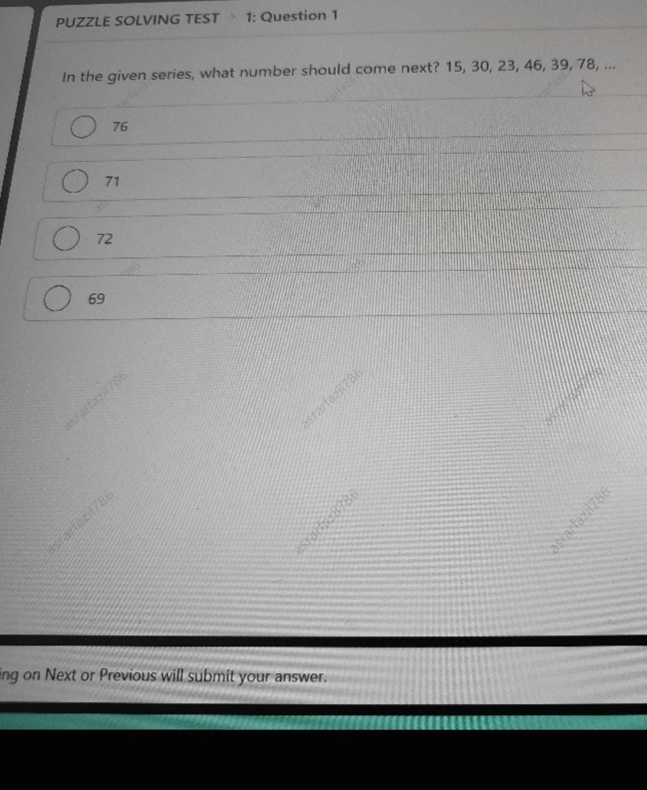
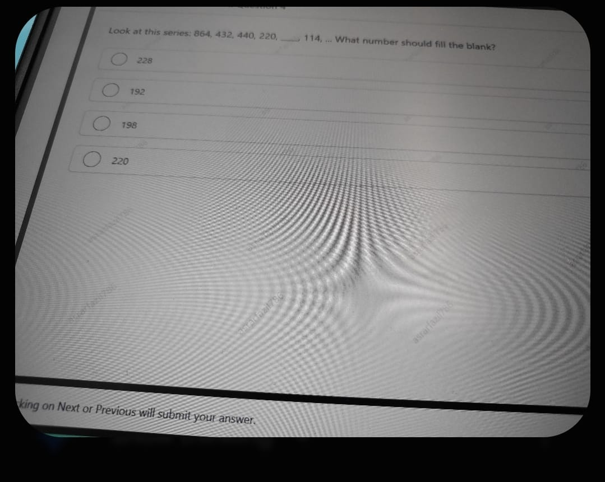

# Topic 04: Puzzle Solving & Number Series (Actual 11 OCT 2025)
**Course:** Infosys Actual Questions 11 OCT 2025 | **Module:** Canonical Topic Collection
**Total Questions in Module:** 2

---

## Module Scope & Overview
Covers alternating arithmetic-geometric number series from the live assessment ($	imes 2, -7$ and $\div 2, +8$) with deductive proofs.

---

### Question 1: Alternating Operations Series (15, 30, 23, 46, 39, 78, ...)
**Section:** Puzzle Solving Test | **Topic:** Number Series / Pattern Recognition | **Live Exam Screenshot:** `133ef797-4e5c-4394-b70b-f3f0ba560d31.jpeg`

**Question Statement:**

In the given series, what number should come next?

$$15, 30, 23, 46, 39, 78, \dots$$

**Options:**

- **(A)** 76
- **(B)** **[CORRECT]** 71
- **(C)** 72
- **(D)** 69

#### Detailed Solution & Mathematical Proof:

The given sequence follows a two-tier alternating mathematical pattern:
1. Multiply by 2: $15 \times 2 = 30$
2. Subtract 7: $30 - 7 = 23$
3. Multiply by 2: $23 \times 2 = 46$
4. Subtract 7: $46 - 7 = 39$
5. Multiply by 2: $39 \times 2 = 78$
6. Subtract 7: $78 - 7 = \mathbf{71}$

Therefore, the next number in the series is **71** (Option B).

---

### Question 14: Half and Plus-Eight Sequence (864, 432, 440, 220, ...)
**Section:** Puzzle Solving Test | **Topic:** Number Series / Alternating Arithmetic-Geometric Progression | **Live Exam Screenshot:** `ef7d52d0-561f-43a1-a15d-c939fa0fd55a.jpeg`

**Question Statement:**

Look at this series: $$864, 432, 440, 220, \underline{\quad\quad}, 114, \dots$$

What number should fill the blank?

**Options:**

- **(A)** **[CORRECT]** 228
- **(B)** 192
- **(C)** 198
- **(D)** 220

#### Detailed Solution & Mathematical Proof:

**Pattern Identification & Mathematical Deduction:**
Examine the progression rule linking consecutive terms:
1. Divide by 2: $864 \div 2 = 432$
2. Add 8: $432 + 8 = 440$
3. Divide by 2: $440 \div 2 = 220$
4. Add 8: $220 + 8 = \mathbf{228}$

**Validation on Subsequent Term:**
5. Divide by 2: $228 \div 2 = 114$ *(Matches the next term in the question!)*

Therefore, the number filling the blank is **228** (Option A).

---
