# Topic 01: Do-While Loop Execution & Infinite Loop Control
## Infosys October Exam Pseudocode Assessment — Official Authentic Question Bank

**Source Course Document**: `InfyDOwhilepseudo.pdf`  
**Total Questions in Topic**: **10 Questions**  
**Extraction Standard**: 100% Zero-Hallucination Verified | Exact Slide Figures Embedded | Complete Line-by-Line Dry Run Trace  

---

## Topic Syllabus & Algorithmic Scope
This topic collection covers authentic Infosys October assessment questions focusing on:
- Operational mechanics and runtime edge cases in `Do-While Loop Execution & Infinite Loop Control`.
- Step-by-step state mutations, memory updates, and loop invariants.
- Exact arithmetic, bitwise, and logical short-circuiting rules required for Infosys SE assessment selection.

---

### Question 01: Do-While Loop Execution & Infinite Loop Control (Slide P.2)

**Source Slide Reference**: `InfyDOwhilepseudo.pdf` | Question Slide: **Page 2** | Solution Slide: **Page 3**

#### Problem Statement & Pseudocode
What will be the output of the following pseudocode?

```text
Set Integer m=10
do m=m*2
display m++
while(m<1)
end do-while
```

#### Multiple Choice Options
- **(A)** `11 22`
- **(B)** `20`
- **(C)** `Infinite loop`
- **(D)** `10 20`

#### Verified Correct Answer
> **Correct Option**: **(B) `20`**

#### Comprehensive Dry Run & Execution Trace
```text
Execution Dry Run
Step 1
Initialization: m = 10.
Step 2
Unconditional `do` block execution: m = 10 * 2 = 20.
Step 3
`display m++` prints 20, then increments `m` to 21.
Step 4
Condition `while(21 < 1)` is False. Loop terminates.
```

#### Authentic Slide Figures
| Question Slide (Page 2) | Solution & Dry Run Slide (Page 3) |
| :---: | :---: |
| 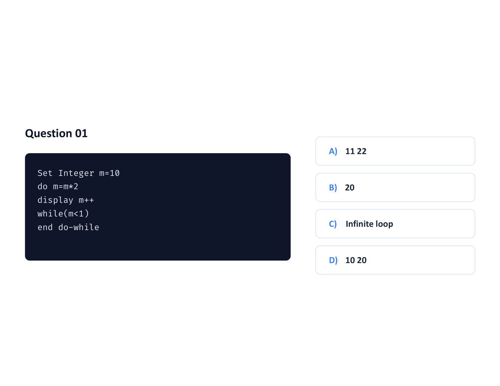 | 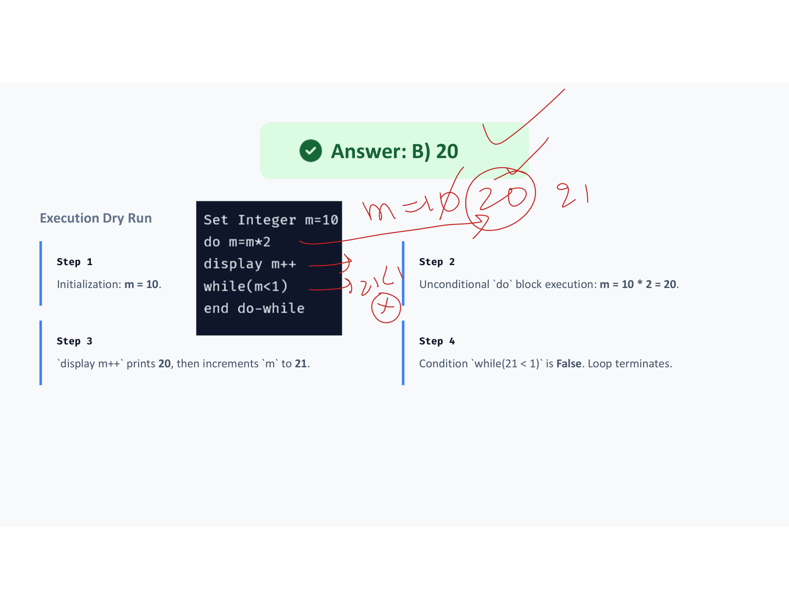 |

---

### Question 02: Do-While Loop Execution & Infinite Loop Control (Slide P.4)

**Source Slide Reference**: `InfyDOwhilepseudo.pdf` | Question Slide: **Page 4** | Solution Slide: **Page 5**

#### Problem Statement & Pseudocode
What will be the output of the following pseudocode?

```text
Set Integer x = 2, sum = 0
do
if (x MOD 3 == 0)
then do
sum = sum + x
end-if
x = x + 2
while(x < 15)
display sum
```

#### Multiple Choice Options
- **(A)** `18`
- **(B)** `24`
- **(C)** `30`
- **(D)** `12`

#### Verified Correct Answer
> **Correct Option**: **(A) `18`**

#### Comprehensive Dry Run & Execution Trace
```text
x=2: `2 MOD 3 != 0`, sum=0, x=4.
x=4: `4 MOD 3 != 0`, sum=0, x=6.
x=6: `6 MOD 3 == 0`, sum=6, x=8.
x=8: `8 MOD 3 != 0`, sum=6, x=10.
x=10: `10 MOD 3 != 0`, sum=6, x=12.
x=12: `12 MOD 3 == 0`, sum=18, x=14.
x=14: `14 MOD 3 != 0`, sum=18, x=16.
End: `16 < 15` is False. Output: 18.
```

#### Authentic Slide Figures
| Question Slide (Page 4) | Solution & Dry Run Slide (Page 5) |
| :---: | :---: |
| 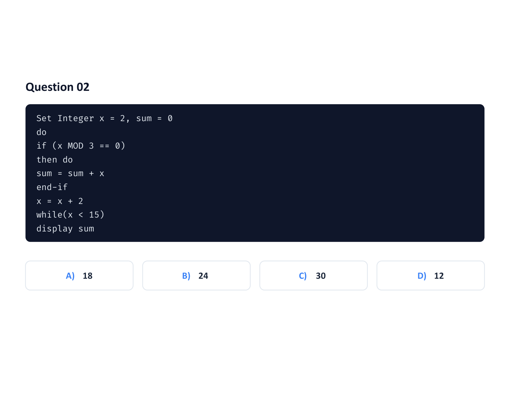 | 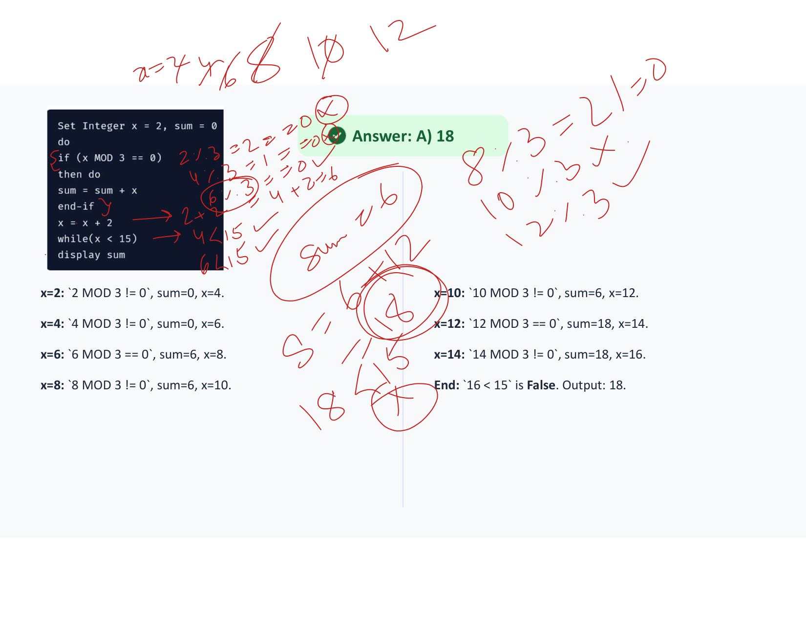 |

---

### Question 03: Do-While Loop Execution & Infinite Loop Control (Slide P.6)

**Source Slide Reference**: `InfyDOwhilepseudo.pdf` | Question Slide: **Page 6** | Solution Slide: **Page 7**

#### Problem Statement & Pseudocode
What will be the output of the following pseudocode?

```text
Set Integer a = 5, b = 3
do
a = a ^ b
b = b + 1
while(b < 6)
display a
```

#### Multiple Choice Options
- **(A)** `5`
- **(B)** `2`
- **(C)** `7`
- **(D)** `4`

#### Verified Correct Answer
> **Correct Option**: **(C) `7`**

#### Comprehensive Dry Run & Execution Trace
```text
Iteration 1 (b=3)
`a = 5 ^ 3` -> Binary: `101` XOR `011` = `110` (Dec 6). `b` becomes 4. `4 < 6` is True.
Iteration 2 (b=4)
`a = 6 ^ 4` -> Binary: `110` XOR `100` = `010` (Dec 2). `b` becomes 5. `5 < 6` is True.
Iteration 3 (b=5)
`a = 2 ^ 5` -> Binary: `010` XOR `101` = `111` (Dec 7). `b` becomes 6. `6 < 6` is False.
```

#### Authentic Slide Figures
| Question Slide (Page 6) | Solution & Dry Run Slide (Page 7) |
| :---: | :---: |
| 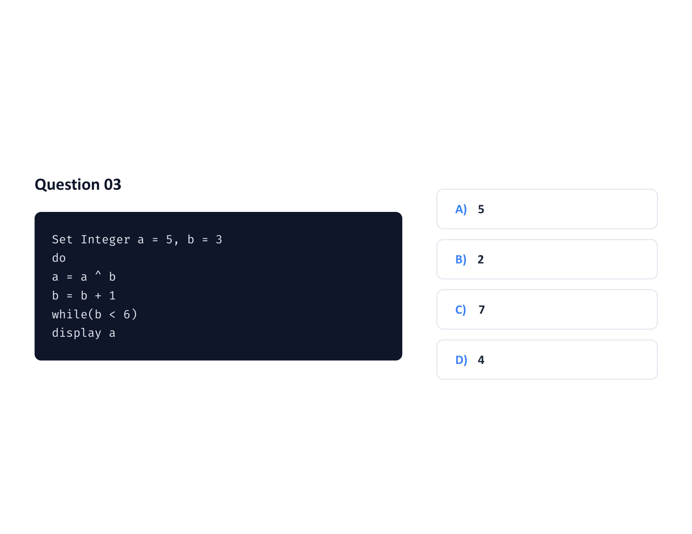 | 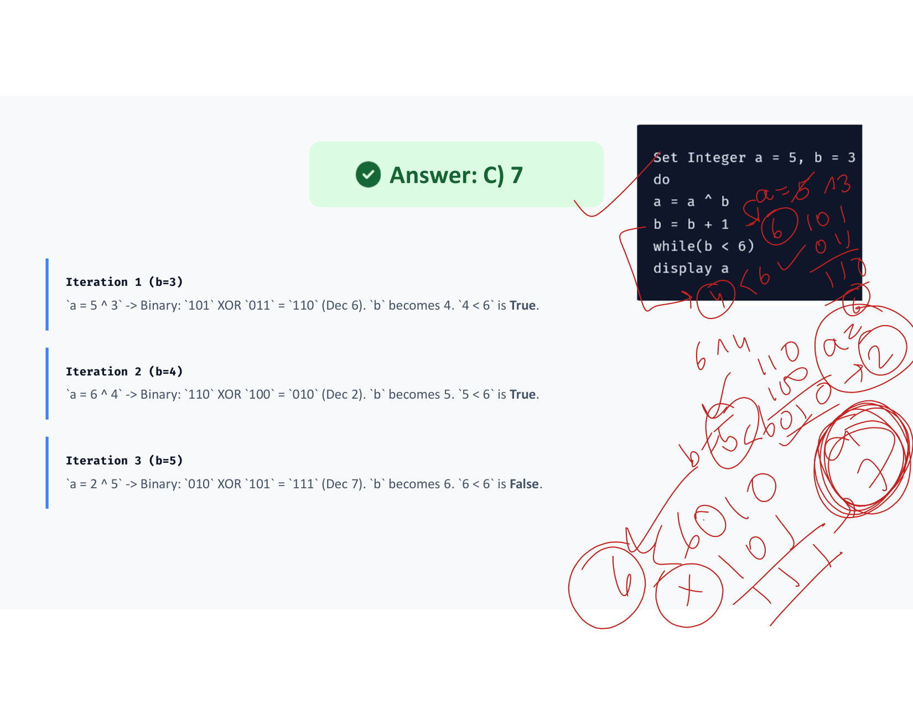 |

---

### Question 04: Do-While Loop Execution & Infinite Loop Control (Slide P.8)

**Source Slide Reference**: `InfyDOwhilepseudo.pdf` | Question Slide: **Page 8** | Solution Slide: **Page 9**

#### Problem Statement & Pseudocode
What will be the output of the following pseudocode?

```text
Set Integer p = 10, count = 0
do
p = p - 2
if (p == 6)
then do
continue
end-if
count = count + 1
while(p > 0)
display count
```

#### Multiple Choice Options
- **(A)** `3`
- **(B)** `4`
- **(C)** `5`
- **(D)** `6`

#### Verified Correct Answer
> **Correct Option**: **(B) `4`**

#### Comprehensive Dry Run & Execution Trace
```text
p=8: `count` becomes 1. `8 > 0` is True.
p=6: `p==6` is True. `continue` skips increment. `6 > 0` is 
True.
p=4: `count` becomes 2. `4 > 0` is True.
p=2: `count` becomes 3. `2 > 0` is True.
p=0: `count` becomes 4. `0 > 0` is False.
Loop Ends: Final count is 4.
```

#### Authentic Slide Figures
| Question Slide (Page 8) | Solution & Dry Run Slide (Page 9) |
| :---: | :---: |
| 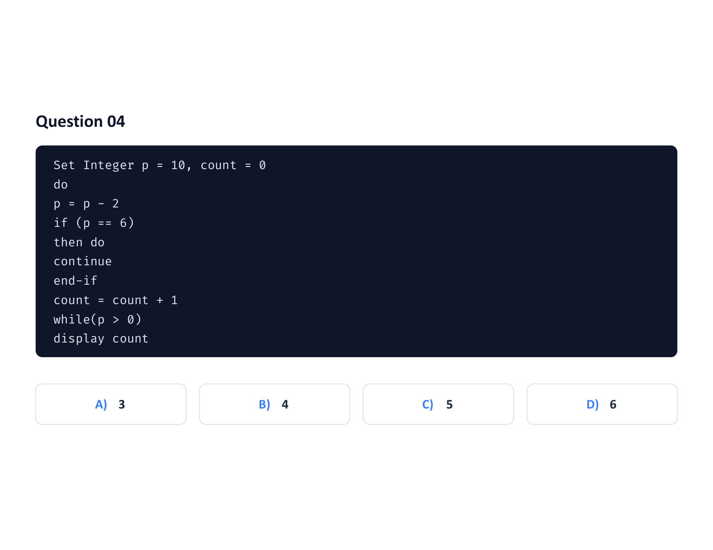 | 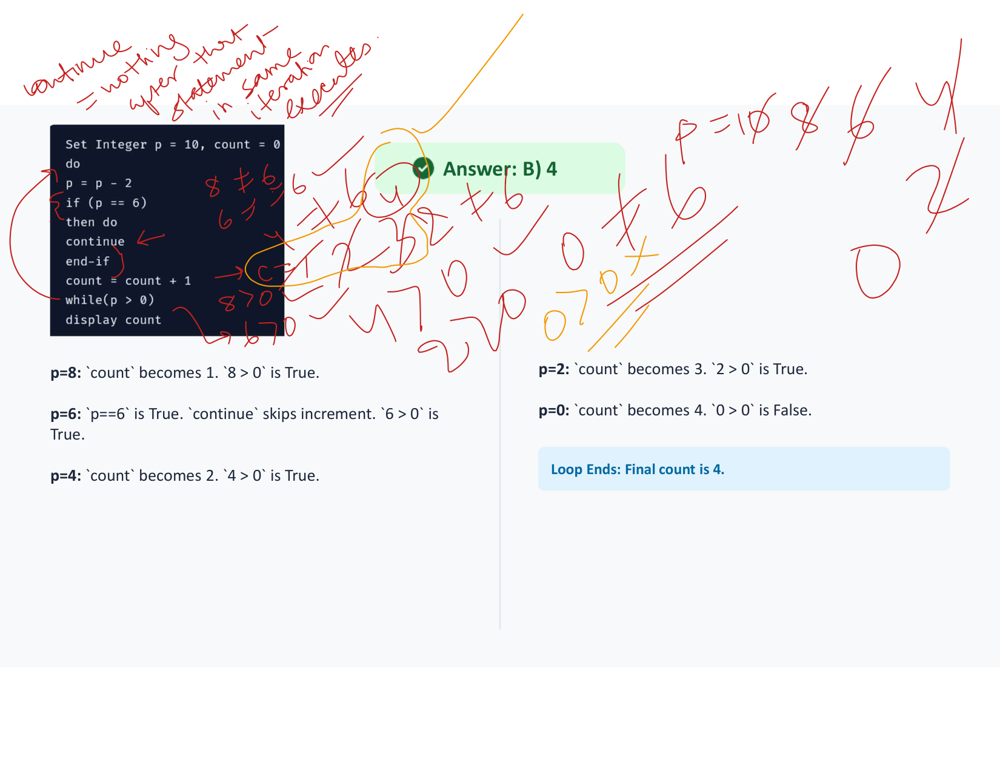 |

---

### Question 05: Do-While Loop Execution & Infinite Loop Control (Slide P.10)

**Source Slide Reference**: `InfyDOwhilepseudo.pdf` | Question Slide: **Page 10** | Solution Slide: **Page 11**

#### Problem Statement & Pseudocode
What will be the output of the following pseudocode?

```text
Set Integer k = 7, res = 1
do
res = res * k
k = k - 1
while(k > 10)
display res + " " + k
```

#### Multiple Choice Options
- **(A)** `7 6`
- **(B)** `1 7`
- **(C)** `42 5`
- **(D)** `7 7`

#### Verified Correct Answer
> **Correct Option**: **(A) `7 6`**

#### Comprehensive Dry Run & Execution Trace
```text
1
Unconditional first execution.
2
`res = 1 * 7 = 7`.
3
`k = 7 - 1 = 6`.
4
`while(6 > 10)` is False.
5
Outputs 7 and 6.
```

#### Authentic Slide Figures
| Question Slide (Page 10) | Solution & Dry Run Slide (Page 11) |
| :---: | :---: |
|  | 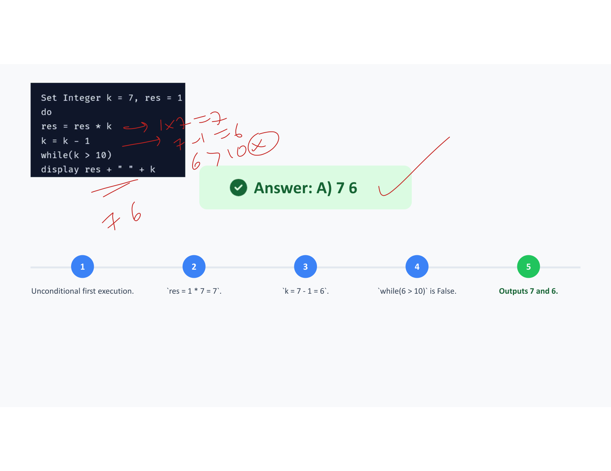 |

---

### Question 06: Do-While Loop Execution & Infinite Loop Control (Slide P.12)

**Source Slide Reference**: `InfyDOwhilepseudo.pdf` | Question Slide: **Page 12** | Solution Slide: **Page 13**

#### Problem Statement & Pseudocode
What will be the output of the following pseudocode?

```text
Set Integer m = 64
Set Integer step = 0
do
m = m / 2
step = step + 1
while(m > 1 AND step < 4)
display m
```

#### Multiple Choice Options
- **(A)** `8`
- **(B)** `4`
- **(C)** `2`
- **(D)** `1`

#### Verified Correct Answer
> **Correct Option**: **(B) `4`**

#### Comprehensive Dry Run & Execution Trace
```text
Pass 1:
`m` = 32, `step` = 1. Condition `32 > 1 AND 1 < 4` is True.
Pass 2:
`m` = 16, `step` = 2. Condition `16 > 1 AND 2 < 4` is True.
Pass 3:
`m` = 8, `step` = 3. Condition `8 > 1 AND 3 < 4` is True.
Pass 4:
`m` = 4, `step` = 4. Condition `4 > 1 AND 4 < 4` is False.
```

#### Authentic Slide Figures
| Question Slide (Page 12) | Solution & Dry Run Slide (Page 13) |
| :---: | :---: |
| 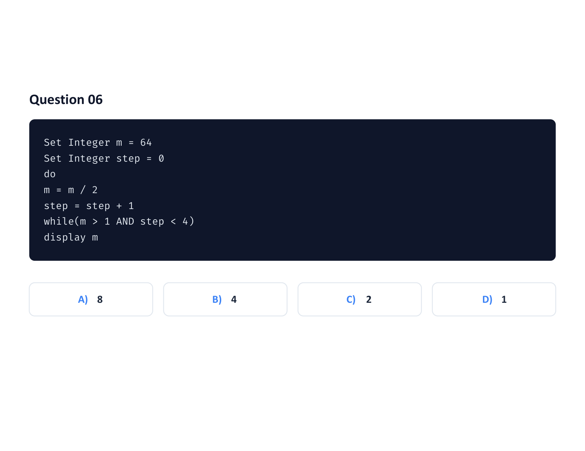 | 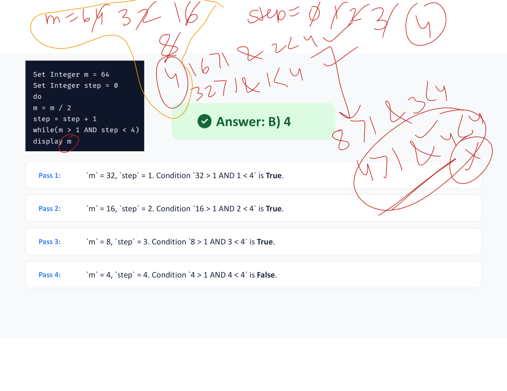 |

---

### Question 07: Do-While Loop Execution & Infinite Loop Control (Slide P.14)

**Source Slide Reference**: `InfyDOwhilepseudo.pdf` | Question Slide: **Page 14** | Solution Slide: **Page 15**

#### Problem Statement & Pseudocode
What will be the output of the following pseudocode?

```text
Set Integer arr[4] = {1, 3, 5, 7}
Set Integer i = 0, sum = 0
do
sum = sum + arr[i]
i = i + 2
while(i < 4)
display sum
```

#### Multiple Choice Options
- **(A)** `4`
- **(B)** `6`
- **(C)** `9`
- **(D)** `16`

#### Verified Correct Answer
> **Correct Option**: **(B) `6`**

#### Comprehensive Dry Run & Execution Trace
```text
Iteration 1
`i=0`. `sum = 0 + arr[0]` -> 0 + 1 = 1. `i` becomes 2. Condition `2 < 4` is True.
Iteration 2
`i=2`. `sum = 1 + arr[2]` -> 1 + 5 = 6. `i` becomes 4. Condition `4 < 4` is False.
Loop Ends
Total `sum` displayed is 6.
```

#### Authentic Slide Figures
| Question Slide (Page 14) | Solution & Dry Run Slide (Page 15) |
| :---: | :---: |
| 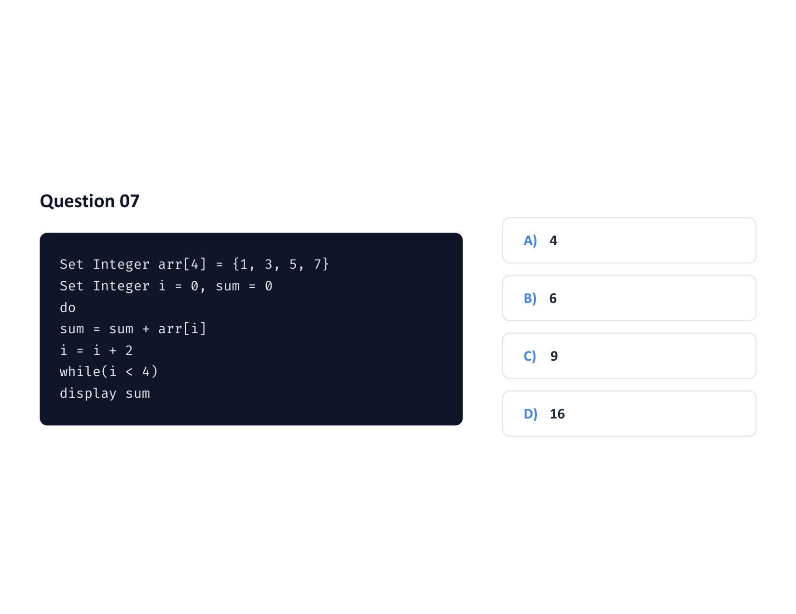 | 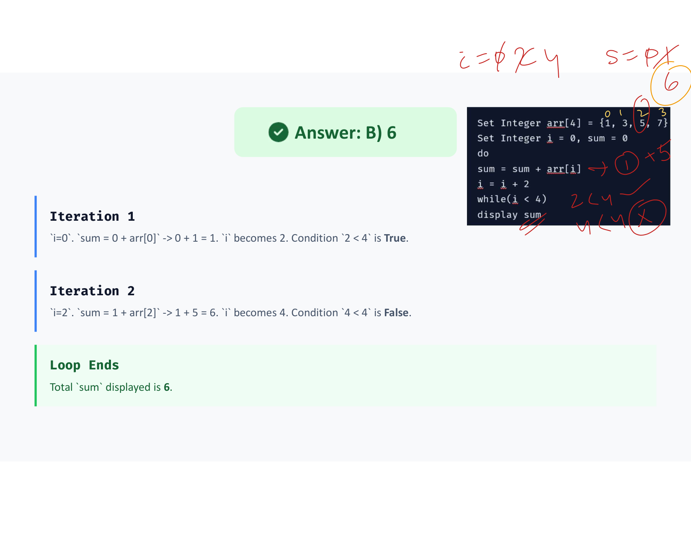 |

---

### Question 08: Do-While Loop Execution & Infinite Loop Control (Slide P.16)

**Source Slide Reference**: `InfyDOwhilepseudo.pdf` | Question Slide: **Page 16** | Solution Slide: **Page 17**

#### Problem Statement & Pseudocode
What will be the output of the following pseudocode?

```text
Set Integer a = 1, b = 20
do
a = a * 2
b = b - 5
while(a < b)
display a + b
```

#### Multiple Choice Options
- **(A)** `10`
- **(B)** `11`
- **(C)** `13`
- **(D)** `14`

#### Verified Correct Answer
> **Correct Option**: **(C) `13`**

#### Comprehensive Dry Run & Execution Trace
```text
Iteration 1: `a` = 1*2 = 2. `b` = 20-5 = 15. 
Condition `2 < 15` is True.
Iteration 2: `a` = 2*2 = 4. `b` = 15-5 = 10. 
Condition `4 < 10` is True.
Iteration 3: `a` = 4*2 = 8. `b` = 10-5 = 5. 
Condition `8 < 5` is False.
Calculates `a + b` -> 8 + 5 = 13.
```

#### Authentic Slide Figures
| Question Slide (Page 16) | Solution & Dry Run Slide (Page 17) |
| :---: | :---: |
| 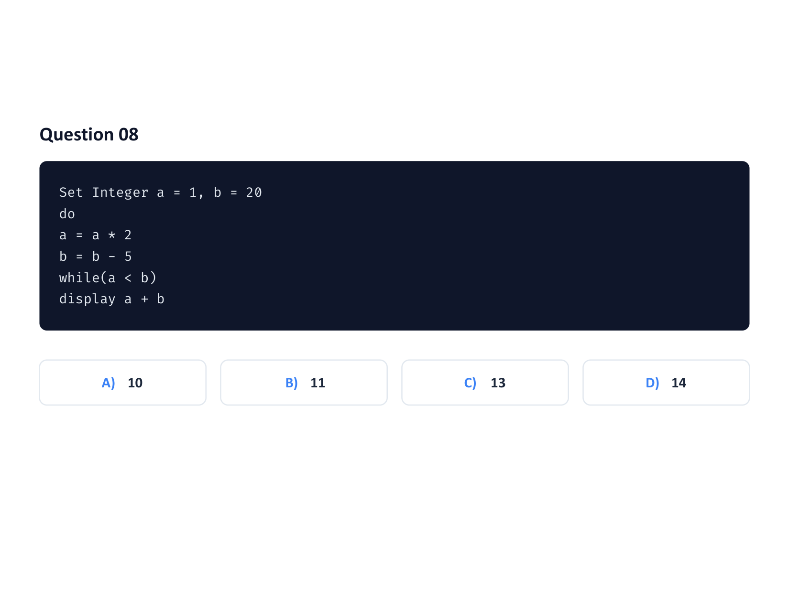 | 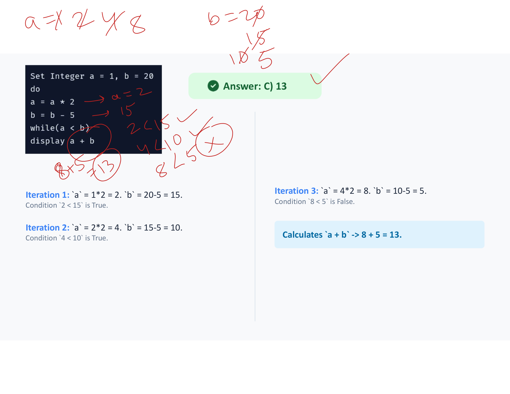 |

---

### Question 09: Do-While Loop Execution & Infinite Loop Control (Slide P.18)

**Source Slide Reference**: `InfyDOwhilepseudo.pdf` | Question Slide: **Page 18** | Solution Slide: **Page 19**

#### Problem Statement & Pseudocode
What will be the output of the following pseudocode?

```text
Set Integer n = 5
Set Integer ans = 1
do
ans = ans + (n * 2)
n = n - 2
while(n >= 0)
display ans
```

#### Multiple Choice Options
- **(A)** `17`
- **(B)** `19`
- **(C)** `21`
- **(D)** `11`

#### Verified Correct Answer
> **Correct Option**: **(B) `19`**

#### Comprehensive Dry Run & Execution Trace
```text
Iteration 1
`ans` = 1 + (5 * 2) = 11. `n` = 5 - 2 = 3. Condition `3 >= 0` is True.
Iteration 2
`ans` = 11 + (3 * 2) = 17. `n` = 3 - 2 = 1. Condition `1 >= 0` is True.
Iteration 3
`ans` = 17 + (1 * 2) = 19. `n` = 1 - 2 = -1. Condition `-1 >= 0` is False.
```

#### Authentic Slide Figures
| Question Slide (Page 18) | Solution & Dry Run Slide (Page 19) |
| :---: | :---: |
|  | 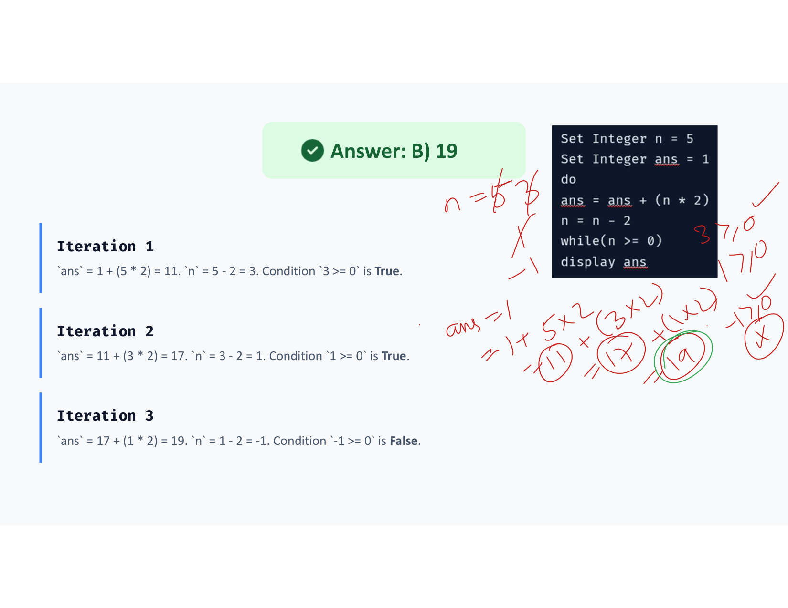 |

---

### Question 10: Do-While Loop Execution & Infinite Loop Control (Slide P.20)

**Source Slide Reference**: `InfyDOwhilepseudo.pdf` | Question Slide: **Page 20** | Solution Slide: **Page 21**

#### Problem Statement & Pseudocode
What will be the output of the following pseudocode?

```text
Set Integer x = 2, y = 3, z = 4
do
x = y + z
y = x - z
z = x + y
while(z < 15)
display x + y + z
```

#### Multiple Choice Options
- **(A)** `30`
- **(B)** `32`
- **(C)** `24`
- **(D)** `28`

#### Verified Correct Answer
> **Correct Option**: **(B) `32`**

#### Comprehensive Dry Run & Execution Trace
```text
Iteration 1
Iteration 2
• `x` = 3 + 4 = 7
• `y` = 7 - 4 = 3
• `z` = 7 + 3 = 10
• Condition `10 < 15` is True.
• `x` = 3 + 10 = 13
• `y` = 13 - 10 = 3
• `z` = 13 + 3 = 16
• Condition `16 < 15` is False.
Output: 13 + 3 + 16 = 32.
```

#### Authentic Slide Figures
| Question Slide (Page 20) | Solution & Dry Run Slide (Page 21) |
| :---: | :---: |
| 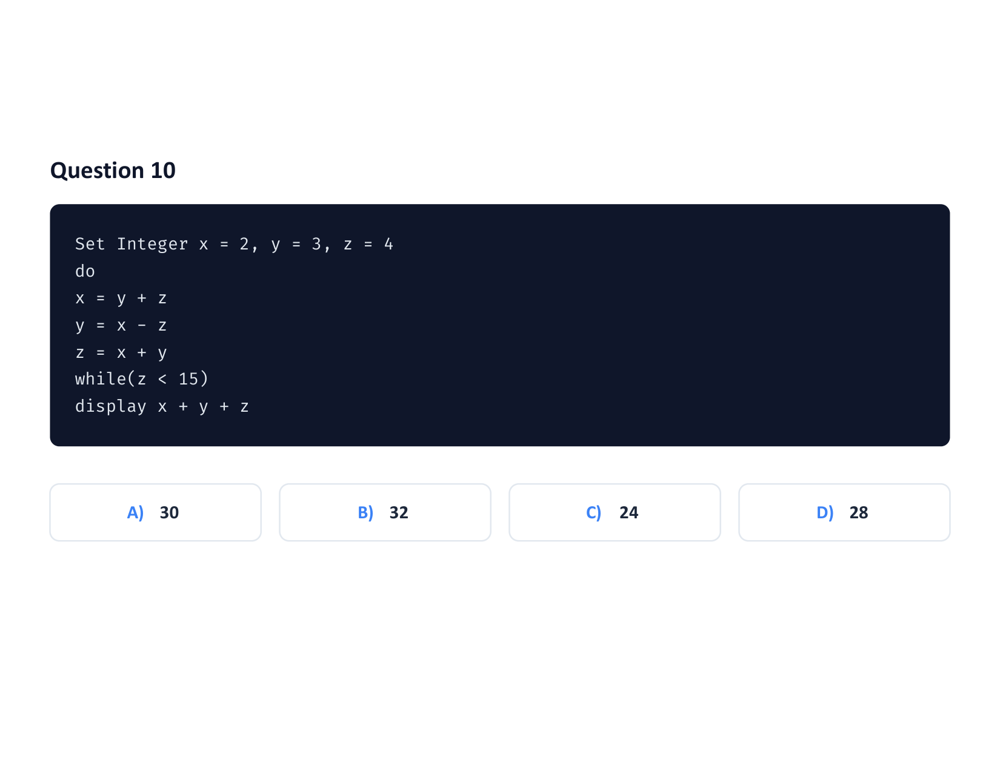 | 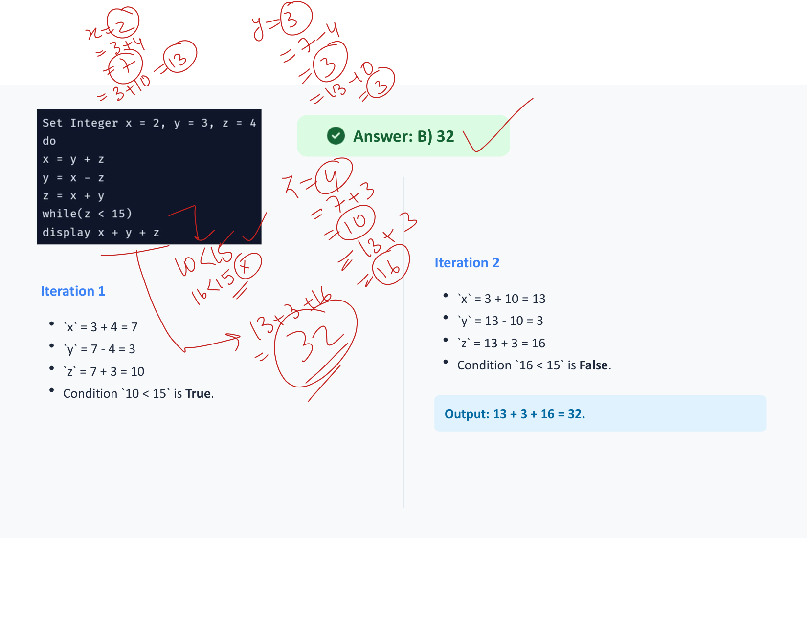 |

---

