# Topic 02: Modulo Arithmetic & Digit Manipulation Pseudocode
## Infosys October Exam Pseudocode Assessment — Official Authentic Question Bank

**Source Course Document**: `InfyModPseudo.pdf`  
**Total Questions in Topic**: **10 Questions**  
**Extraction Standard**: 100% Zero-Hallucination Verified | Exact Slide Figures Embedded | Complete Line-by-Line Dry Run Trace  

---

## Topic Syllabus & Algorithmic Scope
This topic collection covers authentic Infosys October assessment questions focusing on:
- Operational mechanics and runtime edge cases in `Modulo Arithmetic & Digit Manipulation Pseudocode`.
- Step-by-step state mutations, memory updates, and loop invariants.
- Exact arithmetic, bitwise, and logical short-circuiting rules required for Infosys SE assessment selection.

---

### Question 01: Modulo Arithmetic & Digit Manipulation Pseudocode (Slide P.2)

**Source Slide Reference**: `InfyModPseudo.pdf` | Question Slide: **Page 2** | Solution Slide: **Page 3**

#### Problem Statement & Pseudocode
What will be the output of the following pseudocode?

```text
What will be the output of the following pseudocode?
Plaintext
Set Integer num = 456
Set Integer sum = 0
while (num > 0) do
sum = sum + (num % 10)
num = num / 10
end-while
display sum
```

#### Multiple Choice Options
- **(A)** `15`
- **(B)** `12`
- **(C)** `10`
- **(D)** `456`

#### Verified Correct Answer
> **Correct Option**: **(A) `15`**

#### Comprehensive Dry Run & Execution Trace
```text
• This is a classic digit-extraction algorithm. num % 10 extracts the last digit, and num / 10 removes it.
• Iteration 1: num = 456. num % 10 = 6. sum = 0 + 6 = 6. num becomes 45.
• Iteration 2: num = 45. num % 10 = 5. sum = 6 + 5 = 11. num becomes 4.
• Iteration 3: num = 4. num % 10 = 4. sum = 11 + 4 = 15. num becomes 0.
• Loop Ends: Condition 0 > 0 is False. Output displayed is 15.
```

#### Authentic Slide Figures
| Question Slide (Page 2) | Solution & Dry Run Slide (Page 3) |
| :---: | :---: |
| 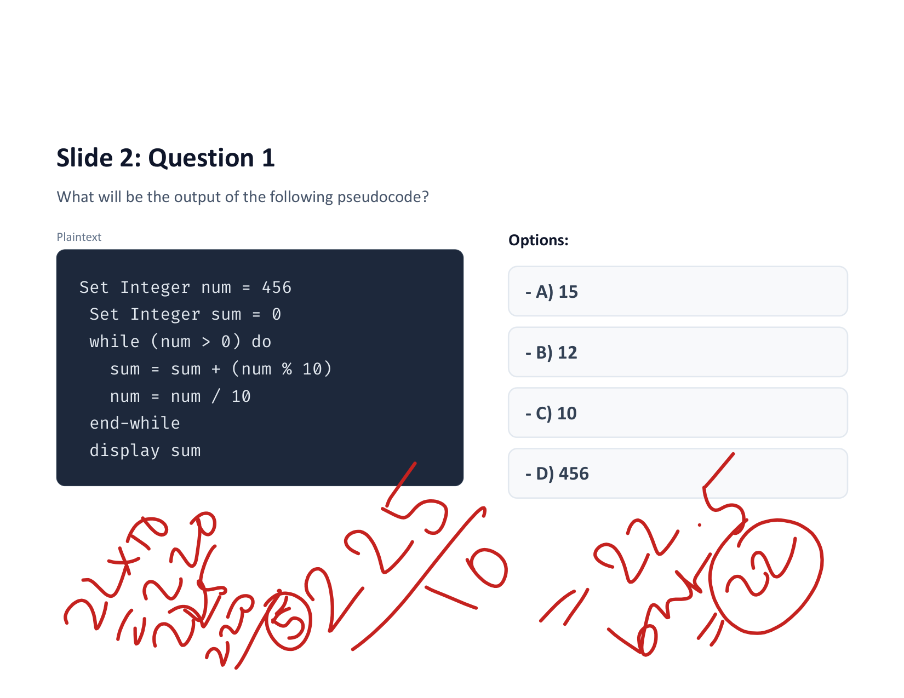 | 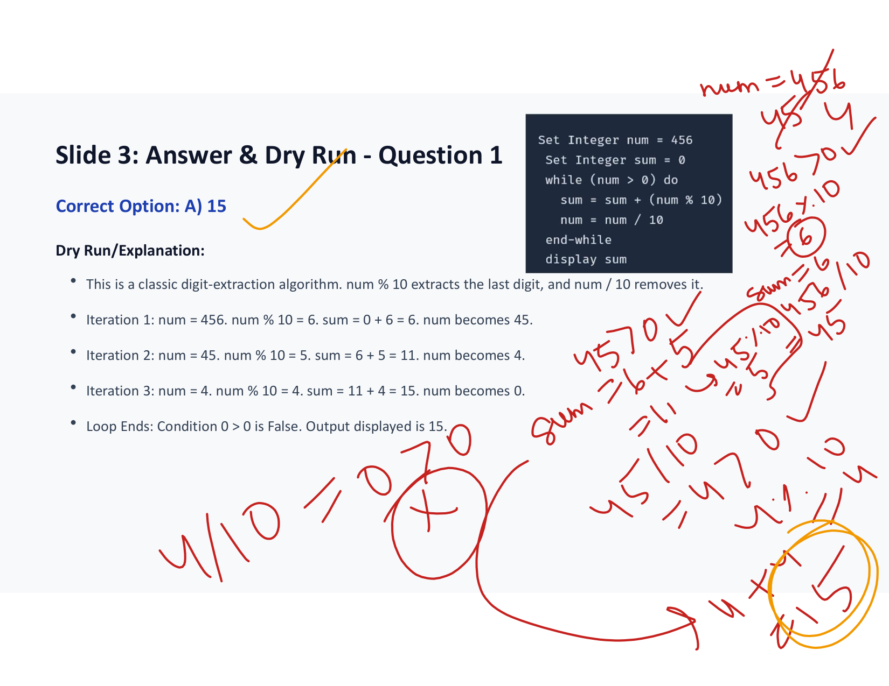 |

---

### Question 02: Modulo Arithmetic & Digit Manipulation Pseudocode (Slide P.4)

**Source Slide Reference**: `InfyModPseudo.pdf` | Question Slide: **Page 4** | Solution Slide: **Page 5**

#### Problem Statement & Pseudocode
What will be the output of the following pseudocode?

```text
What will be the output of the following pseudocode?
Plaintext
Set Integer res = 0
for i = 1 to 5 step 1 do
if (i % 2 != 0) then do
res = res + i
else do
res = res - i
end-if
end-for
display res
```

#### Multiple Choice Options
- **(A)** `-3`
- **(B)** `3`
- **(C)** `15`
- **(D)** `5`

#### Verified Correct Answer
> **Correct Option**: **(B) `3`**

#### Comprehensive Dry Run & Execution Trace
```text
• Condition i % 2 != 0 checks if a number is odd. Odd numbers are added, even numbers are subtracted.
• i = 1 (Odd): res = 0 + 1 = 1
• i = 2 (Even): res = 1 - 2 = -1
• i = 3 (Odd): res = -1 + 3 = 2
• i = 4 (Even): res = 2 - 4 = -2
• i = 5 (Odd): res = -2 + 5 = 3
• Loop Ends: The output displayed is 3.
```

#### Authentic Slide Figures
| Question Slide (Page 4) | Solution & Dry Run Slide (Page 5) |
| :---: | :---: |
| 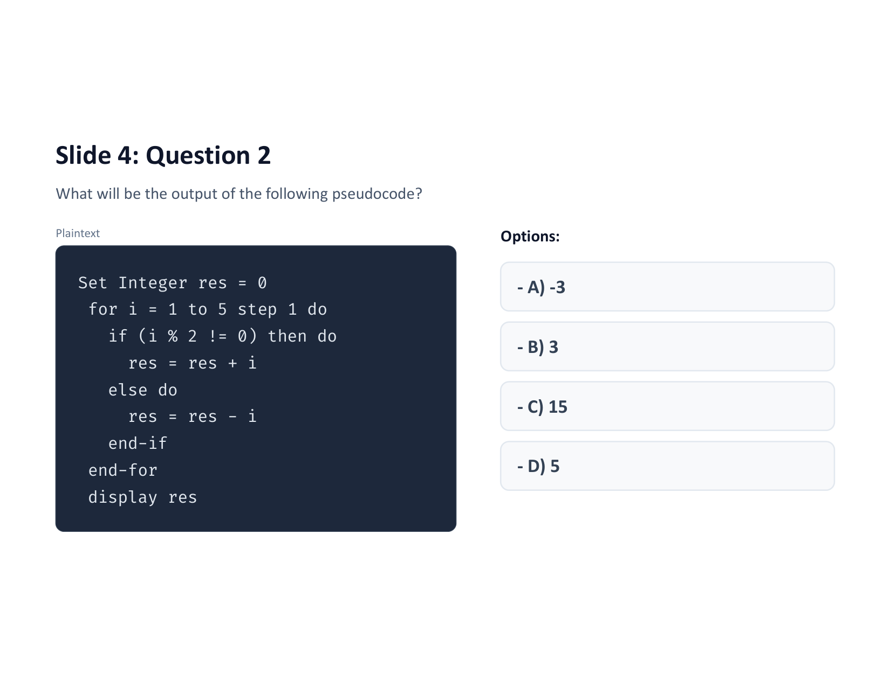 | 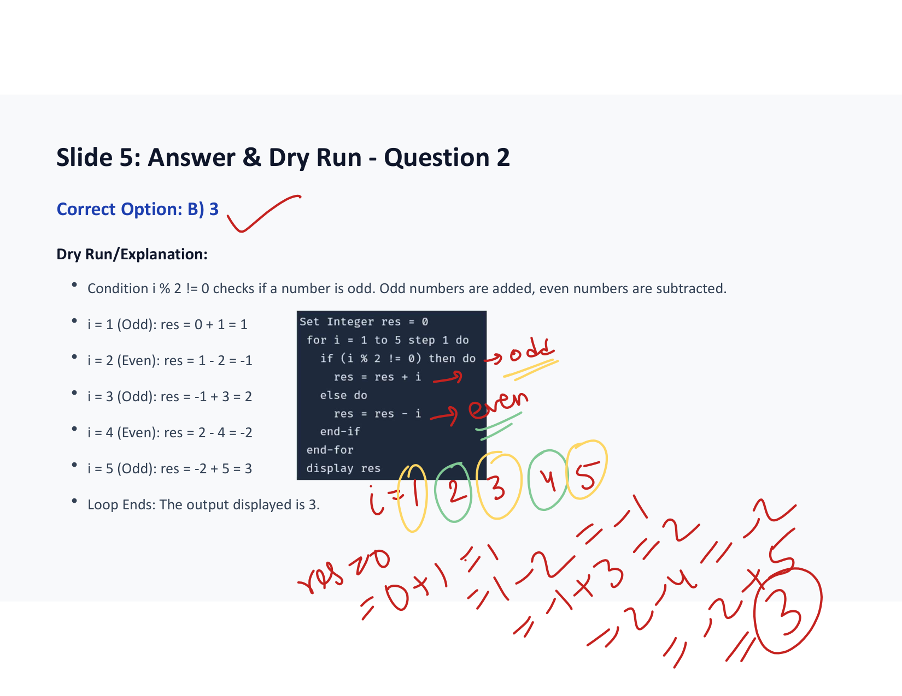 |

---

### Question 03: Modulo Arithmetic & Digit Manipulation Pseudocode (Slide P.6)

**Source Slide Reference**: `InfyModPseudo.pdf` | Question Slide: **Page 6** | Solution Slide: **Page 7**

#### Problem Statement & Pseudocode
What will be the output of the following pseudocode?

```text
What will be the output of the following pseudocode?
Plaintext
Set Integer a = 17, b = 5, c = 3
Set Integer res = (a % b) + (a % c)
display res
```

#### Multiple Choice Options
- **(A)** `2`
- **(B)** `8`
- **(C)** `6`
- **(D)** `4`

#### Verified Correct Answer
> **Correct Option**: **(D) `4`**

#### Comprehensive Dry Run & Execution Trace
```text
• First, evaluate (a % b): 17 divided by 5 leaves a remainder of 2. So, 17 % 5 = 2.
• Next, evaluate (a % c): 17 divided by 3 leaves a remainder of 2. So, 17 % 3 = 2.
• Add the two remainders: res = 2 + 2 = 4.
• The output displayed is 4.
```

#### Authentic Slide Figures
| Question Slide (Page 6) | Solution & Dry Run Slide (Page 7) |
| :---: | :---: |
|  | 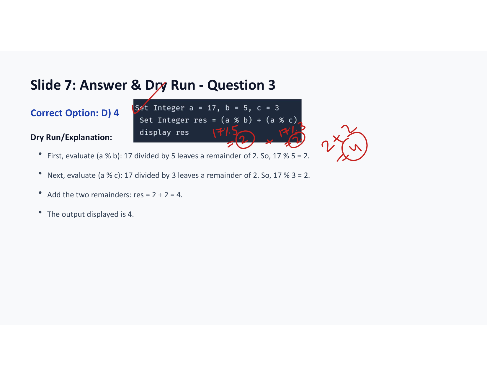 |

---

### Question 04: Modulo Arithmetic & Digit Manipulation Pseudocode (Slide P.8)

**Source Slide Reference**: `InfyModPseudo.pdf` | Question Slide: **Page 8** | Solution Slide: **Page 9**

#### Problem Statement & Pseudocode
What will be the output of the following pseudocode?

```text
What will be the output of the following pseudocode?
Plaintext
Set Integer count = 0
for i = 1 to 10 step 1 do
if (i % 3 == 0) then do
continue
end-if
count = count + 1
end-for
display count
```

#### Multiple Choice Options
- **(A)** `10`
- **(B)** `7`
- **(C)** `3`
- **(D)** `0`

#### Verified Correct Answer
> **Correct Option**: **(B) `7`**

#### Comprehensive Dry Run & Execution Trace
```text
• The loop runs from 1 to 10 (total 10 iterations).
• Condition i % 3 == 0 checks if i is a multiple of 3.
• Multiples of 3 between 1 and 10 are: 3, 6, and 9.
• When i is 3, 6, or 9, the continue statement skips the count = count + 1 execution.
• For the remaining 7 numbers (1, 2, 4, 5, 7, 8, 10), count increments normally.
• The output displayed is 7.
```

#### Authentic Slide Figures
| Question Slide (Page 8) | Solution & Dry Run Slide (Page 9) |
| :---: | :---: |
|  | 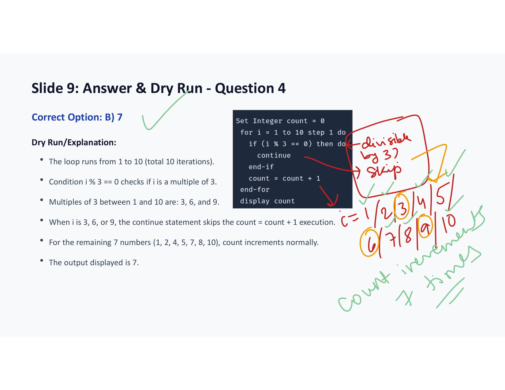 |

---

### Question 05: Modulo Arithmetic & Digit Manipulation Pseudocode (Slide P.10)

**Source Slide Reference**: `InfyModPseudo.pdf` | Question Slide: **Page 10** | Solution Slide: **Page 11**

#### Problem Statement & Pseudocode
What will be the output of the following pseudocode?

```text
What will be the output of the following pseudocode?
Plaintext
Set Integer x = 23
Set Integer y = 4
x = x + (x % y)
y = y + (x % y)
display x + " " + y
```

#### Multiple Choice Options
- **(A)** `26 4`
- **(B)** `23 4`
- **(C)** `26 6`
- **(D)** `26 5`

#### Verified Correct Answer
> **Correct Option**: **(C) `26 6`**

#### Comprehensive Dry Run & Execution Trace
```text
• Line 3: x = x + (x % y). x % y is 23 % 4 = 3. Therefore, x becomes 23 + 3 = 26.
• Line 4: y = y + (x % y). Note: x is now 26. 26 % 4 leaves a remainder of 2. Therefore, y becomes 4 + 2 = 6.
• The output displayed is 26 6.
```

#### Authentic Slide Figures
| Question Slide (Page 10) | Solution & Dry Run Slide (Page 11) |
| :---: | :---: |
|  | 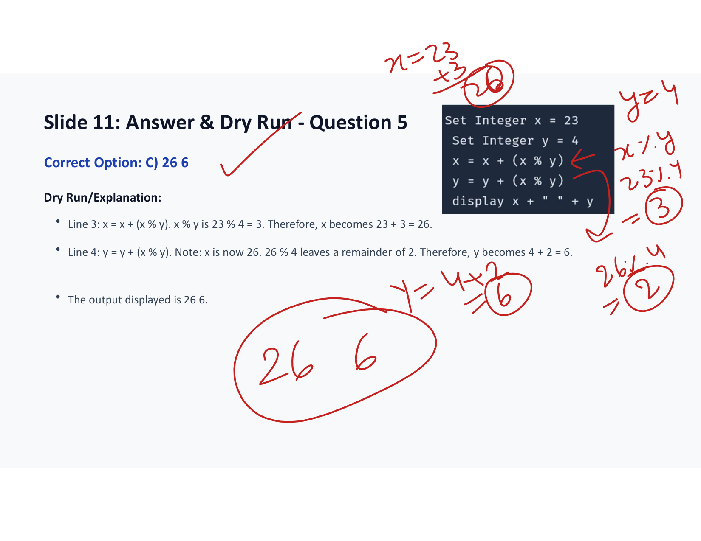 |

---

### Question 06: Modulo Arithmetic & Digit Manipulation Pseudocode (Slide P.12)

**Source Slide Reference**: `InfyModPseudo.pdf` | Question Slide: **Page 12** | Solution Slide: **Page 13**

#### Problem Statement & Pseudocode
What will be the output of the following pseudocode?

```text
What will be the output of the following pseudocode?
Plaintext
Set Integer arr[5] = {10, 20, 30,
40, 50}
Set Integer res = 0
for i = 0 to 4 step 1 do
if (arr[i] % 4 == 0) then do
res = res + arr[i]
end-if
end-for
display res
```

#### Multiple Choice Options
- **(A)** `150`
- **(B)** `60`
- **(C)** `80`
- **(D)** `40`

#### Verified Correct Answer
> **Correct Option**: **(B) `60`**

#### Comprehensive Dry Run & Execution Trace
```text
• Iterates array and adds elements to res only if divisible by 4 (remainder is 0).
• i = 0: 10 % 4 = 2 (False)
• i = 1: 20 % 4 = 0 (True) → res = 0 + 20 = 20
• i = 2: 30 % 4 = 2 (False)
• i = 3: 40 % 4 = 0 (True) → res = 20 + 40 = 60
• i = 4: 50 % 4 = 2 (False)
• The output displayed is 60.
```

#### Authentic Slide Figures
| Question Slide (Page 12) | Solution & Dry Run Slide (Page 13) |
| :---: | :---: |
|  | 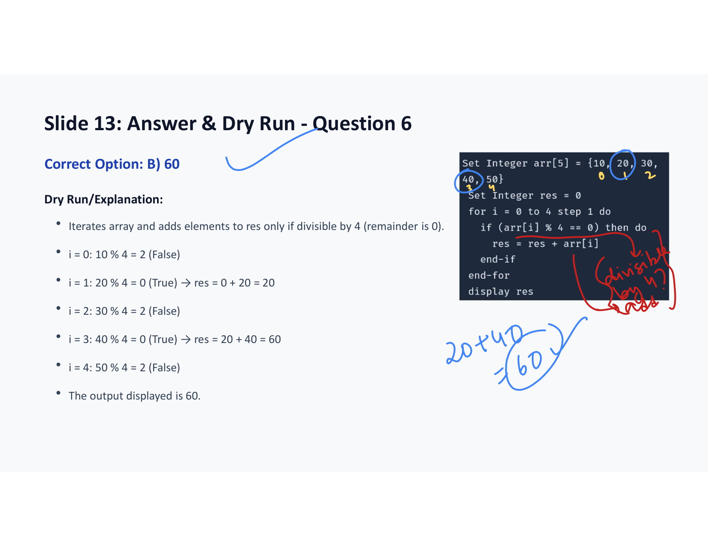 |

---

### Question 07: Modulo Arithmetic & Digit Manipulation Pseudocode (Slide P.14)

**Source Slide Reference**: `InfyModPseudo.pdf` | Question Slide: **Page 14** | Solution Slide: **Page 15**

#### Problem Statement & Pseudocode
What will be the output of the following pseudocode?

```text
What will be the output of the following pseudocode?
Plaintext
Set Integer m = 8
Set Integer n = 3
Set Integer val = (m++ % n) + (m %
n)
display val
```

#### Multiple Choice Options
- **(A)** `5`
- **(B)** `4`
- **(C)** `3`
- **(D)** `2`

#### Verified Correct Answer
> **Correct Option**: **(D) `2`**

#### Comprehensive Dry Run & Execution Trace
```text
• Evaluates left-to-right. m++ is a post-increment operator.
• (m++ % n) uses current value (8). 8 % 3 = 2. Immediately after, m becomes 9.
• (m % n) uses updated value (9). 9 % 3 = 0.
• val = 2 + 0 = 2.
• The output displayed is 2.
```

#### Authentic Slide Figures
| Question Slide (Page 14) | Solution & Dry Run Slide (Page 15) |
| :---: | :---: |
| 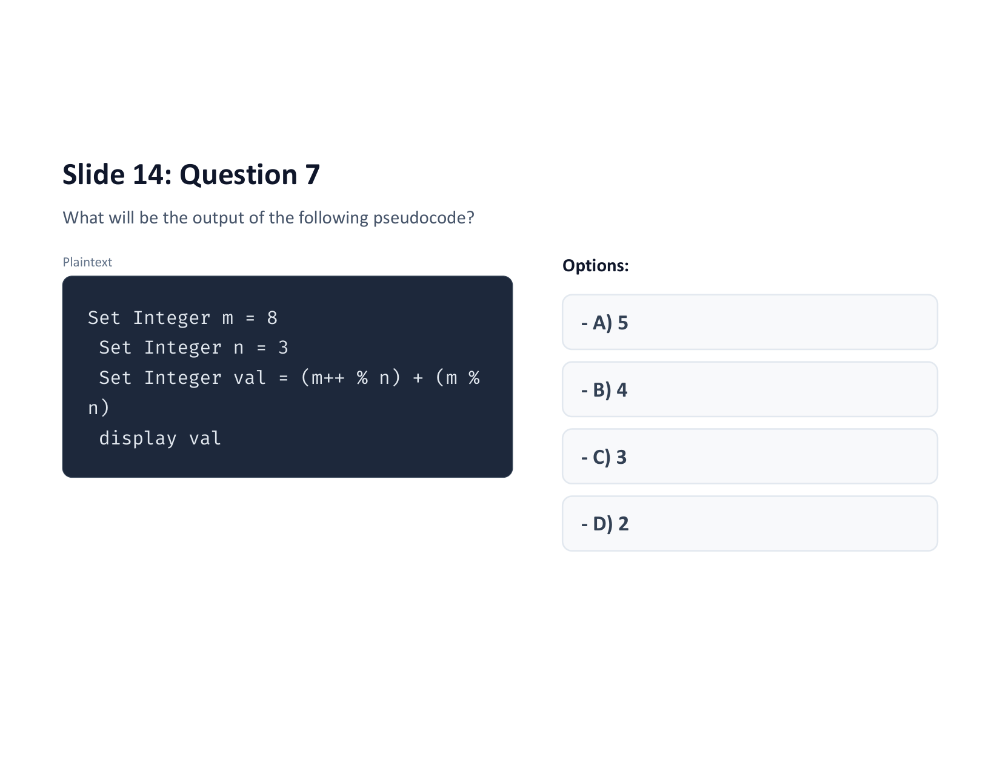 | 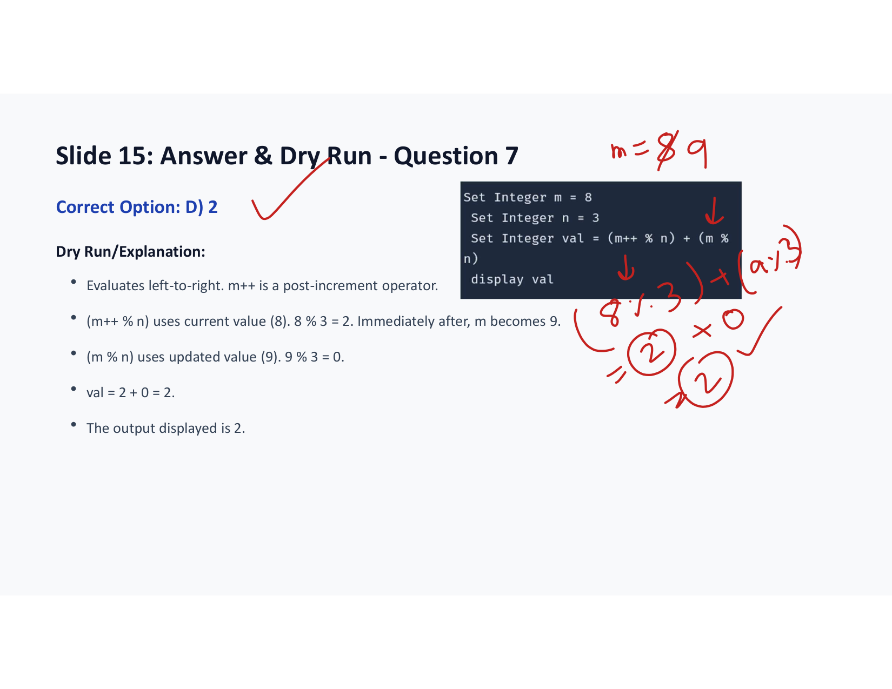 |

---

### Question 08: Modulo Arithmetic & Digit Manipulation Pseudocode (Slide P.16)

**Source Slide Reference**: `InfyModPseudo.pdf` | Question Slide: **Page 16** | Solution Slide: **Page 17**

#### Problem Statement & Pseudocode
What will be the output of the following pseudocode?

```text
What will be the output of the following pseudocode?
Plaintext
Set Integer n = 123
Set Integer rev = 0
while (n > 0) do
rev = (rev * 10) + (n % 10)
n = n / 10
end-while
display rev
```

#### Multiple Choice Options
- **(A)** `6`
- **(B)** `123`
- **(C)** `321`
- **(D)** `0`

#### Verified Correct Answer
> **Correct Option**: **(C) `321`**

#### Comprehensive Dry Run & Execution Trace
```text
• This is the standard algorithm for reversing an integer.
• Iteration 1: n = 123. n % 10 = 3. rev = (0 * 10) + 3 = 3. n becomes 12.
• Iteration 2: n = 12. n % 10 = 2. rev = (3 * 10) + 2 = 32. n becomes 1.
• Iteration 3: n = 1. n % 10 = 1. rev = (32 * 10) + 1 = 321. n becomes 0.
• Loop Ends: Condition 0 > 0 is False. Output is 321.
```

#### Authentic Slide Figures
| Question Slide (Page 16) | Solution & Dry Run Slide (Page 17) |
| :---: | :---: |
| 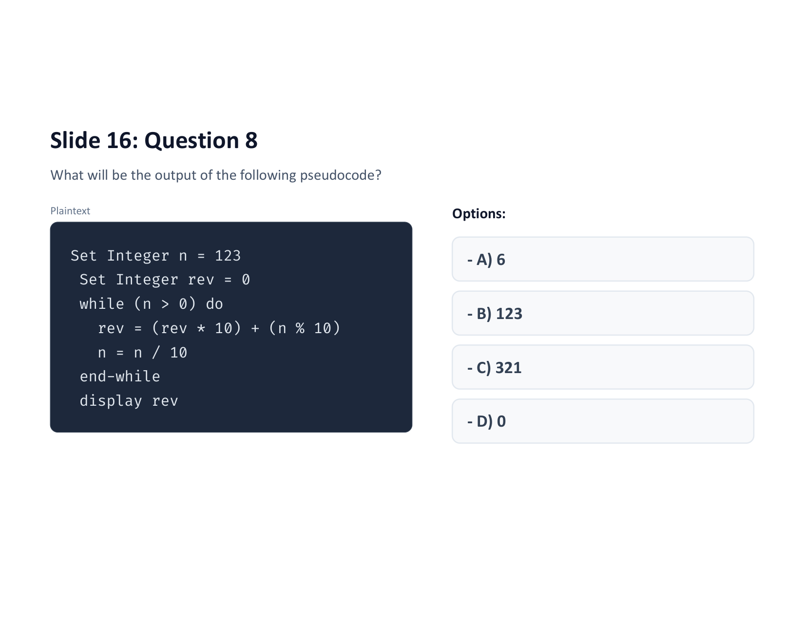 | 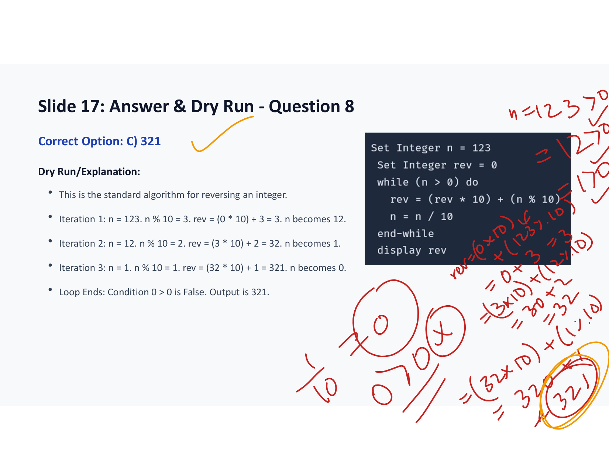 |

---

### Question 09: Modulo Arithmetic & Digit Manipulation Pseudocode (Slide P.18)

**Source Slide Reference**: `InfyModPseudo.pdf` | Question Slide: **Page 18** | Solution Slide: **Page 19**

#### Problem Statement & Pseudocode
What will be the output of the following pseudocode?

```text
What will be the output of the following pseudocode?
Plaintext
Set Integer num = 12, count = 0
for i = 1 to num step 1 do
if (num % i == 0) then do
count = count + 1
end-if
end-for
display count
```

#### Multiple Choice Options
- **(A)** `4`
- **(B)** `5`
- **(C)** `6`
- **(D)** `12`

#### Verified Correct Answer
> **Correct Option**: **(C) `6`**

#### Comprehensive Dry Run & Execution Trace
```text
• Counts the number of proper factors (divisors) of num. num % i == 0 checks for perfect division.
• The loop runs from 1 to 12.
• Numbers leaving a remainder of 0 when dividing 12: 1, 2, 3, 4, 6, 12.
• The count variable increments exactly 6 times.
• The output displayed is 6.
```

#### Authentic Slide Figures
| Question Slide (Page 18) | Solution & Dry Run Slide (Page 19) |
| :---: | :---: |
| 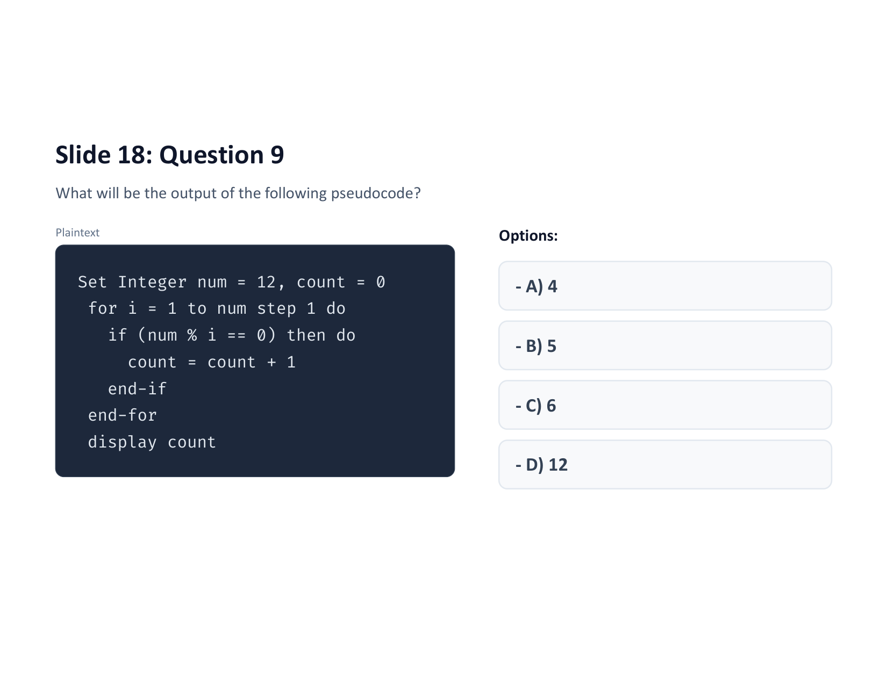 | 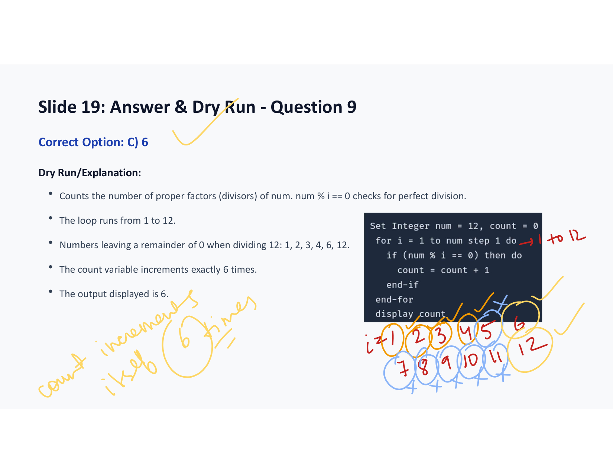 |

---

### Question 10: Modulo Arithmetic & Digit Manipulation Pseudocode (Slide P.20)

**Source Slide Reference**: `InfyModPseudo.pdf` | Question Slide: **Page 20** | Solution Slide: **Page 21**

#### Problem Statement & Pseudocode
What will be the output of the following pseudocode?

```text
What will be the output of the following pseudocode?
Plaintext
Set Integer val = 83
Set Integer res = (val % 15) % 4
display res
```

#### Multiple Choice Options
- **(A)** `1`
- **(B)** `2`
- **(C)** `3`
- **(D)** `0`

#### Verified Correct Answer
> **Correct Option**: **(D) `0`**

#### Comprehensive Dry Run & Execution Trace
```text
• This tests the nested evaluation of modulo operators.
• First, compute (val % 15). 83 divided by 15 is 5 (15 * 5 = 75), leaving a remainder of 8. Thus, 83 % 15 = 8.
• Next, compute 8 % 4. 8 divided by 4 leaves a remainder of 0.
• res is assigned 0.
• The output displayed is 0.
```

#### Authentic Slide Figures
| Question Slide (Page 20) | Solution & Dry Run Slide (Page 21) |
| :---: | :---: |
| 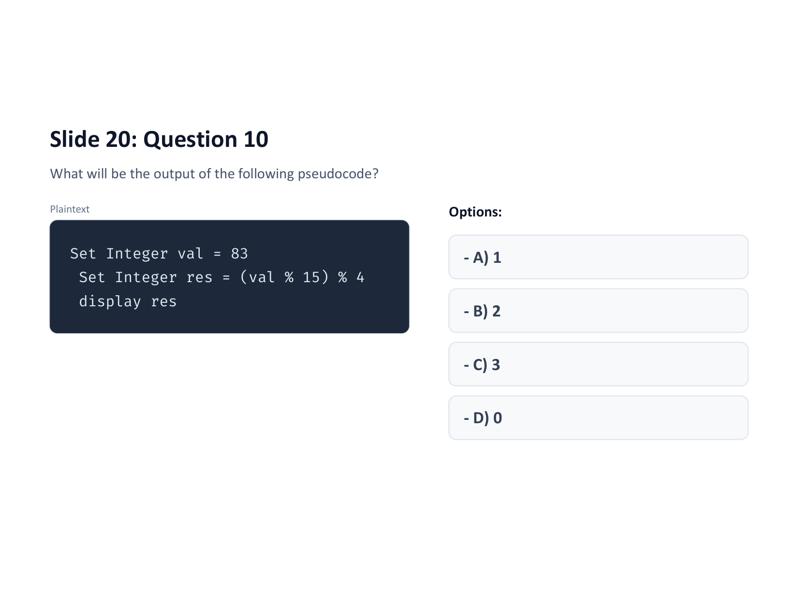 | 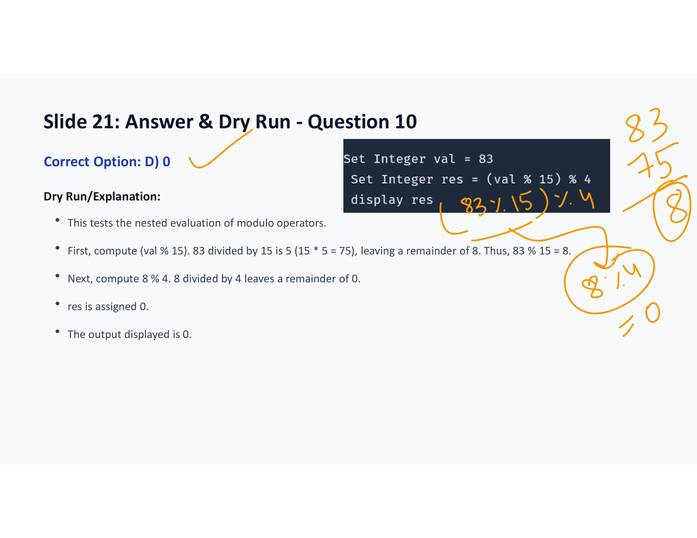 |

---

