# Topic 03: Pre and Post Increment & Decrement Compound Expressions
## Infosys October Exam Pseudocode Assessment — Official Authentic Question Bank

**Source Course Document**: `InfyPrePostPseudo.pdf`  
**Total Questions in Topic**: **15 Questions**  
**Extraction Standard**: 100% Zero-Hallucination Verified | Exact Slide Figures Embedded | Complete Line-by-Line Dry Run Trace  

---

## Topic Syllabus & Algorithmic Scope
This topic collection covers authentic Infosys October assessment questions focusing on:
- Operational mechanics and runtime edge cases in `Pre and Post Increment & Decrement Compound Expressions`.
- Step-by-step state mutations, memory updates, and loop invariants.
- Exact arithmetic, bitwise, and logical short-circuiting rules required for Infosys SE assessment selection.

---

### Question 01: Pre and Post Increment & Decrement Compound Expressions (Slide P.2)

**Source Slide Reference**: `InfyPrePostPseudo.pdf` | Question Slide: **Page 2** | Solution Slide: **Page 3**

#### Problem Statement & Pseudocode
What will be the output?

```text
Set Integer a = 5, b = 2, c
c = a++ + ++b - --a + b--
display c
```

#### Multiple Choice Options
- **(A)** `5`
- **(B)** `6`
- **(C)** `7`
- **(D)** `8`

#### Verified Correct Answer
> **Correct Option**: **(B) `6`**

#### Comprehensive Dry Run & Execution Trace
```text
EXECUTION DRY RUN
Step 1: Post-increment a returns 5.
Step 2: Pre-increment b returns 3.
Step 3: Pre-decrement a returns 5.
Step 4: Post-decrement b returns 3.
Calculate: Formula yields 5 + 3 - 5 + 3 = 6.
```

#### Authentic Slide Figures
| Question Slide (Page 2) | Solution & Dry Run Slide (Page 3) |
| :---: | :---: |
|  | 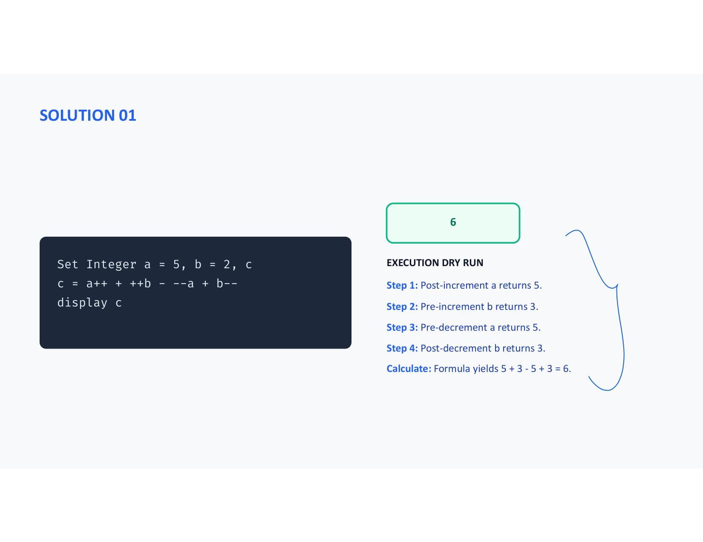 |

---

### Question 02: Pre and Post Increment & Decrement Compound Expressions (Slide P.4)

**Source Slide Reference**: `InfyPrePostPseudo.pdf` | Question Slide: **Page 4** | Solution Slide: **Page 5**

#### Problem Statement & Pseudocode
What will be the output?

```text
Set Integer x = 0, y = 0
if (x++ > 0 OR ++y > 0)
display x + " " + y
else
display y + " " + x
end-if
```

#### Multiple Choice Options
- **(A)** `0 0`
- **(B)** `1 0`
- **(C)** `0 1`
- **(D)** `1 1`

#### Verified Correct Answer
> **Correct Option**: **(D) `1 1`**

#### Comprehensive Dry Run & Execution Trace
```text
EXECUTION DRY RUN
Left OR: x++ returns 0. Condition fails.
Update X: Post-increment sets x to 1.
Right OR: ++y sets y to 1. Condition passes.
Result: True overall condition outputs 1 1.
```

#### Authentic Slide Figures
| Question Slide (Page 4) | Solution & Dry Run Slide (Page 5) |
| :---: | :---: |
| 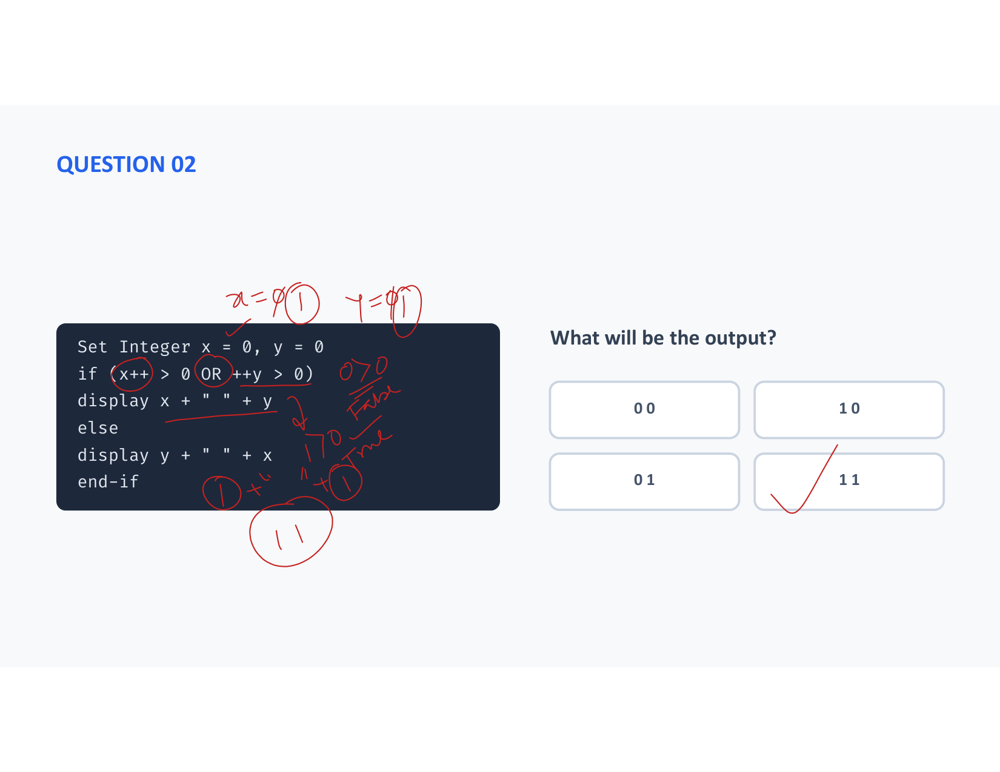 |  |

---

### Question 03: Pre and Post Increment & Decrement Compound Expressions (Slide P.6)

**Source Slide Reference**: `InfyPrePostPseudo.pdf` | Question Slide: **Page 6** | Solution Slide: **Page 7**

#### Problem Statement & Pseudocode
What will be the output?

```text
Set Integer p = 5, q = 10
if (++p < 5 AND q-- > 9)
display p
else
display p + " " + q
end-if
```

#### Multiple Choice Options
- **(A)** `6 10`
- **(B)** `6 9`
- **(C)** `5 10`
- **(D)** `5 9`

#### Verified Correct Answer
> **Correct Option**: **(A) `6 10`**

#### Comprehensive Dry Run & Execution Trace
```text
EXECUTION DRY RUN
Left AND: ++p sets p to 6. Evaluation fails.
Bypass: Right operand evaluation short-circuits.
State: Variable q remains exactly 10.
Result: Else branch outputs 6 10.
```

#### Authentic Slide Figures
| Question Slide (Page 6) | Solution & Dry Run Slide (Page 7) |
| :---: | :---: |
|  | 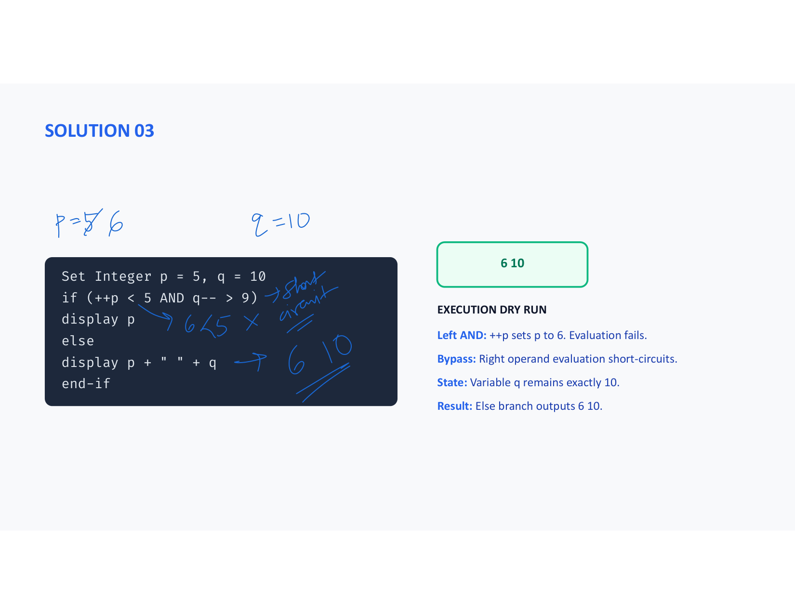 |

---

### Question 04: Pre and Post Increment & Decrement Compound Expressions (Slide P.8)

**Source Slide Reference**: `InfyPrePostPseudo.pdf` | Question Slide: **Page 8** | Solution Slide: **Page 9**

#### Problem Statement & Pseudocode
What will be the value of sum?

```text
Set Integer arr[4] = {2, 4, 6, 8}
Set Integer i = 0
Set Integer sum = arr[i++] + arr[++i]
display sum
```

#### Multiple Choice Options
- **(A)** `6`
- **(B)** `8`
- **(C)** `10`
- **(D)** `14`

#### Verified Correct Answer
> **Correct Option**: **(B) `8`**

#### Comprehensive Dry Run & Execution Trace
```text
EXECUTION DRY RUN
Term 1: Fetch index 0 outputs value 2.
Update: Pointer i post-increments to 1.
Term 2: Pre-increment sets i to 2. Fetch value 6.
Calculate: Sum totals 2 + 6 yielding 8.
```

#### Authentic Slide Figures
| Question Slide (Page 8) | Solution & Dry Run Slide (Page 9) |
| :---: | :---: |
|  | 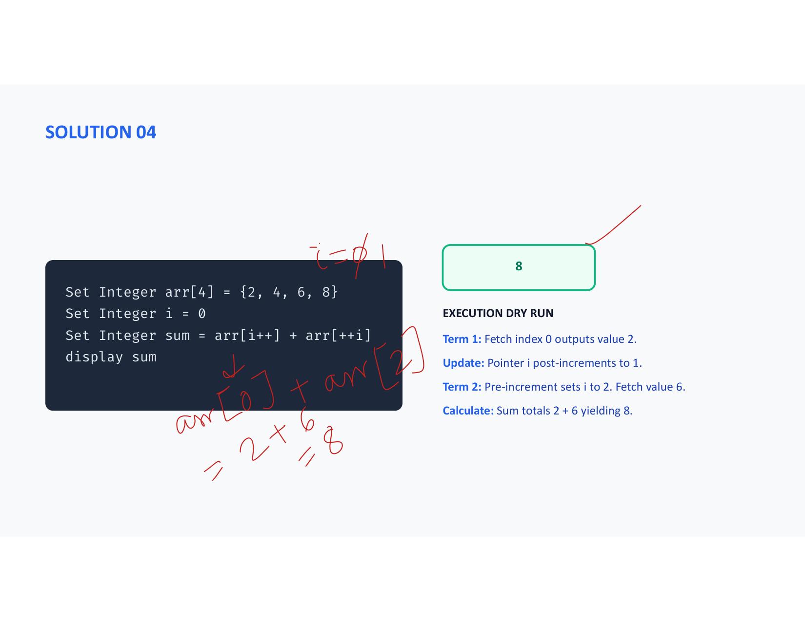 |

---

### Question 05: Pre and Post Increment & Decrement Compound Expressions (Slide P.10)

**Source Slide Reference**: `InfyPrePostPseudo.pdf` | Question Slide: **Page 10** | Solution Slide: **Page 11**

#### Problem Statement & Pseudocode
What will be the output?

```text
Set Integer val = 13
Set Integer res = (val++ MOD 5) +
(++val MOD 3)
display res
```

#### Multiple Choice Options
- **(A)** `2`
- **(B)** `3`
- **(C)** `4`
- **(D)** `5`

#### Verified Correct Answer
> **Correct Option**: **(B) `3`**

#### Comprehensive Dry Run & Execution Trace
```text
EXECUTION DRY RUN
Term 1: Modulo 13 by 5 yields 3.
Update: Variable val post-increments to 14.
Term 2: Pre-increment sets val to 15. Modulo yields 0.
Calculate: Addition 3 + 0 yields exactly 3.
```

#### Authentic Slide Figures
| Question Slide (Page 10) | Solution & Dry Run Slide (Page 11) |
| :---: | :---: |
|  | 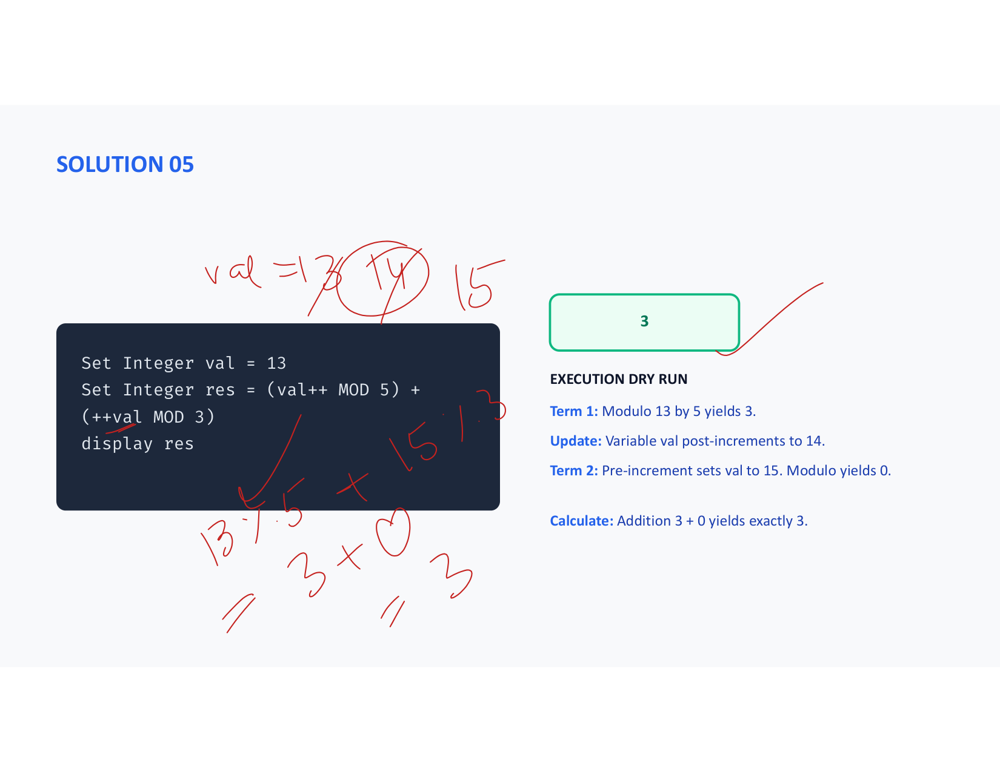 |

---

### Question 06: Pre and Post Increment & Decrement Compound Expressions (Slide P.12)

**Source Slide Reference**: `InfyPrePostPseudo.pdf` | Question Slide: **Page 12** | Solution Slide: **Page 13**

#### Problem Statement & Pseudocode
What will be the output?

```text
Set Integer count = 5
while (count-- > 2)
do
display --count
end-while
```

#### Multiple Choice Options
- **(A)** `4 2 0`
- **(B)** `3 1`
- **(C)** `3 2`
- **(D)** `4 3 2`

#### Verified Correct Answer
> **Correct Option**: **(B) `3 1`**

#### Comprehensive Dry Run & Execution Trace
```text
EXECUTION DRY RUN
Iter 1: Condition passes. Count drops to 4. Prints 3.
Iter 2: Condition passes. Count drops to 2. Prints 1.
Iter 3: Condition fails 1 > 2. Loop terminates.
Result: Sequential outputs print 3 1.
```

#### Authentic Slide Figures
| Question Slide (Page 12) | Solution & Dry Run Slide (Page 13) |
| :---: | :---: |
|  | 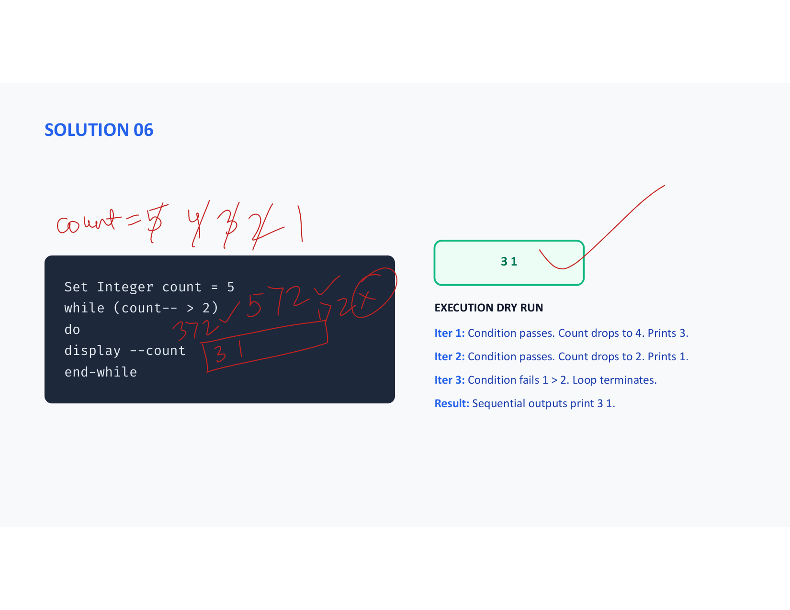 |

---

### Question 07: Pre and Post Increment & Decrement Compound Expressions (Slide P.14)

**Source Slide Reference**: `InfyPrePostPseudo.pdf` | Question Slide: **Page 14** | Solution Slide: **Page 15**

#### Problem Statement & Pseudocode
What will be the value of c?

```text
Set Integer a = 3, b = 4, c
c = (a++ > --b) ? (a++ * 2) : (++b * 2)
display c
```

#### Multiple Choice Options
- **(A)** `6`
- **(B)** `8`
- **(C)** `10`
- **(D)** `12`

#### Verified Correct Answer
> **Correct Option**: **(B) `8`**

#### Comprehensive Dry Run & Execution Trace
```text
EXECUTION DRY RUN
Condition: Compare 3 > 3 yields False.
Update: Variable a post-increments to 4.
Branch: False logic executes right side.
Calculate: Variable b increments 4. Result 4 * 2 = 8.
```

#### Authentic Slide Figures
| Question Slide (Page 14) | Solution & Dry Run Slide (Page 15) |
| :---: | :---: |
| 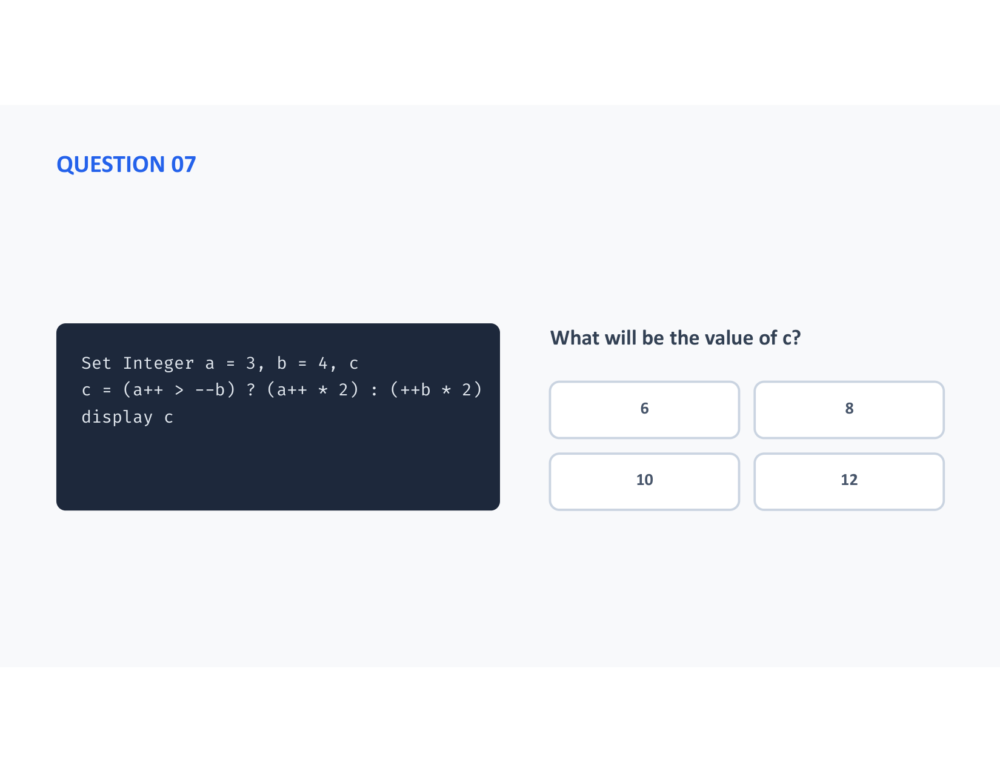 | 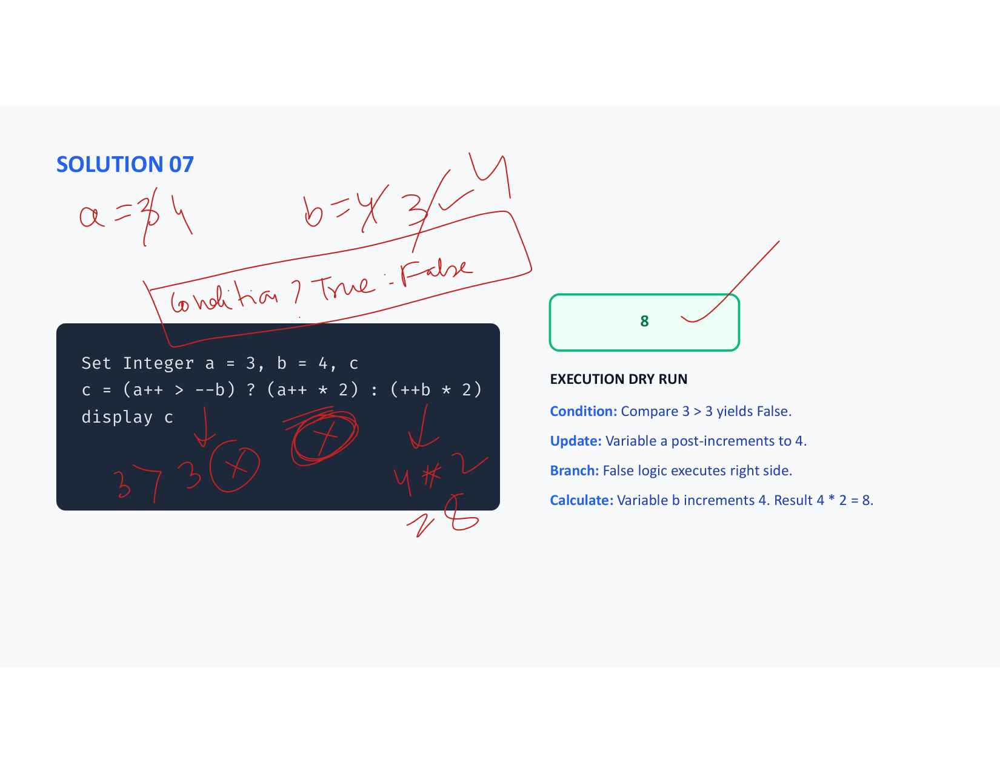 |

---

### Question 08: Pre and Post Increment & Decrement Compound Expressions (Slide P.16)

**Source Slide Reference**: `InfyPrePostPseudo.pdf` | Question Slide: **Page 16** | Solution Slide: **Page 17**

#### Problem Statement & Pseudocode
What will be the output?

```text
Set Integer k = 2
switch(k++)
case 2: display "Two " k++
break
case 3: display "Three "
break
end-switch
display k
```

#### Multiple Choice Options
- **(A)** `Two 3`
- **(B)** `Two 4`
- **(C)** `Three 3`
- **(D)** `Three 4`

#### Verified Correct Answer
> **Correct Option**: **(B) `Two 4`**

#### Comprehensive Dry Run & Execution Trace
```text
EXECUTION DRY RUN
Switch: Fetch 2 navigates Case 2 directly.
Update: Post-increment sets variable k to 3.
Case 2: Prints string Two. Increments k to 4.
Result: Final instruction displays value 4.
```

#### Authentic Slide Figures
| Question Slide (Page 16) | Solution & Dry Run Slide (Page 17) |
| :---: | :---: |
| 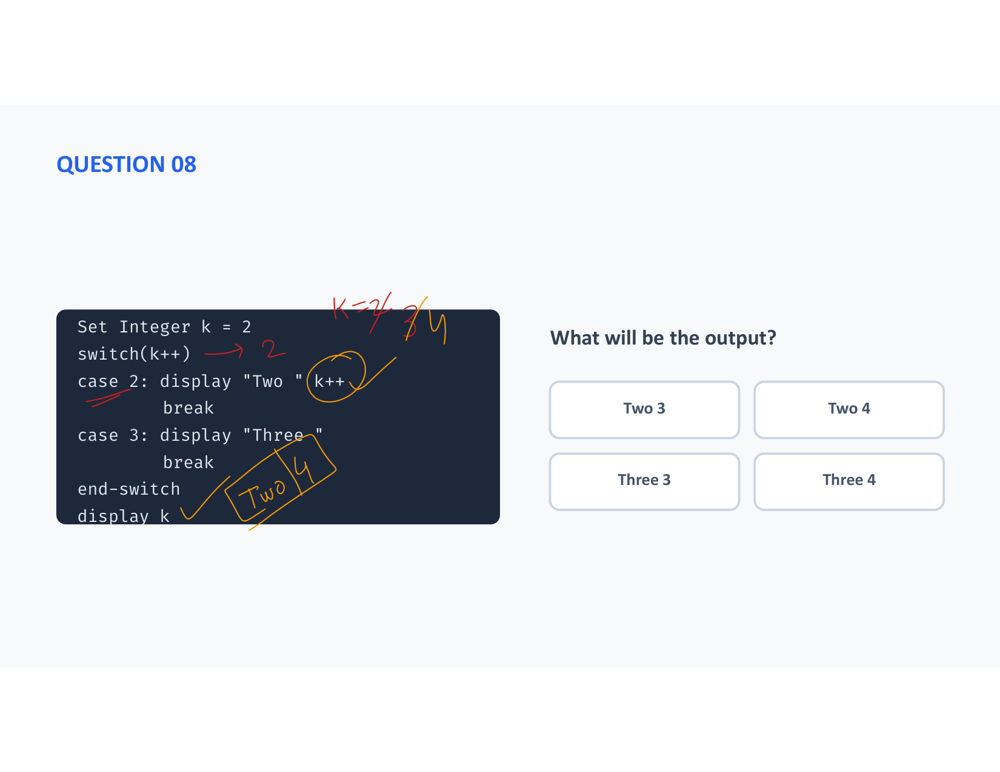 | 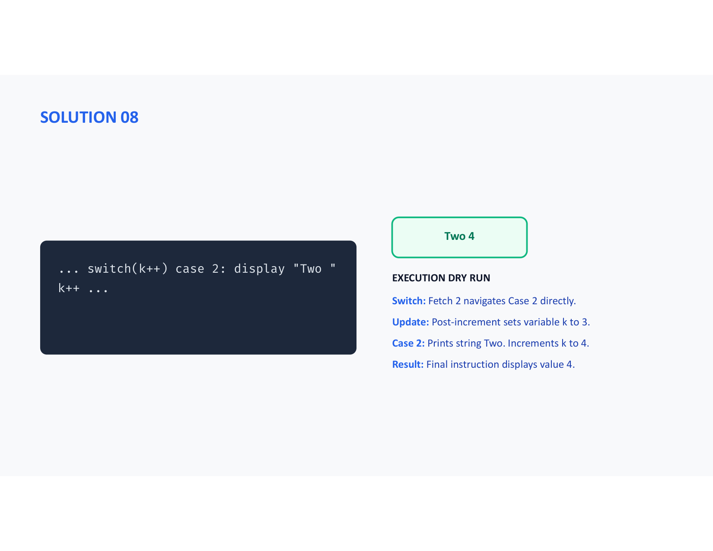 |

---

### Question 09: Pre and Post Increment & Decrement Compound Expressions (Slide P.18)

**Source Slide Reference**: `InfyPrePostPseudo.pdf` | Question Slide: **Page 18** | Solution Slide: **Page 19**

#### Problem Statement & Pseudocode
What will be the output?

```text
Set Integer x = 2, y = 10
do
y = y - x++
while(--y > x)
display x + " " + y
```

#### Multiple Choice Options
- **(A)** `3 8`
- **(B)** `4 3`
- **(C)** `4 4`
- **(D)** `3 7`

#### Verified Correct Answer
> **Correct Option**: **(B) `4 3`**

#### Comprehensive Dry Run & Execution Trace
```text
EXECUTION DRY RUN
Iter 1: Calculate y = 8. Update x = 3. Check 7 > 3 passes.
Iter 2: Calculate y = 4. Update x = 4. Check 3 > 4 fails.
Result: Loop ends tracking values x=4 y=3.
```

#### Authentic Slide Figures
| Question Slide (Page 18) | Solution & Dry Run Slide (Page 19) |
| :---: | :---: |
|  | 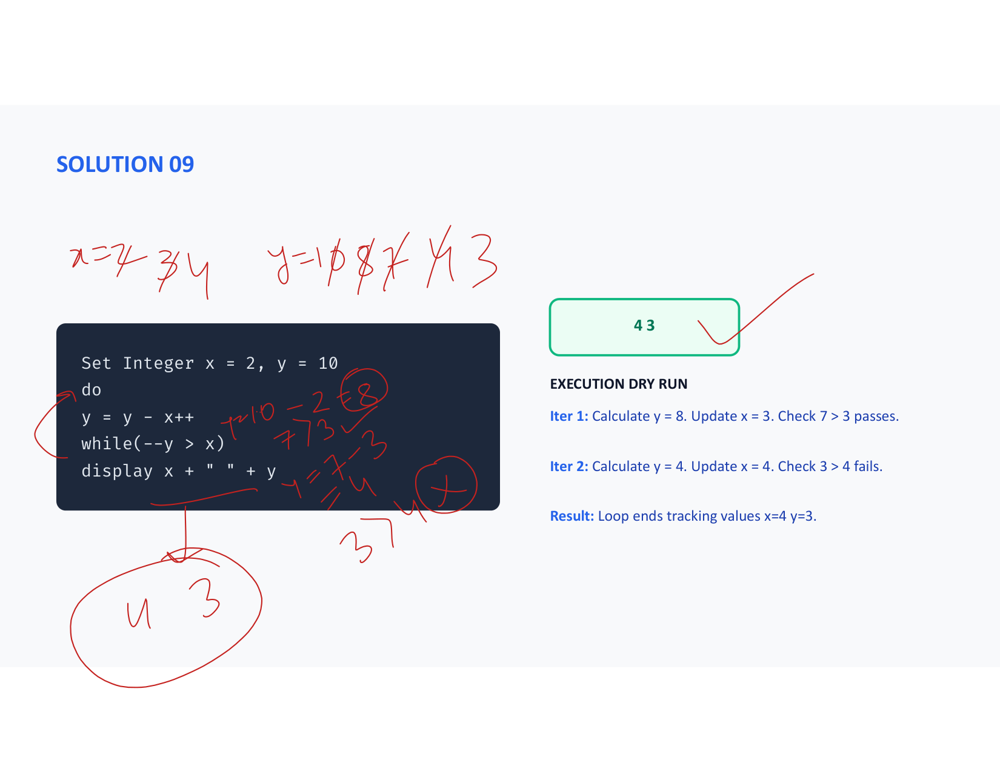 |

---

### Question 10: Pre and Post Increment & Decrement Compound Expressions (Slide P.20)

**Source Slide Reference**: `InfyPrePostPseudo.pdf` | Question Slide: **Page 20** | Solution Slide: **Page 21**

#### Problem Statement & Pseudocode
What will be the value of c?

```text
Set Integer a = 5, b = 2
Set Integer c = a++ ^ ++b
display c
```

#### Multiple Choice Options
- **(A)** `4`
- **(B)** `5`
- **(C)** `6`
- **(D)** `7`

#### Verified Correct Answer
> **Correct Option**: **(C) `6`**

#### Comprehensive Dry Run & Execution Trace
```text
EXECUTION DRY RUN
Term 1: Fetch variable a yields 5.
Term 2: Pre-increment sets variable b yielding 3.
Bitwise: XOR operation compares binary 101 and 011.
Result: Output measures decimal 6 reliably.
```

#### Authentic Slide Figures
| Question Slide (Page 20) | Solution & Dry Run Slide (Page 21) |
| :---: | :---: |
|  | 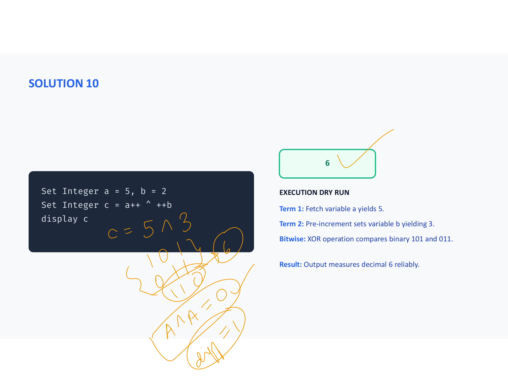 |

---

### Question 11: Pre and Post Increment & Decrement Compound Expressions (Slide P.22)

**Source Slide Reference**: `InfyPrePostPseudo.pdf` | Question Slide: **Page 22** | Solution Slide: **Page 23**

#### Problem Statement & Pseudocode
What will be the value of result?

```text
Set Integer m = 1
Set Integer result = m++ * 2 + ++m * 3
- m-- * 4
display result
```

#### Multiple Choice Options
- **(A)** `-1`
- **(B)** `0`
- **(C)** `1`
- **(D)** `2`

#### Verified Correct Answer
> **Correct Option**: **(A) `-1`**

#### Comprehensive Dry Run & Execution Trace
```text
EXECUTION DRY RUN
Term 1: Use 1 yields 2. Update m = 2.
Term 2: Set 3 yields 9. Update m = 3.
Term 3: Use 3 yields 12. Update m = 2.
Calculate: Combine 2 + 9 - 12 yielding -1.
```

#### Authentic Slide Figures
| Question Slide (Page 22) | Solution & Dry Run Slide (Page 23) |
| :---: | :---: |
|  | 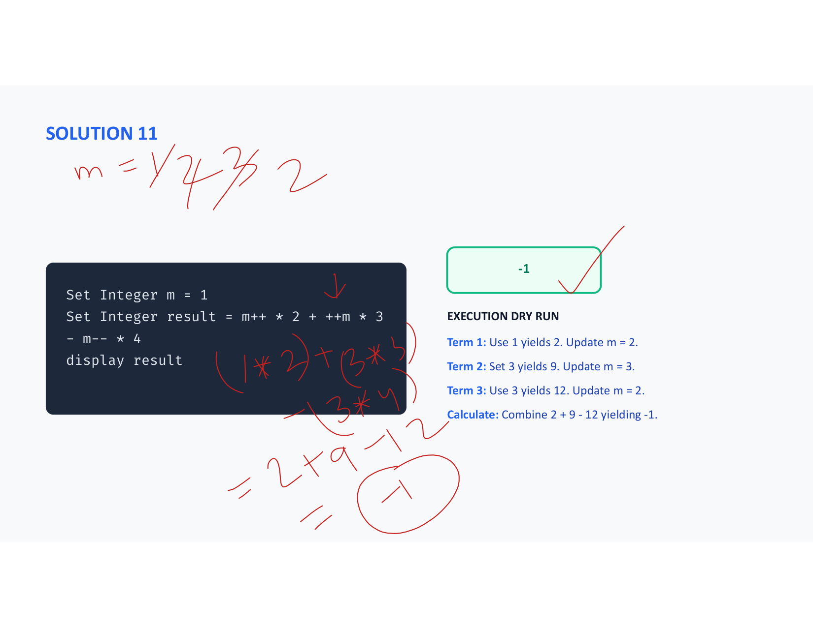 |

---

### Question 12: Pre and Post Increment & Decrement Compound Expressions (Slide P.24)

**Source Slide Reference**: `InfyPrePostPseudo.pdf` | Question Slide: **Page 24** | Solution Slide: **Page 25**

#### Problem Statement & Pseudocode
What will be the output?

```text
Set Integer i = 1, sum = 0
while(i++ < 4)
do
sum = sum + ++i
end-while
display sum
```

#### Multiple Choice Options
- **(A)** `5`
- **(B)** `8`
- **(C)** `12`
- **(D)** `15`

#### Verified Correct Answer
> **Correct Option**: **(B) `8`**

#### Comprehensive Dry Run & Execution Trace
```text
EXECUTION DRY RUN
Iter 1: Check 1 < 4. Inside i=3 sum=3.
Iter 2: Check 3 < 4. Inside i=5 sum=8.
Iter 3: Check 5 < 4 fails instantly.
Result: Loop exits displaying sum 8.
```

#### Authentic Slide Figures
| Question Slide (Page 24) | Solution & Dry Run Slide (Page 25) |
| :---: | :---: |
| 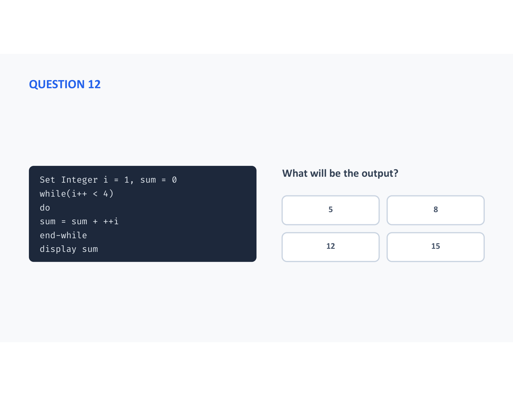 | 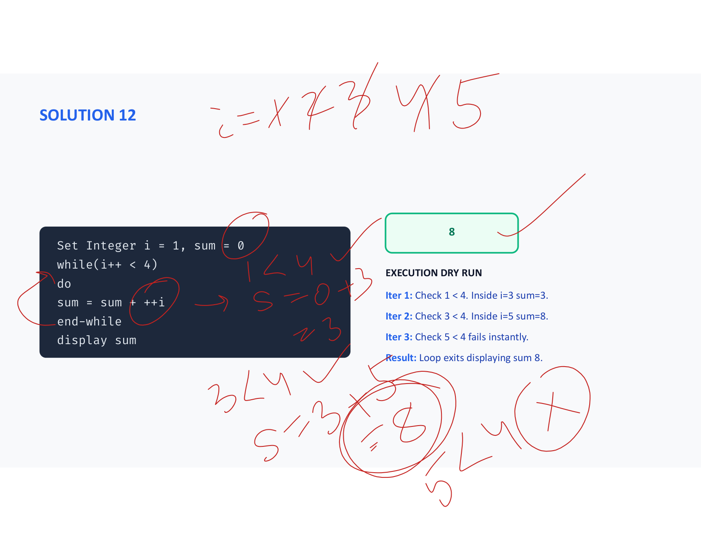 |

---

### Question 13: Pre and Post Increment & Decrement Compound Expressions (Slide P.26)

**Source Slide Reference**: `InfyPrePostPseudo.pdf` | Question Slide: **Page 26** | Solution Slide: **Page 27**

#### Problem Statement & Pseudocode
What will be the value of y?

```text
Set Integer x = 14
Set Integer y = x++ / 3 + ++x / 4
display y
```

#### Multiple Choice Options
- **(A)** `7`
- **(B)** `8`
- **(C)** `9`
- **(D)** `10`

#### Verified Correct Answer
> **Correct Option**: **(B) `8`**

#### Comprehensive Dry Run & Execution Trace
```text
EXECUTION DRY RUN
Term 1: Execute 14 / 3 yielding 4.
Update: Variable x increments 15 internally.
Term 2: Increment x to 16. Execute 16 / 4 yielding 4.
Calculate: Evaluate 4 + 4 targeting 8.
```

#### Authentic Slide Figures
| Question Slide (Page 26) | Solution & Dry Run Slide (Page 27) |
| :---: | :---: |
|  | 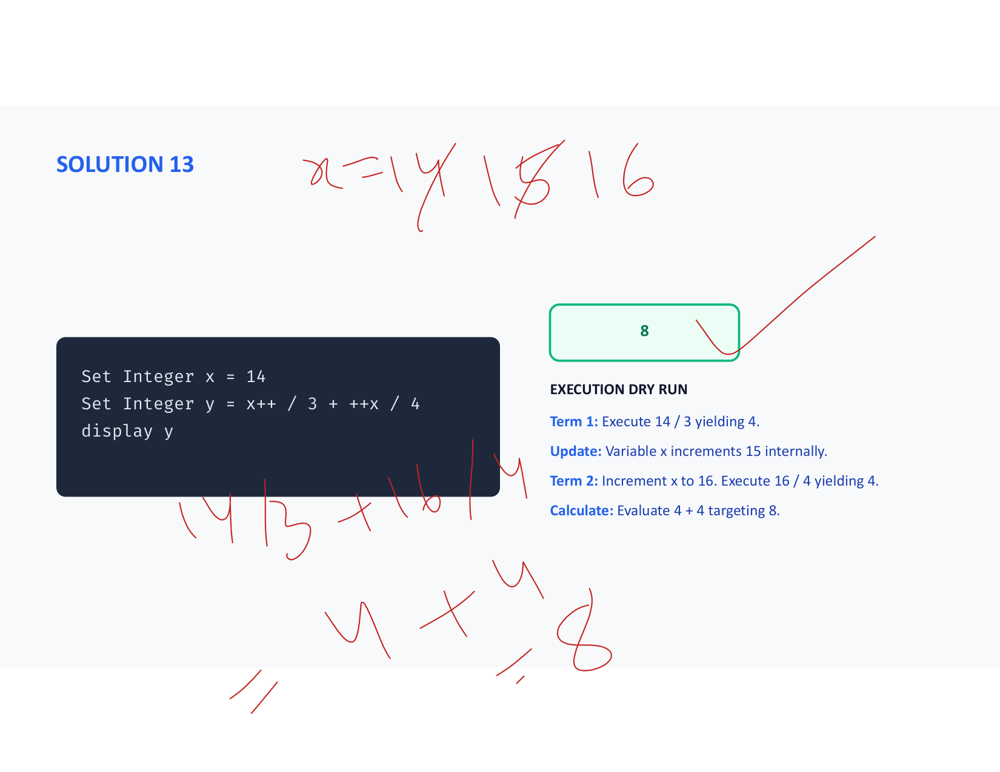 |

---

### Question 14: Pre and Post Increment & Decrement Compound Expressions (Slide P.28)

**Source Slide Reference**: `InfyPrePostPseudo.pdf` | Question Slide: **Page 28** | Solution Slide: **Page 29**

#### Problem Statement & Pseudocode
What will be the output?

```text
Set Integer a = 10, b = 10, c = 10
if (a++ == 10 AND ++b == 11 AND c-- ==
9)
display "If"
else
display "Else " + a + " " + b + " " + c
end-if
```

#### Multiple Choice Options
- **(A)** `If`
- **(B)** `Else 10 11 9`
- **(C)** `Else 11 11 9`
- **(D)** `Else 11 11 10`

#### Verified Correct Answer
> **Correct Option**: **(C) `Else 11 11 9`**

#### Comprehensive Dry Run & Execution Trace
```text
EXECUTION DRY RUN
Cond 1: Check 10 == 10 passes. Variable a becomes 11.
Cond 2: Check 11 == 11 passes. Variable b becomes 11.
Cond 3: Check 10 == 9 fails. Variable c becomes 9.
Result: Logic triggers Else printing updated states.
```

#### Authentic Slide Figures
| Question Slide (Page 28) | Solution & Dry Run Slide (Page 29) |
| :---: | :---: |
|  | 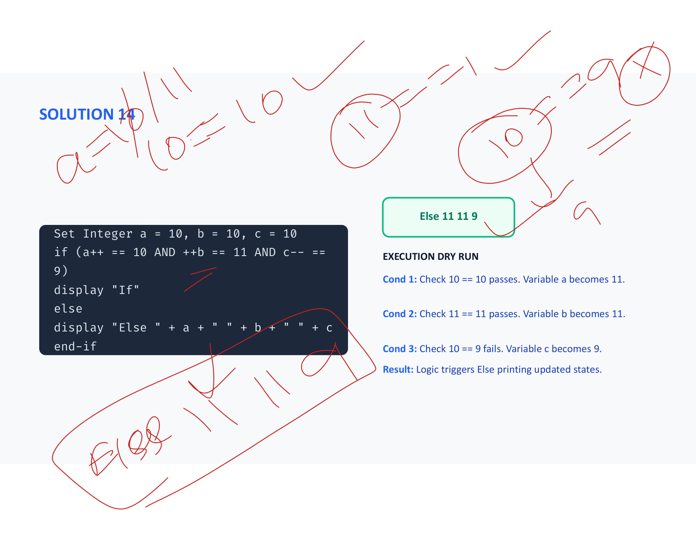 |

---

### Question 15: Pre and Post Increment & Decrement Compound Expressions (Slide P.30)

**Source Slide Reference**: `InfyPrePostPseudo.pdf` | Question Slide: **Page 30** | Solution Slide: **Page 31**

#### Problem Statement & Pseudocode
What will be the output?

```text
Set Integer i = 0, j = 0, count = 0
while(i++ < 2) do
while(++j < 3) do
count++
end-while
end-while
display count
```

#### Multiple Choice Options
- **(A)** `2`
- **(B)** `3`
- **(C)** `4`
- **(D)** `6`

#### Verified Correct Answer
> **Correct Option**: **(A) `2`**

#### Comprehensive Dry Run & Execution Trace
```text
EXECUTION DRY RUN
Outer 1: Uses i=0 passes. Inner loop executes.
Inner: Variables j increments 1 then 2. Count reaches 2.
Outer 2: Uses i=1 passes. Inner loop skips totally.
Result: Outer fails i=2. Count remains exactly 2.
```

#### Authentic Slide Figures
| Question Slide (Page 30) | Solution & Dry Run Slide (Page 31) |
| :---: | :---: |
| 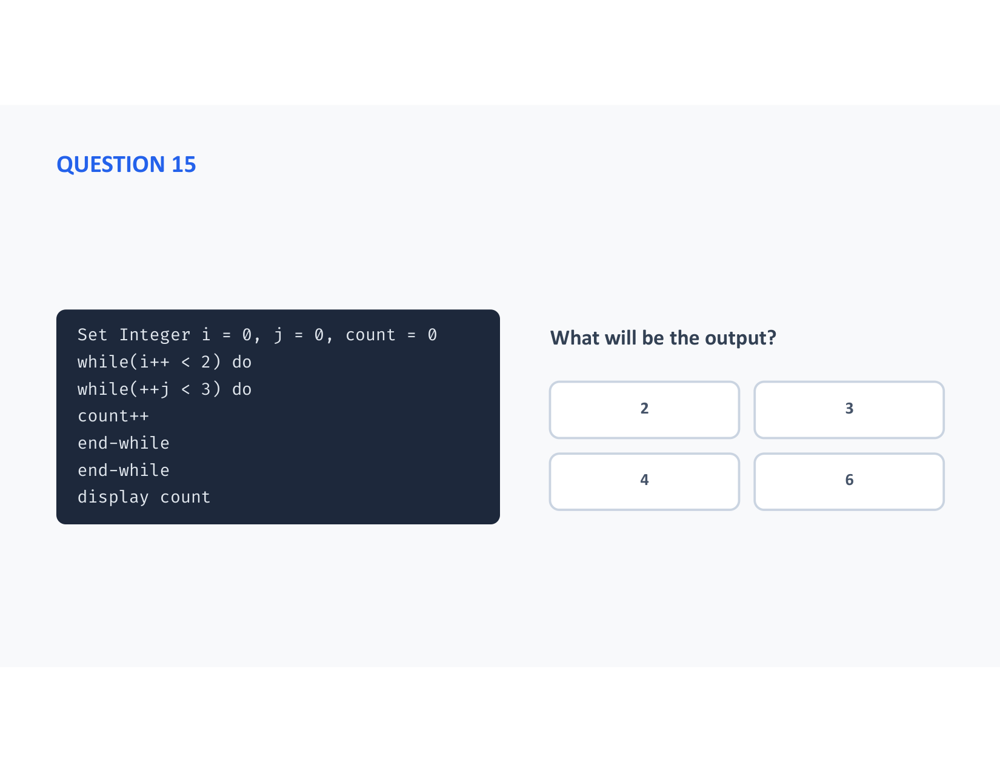 |  |

---

