# Topic 04: String Operations, Character Arrays & ASCII Manipulation
## Infosys October Exam Pseudocode Assessment — Official Authentic Question Bank

**Source Course Document**: `InfyStringsPseudo.pdf`  
**Total Questions in Topic**: **10 Questions**  
**Extraction Standard**: 100% Zero-Hallucination Verified | Exact Slide Figures Embedded | Complete Line-by-Line Dry Run Trace  

---

## Topic Syllabus & Algorithmic Scope
This topic collection covers authentic Infosys October assessment questions focusing on:
- Operational mechanics and runtime edge cases in `String Operations, Character Arrays & ASCII Manipulation`.
- Step-by-step state mutations, memory updates, and loop invariants.
- Exact arithmetic, bitwise, and logical short-circuiting rules required for Infosys SE assessment selection.

---

### Question 01: String Operations, Character Arrays & ASCII Manipulation (Slide P.2)

**Source Slide Reference**: `InfyStringsPseudo.pdf` | Question Slide: **Page 2** | Solution Slide: **Page 3**

#### Problem Statement & Pseudocode
What will be the output of the following pseudocode?

```text
Set Character array c = {'P', 'Q', 'R', 'S'}
Set Character result = c[2] + 32
display result
```

#### Multiple Choice Options
- **(A)** ``
- **(B)** ``
- **(C)** ``
- **(D)** ``

#### Verified Correct Answer
> **Correct Option**: **(A) `r`**

#### Comprehensive Dry Run & Execution Trace
```text
Execution Dry Run
Array Init
`c` initialized with 'P', 'Q', 'R', 'S' at indices 0 to 3.
Fetch Char
`c[2]` retrieves the character 'R'.
ASCII Math
ASCII of 'R' is 82. Calculation: 82 + 32 = 114.
Result
ASCII 114 corresponds to lowercase 'r'.
```

#### Authentic Slide Figures
| Question Slide (Page 2) | Solution & Dry Run Slide (Page 3) |
| :---: | :---: |
| 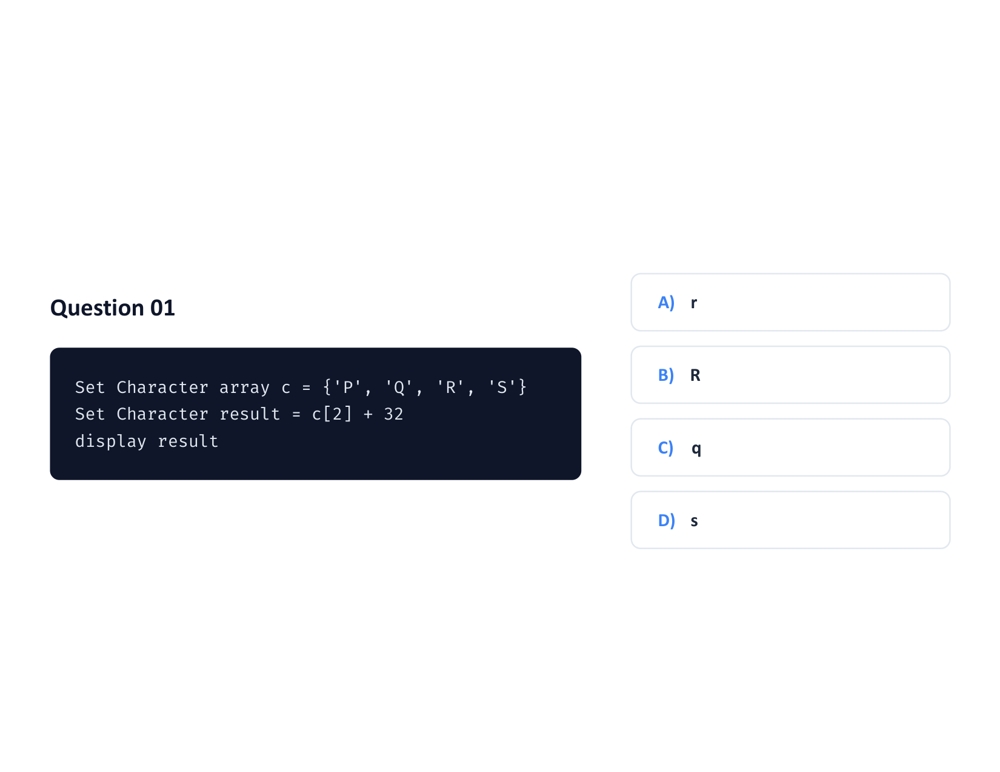 | 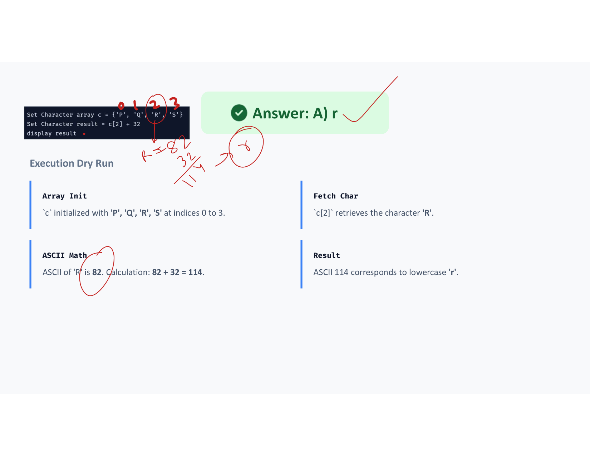 |

---

### Question 02: String Operations, Character Arrays & ASCII Manipulation (Slide P.4)

**Source Slide Reference**: `InfyStringsPseudo.pdf` | Question Slide: **Page 4** | Solution Slide: **Page 5**

#### Problem Statement & Pseudocode
What will be the output of the following pseudocode?

```text
Set String str = "Info"
Set String res = ""
Set Integer i = 0
while(i < 4)
do
res = res + str[i] + str[i]
i = i + 1
end-while
display res
```

#### Multiple Choice Options
- **(A)** ``
- **(B)** ``
- **(C)** ``
- **(D)** ``

#### Verified Correct Answer
> **Correct Option**: **(B) `IInnffoo`**

#### Comprehensive Dry Run & Execution Trace
```text
i=0: `str[0]` is 'I'. `res` becomes "II".
i=1: `str[1]` is 'n'. `res` becomes "IInn".
i=2: `str[2]` is 'f'. `res` becomes "IInnff".
i=3: `str[3]` is 'o'. `res` becomes "IInnffoo".
Loop Ends: Condition `4 < 4` is False.
```

#### Authentic Slide Figures
| Question Slide (Page 4) | Solution & Dry Run Slide (Page 5) |
| :---: | :---: |
|  | 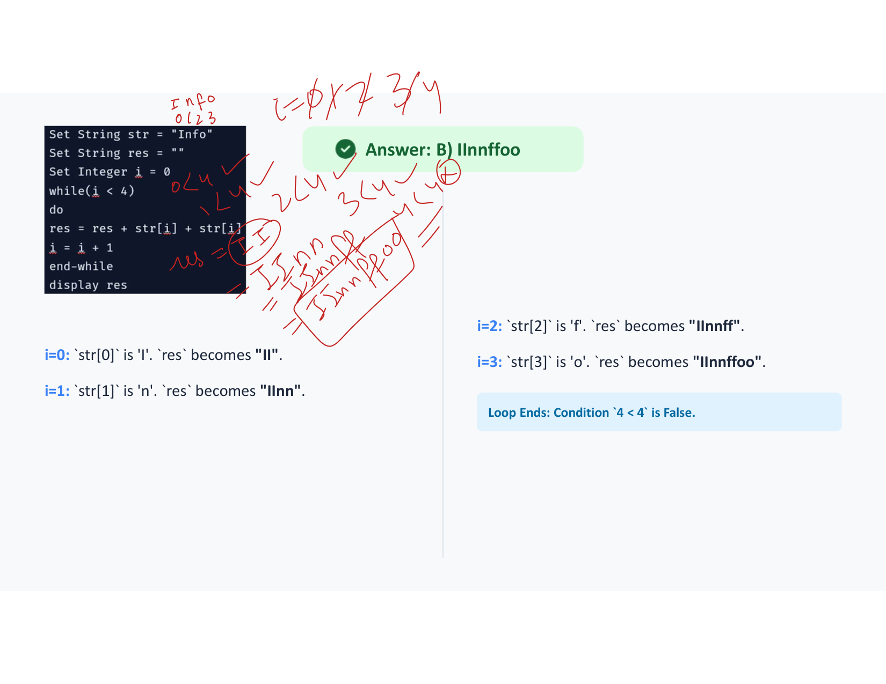 |

---

### Question 03: String Operations, Character Arrays & ASCII Manipulation (Slide P.6)

**Source Slide Reference**: `InfyStringsPseudo.pdf` | Question Slide: **Page 6** | Solution Slide: **Page 7**

#### Problem Statement & Pseudocode
What will be the output of the following pseudocode?

```text
Set String s = "apple"
Set Integer n = 5
for i = 0 to n-1
step 1 do
if(s[i] == 'a' OR s[i] == 'e')
then do
s[i] = '*'
end-if
end-for
display s
```

#### Multiple Choice Options
- **(A)** ``
- **(B)** ``
- **(C)** ``
- **(D)** ``

#### Verified Correct Answer
> **Correct Option**: **(D) `*ppl*`**

#### Comprehensive Dry Run & Execution Trace
```text
Iteration i=0
`s[0]` is 'a'. Condition is True. `s[0]` becomes '*'. String is *pple.
Iterations i=1, 2, 3
Characters are 'p', 'p', 'l'. Condition is False for all. No change.
Iteration i=4
`s[4]` is 'e'. Condition is True. `s[4]` becomes '*'. String is *ppl*.
```

#### Authentic Slide Figures
| Question Slide (Page 6) | Solution & Dry Run Slide (Page 7) |
| :---: | :---: |
| 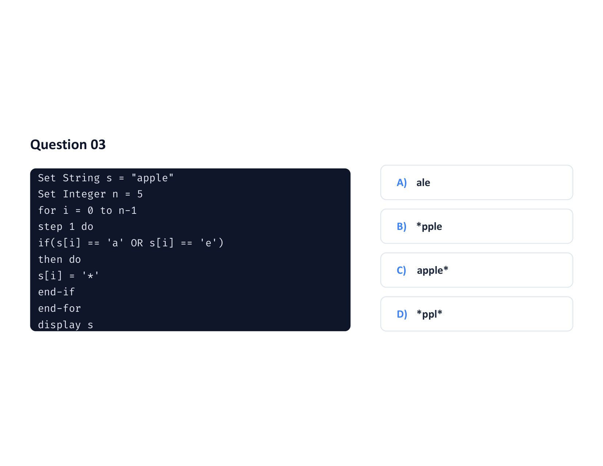 | 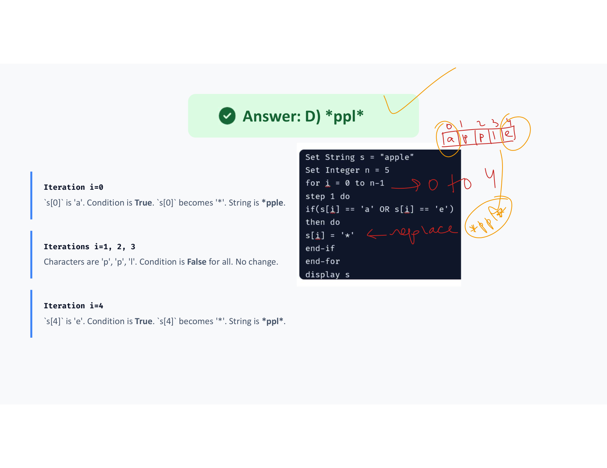 |

---

### Question 04: String Operations, Character Arrays & ASCII Manipulation (Slide P.8)

**Source Slide Reference**: `InfyStringsPseudo.pdf` | Question Slide: **Page 8** | Solution Slide: **Page 9**

#### Problem Statement & Pseudocode
What will be the output of the following pseudocode?

```text
Set String word = "TEST"
Set String rev = ""
Set Integer len = 4
for i = len-1 to 0
step 1 do
rev = rev + word[i]
end-for
display rev
```

#### Multiple Choice Options
- **(A)** ``
- **(B)** ``
- **(C)** ``
- **(D)** ``

#### Verified Correct Answer
> **Correct Option**: **(B) `TSET`**

#### Comprehensive Dry Run & Execution Trace
```text
i=3: `word[3]` is 'T'. `rev` = "" + 'T' = "T".
i=2: `word[2]` is 'S'. `rev` = "T" + 'S' = "TS".
i=1: `word[1]` is 'E'. `rev` = "TS" + 'E' = "TSE".
i=0: `word[0]` is 'T'. `rev` = "TSE" + 'T' = "TSET".
```

#### Authentic Slide Figures
| Question Slide (Page 8) | Solution & Dry Run Slide (Page 9) |
| :---: | :---: |
| 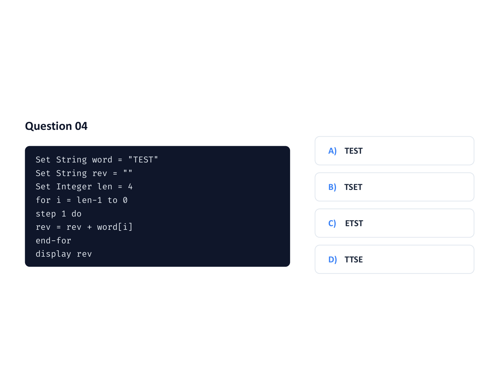 | 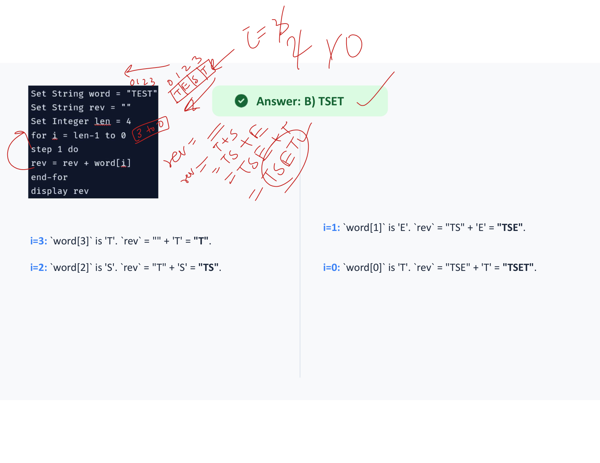 |

---

### Question 05: String Operations, Character Arrays & ASCII Manipulation (Slide P.10)

**Source Slide Reference**: `InfyStringsPseudo.pdf` | Question Slide: **Page 10** | Solution Slide: **Page 11**

#### Problem Statement & Pseudocode
What will be the output of the following pseudocode?

```text
Set String str = "banana"
Set Integer count = 0
for i = 0 to 5
step 1 do
if(str[i] == 'a')
then do
count = count + 1
end-if
end-for
display count
```

#### Multiple Choice Options
- **(A)** ``
- **(B)** ``
- **(C)** ``
- **(D)** ``

#### Verified Correct Answer
> **Correct Option**: **(B) `3`**

#### Comprehensive Dry Run & Execution Trace
```text
Loop Iteration
Iterates through each character of "banana" from indices 0 to 5.
Condition Match
Target 'a' is found at indices 1, 3, and 5.
Final Count
The `count` variable increments 3 times. Output is 3.
```

#### Authentic Slide Figures
| Question Slide (Page 10) | Solution & Dry Run Slide (Page 11) |
| :---: | :---: |
|  | 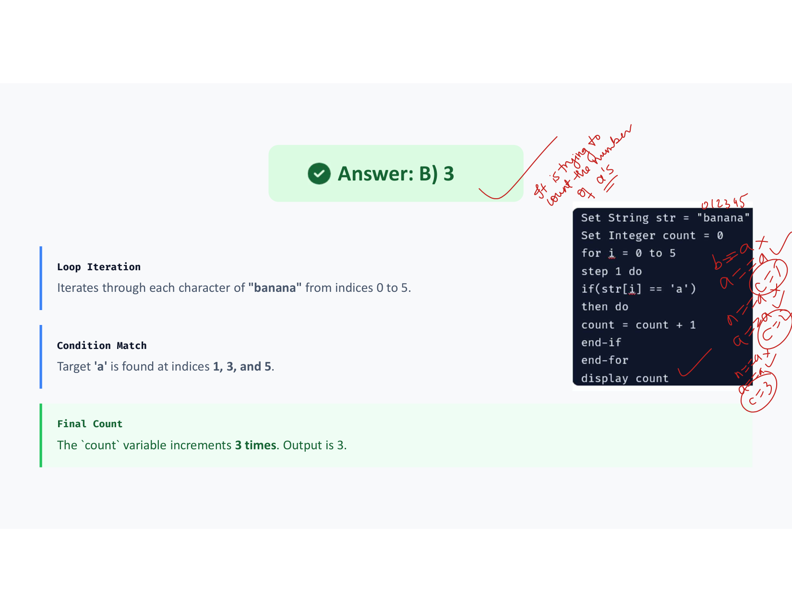 |

---

### Question 06: String Operations, Character Arrays & ASCII Manipulation (Slide P.12)

**Source Slide Reference**: `InfyStringsPseudo.pdf` | Question Slide: **Page 12** | Solution Slide: **Page 13**

#### Problem Statement & Pseudocode
What will be the output of the following pseudocode?

```text
Set String s = "PROGRAM"
Set String out = ""
Set Integer i = 2
while(i < 5)
do
out = out + s[i]
i = i + 1
end-while
display out
```

#### Multiple Choice Options
- **(A)** ``
- **(B)** ``
- **(C)** ``
- **(D)** ``

#### Verified Correct Answer
> **Correct Option**: **(C) `OGR`**

#### Comprehensive Dry Run & Execution Trace
```text
i = 2:
`s[2]` is 'O'. `out` becomes "O".
i = 3:
`s[3]` is 'G'. `out` becomes "OG".
i = 4:
`s[4]` is 'R'. `out` becomes "OGR".
```

#### Authentic Slide Figures
| Question Slide (Page 12) | Solution & Dry Run Slide (Page 13) |
| :---: | :---: |
|  | 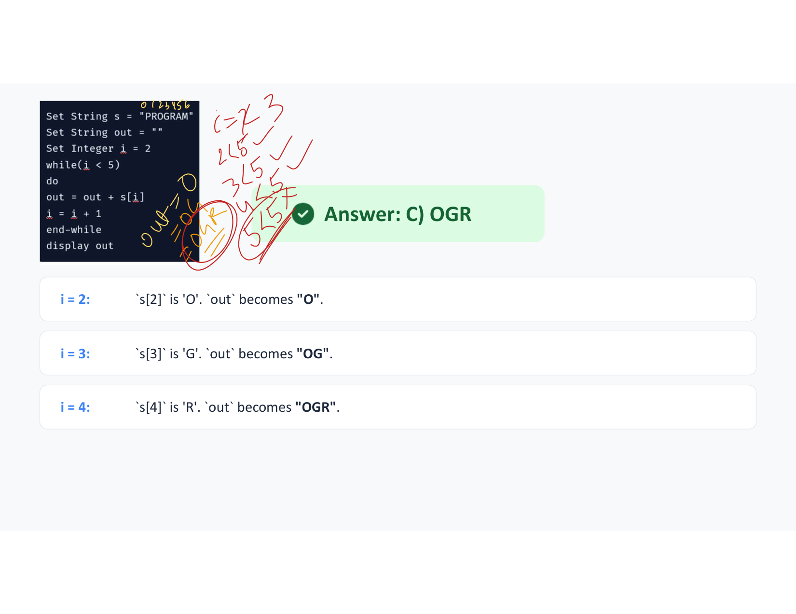 |

---

### Question 07: String Operations, Character Arrays & ASCII Manipulation (Slide P.14)

**Source Slide Reference**: `InfyStringsPseudo.pdf` | Question Slide: **Page 14** | Solution Slide: **Page 15**

#### Problem Statement & Pseudocode
What will be the output of the following pseudocode?

```text
Set String str = "MADAM"
Set Integer left=0, right=4
Set Integer flag = 1
while(left < right)
do
if(str[left] != str[right])
then
flag = 0
break
left = left + 1, right = right - 1
end-while
display flag
```

#### Multiple Choice Options
- **(A)** ``
- **(B)** ``
- **(C)** ``
- **(D)** ``

#### Verified Correct Answer
> **Correct Option**: **(B) `1`**

#### Comprehensive Dry Run & Execution Trace
```text
Iteration 1
`str[0]` ('M') == `str[4]` ('M'). Match. `left` becomes 1, `right` becomes 3.
Iteration 2
`str[1]` ('A') == `str[3]` ('A'). Match. `left` becomes 2, `right` becomes 2.
Result
Loop ends. No mismatches found. `flag` remains 1.
```

#### Authentic Slide Figures
| Question Slide (Page 14) | Solution & Dry Run Slide (Page 15) |
| :---: | :---: |
| 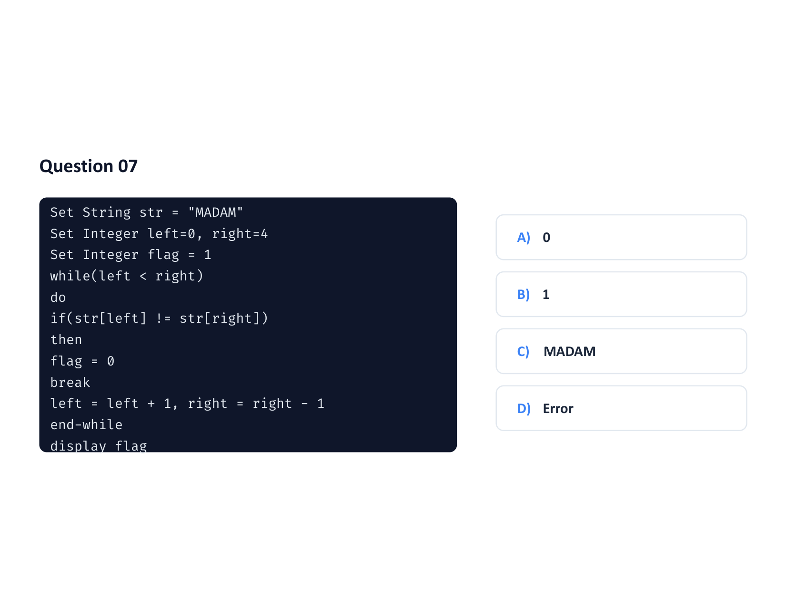 | 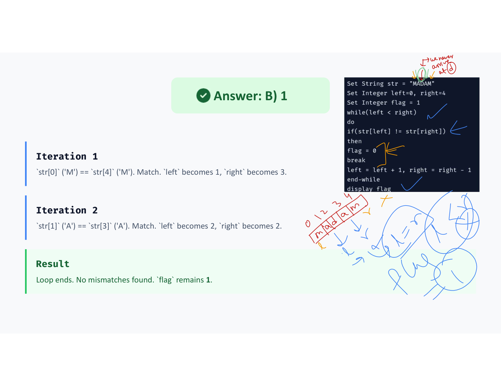 |

---

### Question 08: String Operations, Character Arrays & ASCII Manipulation (Slide P.16)

**Source Slide Reference**: `InfyStringsPseudo.pdf` | Question Slide: **Page 16** | Solution Slide: **Page 17**

#### Problem Statement & Pseudocode
What will be the output of the following pseudocode?

```text
Set Character ch = 'G'
Set Integer ascii_val = ch
if(ascii_val >= 65 AND ascii_val <= 90)
then
ascii_val = ascii_val + 32
end-if
display Character(ascii_val)
```

#### Multiple Choice Options
- **(A)** ``
- **(B)** ``
- **(C)** ``
- **(D)** ``

#### Verified Correct Answer
> **Correct Option**: **(B) `g`**

#### Comprehensive Dry Run & Execution Trace
```text
ASCII Conversion
`ch` is 'G'. ASCII value of uppercase 'G' is 71.
Uppercase Check
Condition `71 >= 65 AND 71 <= 90` is True.
Shift Value
`ascii_val` updated: 71 + 32 = 103. Casting 103 yields lowercase 'g'.
```

#### Authentic Slide Figures
| Question Slide (Page 16) | Solution & Dry Run Slide (Page 17) |
| :---: | :---: |
| 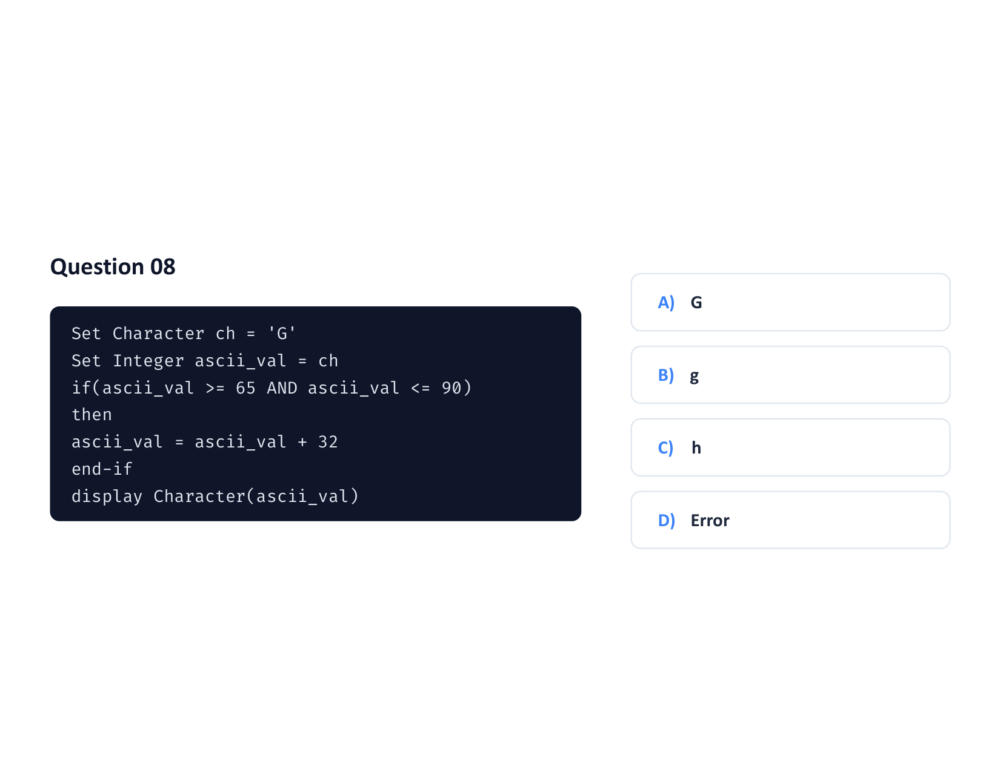 | 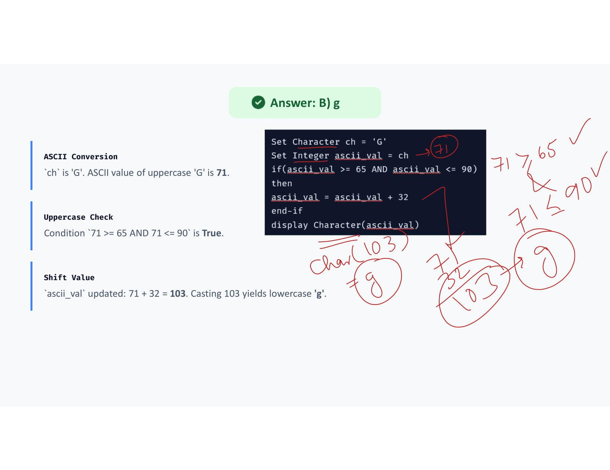 |

---

### Question 09: String Operations, Character Arrays & ASCII Manipulation (Slide P.18)

**Source Slide Reference**: `InfyStringsPseudo.pdf` | Question Slide: **Page 18** | Solution Slide: **Page 19**

#### Problem Statement & Pseudocode
What will be the output of the following pseudocode?

```text
Set String text = "CODING"
Set String res = ""
for i = 0 to 5
res = res + text[i]
i++
end-for
display res
```

#### Multiple Choice Options
- **(A)** ``
- **(B)** ``
- **(C)** ``
- **(D)** ``

#### Verified Correct Answer
> **Correct Option**: **(D) `CDN`**

#### Comprehensive Dry Run & Execution Trace
```text
Iteration i=0
`text[0]` is 'C'. `res` becomes "C".
Iteration i=2
`text[2]` is 'D'. `res` becomes "CD".
Iteration i=4
`text[4]` is 'N'. `res` becomes "CDN".
```

#### Authentic Slide Figures
| Question Slide (Page 18) | Solution & Dry Run Slide (Page 19) |
| :---: | :---: |
| 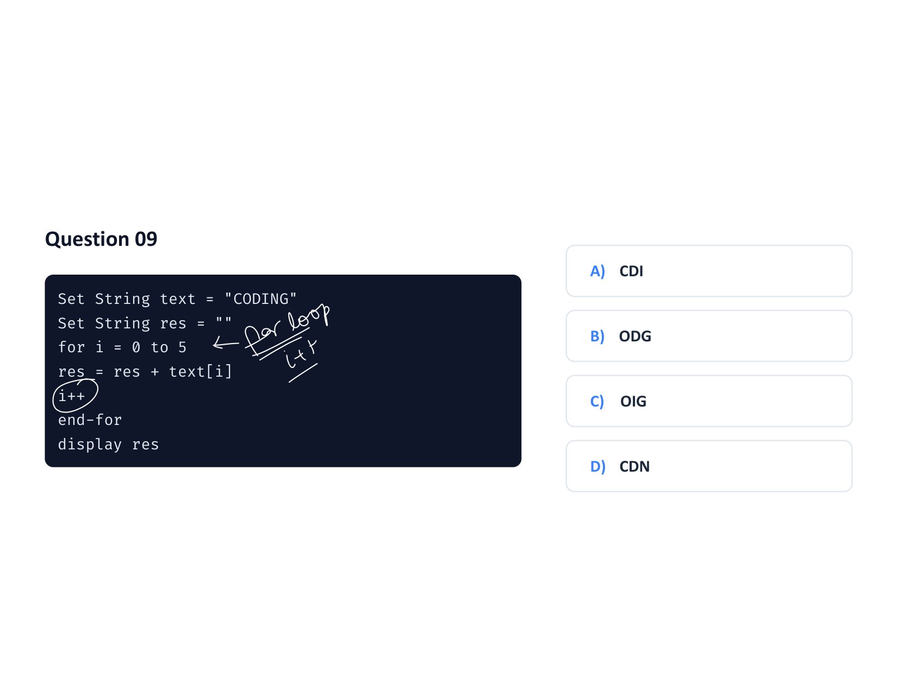 | 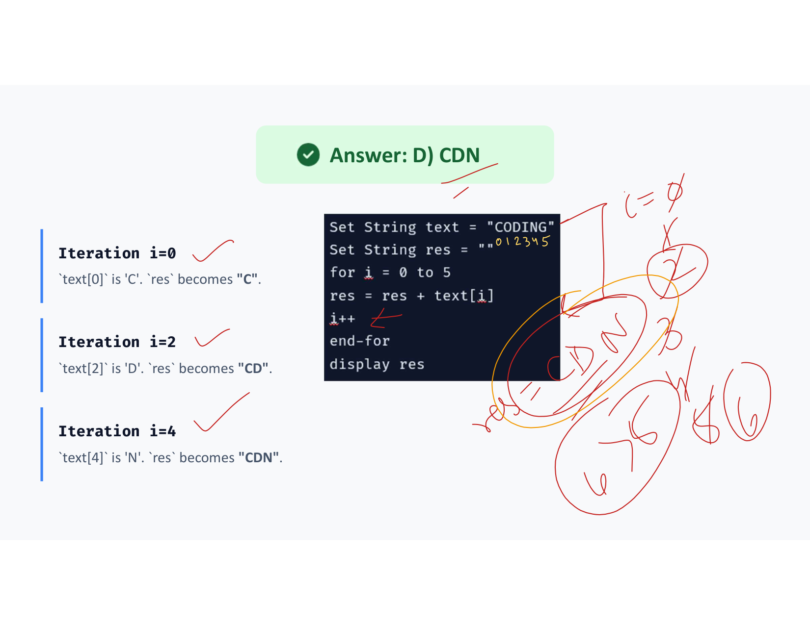 |

---

### Question 10: String Operations, Character Arrays & ASCII Manipulation (Slide P.20)

**Source Slide Reference**: `InfyStringsPseudo.pdf` | Question Slide: **Page 20** | Solution Slide: **Page 21**

#### Problem Statement & Pseudocode
What will be the output of the following pseudocode?

```text
Set String str1 = "INFOSYS"
Set String str2 = "TECH"
Set Integer val = Length(str1) - Length(str2)
display val * 2
```

#### Multiple Choice Options
- **(A)** ``
- **(B)** ``
- **(C)** ``
- **(D)** ``

#### Verified Correct Answer
> **Correct Option**: **(B) `6`**

#### Comprehensive Dry Run & Execution Trace
```text
String Lengths
Calculation
• Length of `str1` ("INFOSYS") = 7
• Length of `str2` ("TECH") = 4
• `val` = 7 - 4 = 3
• Display: `val * 2` -> 3 * 2 = 6
```

#### Authentic Slide Figures
| Question Slide (Page 20) | Solution & Dry Run Slide (Page 21) |
| :---: | :---: |
| 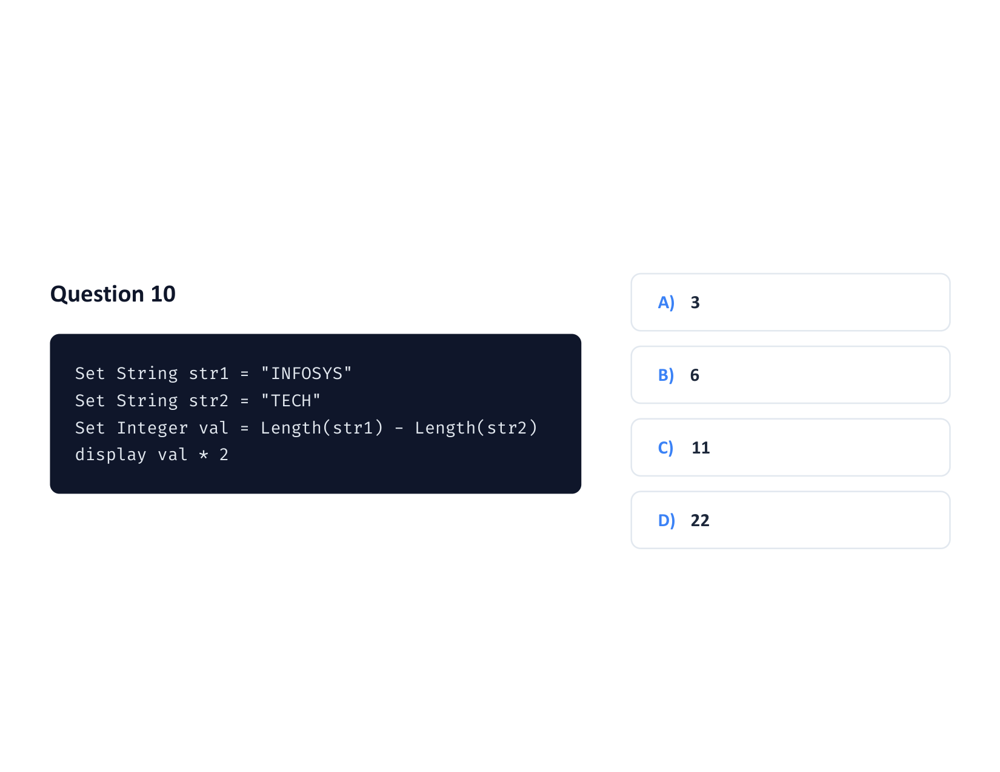 | 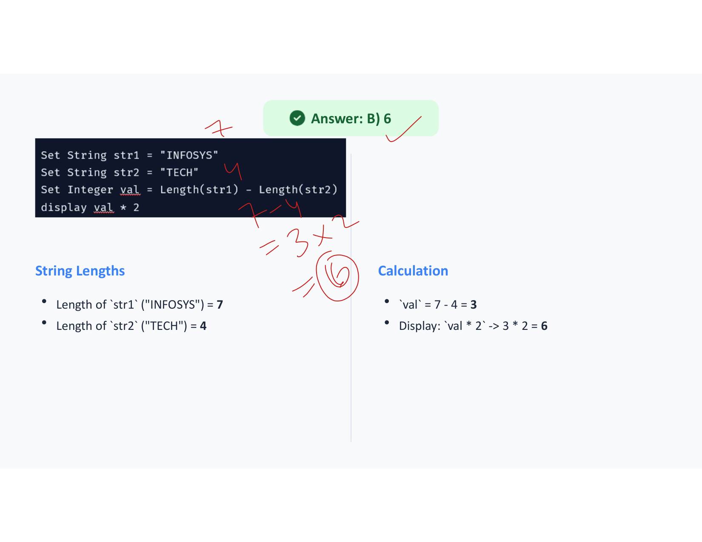 |

---

