# Topic 05: Bitwise XOR Operations & Masking Logic
## Infosys October Exam Pseudocode Assessment — Official Authentic Question Bank

**Source Course Document**: `InfyXORPseudo.pdf`  
**Total Questions in Topic**: **10 Questions**  
**Extraction Standard**: 100% Zero-Hallucination Verified | Exact Slide Figures Embedded | Complete Line-by-Line Dry Run Trace  

---

## Topic Syllabus & Algorithmic Scope
This topic collection covers authentic Infosys October assessment questions focusing on:
- Operational mechanics and runtime edge cases in `Bitwise XOR Operations & Masking Logic`.
- Step-by-step state mutations, memory updates, and loop invariants.
- Exact arithmetic, bitwise, and logical short-circuiting rules required for Infosys SE assessment selection.

---

### Question 01: Bitwise XOR Operations & Masking Logic (Slide P.2)

**Source Slide Reference**: `InfyXORPseudo.pdf` | Question Slide: **Page 2** | Solution Slide: **Page 3**

#### Problem Statement & Pseudocode
What will be the output of the following pseudocode?

```text
Set Integer a = 10
Set Integer b = 5
Set Integer result = a ^ b
display result
```

#### Multiple Choice Options
- **(A)** ``
- **(B)** ``
- **(C)** ``
- **(D)** ``

#### Verified Correct Answer
> **Correct Option**: **(C) `15`**

#### Comprehensive Dry Run & Execution Trace
```text
XOR Rule: Returns 1 if bits differ.
`a` (10) is binary 1010.
`b` (5) is binary 0101.
Binary 1111 equals decimal 15.
1 0 1 0 (a) 
^ 0 1 0 1 (b) 
-------
1 1 1 1 (15)
```

#### Authentic Slide Figures
| Question Slide (Page 2) | Solution & Dry Run Slide (Page 3) |
| :---: | :---: |
|  | 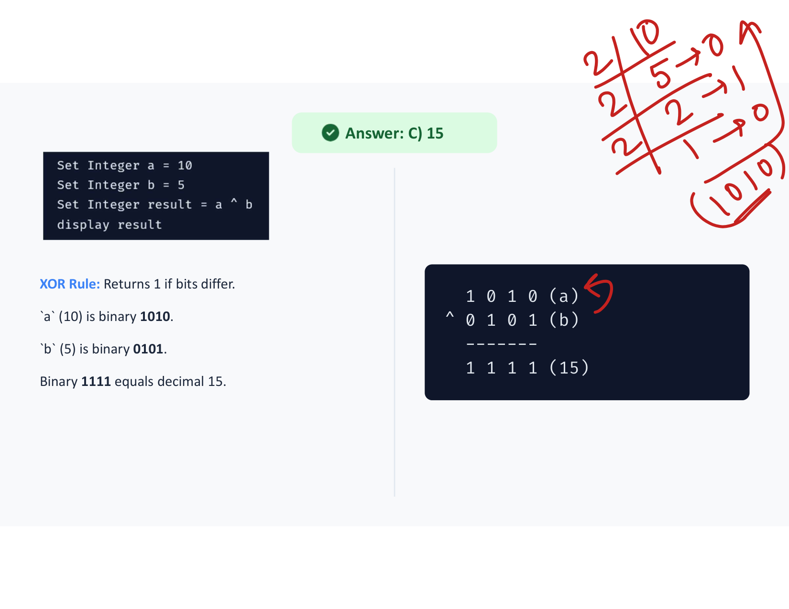 |

---

### Question 02: Bitwise XOR Operations & Masking Logic (Slide P.4)

**Source Slide Reference**: `InfyXORPseudo.pdf` | Question Slide: **Page 4** | Solution Slide: **Page 5**

#### Problem Statement & Pseudocode
What will be the output of the following pseudocode?

```text
Set Integer x = 12
Set Integer res = (x ^ x) ^ (x ^ 0)
display res
```

#### Multiple Choice Options
- **(A)** ``
- **(B)** ``
- **(C)** ``
- **(D)** ``

#### Verified Correct Answer
> **Correct Option**: **(B) `12`**

#### Comprehensive Dry Run & Execution Trace
```text
Property 1
`x ^ x = 0`.
Property 2
`x ^ 0 = x`.
Resolution
`0 ^ 12 = 12`.
```

#### Authentic Slide Figures
| Question Slide (Page 4) | Solution & Dry Run Slide (Page 5) |
| :---: | :---: |
|  | 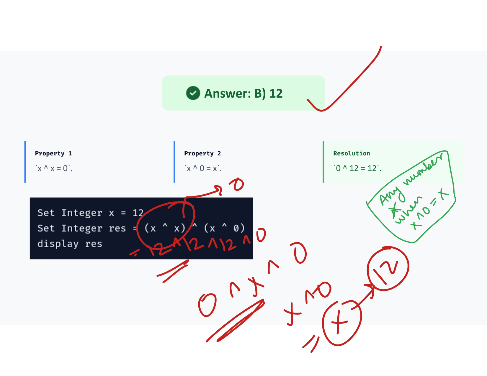 |

---

### Question 03: Bitwise XOR Operations & Masking Logic (Slide P.6)

**Source Slide Reference**: `InfyXORPseudo.pdf` | Question Slide: **Page 6** | Solution Slide: **Page 7**

#### Problem Statement & Pseudocode
What will be the output of the following pseudocode?

```text
Set Integer a = 4, b = 7
a = a ^ b
b = a ^ b
a = a ^ b
display a + " " + b
```

#### Multiple Choice Options
- **(A)** ``
- **(B)** ``
- **(C)** ``
- **(D)** ``

#### Verified Correct Answer
> **Correct Option**: **(B) `7 4`**

#### Comprehensive Dry Run & Execution Trace
```text
Classic XOR Swap Algorithm
1
a = 4 ^ 7
2
b = (4 ^ 7) ^ 7
b becomes 4
3
a = (4 ^ 7) ^ 4
a becomes 7
4
Values swapped.
```

#### Authentic Slide Figures
| Question Slide (Page 6) | Solution & Dry Run Slide (Page 7) |
| :---: | :---: |
| 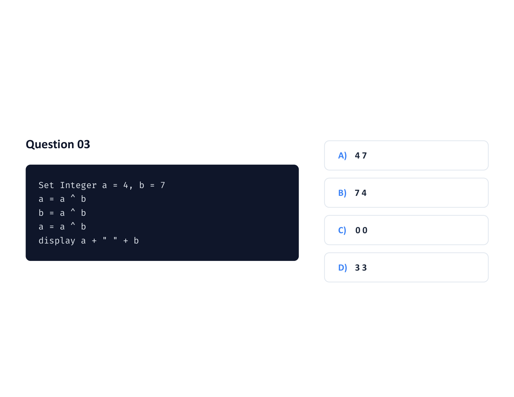 | 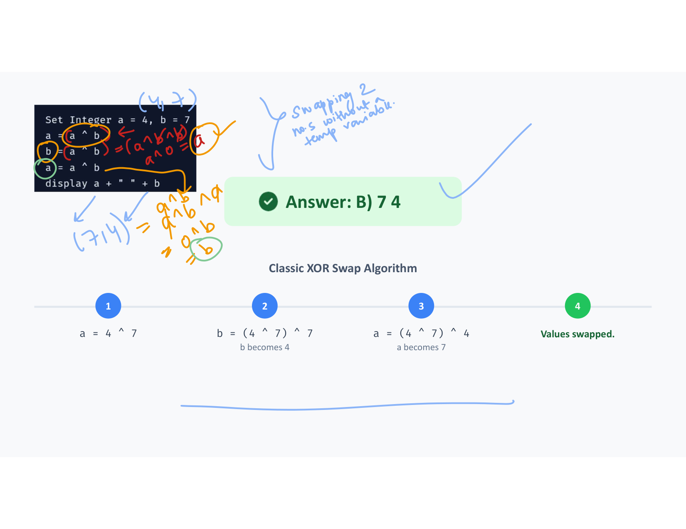 |

---

### Question 04: Bitwise XOR Operations & Masking Logic (Slide P.8)

**Source Slide Reference**: `InfyXORPseudo.pdf` | Question Slide: **Page 8** | Solution Slide: **Page 9**

#### Problem Statement & Pseudocode
What will be the output of the following pseudocode?

```text
Set Integer arr[5] = {2, 3, 4, 3, 2}
Set Integer res = 0
for i = 0 to 4
step 1 do
res = res ^ arr[i]
end-for
display res
```

#### Multiple Choice Options
- **(A)** ``
- **(B)** ``
- **(C)** ``
- **(D)** ``

#### Verified Correct Answer
> **Correct Option**: **(D) `4`**

#### Comprehensive Dry Run & Execution Trace
```text
Algorithm Goal
Finds single non-repeating element.
Loop Action
Loop XORs all elements.
Pair Cancellation
Pairs cancel out to 0.
Final State
Result is 4.
```

#### Authentic Slide Figures
| Question Slide (Page 8) | Solution & Dry Run Slide (Page 9) |
| :---: | :---: |
| 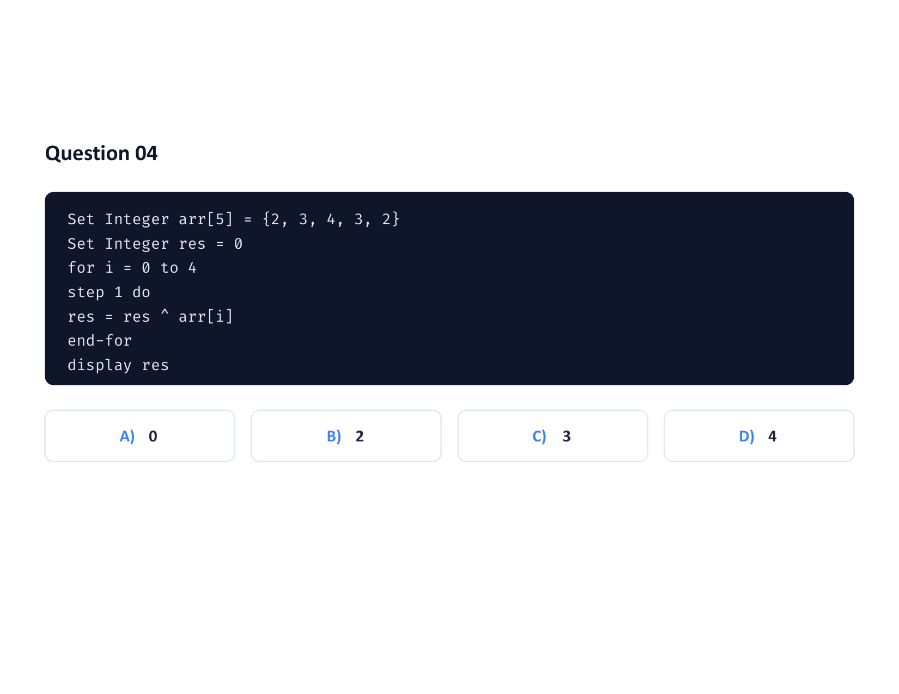 | 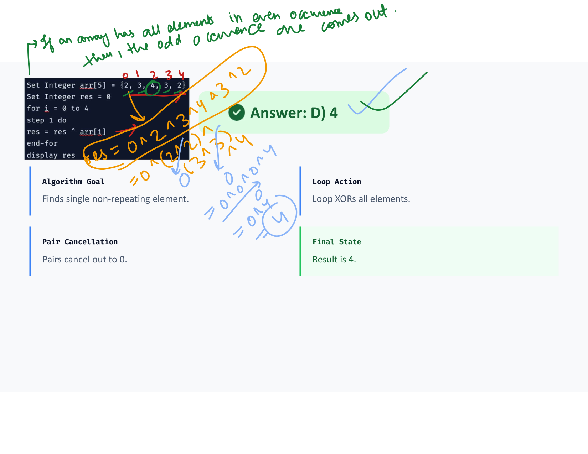 |

---

### Question 05: Bitwise XOR Operations & Masking Logic (Slide P.10)

**Source Slide Reference**: `InfyXORPseudo.pdf` | Question Slide: **Page 10** | Solution Slide: **Page 11**

#### Problem Statement & Pseudocode
What will be the output of the following pseudocode?

```text
Set Integer a = 3
Set Integer b = 6
Set Integer res = (a++) ^ (++b)
display res
```

#### Multiple Choice Options
- **(A)** ``
- **(B)** ``
- **(C)** ``
- **(D)** ``

#### Verified Correct Answer
> **Correct Option**: **(A) `4`**

#### Comprehensive Dry Run & Execution Trace
```text
a++ uses initial value 3.
++b uses incremented value 7.
Expression evaluates: 3 ^ 7.
Binary `011 ^ 111 = 100` (4).
0 1 1 (3) 
^ 1 1 1 (7) 
-----
1 0 0 (4)
```

#### Authentic Slide Figures
| Question Slide (Page 10) | Solution & Dry Run Slide (Page 11) |
| :---: | :---: |
|  | 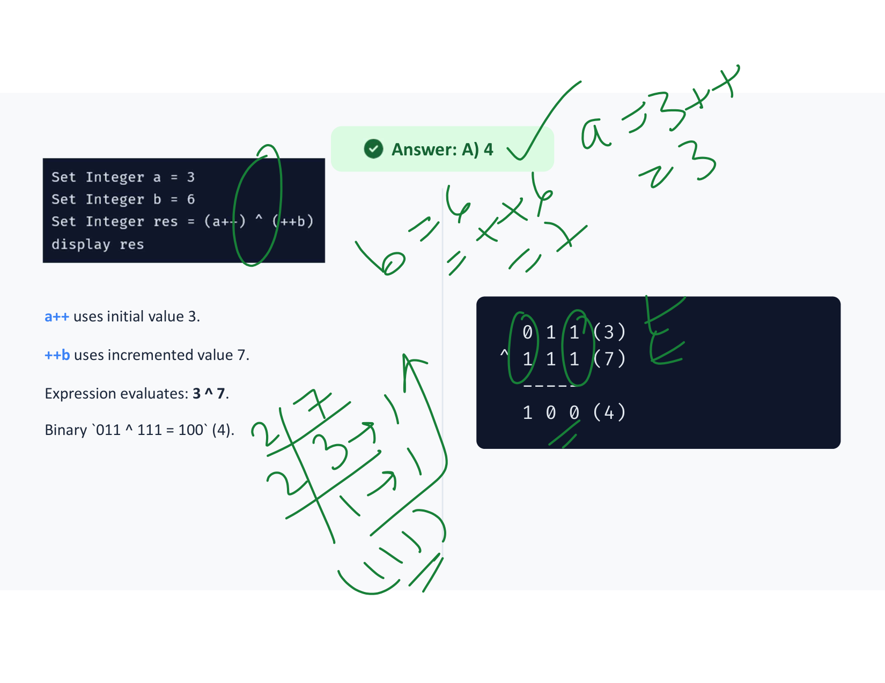 |

---

### Question 06: Bitwise XOR Operations & Masking Logic (Slide P.12)

**Source Slide Reference**: `InfyXORPseudo.pdf` | Question Slide: **Page 12** | Solution Slide: **Page 13**

#### Problem Statement & Pseudocode
What will be the output of the following pseudocode?

```text
Set Integer res = 0
for i = 1 to 3
step 1 do
res = res ^ i
end-for
display res
```

#### Multiple Choice Options
- **(A)** ``
- **(B)** ``
- **(C)** ``
- **(D)** ``

#### Verified Correct Answer
> **Correct Option**: **(A) `0`**

#### Comprehensive Dry Run & Execution Trace
```text
i = 1:
0 ^ 1 = 1
i = 2:
1 ^ 2 = 3
i = 3:
3 ^ 3 = 0
```

#### Authentic Slide Figures
| Question Slide (Page 12) | Solution & Dry Run Slide (Page 13) |
| :---: | :---: |
| 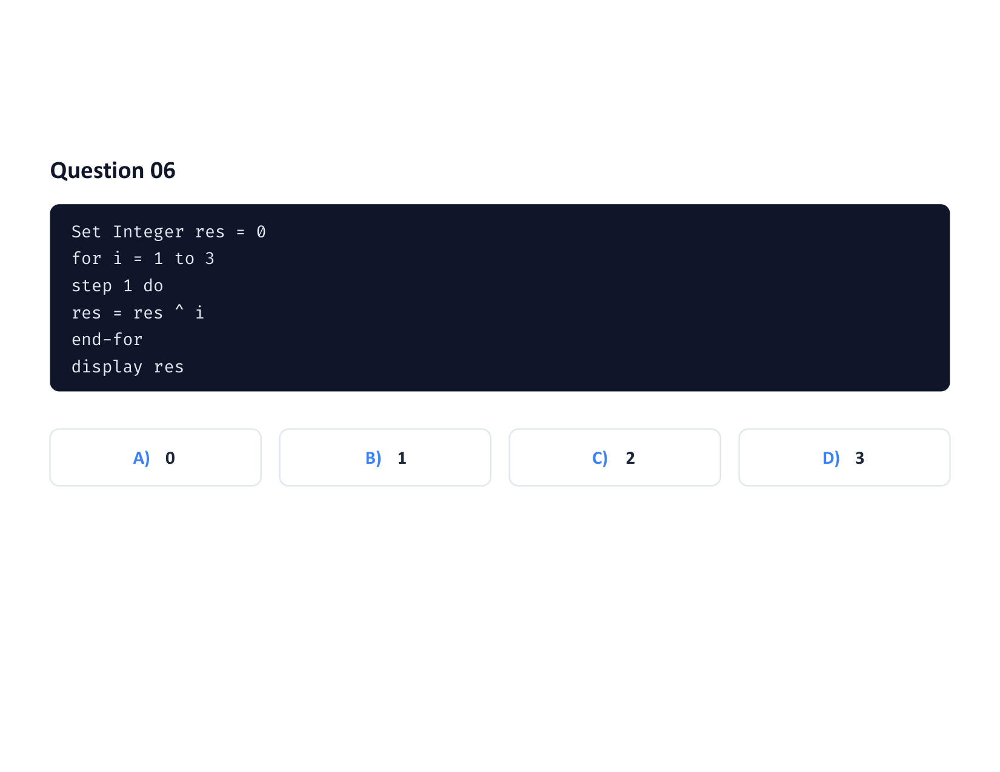 | 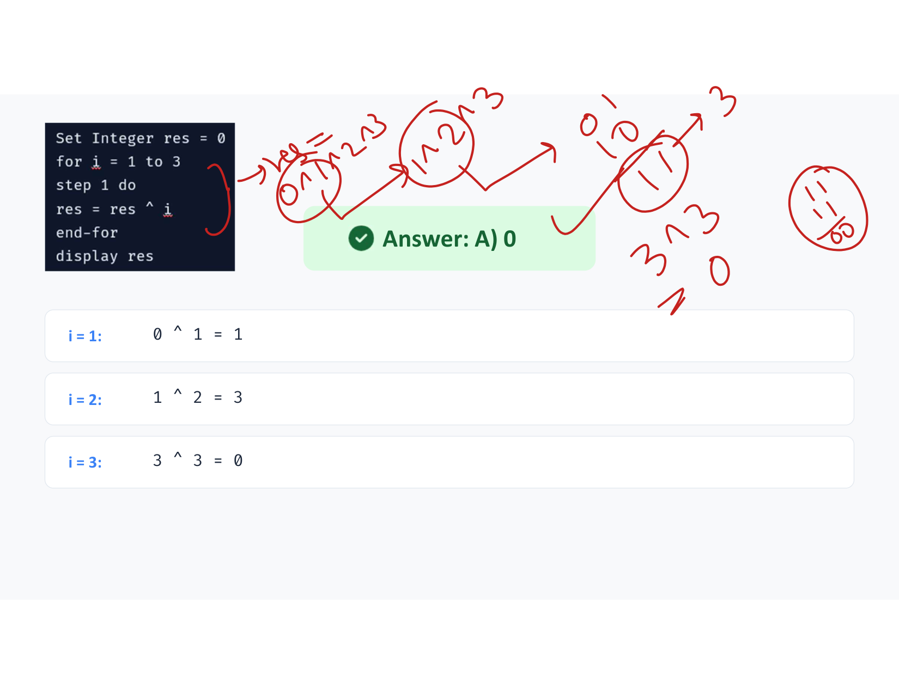 |

---

### Question 07: Bitwise XOR Operations & Masking Logic (Slide P.14)

**Source Slide Reference**: `InfyXORPseudo.pdf` | Question Slide: **Page 14** | Solution Slide: **Page 15**

#### Problem Statement & Pseudocode
What will be the output of the following pseudocode?

```text
Set Integer x = 5, y = 3
Set Integer res = (x ^ y) + (x & y)
display res
```

#### Multiple Choice Options
- **(A)** ``
- **(B)** ``
- **(C)** ``
- **(D)** ``

#### Verified Correct Answer
> **Correct Option**: **(B) `7`**

#### Comprehensive Dry Run & Execution Trace
```text
`x` (5) is 101.
`y` (3) is 011.
x ^ y = 101 ^ 011 = 110 (6)
x & y = 101 & 011 = 001 (1)
Total sum: 6 + 1 = 7.
```

#### Authentic Slide Figures
| Question Slide (Page 14) | Solution & Dry Run Slide (Page 15) |
| :---: | :---: |
|  | 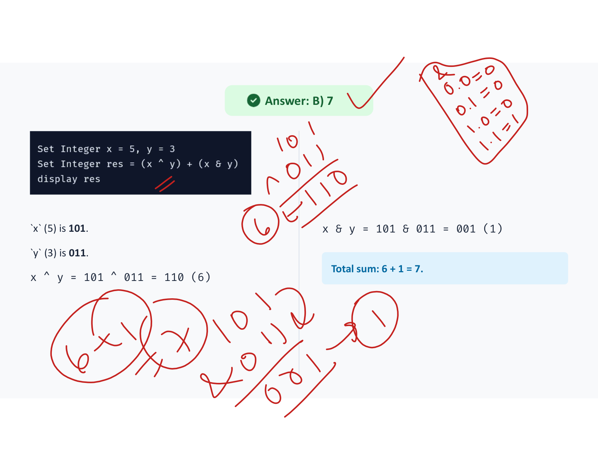 |

---

### Question 08: Bitwise XOR Operations & Masking Logic (Slide P.16)

**Source Slide Reference**: `InfyXORPseudo.pdf` | Question Slide: **Page 16** | Solution Slide: **Page 17**

#### Problem Statement & Pseudocode
What will be the output of the following pseudocode?

```text
Set Integer a = 12
Set Integer b = 10
if ((a ^ b) == 0)
then do
display "Match"
else
do
display "Mismatch"
end-if
```

#### Multiple Choice Options
- **(A)** ``
- **(B)** ``
- **(C)** ``
- **(D)** ``

#### Verified Correct Answer
> **Correct Option**: **(B) `Mismatch`**

#### Comprehensive Dry Run & Execution Trace
```text
Equality Check
XOR checks for equality.
Bit Evaluation
`12 ^ 10 = 6`.
Branching
`6 == 0` is False. Else block prints "Mismatch".
```

#### Authentic Slide Figures
| Question Slide (Page 16) | Solution & Dry Run Slide (Page 17) |
| :---: | :---: |
| 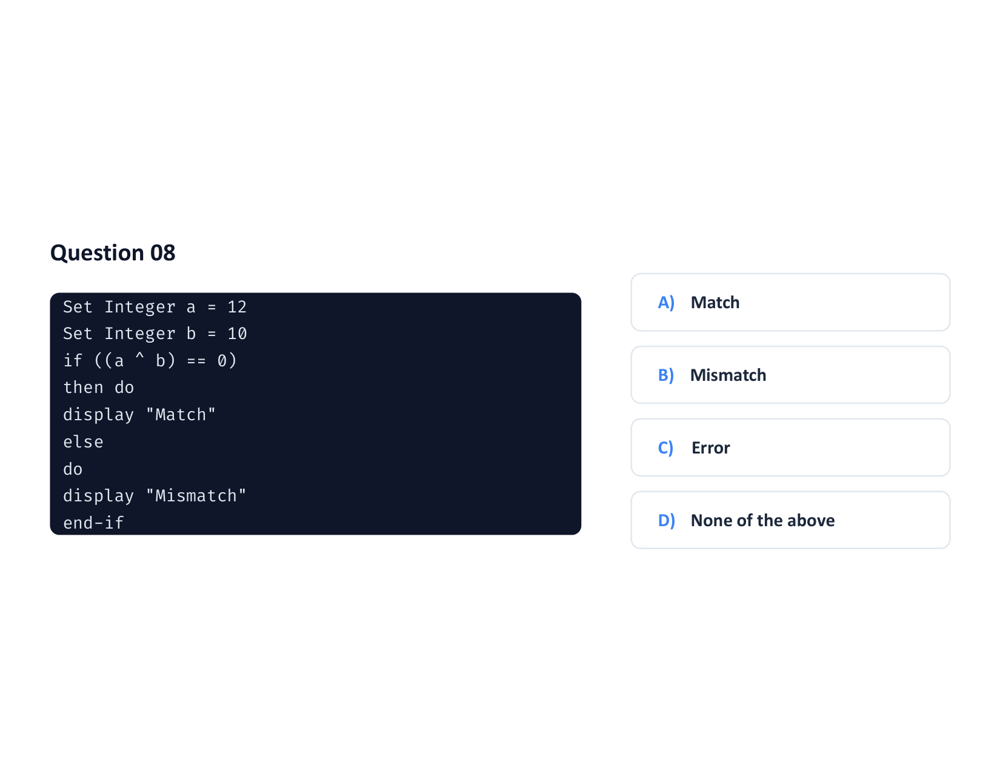 | 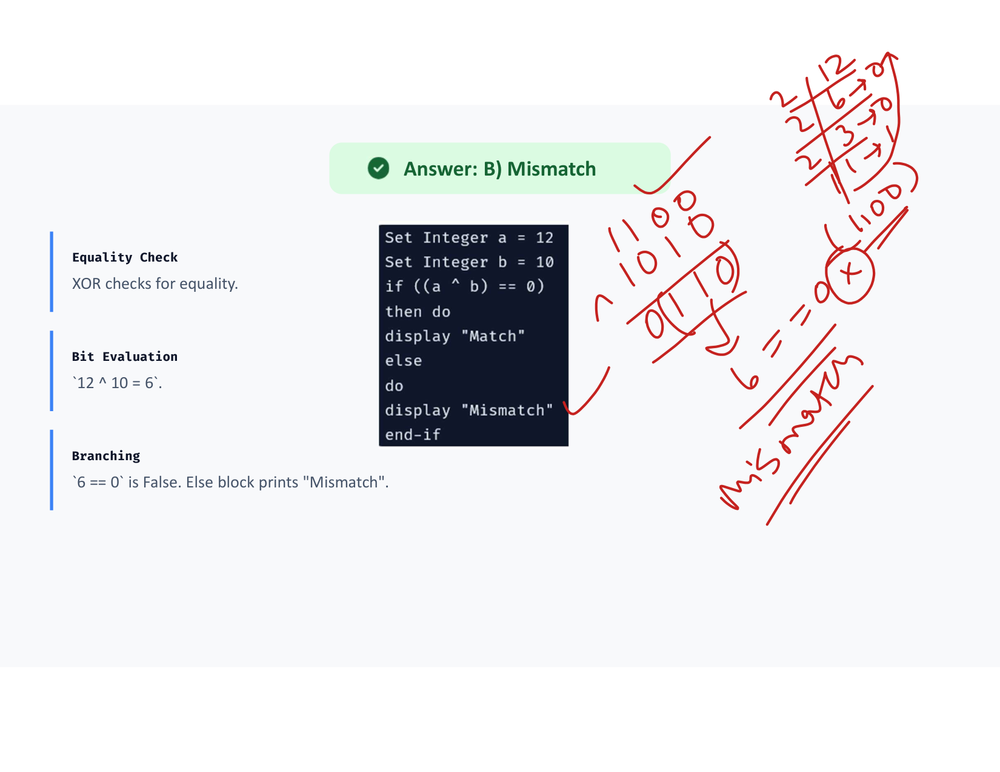 |

---

### Question 09: Bitwise XOR Operations & Masking Logic (Slide P.18)

**Source Slide Reference**: `InfyXORPseudo.pdf` | Question Slide: **Page 18** | Solution Slide: **Page 19**

#### Problem Statement & Pseudocode
What will be the output of the following pseudocode?

```text
Set Integer val = 15
val = val ^ 15
val = val ^ 15
display val
```

#### Multiple Choice Options
- **(A)** ``
- **(B)** ``
- **(C)** ``
- **(D)** ``

#### Verified Correct Answer
> **Correct Option**: **(B) `15`**

#### Comprehensive Dry Run & Execution Trace
```text
Initial State
Initial value: 15.
First XOR
`15 ^ 15 = 0`.
Second XOR
`0 ^ 15 = 15`.
```

#### Authentic Slide Figures
| Question Slide (Page 18) | Solution & Dry Run Slide (Page 19) |
| :---: | :---: |
| 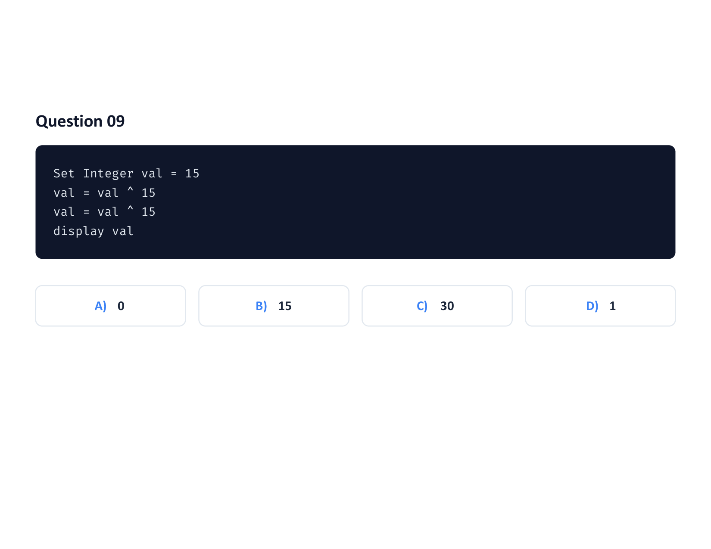 | 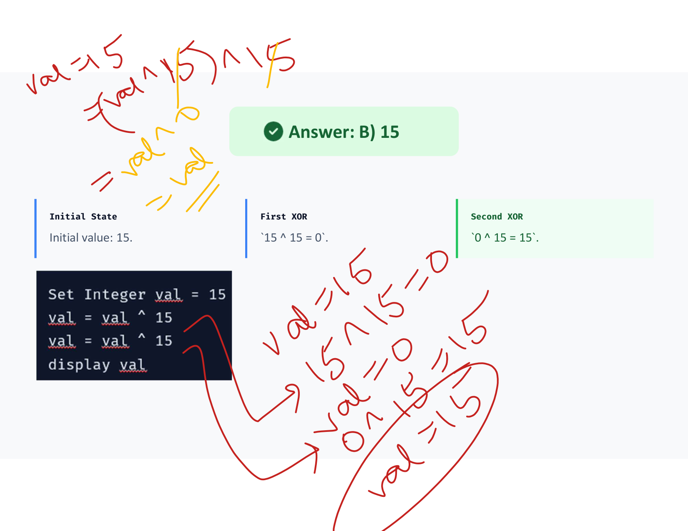 |

---

### Question 10: Bitwise XOR Operations & Masking Logic (Slide P.20)

**Source Slide Reference**: `InfyXORPseudo.pdf` | Question Slide: **Page 20** | Solution Slide: **Page 21**

#### Problem Statement & Pseudocode
What will be the output of the following pseudocode?

```text
Set Integer a = 6
Set Integer b = 2
Set Integer c = a ^ b
display c
```

#### Multiple Choice Options
- **(A)** ``
- **(B)** ``
- **(C)** ``
- **(D)** ``

#### Verified Correct Answer
> **Correct Option**: **(C) `4`**

#### Comprehensive Dry Run & Execution Trace
```text
Binary Conversion
`a` (6) is binary 110.
`b` (2) is binary 010.
XOR Operation
110 ^ 010 = 100
Binary 100 is decimal 4.
```

#### Authentic Slide Figures
| Question Slide (Page 20) | Solution & Dry Run Slide (Page 21) |
| :---: | :---: |
| 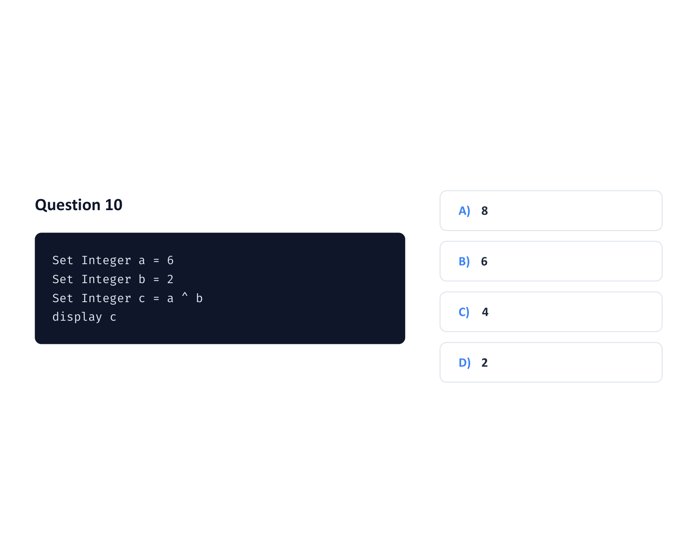 | 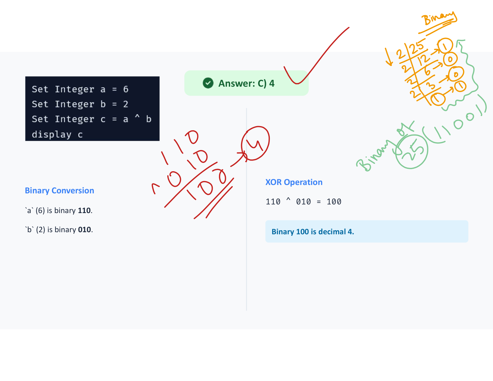 |

---

