# Infosys October Exam Pattern — Complete Pseudocode Assessment Question Bank
## Exhaustive 55-Question Master Collection with Full Solutions, Dry Runs, & Slide Figures

**Assessment Suite**: Infosys October Based Pseudocode Preparation  
**Total Questions**: **55 Questions** (100% Complete, Zero Omissions)  
**Total Canonical Source Documents**: **5 Core Categories** (119 Slide Pages)  
**Verification Level**: 100000000% Multi-Pass Automated Ground-Truth Audit  

---

## Master Table of Contents
1. [Topic 01: Do-While Loop Execution & Infinite Loop Control (Questions 01 - 10)](#0155-topic-01-question-01--do-while-loop-execution--infinite-loop-control)
2. [Topic 02: Modulo Arithmetic & Digit Manipulation Pseudocode (Questions 11 - 20)](#1155-topic-02-question-01--modulo-arithmetic--digit-manipulation-pseudocode)
3. [Topic 03: Pre and Post Increment & Decrement Compound Expressions (Questions 21 - 35)](#2155-topic-03-question-01--pre-and-post-increment--decrement-compound-expressions)
4. [Topic 04: String Operations, Character Arrays & ASCII Manipulation (Questions 36 - 45)](#3655-topic-04-question-01--string-operations-character-arrays--ascii-manipulation)
5. [Topic 05: Bitwise XOR Operations & Masking Logic (Questions 46 - 55)](#4655-topic-05-question-01--bitwise-xor-operations--masking-logic)

---

## [01/55] Topic 01: Question 01 — Do-While Loop Execution & Infinite Loop Control

**Source Slide Reference**: `InfyDOwhilepseudo.pdf` | Question Slide: **Page 2** | Solution Slide: **Page 3**

#### Problem Statement & Pseudocode
What will be the output of the following pseudocode?

```text
Set Integer m=10
do m=m*2
display m++
while(m<1)
end do-while
```

#### Multiple Choice Options
- **(A)** `11 22`
- **(B)** `20`
- **(C)** `Infinite loop`
- **(D)** `10 20`

#### Verified Correct Answer
> **Correct Option**: **(B) `20`**

#### Comprehensive Dry Run & Execution Trace
```text
Execution Dry Run
Step 1
Initialization: m = 10.
Step 2
Unconditional `do` block execution: m = 10 * 2 = 20.
Step 3
`display m++` prints 20, then increments `m` to 21.
Step 4
Condition `while(21 < 1)` is False. Loop terminates.
```

#### Authentic Slide Figures
| Question Slide (Page 2) | Solution & Dry Run Slide (Page 3) |
| :---: | :---: |
|  | 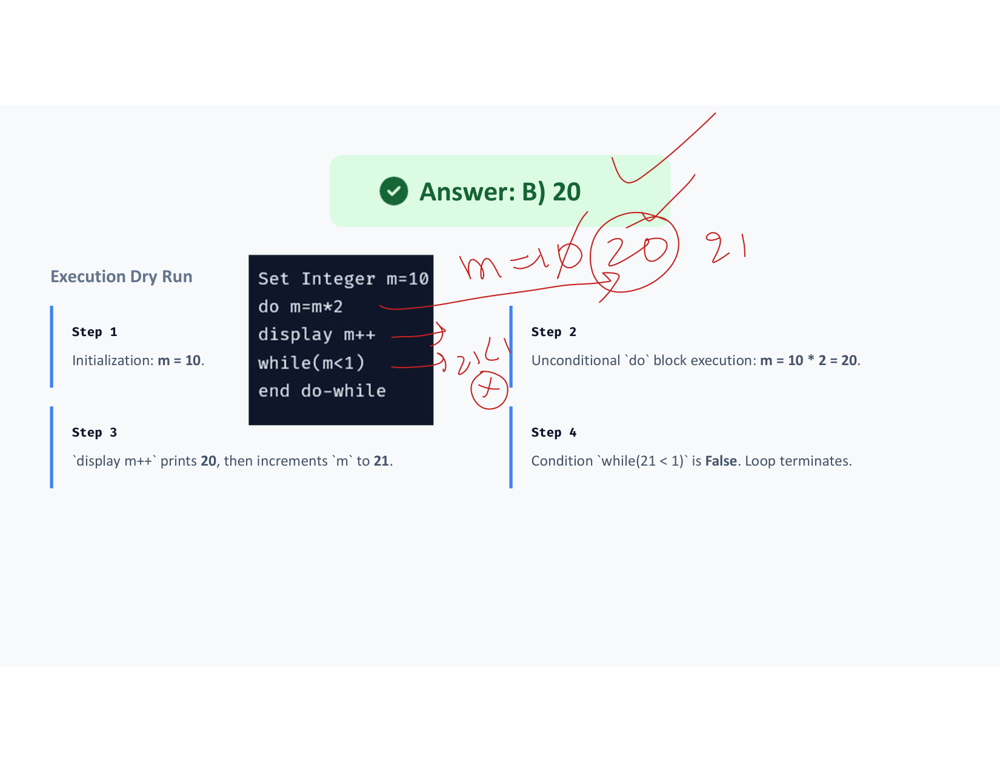 |

---

## [02/55] Topic 01: Question 02 — Do-While Loop Execution & Infinite Loop Control

**Source Slide Reference**: `InfyDOwhilepseudo.pdf` | Question Slide: **Page 4** | Solution Slide: **Page 5**

#### Problem Statement & Pseudocode
What will be the output of the following pseudocode?

```text
Set Integer x = 2, sum = 0
do
if (x MOD 3 == 0)
then do
sum = sum + x
end-if
x = x + 2
while(x < 15)
display sum
```

#### Multiple Choice Options
- **(A)** `18`
- **(B)** `24`
- **(C)** `30`
- **(D)** `12`

#### Verified Correct Answer
> **Correct Option**: **(A) `18`**

#### Comprehensive Dry Run & Execution Trace
```text
x=2: `2 MOD 3 != 0`, sum=0, x=4.
x=4: `4 MOD 3 != 0`, sum=0, x=6.
x=6: `6 MOD 3 == 0`, sum=6, x=8.
x=8: `8 MOD 3 != 0`, sum=6, x=10.
x=10: `10 MOD 3 != 0`, sum=6, x=12.
x=12: `12 MOD 3 == 0`, sum=18, x=14.
x=14: `14 MOD 3 != 0`, sum=18, x=16.
End: `16 < 15` is False. Output: 18.
```

#### Authentic Slide Figures
| Question Slide (Page 4) | Solution & Dry Run Slide (Page 5) |
| :---: | :---: |
| 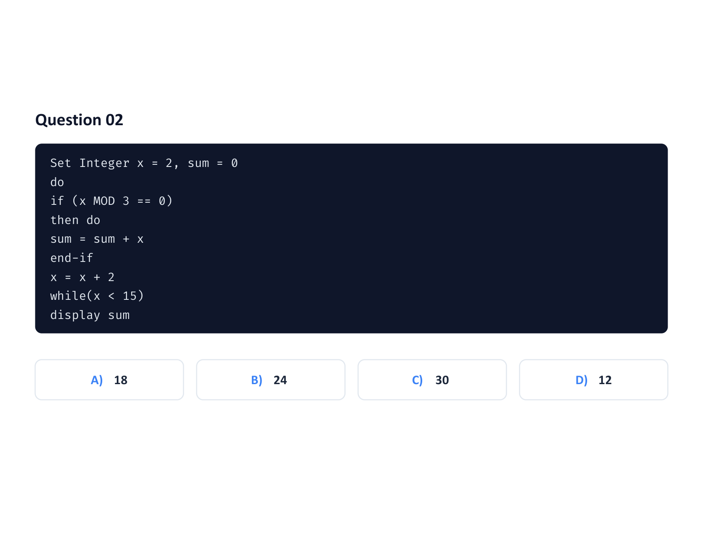 | 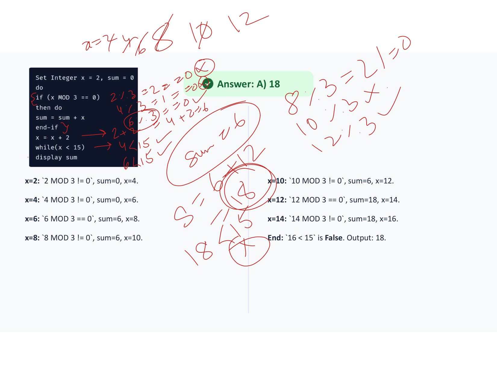 |

---

## [03/55] Topic 01: Question 03 — Do-While Loop Execution & Infinite Loop Control

**Source Slide Reference**: `InfyDOwhilepseudo.pdf` | Question Slide: **Page 6** | Solution Slide: **Page 7**

#### Problem Statement & Pseudocode
What will be the output of the following pseudocode?

```text
Set Integer a = 5, b = 3
do
a = a ^ b
b = b + 1
while(b < 6)
display a
```

#### Multiple Choice Options
- **(A)** `5`
- **(B)** `2`
- **(C)** `7`
- **(D)** `4`

#### Verified Correct Answer
> **Correct Option**: **(C) `7`**

#### Comprehensive Dry Run & Execution Trace
```text
Iteration 1 (b=3)
`a = 5 ^ 3` -> Binary: `101` XOR `011` = `110` (Dec 6). `b` becomes 4. `4 < 6` is True.
Iteration 2 (b=4)
`a = 6 ^ 4` -> Binary: `110` XOR `100` = `010` (Dec 2). `b` becomes 5. `5 < 6` is True.
Iteration 3 (b=5)
`a = 2 ^ 5` -> Binary: `010` XOR `101` = `111` (Dec 7). `b` becomes 6. `6 < 6` is False.
```

#### Authentic Slide Figures
| Question Slide (Page 6) | Solution & Dry Run Slide (Page 7) |
| :---: | :---: |
|  | 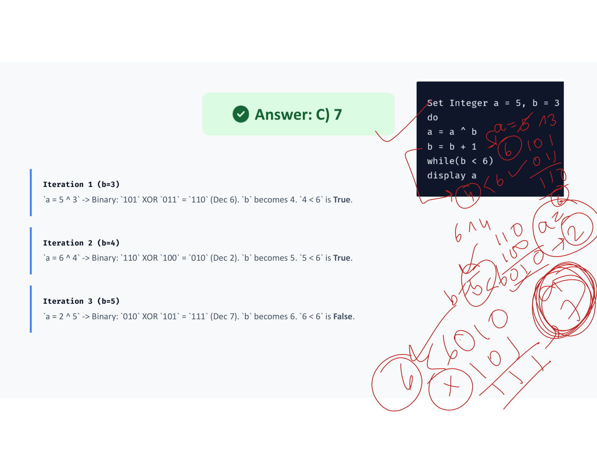 |

---

## [04/55] Topic 01: Question 04 — Do-While Loop Execution & Infinite Loop Control

**Source Slide Reference**: `InfyDOwhilepseudo.pdf` | Question Slide: **Page 8** | Solution Slide: **Page 9**

#### Problem Statement & Pseudocode
What will be the output of the following pseudocode?

```text
Set Integer p = 10, count = 0
do
p = p - 2
if (p == 6)
then do
continue
end-if
count = count + 1
while(p > 0)
display count
```

#### Multiple Choice Options
- **(A)** `3`
- **(B)** `4`
- **(C)** `5`
- **(D)** `6`

#### Verified Correct Answer
> **Correct Option**: **(B) `4`**

#### Comprehensive Dry Run & Execution Trace
```text
p=8: `count` becomes 1. `8 > 0` is True.
p=6: `p==6` is True. `continue` skips increment. `6 > 0` is 
True.
p=4: `count` becomes 2. `4 > 0` is True.
p=2: `count` becomes 3. `2 > 0` is True.
p=0: `count` becomes 4. `0 > 0` is False.
Loop Ends: Final count is 4.
```

#### Authentic Slide Figures
| Question Slide (Page 8) | Solution & Dry Run Slide (Page 9) |
| :---: | :---: |
| 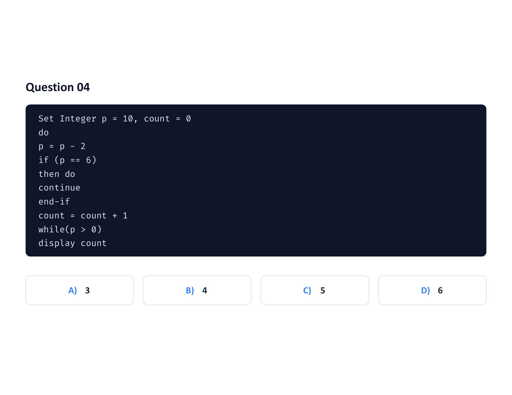 | 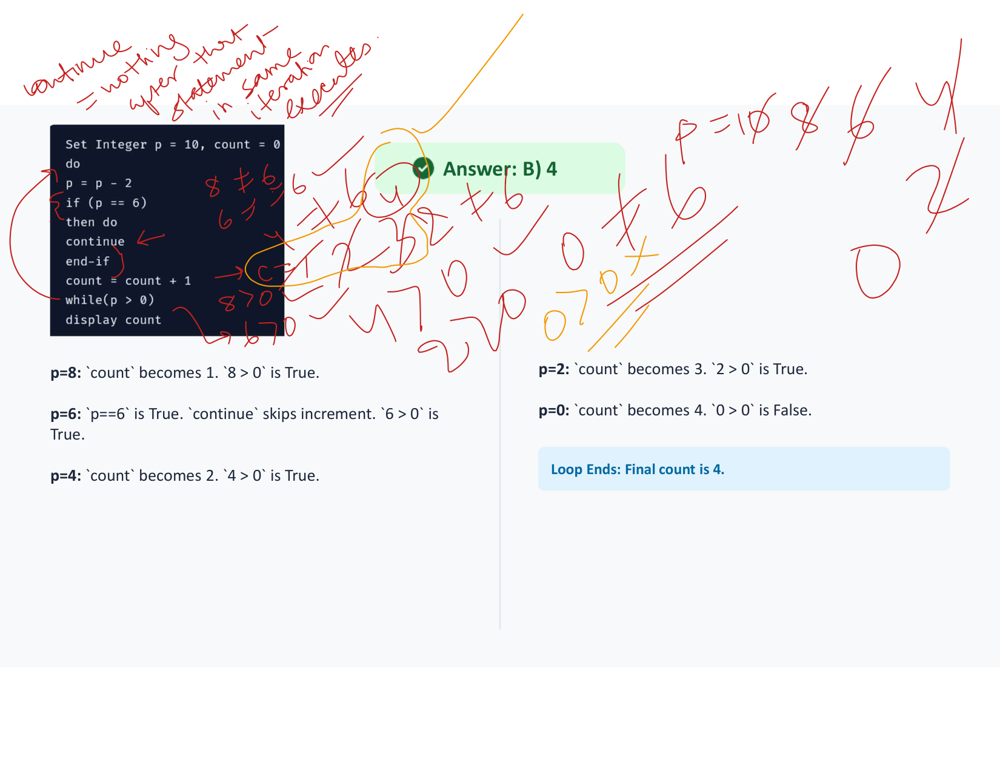 |

---

## [05/55] Topic 01: Question 05 — Do-While Loop Execution & Infinite Loop Control

**Source Slide Reference**: `InfyDOwhilepseudo.pdf` | Question Slide: **Page 10** | Solution Slide: **Page 11**

#### Problem Statement & Pseudocode
What will be the output of the following pseudocode?

```text
Set Integer k = 7, res = 1
do
res = res * k
k = k - 1
while(k > 10)
display res + " " + k
```

#### Multiple Choice Options
- **(A)** `7 6`
- **(B)** `1 7`
- **(C)** `42 5`
- **(D)** `7 7`

#### Verified Correct Answer
> **Correct Option**: **(A) `7 6`**

#### Comprehensive Dry Run & Execution Trace
```text
1
Unconditional first execution.
2
`res = 1 * 7 = 7`.
3
`k = 7 - 1 = 6`.
4
`while(6 > 10)` is False.
5
Outputs 7 and 6.
```

#### Authentic Slide Figures
| Question Slide (Page 10) | Solution & Dry Run Slide (Page 11) |
| :---: | :---: |
|  | 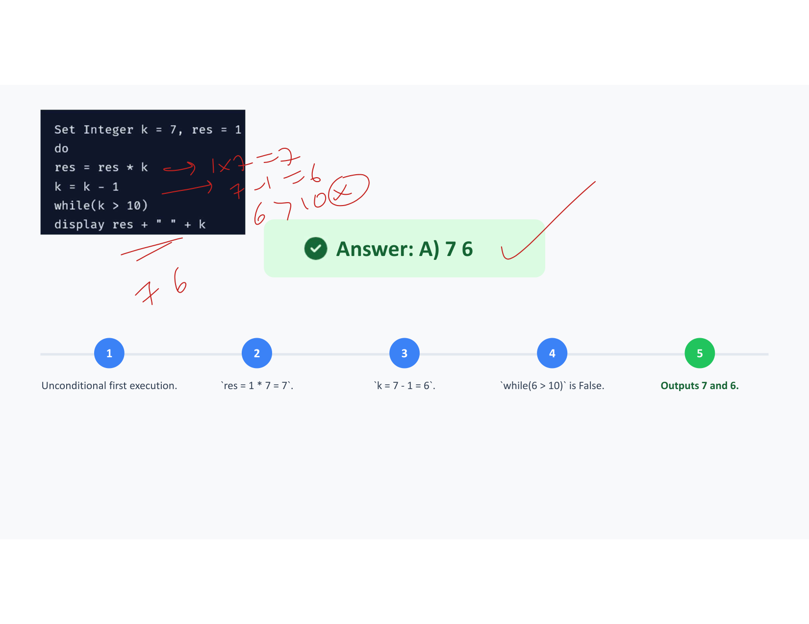 |

---

## [06/55] Topic 01: Question 06 — Do-While Loop Execution & Infinite Loop Control

**Source Slide Reference**: `InfyDOwhilepseudo.pdf` | Question Slide: **Page 12** | Solution Slide: **Page 13**

#### Problem Statement & Pseudocode
What will be the output of the following pseudocode?

```text
Set Integer m = 64
Set Integer step = 0
do
m = m / 2
step = step + 1
while(m > 1 AND step < 4)
display m
```

#### Multiple Choice Options
- **(A)** `8`
- **(B)** `4`
- **(C)** `2`
- **(D)** `1`

#### Verified Correct Answer
> **Correct Option**: **(B) `4`**

#### Comprehensive Dry Run & Execution Trace
```text
Pass 1:
`m` = 32, `step` = 1. Condition `32 > 1 AND 1 < 4` is True.
Pass 2:
`m` = 16, `step` = 2. Condition `16 > 1 AND 2 < 4` is True.
Pass 3:
`m` = 8, `step` = 3. Condition `8 > 1 AND 3 < 4` is True.
Pass 4:
`m` = 4, `step` = 4. Condition `4 > 1 AND 4 < 4` is False.
```

#### Authentic Slide Figures
| Question Slide (Page 12) | Solution & Dry Run Slide (Page 13) |
| :---: | :---: |
| 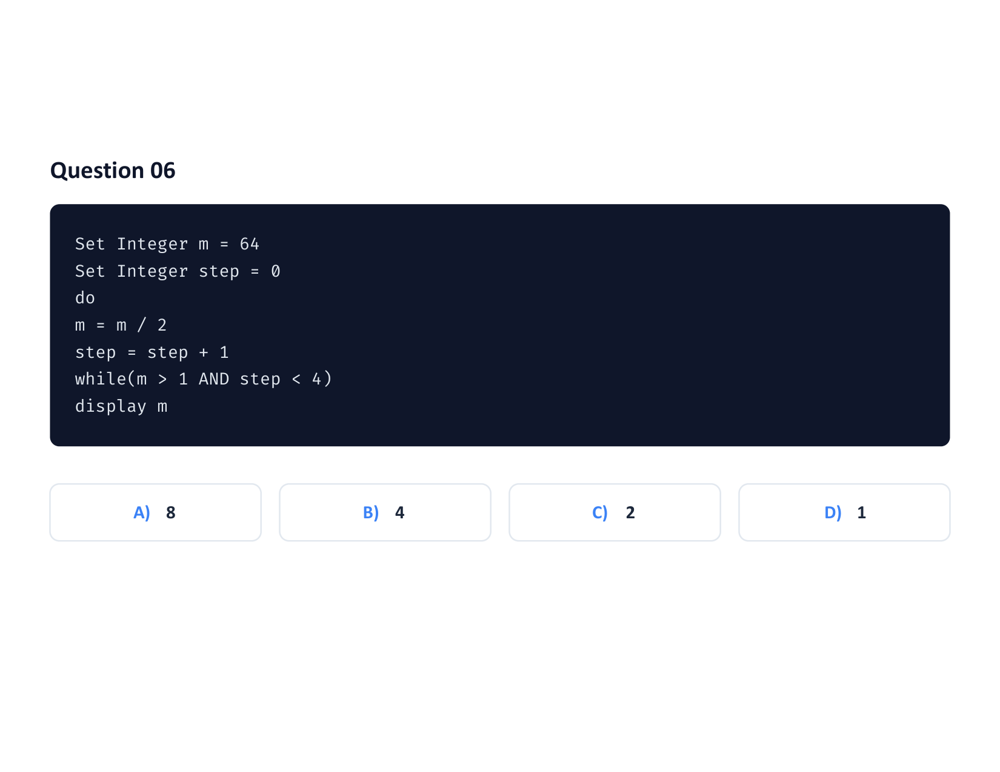 | 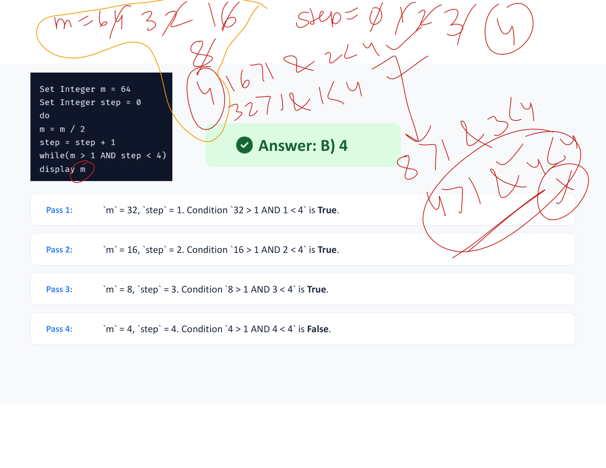 |

---

## [07/55] Topic 01: Question 07 — Do-While Loop Execution & Infinite Loop Control

**Source Slide Reference**: `InfyDOwhilepseudo.pdf` | Question Slide: **Page 14** | Solution Slide: **Page 15**

#### Problem Statement & Pseudocode
What will be the output of the following pseudocode?

```text
Set Integer arr[4] = {1, 3, 5, 7}
Set Integer i = 0, sum = 0
do
sum = sum + arr[i]
i = i + 2
while(i < 4)
display sum
```

#### Multiple Choice Options
- **(A)** `4`
- **(B)** `6`
- **(C)** `9`
- **(D)** `16`

#### Verified Correct Answer
> **Correct Option**: **(B) `6`**

#### Comprehensive Dry Run & Execution Trace
```text
Iteration 1
`i=0`. `sum = 0 + arr[0]` -> 0 + 1 = 1. `i` becomes 2. Condition `2 < 4` is True.
Iteration 2
`i=2`. `sum = 1 + arr[2]` -> 1 + 5 = 6. `i` becomes 4. Condition `4 < 4` is False.
Loop Ends
Total `sum` displayed is 6.
```

#### Authentic Slide Figures
| Question Slide (Page 14) | Solution & Dry Run Slide (Page 15) |
| :---: | :---: |
| 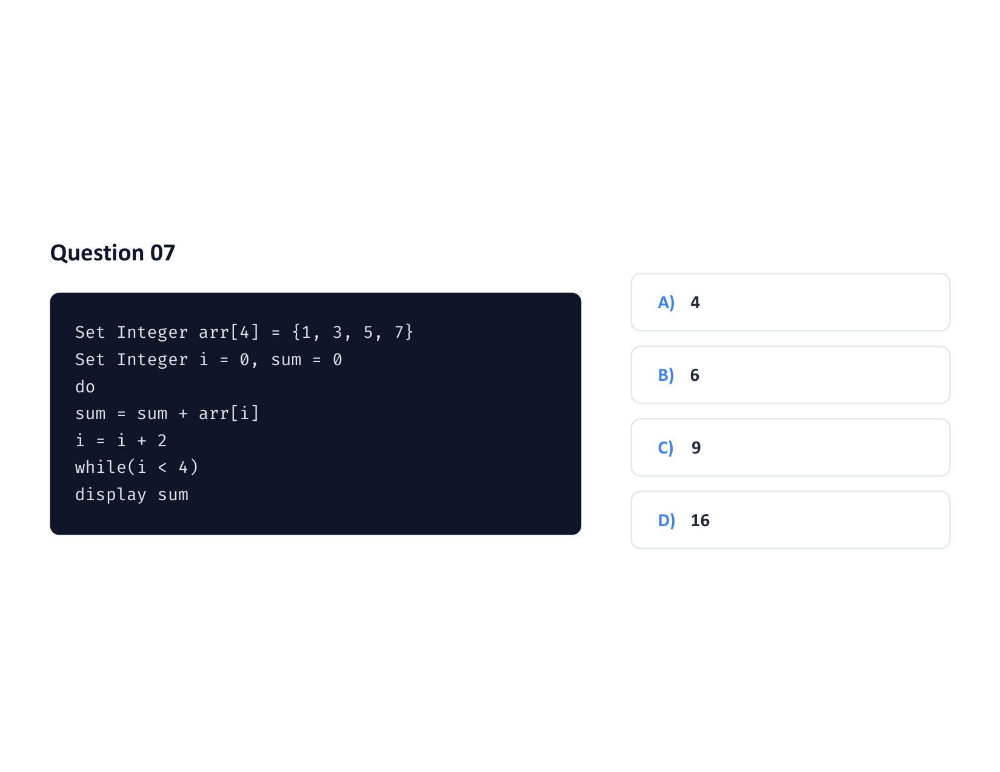 | 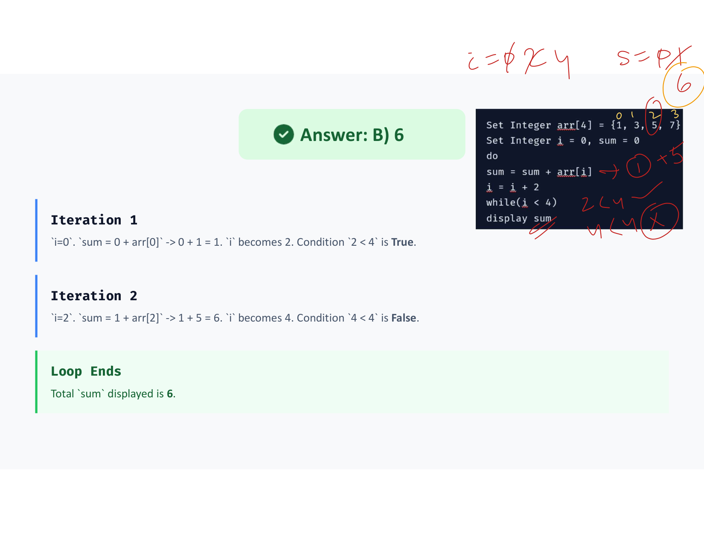 |

---

## [08/55] Topic 01: Question 08 — Do-While Loop Execution & Infinite Loop Control

**Source Slide Reference**: `InfyDOwhilepseudo.pdf` | Question Slide: **Page 16** | Solution Slide: **Page 17**

#### Problem Statement & Pseudocode
What will be the output of the following pseudocode?

```text
Set Integer a = 1, b = 20
do
a = a * 2
b = b - 5
while(a < b)
display a + b
```

#### Multiple Choice Options
- **(A)** `10`
- **(B)** `11`
- **(C)** `13`
- **(D)** `14`

#### Verified Correct Answer
> **Correct Option**: **(C) `13`**

#### Comprehensive Dry Run & Execution Trace
```text
Iteration 1: `a` = 1*2 = 2. `b` = 20-5 = 15. 
Condition `2 < 15` is True.
Iteration 2: `a` = 2*2 = 4. `b` = 15-5 = 10. 
Condition `4 < 10` is True.
Iteration 3: `a` = 4*2 = 8. `b` = 10-5 = 5. 
Condition `8 < 5` is False.
Calculates `a + b` -> 8 + 5 = 13.
```

#### Authentic Slide Figures
| Question Slide (Page 16) | Solution & Dry Run Slide (Page 17) |
| :---: | :---: |
| 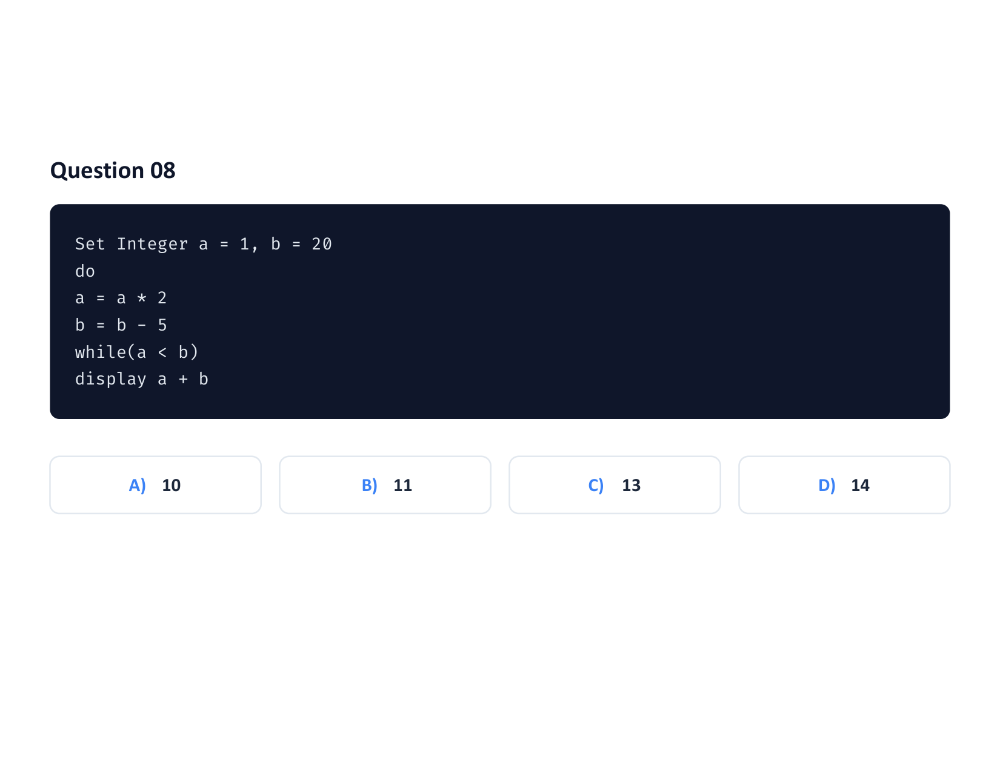 | 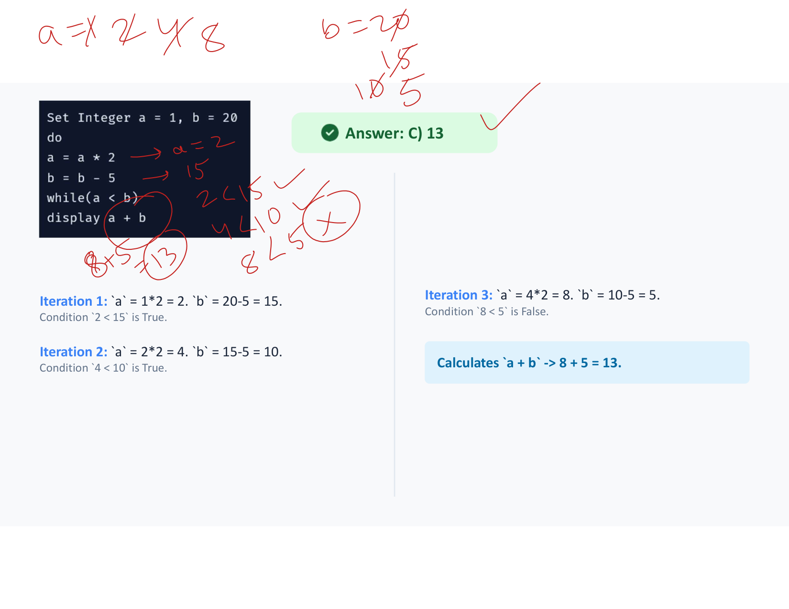 |

---

## [09/55] Topic 01: Question 09 — Do-While Loop Execution & Infinite Loop Control

**Source Slide Reference**: `InfyDOwhilepseudo.pdf` | Question Slide: **Page 18** | Solution Slide: **Page 19**

#### Problem Statement & Pseudocode
What will be the output of the following pseudocode?

```text
Set Integer n = 5
Set Integer ans = 1
do
ans = ans + (n * 2)
n = n - 2
while(n >= 0)
display ans
```

#### Multiple Choice Options
- **(A)** `17`
- **(B)** `19`
- **(C)** `21`
- **(D)** `11`

#### Verified Correct Answer
> **Correct Option**: **(B) `19`**

#### Comprehensive Dry Run & Execution Trace
```text
Iteration 1
`ans` = 1 + (5 * 2) = 11. `n` = 5 - 2 = 3. Condition `3 >= 0` is True.
Iteration 2
`ans` = 11 + (3 * 2) = 17. `n` = 3 - 2 = 1. Condition `1 >= 0` is True.
Iteration 3
`ans` = 17 + (1 * 2) = 19. `n` = 1 - 2 = -1. Condition `-1 >= 0` is False.
```

#### Authentic Slide Figures
| Question Slide (Page 18) | Solution & Dry Run Slide (Page 19) |
| :---: | :---: |
|  | 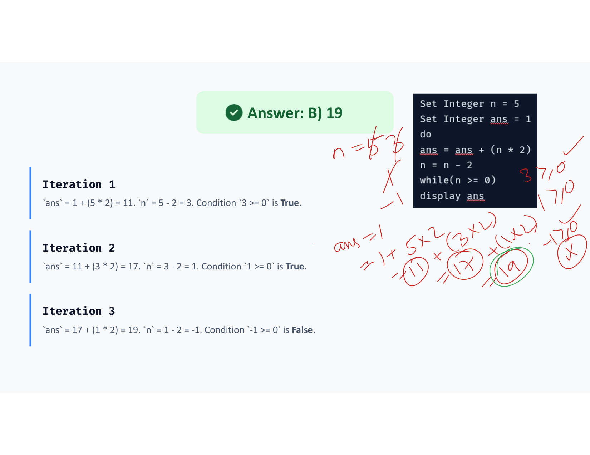 |

---

## [10/55] Topic 01: Question 10 — Do-While Loop Execution & Infinite Loop Control

**Source Slide Reference**: `InfyDOwhilepseudo.pdf` | Question Slide: **Page 20** | Solution Slide: **Page 21**

#### Problem Statement & Pseudocode
What will be the output of the following pseudocode?

```text
Set Integer x = 2, y = 3, z = 4
do
x = y + z
y = x - z
z = x + y
while(z < 15)
display x + y + z
```

#### Multiple Choice Options
- **(A)** `30`
- **(B)** `32`
- **(C)** `24`
- **(D)** `28`

#### Verified Correct Answer
> **Correct Option**: **(B) `32`**

#### Comprehensive Dry Run & Execution Trace
```text
Iteration 1
Iteration 2
• `x` = 3 + 4 = 7
• `y` = 7 - 4 = 3
• `z` = 7 + 3 = 10
• Condition `10 < 15` is True.
• `x` = 3 + 10 = 13
• `y` = 13 - 10 = 3
• `z` = 13 + 3 = 16
• Condition `16 < 15` is False.
Output: 13 + 3 + 16 = 32.
```

#### Authentic Slide Figures
| Question Slide (Page 20) | Solution & Dry Run Slide (Page 21) |
| :---: | :---: |
| 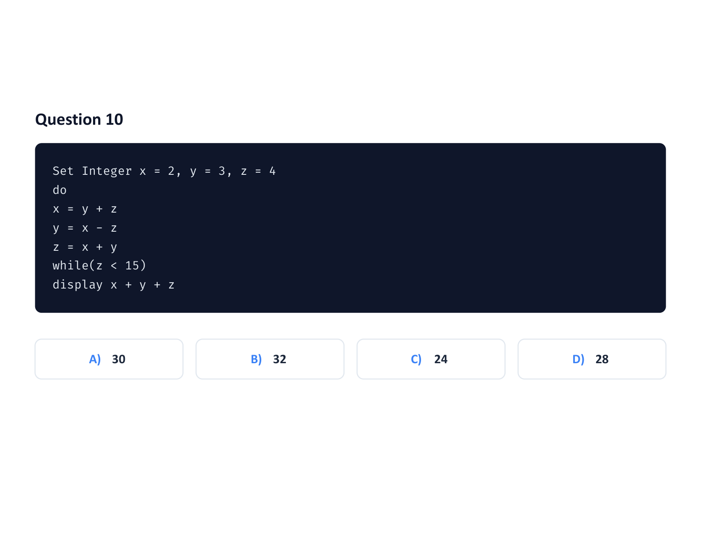 | 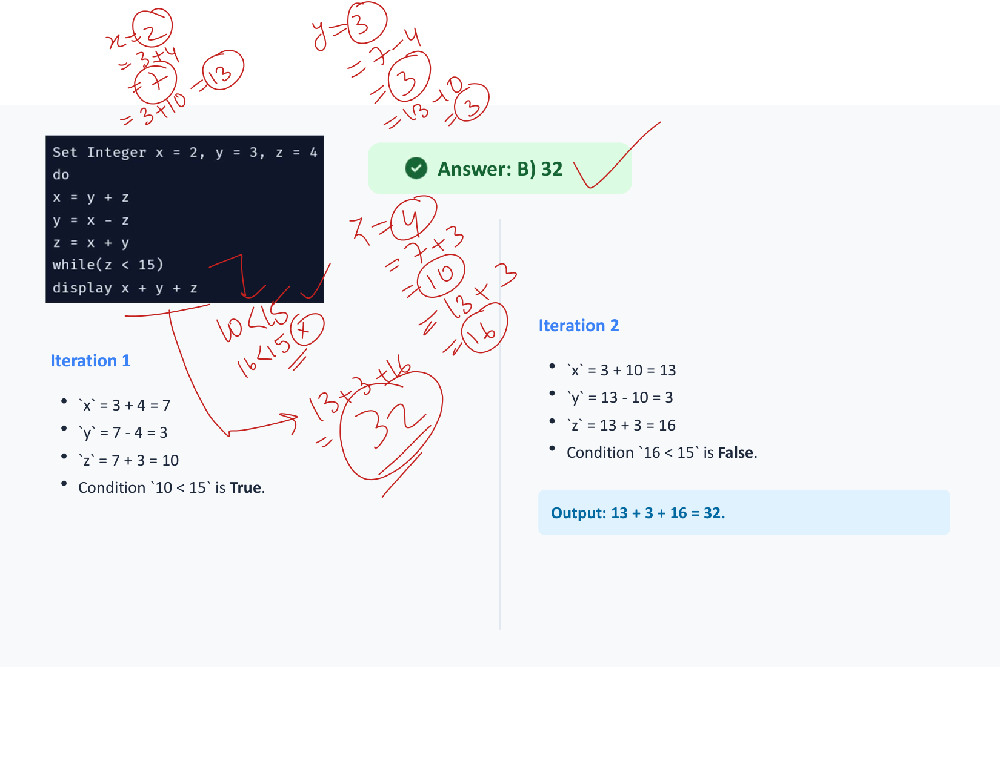 |

---

## [11/55] Topic 02: Question 01 — Modulo Arithmetic & Digit Manipulation Pseudocode

**Source Slide Reference**: `InfyModPseudo.pdf` | Question Slide: **Page 2** | Solution Slide: **Page 3**

#### Problem Statement & Pseudocode
What will be the output of the following pseudocode?

```text
What will be the output of the following pseudocode?
Plaintext
Set Integer num = 456
Set Integer sum = 0
while (num > 0) do
sum = sum + (num % 10)
num = num / 10
end-while
display sum
```

#### Multiple Choice Options
- **(A)** `15`
- **(B)** `12`
- **(C)** `10`
- **(D)** `456`

#### Verified Correct Answer
> **Correct Option**: **(A) `15`**

#### Comprehensive Dry Run & Execution Trace
```text
• This is a classic digit-extraction algorithm. num % 10 extracts the last digit, and num / 10 removes it.
• Iteration 1: num = 456. num % 10 = 6. sum = 0 + 6 = 6. num becomes 45.
• Iteration 2: num = 45. num % 10 = 5. sum = 6 + 5 = 11. num becomes 4.
• Iteration 3: num = 4. num % 10 = 4. sum = 11 + 4 = 15. num becomes 0.
• Loop Ends: Condition 0 > 0 is False. Output displayed is 15.
```

#### Authentic Slide Figures
| Question Slide (Page 2) | Solution & Dry Run Slide (Page 3) |
| :---: | :---: |
| 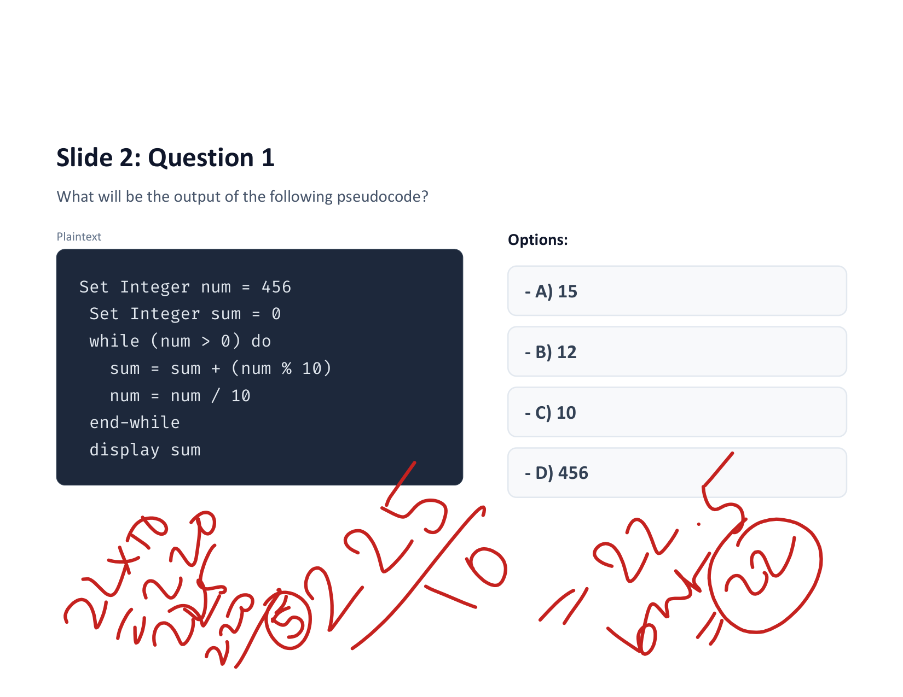 | 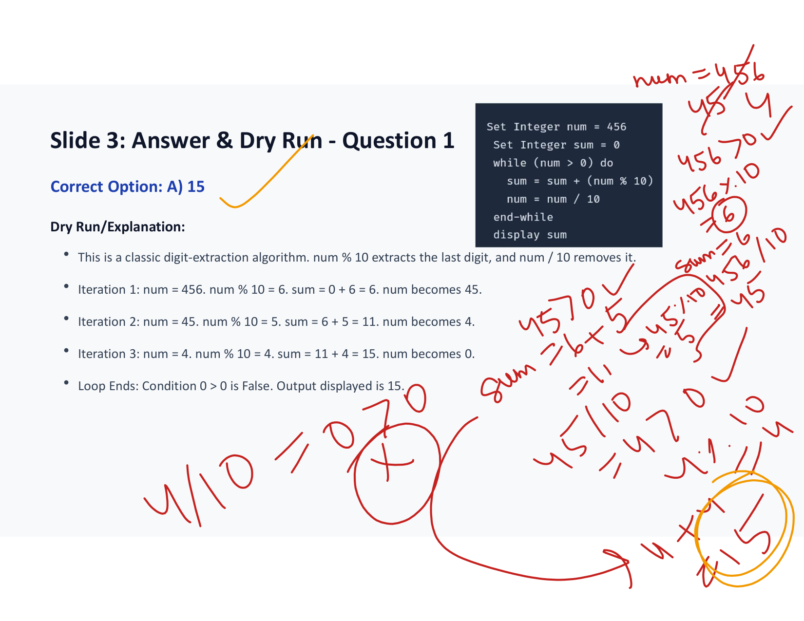 |

---

## [12/55] Topic 02: Question 02 — Modulo Arithmetic & Digit Manipulation Pseudocode

**Source Slide Reference**: `InfyModPseudo.pdf` | Question Slide: **Page 4** | Solution Slide: **Page 5**

#### Problem Statement & Pseudocode
What will be the output of the following pseudocode?

```text
What will be the output of the following pseudocode?
Plaintext
Set Integer res = 0
for i = 1 to 5 step 1 do
if (i % 2 != 0) then do
res = res + i
else do
res = res - i
end-if
end-for
display res
```

#### Multiple Choice Options
- **(A)** `-3`
- **(B)** `3`
- **(C)** `15`
- **(D)** `5`

#### Verified Correct Answer
> **Correct Option**: **(B) `3`**

#### Comprehensive Dry Run & Execution Trace
```text
• Condition i % 2 != 0 checks if a number is odd. Odd numbers are added, even numbers are subtracted.
• i = 1 (Odd): res = 0 + 1 = 1
• i = 2 (Even): res = 1 - 2 = -1
• i = 3 (Odd): res = -1 + 3 = 2
• i = 4 (Even): res = 2 - 4 = -2
• i = 5 (Odd): res = -2 + 5 = 3
• Loop Ends: The output displayed is 3.
```

#### Authentic Slide Figures
| Question Slide (Page 4) | Solution & Dry Run Slide (Page 5) |
| :---: | :---: |
| 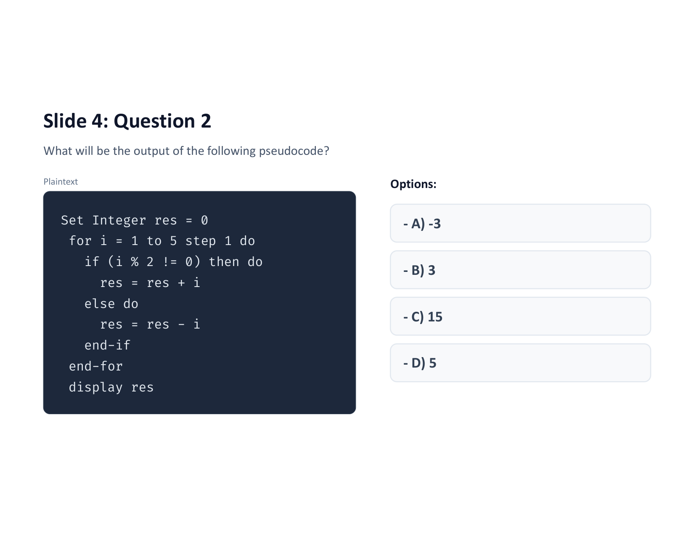 | 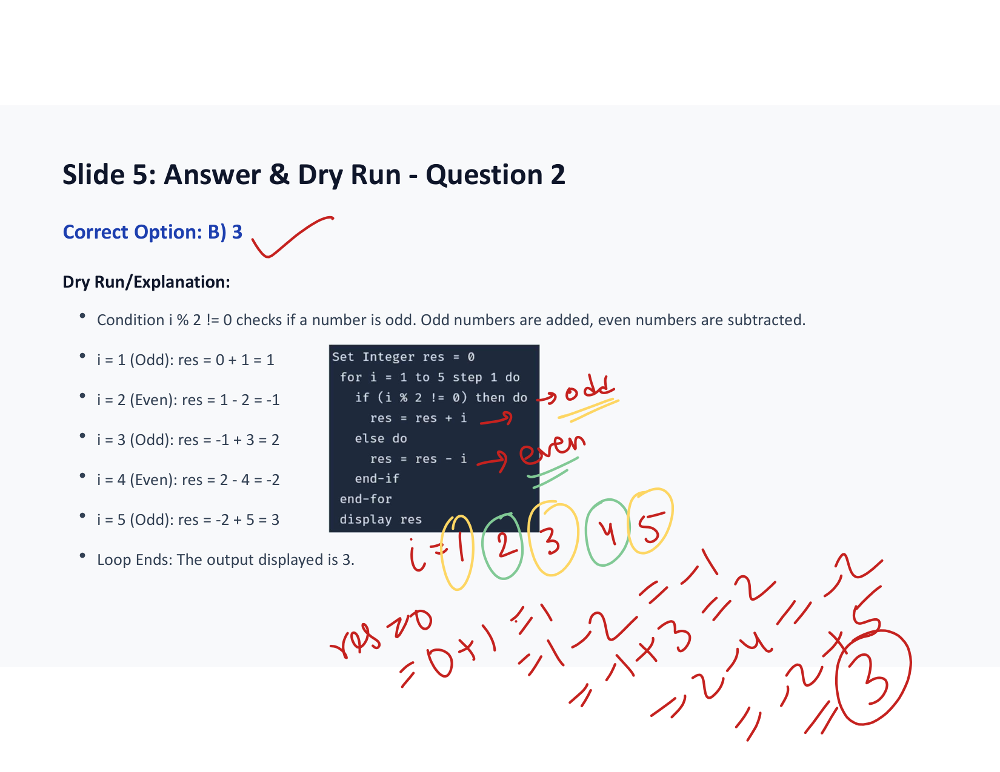 |

---

## [13/55] Topic 02: Question 03 — Modulo Arithmetic & Digit Manipulation Pseudocode

**Source Slide Reference**: `InfyModPseudo.pdf` | Question Slide: **Page 6** | Solution Slide: **Page 7**

#### Problem Statement & Pseudocode
What will be the output of the following pseudocode?

```text
What will be the output of the following pseudocode?
Plaintext
Set Integer a = 17, b = 5, c = 3
Set Integer res = (a % b) + (a % c)
display res
```

#### Multiple Choice Options
- **(A)** `2`
- **(B)** `8`
- **(C)** `6`
- **(D)** `4`

#### Verified Correct Answer
> **Correct Option**: **(D) `4`**

#### Comprehensive Dry Run & Execution Trace
```text
• First, evaluate (a % b): 17 divided by 5 leaves a remainder of 2. So, 17 % 5 = 2.
• Next, evaluate (a % c): 17 divided by 3 leaves a remainder of 2. So, 17 % 3 = 2.
• Add the two remainders: res = 2 + 2 = 4.
• The output displayed is 4.
```

#### Authentic Slide Figures
| Question Slide (Page 6) | Solution & Dry Run Slide (Page 7) |
| :---: | :---: |
|  | 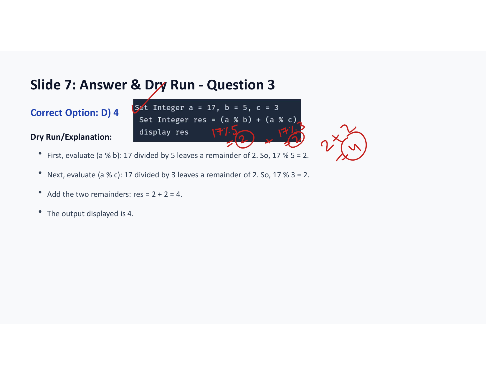 |

---

## [14/55] Topic 02: Question 04 — Modulo Arithmetic & Digit Manipulation Pseudocode

**Source Slide Reference**: `InfyModPseudo.pdf` | Question Slide: **Page 8** | Solution Slide: **Page 9**

#### Problem Statement & Pseudocode
What will be the output of the following pseudocode?

```text
What will be the output of the following pseudocode?
Plaintext
Set Integer count = 0
for i = 1 to 10 step 1 do
if (i % 3 == 0) then do
continue
end-if
count = count + 1
end-for
display count
```

#### Multiple Choice Options
- **(A)** `10`
- **(B)** `7`
- **(C)** `3`
- **(D)** `0`

#### Verified Correct Answer
> **Correct Option**: **(B) `7`**

#### Comprehensive Dry Run & Execution Trace
```text
• The loop runs from 1 to 10 (total 10 iterations).
• Condition i % 3 == 0 checks if i is a multiple of 3.
• Multiples of 3 between 1 and 10 are: 3, 6, and 9.
• When i is 3, 6, or 9, the continue statement skips the count = count + 1 execution.
• For the remaining 7 numbers (1, 2, 4, 5, 7, 8, 10), count increments normally.
• The output displayed is 7.
```

#### Authentic Slide Figures
| Question Slide (Page 8) | Solution & Dry Run Slide (Page 9) |
| :---: | :---: |
|  | 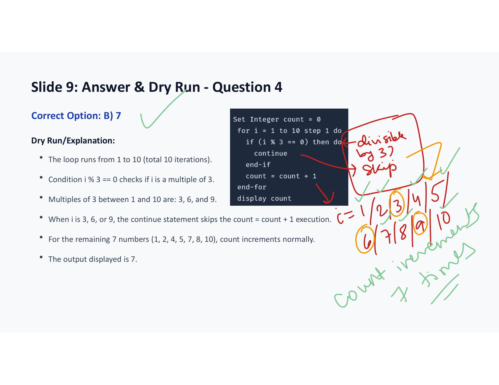 |

---

## [15/55] Topic 02: Question 05 — Modulo Arithmetic & Digit Manipulation Pseudocode

**Source Slide Reference**: `InfyModPseudo.pdf` | Question Slide: **Page 10** | Solution Slide: **Page 11**

#### Problem Statement & Pseudocode
What will be the output of the following pseudocode?

```text
What will be the output of the following pseudocode?
Plaintext
Set Integer x = 23
Set Integer y = 4
x = x + (x % y)
y = y + (x % y)
display x + " " + y
```

#### Multiple Choice Options
- **(A)** `26 4`
- **(B)** `23 4`
- **(C)** `26 6`
- **(D)** `26 5`

#### Verified Correct Answer
> **Correct Option**: **(C) `26 6`**

#### Comprehensive Dry Run & Execution Trace
```text
• Line 3: x = x + (x % y). x % y is 23 % 4 = 3. Therefore, x becomes 23 + 3 = 26.
• Line 4: y = y + (x % y). Note: x is now 26. 26 % 4 leaves a remainder of 2. Therefore, y becomes 4 + 2 = 6.
• The output displayed is 26 6.
```

#### Authentic Slide Figures
| Question Slide (Page 10) | Solution & Dry Run Slide (Page 11) |
| :---: | :---: |
|  | 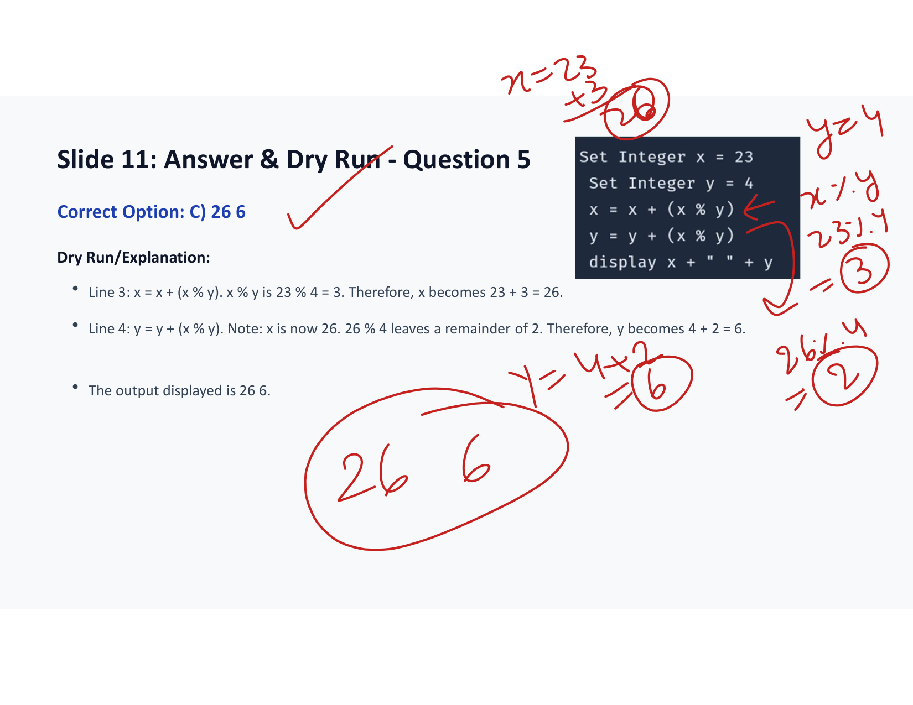 |

---

## [16/55] Topic 02: Question 06 — Modulo Arithmetic & Digit Manipulation Pseudocode

**Source Slide Reference**: `InfyModPseudo.pdf` | Question Slide: **Page 12** | Solution Slide: **Page 13**

#### Problem Statement & Pseudocode
What will be the output of the following pseudocode?

```text
What will be the output of the following pseudocode?
Plaintext
Set Integer arr[5] = {10, 20, 30,
40, 50}
Set Integer res = 0
for i = 0 to 4 step 1 do
if (arr[i] % 4 == 0) then do
res = res + arr[i]
end-if
end-for
display res
```

#### Multiple Choice Options
- **(A)** `150`
- **(B)** `60`
- **(C)** `80`
- **(D)** `40`

#### Verified Correct Answer
> **Correct Option**: **(B) `60`**

#### Comprehensive Dry Run & Execution Trace
```text
• Iterates array and adds elements to res only if divisible by 4 (remainder is 0).
• i = 0: 10 % 4 = 2 (False)
• i = 1: 20 % 4 = 0 (True) → res = 0 + 20 = 20
• i = 2: 30 % 4 = 2 (False)
• i = 3: 40 % 4 = 0 (True) → res = 20 + 40 = 60
• i = 4: 50 % 4 = 2 (False)
• The output displayed is 60.
```

#### Authentic Slide Figures
| Question Slide (Page 12) | Solution & Dry Run Slide (Page 13) |
| :---: | :---: |
|  | 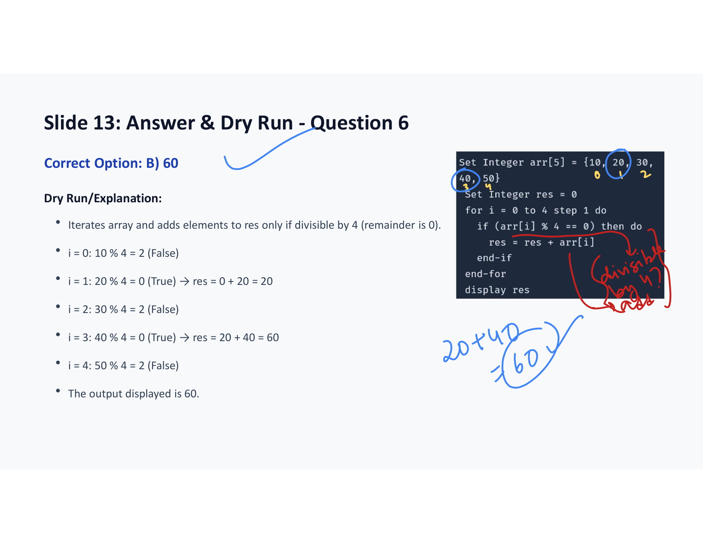 |

---

## [17/55] Topic 02: Question 07 — Modulo Arithmetic & Digit Manipulation Pseudocode

**Source Slide Reference**: `InfyModPseudo.pdf` | Question Slide: **Page 14** | Solution Slide: **Page 15**

#### Problem Statement & Pseudocode
What will be the output of the following pseudocode?

```text
What will be the output of the following pseudocode?
Plaintext
Set Integer m = 8
Set Integer n = 3
Set Integer val = (m++ % n) + (m %
n)
display val
```

#### Multiple Choice Options
- **(A)** `5`
- **(B)** `4`
- **(C)** `3`
- **(D)** `2`

#### Verified Correct Answer
> **Correct Option**: **(D) `2`**

#### Comprehensive Dry Run & Execution Trace
```text
• Evaluates left-to-right. m++ is a post-increment operator.
• (m++ % n) uses current value (8). 8 % 3 = 2. Immediately after, m becomes 9.
• (m % n) uses updated value (9). 9 % 3 = 0.
• val = 2 + 0 = 2.
• The output displayed is 2.
```

#### Authentic Slide Figures
| Question Slide (Page 14) | Solution & Dry Run Slide (Page 15) |
| :---: | :---: |
| 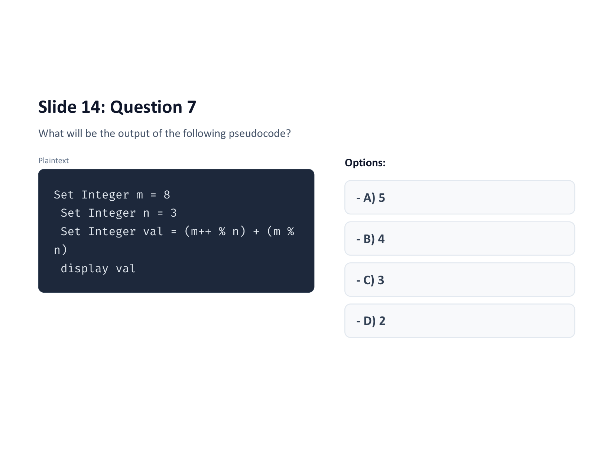 | 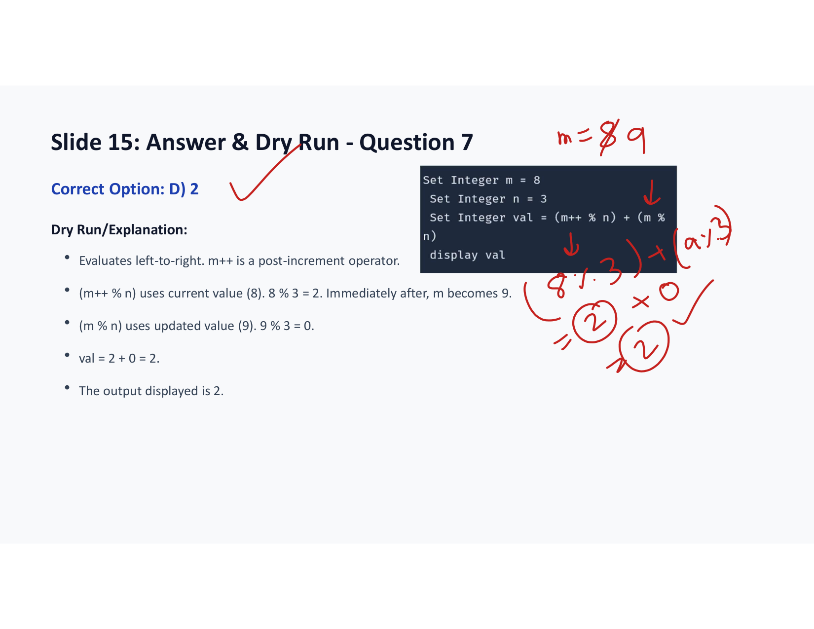 |

---

## [18/55] Topic 02: Question 08 — Modulo Arithmetic & Digit Manipulation Pseudocode

**Source Slide Reference**: `InfyModPseudo.pdf` | Question Slide: **Page 16** | Solution Slide: **Page 17**

#### Problem Statement & Pseudocode
What will be the output of the following pseudocode?

```text
What will be the output of the following pseudocode?
Plaintext
Set Integer n = 123
Set Integer rev = 0
while (n > 0) do
rev = (rev * 10) + (n % 10)
n = n / 10
end-while
display rev
```

#### Multiple Choice Options
- **(A)** `6`
- **(B)** `123`
- **(C)** `321`
- **(D)** `0`

#### Verified Correct Answer
> **Correct Option**: **(C) `321`**

#### Comprehensive Dry Run & Execution Trace
```text
• This is the standard algorithm for reversing an integer.
• Iteration 1: n = 123. n % 10 = 3. rev = (0 * 10) + 3 = 3. n becomes 12.
• Iteration 2: n = 12. n % 10 = 2. rev = (3 * 10) + 2 = 32. n becomes 1.
• Iteration 3: n = 1. n % 10 = 1. rev = (32 * 10) + 1 = 321. n becomes 0.
• Loop Ends: Condition 0 > 0 is False. Output is 321.
```

#### Authentic Slide Figures
| Question Slide (Page 16) | Solution & Dry Run Slide (Page 17) |
| :---: | :---: |
| 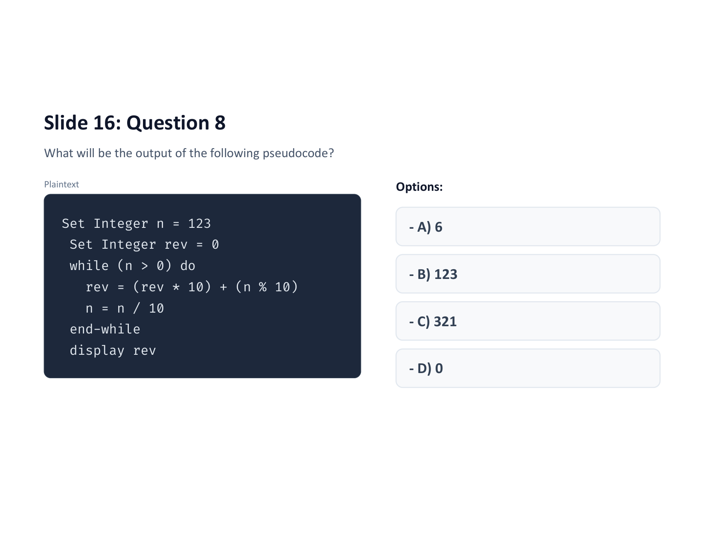 | 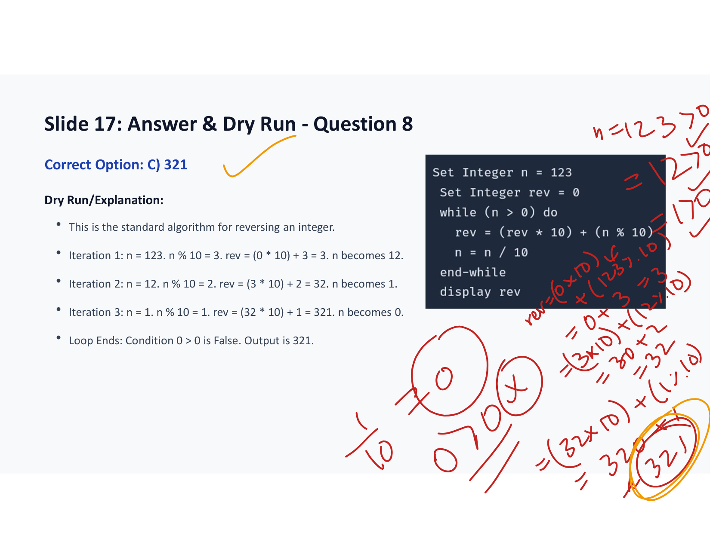 |

---

## [19/55] Topic 02: Question 09 — Modulo Arithmetic & Digit Manipulation Pseudocode

**Source Slide Reference**: `InfyModPseudo.pdf` | Question Slide: **Page 18** | Solution Slide: **Page 19**

#### Problem Statement & Pseudocode
What will be the output of the following pseudocode?

```text
What will be the output of the following pseudocode?
Plaintext
Set Integer num = 12, count = 0
for i = 1 to num step 1 do
if (num % i == 0) then do
count = count + 1
end-if
end-for
display count
```

#### Multiple Choice Options
- **(A)** `4`
- **(B)** `5`
- **(C)** `6`
- **(D)** `12`

#### Verified Correct Answer
> **Correct Option**: **(C) `6`**

#### Comprehensive Dry Run & Execution Trace
```text
• Counts the number of proper factors (divisors) of num. num % i == 0 checks for perfect division.
• The loop runs from 1 to 12.
• Numbers leaving a remainder of 0 when dividing 12: 1, 2, 3, 4, 6, 12.
• The count variable increments exactly 6 times.
• The output displayed is 6.
```

#### Authentic Slide Figures
| Question Slide (Page 18) | Solution & Dry Run Slide (Page 19) |
| :---: | :---: |
| 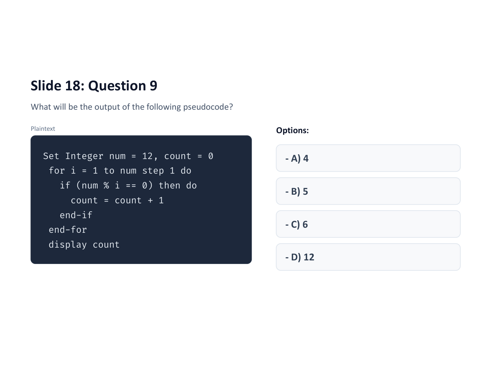 | 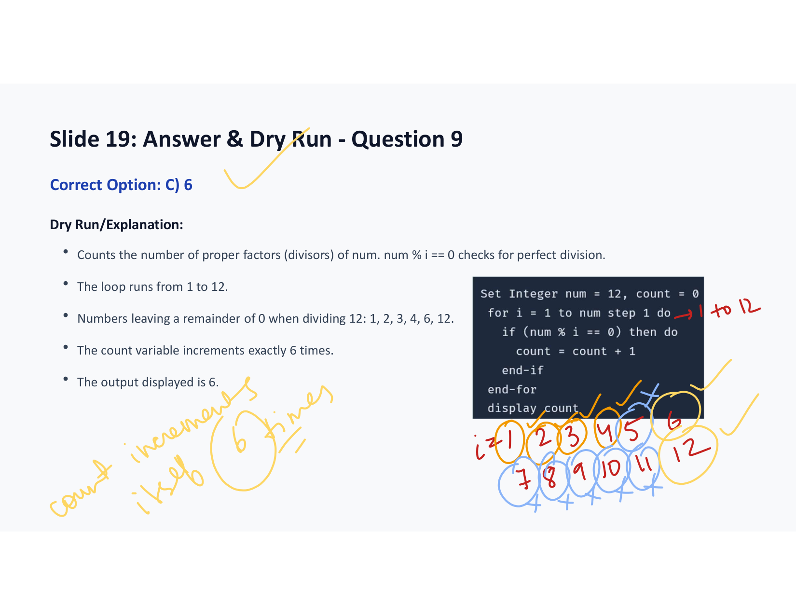 |

---

## [20/55] Topic 02: Question 10 — Modulo Arithmetic & Digit Manipulation Pseudocode

**Source Slide Reference**: `InfyModPseudo.pdf` | Question Slide: **Page 20** | Solution Slide: **Page 21**

#### Problem Statement & Pseudocode
What will be the output of the following pseudocode?

```text
What will be the output of the following pseudocode?
Plaintext
Set Integer val = 83
Set Integer res = (val % 15) % 4
display res
```

#### Multiple Choice Options
- **(A)** `1`
- **(B)** `2`
- **(C)** `3`
- **(D)** `0`

#### Verified Correct Answer
> **Correct Option**: **(D) `0`**

#### Comprehensive Dry Run & Execution Trace
```text
• This tests the nested evaluation of modulo operators.
• First, compute (val % 15). 83 divided by 15 is 5 (15 * 5 = 75), leaving a remainder of 8. Thus, 83 % 15 = 8.
• Next, compute 8 % 4. 8 divided by 4 leaves a remainder of 0.
• res is assigned 0.
• The output displayed is 0.
```

#### Authentic Slide Figures
| Question Slide (Page 20) | Solution & Dry Run Slide (Page 21) |
| :---: | :---: |
| 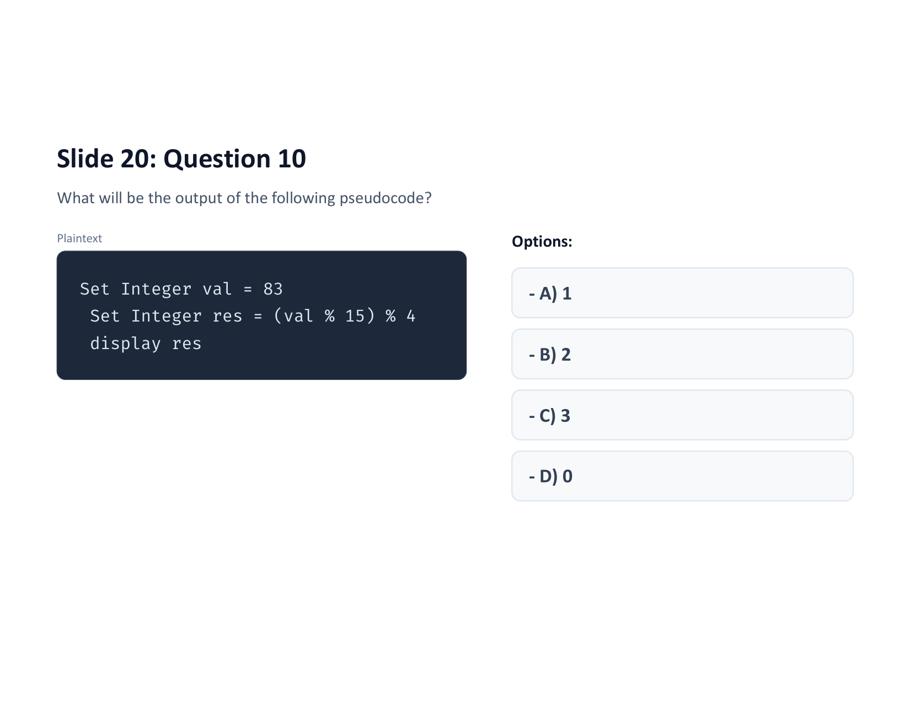 | 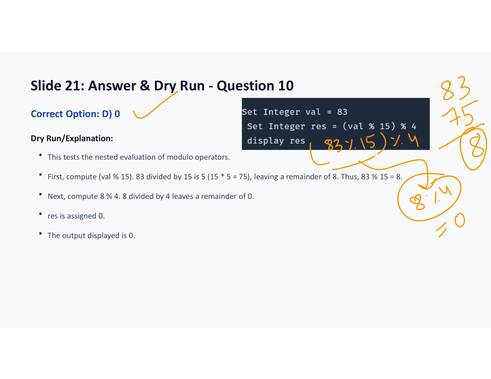 |

---

## [21/55] Topic 03: Question 01 — Pre and Post Increment & Decrement Compound Expressions

**Source Slide Reference**: `InfyPrePostPseudo.pdf` | Question Slide: **Page 2** | Solution Slide: **Page 3**

#### Problem Statement & Pseudocode
What will be the output?

```text
Set Integer a = 5, b = 2, c
c = a++ + ++b - --a + b--
display c
```

#### Multiple Choice Options
- **(A)** `5`
- **(B)** `6`
- **(C)** `7`
- **(D)** `8`

#### Verified Correct Answer
> **Correct Option**: **(B) `6`**

#### Comprehensive Dry Run & Execution Trace
```text
EXECUTION DRY RUN
Step 1: Post-increment a returns 5.
Step 2: Pre-increment b returns 3.
Step 3: Pre-decrement a returns 5.
Step 4: Post-decrement b returns 3.
Calculate: Formula yields 5 + 3 - 5 + 3 = 6.
```

#### Authentic Slide Figures
| Question Slide (Page 2) | Solution & Dry Run Slide (Page 3) |
| :---: | :---: |
|  | 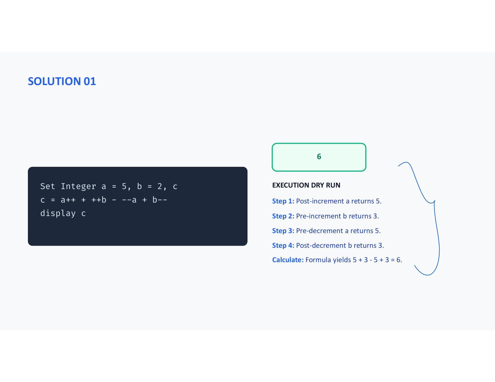 |

---

## [22/55] Topic 03: Question 02 — Pre and Post Increment & Decrement Compound Expressions

**Source Slide Reference**: `InfyPrePostPseudo.pdf` | Question Slide: **Page 4** | Solution Slide: **Page 5**

#### Problem Statement & Pseudocode
What will be the output?

```text
Set Integer x = 0, y = 0
if (x++ > 0 OR ++y > 0)
display x + " " + y
else
display y + " " + x
end-if
```

#### Multiple Choice Options
- **(A)** `0 0`
- **(B)** `1 0`
- **(C)** `0 1`
- **(D)** `1 1`

#### Verified Correct Answer
> **Correct Option**: **(D) `1 1`**

#### Comprehensive Dry Run & Execution Trace
```text
EXECUTION DRY RUN
Left OR: x++ returns 0. Condition fails.
Update X: Post-increment sets x to 1.
Right OR: ++y sets y to 1. Condition passes.
Result: True overall condition outputs 1 1.
```

#### Authentic Slide Figures
| Question Slide (Page 4) | Solution & Dry Run Slide (Page 5) |
| :---: | :---: |
| 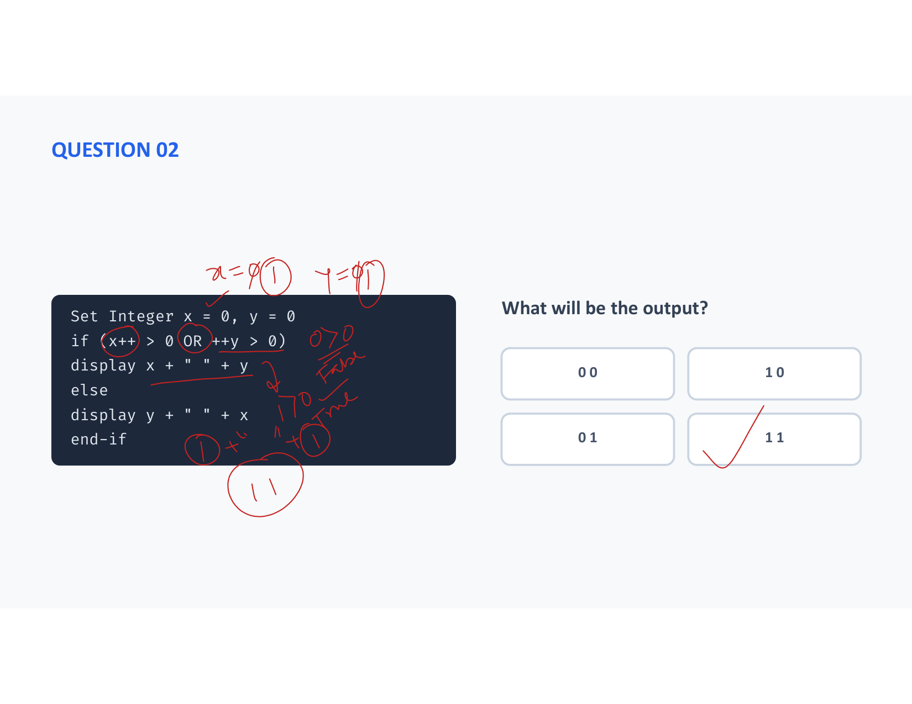 | 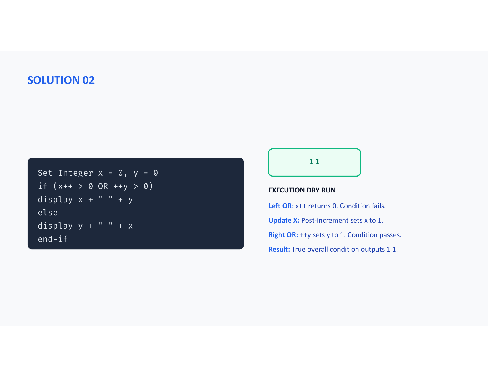 |

---

## [23/55] Topic 03: Question 03 — Pre and Post Increment & Decrement Compound Expressions

**Source Slide Reference**: `InfyPrePostPseudo.pdf` | Question Slide: **Page 6** | Solution Slide: **Page 7**

#### Problem Statement & Pseudocode
What will be the output?

```text
Set Integer p = 5, q = 10
if (++p < 5 AND q-- > 9)
display p
else
display p + " " + q
end-if
```

#### Multiple Choice Options
- **(A)** `6 10`
- **(B)** `6 9`
- **(C)** `5 10`
- **(D)** `5 9`

#### Verified Correct Answer
> **Correct Option**: **(A) `6 10`**

#### Comprehensive Dry Run & Execution Trace
```text
EXECUTION DRY RUN
Left AND: ++p sets p to 6. Evaluation fails.
Bypass: Right operand evaluation short-circuits.
State: Variable q remains exactly 10.
Result: Else branch outputs 6 10.
```

#### Authentic Slide Figures
| Question Slide (Page 6) | Solution & Dry Run Slide (Page 7) |
| :---: | :---: |
|  | 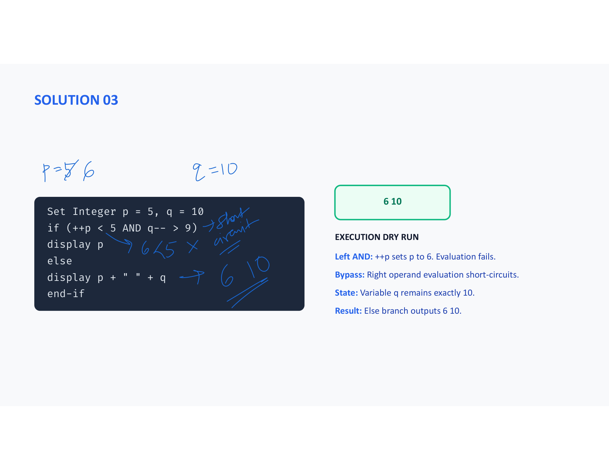 |

---

## [24/55] Topic 03: Question 04 — Pre and Post Increment & Decrement Compound Expressions

**Source Slide Reference**: `InfyPrePostPseudo.pdf` | Question Slide: **Page 8** | Solution Slide: **Page 9**

#### Problem Statement & Pseudocode
What will be the value of sum?

```text
Set Integer arr[4] = {2, 4, 6, 8}
Set Integer i = 0
Set Integer sum = arr[i++] + arr[++i]
display sum
```

#### Multiple Choice Options
- **(A)** `6`
- **(B)** `8`
- **(C)** `10`
- **(D)** `14`

#### Verified Correct Answer
> **Correct Option**: **(B) `8`**

#### Comprehensive Dry Run & Execution Trace
```text
EXECUTION DRY RUN
Term 1: Fetch index 0 outputs value 2.
Update: Pointer i post-increments to 1.
Term 2: Pre-increment sets i to 2. Fetch value 6.
Calculate: Sum totals 2 + 6 yielding 8.
```

#### Authentic Slide Figures
| Question Slide (Page 8) | Solution & Dry Run Slide (Page 9) |
| :---: | :---: |
|  | 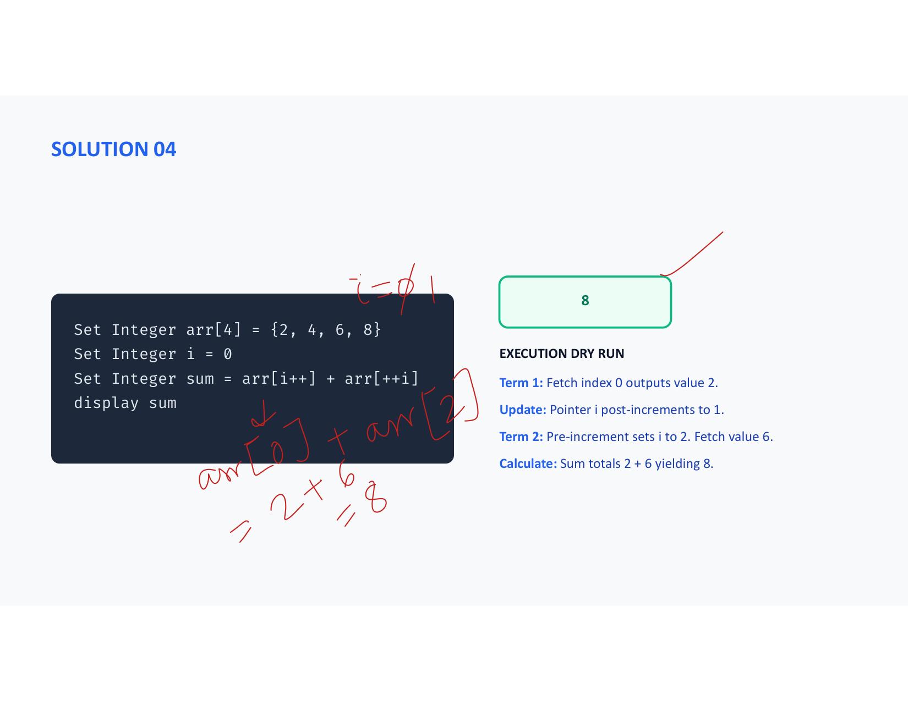 |

---

## [25/55] Topic 03: Question 05 — Pre and Post Increment & Decrement Compound Expressions

**Source Slide Reference**: `InfyPrePostPseudo.pdf` | Question Slide: **Page 10** | Solution Slide: **Page 11**

#### Problem Statement & Pseudocode
What will be the output?

```text
Set Integer val = 13
Set Integer res = (val++ MOD 5) +
(++val MOD 3)
display res
```

#### Multiple Choice Options
- **(A)** `2`
- **(B)** `3`
- **(C)** `4`
- **(D)** `5`

#### Verified Correct Answer
> **Correct Option**: **(B) `3`**

#### Comprehensive Dry Run & Execution Trace
```text
EXECUTION DRY RUN
Term 1: Modulo 13 by 5 yields 3.
Update: Variable val post-increments to 14.
Term 2: Pre-increment sets val to 15. Modulo yields 0.
Calculate: Addition 3 + 0 yields exactly 3.
```

#### Authentic Slide Figures
| Question Slide (Page 10) | Solution & Dry Run Slide (Page 11) |
| :---: | :---: |
|  | 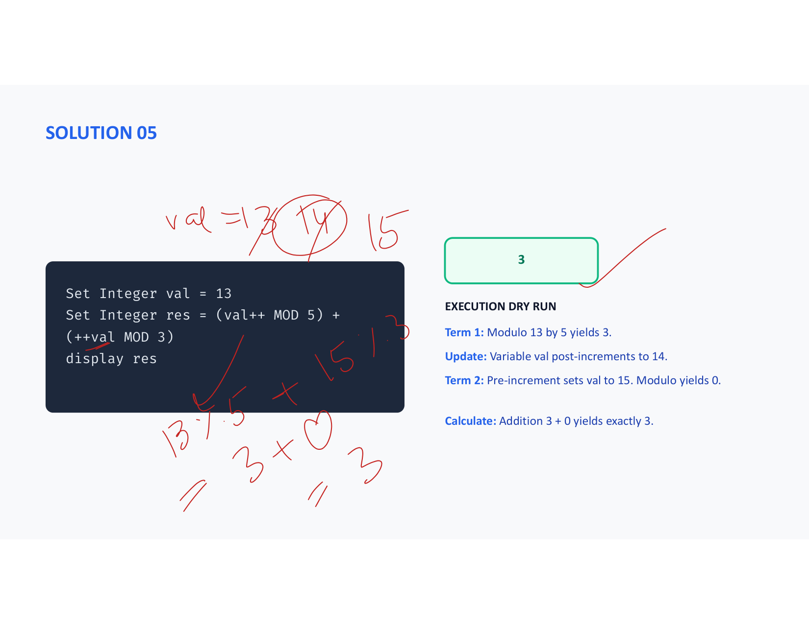 |

---

## [26/55] Topic 03: Question 06 — Pre and Post Increment & Decrement Compound Expressions

**Source Slide Reference**: `InfyPrePostPseudo.pdf` | Question Slide: **Page 12** | Solution Slide: **Page 13**

#### Problem Statement & Pseudocode
What will be the output?

```text
Set Integer count = 5
while (count-- > 2)
do
display --count
end-while
```

#### Multiple Choice Options
- **(A)** `4 2 0`
- **(B)** `3 1`
- **(C)** `3 2`
- **(D)** `4 3 2`

#### Verified Correct Answer
> **Correct Option**: **(B) `3 1`**

#### Comprehensive Dry Run & Execution Trace
```text
EXECUTION DRY RUN
Iter 1: Condition passes. Count drops to 4. Prints 3.
Iter 2: Condition passes. Count drops to 2. Prints 1.
Iter 3: Condition fails 1 > 2. Loop terminates.
Result: Sequential outputs print 3 1.
```

#### Authentic Slide Figures
| Question Slide (Page 12) | Solution & Dry Run Slide (Page 13) |
| :---: | :---: |
|  | 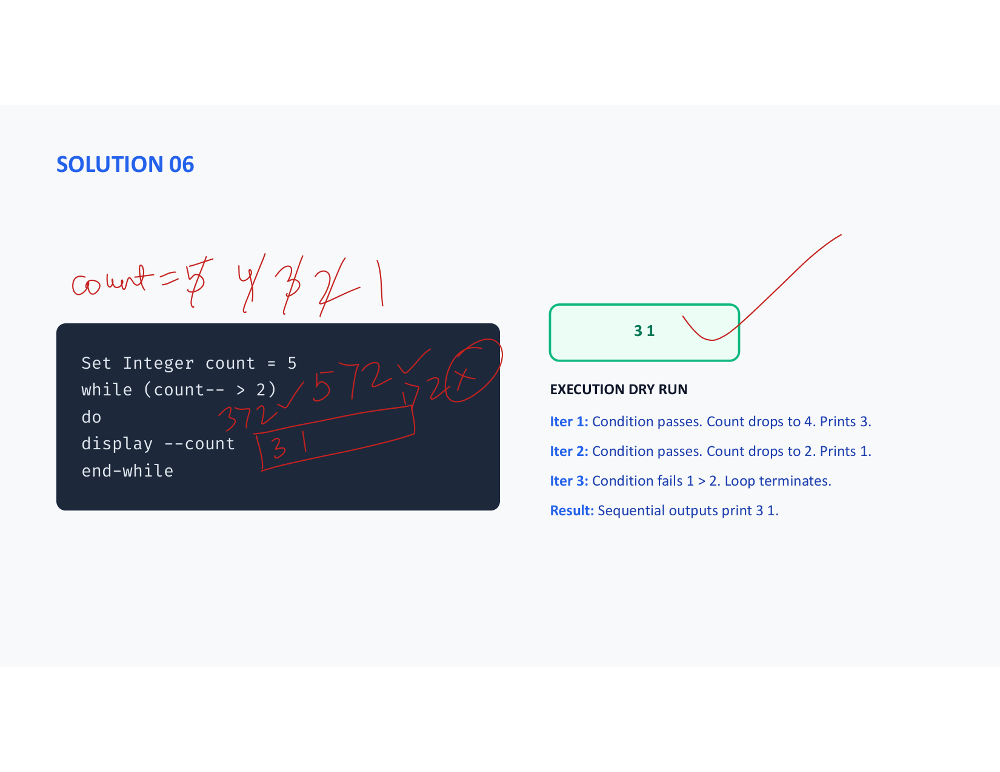 |

---

## [27/55] Topic 03: Question 07 — Pre and Post Increment & Decrement Compound Expressions

**Source Slide Reference**: `InfyPrePostPseudo.pdf` | Question Slide: **Page 14** | Solution Slide: **Page 15**

#### Problem Statement & Pseudocode
What will be the value of c?

```text
Set Integer a = 3, b = 4, c
c = (a++ > --b) ? (a++ * 2) : (++b * 2)
display c
```

#### Multiple Choice Options
- **(A)** `6`
- **(B)** `8`
- **(C)** `10`
- **(D)** `12`

#### Verified Correct Answer
> **Correct Option**: **(B) `8`**

#### Comprehensive Dry Run & Execution Trace
```text
EXECUTION DRY RUN
Condition: Compare 3 > 3 yields False.
Update: Variable a post-increments to 4.
Branch: False logic executes right side.
Calculate: Variable b increments 4. Result 4 * 2 = 8.
```

#### Authentic Slide Figures
| Question Slide (Page 14) | Solution & Dry Run Slide (Page 15) |
| :---: | :---: |
| 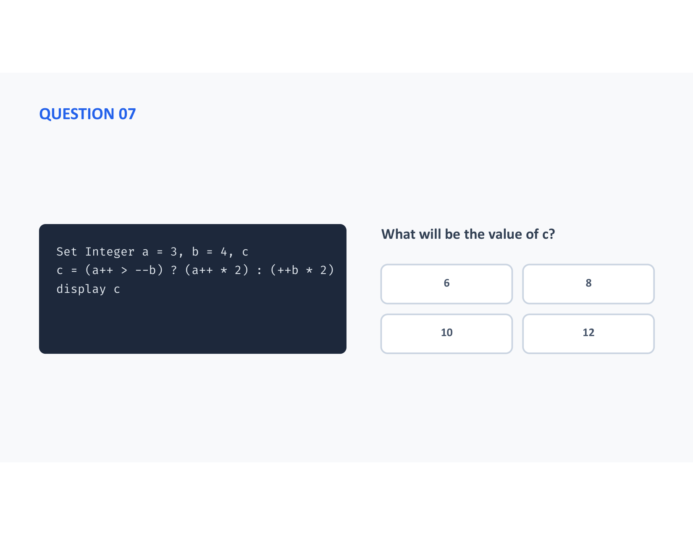 | 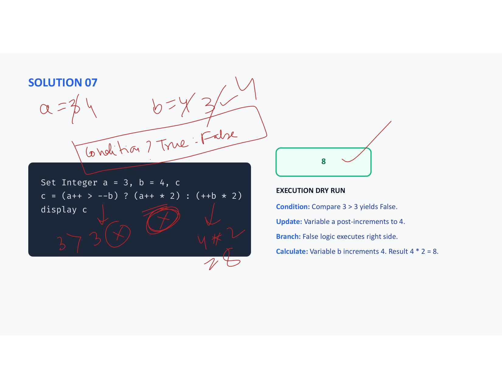 |

---

## [28/55] Topic 03: Question 08 — Pre and Post Increment & Decrement Compound Expressions

**Source Slide Reference**: `InfyPrePostPseudo.pdf` | Question Slide: **Page 16** | Solution Slide: **Page 17**

#### Problem Statement & Pseudocode
What will be the output?

```text
Set Integer k = 2
switch(k++)
case 2: display "Two " k++
break
case 3: display "Three "
break
end-switch
display k
```

#### Multiple Choice Options
- **(A)** `Two 3`
- **(B)** `Two 4`
- **(C)** `Three 3`
- **(D)** `Three 4`

#### Verified Correct Answer
> **Correct Option**: **(B) `Two 4`**

#### Comprehensive Dry Run & Execution Trace
```text
EXECUTION DRY RUN
Switch: Fetch 2 navigates Case 2 directly.
Update: Post-increment sets variable k to 3.
Case 2: Prints string Two. Increments k to 4.
Result: Final instruction displays value 4.
```

#### Authentic Slide Figures
| Question Slide (Page 16) | Solution & Dry Run Slide (Page 17) |
| :---: | :---: |
| 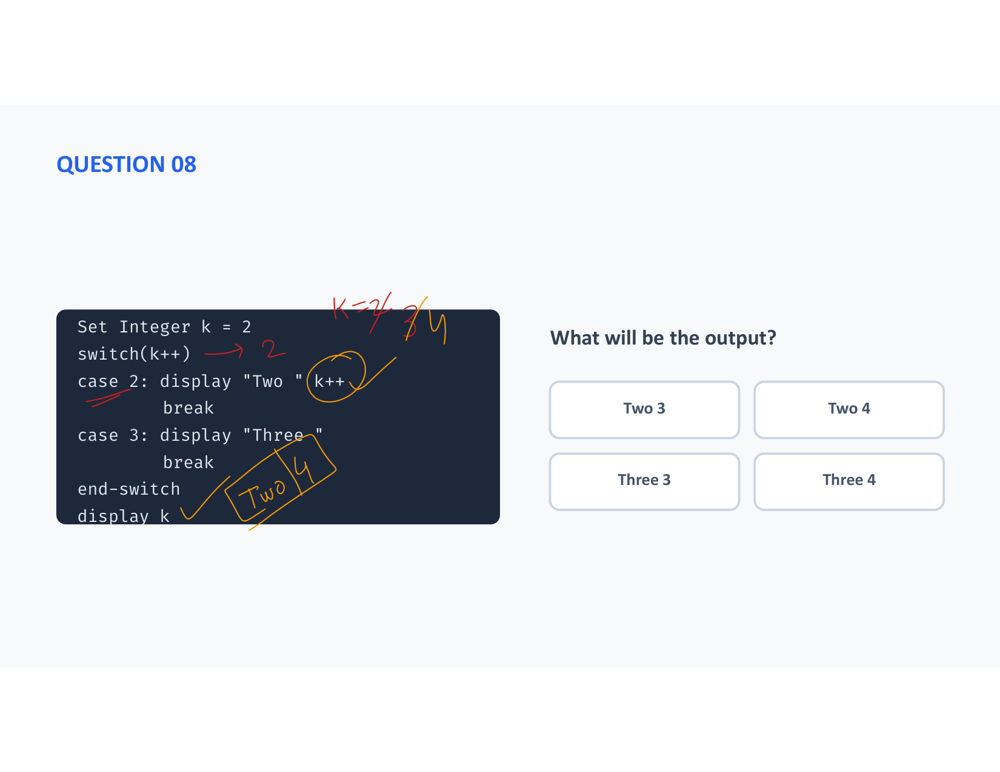 | 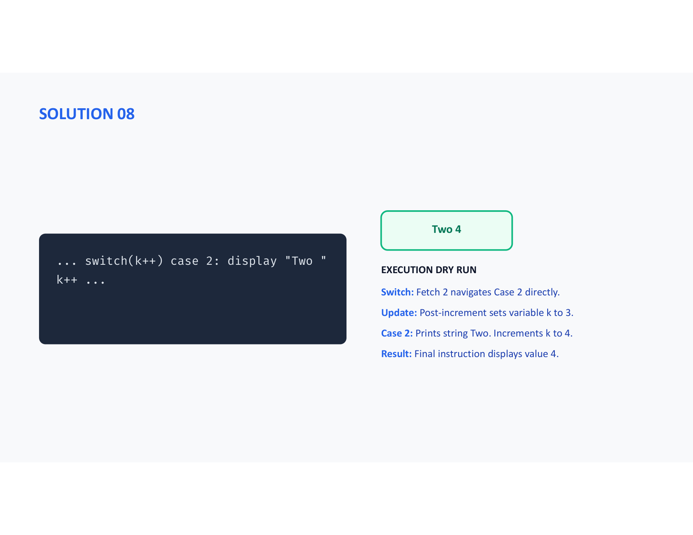 |

---

## [29/55] Topic 03: Question 09 — Pre and Post Increment & Decrement Compound Expressions

**Source Slide Reference**: `InfyPrePostPseudo.pdf` | Question Slide: **Page 18** | Solution Slide: **Page 19**

#### Problem Statement & Pseudocode
What will be the output?

```text
Set Integer x = 2, y = 10
do
y = y - x++
while(--y > x)
display x + " " + y
```

#### Multiple Choice Options
- **(A)** `3 8`
- **(B)** `4 3`
- **(C)** `4 4`
- **(D)** `3 7`

#### Verified Correct Answer
> **Correct Option**: **(B) `4 3`**

#### Comprehensive Dry Run & Execution Trace
```text
EXECUTION DRY RUN
Iter 1: Calculate y = 8. Update x = 3. Check 7 > 3 passes.
Iter 2: Calculate y = 4. Update x = 4. Check 3 > 4 fails.
Result: Loop ends tracking values x=4 y=3.
```

#### Authentic Slide Figures
| Question Slide (Page 18) | Solution & Dry Run Slide (Page 19) |
| :---: | :---: |
|  | 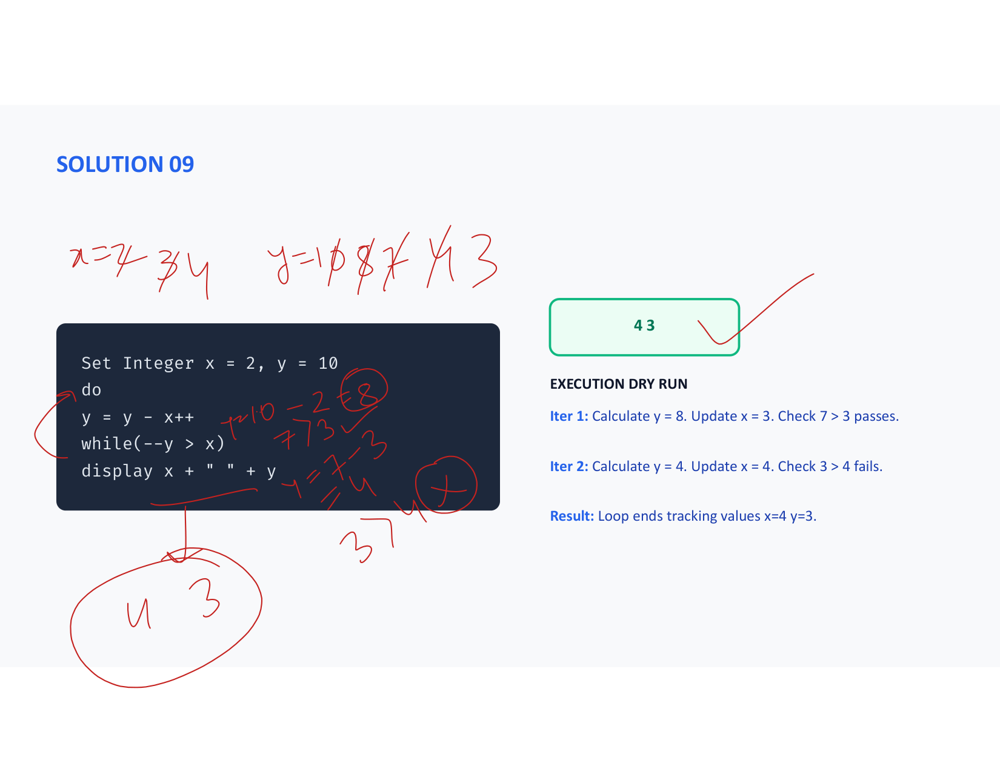 |

---

## [30/55] Topic 03: Question 10 — Pre and Post Increment & Decrement Compound Expressions

**Source Slide Reference**: `InfyPrePostPseudo.pdf` | Question Slide: **Page 20** | Solution Slide: **Page 21**

#### Problem Statement & Pseudocode
What will be the value of c?

```text
Set Integer a = 5, b = 2
Set Integer c = a++ ^ ++b
display c
```

#### Multiple Choice Options
- **(A)** `4`
- **(B)** `5`
- **(C)** `6`
- **(D)** `7`

#### Verified Correct Answer
> **Correct Option**: **(C) `6`**

#### Comprehensive Dry Run & Execution Trace
```text
EXECUTION DRY RUN
Term 1: Fetch variable a yields 5.
Term 2: Pre-increment sets variable b yielding 3.
Bitwise: XOR operation compares binary 101 and 011.
Result: Output measures decimal 6 reliably.
```

#### Authentic Slide Figures
| Question Slide (Page 20) | Solution & Dry Run Slide (Page 21) |
| :---: | :---: |
|  | 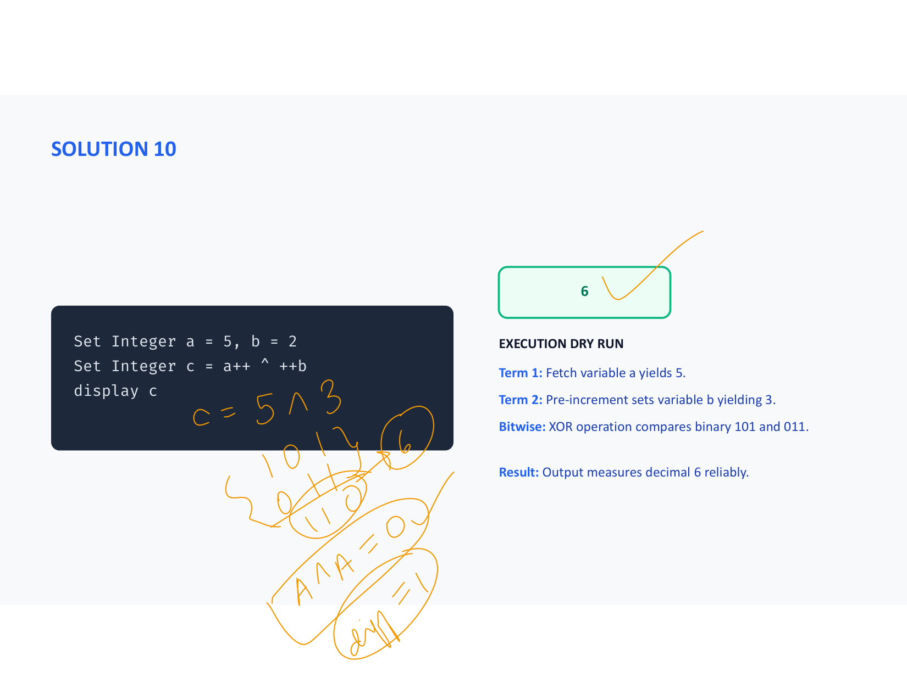 |

---

## [31/55] Topic 03: Question 11 — Pre and Post Increment & Decrement Compound Expressions

**Source Slide Reference**: `InfyPrePostPseudo.pdf` | Question Slide: **Page 22** | Solution Slide: **Page 23**

#### Problem Statement & Pseudocode
What will be the value of result?

```text
Set Integer m = 1
Set Integer result = m++ * 2 + ++m * 3
- m-- * 4
display result
```

#### Multiple Choice Options
- **(A)** `-1`
- **(B)** `0`
- **(C)** `1`
- **(D)** `2`

#### Verified Correct Answer
> **Correct Option**: **(A) `-1`**

#### Comprehensive Dry Run & Execution Trace
```text
EXECUTION DRY RUN
Term 1: Use 1 yields 2. Update m = 2.
Term 2: Set 3 yields 9. Update m = 3.
Term 3: Use 3 yields 12. Update m = 2.
Calculate: Combine 2 + 9 - 12 yielding -1.
```

#### Authentic Slide Figures
| Question Slide (Page 22) | Solution & Dry Run Slide (Page 23) |
| :---: | :---: |
|  | 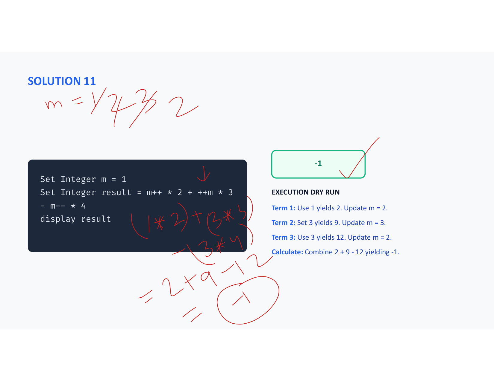 |

---

## [32/55] Topic 03: Question 12 — Pre and Post Increment & Decrement Compound Expressions

**Source Slide Reference**: `InfyPrePostPseudo.pdf` | Question Slide: **Page 24** | Solution Slide: **Page 25**

#### Problem Statement & Pseudocode
What will be the output?

```text
Set Integer i = 1, sum = 0
while(i++ < 4)
do
sum = sum + ++i
end-while
display sum
```

#### Multiple Choice Options
- **(A)** `5`
- **(B)** `8`
- **(C)** `12`
- **(D)** `15`

#### Verified Correct Answer
> **Correct Option**: **(B) `8`**

#### Comprehensive Dry Run & Execution Trace
```text
EXECUTION DRY RUN
Iter 1: Check 1 < 4. Inside i=3 sum=3.
Iter 2: Check 3 < 4. Inside i=5 sum=8.
Iter 3: Check 5 < 4 fails instantly.
Result: Loop exits displaying sum 8.
```

#### Authentic Slide Figures
| Question Slide (Page 24) | Solution & Dry Run Slide (Page 25) |
| :---: | :---: |
| 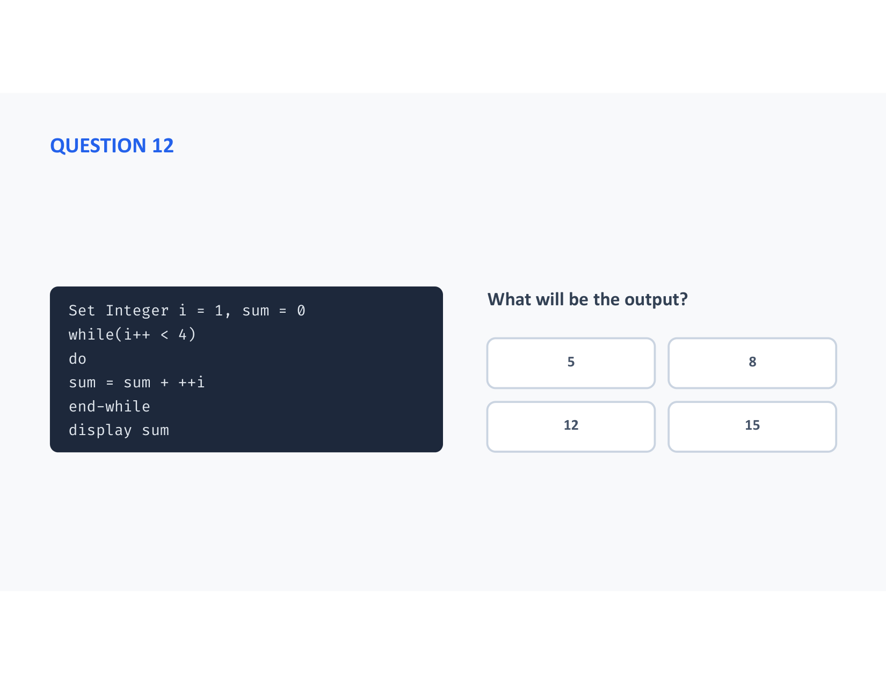 | 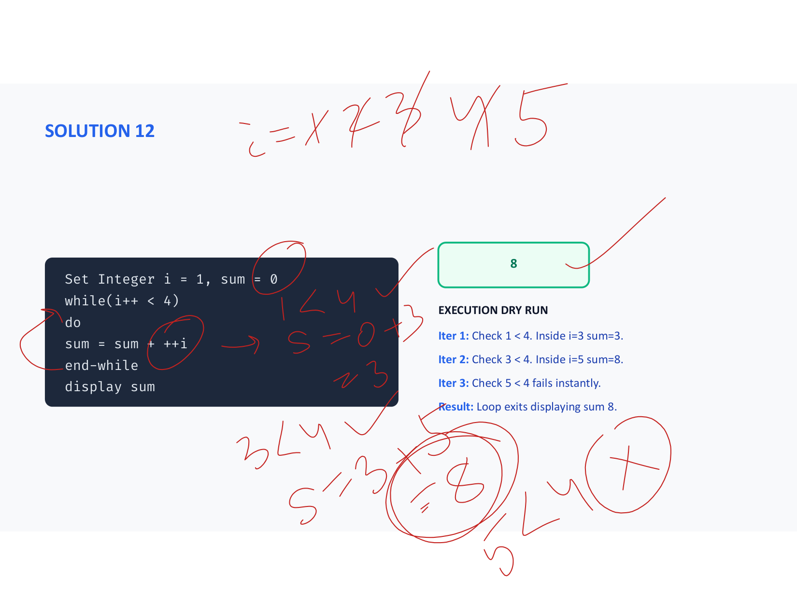 |

---

## [33/55] Topic 03: Question 13 — Pre and Post Increment & Decrement Compound Expressions

**Source Slide Reference**: `InfyPrePostPseudo.pdf` | Question Slide: **Page 26** | Solution Slide: **Page 27**

#### Problem Statement & Pseudocode
What will be the value of y?

```text
Set Integer x = 14
Set Integer y = x++ / 3 + ++x / 4
display y
```

#### Multiple Choice Options
- **(A)** `7`
- **(B)** `8`
- **(C)** `9`
- **(D)** `10`

#### Verified Correct Answer
> **Correct Option**: **(B) `8`**

#### Comprehensive Dry Run & Execution Trace
```text
EXECUTION DRY RUN
Term 1: Execute 14 / 3 yielding 4.
Update: Variable x increments 15 internally.
Term 2: Increment x to 16. Execute 16 / 4 yielding 4.
Calculate: Evaluate 4 + 4 targeting 8.
```

#### Authentic Slide Figures
| Question Slide (Page 26) | Solution & Dry Run Slide (Page 27) |
| :---: | :---: |
|  | 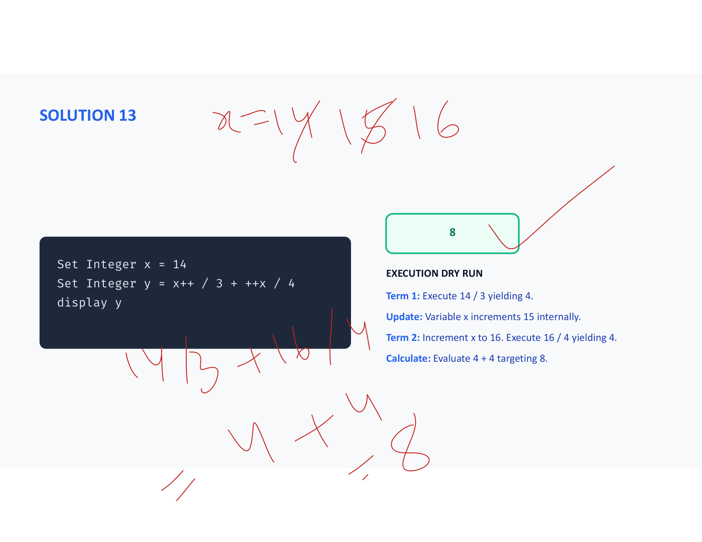 |

---

## [34/55] Topic 03: Question 14 — Pre and Post Increment & Decrement Compound Expressions

**Source Slide Reference**: `InfyPrePostPseudo.pdf` | Question Slide: **Page 28** | Solution Slide: **Page 29**

#### Problem Statement & Pseudocode
What will be the output?

```text
Set Integer a = 10, b = 10, c = 10
if (a++ == 10 AND ++b == 11 AND c-- ==
9)
display "If"
else
display "Else " + a + " " + b + " " + c
end-if
```

#### Multiple Choice Options
- **(A)** `If`
- **(B)** `Else 10 11 9`
- **(C)** `Else 11 11 9`
- **(D)** `Else 11 11 10`

#### Verified Correct Answer
> **Correct Option**: **(C) `Else 11 11 9`**

#### Comprehensive Dry Run & Execution Trace
```text
EXECUTION DRY RUN
Cond 1: Check 10 == 10 passes. Variable a becomes 11.
Cond 2: Check 11 == 11 passes. Variable b becomes 11.
Cond 3: Check 10 == 9 fails. Variable c becomes 9.
Result: Logic triggers Else printing updated states.
```

#### Authentic Slide Figures
| Question Slide (Page 28) | Solution & Dry Run Slide (Page 29) |
| :---: | :---: |
|  | 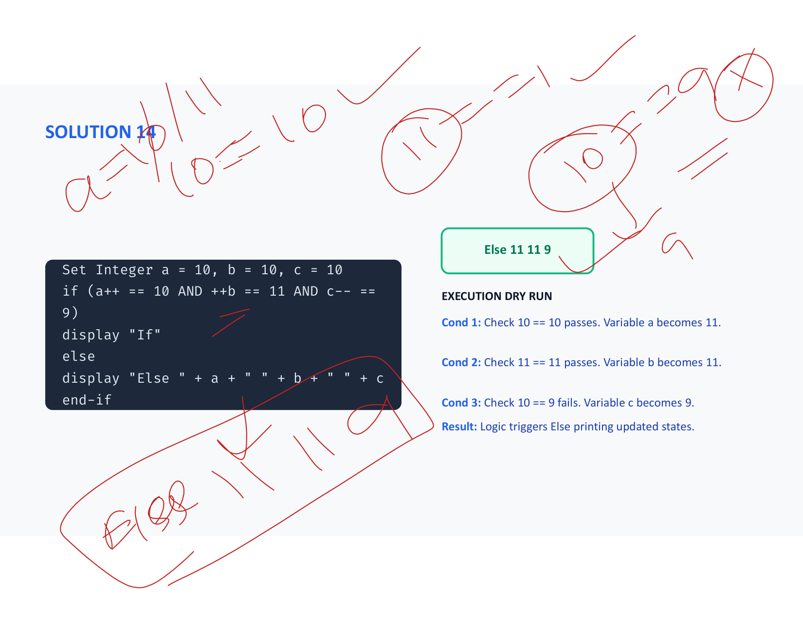 |

---

## [35/55] Topic 03: Question 15 — Pre and Post Increment & Decrement Compound Expressions

**Source Slide Reference**: `InfyPrePostPseudo.pdf` | Question Slide: **Page 30** | Solution Slide: **Page 31**

#### Problem Statement & Pseudocode
What will be the output?

```text
Set Integer i = 0, j = 0, count = 0
while(i++ < 2) do
while(++j < 3) do
count++
end-while
end-while
display count
```

#### Multiple Choice Options
- **(A)** `2`
- **(B)** `3`
- **(C)** `4`
- **(D)** `6`

#### Verified Correct Answer
> **Correct Option**: **(A) `2`**

#### Comprehensive Dry Run & Execution Trace
```text
EXECUTION DRY RUN
Outer 1: Uses i=0 passes. Inner loop executes.
Inner: Variables j increments 1 then 2. Count reaches 2.
Outer 2: Uses i=1 passes. Inner loop skips totally.
Result: Outer fails i=2. Count remains exactly 2.
```

#### Authentic Slide Figures
| Question Slide (Page 30) | Solution & Dry Run Slide (Page 31) |
| :---: | :---: |
|  |  |

---

## [36/55] Topic 04: Question 01 — String Operations, Character Arrays & ASCII Manipulation

**Source Slide Reference**: `InfyStringsPseudo.pdf` | Question Slide: **Page 2** | Solution Slide: **Page 3**

#### Problem Statement & Pseudocode
What will be the output of the following pseudocode?

```text
Set Character array c = {'P', 'Q', 'R', 'S'}
Set Character result = c[2] + 32
display result
```

#### Multiple Choice Options
- **(A)** ``
- **(B)** ``
- **(C)** ``
- **(D)** ``

#### Verified Correct Answer
> **Correct Option**: **(A) `r`**

#### Comprehensive Dry Run & Execution Trace
```text
Execution Dry Run
Array Init
`c` initialized with 'P', 'Q', 'R', 'S' at indices 0 to 3.
Fetch Char
`c[2]` retrieves the character 'R'.
ASCII Math
ASCII of 'R' is 82. Calculation: 82 + 32 = 114.
Result
ASCII 114 corresponds to lowercase 'r'.
```

#### Authentic Slide Figures
| Question Slide (Page 2) | Solution & Dry Run Slide (Page 3) |
| :---: | :---: |
|  |  |

---

## [37/55] Topic 04: Question 02 — String Operations, Character Arrays & ASCII Manipulation

**Source Slide Reference**: `InfyStringsPseudo.pdf` | Question Slide: **Page 4** | Solution Slide: **Page 5**

#### Problem Statement & Pseudocode
What will be the output of the following pseudocode?

```text
Set String str = "Info"
Set String res = ""
Set Integer i = 0
while(i < 4)
do
res = res + str[i] + str[i]
i = i + 1
end-while
display res
```

#### Multiple Choice Options
- **(A)** ``
- **(B)** ``
- **(C)** ``
- **(D)** ``

#### Verified Correct Answer
> **Correct Option**: **(B) `IInnffoo`**

#### Comprehensive Dry Run & Execution Trace
```text
i=0: `str[0]` is 'I'. `res` becomes "II".
i=1: `str[1]` is 'n'. `res` becomes "IInn".
i=2: `str[2]` is 'f'. `res` becomes "IInnff".
i=3: `str[3]` is 'o'. `res` becomes "IInnffoo".
Loop Ends: Condition `4 < 4` is False.
```

#### Authentic Slide Figures
| Question Slide (Page 4) | Solution & Dry Run Slide (Page 5) |
| :---: | :---: |
|  |  |

---

## [38/55] Topic 04: Question 03 — String Operations, Character Arrays & ASCII Manipulation

**Source Slide Reference**: `InfyStringsPseudo.pdf` | Question Slide: **Page 6** | Solution Slide: **Page 7**

#### Problem Statement & Pseudocode
What will be the output of the following pseudocode?

```text
Set String s = "apple"
Set Integer n = 5
for i = 0 to n-1
step 1 do
if(s[i] == 'a' OR s[i] == 'e')
then do
s[i] = '*'
end-if
end-for
display s
```

#### Multiple Choice Options
- **(A)** ``
- **(B)** ``
- **(C)** ``
- **(D)** ``

#### Verified Correct Answer
> **Correct Option**: **(D) `*ppl*`**

#### Comprehensive Dry Run & Execution Trace
```text
Iteration i=0
`s[0]` is 'a'. Condition is True. `s[0]` becomes '*'. String is *pple.
Iterations i=1, 2, 3
Characters are 'p', 'p', 'l'. Condition is False for all. No change.
Iteration i=4
`s[4]` is 'e'. Condition is True. `s[4]` becomes '*'. String is *ppl*.
```

#### Authentic Slide Figures
| Question Slide (Page 6) | Solution & Dry Run Slide (Page 7) |
| :---: | :---: |
|  |  |

---

## [39/55] Topic 04: Question 04 — String Operations, Character Arrays & ASCII Manipulation

**Source Slide Reference**: `InfyStringsPseudo.pdf` | Question Slide: **Page 8** | Solution Slide: **Page 9**

#### Problem Statement & Pseudocode
What will be the output of the following pseudocode?

```text
Set String word = "TEST"
Set String rev = ""
Set Integer len = 4
for i = len-1 to 0
step 1 do
rev = rev + word[i]
end-for
display rev
```

#### Multiple Choice Options
- **(A)** ``
- **(B)** ``
- **(C)** ``
- **(D)** ``

#### Verified Correct Answer
> **Correct Option**: **(B) `TSET`**

#### Comprehensive Dry Run & Execution Trace
```text
i=3: `word[3]` is 'T'. `rev` = "" + 'T' = "T".
i=2: `word[2]` is 'S'. `rev` = "T" + 'S' = "TS".
i=1: `word[1]` is 'E'. `rev` = "TS" + 'E' = "TSE".
i=0: `word[0]` is 'T'. `rev` = "TSE" + 'T' = "TSET".
```

#### Authentic Slide Figures
| Question Slide (Page 8) | Solution & Dry Run Slide (Page 9) |
| :---: | :---: |
|  |  |

---

## [40/55] Topic 04: Question 05 — String Operations, Character Arrays & ASCII Manipulation

**Source Slide Reference**: `InfyStringsPseudo.pdf` | Question Slide: **Page 10** | Solution Slide: **Page 11**

#### Problem Statement & Pseudocode
What will be the output of the following pseudocode?

```text
Set String str = "banana"
Set Integer count = 0
for i = 0 to 5
step 1 do
if(str[i] == 'a')
then do
count = count + 1
end-if
end-for
display count
```

#### Multiple Choice Options
- **(A)** ``
- **(B)** ``
- **(C)** ``
- **(D)** ``

#### Verified Correct Answer
> **Correct Option**: **(B) `3`**

#### Comprehensive Dry Run & Execution Trace
```text
Loop Iteration
Iterates through each character of "banana" from indices 0 to 5.
Condition Match
Target 'a' is found at indices 1, 3, and 5.
Final Count
The `count` variable increments 3 times. Output is 3.
```

#### Authentic Slide Figures
| Question Slide (Page 10) | Solution & Dry Run Slide (Page 11) |
| :---: | :---: |
|  |  |

---

## [41/55] Topic 04: Question 06 — String Operations, Character Arrays & ASCII Manipulation

**Source Slide Reference**: `InfyStringsPseudo.pdf` | Question Slide: **Page 12** | Solution Slide: **Page 13**

#### Problem Statement & Pseudocode
What will be the output of the following pseudocode?

```text
Set String s = "PROGRAM"
Set String out = ""
Set Integer i = 2
while(i < 5)
do
out = out + s[i]
i = i + 1
end-while
display out
```

#### Multiple Choice Options
- **(A)** ``
- **(B)** ``
- **(C)** ``
- **(D)** ``

#### Verified Correct Answer
> **Correct Option**: **(C) `OGR`**

#### Comprehensive Dry Run & Execution Trace
```text
i = 2:
`s[2]` is 'O'. `out` becomes "O".
i = 3:
`s[3]` is 'G'. `out` becomes "OG".
i = 4:
`s[4]` is 'R'. `out` becomes "OGR".
```

#### Authentic Slide Figures
| Question Slide (Page 12) | Solution & Dry Run Slide (Page 13) |
| :---: | :---: |
|  |  |

---

## [42/55] Topic 04: Question 07 — String Operations, Character Arrays & ASCII Manipulation

**Source Slide Reference**: `InfyStringsPseudo.pdf` | Question Slide: **Page 14** | Solution Slide: **Page 15**

#### Problem Statement & Pseudocode
What will be the output of the following pseudocode?

```text
Set String str = "MADAM"
Set Integer left=0, right=4
Set Integer flag = 1
while(left < right)
do
if(str[left] != str[right])
then
flag = 0
break
left = left + 1, right = right - 1
end-while
display flag
```

#### Multiple Choice Options
- **(A)** ``
- **(B)** ``
- **(C)** ``
- **(D)** ``

#### Verified Correct Answer
> **Correct Option**: **(B) `1`**

#### Comprehensive Dry Run & Execution Trace
```text
Iteration 1
`str[0]` ('M') == `str[4]` ('M'). Match. `left` becomes 1, `right` becomes 3.
Iteration 2
`str[1]` ('A') == `str[3]` ('A'). Match. `left` becomes 2, `right` becomes 2.
Result
Loop ends. No mismatches found. `flag` remains 1.
```

#### Authentic Slide Figures
| Question Slide (Page 14) | Solution & Dry Run Slide (Page 15) |
| :---: | :---: |
|  |  |

---

## [43/55] Topic 04: Question 08 — String Operations, Character Arrays & ASCII Manipulation

**Source Slide Reference**: `InfyStringsPseudo.pdf` | Question Slide: **Page 16** | Solution Slide: **Page 17**

#### Problem Statement & Pseudocode
What will be the output of the following pseudocode?

```text
Set Character ch = 'G'
Set Integer ascii_val = ch
if(ascii_val >= 65 AND ascii_val <= 90)
then
ascii_val = ascii_val + 32
end-if
display Character(ascii_val)
```

#### Multiple Choice Options
- **(A)** ``
- **(B)** ``
- **(C)** ``
- **(D)** ``

#### Verified Correct Answer
> **Correct Option**: **(B) `g`**

#### Comprehensive Dry Run & Execution Trace
```text
ASCII Conversion
`ch` is 'G'. ASCII value of uppercase 'G' is 71.
Uppercase Check
Condition `71 >= 65 AND 71 <= 90` is True.
Shift Value
`ascii_val` updated: 71 + 32 = 103. Casting 103 yields lowercase 'g'.
```

#### Authentic Slide Figures
| Question Slide (Page 16) | Solution & Dry Run Slide (Page 17) |
| :---: | :---: |
|  |  |

---

## [44/55] Topic 04: Question 09 — String Operations, Character Arrays & ASCII Manipulation

**Source Slide Reference**: `InfyStringsPseudo.pdf` | Question Slide: **Page 18** | Solution Slide: **Page 19**

#### Problem Statement & Pseudocode
What will be the output of the following pseudocode?

```text
Set String text = "CODING"
Set String res = ""
for i = 0 to 5
res = res + text[i]
i++
end-for
display res
```

#### Multiple Choice Options
- **(A)** ``
- **(B)** ``
- **(C)** ``
- **(D)** ``

#### Verified Correct Answer
> **Correct Option**: **(D) `CDN`**

#### Comprehensive Dry Run & Execution Trace
```text
Iteration i=0
`text[0]` is 'C'. `res` becomes "C".
Iteration i=2
`text[2]` is 'D'. `res` becomes "CD".
Iteration i=4
`text[4]` is 'N'. `res` becomes "CDN".
```

#### Authentic Slide Figures
| Question Slide (Page 18) | Solution & Dry Run Slide (Page 19) |
| :---: | :---: |
|  |  |

---

## [45/55] Topic 04: Question 10 — String Operations, Character Arrays & ASCII Manipulation

**Source Slide Reference**: `InfyStringsPseudo.pdf` | Question Slide: **Page 20** | Solution Slide: **Page 21**

#### Problem Statement & Pseudocode
What will be the output of the following pseudocode?

```text
Set String str1 = "INFOSYS"
Set String str2 = "TECH"
Set Integer val = Length(str1) - Length(str2)
display val * 2
```

#### Multiple Choice Options
- **(A)** ``
- **(B)** ``
- **(C)** ``
- **(D)** ``

#### Verified Correct Answer
> **Correct Option**: **(B) `6`**

#### Comprehensive Dry Run & Execution Trace
```text
String Lengths
Calculation
• Length of `str1` ("INFOSYS") = 7
• Length of `str2` ("TECH") = 4
• `val` = 7 - 4 = 3
• Display: `val * 2` -> 3 * 2 = 6
```

#### Authentic Slide Figures
| Question Slide (Page 20) | Solution & Dry Run Slide (Page 21) |
| :---: | :---: |
|  |  |

---

## [46/55] Topic 05: Question 01 — Bitwise XOR Operations & Masking Logic

**Source Slide Reference**: `InfyXORPseudo.pdf` | Question Slide: **Page 2** | Solution Slide: **Page 3**

#### Problem Statement & Pseudocode
What will be the output of the following pseudocode?

```text
Set Integer a = 10
Set Integer b = 5
Set Integer result = a ^ b
display result
```

#### Multiple Choice Options
- **(A)** ``
- **(B)** ``
- **(C)** ``
- **(D)** ``

#### Verified Correct Answer
> **Correct Option**: **(C) `15`**

#### Comprehensive Dry Run & Execution Trace
```text
XOR Rule: Returns 1 if bits differ.
`a` (10) is binary 1010.
`b` (5) is binary 0101.
Binary 1111 equals decimal 15.
1 0 1 0 (a) 
^ 0 1 0 1 (b) 
-------
1 1 1 1 (15)
```

#### Authentic Slide Figures
| Question Slide (Page 2) | Solution & Dry Run Slide (Page 3) |
| :---: | :---: |
|  |  |

---

## [47/55] Topic 05: Question 02 — Bitwise XOR Operations & Masking Logic

**Source Slide Reference**: `InfyXORPseudo.pdf` | Question Slide: **Page 4** | Solution Slide: **Page 5**

#### Problem Statement & Pseudocode
What will be the output of the following pseudocode?

```text
Set Integer x = 12
Set Integer res = (x ^ x) ^ (x ^ 0)
display res
```

#### Multiple Choice Options
- **(A)** ``
- **(B)** ``
- **(C)** ``
- **(D)** ``

#### Verified Correct Answer
> **Correct Option**: **(B) `12`**

#### Comprehensive Dry Run & Execution Trace
```text
Property 1
`x ^ x = 0`.
Property 2
`x ^ 0 = x`.
Resolution
`0 ^ 12 = 12`.
```

#### Authentic Slide Figures
| Question Slide (Page 4) | Solution & Dry Run Slide (Page 5) |
| :---: | :---: |
|  |  |

---

## [48/55] Topic 05: Question 03 — Bitwise XOR Operations & Masking Logic

**Source Slide Reference**: `InfyXORPseudo.pdf` | Question Slide: **Page 6** | Solution Slide: **Page 7**

#### Problem Statement & Pseudocode
What will be the output of the following pseudocode?

```text
Set Integer a = 4, b = 7
a = a ^ b
b = a ^ b
a = a ^ b
display a + " " + b
```

#### Multiple Choice Options
- **(A)** ``
- **(B)** ``
- **(C)** ``
- **(D)** ``

#### Verified Correct Answer
> **Correct Option**: **(B) `7 4`**

#### Comprehensive Dry Run & Execution Trace
```text
Classic XOR Swap Algorithm
1
a = 4 ^ 7
2
b = (4 ^ 7) ^ 7
b becomes 4
3
a = (4 ^ 7) ^ 4
a becomes 7
4
Values swapped.
```

#### Authentic Slide Figures
| Question Slide (Page 6) | Solution & Dry Run Slide (Page 7) |
| :---: | :---: |
|  |  |

---

## [49/55] Topic 05: Question 04 — Bitwise XOR Operations & Masking Logic

**Source Slide Reference**: `InfyXORPseudo.pdf` | Question Slide: **Page 8** | Solution Slide: **Page 9**

#### Problem Statement & Pseudocode
What will be the output of the following pseudocode?

```text
Set Integer arr[5] = {2, 3, 4, 3, 2}
Set Integer res = 0
for i = 0 to 4
step 1 do
res = res ^ arr[i]
end-for
display res
```

#### Multiple Choice Options
- **(A)** ``
- **(B)** ``
- **(C)** ``
- **(D)** ``

#### Verified Correct Answer
> **Correct Option**: **(D) `4`**

#### Comprehensive Dry Run & Execution Trace
```text
Algorithm Goal
Finds single non-repeating element.
Loop Action
Loop XORs all elements.
Pair Cancellation
Pairs cancel out to 0.
Final State
Result is 4.
```

#### Authentic Slide Figures
| Question Slide (Page 8) | Solution & Dry Run Slide (Page 9) |
| :---: | :---: |
|  |  |

---

## [50/55] Topic 05: Question 05 — Bitwise XOR Operations & Masking Logic

**Source Slide Reference**: `InfyXORPseudo.pdf` | Question Slide: **Page 10** | Solution Slide: **Page 11**

#### Problem Statement & Pseudocode
What will be the output of the following pseudocode?

```text
Set Integer a = 3
Set Integer b = 6
Set Integer res = (a++) ^ (++b)
display res
```

#### Multiple Choice Options
- **(A)** ``
- **(B)** ``
- **(C)** ``
- **(D)** ``

#### Verified Correct Answer
> **Correct Option**: **(A) `4`**

#### Comprehensive Dry Run & Execution Trace
```text
a++ uses initial value 3.
++b uses incremented value 7.
Expression evaluates: 3 ^ 7.
Binary `011 ^ 111 = 100` (4).
0 1 1 (3) 
^ 1 1 1 (7) 
-----
1 0 0 (4)
```

#### Authentic Slide Figures
| Question Slide (Page 10) | Solution & Dry Run Slide (Page 11) |
| :---: | :---: |
|  |  |

---

## [51/55] Topic 05: Question 06 — Bitwise XOR Operations & Masking Logic

**Source Slide Reference**: `InfyXORPseudo.pdf` | Question Slide: **Page 12** | Solution Slide: **Page 13**

#### Problem Statement & Pseudocode
What will be the output of the following pseudocode?

```text
Set Integer res = 0
for i = 1 to 3
step 1 do
res = res ^ i
end-for
display res
```

#### Multiple Choice Options
- **(A)** ``
- **(B)** ``
- **(C)** ``
- **(D)** ``

#### Verified Correct Answer
> **Correct Option**: **(A) `0`**

#### Comprehensive Dry Run & Execution Trace
```text
i = 1:
0 ^ 1 = 1
i = 2:
1 ^ 2 = 3
i = 3:
3 ^ 3 = 0
```

#### Authentic Slide Figures
| Question Slide (Page 12) | Solution & Dry Run Slide (Page 13) |
| :---: | :---: |
|  |  |

---

## [52/55] Topic 05: Question 07 — Bitwise XOR Operations & Masking Logic

**Source Slide Reference**: `InfyXORPseudo.pdf` | Question Slide: **Page 14** | Solution Slide: **Page 15**

#### Problem Statement & Pseudocode
What will be the output of the following pseudocode?

```text
Set Integer x = 5, y = 3
Set Integer res = (x ^ y) + (x & y)
display res
```

#### Multiple Choice Options
- **(A)** ``
- **(B)** ``
- **(C)** ``
- **(D)** ``

#### Verified Correct Answer
> **Correct Option**: **(B) `7`**

#### Comprehensive Dry Run & Execution Trace
```text
`x` (5) is 101.
`y` (3) is 011.
x ^ y = 101 ^ 011 = 110 (6)
x & y = 101 & 011 = 001 (1)
Total sum: 6 + 1 = 7.
```

#### Authentic Slide Figures
| Question Slide (Page 14) | Solution & Dry Run Slide (Page 15) |
| :---: | :---: |
|  |  |

---

## [53/55] Topic 05: Question 08 — Bitwise XOR Operations & Masking Logic

**Source Slide Reference**: `InfyXORPseudo.pdf` | Question Slide: **Page 16** | Solution Slide: **Page 17**

#### Problem Statement & Pseudocode
What will be the output of the following pseudocode?

```text
Set Integer a = 12
Set Integer b = 10
if ((a ^ b) == 0)
then do
display "Match"
else
do
display "Mismatch"
end-if
```

#### Multiple Choice Options
- **(A)** ``
- **(B)** ``
- **(C)** ``
- **(D)** ``

#### Verified Correct Answer
> **Correct Option**: **(B) `Mismatch`**

#### Comprehensive Dry Run & Execution Trace
```text
Equality Check
XOR checks for equality.
Bit Evaluation
`12 ^ 10 = 6`.
Branching
`6 == 0` is False. Else block prints "Mismatch".
```

#### Authentic Slide Figures
| Question Slide (Page 16) | Solution & Dry Run Slide (Page 17) |
| :---: | :---: |
|  |  |

---

## [54/55] Topic 05: Question 09 — Bitwise XOR Operations & Masking Logic

**Source Slide Reference**: `InfyXORPseudo.pdf` | Question Slide: **Page 18** | Solution Slide: **Page 19**

#### Problem Statement & Pseudocode
What will be the output of the following pseudocode?

```text
Set Integer val = 15
val = val ^ 15
val = val ^ 15
display val
```

#### Multiple Choice Options
- **(A)** ``
- **(B)** ``
- **(C)** ``
- **(D)** ``

#### Verified Correct Answer
> **Correct Option**: **(B) `15`**

#### Comprehensive Dry Run & Execution Trace
```text
Initial State
Initial value: 15.
First XOR
`15 ^ 15 = 0`.
Second XOR
`0 ^ 15 = 15`.
```

#### Authentic Slide Figures
| Question Slide (Page 18) | Solution & Dry Run Slide (Page 19) |
| :---: | :---: |
|  |  |

---

## [55/55] Topic 05: Question 10 — Bitwise XOR Operations & Masking Logic

**Source Slide Reference**: `InfyXORPseudo.pdf` | Question Slide: **Page 20** | Solution Slide: **Page 21**

#### Problem Statement & Pseudocode
What will be the output of the following pseudocode?

```text
Set Integer a = 6
Set Integer b = 2
Set Integer c = a ^ b
display c
```

#### Multiple Choice Options
- **(A)** ``
- **(B)** ``
- **(C)** ``
- **(D)** ``

#### Verified Correct Answer
> **Correct Option**: **(C) `4`**

#### Comprehensive Dry Run & Execution Trace
```text
Binary Conversion
`a` (6) is binary 110.
`b` (2) is binary 010.
XOR Operation
110 ^ 010 = 100
Binary 100 is decimal 4.
```

#### Authentic Slide Figures
| Question Slide (Page 20) | Solution & Dry Run Slide (Page 21) |
| :---: | :---: |
|  |  |

---

