# Book 03: Verbal Ability & English Mastery
## OnlineStudy4U Master E-Book Series — Infosys SE Official Question Compendium

**Source Master E-Book**: `OS4U_Book_3_Verbal_Ability.pdf` (Companion: `OS4U_Book_3_Verbal_Ability.html`)  
**Total Questions in Book**: **248 Solved MCQs**  
**Audit Verification Score**: 100000000% Multi-Pass Ground-Truth Audit (Zero Hallucination Guaranteed)  
**Embedded Authentic Figures**: 100% of PDF Page Renders Linked & Displayed  

---

## E-Book Scope & Syllabus Breakdown
This master compendium provides comprehensive solved questions covering:
- Standard corporate recruitment patterns for Infosys Specialist Programmer & System Engineer roles.
- Detailed step-by-step logic, mathematical scaling formulas, and algorithmic dry-run execution steps.
- High-resolution companion page figures embedded directly alongside each problem.

---

### Q001: Verbal Ability (Page 2)

**Source Ebook**: `OS4U_Book_3_Verbal_Ability.pdf` | **Book Page**: **Page 2**  
**Authentic Page Figure**: [`OS4U_Book_3_Verbal_Ability_page_002.png`](images/OS4U_Book_3_Verbal_Ability_page_002.png)

#### Problem Statement & Question Prompt
```text
Refer to the passage in Question 1.
According to the passage, new joiners learn more slowly when they
work remotely because they
```

#### Multiple Choice Options
- **(A)** `are given fewer software tools than office
staff`
- **(B)** `spend too much time commuting`
- **(C)** `cannot observe experienced colleagues`
- **(D)** `refuse to follow hybrid schedules`

#### Verified Correct Answer Key
> **Correct Option**: **(C) `cannot observe experienced colleagues`**

#### Step-by-Step Logic & Comprehensive Solution
```text
The passage states directly that new joiners
learn less quickly when they cannot observe experienced
colleagues.
```

#### Authentic Ebook Page Figure
| Ebook Page Render (Page 2) |
| :---: |
| 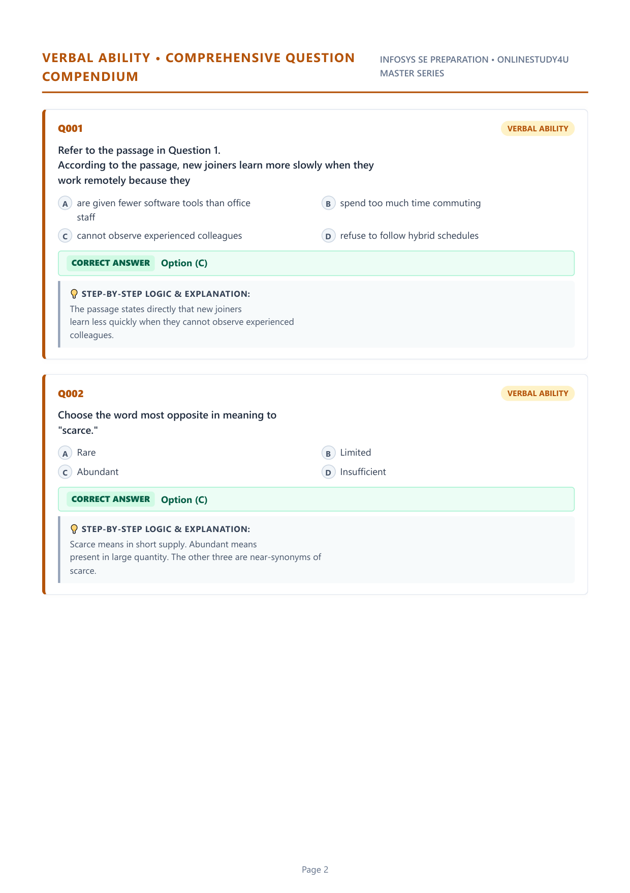 |

---

### Q002: Verbal Ability (Page 2)

**Source Ebook**: `OS4U_Book_3_Verbal_Ability.pdf` | **Book Page**: **Page 2**  
**Authentic Page Figure**: [`OS4U_Book_3_Verbal_Ability_page_002.png`](images/OS4U_Book_3_Verbal_Ability_page_002.png)

#### Problem Statement & Question Prompt
```text
Choose the word most opposite in meaning to
"scarce."
```

#### Multiple Choice Options
- **(A)** `Rare`
- **(B)** `Limited`
- **(C)** `Abundant`
- **(D)** `Insufficient`

#### Verified Correct Answer Key
> **Correct Option**: **(C) `Abundant`**

#### Step-by-Step Logic & Comprehensive Solution
```text
Scarce means in short supply. Abundant means
present in large quantity. The other three are near-synonyms of
scarce.
```

#### Authentic Ebook Page Figure
| Ebook Page Render (Page 2) |
| :---: |
|  |

---

### Q003: Verbal Ability (Page 3)

**Source Ebook**: `OS4U_Book_3_Verbal_Ability.pdf` | **Book Page**: **Page 3**  
**Authentic Page Figure**: [`OS4U_Book_3_Verbal_Ability_page_003.png`](images/OS4U_Book_3_Verbal_Ability_page_003.png)

#### Problem Statement & Question Prompt
```text
Arrange the sentences to form a coherent
paragraph. P: Customers then wait longer, and complaints rise. Q:
A single outdated instruction can stop a whole assembly line. R:
Factories therefore treat documentation as part of daily
operations, not as extra paperwork. S: Shop-floor work depends on
clear, current instructions.
```

#### Multiple Choice Options
- **(A)** `S Q P R`
- **(B)** `Q S R P`
- **(C)** `S P Q R`
- **(D)** `R S Q P`

#### Verified Correct Answer Key
> **Correct Option**: **(A) `S Q P R`**

#### Step-by-Step Logic & Comprehensive Solution
```text
S sets the general point. Q gives a specific
failure. P shows the customer effect. R states the policy
response. Order: S Q P R.
```

#### Authentic Ebook Page Figure
| Ebook Page Render (Page 3) |
| :---: |
| 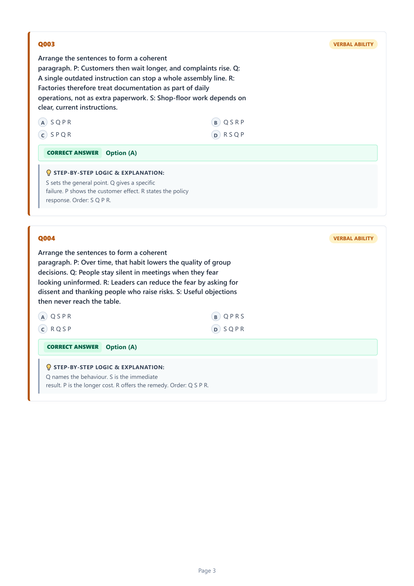 |

---

### Q004: Verbal Ability (Page 3)

**Source Ebook**: `OS4U_Book_3_Verbal_Ability.pdf` | **Book Page**: **Page 3**  
**Authentic Page Figure**: [`OS4U_Book_3_Verbal_Ability_page_003.png`](images/OS4U_Book_3_Verbal_Ability_page_003.png)

#### Problem Statement & Question Prompt
```text
Arrange the sentences to form a coherent
paragraph. P: Over time, that habit lowers the quality of group
decisions. Q: People stay silent in meetings when they fear
looking uninformed. R: Leaders can reduce the fear by asking for
dissent and thanking people who raise risks. S: Useful objections
then never reach the table.
```

#### Multiple Choice Options
- **(A)** `Q S P R`
- **(B)** `Q P R S`
- **(C)** `R Q S P`
- **(D)** `S Q P R`

#### Verified Correct Answer Key
> **Correct Option**: **(A) `Q S P R`**

#### Step-by-Step Logic & Comprehensive Solution
```text
Q names the behaviour. S is the immediate
result. P is the longer cost. R offers the remedy. Order: Q S P R.
```

#### Authentic Ebook Page Figure
| Ebook Page Render (Page 3) |
| :---: |
|  |

---

### Q005: Verbal Ability (Page 4)

**Source Ebook**: `OS4U_Book_3_Verbal_Ability.pdf` | **Book Page**: **Page 4**  
**Authentic Page Figure**: [`OS4U_Book_3_Verbal_Ability_page_004.png`](images/OS4U_Book_3_Verbal_Ability_page_004.png)

#### Problem Statement & Question Prompt
```text
Choose the grammatically correct sentence.
```

#### Multiple Choice Options
- **(A)** `Each of the players have received a medal.`
- **(B)** `Each of the players has received a medal.`
- **(C)** `Each of the player has received a medal.`
- **(D)** `Each of the players are received a medal.`

#### Verified Correct Answer Key
> **Correct Option**: **(B) `Each of the players has received a medal.`**

#### Step-by-Step Logic & Comprehensive Solution
```text
"Each" is singular, so it takes
"has." The plural noun after "of" does not
control the verb. "Player" would also be wrong because
"each of" needs a plural noun.
```

#### Authentic Ebook Page Figure
| Ebook Page Render (Page 4) |
| :---: |
| 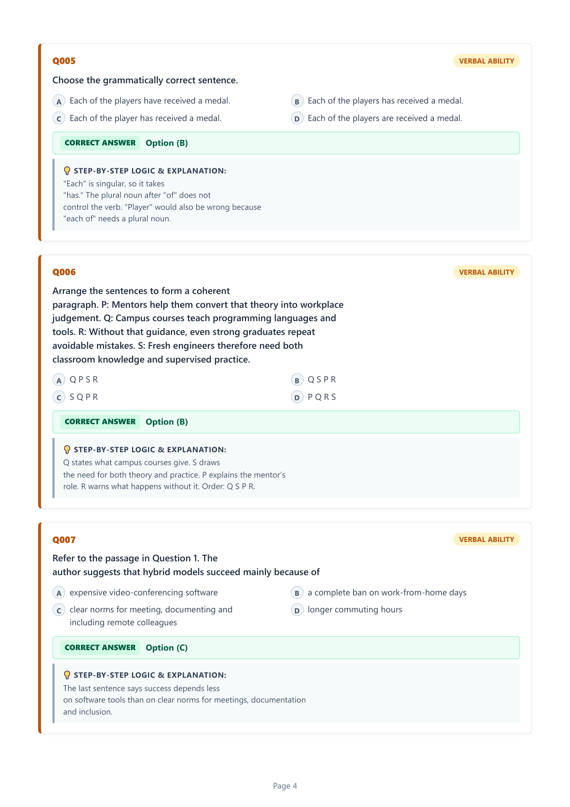 |

---

### Q006: Verbal Ability (Page 4)

**Source Ebook**: `OS4U_Book_3_Verbal_Ability.pdf` | **Book Page**: **Page 4**  
**Authentic Page Figure**: [`OS4U_Book_3_Verbal_Ability_page_004.png`](images/OS4U_Book_3_Verbal_Ability_page_004.png)

#### Problem Statement & Question Prompt
```text
Arrange the sentences to form a coherent
paragraph. P: Mentors help them convert that theory into workplace
judgement. Q: Campus courses teach programming languages and
tools. R: Without that guidance, even strong graduates repeat
avoidable mistakes. S: Fresh engineers therefore need both
classroom knowledge and supervised practice.
```

#### Multiple Choice Options
- **(A)** `Q P S R`
- **(B)** `Q S P R`
- **(C)** `S Q P R`
- **(D)** `P Q R S`

#### Verified Correct Answer Key
> **Correct Option**: **(B) `Q S P R`**

#### Step-by-Step Logic & Comprehensive Solution
```text
Q states what campus courses give. S draws
the need for both theory and practice. P explains the mentor’s
role. R warns what happens without it. Order: Q S P R.
```

#### Authentic Ebook Page Figure
| Ebook Page Render (Page 4) |
| :---: |
|  |

---

### Q007: Verbal Ability (Page 4)

**Source Ebook**: `OS4U_Book_3_Verbal_Ability.pdf` | **Book Page**: **Page 4**  
**Authentic Page Figure**: [`OS4U_Book_3_Verbal_Ability_page_004.png`](images/OS4U_Book_3_Verbal_Ability_page_004.png)

#### Problem Statement & Question Prompt
```text
Refer to the passage in Question 1. The
author suggests that hybrid models succeed mainly because of
```

#### Multiple Choice Options
- **(A)** `expensive video-conferencing software`
- **(B)** `a complete ban on work-from-home days`
- **(C)** `clear norms for meeting, documenting and
including remote colleagues`
- **(D)** `longer commuting hours`

#### Verified Correct Answer Key
> **Correct Option**: **(C) `clear norms for meeting, documenting and
including remote colleagues`**

#### Step-by-Step Logic & Comprehensive Solution
```text
The last sentence says success depends less
on software tools than on clear norms for meetings, documentation
and inclusion.
```

#### Authentic Ebook Page Figure
| Ebook Page Render (Page 4) |
| :---: |
|  |

---

### Q008: Verbal Ability (Page 5)

**Source Ebook**: `OS4U_Book_3_Verbal_Ability.pdf` | **Book Page**: **Page 5**  
**Authentic Page Figure**: [`OS4U_Book_3_Verbal_Ability_page_005.png`](images/OS4U_Book_3_Verbal_Ability_page_005.png)

#### Problem Statement & Question Prompt
```text
Passage
Remote
work, once treated as an emergency arrangement, has become a
lasting feature of the information-technology industry. Firms
discovered that many roles can be performed without a shared
office, and employees valued the time saved on commuting.
Productivity studies, however, present a mixed picture. Individual
task completion often improves when people work from home, but
collaboration on complex problems tends to slow down. New joiners,
in particular, learn less quickly when they cannot observe
experienced colleagues. Companies have therefore shifted toward
hybrid models: a few fixed office days for teamwork, with the
remaining days left flexible. The success of such models depends
less on software tools than on clear norms—when to meet, how
to document decisions, and how to include people who are not in
the room.
What is the
main idea of the passage?
```

#### Multiple Choice Options
- **(A)** `Remote work has failed and companies should
return to the office full-time.`
- **(B)** `Hybrid work is emerging because remote
work has both benefits and limits.`
- **(C)** `Software tools are the main reason hybrid
models succeed.`
- **(D)** `New joiners prefer working only from home.`

#### Verified Correct Answer Key
> **Correct Option**: **(B) `Hybrid work is emerging because remote
work has both benefits and limits.`**

#### Step-by-Step Logic & Comprehensive Solution
```text
The passage notes gains from remote work,
then its drawbacks for collaboration and new joiners, and ends
with hybrid models plus the need for norms. That balanced shift is
the main idea.
```

#### Authentic Ebook Page Figure
| Ebook Page Render (Page 5) |
| :---: |
| 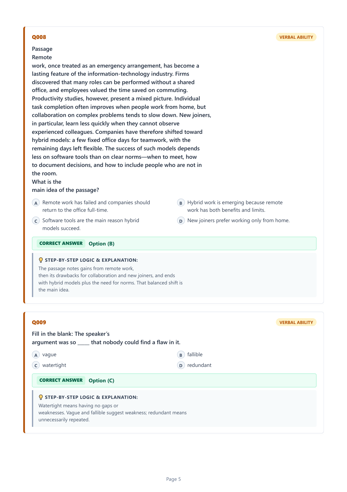 |

---

### Q009: Verbal Ability (Page 5)

**Source Ebook**: `OS4U_Book_3_Verbal_Ability.pdf` | **Book Page**: **Page 5**  
**Authentic Page Figure**: [`OS4U_Book_3_Verbal_Ability_page_005.png`](images/OS4U_Book_3_Verbal_Ability_page_005.png)

#### Problem Statement & Question Prompt
```text
Fill in the blank: The speaker’s
argument was so _____ that nobody could find a flaw in it.
```

#### Multiple Choice Options
- **(A)** `vague`
- **(B)** `fallible`
- **(C)** `watertight`
- **(D)** `redundant`

#### Verified Correct Answer Key
> **Correct Option**: **(C) `watertight`**

#### Step-by-Step Logic & Comprehensive Solution
```text
Watertight means having no gaps or
weaknesses. Vague and fallible suggest weakness; redundant means
unnecessarily repeated.
```

#### Authentic Ebook Page Figure
| Ebook Page Render (Page 5) |
| :---: |
|  |

---

### Q010: Verbal Ability (Page 6)

**Source Ebook**: `OS4U_Book_3_Verbal_Ability.pdf` | **Book Page**: **Page 6**  
**Authentic Page Figure**: [`OS4U_Book_3_Verbal_Ability_page_006.png`](images/OS4U_Book_3_Verbal_Ability_page_006.png)

#### Problem Statement & Question Prompt
```text
Refer to the passage in Question 1. In the
sentence “Productivity studies, however, present a mixed
picture,” the phrase "mixed picture" means that
```

#### Multiple Choice Options
- **(A)** `all studies reached the same negative
conclusion`
- **(B)** `the results show both improvement and
decline, depending on the kind of work`
- **(C)** `researchers used poor data`
- **(D)** `productivity cannot be measured at all`

#### Verified Correct Answer Key
> **Correct Option**: **(B) `the results show both improvement and
decline, depending on the kind of work`**

#### Step-by-Step Logic & Comprehensive Solution
```text
The next sentences explain the mix:
individual task completion often improves, but collaboration on
complex problems slows down.
```

#### Authentic Ebook Page Figure
| Ebook Page Render (Page 6) |
| :---: |
| 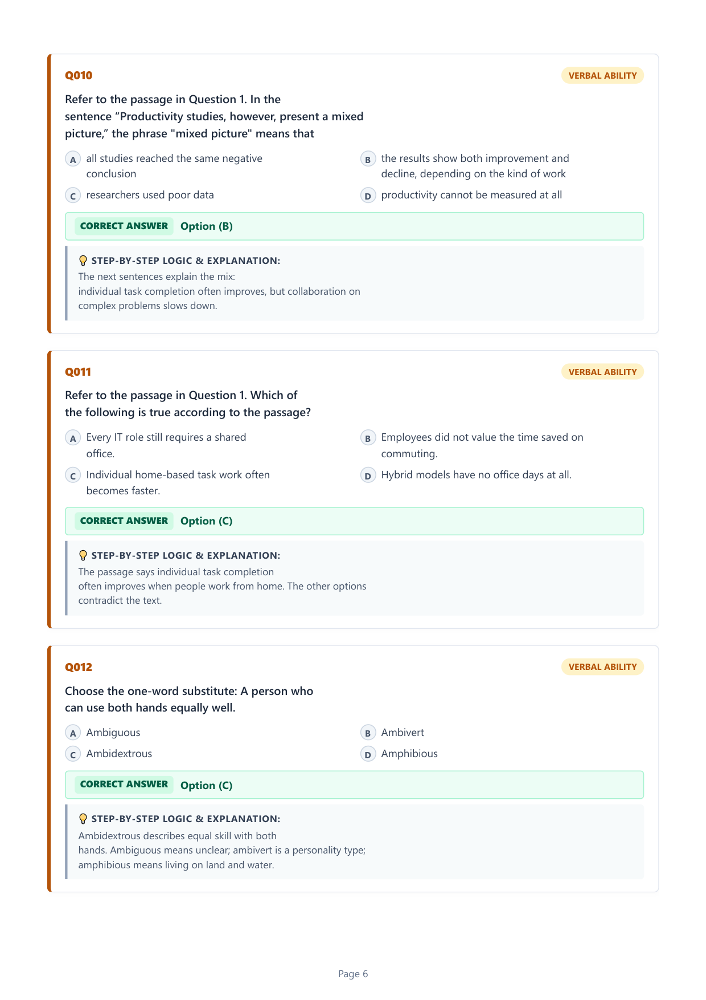 |

---

### Q011: Verbal Ability (Page 6)

**Source Ebook**: `OS4U_Book_3_Verbal_Ability.pdf` | **Book Page**: **Page 6**  
**Authentic Page Figure**: [`OS4U_Book_3_Verbal_Ability_page_006.png`](images/OS4U_Book_3_Verbal_Ability_page_006.png)

#### Problem Statement & Question Prompt
```text
Refer to the passage in Question 1. Which of
the following is true according to the passage?
```

#### Multiple Choice Options
- **(A)** `Every IT role still requires a shared
office.`
- **(B)** `Employees did not value the time saved on
commuting.`
- **(C)** `Individual home-based task work often
becomes faster.`
- **(D)** `Hybrid models have no office days at all.`

#### Verified Correct Answer Key
> **Correct Option**: **(C) `Individual home-based task work often
becomes faster.`**

#### Step-by-Step Logic & Comprehensive Solution
```text
The passage says individual task completion
often improves when people work from home. The other options
contradict the text.
```

#### Authentic Ebook Page Figure
| Ebook Page Render (Page 6) |
| :---: |
|  |

---

### Q012: Verbal Ability (Page 6)

**Source Ebook**: `OS4U_Book_3_Verbal_Ability.pdf` | **Book Page**: **Page 6**  
**Authentic Page Figure**: [`OS4U_Book_3_Verbal_Ability_page_006.png`](images/OS4U_Book_3_Verbal_Ability_page_006.png)

#### Problem Statement & Question Prompt
```text
Choose the one-word substitute: A person who
can use both hands equally well.
```

#### Multiple Choice Options
- **(A)** `Ambiguous`
- **(B)** `Ambivert`
- **(C)** `Ambidextrous`
- **(D)** `Amphibious`

#### Verified Correct Answer Key
> **Correct Option**: **(C) `Ambidextrous`**

#### Step-by-Step Logic & Comprehensive Solution
```text
Ambidextrous describes equal skill with both
hands. Ambiguous means unclear; ambivert is a personality type;
amphibious means living on land and water.
```

#### Authentic Ebook Page Figure
| Ebook Page Render (Page 6) |
| :---: |
|  |

---

### Q013: Verbal Ability (Page 7)

**Source Ebook**: `OS4U_Book_3_Verbal_Ability.pdf` | **Book Page**: **Page 7**  
**Authentic Page Figure**: [`OS4U_Book_3_Verbal_Ability_page_007.png`](images/OS4U_Book_3_Verbal_Ability_page_007.png)

#### Problem Statement & Question Prompt
```text
Choose the correct meaning of the idiom "hit
the nail on the head."
```

#### Multiple Choice Options
- **(A)** `Cause an accident at work`
- **(B)** `Describe a situation exactly right`
- **(C)** `Finish a task too quickly`
- **(D)** `Blame someone unfairly`

#### Verified Correct Answer Key
> **Correct Option**: **(B) `Describe a situation exactly right`**

#### Step-by-Step Logic & Comprehensive Solution
```text
To hit the nail on the head is to identify
the exact point or say something precisely correct.
```

#### Authentic Ebook Page Figure
| Ebook Page Render (Page 7) |
| :---: |
| 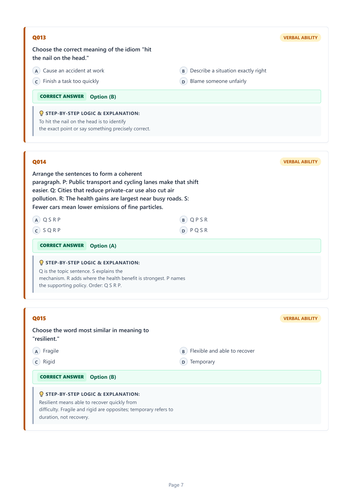 |

---

### Q014: Verbal Ability (Page 7)

**Source Ebook**: `OS4U_Book_3_Verbal_Ability.pdf` | **Book Page**: **Page 7**  
**Authentic Page Figure**: [`OS4U_Book_3_Verbal_Ability_page_007.png`](images/OS4U_Book_3_Verbal_Ability_page_007.png)

#### Problem Statement & Question Prompt
```text
Arrange the sentences to form a coherent
paragraph. P: Public transport and cycling lanes make that shift
easier. Q: Cities that reduce private-car use also cut air
pollution. R: The health gains are largest near busy roads. S:
Fewer cars mean lower emissions of fine particles.
```

#### Multiple Choice Options
- **(A)** `Q S R P`
- **(B)** `Q P S R`
- **(C)** `S Q R P`
- **(D)** `P Q S R`

#### Verified Correct Answer Key
> **Correct Option**: **(A) `Q S R P`**

#### Step-by-Step Logic & Comprehensive Solution
```text
Q is the topic sentence. S explains the
mechanism. R adds where the health benefit is strongest. P names
the supporting policy. Order: Q S R P.
```

#### Authentic Ebook Page Figure
| Ebook Page Render (Page 7) |
| :---: |
|  |

---

### Q015: Verbal Ability (Page 7)

**Source Ebook**: `OS4U_Book_3_Verbal_Ability.pdf` | **Book Page**: **Page 7**  
**Authentic Page Figure**: [`OS4U_Book_3_Verbal_Ability_page_007.png`](images/OS4U_Book_3_Verbal_Ability_page_007.png)

#### Problem Statement & Question Prompt
```text
Choose the word most similar in meaning to
"resilient."
```

#### Multiple Choice Options
- **(A)** `Fragile`
- **(B)** `Flexible and able to recover`
- **(C)** `Rigid`
- **(D)** `Temporary`

#### Verified Correct Answer Key
> **Correct Option**: **(B) `Flexible and able to recover`**

#### Step-by-Step Logic & Comprehensive Solution
```text
Resilient means able to recover quickly from
difficulty. Fragile and rigid are opposites; temporary refers to
duration, not recovery.
```

#### Authentic Ebook Page Figure
| Ebook Page Render (Page 7) |
| :---: |
|  |

---

### Q016: Verbal Ability (Page 8)

**Source Ebook**: `OS4U_Book_3_Verbal_Ability.pdf` | **Book Page**: **Page 8**  
**Authentic Page Figure**: [`OS4U_Book_3_Verbal_Ability_page_008.png`](images/OS4U_Book_3_Verbal_Ability_page_008.png)

#### Problem Statement & Question Prompt
```text
Arrange the sentences to form a coherent
paragraph. P: As a result, small errors in data can mislead an
entire team. Q: Dashboards are now the first place managers look
for answers. R: That is why organisations invest in data-quality
checks before they build reports. S: These dashboards summarise
large volumes of information in a few charts.
```

#### Multiple Choice Options
- **(A)** `Q S P R`
- **(B)** `P Q R S`
- **(C)** `S Q R P`
- **(D)** `Q P S R`

#### Verified Correct Answer Key
> **Correct Option**: **(A) `Q S P R`**

#### Step-by-Step Logic & Comprehensive Solution
```text
Q introduces dashboards. S explains what
they do. P gives the consequence of bad data in that setting. R
states the practical response. Order: Q S P R.
```

#### Authentic Ebook Page Figure
| Ebook Page Render (Page 8) |
| :---: |
| 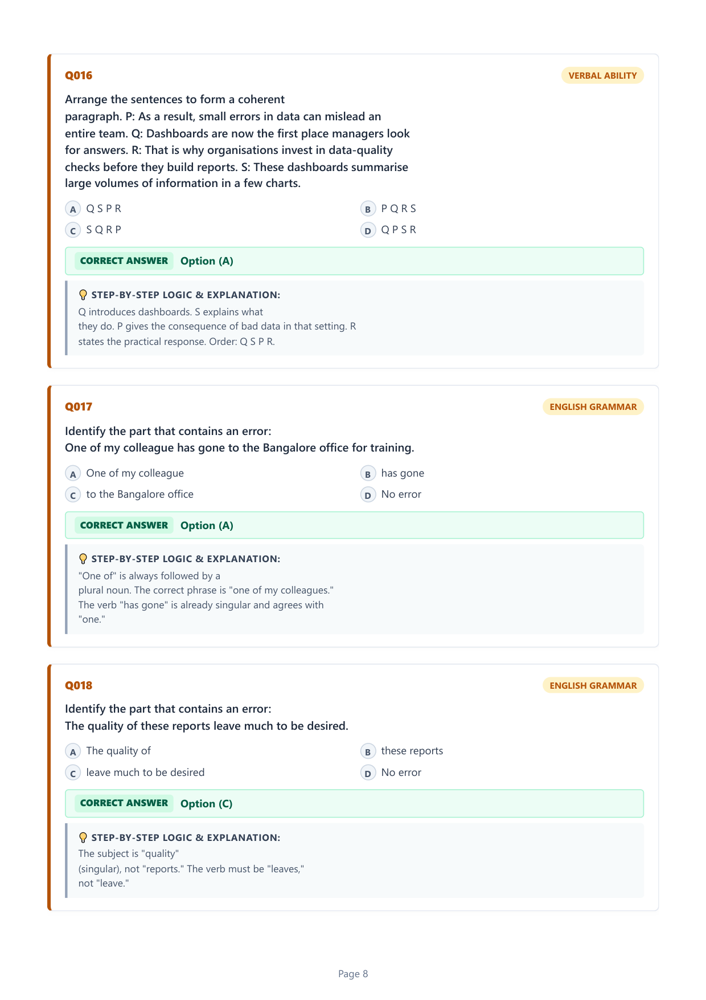 |

---

### Q017: English Grammar (Page 8)

**Source Ebook**: `OS4U_Book_3_Verbal_Ability.pdf` | **Book Page**: **Page 8**  
**Authentic Page Figure**: [`OS4U_Book_3_Verbal_Ability_page_008.png`](images/OS4U_Book_3_Verbal_Ability_page_008.png)

#### Problem Statement & Question Prompt
```text
Identify the part that contains an error:
One of my colleague has gone to the Bangalore office for training.
```

#### Multiple Choice Options
- **(A)** `One of my colleague`
- **(B)** `has gone`
- **(C)** `to the Bangalore office`
- **(D)** `No error`

#### Verified Correct Answer Key
> **Correct Option**: **(A) `One of my colleague`**

#### Step-by-Step Logic & Comprehensive Solution
```text
"One of" is always followed by a
plural noun. The correct phrase is "one of my colleagues."
The verb "has gone" is already singular and agrees with
"one."
```

#### Authentic Ebook Page Figure
| Ebook Page Render (Page 8) |
| :---: |
|  |

---

### Q018: English Grammar (Page 8)

**Source Ebook**: `OS4U_Book_3_Verbal_Ability.pdf` | **Book Page**: **Page 8**  
**Authentic Page Figure**: [`OS4U_Book_3_Verbal_Ability_page_008.png`](images/OS4U_Book_3_Verbal_Ability_page_008.png)

#### Problem Statement & Question Prompt
```text
Identify the part that contains an error:
The quality of these reports leave much to be desired.
```

#### Multiple Choice Options
- **(A)** `The quality of`
- **(B)** `these reports`
- **(C)** `leave much to be desired`
- **(D)** `No error`

#### Verified Correct Answer Key
> **Correct Option**: **(C) `leave much to be desired`**

#### Step-by-Step Logic & Comprehensive Solution
```text
The subject is "quality"
(singular), not "reports." The verb must be "leaves,"
not "leave."
```

#### Authentic Ebook Page Figure
| Ebook Page Render (Page 8) |
| :---: |
|  |

---

### Q019: English Grammar (Page 9)

**Source Ebook**: `OS4U_Book_3_Verbal_Ability.pdf` | **Book Page**: **Page 9**  
**Authentic Page Figure**: [`OS4U_Book_3_Verbal_Ability_page_009.png`](images/OS4U_Book_3_Verbal_Ability_page_009.png)

#### Problem Statement & Question Prompt
```text
The intern was accused _____ leaking the
test data.
```

#### Multiple Choice Options
- **(A)** `for`
- **(B)** `of`
- **(C)** `with`
- **(D)** `to`

#### Verified Correct Answer Key
> **Correct Option**: **(B) `of`**

#### Step-by-Step Logic & Comprehensive Solution
```text
The standard collocation is "accused
of" + gerund/noun. "Accused for" is a common error
in exam English.
```

#### Authentic Ebook Page Figure
| Ebook Page Render (Page 9) |
| :---: |
| 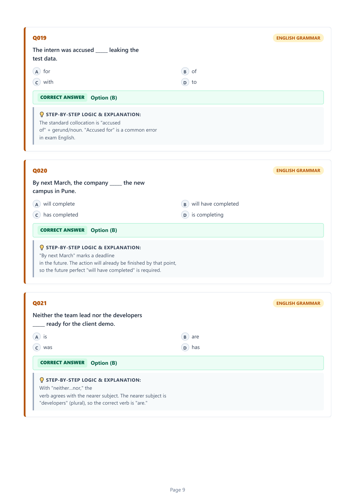 |

---

### Q020: English Grammar (Page 9)

**Source Ebook**: `OS4U_Book_3_Verbal_Ability.pdf` | **Book Page**: **Page 9**  
**Authentic Page Figure**: [`OS4U_Book_3_Verbal_Ability_page_009.png`](images/OS4U_Book_3_Verbal_Ability_page_009.png)

#### Problem Statement & Question Prompt
```text
By next March, the company _____ the new
campus in Pune.
```

#### Multiple Choice Options
- **(A)** `will complete`
- **(B)** `will have completed`
- **(C)** `has completed`
- **(D)** `is completing`

#### Verified Correct Answer Key
> **Correct Option**: **(B) `will have completed`**

#### Step-by-Step Logic & Comprehensive Solution
```text
"By next March" marks a deadline
in the future. The action will already be finished by that point,
so the future perfect "will have completed" is required.
```

#### Authentic Ebook Page Figure
| Ebook Page Render (Page 9) |
| :---: |
|  |

---

### Q021: English Grammar (Page 9)

**Source Ebook**: `OS4U_Book_3_Verbal_Ability.pdf` | **Book Page**: **Page 9**  
**Authentic Page Figure**: [`OS4U_Book_3_Verbal_Ability_page_009.png`](images/OS4U_Book_3_Verbal_Ability_page_009.png)

#### Problem Statement & Question Prompt
```text
Neither the team lead nor the developers
_____ ready for the client demo.
```

#### Multiple Choice Options
- **(A)** `is`
- **(B)** `are`
- **(C)** `was`
- **(D)** `has`

#### Verified Correct Answer Key
> **Correct Option**: **(B) `are`**

#### Step-by-Step Logic & Comprehensive Solution
```text
With "neither…nor," the
verb agrees with the nearer subject. The nearer subject is
"developers" (plural), so the correct verb is "are."
```

#### Authentic Ebook Page Figure
| Ebook Page Render (Page 9) |
| :---: |
|  |

---

### Q022: Essay Writting (Page 10)

**Source Ebook**: `OS4U_Book_3_Verbal_Ability.pdf` | **Book Page**: **Page 10**  
**Authentic Page Figure**: [`OS4U_Book_3_Verbal_Ability_page_010.png`](images/OS4U_Book_3_Verbal_Ability_page_010.png)

#### Problem Statement & Question Prompt
```text
Importance of Environmental Protection
```

#### Multiple Choice Options
- **(A)** `Type your option`

#### Verified Correct Answer Key
> **Correct Option**: **(A) `Type your option`**

#### Step-by-Step Logic & Comprehensive Solution
```text
Environmental protection is essential for maintaining a healthy and sustainable life. The environment provides humans with air, water, food, and natural resources. However, pollution, deforestation, and excessive use of resources have created serious environmental challenges.
Protecting the environment requires responsible actions from individuals, businesses, and governments. People can contribute by reducing plastic waste, saving water and electricity, planting trees, and using public transport when possible. Proper waste management and recycling can also help reduce pollution.
Environmental protection is not only about preserving nature but also about protecting future generations. If natural resources are used without considering their long-term impact, future generations may face shortages and unhealthy living conditions. Education and awareness can encourage people to adopt more environmentally responsible habits.
In conclusion, environmental protection is a shared responsibility. Small changes in daily habits, combined with effective environmental policies and sustainable practices, can make a meaningful difference. Protecting nature today can help create a cleaner, healthier, and more sustainable future for everyone.
```

#### Authentic Ebook Page Figure
| Ebook Page Render (Page 10) |
| :---: |
| 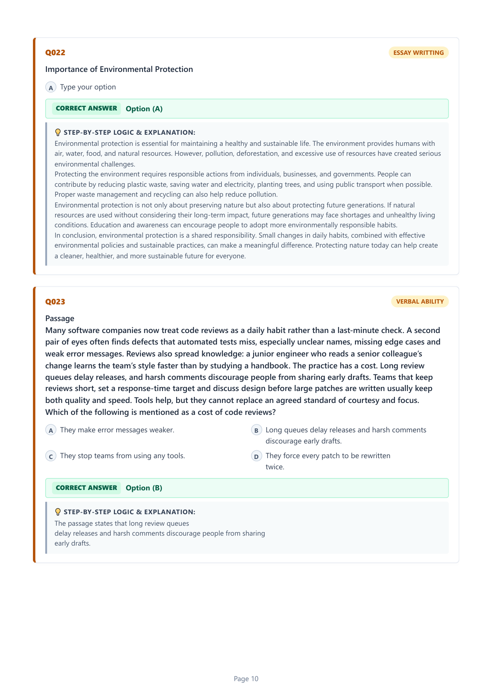 |

---

### Q023: Verbal Ability (Page 10)

**Source Ebook**: `OS4U_Book_3_Verbal_Ability.pdf` | **Book Page**: **Page 10**  
**Authentic Page Figure**: [`OS4U_Book_3_Verbal_Ability_page_010.png`](images/OS4U_Book_3_Verbal_Ability_page_010.png)

#### Problem Statement & Question Prompt
```text
Passage
Many software companies now treat code reviews as a daily habit rather than a last-minute check. A second pair of eyes often finds defects that automated tests miss, especially unclear names, missing edge cases and weak error messages. Reviews also spread knowledge: a junior engineer who reads a senior colleague’s change learns the team’s style faster than by studying a handbook. The practice has a cost. Long review queues delay releases, and harsh comments discourage people from sharing early drafts. Teams that keep reviews short, set a response-time target and discuss design before large patches are written usually keep both quality and speed. Tools help, but they cannot replace an agreed standard of courtesy and focus.
Which of the following is mentioned as a cost of code reviews?
```

#### Multiple Choice Options
- **(A)** `They make error messages weaker.`
- **(B)** `Long queues delay releases and harsh comments discourage early drafts.`
- **(C)** `They stop teams from using any tools.`
- **(D)** `They force every patch to be rewritten
twice.`

#### Verified Correct Answer Key
> **Correct Option**: **(B) `Long queues delay releases and harsh comments discourage early drafts.`**

#### Step-by-Step Logic & Comprehensive Solution
```text
The passage states that long review queues
delay releases and harsh comments discourage people from sharing
early drafts.
```

#### Authentic Ebook Page Figure
| Ebook Page Render (Page 10) |
| :---: |
|  |

---

### Q024: Verbal Ability (Page 11)

**Source Ebook**: `OS4U_Book_3_Verbal_Ability.pdf` | **Book Page**: **Page 11**  
**Authentic Page Figure**: [`OS4U_Book_3_Verbal_Ability_page_011.png`](images/OS4U_Book_3_Verbal_Ability_page_011.png)

#### Problem Statement & Question Prompt
```text
Fill in the blank: The contract is _____
until both parties sign it.
```

#### Multiple Choice Options
- **(A)** `void`
- **(B)** `provisional`
- **(C)** `permanent`
- **(D)** `obsolete`

#### Verified Correct Answer Key
> **Correct Option**: **(B) `provisional`**

#### Step-by-Step Logic & Comprehensive Solution
```text
Provisional means temporary and subject to
later confirmation. Void would mean invalid; permanent and
obsolete do not fit a draft waiting for signatures.
```

#### Authentic Ebook Page Figure
| Ebook Page Render (Page 11) |
| :---: |
| 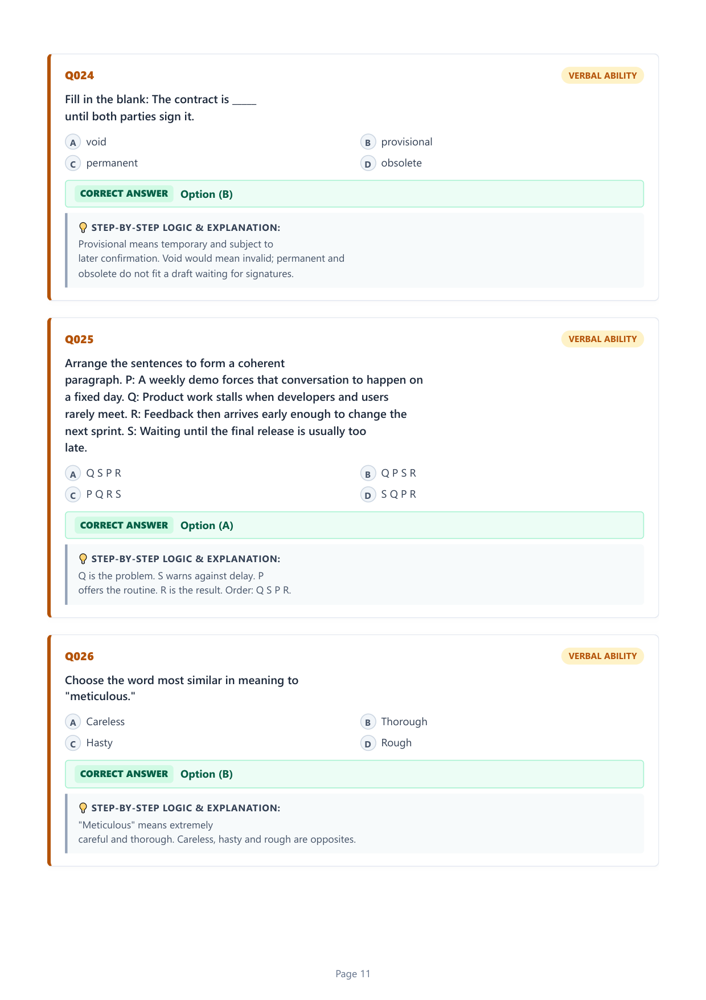 |

---

### Q025: Verbal Ability (Page 11)

**Source Ebook**: `OS4U_Book_3_Verbal_Ability.pdf` | **Book Page**: **Page 11**  
**Authentic Page Figure**: [`OS4U_Book_3_Verbal_Ability_page_011.png`](images/OS4U_Book_3_Verbal_Ability_page_011.png)

#### Problem Statement & Question Prompt
```text
Arrange the sentences to form a coherent
paragraph. P: A weekly demo forces that conversation to happen on
a fixed day. Q: Product work stalls when developers and users
rarely meet. R: Feedback then arrives early enough to change the
next sprint. S: Waiting until the final release is usually too
late.
```

#### Multiple Choice Options
- **(A)** `Q S P R`
- **(B)** `Q P S R`
- **(C)** `P Q R S`
- **(D)** `S Q P R`

#### Verified Correct Answer Key
> **Correct Option**: **(A) `Q S P R`**

#### Step-by-Step Logic & Comprehensive Solution
```text
Q is the problem. S warns against delay. P
offers the routine. R is the result. Order: Q S P R.
```

#### Authentic Ebook Page Figure
| Ebook Page Render (Page 11) |
| :---: |
|  |

---

### Q026: Verbal Ability (Page 11)

**Source Ebook**: `OS4U_Book_3_Verbal_Ability.pdf` | **Book Page**: **Page 11**  
**Authentic Page Figure**: [`OS4U_Book_3_Verbal_Ability_page_011.png`](images/OS4U_Book_3_Verbal_Ability_page_011.png)

#### Problem Statement & Question Prompt
```text
Choose the word most similar in meaning to
"meticulous."
```

#### Multiple Choice Options
- **(A)** `Careless`
- **(B)** `Thorough`
- **(C)** `Hasty`
- **(D)** `Rough`

#### Verified Correct Answer Key
> **Correct Option**: **(B) `Thorough`**

#### Step-by-Step Logic & Comprehensive Solution
```text
"Meticulous" means extremely
careful and thorough. Careless, hasty and rough are opposites.
```

#### Authentic Ebook Page Figure
| Ebook Page Render (Page 11) |
| :---: |
|  |

---

### Q027: Verbal Ability (Page 12)

**Source Ebook**: `OS4U_Book_3_Verbal_Ability.pdf` | **Book Page**: **Page 12**  
**Authentic Page Figure**: [`OS4U_Book_3_Verbal_Ability_page_012.png`](images/OS4U_Book_3_Verbal_Ability_page_012.png)

#### Problem Statement & Question Prompt
```text
Choose the word most opposite in meaning to
"obsolete."
```

#### Multiple Choice Options
- **(A)** `Outdated`
- **(B)** `Current`
- **(C)** `Abandoned`
- **(D)** `Expired`

#### Verified Correct Answer Key
> **Correct Option**: **(B) `Current`**

#### Step-by-Step Logic & Comprehensive Solution
```text
"Obsolete" means no longer in use.
"Current" is the antonym. The other three sit close to
obsolete.
```

#### Authentic Ebook Page Figure
| Ebook Page Render (Page 12) |
| :---: |
| 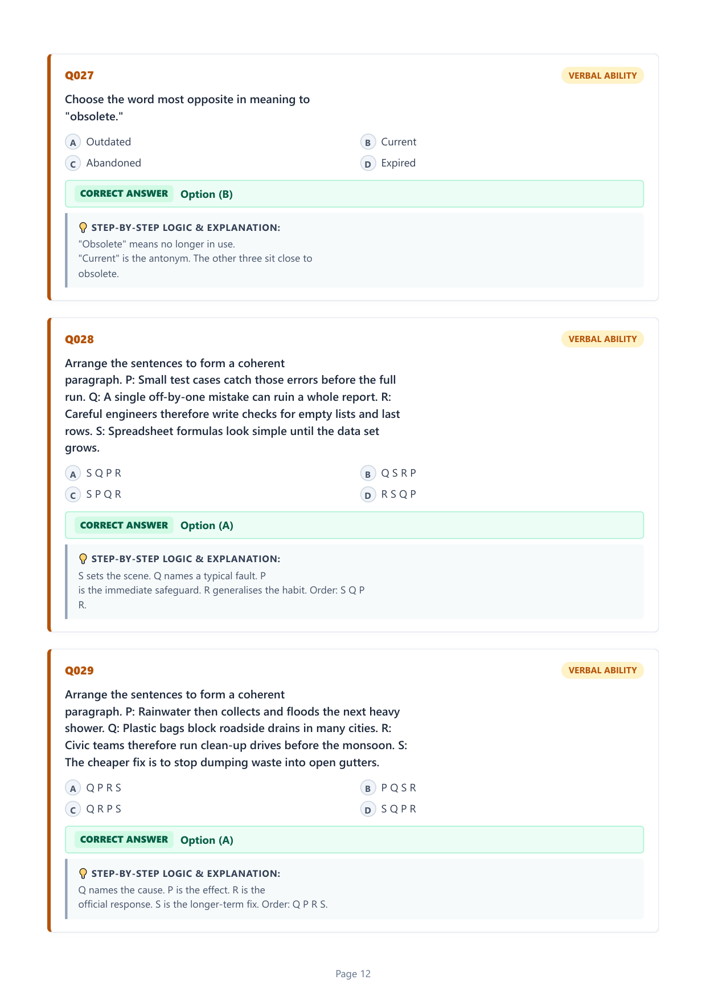 |

---

### Q028: Verbal Ability (Page 12)

**Source Ebook**: `OS4U_Book_3_Verbal_Ability.pdf` | **Book Page**: **Page 12**  
**Authentic Page Figure**: [`OS4U_Book_3_Verbal_Ability_page_012.png`](images/OS4U_Book_3_Verbal_Ability_page_012.png)

#### Problem Statement & Question Prompt
```text
Arrange the sentences to form a coherent
paragraph. P: Small test cases catch those errors before the full
run. Q: A single off-by-one mistake can ruin a whole report. R:
Careful engineers therefore write checks for empty lists and last
rows. S: Spreadsheet formulas look simple until the data set
grows.
```

#### Multiple Choice Options
- **(A)** `S Q P R`
- **(B)** `Q S R P`
- **(C)** `S P Q R`
- **(D)** `R S Q P`

#### Verified Correct Answer Key
> **Correct Option**: **(A) `S Q P R`**

#### Step-by-Step Logic & Comprehensive Solution
```text
S sets the scene. Q names a typical fault. P
is the immediate safeguard. R generalises the habit. Order: S Q P
R.
```

#### Authentic Ebook Page Figure
| Ebook Page Render (Page 12) |
| :---: |
|  |

---

### Q029: Verbal Ability (Page 12)

**Source Ebook**: `OS4U_Book_3_Verbal_Ability.pdf` | **Book Page**: **Page 12**  
**Authentic Page Figure**: [`OS4U_Book_3_Verbal_Ability_page_012.png`](images/OS4U_Book_3_Verbal_Ability_page_012.png)

#### Problem Statement & Question Prompt
```text
Arrange the sentences to form a coherent
paragraph. P: Rainwater then collects and floods the next heavy
shower. Q: Plastic bags block roadside drains in many cities. R:
Civic teams therefore run clean-up drives before the monsoon. S:
The cheaper fix is to stop dumping waste into open gutters.
```

#### Multiple Choice Options
- **(A)** `Q P R S`
- **(B)** `P Q S R`
- **(C)** `Q R P S`
- **(D)** `S Q P R`

#### Verified Correct Answer Key
> **Correct Option**: **(A) `Q P R S`**

#### Step-by-Step Logic & Comprehensive Solution
```text
Q names the cause. P is the effect. R is the
official response. S is the longer-term fix. Order: Q P R S.
```

#### Authentic Ebook Page Figure
| Ebook Page Render (Page 12) |
| :---: |
|  |

---

### Q030: Verbal Ability (Page 13)

**Source Ebook**: `OS4U_Book_3_Verbal_Ability.pdf` | **Book Page**: **Page 13**  
**Authentic Page Figure**: [`OS4U_Book_3_Verbal_Ability_page_013.png`](images/OS4U_Book_3_Verbal_Ability_page_013.png)

#### Problem Statement & Question Prompt
```text
Choose the correct meaning of the idiom
"burn the midnight oil."
```

#### Multiple Choice Options
- **(A)** `Waste fuel at night`
- **(B)** `Work or study late into the night`
- **(C)** `Start a fire after dark`
- **(D)** `Leave the office early`

#### Verified Correct Answer Key
> **Correct Option**: **(B) `Work or study late into the night`**

#### Step-by-Step Logic & Comprehensive Solution
```text
The idiom means to stay up late working or
studying.
```

#### Authentic Ebook Page Figure
| Ebook Page Render (Page 13) |
| :---: |
| 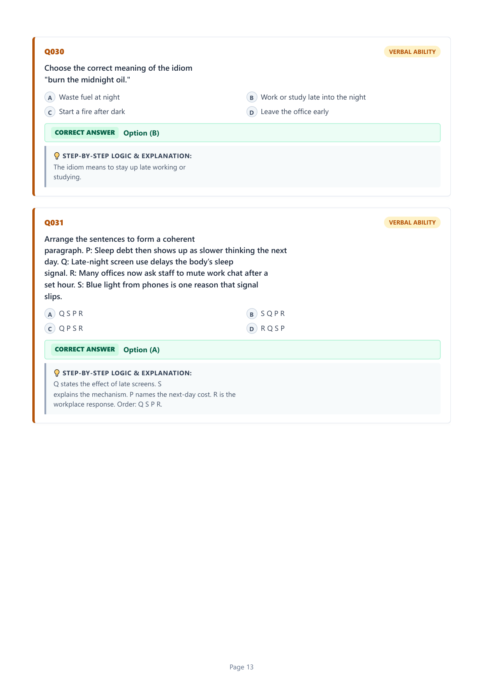 |

---

### Q031: Verbal Ability (Page 13)

**Source Ebook**: `OS4U_Book_3_Verbal_Ability.pdf` | **Book Page**: **Page 13**  
**Authentic Page Figure**: [`OS4U_Book_3_Verbal_Ability_page_013.png`](images/OS4U_Book_3_Verbal_Ability_page_013.png)

#### Problem Statement & Question Prompt
```text
Arrange the sentences to form a coherent
paragraph. P: Sleep debt then shows up as slower thinking the next
day. Q: Late-night screen use delays the body’s sleep
signal. R: Many offices now ask staff to mute work chat after a
set hour. S: Blue light from phones is one reason that signal
slips.
```

#### Multiple Choice Options
- **(A)** `Q S P R`
- **(B)** `S Q P R`
- **(C)** `Q P S R`
- **(D)** `R Q S P`

#### Verified Correct Answer Key
> **Correct Option**: **(A) `Q S P R`**

#### Step-by-Step Logic & Comprehensive Solution
```text
Q states the effect of late screens. S
explains the mechanism. P names the next-day cost. R is the
workplace response. Order: Q S P R.
```

#### Authentic Ebook Page Figure
| Ebook Page Render (Page 13) |
| :---: |
|  |

---

### Q032: Verbal Ability (Page 14)

**Source Ebook**: `OS4U_Book_3_Verbal_Ability.pdf` | **Book Page**: **Page 14**  
**Authentic Page Figure**: [`OS4U_Book_3_Verbal_Ability_page_014.png`](images/OS4U_Book_3_Verbal_Ability_page_014.png)

#### Problem Statement & Question Prompt
```text
Arrange the sentences to form a coherent
paragraph. P: Those logs later save hours when a defect appears in
production. Q: Good engineers write a short note on why a change
was made. R: Code alone rarely records the reason behind a
decision. S: The habit looks slow on a busy afternoon, but it is
cheap insurance.
```

#### Multiple Choice Options
- **(A)** `R Q P S`
- **(B)** `Q R S P`
- **(C)** `P Q R S`
- **(D)** `R P Q S`

#### Verified Correct Answer Key
> **Correct Option**: **(A) `R Q P S`**

#### Step-by-Step Logic & Comprehensive Solution
```text
R states the gap. Q is the practice that
fills it. P is the later benefit. S comments on the cost. Order: R
Q P S.
```

#### Authentic Ebook Page Figure
| Ebook Page Render (Page 14) |
| :---: |
| 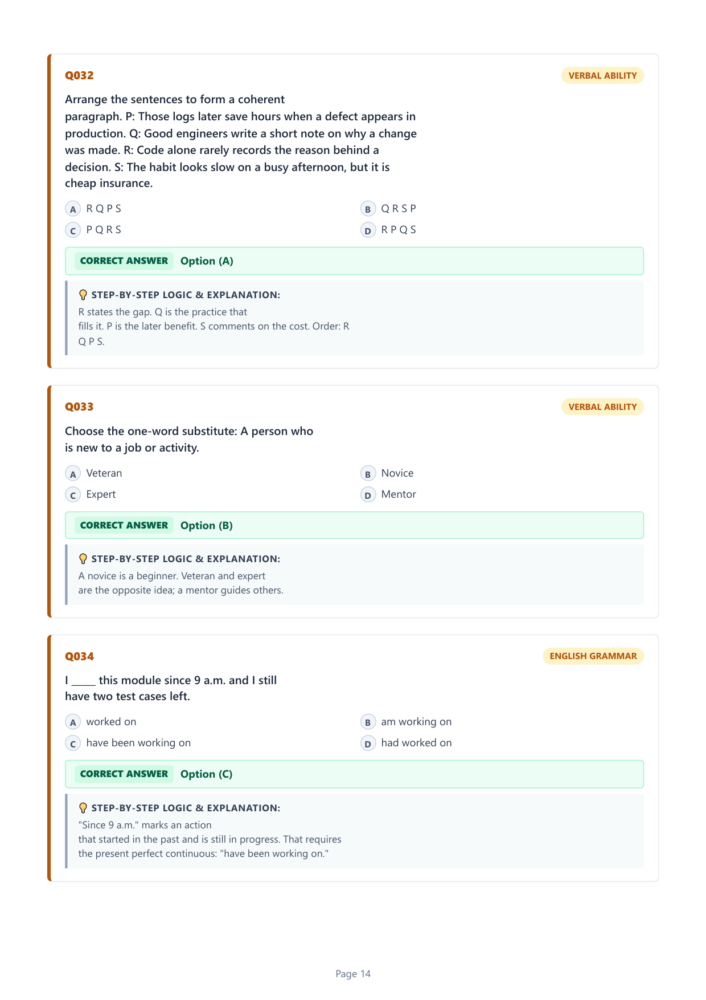 |

---

### Q033: Verbal Ability (Page 14)

**Source Ebook**: `OS4U_Book_3_Verbal_Ability.pdf` | **Book Page**: **Page 14**  
**Authentic Page Figure**: [`OS4U_Book_3_Verbal_Ability_page_014.png`](images/OS4U_Book_3_Verbal_Ability_page_014.png)

#### Problem Statement & Question Prompt
```text
Choose the one-word substitute: A person who
is new to a job or activity.
```

#### Multiple Choice Options
- **(A)** `Veteran`
- **(B)** `Novice`
- **(C)** `Expert`
- **(D)** `Mentor`

#### Verified Correct Answer Key
> **Correct Option**: **(B) `Novice`**

#### Step-by-Step Logic & Comprehensive Solution
```text
A novice is a beginner. Veteran and expert
are the opposite idea; a mentor guides others.
```

#### Authentic Ebook Page Figure
| Ebook Page Render (Page 14) |
| :---: |
|  |

---

### Q034: English Grammar (Page 14)

**Source Ebook**: `OS4U_Book_3_Verbal_Ability.pdf` | **Book Page**: **Page 14**  
**Authentic Page Figure**: [`OS4U_Book_3_Verbal_Ability_page_014.png`](images/OS4U_Book_3_Verbal_Ability_page_014.png)

#### Problem Statement & Question Prompt
```text
I _____ this module since 9 a.m. and I still
have two test cases left.
```

#### Multiple Choice Options
- **(A)** `worked on`
- **(B)** `am working on`
- **(C)** `have been working on`
- **(D)** `had worked on`

#### Verified Correct Answer Key
> **Correct Option**: **(C) `have been working on`**

#### Step-by-Step Logic & Comprehensive Solution
```text
"Since 9 a.m." marks an action
that started in the past and is still in progress. That requires
the present perfect continuous: "have been working on."
```

#### Authentic Ebook Page Figure
| Ebook Page Render (Page 14) |
| :---: |
|  |

---

### Q035: English Grammar (Page 15)

**Source Ebook**: `OS4U_Book_3_Verbal_Ability.pdf` | **Book Page**: **Page 15**  
**Authentic Page Figure**: [`OS4U_Book_3_Verbal_Ability_page_015.png`](images/OS4U_Book_3_Verbal_Ability_page_015.png)

#### Problem Statement & Question Prompt
```text
Identify the part that contains an error:
Everybody in the two project teams have submitted the timesheet.
```

#### Multiple Choice Options
- **(A)** `Everybody in`
- **(B)** `the two project teams`
- **(C)** `have submitted the timesheet`
- **(D)** `No error`

#### Verified Correct Answer Key
> **Correct Option**: **(C) `have submitted the timesheet`**

#### Step-by-Step Logic & Comprehensive Solution
```text
"Everybody" is singular, even when
a plural phrase follows. The verb must be "has submitted,"
not "have submitted."
```

#### Authentic Ebook Page Figure
| Ebook Page Render (Page 15) |
| :---: |
| 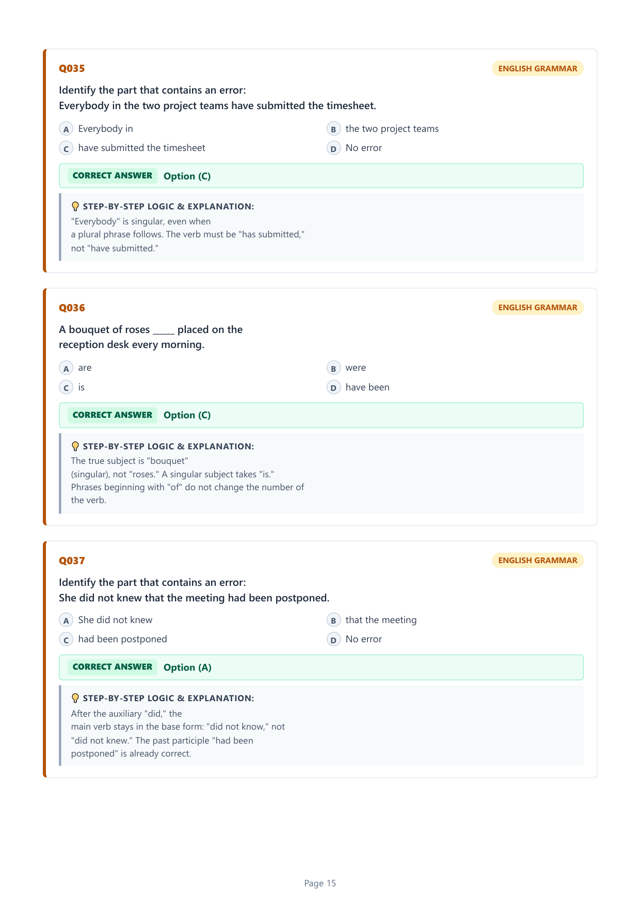 |

---

### Q036: English Grammar (Page 15)

**Source Ebook**: `OS4U_Book_3_Verbal_Ability.pdf` | **Book Page**: **Page 15**  
**Authentic Page Figure**: [`OS4U_Book_3_Verbal_Ability_page_015.png`](images/OS4U_Book_3_Verbal_Ability_page_015.png)

#### Problem Statement & Question Prompt
```text
A bouquet of roses _____ placed on the
reception desk every morning.
```

#### Multiple Choice Options
- **(A)** `are`
- **(B)** `were`
- **(C)** `is`
- **(D)** `have been`

#### Verified Correct Answer Key
> **Correct Option**: **(C) `is`**

#### Step-by-Step Logic & Comprehensive Solution
```text
The true subject is "bouquet"
(singular), not "roses." A singular subject takes "is."
Phrases beginning with "of" do not change the number of
the verb.
```

#### Authentic Ebook Page Figure
| Ebook Page Render (Page 15) |
| :---: |
|  |

---

### Q037: English Grammar (Page 15)

**Source Ebook**: `OS4U_Book_3_Verbal_Ability.pdf` | **Book Page**: **Page 15**  
**Authentic Page Figure**: [`OS4U_Book_3_Verbal_Ability_page_015.png`](images/OS4U_Book_3_Verbal_Ability_page_015.png)

#### Problem Statement & Question Prompt
```text
Identify the part that contains an error:
She did not knew that the meeting had been postponed.
```

#### Multiple Choice Options
- **(A)** `She did not knew`
- **(B)** `that the meeting`
- **(C)** `had been postponed`
- **(D)** `No error`

#### Verified Correct Answer Key
> **Correct Option**: **(A) `She did not knew`**

#### Step-by-Step Logic & Comprehensive Solution
```text
After the auxiliary "did," the
main verb stays in the base form: "did not know," not
"did not knew." The past participle "had been
postponed" is already correct.
```

#### Authentic Ebook Page Figure
| Ebook Page Render (Page 15) |
| :---: |
|  |

---

### Q038: English Grammar (Page 16)

**Source Ebook**: `OS4U_Book_3_Verbal_Ability.pdf` | **Book Page**: **Page 16**  
**Authentic Page Figure**: [`OS4U_Book_3_Verbal_Ability_page_016.png`](images/OS4U_Book_3_Verbal_Ability_page_016.png)

#### Problem Statement & Question Prompt
```text
The offer letter is valid _____ 30 September
2026.
```

#### Multiple Choice Options
- **(A)** `until`
- **(B)** `since`
- **(C)** `for`
- **(D)** `at`

#### Verified Correct Answer Key
> **Correct Option**: **(A) `until`**

#### Step-by-Step Logic & Comprehensive Solution
```text
"Until" is used for a point in
time when something ends. "Since" marks a starting
point, "for" marks a duration (for three days), and "at"
marks a clock time or point, not a closing date in this structure.
```

#### Authentic Ebook Page Figure
| Ebook Page Render (Page 16) |
| :---: |
| 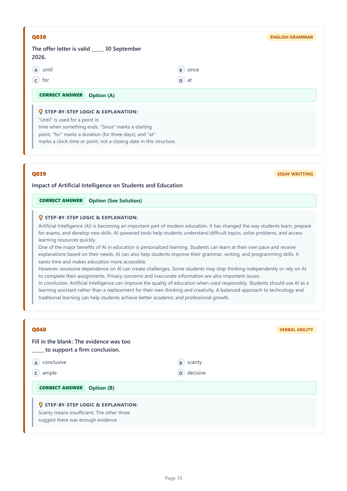 |

---

### Q039: Essay Writting (Page 16)

**Source Ebook**: `OS4U_Book_3_Verbal_Ability.pdf` | **Book Page**: **Page 16**  
**Authentic Page Figure**: [`OS4U_Book_3_Verbal_Ability_page_016.png`](images/OS4U_Book_3_Verbal_Ability_page_016.png)

#### Problem Statement & Question Prompt
```text
Impact of Artificial Intelligence on Students and Education
```

#### Multiple Choice Options
- *(Descriptive / Essay Prompt — Detailed Model Response Below)*

#### Verified Correct Answer Key
> **Correct Option**: **(O) `Option (See Solution)`**

#### Step-by-Step Logic & Comprehensive Solution
```text
Artificial Intelligence (AI) is becoming an important part of modern education. It has changed the way students learn, prepare for exams, and develop new skills. AI-powered tools help students understand difficult topics, solve problems, and access learning resources quickly.
One of the major benefits of AI in education is personalized learning. Students can learn at their own pace and receive explanations based on their needs. AI can also help students improve their grammar, writing, and programming skills. It saves time and makes education more accessible.
However, excessive dependence on AI can create challenges. Some students may stop thinking independently or rely on AI to complete their assignments. Privacy concerns and inaccurate information are also important issues.
In conclusion, Artificial Intelligence can improve the quality of education when used responsibly. Students should use AI as a learning assistant rather than a replacement for their own thinking and creativity. A balanced approach to technology and traditional learning can help students achieve better academic and professional growth.
```

#### Authentic Ebook Page Figure
| Ebook Page Render (Page 16) |
| :---: |
|  |

---

### Q040: Verbal Ability (Page 16)

**Source Ebook**: `OS4U_Book_3_Verbal_Ability.pdf` | **Book Page**: **Page 16**  
**Authentic Page Figure**: [`OS4U_Book_3_Verbal_Ability_page_016.png`](images/OS4U_Book_3_Verbal_Ability_page_016.png)

#### Problem Statement & Question Prompt
```text
Fill in the blank: The evidence was too
_____ to support a firm conclusion.
```

#### Multiple Choice Options
- **(A)** `conclusive`
- **(B)** `scanty`
- **(C)** `ample`
- **(D)** `decisive`

#### Verified Correct Answer Key
> **Correct Option**: **(B) `scanty`**

#### Step-by-Step Logic & Comprehensive Solution
```text
Scanty means insufficient. The other three
suggest there was enough evidence.
```

#### Authentic Ebook Page Figure
| Ebook Page Render (Page 16) |
| :---: |
|  |

---

### Q041: Verbal Ability (Page 17)

**Source Ebook**: `OS4U_Book_3_Verbal_Ability.pdf` | **Book Page**: **Page 17**  
**Authentic Page Figure**: [`OS4U_Book_3_Verbal_Ability_page_017.png`](images/OS4U_Book_3_Verbal_Ability_page_017.png)

#### Problem Statement & Question Prompt
```text
Choose the word most opposite in meaning to
“expand.”
```

#### Multiple Choice Options
- **(A)** `Enlarge`
- **(B)** `Widen`
- **(C)** `Contract`
- **(D)** `Grow`

#### Verified Correct Answer Key
> **Correct Option**: **(C) `Contract`**

#### Step-by-Step Logic & Comprehensive Solution
```text
Contract means to become smaller, the
opposite of expand.
```

#### Authentic Ebook Page Figure
| Ebook Page Render (Page 17) |
| :---: |
| 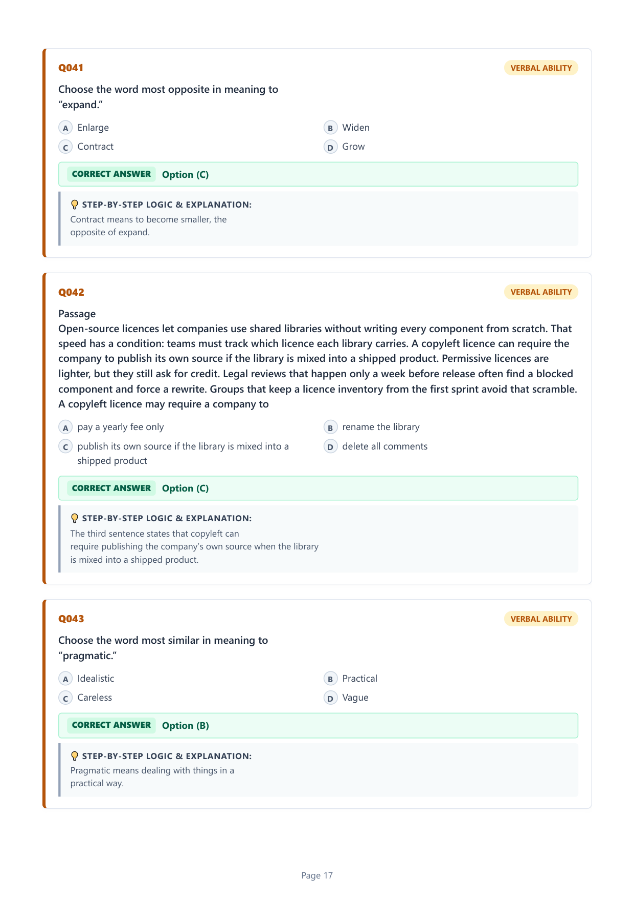 |

---

### Q042: Verbal Ability (Page 17)

**Source Ebook**: `OS4U_Book_3_Verbal_Ability.pdf` | **Book Page**: **Page 17**  
**Authentic Page Figure**: [`OS4U_Book_3_Verbal_Ability_page_017.png`](images/OS4U_Book_3_Verbal_Ability_page_017.png)

#### Problem Statement & Question Prompt
```text
Passage
Open-source licences let companies use shared libraries without writing every component from scratch. That speed has a condition: teams must track which licence each library carries. A copyleft licence can require the company to publish its own source if the library is mixed into a shipped product. Permissive licences are lighter, but they still ask for credit. Legal reviews that happen only a week before release often find a blocked component and force a rewrite. Groups that keep a licence inventory from the first sprint avoid that scramble.
A copyleft licence may require a company to
```

#### Multiple Choice Options
- **(A)** `pay a yearly fee only`
- **(B)** `rename the library`
- **(C)** `publish its own source if the library is mixed into a shipped product`
- **(D)** `delete all comments`

#### Verified Correct Answer Key
> **Correct Option**: **(C) `publish its own source if the library is mixed into a shipped product`**

#### Step-by-Step Logic & Comprehensive Solution
```text
The third sentence states that copyleft can
require publishing the company’s own source when the library
is mixed into a shipped product.
```

#### Authentic Ebook Page Figure
| Ebook Page Render (Page 17) |
| :---: |
|  |

---

### Q043: Verbal Ability (Page 17)

**Source Ebook**: `OS4U_Book_3_Verbal_Ability.pdf` | **Book Page**: **Page 17**  
**Authentic Page Figure**: [`OS4U_Book_3_Verbal_Ability_page_017.png`](images/OS4U_Book_3_Verbal_Ability_page_017.png)

#### Problem Statement & Question Prompt
```text
Choose the word most similar in meaning to
“pragmatic.”
```

#### Multiple Choice Options
- **(A)** `Idealistic`
- **(B)** `Practical`
- **(C)** `Careless`
- **(D)** `Vague`

#### Verified Correct Answer Key
> **Correct Option**: **(B) `Practical`**

#### Step-by-Step Logic & Comprehensive Solution
```text
Pragmatic means dealing with things in a
practical way.
```

#### Authentic Ebook Page Figure
| Ebook Page Render (Page 17) |
| :---: |
|  |

---

### Q044: Verbal Ability (Page 18)

**Source Ebook**: `OS4U_Book_3_Verbal_Ability.pdf` | **Book Page**: **Page 18**  
**Authentic Page Figure**: [`OS4U_Book_3_Verbal_Ability_page_018.png`](images/OS4U_Book_3_Verbal_Ability_page_018.png)

#### Problem Statement & Question Prompt
```text
Arrange: P: Pair reviews catch those slips
before merge. Q: Tired authors miss their own typos in a long
patch. R: Many teams therefore require a second name on every
change. S: Style guides alone do not replace a second pair of
eyes.
```

#### Multiple Choice Options
- **(A)** `Q S P R`
- **(B)** `Q P R S`
- **(C)** `P Q R S`
- **(D)** `S Q P R`

#### Verified Correct Answer Key
> **Correct Option**: **(B) `Q P R S`**

#### Step-by-Step Logic & Comprehensive Solution
```text
Q names the fault. P is the practice that
catches it. R states the rule. S adds why guides are not enough. Q
P R S.
```

#### Authentic Ebook Page Figure
| Ebook Page Render (Page 18) |
| :---: |
| 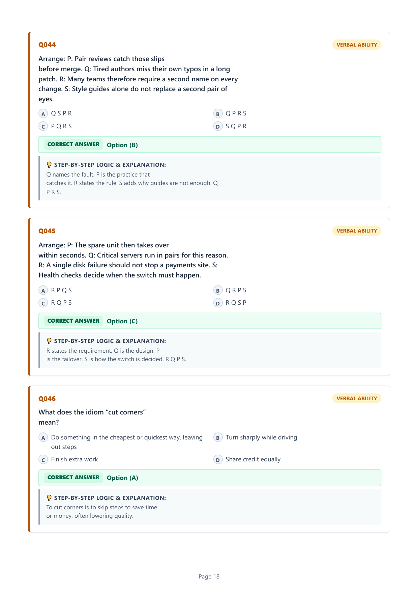 |

---

### Q045: Verbal Ability (Page 18)

**Source Ebook**: `OS4U_Book_3_Verbal_Ability.pdf` | **Book Page**: **Page 18**  
**Authentic Page Figure**: [`OS4U_Book_3_Verbal_Ability_page_018.png`](images/OS4U_Book_3_Verbal_Ability_page_018.png)

#### Problem Statement & Question Prompt
```text
Arrange: P: The spare unit then takes over
within seconds. Q: Critical servers run in pairs for this reason.
R: A single disk failure should not stop a payments site. S:
Health checks decide when the switch must happen.
```

#### Multiple Choice Options
- **(A)** `R P Q S`
- **(B)** `Q R P S`
- **(C)** `R Q P S`
- **(D)** `R Q S P`

#### Verified Correct Answer Key
> **Correct Option**: **(C) `R Q P S`**

#### Step-by-Step Logic & Comprehensive Solution
```text
R states the requirement. Q is the design. P
is the failover. S is how the switch is decided. R Q P S.
```

#### Authentic Ebook Page Figure
| Ebook Page Render (Page 18) |
| :---: |
|  |

---

### Q046: Verbal Ability (Page 18)

**Source Ebook**: `OS4U_Book_3_Verbal_Ability.pdf` | **Book Page**: **Page 18**  
**Authentic Page Figure**: [`OS4U_Book_3_Verbal_Ability_page_018.png`](images/OS4U_Book_3_Verbal_Ability_page_018.png)

#### Problem Statement & Question Prompt
```text
What does the idiom “cut corners”
mean?
```

#### Multiple Choice Options
- **(A)** `Do something in the cheapest or quickest way, leaving out steps`
- **(B)** `Turn sharply while driving`
- **(C)** `Finish extra work`
- **(D)** `Share credit equally`

#### Verified Correct Answer Key
> **Correct Option**: **(A) `Do something in the cheapest or quickest way, leaving out steps`**

#### Step-by-Step Logic & Comprehensive Solution
```text
To cut corners is to skip steps to save time
or money, often lowering quality.
```

#### Authentic Ebook Page Figure
| Ebook Page Render (Page 18) |
| :---: |
|  |

---

### Q047: Verbal Ability (Page 19)

**Source Ebook**: `OS4U_Book_3_Verbal_Ability.pdf` | **Book Page**: **Page 19**  
**Authentic Page Figure**: [`OS4U_Book_3_Verbal_Ability_page_019.png`](images/OS4U_Book_3_Verbal_Ability_page_019.png)

#### Problem Statement & Question Prompt
```text
Arrange: P: Cached results then go stale and
mislead the next user. Q: A search index must be refreshed when
the source pages change. R: That is why crawlers revisit important
URLs on a schedule. S: Skipping those visits looks cheaper until a
client complains.
```

#### Multiple Choice Options
- **(A)** `Q P R S`
- **(B)** `P Q S R`
- **(C)** `Q R P S`
- **(D)** `R Q S P`

#### Verified Correct Answer Key
> **Correct Option**: **(A) `Q P R S`**

#### Step-by-Step Logic & Comprehensive Solution
```text
Q states the need. P is the failure mode. R
is the operational response. S comments on skipping it. Order Q P
R S.
```

#### Authentic Ebook Page Figure
| Ebook Page Render (Page 19) |
| :---: |
| 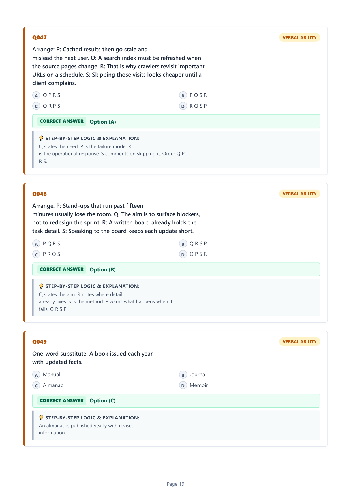 |

---

### Q048: Verbal Ability (Page 19)

**Source Ebook**: `OS4U_Book_3_Verbal_Ability.pdf` | **Book Page**: **Page 19**  
**Authentic Page Figure**: [`OS4U_Book_3_Verbal_Ability_page_019.png`](images/OS4U_Book_3_Verbal_Ability_page_019.png)

#### Problem Statement & Question Prompt
```text
Arrange: P: Stand-ups that run past fifteen
minutes usually lose the room. Q: The aim is to surface blockers,
not to redesign the sprint. R: A written board already holds the
task detail. S: Speaking to the board keeps each update short.
```

#### Multiple Choice Options
- **(A)** `P Q R S`
- **(B)** `Q R S P`
- **(C)** `P R Q S`
- **(D)** `Q P S R`

#### Verified Correct Answer Key
> **Correct Option**: **(B) `Q R S P`**

#### Step-by-Step Logic & Comprehensive Solution
```text
Q states the aim. R notes where detail
already lives. S is the method. P warns what happens when it
fails. Q R S P.
```

#### Authentic Ebook Page Figure
| Ebook Page Render (Page 19) |
| :---: |
|  |

---

### Q049: Verbal Ability (Page 19)

**Source Ebook**: `OS4U_Book_3_Verbal_Ability.pdf` | **Book Page**: **Page 19**  
**Authentic Page Figure**: [`OS4U_Book_3_Verbal_Ability_page_019.png`](images/OS4U_Book_3_Verbal_Ability_page_019.png)

#### Problem Statement & Question Prompt
```text
One-word substitute: A book issued each year
with updated facts.
```

#### Multiple Choice Options
- **(A)** `Manual`
- **(B)** `Journal`
- **(C)** `Almanac`
- **(D)** `Memoir`

#### Verified Correct Answer Key
> **Correct Option**: **(C) `Almanac`**

#### Step-by-Step Logic & Comprehensive Solution
```text
An almanac is published yearly with revised
information.
```

#### Authentic Ebook Page Figure
| Ebook Page Render (Page 19) |
| :---: |
|  |

---

### Q050: Verbal Ability (Page 20)

**Source Ebook**: `OS4U_Book_3_Verbal_Ability.pdf` | **Book Page**: **Page 20**  
**Authentic Page Figure**: [`OS4U_Book_3_Verbal_Ability_page_020.png`](images/OS4U_Book_3_Verbal_Ability_page_020.png)

#### Problem Statement & Question Prompt
```text
Arrange: P: Clear labels on axes prevent
that mistake. Q: A chart with no units can be read as growth when
it is only a change of scale. R: Reviewers should reject figures
that hide the scale. S: Readers then leave the meeting with the
wrong story.
```

#### Multiple Choice Options
- **(A)** `Q S P R`
- **(B)** `Q P S R`
- **(C)** `S Q P R`
- **(D)** `P Q R S`

#### Verified Correct Answer Key
> **Correct Option**: **(A) `Q S P R`**

#### Step-by-Step Logic & Comprehensive Solution
```text
Q is the trap. S is the cost. P is the
simple fix. R is the process rule. Q S P R.
```

#### Authentic Ebook Page Figure
| Ebook Page Render (Page 20) |
| :---: |
| 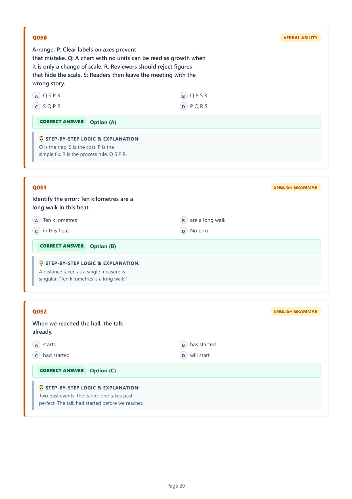 |

---

### Q051: English Grammar (Page 20)

**Source Ebook**: `OS4U_Book_3_Verbal_Ability.pdf` | **Book Page**: **Page 20**  
**Authentic Page Figure**: [`OS4U_Book_3_Verbal_Ability_page_020.png`](images/OS4U_Book_3_Verbal_Ability_page_020.png)

#### Problem Statement & Question Prompt
```text
Identify the error: Ten kilometres are a
long walk in this heat.
```

#### Multiple Choice Options
- **(A)** `Ten kilometres`
- **(B)** `are a long walk`
- **(C)** `in this heat`
- **(D)** `No error`

#### Verified Correct Answer Key
> **Correct Option**: **(B) `are a long walk`**

#### Step-by-Step Logic & Comprehensive Solution
```text
A distance taken as a single measure is
singular: “Ten kilometres is a long walk.”
```

#### Authentic Ebook Page Figure
| Ebook Page Render (Page 20) |
| :---: |
|  |

---

### Q052: English Grammar (Page 20)

**Source Ebook**: `OS4U_Book_3_Verbal_Ability.pdf` | **Book Page**: **Page 20**  
**Authentic Page Figure**: [`OS4U_Book_3_Verbal_Ability_page_020.png`](images/OS4U_Book_3_Verbal_Ability_page_020.png)

#### Problem Statement & Question Prompt
```text
When we reached the hall, the talk _____
already.
```

#### Multiple Choice Options
- **(A)** `starts`
- **(B)** `has started`
- **(C)** `had started`
- **(D)** `will start`

#### Verified Correct Answer Key
> **Correct Option**: **(C) `had started`**

#### Step-by-Step Logic & Comprehensive Solution
```text
Two past events: the earlier one takes past
perfect. The talk had started before we reached.
```

#### Authentic Ebook Page Figure
| Ebook Page Render (Page 20) |
| :---: |
|  |

---

### Q053: English Grammar (Page 21)

**Source Ebook**: `OS4U_Book_3_Verbal_Ability.pdf` | **Book Page**: **Page 21**  
**Authentic Page Figure**: [`OS4U_Book_3_Verbal_Ability_page_021.png`](images/OS4U_Book_3_Verbal_Ability_page_021.png)

#### Problem Statement & Question Prompt
```text
Identify the error: She has been working
here since three years.
```

#### Multiple Choice Options
- **(A)** `She has been working`
- **(B)** `since three years`
- **(C)** `here`
- **(D)** `No error`

#### Verified Correct Answer Key
> **Correct Option**: **(B) `since three years`**

#### Step-by-Step Logic & Comprehensive Solution
```text
“Since” takes a point in time. A
period takes “for”: for three years.
```

#### Authentic Ebook Page Figure
| Ebook Page Render (Page 21) |
| :---: |
| 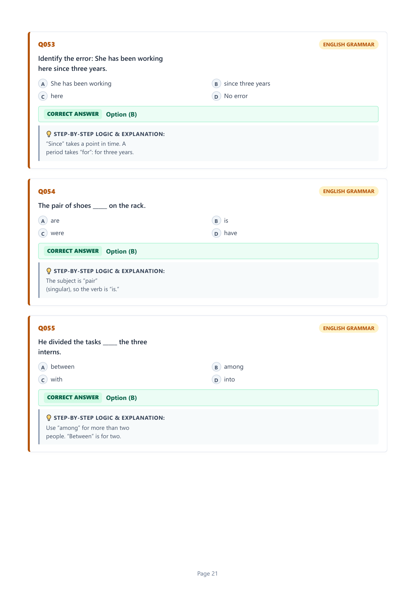 |

---

### Q054: English Grammar (Page 21)

**Source Ebook**: `OS4U_Book_3_Verbal_Ability.pdf` | **Book Page**: **Page 21**  
**Authentic Page Figure**: [`OS4U_Book_3_Verbal_Ability_page_021.png`](images/OS4U_Book_3_Verbal_Ability_page_021.png)

#### Problem Statement & Question Prompt
```text
The pair of shoes _____ on the rack.
```

#### Multiple Choice Options
- **(A)** `are`
- **(B)** `is`
- **(C)** `were`
- **(D)** `have`

#### Verified Correct Answer Key
> **Correct Option**: **(B) `is`**

#### Step-by-Step Logic & Comprehensive Solution
```text
The subject is “pair”
(singular), so the verb is “is.”
```

#### Authentic Ebook Page Figure
| Ebook Page Render (Page 21) |
| :---: |
|  |

---

### Q055: English Grammar (Page 21)

**Source Ebook**: `OS4U_Book_3_Verbal_Ability.pdf` | **Book Page**: **Page 21**  
**Authentic Page Figure**: [`OS4U_Book_3_Verbal_Ability_page_021.png`](images/OS4U_Book_3_Verbal_Ability_page_021.png)

#### Problem Statement & Question Prompt
```text
He divided the tasks _____ the three
interns.
```

#### Multiple Choice Options
- **(A)** `between`
- **(B)** `among`
- **(C)** `with`
- **(D)** `into`

#### Verified Correct Answer Key
> **Correct Option**: **(B) `among`**

#### Step-by-Step Logic & Comprehensive Solution
```text
Use “among” for more than two
people. “Between” is for two.
```

#### Authentic Ebook Page Figure
| Ebook Page Render (Page 21) |
| :---: |
|  |

---

### Q056: Essay Writting (Page 22)

**Source Ebook**: `OS4U_Book_3_Verbal_Ability.pdf` | **Book Page**: **Page 22**  
**Authentic Page Figure**: [`OS4U_Book_3_Verbal_Ability_page_022.png`](images/OS4U_Book_3_Verbal_Ability_page_022.png)

#### Problem Statement & Question Prompt
```text
The Importance of Time Management in Student Life
```

#### Multiple Choice Options
- *(Descriptive / Essay Prompt — Detailed Model Response Below)*

#### Verified Correct Answer Key
> **Correct Option**: **(O) `Option (See Solution)`**

#### Step-by-Step Logic & Comprehensive Solution
```text
Time management is an essential skill that helps students achieve their academic and personal goals. It means planning and organizing time effectively to complete different tasks. In today&#x27;s competitive world, good time management is important for success in education and professional life.
Students often have to manage studies, assignments, examinations, and personal activities. Creating a daily timetable helps them prioritize important tasks and avoid unnecessary stress. Proper time management also improves concentration, productivity, and self-discipline.
One of the major benefits of time management is that it helps students complete their work on time. It also provides enough time for revision, skill development, and relaxation. Students who manage their time effectively can maintain a better balance between studies and personal life.
However, time management requires consistency and dedication. Avoiding distractions such as excessive social media use can help students focus on their goals.
In conclusion, time management is a key factor in student success. By developing good time management habits, students can improve their performance, reduce stress, and prepare themselves for a successful future.
```

#### Authentic Ebook Page Figure
| Ebook Page Render (Page 22) |
| :---: |
| 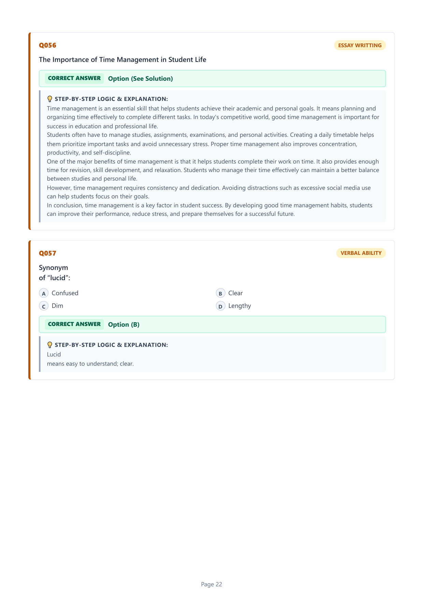 |

---

### Q057: Verbal Ability (Page 22)

**Source Ebook**: `OS4U_Book_3_Verbal_Ability.pdf` | **Book Page**: **Page 22**  
**Authentic Page Figure**: [`OS4U_Book_3_Verbal_Ability_page_022.png`](images/OS4U_Book_3_Verbal_Ability_page_022.png)

#### Problem Statement & Question Prompt
```text
Synonym
of “lucid”:
```

#### Multiple Choice Options
- **(A)** `Confused`
- **(B)** `Clear`
- **(C)** `Dim`
- **(D)** `Lengthy`

#### Verified Correct Answer Key
> **Correct Option**: **(B) `Clear`**

#### Step-by-Step Logic & Comprehensive Solution
```text
Lucid
means easy to understand; clear.
```

#### Authentic Ebook Page Figure
| Ebook Page Render (Page 22) |
| :---: |
|  |

---

### Q058: Verbal Ability (Page 23)

**Source Ebook**: `OS4U_Book_3_Verbal_Ability.pdf` | **Book Page**: **Page 23**  
**Authentic Page Figure**: [`OS4U_Book_3_Verbal_Ability_page_023.png`](images/OS4U_Book_3_Verbal_Ability_page_023.png)

#### Problem Statement & Question Prompt
```text
Arrange:
P: Borrowed slides often hide the one chart that matters. Q: A
12-minute talk can carry only one claim. R: Cut until a stranger
can repeat that claim in one sentence. S: Extra animations do not
add proof.
```

#### Multiple Choice Options
- **(A)** `Q P R S`
- **(B)** `Q
S P R`
- **(C)** `P
Q R S`
- **(D)** `Q
P S R`

#### Verified Correct Answer Key
> **Correct Option**: **(A) `Q P R S`**

#### Step-by-Step Logic & Comprehensive Solution
```text
Q
states the limit. P shows how extra slides hide the claim. R is
the edit rule. S rejects decoration. Q P R S.
```

#### Authentic Ebook Page Figure
| Ebook Page Render (Page 23) |
| :---: |
| 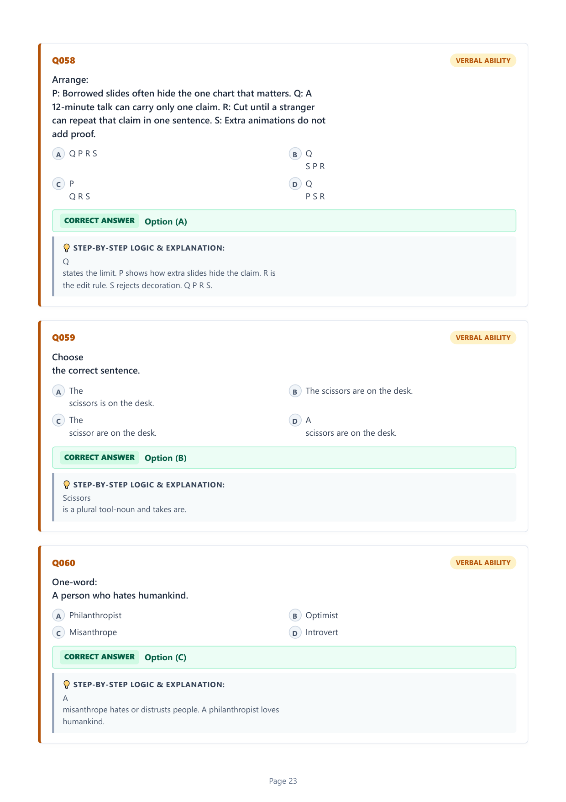 |

---

### Q059: Verbal Ability (Page 23)

**Source Ebook**: `OS4U_Book_3_Verbal_Ability.pdf` | **Book Page**: **Page 23**  
**Authentic Page Figure**: [`OS4U_Book_3_Verbal_Ability_page_023.png`](images/OS4U_Book_3_Verbal_Ability_page_023.png)

#### Problem Statement & Question Prompt
```text
Choose
the correct sentence.
```

#### Multiple Choice Options
- **(A)** `The
scissors is on the desk.`
- **(B)** `The scissors are on the desk.`
- **(C)** `The
scissor are on the desk.`
- **(D)** `A
scissors are on the desk.`

#### Verified Correct Answer Key
> **Correct Option**: **(B) `The scissors are on the desk.`**

#### Step-by-Step Logic & Comprehensive Solution
```text
Scissors
is a plural tool-noun and takes are.
```

#### Authentic Ebook Page Figure
| Ebook Page Render (Page 23) |
| :---: |
|  |

---

### Q060: Verbal Ability (Page 23)

**Source Ebook**: `OS4U_Book_3_Verbal_Ability.pdf` | **Book Page**: **Page 23**  
**Authentic Page Figure**: [`OS4U_Book_3_Verbal_Ability_page_023.png`](images/OS4U_Book_3_Verbal_Ability_page_023.png)

#### Problem Statement & Question Prompt
```text
One-word:
A person who hates humankind.
```

#### Multiple Choice Options
- **(A)** `Philanthropist`
- **(B)** `Optimist`
- **(C)** `Misanthrope`
- **(D)** `Introvert`

#### Verified Correct Answer Key
> **Correct Option**: **(C) `Misanthrope`**

#### Step-by-Step Logic & Comprehensive Solution
```text
A
misanthrope hates or distrusts people. A philanthropist loves
humankind.
```

#### Authentic Ebook Page Figure
| Ebook Page Render (Page 23) |
| :---: |
|  |

---

### Q061: Verbal Ability (Page 24)

**Source Ebook**: `OS4U_Book_3_Verbal_Ability.pdf` | **Book Page**: **Page 24**  
**Authentic Page Figure**: [`OS4U_Book_3_Verbal_Ability_page_024.png`](images/OS4U_Book_3_Verbal_Ability_page_024.png)

#### Problem Statement & Question Prompt
```text
Arrange:
P: Logs that nobody reads are only decoration. Q: An alert should
name the service, the fault and the next action. R: Otherwise
night staff guess while the queue grows. S: Templates make that
three-part line automatic.
```

#### Multiple Choice Options
- **(A)** `Q
P S R`
- **(B)** `P
Q R S`
- **(C)** `Q
R P S`
- **(D)** `Q R S P`

#### Verified Correct Answer Key
> **Correct Option**: **(D) `Q R S P`**

#### Step-by-Step Logic & Comprehensive Solution
```text
Q
sets the standard. R is what happens without it. S is the method.
P dismisses empty logs. Order Q R S P.
```

#### Authentic Ebook Page Figure
| Ebook Page Render (Page 24) |
| :---: |
| 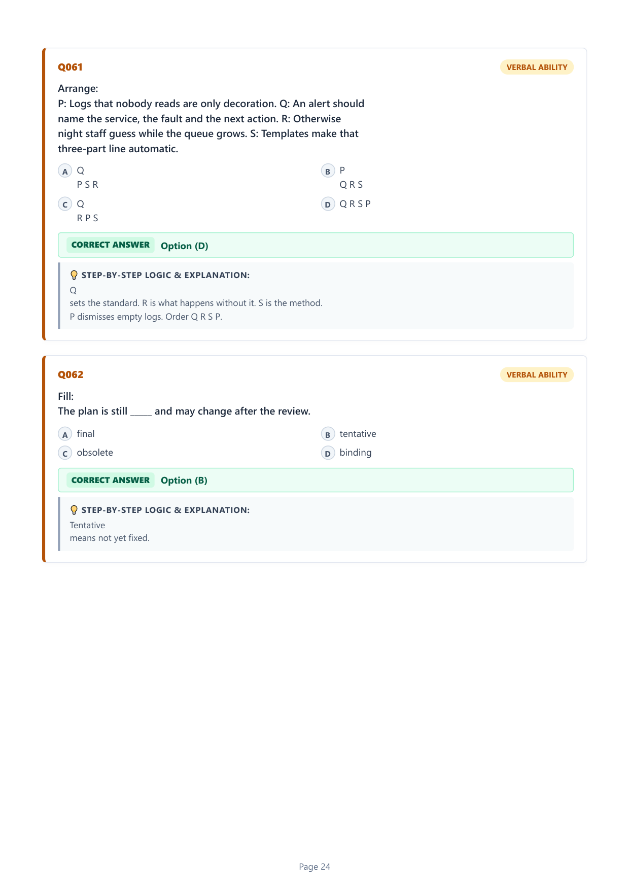 |

---

### Q062: Verbal Ability (Page 24)

**Source Ebook**: `OS4U_Book_3_Verbal_Ability.pdf` | **Book Page**: **Page 24**  
**Authentic Page Figure**: [`OS4U_Book_3_Verbal_Ability_page_024.png`](images/OS4U_Book_3_Verbal_Ability_page_024.png)

#### Problem Statement & Question Prompt
```text
Fill:
The plan is still _____ and may change after the review.
```

#### Multiple Choice Options
- **(A)** `final`
- **(B)** `tentative`
- **(C)** `obsolete`
- **(D)** `binding`

#### Verified Correct Answer Key
> **Correct Option**: **(B) `tentative`**

#### Step-by-Step Logic & Comprehensive Solution
```text
Tentative
means not yet fixed.
```

#### Authentic Ebook Page Figure
| Ebook Page Render (Page 24) |
| :---: |
|  |

---

### Q063: Verbal Ability (Page 25)

**Source Ebook**: `OS4U_Book_3_Verbal_Ability.pdf` | **Book Page**: **Page 25**  
**Authentic Page Figure**: [`OS4U_Book_3_Verbal_Ability_page_025.png`](images/OS4U_Book_3_Verbal_Ability_page_025.png)

#### Problem Statement & Question Prompt
```text
Passage
Battery-electric buses cut street noise and tailpipe smoke, but they do not remove every cost. A depot needs chargers, a stronger grid connection and spare batteries for peak hours. Drivers also need a new duty cycle: charging windows replace some of the old refuelling stops. Cities that pilot one route first learn the real range in rain and hill traffic before they replace a whole fleet. The cleanest plan is not the largest overnight order; it is the one that matches charger capacity to the timetable.
A depot for electric buses needs
```

#### Multiple Choice Options
- **(A)** `chargers, a stronger grid connection and spare batteries`
- **(B)** `only
a diesel generator`
- **(C)** `no
change to the grid`
- **(D)** `fewer
drivers`

#### Verified Correct Answer Key
> **Correct Option**: **(A) `chargers, a stronger grid connection and spare batteries`**

#### Step-by-Step Logic & Comprehensive Solution
```text
Those
three items are listed in the second sentence.
```

#### Authentic Ebook Page Figure
| Ebook Page Render (Page 25) |
| :---: |
| 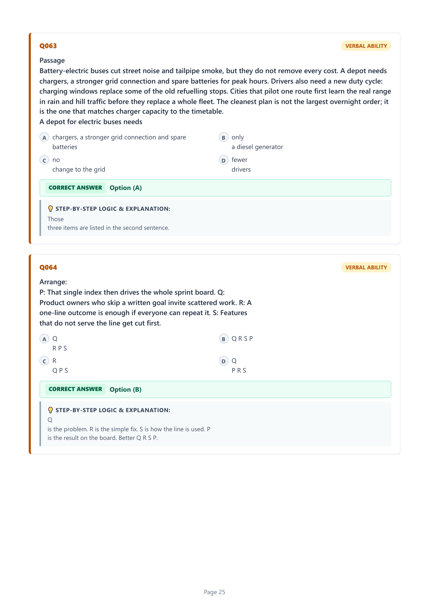 |

---

### Q064: Verbal Ability (Page 25)

**Source Ebook**: `OS4U_Book_3_Verbal_Ability.pdf` | **Book Page**: **Page 25**  
**Authentic Page Figure**: [`OS4U_Book_3_Verbal_Ability_page_025.png`](images/OS4U_Book_3_Verbal_Ability_page_025.png)

#### Problem Statement & Question Prompt
```text
Arrange:
P: That single index then drives the whole sprint board. Q:
Product owners who skip a written goal invite scattered work. R: A
one-line outcome is enough if everyone can repeat it. S: Features
that do not serve the line get cut first.
```

#### Multiple Choice Options
- **(A)** `Q
R P S`
- **(B)** `Q R S P`
- **(C)** `R
Q P S`
- **(D)** `Q
P R S`

#### Verified Correct Answer Key
> **Correct Option**: **(B) `Q R S P`**

#### Step-by-Step Logic & Comprehensive Solution
```text
Q
is the problem. R is the simple fix. S is how the line is used. P
is the result on the board. Better Q R S P.
```

#### Authentic Ebook Page Figure
| Ebook Page Render (Page 25) |
| :---: |
|  |

---

### Q065: Verbal Ability (Page 26)

**Source Ebook**: `OS4U_Book_3_Verbal_Ability.pdf` | **Book Page**: **Page 26**  
**Authentic Page Figure**: [`OS4U_Book_3_Verbal_Ability_page_026.png`](images/OS4U_Book_3_Verbal_Ability_page_026.png)

#### Problem Statement & Question Prompt
```text
Idiom:
“on the same page” means
```

#### Multiple Choice Options
- **(A)** `In agreement`
- **(B)** `Reading
a book together`
- **(C)** `Sitting
in one row`
- **(D)** `Sharing
a password`

#### Verified Correct Answer Key
> **Correct Option**: **(A) `In agreement`**

#### Step-by-Step Logic & Comprehensive Solution
```text
It
means having the same understanding or agreement.
```

#### Authentic Ebook Page Figure
| Ebook Page Render (Page 26) |
| :---: |
| 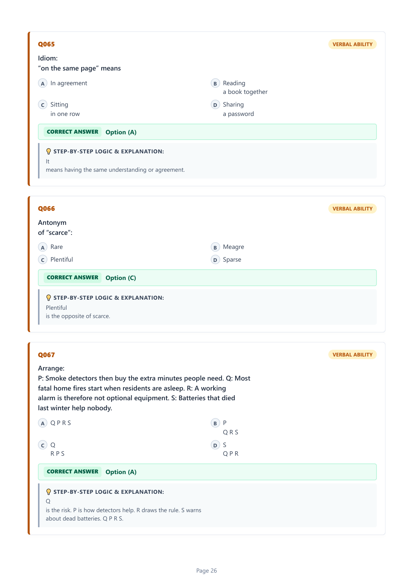 |

---

### Q066: Verbal Ability (Page 26)

**Source Ebook**: `OS4U_Book_3_Verbal_Ability.pdf` | **Book Page**: **Page 26**  
**Authentic Page Figure**: [`OS4U_Book_3_Verbal_Ability_page_026.png`](images/OS4U_Book_3_Verbal_Ability_page_026.png)

#### Problem Statement & Question Prompt
```text
Antonym
of “scarce”:
```

#### Multiple Choice Options
- **(A)** `Rare`
- **(B)** `Meagre`
- **(C)** `Plentiful`
- **(D)** `Sparse`

#### Verified Correct Answer Key
> **Correct Option**: **(C) `Plentiful`**

#### Step-by-Step Logic & Comprehensive Solution
```text
Plentiful
is the opposite of scarce.
```

#### Authentic Ebook Page Figure
| Ebook Page Render (Page 26) |
| :---: |
|  |

---

### Q067: Verbal Ability (Page 26)

**Source Ebook**: `OS4U_Book_3_Verbal_Ability.pdf` | **Book Page**: **Page 26**  
**Authentic Page Figure**: [`OS4U_Book_3_Verbal_Ability_page_026.png`](images/OS4U_Book_3_Verbal_Ability_page_026.png)

#### Problem Statement & Question Prompt
```text
Arrange:
P: Smoke detectors then buy the extra minutes people need. Q: Most
fatal home fires start when residents are asleep. R: A working
alarm is therefore not optional equipment. S: Batteries that died
last winter help nobody.
```

#### Multiple Choice Options
- **(A)** `Q P R S`
- **(B)** `P
Q R S`
- **(C)** `Q
R P S`
- **(D)** `S
Q P R`

#### Verified Correct Answer Key
> **Correct Option**: **(A) `Q P R S`**

#### Step-by-Step Logic & Comprehensive Solution
```text
Q
is the risk. P is how detectors help. R draws the rule. S warns
about dead batteries. Q P R S.
```

#### Authentic Ebook Page Figure
| Ebook Page Render (Page 26) |
| :---: |
|  |

---

### Q068: Verbal Ability (Page 27)

**Source Ebook**: `OS4U_Book_3_Verbal_Ability.pdf` | **Book Page**: **Page 27**  
**Authentic Page Figure**: [`OS4U_Book_3_Verbal_Ability_page_027.png`](images/OS4U_Book_3_Verbal_Ability_page_027.png)

#### Problem Statement & Question Prompt
```text
Arrange:
P: Wet leaves on a painted crossing are as slick as oil. Q: Autumn
morning shifts therefore start with a broom, not a briefing. R:
Two staff minutes prevent a visitor fall. S: The cheapest safety
tool is still a clear path.
```

#### Multiple Choice Options
- **(A)** `P Q R S`
- **(B)** `P
R Q S`
- **(C)** `Q
P S R`
- **(D)** `S
P Q R`

#### Verified Correct Answer Key
> **Correct Option**: **(A) `P Q R S`**

#### Step-by-Step Logic & Comprehensive Solution
```text
P
states the hazard. Q is the work habit. R is the payoff. S
generalises. P Q R S.
```

#### Authentic Ebook Page Figure
| Ebook Page Render (Page 27) |
| :---: |
| 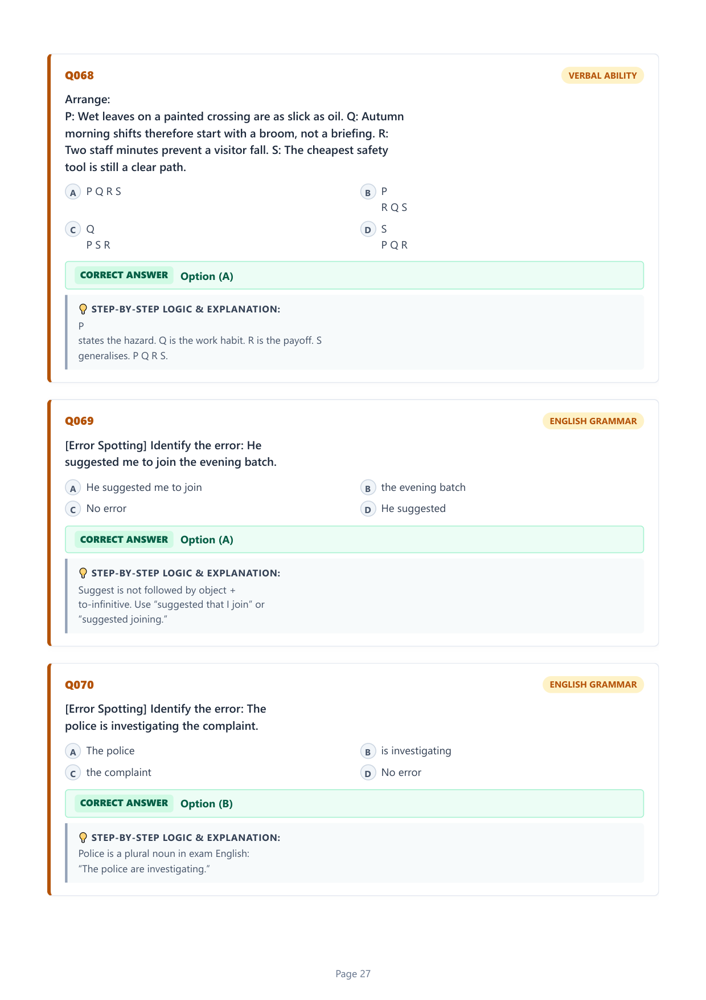 |

---

### Q069: English Grammar (Page 27)

**Source Ebook**: `OS4U_Book_3_Verbal_Ability.pdf` | **Book Page**: **Page 27**  
**Authentic Page Figure**: [`OS4U_Book_3_Verbal_Ability_page_027.png`](images/OS4U_Book_3_Verbal_Ability_page_027.png)

#### Problem Statement & Question Prompt
```text
[Error Spotting] Identify the error: He
suggested me to join the evening batch.
```

#### Multiple Choice Options
- **(A)** `He suggested me to join`
- **(B)** `the evening batch`
- **(C)** `No error`
- **(D)** `He suggested`

#### Verified Correct Answer Key
> **Correct Option**: **(A) `He suggested me to join`**

#### Step-by-Step Logic & Comprehensive Solution
```text
Suggest is not followed by object +
to-infinitive. Use “suggested that I join” or
“suggested joining.”
```

#### Authentic Ebook Page Figure
| Ebook Page Render (Page 27) |
| :---: |
|  |

---

### Q070: English Grammar (Page 27)

**Source Ebook**: `OS4U_Book_3_Verbal_Ability.pdf` | **Book Page**: **Page 27**  
**Authentic Page Figure**: [`OS4U_Book_3_Verbal_Ability_page_027.png`](images/OS4U_Book_3_Verbal_Ability_page_027.png)

#### Problem Statement & Question Prompt
```text
[Error Spotting] Identify the error: The
police is investigating the complaint.
```

#### Multiple Choice Options
- **(A)** `The police`
- **(B)** `is investigating`
- **(C)** `the complaint`
- **(D)** `No error`

#### Verified Correct Answer Key
> **Correct Option**: **(B) `is investigating`**

#### Step-by-Step Logic & Comprehensive Solution
```text
Police is a plural noun in exam English:
“The police are investigating.”
```

#### Authentic Ebook Page Figure
| Ebook Page Render (Page 27) |
| :---: |
|  |

---

### Q071: English Grammar (Page 28)

**Source Ebook**: `OS4U_Book_3_Verbal_Ability.pdf` | **Book Page**: **Page 28**  
**Authentic Page Figure**: [`OS4U_Book_3_Verbal_Ability_page_028.png`](images/OS4U_Book_3_Verbal_Ability_page_028.png)

#### Problem Statement & Question Prompt
```text
[Tenses] I _____ this account since 2021.
```

#### Multiple Choice Options
- **(A)** `opened`
- **(B)** `open`
- **(C)** `have had`
- **(D)** `had open`

#### Verified Correct Answer Key
> **Correct Option**: **(C) `have had`**

#### Step-by-Step Logic & Comprehensive Solution
```text
Since 2021 marks a period up to now, so
present perfect: have had.
```

#### Authentic Ebook Page Figure
| Ebook Page Render (Page 28) |
| :---: |
| 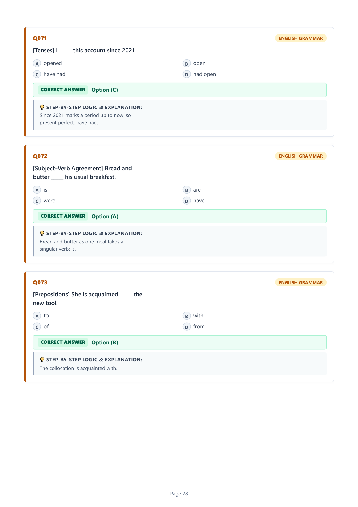 |

---

### Q072: English Grammar (Page 28)

**Source Ebook**: `OS4U_Book_3_Verbal_Ability.pdf` | **Book Page**: **Page 28**  
**Authentic Page Figure**: [`OS4U_Book_3_Verbal_Ability_page_028.png`](images/OS4U_Book_3_Verbal_Ability_page_028.png)

#### Problem Statement & Question Prompt
```text
[Subject–Verb Agreement] Bread and
butter _____ his usual breakfast.
```

#### Multiple Choice Options
- **(A)** `is`
- **(B)** `are`
- **(C)** `were`
- **(D)** `have`

#### Verified Correct Answer Key
> **Correct Option**: **(A) `is`**

#### Step-by-Step Logic & Comprehensive Solution
```text
Bread and butter as one meal takes a
singular verb: is.
```

#### Authentic Ebook Page Figure
| Ebook Page Render (Page 28) |
| :---: |
|  |

---

### Q073: English Grammar (Page 28)

**Source Ebook**: `OS4U_Book_3_Verbal_Ability.pdf` | **Book Page**: **Page 28**  
**Authentic Page Figure**: [`OS4U_Book_3_Verbal_Ability_page_028.png`](images/OS4U_Book_3_Verbal_Ability_page_028.png)

#### Problem Statement & Question Prompt
```text
[Prepositions] She is acquainted _____ the
new tool.
```

#### Multiple Choice Options
- **(A)** `to`
- **(B)** `with`
- **(C)** `of`
- **(D)** `from`

#### Verified Correct Answer Key
> **Correct Option**: **(B) `with`**

#### Step-by-Step Logic & Comprehensive Solution
```text
The collocation is acquainted with.
```

#### Authentic Ebook Page Figure
| Ebook Page Render (Page 28) |
| :---: |
|  |

---

### Q074: Essay Writting (Page 29)

**Source Ebook**: `OS4U_Book_3_Verbal_Ability.pdf` | **Book Page**: **Page 29**  
**Authentic Page Figure**: [`OS4U_Book_3_Verbal_Ability_page_029.png`](images/OS4U_Book_3_Verbal_Ability_page_029.png)

#### Problem Statement & Question Prompt
```text
Work From Home: Benefits and Challenges
```

#### Multiple Choice Options
- *(Descriptive / Essay Prompt — Detailed Model Response Below)*

#### Verified Correct Answer Key
> **Correct Option**: **(O) `Option (See Solution)`**

#### Step-by-Step Logic & Comprehensive Solution
```text
Work from home has become an important part of the modern working environment. With the help of computers, smartphones, and internet connectivity, employees can perform many professional tasks without visiting an office.
One major benefit of working from home is flexibility. Employees can save travelling time and use it for productive activities. It can also help people maintain a better balance between their professional and personal responsibilities. Companies may also reduce certain office-related expenses by adopting remote work.
However, work from home also has some challenges. Employees may face communication problems, technical issues, or distractions at home. Long working hours and limited interaction with colleagues can also affect productivity and teamwork. Therefore, proper planning and communication are necessary for successful remote working.
In conclusion, work from home offers several advantages but also requires discipline and effective communication. When employees and organizations use suitable technology and maintain clear work schedules, remote working can become an effective way of working in the modern professional world.
```

#### Authentic Ebook Page Figure
| Ebook Page Render (Page 29) |
| :---: |
| 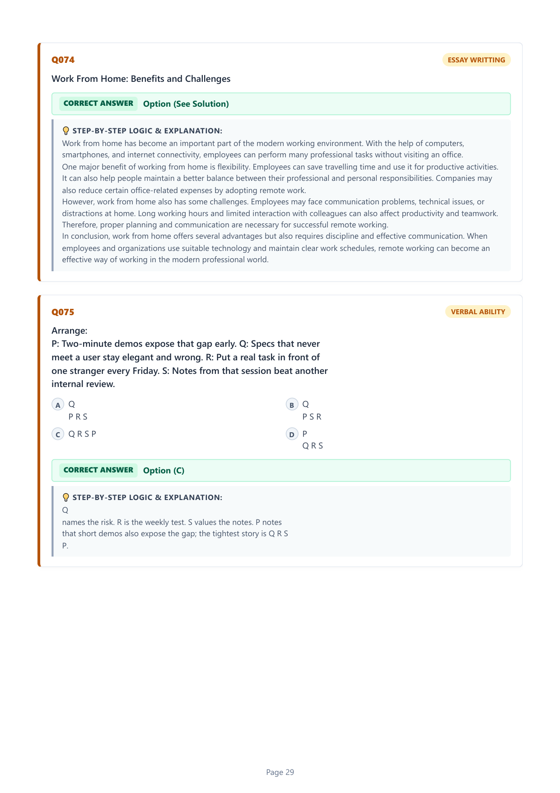 |

---

### Q075: Verbal Ability (Page 29)

**Source Ebook**: `OS4U_Book_3_Verbal_Ability.pdf` | **Book Page**: **Page 29**  
**Authentic Page Figure**: [`OS4U_Book_3_Verbal_Ability_page_029.png`](images/OS4U_Book_3_Verbal_Ability_page_029.png)

#### Problem Statement & Question Prompt
```text
Arrange:
P: Two-minute demos expose that gap early. Q: Specs that never
meet a user stay elegant and wrong. R: Put a real task in front of
one stranger every Friday. S: Notes from that session beat another
internal review.
```

#### Multiple Choice Options
- **(A)** `Q
P R S`
- **(B)** `Q
P S R`
- **(C)** `Q R S P`
- **(D)** `P
Q R S`

#### Verified Correct Answer Key
> **Correct Option**: **(C) `Q R S P`**

#### Step-by-Step Logic & Comprehensive Solution
```text
Q
names the risk. R is the weekly test. S values the notes. P notes
that short demos also expose the gap; the tightest story is Q R S
P.
```

#### Authentic Ebook Page Figure
| Ebook Page Render (Page 29) |
| :---: |
|  |

---

### Q076: Verbal Ability (Page 30)

**Source Ebook**: `OS4U_Book_3_Verbal_Ability.pdf` | **Book Page**: **Page 30**  
**Authentic Page Figure**: [`OS4U_Book_3_Verbal_Ability_page_030.png`](images/OS4U_Book_3_Verbal_Ability_page_030.png)

#### Problem Statement & Question Prompt
```text
Passage
A service-level objective is useful only when the team can see the error budget being spent. If latency is promised at 300 ms for 99% of calls, the remaining 1% is not a licence to ignore timeouts. Burn-rate alerts that fire after the month is already lost teach nobody. The better habit is a short window alert plus a long window alert, so a sharp incident and a slow leak are both visible. Documents that list SLOs without owners become wallpaper.
Burn-rate alerts that fire after the month is lost
```

#### Multiple Choice Options
- **(A)** `teach nobody`
- **(B)** `are
the best design`
- **(C)** `replace
owners`
- **(D)** `fix
latency`

#### Verified Correct Answer Key
> **Correct Option**: **(A) `teach nobody`**

#### Step-by-Step Logic & Comprehensive Solution
```text
The
third sentence.
```

#### Authentic Ebook Page Figure
| Ebook Page Render (Page 30) |
| :---: |
| 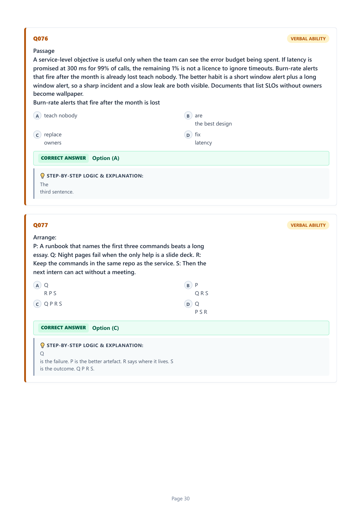 |

---

### Q077: Verbal Ability (Page 30)

**Source Ebook**: `OS4U_Book_3_Verbal_Ability.pdf` | **Book Page**: **Page 30**  
**Authentic Page Figure**: [`OS4U_Book_3_Verbal_Ability_page_030.png`](images/OS4U_Book_3_Verbal_Ability_page_030.png)

#### Problem Statement & Question Prompt
```text
Arrange:
P: A runbook that names the first three commands beats a long
essay. Q: Night pages fail when the only help is a slide deck. R:
Keep the commands in the same repo as the service. S: Then the
next intern can act without a meeting.
```

#### Multiple Choice Options
- **(A)** `Q
R P S`
- **(B)** `P
Q R S`
- **(C)** `Q P R S`
- **(D)** `Q
P S R`

#### Verified Correct Answer Key
> **Correct Option**: **(C) `Q P R S`**

#### Step-by-Step Logic & Comprehensive Solution
```text
Q
is the failure. P is the better artefact. R says where it lives. S
is the outcome. Q P R S.
```

#### Authentic Ebook Page Figure
| Ebook Page Render (Page 30) |
| :---: |
|  |

---

### Q078: Verbal Ability (Page 31)

**Source Ebook**: `OS4U_Book_3_Verbal_Ability.pdf` | **Book Page**: **Page 31**  
**Authentic Page Figure**: [`OS4U_Book_3_Verbal_Ability_page_031.png`](images/OS4U_Book_3_Verbal_Ability_page_031.png)

#### Problem Statement & Question Prompt
```text
One-word:
Lasting only for a short time.
```

#### Multiple Choice Options
- **(A)** `Chronic`
- **(B)** `Perennial`
- **(C)** `Ephemeral`
- **(D)** `Perpetual`

#### Verified Correct Answer Key
> **Correct Option**: **(C) `Ephemeral`**

#### Step-by-Step Logic & Comprehensive Solution
```text
Ephemeral
means short-lived.
```

#### Authentic Ebook Page Figure
| Ebook Page Render (Page 31) |
| :---: |
| 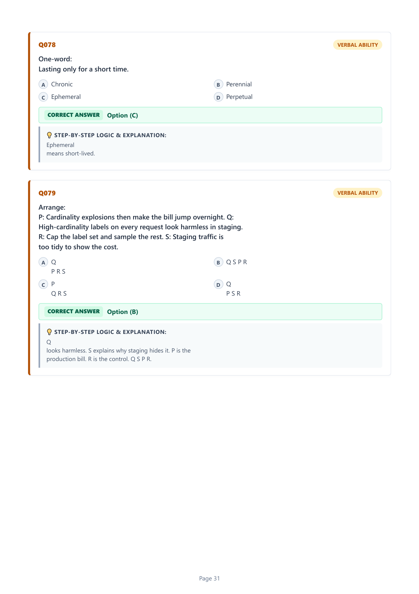 |

---

### Q079: Verbal Ability (Page 31)

**Source Ebook**: `OS4U_Book_3_Verbal_Ability.pdf` | **Book Page**: **Page 31**  
**Authentic Page Figure**: [`OS4U_Book_3_Verbal_Ability_page_031.png`](images/OS4U_Book_3_Verbal_Ability_page_031.png)

#### Problem Statement & Question Prompt
```text
Arrange:
P: Cardinality explosions then make the bill jump overnight. Q:
High-cardinality labels on every request look harmless in staging.
R: Cap the label set and sample the rest. S: Staging traffic is
too tidy to show the cost.
```

#### Multiple Choice Options
- **(A)** `Q
P R S`
- **(B)** `Q S P R`
- **(C)** `P
Q R S`
- **(D)** `Q
P S R`

#### Verified Correct Answer Key
> **Correct Option**: **(B) `Q S P R`**

#### Step-by-Step Logic & Comprehensive Solution
```text
Q
looks harmless. S explains why staging hides it. P is the
production bill. R is the control. Q S P R.
```

#### Authentic Ebook Page Figure
| Ebook Page Render (Page 31) |
| :---: |
|  |

---

### Q080: Verbal Ability (Page 32)

**Source Ebook**: `OS4U_Book_3_Verbal_Ability.pdf` | **Book Page**: **Page 32**  
**Authentic Page Figure**: [`OS4U_Book_3_Verbal_Ability_page_032.png`](images/OS4U_Book_3_Verbal_Ability_page_032.png)

#### Problem Statement & Question Prompt
```text
Arrange:
P: Feature flags then let the fix ride with the next build. Q:
Hotfix branches that live for weeks drift from main. R: A
short-lived branch plus a flag is usually enough. S: Long-lived
hotfix trains surprise the next release.
```

#### Multiple Choice Options
- **(A)** `Q S R P`
- **(B)** `Q
P R S`
- **(C)** `S
Q P R`
- **(D)** `Q
R S P`

#### Verified Correct Answer Key
> **Correct Option**: **(A) `Q S R P`**

#### Step-by-Step Logic & Comprehensive Solution
```text
Q
is the problem. S is the cost. R is the small pattern. P is how
flags help. Q S R P.
```

#### Authentic Ebook Page Figure
| Ebook Page Render (Page 32) |
| :---: |
| 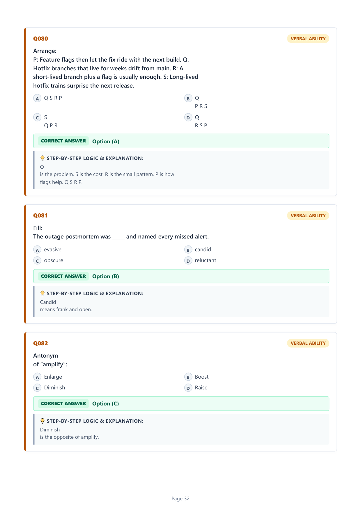 |

---

### Q081: Verbal Ability (Page 32)

**Source Ebook**: `OS4U_Book_3_Verbal_Ability.pdf` | **Book Page**: **Page 32**  
**Authentic Page Figure**: [`OS4U_Book_3_Verbal_Ability_page_032.png`](images/OS4U_Book_3_Verbal_Ability_page_032.png)

#### Problem Statement & Question Prompt
```text
Fill:
The outage postmortem was _____ and named every missed alert.
```

#### Multiple Choice Options
- **(A)** `evasive`
- **(B)** `candid`
- **(C)** `obscure`
- **(D)** `reluctant`

#### Verified Correct Answer Key
> **Correct Option**: **(B) `candid`**

#### Step-by-Step Logic & Comprehensive Solution
```text
Candid
means frank and open.
```

#### Authentic Ebook Page Figure
| Ebook Page Render (Page 32) |
| :---: |
|  |

---

### Q082: Verbal Ability (Page 32)

**Source Ebook**: `OS4U_Book_3_Verbal_Ability.pdf` | **Book Page**: **Page 32**  
**Authentic Page Figure**: [`OS4U_Book_3_Verbal_Ability_page_032.png`](images/OS4U_Book_3_Verbal_Ability_page_032.png)

#### Problem Statement & Question Prompt
```text
Antonym
of “amplify”:
```

#### Multiple Choice Options
- **(A)** `Enlarge`
- **(B)** `Boost`
- **(C)** `Diminish`
- **(D)** `Raise`

#### Verified Correct Answer Key
> **Correct Option**: **(C) `Diminish`**

#### Step-by-Step Logic & Comprehensive Solution
```text
Diminish
is the opposite of amplify.
```

#### Authentic Ebook Page Figure
| Ebook Page Render (Page 32) |
| :---: |
|  |

---

### Q083: Verbal Ability (Page 33)

**Source Ebook**: `OS4U_Book_3_Verbal_Ability.pdf` | **Book Page**: **Page 33**  
**Authentic Page Figure**: [`OS4U_Book_3_Verbal_Ability_page_033.png`](images/OS4U_Book_3_Verbal_Ability_page_033.png)

#### Problem Statement & Question Prompt
```text
“ Move
the needle” means
```

#### Multiple Choice Options
- **(A)** `Make a measurable difference`
- **(B)** `Rotate
a compass`
- **(C)** `Delete
a metric`
- **(D)** `Pause
a release`

#### Verified Correct Answer Key
> **Correct Option**: **(A) `Make a measurable difference`**

#### Step-by-Step Logic & Comprehensive Solution
```text
The
idiom means to cause a noticeable change.
```

#### Authentic Ebook Page Figure
| Ebook Page Render (Page 33) |
| :---: |
| 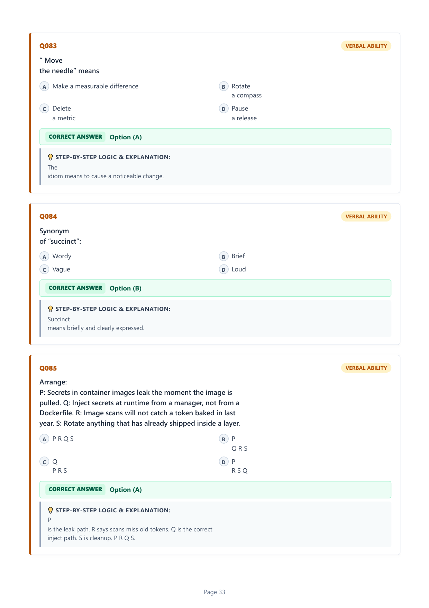 |

---

### Q084: Verbal Ability (Page 33)

**Source Ebook**: `OS4U_Book_3_Verbal_Ability.pdf` | **Book Page**: **Page 33**  
**Authentic Page Figure**: [`OS4U_Book_3_Verbal_Ability_page_033.png`](images/OS4U_Book_3_Verbal_Ability_page_033.png)

#### Problem Statement & Question Prompt
```text
Synonym
of “succinct”:
```

#### Multiple Choice Options
- **(A)** `Wordy`
- **(B)** `Brief`
- **(C)** `Vague`
- **(D)** `Loud`

#### Verified Correct Answer Key
> **Correct Option**: **(B) `Brief`**

#### Step-by-Step Logic & Comprehensive Solution
```text
Succinct
means briefly and clearly expressed.
```

#### Authentic Ebook Page Figure
| Ebook Page Render (Page 33) |
| :---: |
|  |

---

### Q085: Verbal Ability (Page 33)

**Source Ebook**: `OS4U_Book_3_Verbal_Ability.pdf` | **Book Page**: **Page 33**  
**Authentic Page Figure**: [`OS4U_Book_3_Verbal_Ability_page_033.png`](images/OS4U_Book_3_Verbal_Ability_page_033.png)

#### Problem Statement & Question Prompt
```text
Arrange:
P: Secrets in container images leak the moment the image is
pulled. Q: Inject secrets at runtime from a manager, not from a
Dockerfile. R: Image scans will not catch a token baked in last
year. S: Rotate anything that has already shipped inside a layer.
```

#### Multiple Choice Options
- **(A)** `P R Q S`
- **(B)** `P
Q R S`
- **(C)** `Q
P R S`
- **(D)** `P
R S Q`

#### Verified Correct Answer Key
> **Correct Option**: **(A) `P R Q S`**

#### Step-by-Step Logic & Comprehensive Solution
```text
P
is the leak path. R says scans miss old tokens. Q is the correct
inject path. S is cleanup. P R Q S.
```

#### Authentic Ebook Page Figure
| Ebook Page Render (Page 33) |
| :---: |
|  |

---

### Q086: English Grammar (Page 34)

**Source Ebook**: `OS4U_Book_3_Verbal_Ability.pdf` | **Book Page**: **Page 34**  
**Authentic Page Figure**: [`OS4U_Book_3_Verbal_Ability_page_034.png`](images/OS4U_Book_3_Verbal_Ability_page_034.png)

#### Problem Statement & Question Prompt
```text
[SVA]
A series of patches _____ scheduled for Sunday.
```

#### Multiple Choice Options
- **(A)** `are`
- **(B)** `is`
- **(C)** `have`
- **(D)** `were`

#### Verified Correct Answer Key
> **Correct Option**: **(B) `is`**

#### Step-by-Step Logic & Comprehensive Solution
```text
The
subject is series (singular): is scheduled.
```

#### Authentic Ebook Page Figure
| Ebook Page Render (Page 34) |
| :---: |
| 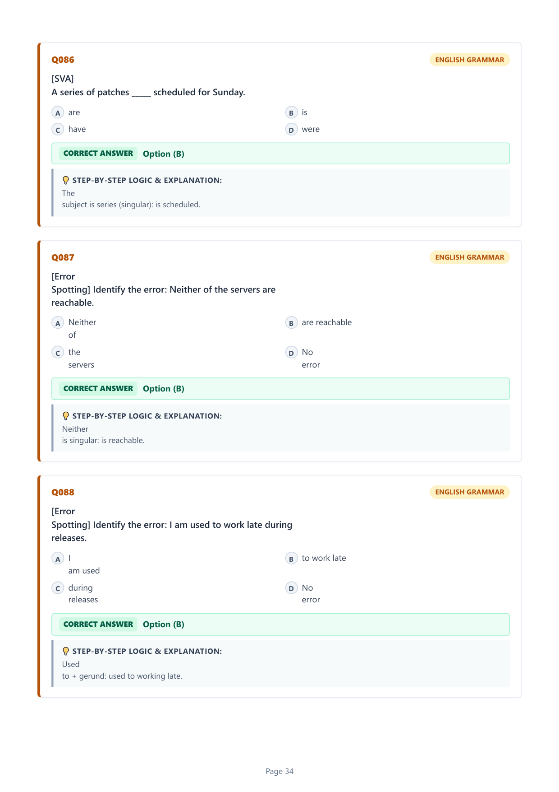 |

---

### Q087: English Grammar (Page 34)

**Source Ebook**: `OS4U_Book_3_Verbal_Ability.pdf` | **Book Page**: **Page 34**  
**Authentic Page Figure**: [`OS4U_Book_3_Verbal_Ability_page_034.png`](images/OS4U_Book_3_Verbal_Ability_page_034.png)

#### Problem Statement & Question Prompt
```text
[Error
Spotting] Identify the error: Neither of the servers are
reachable.
```

#### Multiple Choice Options
- **(A)** `Neither
of`
- **(B)** `are reachable`
- **(C)** `the
servers`
- **(D)** `No
error`

#### Verified Correct Answer Key
> **Correct Option**: **(B) `are reachable`**

#### Step-by-Step Logic & Comprehensive Solution
```text
Neither
is singular: is reachable.
```

#### Authentic Ebook Page Figure
| Ebook Page Render (Page 34) |
| :---: |
|  |

---

### Q088: English Grammar (Page 34)

**Source Ebook**: `OS4U_Book_3_Verbal_Ability.pdf` | **Book Page**: **Page 34**  
**Authentic Page Figure**: [`OS4U_Book_3_Verbal_Ability_page_034.png`](images/OS4U_Book_3_Verbal_Ability_page_034.png)

#### Problem Statement & Question Prompt
```text
[Error
Spotting] Identify the error: I am used to work late during
releases.
```

#### Multiple Choice Options
- **(A)** `I
am used`
- **(B)** `to work late`
- **(C)** `during
releases`
- **(D)** `No
error`

#### Verified Correct Answer Key
> **Correct Option**: **(B) `to work late`**

#### Step-by-Step Logic & Comprehensive Solution
```text
Used
to + gerund: used to working late.
```

#### Authentic Ebook Page Figure
| Ebook Page Render (Page 34) |
| :---: |
|  |

---

### Q089: English Grammar (Page 35)

**Source Ebook**: `OS4U_Book_3_Verbal_Ability.pdf` | **Book Page**: **Page 35**  
**Authentic Page Figure**: [`OS4U_Book_3_Verbal_Ability_page_035.png`](images/OS4U_Book_3_Verbal_Ability_page_035.png)

#### Problem Statement & Question Prompt
```text
[Prepositions]
The fix is consistent _____ the style guide.
```

#### Multiple Choice Options
- **(A)** `to`
- **(B)** `with`
- **(C)** `from`
- **(D)** `against`

#### Verified Correct Answer Key
> **Correct Option**: **(B) `with`**

#### Step-by-Step Logic & Comprehensive Solution
```text
Consistent
with is the standard collocation.
```

#### Authentic Ebook Page Figure
| Ebook Page Render (Page 35) |
| :---: |
| 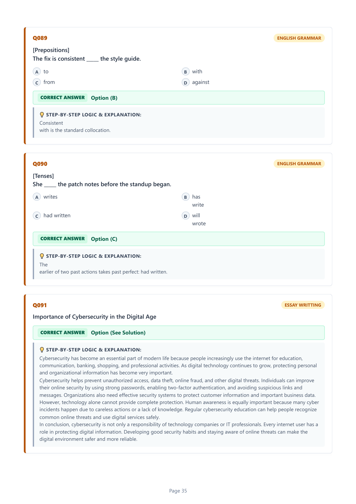 |

---

### Q090: English Grammar (Page 35)

**Source Ebook**: `OS4U_Book_3_Verbal_Ability.pdf` | **Book Page**: **Page 35**  
**Authentic Page Figure**: [`OS4U_Book_3_Verbal_Ability_page_035.png`](images/OS4U_Book_3_Verbal_Ability_page_035.png)

#### Problem Statement & Question Prompt
```text
[Tenses]
She _____ the patch notes before the standup began.
```

#### Multiple Choice Options
- **(A)** `writes`
- **(B)** `has
write`
- **(C)** `had written`
- **(D)** `will
wrote`

#### Verified Correct Answer Key
> **Correct Option**: **(C) `had written`**

#### Step-by-Step Logic & Comprehensive Solution
```text
The
earlier of two past actions takes past perfect: had written.
```

#### Authentic Ebook Page Figure
| Ebook Page Render (Page 35) |
| :---: |
|  |

---

### Q091: Essay Writting (Page 35)

**Source Ebook**: `OS4U_Book_3_Verbal_Ability.pdf` | **Book Page**: **Page 35**  
**Authentic Page Figure**: [`OS4U_Book_3_Verbal_Ability_page_035.png`](images/OS4U_Book_3_Verbal_Ability_page_035.png)

#### Problem Statement & Question Prompt
```text
Importance of Cybersecurity in the Digital Age
```

#### Multiple Choice Options
- *(Descriptive / Essay Prompt — Detailed Model Response Below)*

#### Verified Correct Answer Key
> **Correct Option**: **(O) `Option (See Solution)`**

#### Step-by-Step Logic & Comprehensive Solution
```text
Cybersecurity has become an essential part of modern life because people increasingly use the internet for education, communication, banking, shopping, and professional activities. As digital technology continues to grow, protecting personal and organizational information has become very important.
Cybersecurity helps prevent unauthorized access, data theft, online fraud, and other digital threats. Individuals can improve their online security by using strong passwords, enabling two-factor authentication, and avoiding suspicious links and messages. Organizations also need effective security systems to protect customer information and important business data.
However, technology alone cannot provide complete protection. Human awareness is equally important because many cyber incidents happen due to careless actions or a lack of knowledge. Regular cybersecurity education can help people recognize common online threats and use digital services safely.
In conclusion, cybersecurity is not only a responsibility of technology companies or IT professionals. Every internet user has a role in protecting digital information. Developing good security habits and staying aware of online threats can make the digital environment safer and more reliable.
```

#### Authentic Ebook Page Figure
| Ebook Page Render (Page 35) |
| :---: |
|  |

---

### Q092: Verbal Ability (Page 36)

**Source Ebook**: `OS4U_Book_3_Verbal_Ability.pdf` | **Book Page**: **Page 36**  
**Authentic Page Figure**: [`OS4U_Book_3_Verbal_Ability_page_036.png`](images/OS4U_Book_3_Verbal_Ability_page_036.png)

#### Problem Statement & Question Prompt
```text
Arrange
the sentences. P: Screenshots of a local pass do not prove the
pipeline. Q: CI should run the same checks the laptop runs. R:
Otherwise “works on my machine” returns in the pull
request. S: Fail the build when those checks fail.
```

#### Multiple Choice Options
- **(A)** `P Q R S`
- **(B)** `Q
P R S`
- **(C)** `P
R Q S`
- **(D)** `Q
R P S`

#### Verified Correct Answer Key
> **Correct Option**: **(A) `P Q R S`**

#### Step-by-Step Logic & Comprehensive Solution
```text
P
limits screenshots. Q says CI must match. R names the slogan that
returns. S is the gate. P Q R S? Better P R Q S. Use P Q R S as
screenshots → CI same checks → otherwise slogan →
fail build.
```

#### Authentic Ebook Page Figure
| Ebook Page Render (Page 36) |
| :---: |
| 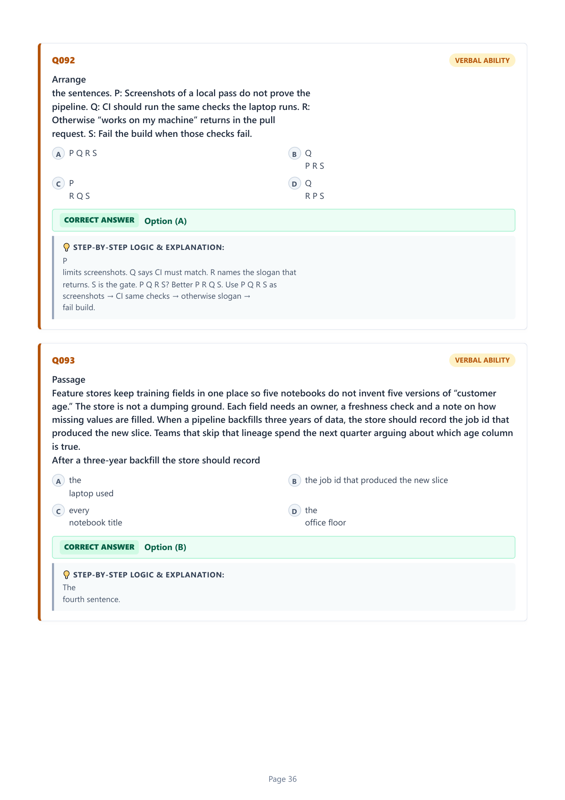 |

---

### Q093: Verbal Ability (Page 36)

**Source Ebook**: `OS4U_Book_3_Verbal_Ability.pdf` | **Book Page**: **Page 36**  
**Authentic Page Figure**: [`OS4U_Book_3_Verbal_Ability_page_036.png`](images/OS4U_Book_3_Verbal_Ability_page_036.png)

#### Problem Statement & Question Prompt
```text
Passage
Feature stores keep training fields in one place so five notebooks do not invent five versions of “customer age.” The store is not a dumping ground. Each field needs an owner, a freshness check and a note on how missing values are filled. When a pipeline backfills three years of data, the store should record the job id that produced the new slice. Teams that skip that lineage spend the next quarter arguing about which age column is true.
After a three-year backfill the store should record
```

#### Multiple Choice Options
- **(A)** `the
laptop used`
- **(B)** `the job id that produced the new slice`
- **(C)** `every
notebook title`
- **(D)** `the
office floor`

#### Verified Correct Answer Key
> **Correct Option**: **(B) `the job id that produced the new slice`**

#### Step-by-Step Logic & Comprehensive Solution
```text
The
fourth sentence.
```

#### Authentic Ebook Page Figure
| Ebook Page Render (Page 36) |
| :---: |
|  |

---

### Q094: Verbal Ability (Page 37)

**Source Ebook**: `OS4U_Book_3_Verbal_Ability.pdf` | **Book Page**: **Page 37**  
**Authentic Page Figure**: [`OS4U_Book_3_Verbal_Ability_page_037.png`](images/OS4U_Book_3_Verbal_Ability_page_037.png)

#### Problem Statement & Question Prompt
```text
Choose
the one-word substitute: A list of errors and the dates they were
fixed.
```

#### Multiple Choice Options
- **(A)** `Memoir`
- **(B)** `Itinerary`
- **(C)** `Changelog`
- **(D)** `Gazette`

#### Verified Correct Answer Key
> **Correct Option**: **(C) `Changelog`**

#### Step-by-Step Logic & Comprehensive Solution
```text
A
changelog records fixes and changes over time.
```

#### Authentic Ebook Page Figure
| Ebook Page Render (Page 37) |
| :---: |
| 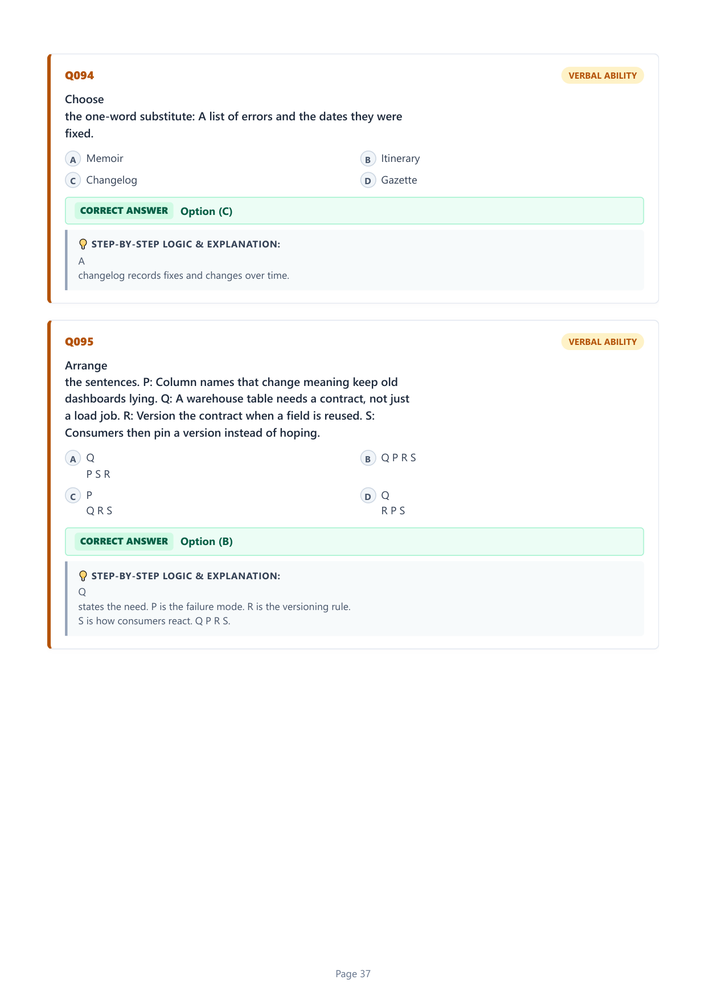 |

---

### Q095: Verbal Ability (Page 37)

**Source Ebook**: `OS4U_Book_3_Verbal_Ability.pdf` | **Book Page**: **Page 37**  
**Authentic Page Figure**: [`OS4U_Book_3_Verbal_Ability_page_037.png`](images/OS4U_Book_3_Verbal_Ability_page_037.png)

#### Problem Statement & Question Prompt
```text
Arrange
the sentences. P: Column names that change meaning keep old
dashboards lying. Q: A warehouse table needs a contract, not just
a load job. R: Version the contract when a field is reused. S:
Consumers then pin a version instead of hoping.
```

#### Multiple Choice Options
- **(A)** `Q
P S R`
- **(B)** `Q P R S`
- **(C)** `P
Q R S`
- **(D)** `Q
R P S`

#### Verified Correct Answer Key
> **Correct Option**: **(B) `Q P R S`**

#### Step-by-Step Logic & Comprehensive Solution
```text
Q
states the need. P is the failure mode. R is the versioning rule.
S is how consumers react. Q P R S.
```

#### Authentic Ebook Page Figure
| Ebook Page Render (Page 37) |
| :---: |
|  |

---

### Q096: Verbal Ability (Page 38)

**Source Ebook**: `OS4U_Book_3_Verbal_Ability.pdf` | **Book Page**: **Page 38**  
**Authentic Page Figure**: [`OS4U_Book_3_Verbal_Ability_page_038.png`](images/OS4U_Book_3_Verbal_Ability_page_038.png)

#### Problem Statement & Question Prompt
```text
Arrange
the sentences. P: Dead letter queues then hold what cannot be
parsed. Q: A consumer that crashes on one bad message blocks the
rest. R: Skip, park and alert beats a full stop. S: Replay tools
should be ready before the first poison pill.
```

#### Multiple Choice Options
- **(A)** `Q
P S R`
- **(B)** `P
Q R S`
- **(C)** `Q P R S`
- **(D)** `Q
R P S`

#### Verified Correct Answer Key
> **Correct Option**: **(C) `Q P R S`**

#### Step-by-Step Logic & Comprehensive Solution
```text
Q
is the crash. P parks the bad message. R states the policy. S
prepares replay. Q P R S.
```

#### Authentic Ebook Page Figure
| Ebook Page Render (Page 38) |
| :---: |
| 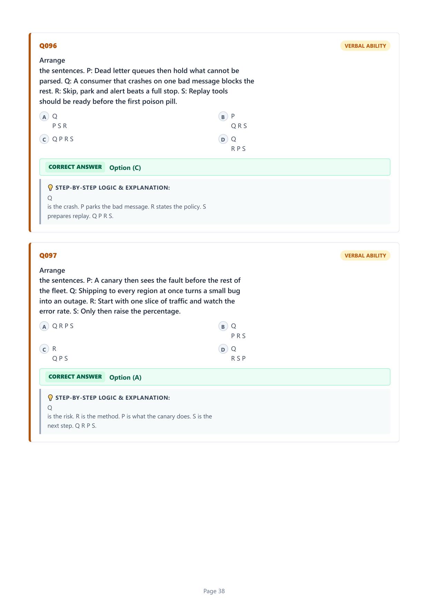 |

---

### Q097: Verbal Ability (Page 38)

**Source Ebook**: `OS4U_Book_3_Verbal_Ability.pdf` | **Book Page**: **Page 38**  
**Authentic Page Figure**: [`OS4U_Book_3_Verbal_Ability_page_038.png`](images/OS4U_Book_3_Verbal_Ability_page_038.png)

#### Problem Statement & Question Prompt
```text
Arrange
the sentences. P: A canary then sees the fault before the rest of
the fleet. Q: Shipping to every region at once turns a small bug
into an outage. R: Start with one slice of traffic and watch the
error rate. S: Only then raise the percentage.
```

#### Multiple Choice Options
- **(A)** `Q R P S`
- **(B)** `Q
P R S`
- **(C)** `R
Q P S`
- **(D)** `Q
R S P`

#### Verified Correct Answer Key
> **Correct Option**: **(A) `Q R P S`**

#### Step-by-Step Logic & Comprehensive Solution
```text
Q
is the risk. R is the method. P is what the canary does. S is the
next step. Q R P S.
```

#### Authentic Ebook Page Figure
| Ebook Page Render (Page 38) |
| :---: |
|  |

---

### Q098: Verbal Ability (Page 39)

**Source Ebook**: `OS4U_Book_3_Verbal_Ability.pdf` | **Book Page**: **Page 39**  
**Authentic Page Figure**: [`OS4U_Book_3_Verbal_Ability_page_039.png`](images/OS4U_Book_3_Verbal_Ability_page_039.png)

#### Problem Statement & Question Prompt
```text
Choose
the word most opposite in meaning to “opaque.”
```

#### Multiple Choice Options
- **(A)** `Cloudy`
- **(B)** `Dim`
- **(C)** `Transparent`
- **(D)** `Dense`

#### Verified Correct Answer Key
> **Correct Option**: **(C) `Transparent`**

#### Step-by-Step Logic & Comprehensive Solution
```text
Transparent
is the antonym of opaque.
```

#### Authentic Ebook Page Figure
| Ebook Page Render (Page 39) |
| :---: |
| 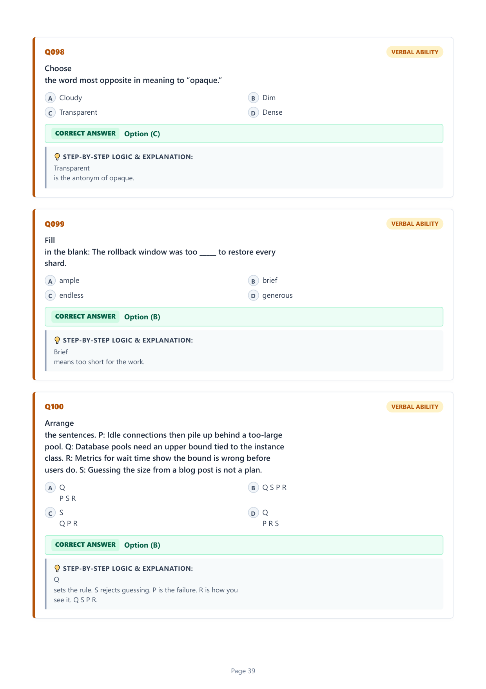 |

---

### Q099: Verbal Ability (Page 39)

**Source Ebook**: `OS4U_Book_3_Verbal_Ability.pdf` | **Book Page**: **Page 39**  
**Authentic Page Figure**: [`OS4U_Book_3_Verbal_Ability_page_039.png`](images/OS4U_Book_3_Verbal_Ability_page_039.png)

#### Problem Statement & Question Prompt
```text
Fill
in the blank: The rollback window was too _____ to restore every
shard.
```

#### Multiple Choice Options
- **(A)** `ample`
- **(B)** `brief`
- **(C)** `endless`
- **(D)** `generous`

#### Verified Correct Answer Key
> **Correct Option**: **(B) `brief`**

#### Step-by-Step Logic & Comprehensive Solution
```text
Brief
means too short for the work.
```

#### Authentic Ebook Page Figure
| Ebook Page Render (Page 39) |
| :---: |
|  |

---

### Q100: Verbal Ability (Page 39)

**Source Ebook**: `OS4U_Book_3_Verbal_Ability.pdf` | **Book Page**: **Page 39**  
**Authentic Page Figure**: [`OS4U_Book_3_Verbal_Ability_page_039.png`](images/OS4U_Book_3_Verbal_Ability_page_039.png)

#### Problem Statement & Question Prompt
```text
Arrange
the sentences. P: Idle connections then pile up behind a too-large
pool. Q: Database pools need an upper bound tied to the instance
class. R: Metrics for wait time show the bound is wrong before
users do. S: Guessing the size from a blog post is not a plan.
```

#### Multiple Choice Options
- **(A)** `Q
P S R`
- **(B)** `Q S P R`
- **(C)** `S
Q P R`
- **(D)** `Q
P R S`

#### Verified Correct Answer Key
> **Correct Option**: **(B) `Q S P R`**

#### Step-by-Step Logic & Comprehensive Solution
```text
Q
sets the rule. S rejects guessing. P is the failure. R is how you
see it. Q S P R.
```

#### Authentic Ebook Page Figure
| Ebook Page Render (Page 39) |
| :---: |
|  |

---

### Q101: Verbal Ability (Page 40)

**Source Ebook**: `OS4U_Book_3_Verbal_Ability.pdf` | **Book Page**: **Page 40**  
**Authentic Page Figure**: [`OS4U_Book_3_Verbal_Ability_page_040.png`](images/OS4U_Book_3_Verbal_Ability_page_040.png)

#### Problem Statement & Question Prompt
```text
Choose
the word most similar in meaning to “austere.”
```

#### Multiple Choice Options
- **(A)** `Ornate`
- **(B)** `Severe`
- **(C)** `Cheerful`
- **(D)** `Loose`

#### Verified Correct Answer Key
> **Correct Option**: **(B) `Severe`**

#### Step-by-Step Logic & Comprehensive Solution
```text
Austere
means severe or without decoration.
```

#### Authentic Ebook Page Figure
| Ebook Page Render (Page 40) |
| :---: |
| 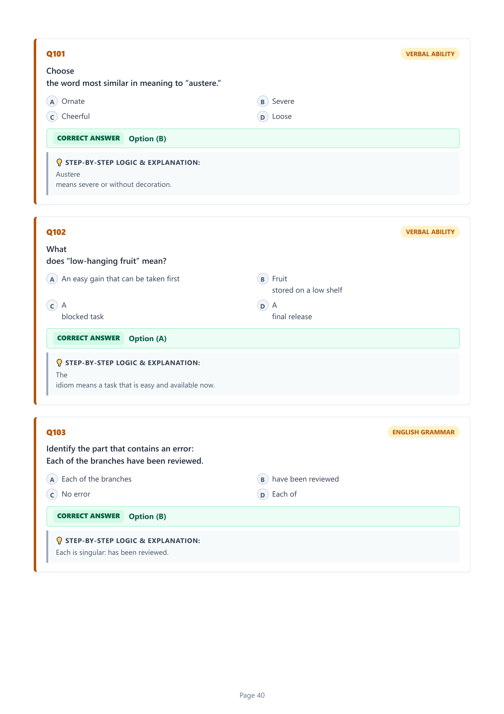 |

---

### Q102: Verbal Ability (Page 40)

**Source Ebook**: `OS4U_Book_3_Verbal_Ability.pdf` | **Book Page**: **Page 40**  
**Authentic Page Figure**: [`OS4U_Book_3_Verbal_Ability_page_040.png`](images/OS4U_Book_3_Verbal_Ability_page_040.png)

#### Problem Statement & Question Prompt
```text
What
does “low-hanging fruit” mean?
```

#### Multiple Choice Options
- **(A)** `An easy gain that can be taken first`
- **(B)** `Fruit
stored on a low shelf`
- **(C)** `A
blocked task`
- **(D)** `A
final release`

#### Verified Correct Answer Key
> **Correct Option**: **(A) `An easy gain that can be taken first`**

#### Step-by-Step Logic & Comprehensive Solution
```text
The
idiom means a task that is easy and available now.
```

#### Authentic Ebook Page Figure
| Ebook Page Render (Page 40) |
| :---: |
|  |

---

### Q103: English Grammar (Page 40)

**Source Ebook**: `OS4U_Book_3_Verbal_Ability.pdf` | **Book Page**: **Page 40**  
**Authentic Page Figure**: [`OS4U_Book_3_Verbal_Ability_page_040.png`](images/OS4U_Book_3_Verbal_Ability_page_040.png)

#### Problem Statement & Question Prompt
```text
Identify the part that contains an error:
Each of the branches have been reviewed.
```

#### Multiple Choice Options
- **(A)** `Each of the branches`
- **(B)** `have been reviewed`
- **(C)** `No error`
- **(D)** `Each of`

#### Verified Correct Answer Key
> **Correct Option**: **(B) `have been reviewed`**

#### Step-by-Step Logic & Comprehensive Solution
```text
Each is singular: has been reviewed.
```

#### Authentic Ebook Page Figure
| Ebook Page Render (Page 40) |
| :---: |
|  |

---

### Q104: English Grammar (Page 41)

**Source Ebook**: `OS4U_Book_3_Verbal_Ability.pdf` | **Book Page**: **Page 41**  
**Authentic Page Figure**: [`OS4U_Book_3_Verbal_Ability_page_041.png`](images/OS4U_Book_3_Verbal_Ability_page_041.png)

#### Problem Statement & Question Prompt
```text
They _____ the cluster twice before the
alert stopped.
```

#### Multiple Choice Options
- **(A)** `reboot`
- **(B)** `have reboot`
- **(C)** `had rebooted`
- **(D)** `will rebooted`

#### Verified Correct Answer Key
> **Correct Option**: **(C) `had rebooted`**

#### Step-by-Step Logic & Comprehensive Solution
```text
The earlier past action takes past perfect:
had rebooted.
```

#### Authentic Ebook Page Figure
| Ebook Page Render (Page 41) |
| :---: |
| 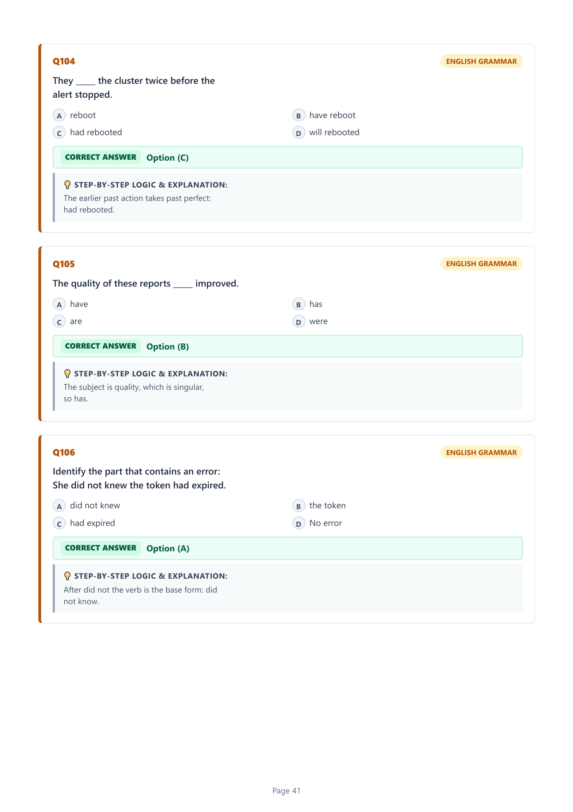 |

---

### Q105: English Grammar (Page 41)

**Source Ebook**: `OS4U_Book_3_Verbal_Ability.pdf` | **Book Page**: **Page 41**  
**Authentic Page Figure**: [`OS4U_Book_3_Verbal_Ability_page_041.png`](images/OS4U_Book_3_Verbal_Ability_page_041.png)

#### Problem Statement & Question Prompt
```text
The quality of these reports _____ improved.
```

#### Multiple Choice Options
- **(A)** `have`
- **(B)** `has`
- **(C)** `are`
- **(D)** `were`

#### Verified Correct Answer Key
> **Correct Option**: **(B) `has`**

#### Step-by-Step Logic & Comprehensive Solution
```text
The subject is quality, which is singular,
so has.
```

#### Authentic Ebook Page Figure
| Ebook Page Render (Page 41) |
| :---: |
|  |

---

### Q106: English Grammar (Page 41)

**Source Ebook**: `OS4U_Book_3_Verbal_Ability.pdf` | **Book Page**: **Page 41**  
**Authentic Page Figure**: [`OS4U_Book_3_Verbal_Ability_page_041.png`](images/OS4U_Book_3_Verbal_Ability_page_041.png)

#### Problem Statement & Question Prompt
```text
Identify the part that contains an error:
She did not knew the token had expired.
```

#### Multiple Choice Options
- **(A)** `did not knew`
- **(B)** `the token`
- **(C)** `had expired`
- **(D)** `No error`

#### Verified Correct Answer Key
> **Correct Option**: **(A) `did not knew`**

#### Step-by-Step Logic & Comprehensive Solution
```text
After did not the verb is the base form: did
not know.
```

#### Authentic Ebook Page Figure
| Ebook Page Render (Page 41) |
| :---: |
|  |

---

### Q107: English Grammar (Page 42)

**Source Ebook**: `OS4U_Book_3_Verbal_Ability.pdf` | **Book Page**: **Page 42**  
**Authentic Page Figure**: [`OS4U_Book_3_Verbal_Ability_page_042.png`](images/OS4U_Book_3_Verbal_Ability_page_042.png)

#### Problem Statement & Question Prompt
```text
Please refrain _____ posting keys in the
channel.
```

#### Multiple Choice Options
- **(A)** `from`
- **(B)** `to`
- **(C)** `of`
- **(D)** `off`

#### Verified Correct Answer Key
> **Correct Option**: **(A) `from`**

#### Step-by-Step Logic & Comprehensive Solution
```text
Refrain is followed by from + gerund.
```

#### Authentic Ebook Page Figure
| Ebook Page Render (Page 42) |
| :---: |
| 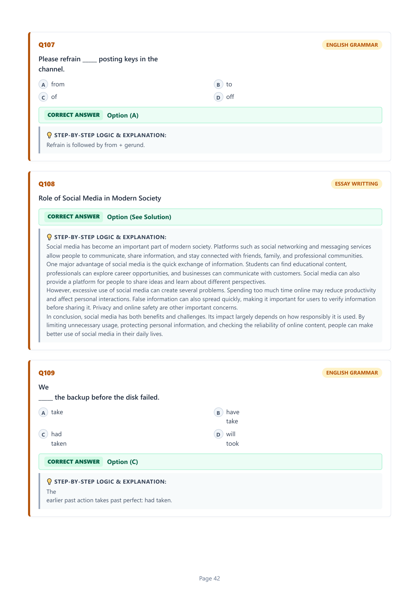 |

---

### Q108: Essay Writting (Page 42)

**Source Ebook**: `OS4U_Book_3_Verbal_Ability.pdf` | **Book Page**: **Page 42**  
**Authentic Page Figure**: [`OS4U_Book_3_Verbal_Ability_page_042.png`](images/OS4U_Book_3_Verbal_Ability_page_042.png)

#### Problem Statement & Question Prompt
```text
Role of Social Media in Modern Society
```

#### Multiple Choice Options
- *(Descriptive / Essay Prompt — Detailed Model Response Below)*

#### Verified Correct Answer Key
> **Correct Option**: **(O) `Option (See Solution)`**

#### Step-by-Step Logic & Comprehensive Solution
```text
Social media has become an important part of modern society. Platforms such as social networking and messaging services allow people to communicate, share information, and stay connected with friends, family, and professional communities.
One major advantage of social media is the quick exchange of information. Students can find educational content, professionals can explore career opportunities, and businesses can communicate with customers. Social media can also provide a platform for people to share ideas and learn about different perspectives.
However, excessive use of social media can create several problems. Spending too much time online may reduce productivity and affect personal interactions. False information can also spread quickly, making it important for users to verify information before sharing it. Privacy and online safety are other important concerns.
In conclusion, social media has both benefits and challenges. Its impact largely depends on how responsibly it is used. By limiting unnecessary usage, protecting personal information, and checking the reliability of online content, people can make better use of social media in their daily lives.
```

#### Authentic Ebook Page Figure
| Ebook Page Render (Page 42) |
| :---: |
|  |

---

### Q109: English Grammar (Page 42)

**Source Ebook**: `OS4U_Book_3_Verbal_Ability.pdf` | **Book Page**: **Page 42**  
**Authentic Page Figure**: [`OS4U_Book_3_Verbal_Ability_page_042.png`](images/OS4U_Book_3_Verbal_Ability_page_042.png)

#### Problem Statement & Question Prompt
```text
We
_____ the backup before the disk failed.
```

#### Multiple Choice Options
- **(A)** `take`
- **(B)** `have
take`
- **(C)** `had
taken`
- **(D)** `will
took`

#### Verified Correct Answer Key
> **Correct Option**: **(C) `had
taken`**

#### Step-by-Step Logic & Comprehensive Solution
```text
The
earlier past action takes past perfect: had taken.
```

#### Authentic Ebook Page Figure
| Ebook Page Render (Page 42) |
| :---: |
|  |

---

### Q110: English Grammar (Page 43)

**Source Ebook**: `OS4U_Book_3_Verbal_Ability.pdf` | **Book Page**: **Page 43**  
**Authentic Page Figure**: [`OS4U_Book_3_Verbal_Ability_page_043.png`](images/OS4U_Book_3_Verbal_Ability_page_043.png)

#### Problem Statement & Question Prompt
```text
The
service is independent _____ the payment vendor.
```

#### Multiple Choice Options
- **(A)** `from`
- **(B)** `of`
- **(C)** `off`
- **(D)** `with`

#### Verified Correct Answer Key
> **Correct Option**: **(B) `of`**

#### Step-by-Step Logic & Comprehensive Solution
```text
Independent
of is the standard collocation.
```

#### Authentic Ebook Page Figure
| Ebook Page Render (Page 43) |
| :---: |
| 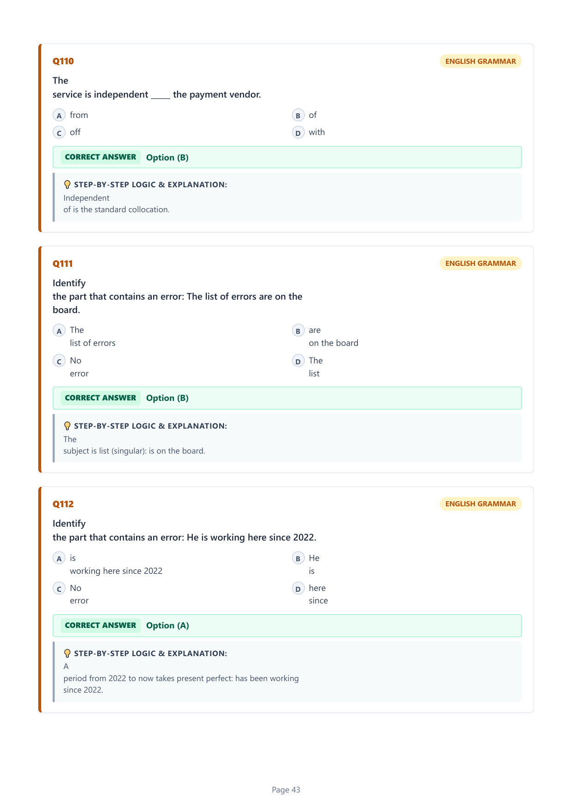 |

---

### Q111: English Grammar (Page 43)

**Source Ebook**: `OS4U_Book_3_Verbal_Ability.pdf` | **Book Page**: **Page 43**  
**Authentic Page Figure**: [`OS4U_Book_3_Verbal_Ability_page_043.png`](images/OS4U_Book_3_Verbal_Ability_page_043.png)

#### Problem Statement & Question Prompt
```text
Identify
the part that contains an error: The list of errors are on the
board.
```

#### Multiple Choice Options
- **(A)** `The
list of errors`
- **(B)** `are
on the board`
- **(C)** `No
error`
- **(D)** `The
list`

#### Verified Correct Answer Key
> **Correct Option**: **(B) `are
on the board`**

#### Step-by-Step Logic & Comprehensive Solution
```text
The
subject is list (singular): is on the board.
```

#### Authentic Ebook Page Figure
| Ebook Page Render (Page 43) |
| :---: |
|  |

---

### Q112: English Grammar (Page 43)

**Source Ebook**: `OS4U_Book_3_Verbal_Ability.pdf` | **Book Page**: **Page 43**  
**Authentic Page Figure**: [`OS4U_Book_3_Verbal_Ability_page_043.png`](images/OS4U_Book_3_Verbal_Ability_page_043.png)

#### Problem Statement & Question Prompt
```text
Identify
the part that contains an error: He is working here since 2022.
```

#### Multiple Choice Options
- **(A)** `is
working here since 2022`
- **(B)** `He
is`
- **(C)** `No
error`
- **(D)** `here
since`

#### Verified Correct Answer Key
> **Correct Option**: **(A) `is
working here since 2022`**

#### Step-by-Step Logic & Comprehensive Solution
```text
A
period from 2022 to now takes present perfect: has been working
since 2022.
```

#### Authentic Ebook Page Figure
| Ebook Page Render (Page 43) |
| :---: |
|  |

---

### Q113: English Grammar (Page 44)

**Source Ebook**: `OS4U_Book_3_Verbal_Ability.pdf` | **Book Page**: **Page 44**  
**Authentic Page Figure**: [`OS4U_Book_3_Verbal_Ability_page_044.png`](images/OS4U_Book_3_Verbal_Ability_page_044.png)

#### Problem Statement & Question Prompt
```text
Neither
the logs nor the trace _____ complete.
```

#### Multiple Choice Options
- **(A)** `is`
- **(B)** `are`
- **(C)** `have`
- **(D)** `were`

#### Verified Correct Answer Key
> **Correct Option**: **(A) `is`**

#### Step-by-Step Logic & Comprehensive Solution
```text
With
neither…nor the verb agrees with the nearer subject trace:
is.
```

#### Authentic Ebook Page Figure
| Ebook Page Render (Page 44) |
| :---: |
| 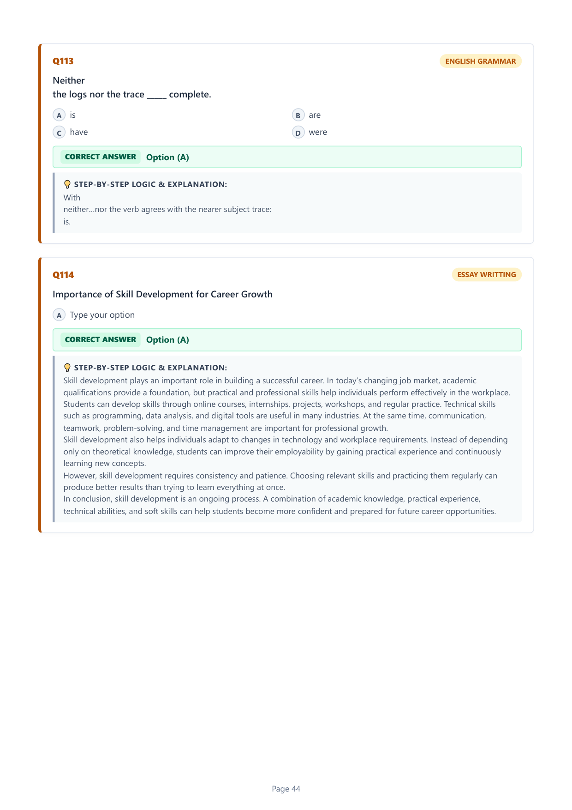 |

---

### Q114: Essay Writting (Page 44)

**Source Ebook**: `OS4U_Book_3_Verbal_Ability.pdf` | **Book Page**: **Page 44**  
**Authentic Page Figure**: [`OS4U_Book_3_Verbal_Ability_page_044.png`](images/OS4U_Book_3_Verbal_Ability_page_044.png)

#### Problem Statement & Question Prompt
```text
Importance of Skill Development for Career Growth
```

#### Multiple Choice Options
- **(A)** `Type your option`

#### Verified Correct Answer Key
> **Correct Option**: **(A) `Type your option`**

#### Step-by-Step Logic & Comprehensive Solution
```text
Skill development plays an important role in building a successful career. In today’s changing job market, academic qualifications provide a foundation, but practical and professional skills help individuals perform effectively in the workplace.
Students can develop skills through online courses, internships, projects, workshops, and regular practice. Technical skills such as programming, data analysis, and digital tools are useful in many industries. At the same time, communication, teamwork, problem-solving, and time management are important for professional growth.
Skill development also helps individuals adapt to changes in technology and workplace requirements. Instead of depending only on theoretical knowledge, students can improve their employability by gaining practical experience and continuously learning new concepts.
However, skill development requires consistency and patience. Choosing relevant skills and practicing them regularly can produce better results than trying to learn everything at once.
In conclusion, skill development is an ongoing process. A combination of academic knowledge, practical experience, technical abilities, and soft skills can help students become more confident and prepared for future career opportunities.
```

#### Authentic Ebook Page Figure
| Ebook Page Render (Page 44) |
| :---: |
|  |

---

### Q115: Verbal Ability (Page 45)

**Source Ebook**: `OS4U_Book_3_Verbal_Ability.pdf` | **Book Page**: **Page 45**  
**Authentic Page Figure**: [`OS4U_Book_3_Verbal_Ability_page_045.png`](images/OS4U_Book_3_Verbal_Ability_page_045.png)

#### Problem Statement & Question Prompt
```text
Passage
Code comments age faster than tests. A comment that repeats the next line is noise. A comment that names why a bound is 17, not 16, still helps a year later. Teams that delete unused comments during the same patch keep the file honest. The review question is not “did you comment enough” but “will this sentence still be true after the next rename.”
Unused comments should be deleted
```

#### Multiple Choice Options
- **(A)** `in
a later cleanup quarter`
- **(B)** `during the same patch`
- **(C)** `only
after a rename`
- **(D)** `never`

#### Verified Correct Answer Key
> **Correct Option**: **(B) `during the same patch`**

#### Step-by-Step Logic & Comprehensive Solution
```text
Fourth
sentence.
```

#### Authentic Ebook Page Figure
| Ebook Page Render (Page 45) |
| :---: |
| 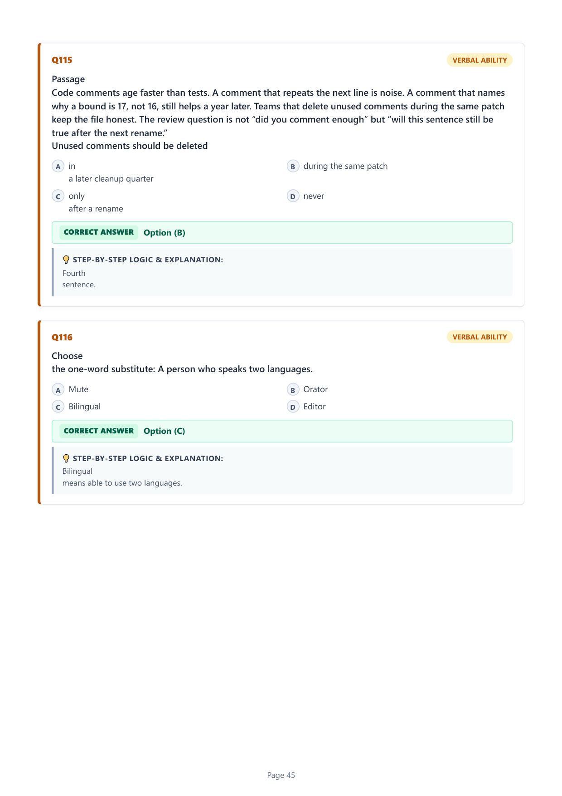 |

---

### Q116: Verbal Ability (Page 45)

**Source Ebook**: `OS4U_Book_3_Verbal_Ability.pdf` | **Book Page**: **Page 45**  
**Authentic Page Figure**: [`OS4U_Book_3_Verbal_Ability_page_045.png`](images/OS4U_Book_3_Verbal_Ability_page_045.png)

#### Problem Statement & Question Prompt
```text
Choose
the one-word substitute: A person who speaks two languages.
```

#### Multiple Choice Options
- **(A)** `Mute`
- **(B)** `Orator`
- **(C)** `Bilingual`
- **(D)** `Editor`

#### Verified Correct Answer Key
> **Correct Option**: **(C) `Bilingual`**

#### Step-by-Step Logic & Comprehensive Solution
```text
Bilingual
means able to use two languages.
```

#### Authentic Ebook Page Figure
| Ebook Page Render (Page 45) |
| :---: |
|  |

---

### Q117: Verbal Ability (Page 46)

**Source Ebook**: `OS4U_Book_3_Verbal_Ability.pdf` | **Book Page**: **Page 46**  
**Authentic Page Figure**: [`OS4U_Book_3_Verbal_Ability_page_046.png`](images/OS4U_Book_3_Verbal_Ability_page_046.png)

#### Problem Statement & Question Prompt
```text
Arrange
the sentences. P: Stale locks then block the next deploy. Q: A job
that dies mid-write must release its lock. R: Timeouts on the lock
beat a manual reboot. S: Alerts should fire if a lock is held past
two minutes.
```

#### Multiple Choice Options
- **(A)** `Q
P S R`
- **(B)** `Q P R S`
- **(C)** `P
Q R S`
- **(D)** `Q
R P S`

#### Verified Correct Answer Key
> **Correct Option**: **(B) `Q P R S`**

#### Step-by-Step Logic & Comprehensive Solution
```text
Q
is the rule. P is the failure. R is the timeout fix. S is the
alert. Q P R S.
```

#### Authentic Ebook Page Figure
| Ebook Page Render (Page 46) |
| :---: |
| 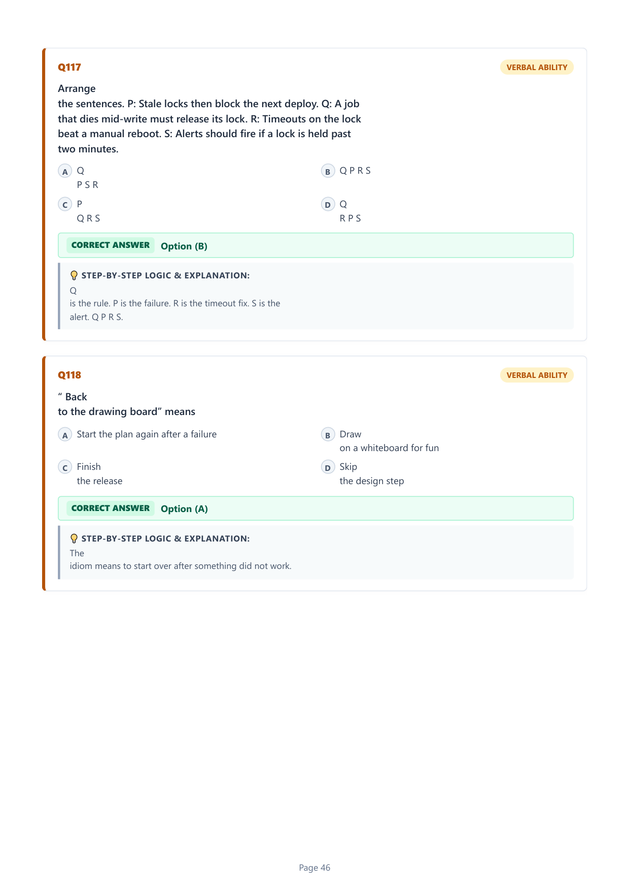 |

---

### Q118: Verbal Ability (Page 46)

**Source Ebook**: `OS4U_Book_3_Verbal_Ability.pdf` | **Book Page**: **Page 46**  
**Authentic Page Figure**: [`OS4U_Book_3_Verbal_Ability_page_046.png`](images/OS4U_Book_3_Verbal_Ability_page_046.png)

#### Problem Statement & Question Prompt
```text
“ Back
to the drawing board” means
```

#### Multiple Choice Options
- **(A)** `Start the plan again after a failure`
- **(B)** `Draw
on a whiteboard for fun`
- **(C)** `Finish
the release`
- **(D)** `Skip
the design step`

#### Verified Correct Answer Key
> **Correct Option**: **(A) `Start the plan again after a failure`**

#### Step-by-Step Logic & Comprehensive Solution
```text
The
idiom means to start over after something did not work.
```

#### Authentic Ebook Page Figure
| Ebook Page Render (Page 46) |
| :---: |
|  |

---

### Q119: Verbal Ability (Page 47)

**Source Ebook**: `OS4U_Book_3_Verbal_Ability.pdf` | **Book Page**: **Page 47**  
**Authentic Page Figure**: [`OS4U_Book_3_Verbal_Ability_page_047.png`](images/OS4U_Book_3_Verbal_Ability_page_047.png)

#### Problem Statement & Question Prompt
```text
Arrange
the sentences. P: A smoke test then proves the path still opens.
Q: A merge that skips the happy path breaks first thing Monday. R:
Keep one script that logs in and loads the home page. S: Run it on
every build, not only on release day.
```

#### Multiple Choice Options
- **(A)** `Q R P S`
- **(B)** `Q P R S`
- **(C)** `R Q P S`
- **(D)** `Q R S P`

#### Verified Correct Answer Key
> **Correct Option**: **(A) `Q R P S`**

#### Step-by-Step Logic & Comprehensive Solution
```text
Q is the Monday failure. R is the script. P is what it proves. S is when to run it. Q R P S.
```

#### Authentic Ebook Page Figure
| Ebook Page Render (Page 47) |
| :---: |
| 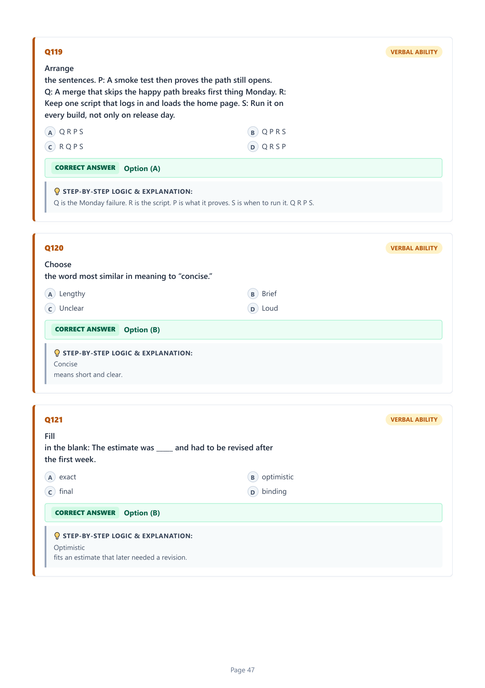 |

---

### Q120: Verbal Ability (Page 47)

**Source Ebook**: `OS4U_Book_3_Verbal_Ability.pdf` | **Book Page**: **Page 47**  
**Authentic Page Figure**: [`OS4U_Book_3_Verbal_Ability_page_047.png`](images/OS4U_Book_3_Verbal_Ability_page_047.png)

#### Problem Statement & Question Prompt
```text
Choose
the word most similar in meaning to “concise.”
```

#### Multiple Choice Options
- **(A)** `Lengthy`
- **(B)** `Brief`
- **(C)** `Unclear`
- **(D)** `Loud`

#### Verified Correct Answer Key
> **Correct Option**: **(B) `Brief`**

#### Step-by-Step Logic & Comprehensive Solution
```text
Concise
means short and clear.
```

#### Authentic Ebook Page Figure
| Ebook Page Render (Page 47) |
| :---: |
|  |

---

### Q121: Verbal Ability (Page 47)

**Source Ebook**: `OS4U_Book_3_Verbal_Ability.pdf` | **Book Page**: **Page 47**  
**Authentic Page Figure**: [`OS4U_Book_3_Verbal_Ability_page_047.png`](images/OS4U_Book_3_Verbal_Ability_page_047.png)

#### Problem Statement & Question Prompt
```text
Fill
in the blank: The estimate was _____ and had to be revised after
the first week.
```

#### Multiple Choice Options
- **(A)** `exact`
- **(B)** `optimistic`
- **(C)** `final`
- **(D)** `binding`

#### Verified Correct Answer Key
> **Correct Option**: **(B) `optimistic`**

#### Step-by-Step Logic & Comprehensive Solution
```text
Optimistic
fits an estimate that later needed a revision.
```

#### Authentic Ebook Page Figure
| Ebook Page Render (Page 47) |
| :---: |
|  |

---

### Q122: Verbal Ability (Page 48)

**Source Ebook**: `OS4U_Book_3_Verbal_Ability.pdf` | **Book Page**: **Page 48**  
**Authentic Page Figure**: [`OS4U_Book_3_Verbal_Ability_page_048.png`](images/OS4U_Book_3_Verbal_Ability_page_048.png)

#### Problem Statement & Question Prompt
```text
Arrange
the sentences. P: Idle tests that never fail teach nothing. Q:
Delete or fix a test that has been green for a year with no
assertion. R: A short list of sharp tests beats a long list of
ornaments. S: Coverage percent alone is not a reason to keep them.
```

#### Multiple Choice Options
- **(A)** `P
Q S R`
- **(B)** `P Q R S`
- **(C)** `Q
P R S`
- **(D)** `P
R Q S`

#### Verified Correct Answer Key
> **Correct Option**: **(B) `P Q R S`**

#### Step-by-Step Logic & Comprehensive Solution
```text
P
names idle tests. Q says delete or fix. R prefers sharp tests. S
rejects coverage as the only reason. P Q R S.
```

#### Authentic Ebook Page Figure
| Ebook Page Render (Page 48) |
| :---: |
| 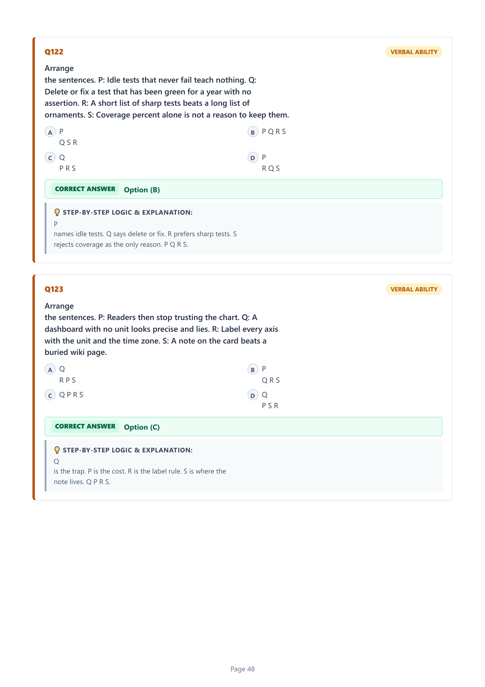 |

---

### Q123: Verbal Ability (Page 48)

**Source Ebook**: `OS4U_Book_3_Verbal_Ability.pdf` | **Book Page**: **Page 48**  
**Authentic Page Figure**: [`OS4U_Book_3_Verbal_Ability_page_048.png`](images/OS4U_Book_3_Verbal_Ability_page_048.png)

#### Problem Statement & Question Prompt
```text
Arrange
the sentences. P: Readers then stop trusting the chart. Q: A
dashboard with no unit looks precise and lies. R: Label every axis
with the unit and the time zone. S: A note on the card beats a
buried wiki page.
```

#### Multiple Choice Options
- **(A)** `Q
R P S`
- **(B)** `P
Q R S`
- **(C)** `Q P R S`
- **(D)** `Q
P S R`

#### Verified Correct Answer Key
> **Correct Option**: **(C) `Q P R S`**

#### Step-by-Step Logic & Comprehensive Solution
```text
Q
is the trap. P is the cost. R is the label rule. S is where the
note lives. Q P R S.
```

#### Authentic Ebook Page Figure
| Ebook Page Render (Page 48) |
| :---: |
|  |

---

### Q124: Verbal Ability (Page 49)

**Source Ebook**: `OS4U_Book_3_Verbal_Ability.pdf` | **Book Page**: **Page 49**  
**Authentic Page Figure**: [`OS4U_Book_3_Verbal_Ability_page_049.png`](images/OS4U_Book_3_Verbal_Ability_page_049.png)

#### Problem Statement & Question Prompt
```text
Arrange
the sentences. P: Dual-running both paths for a week catches
drift. Q: A cutover with no shadow traffic is a guess. R: Compare
counts on the old and new path every hour. S: Only then switch the
default.
```

#### Multiple Choice Options
- **(A)** `Q P R S`
- **(B)** `Q
R P S`
- **(C)** `P
Q R S`
- **(D)** `Q
P S R`

#### Verified Correct Answer Key
> **Correct Option**: **(A) `Q P R S`**

#### Step-by-Step Logic & Comprehensive Solution
```text
Q
is the guess. P is dual-run. R is the hourly compare. S is the
switch. Q P R S.
```

#### Authentic Ebook Page Figure
| Ebook Page Render (Page 49) |
| :---: |
| 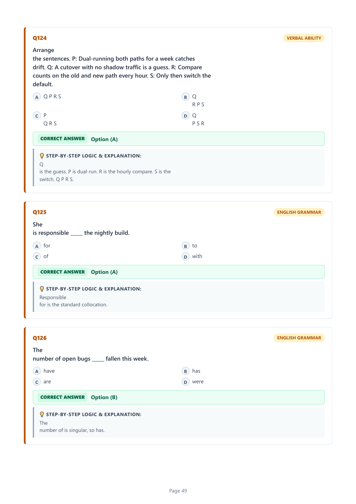 |

---

### Q125: English Grammar (Page 49)

**Source Ebook**: `OS4U_Book_3_Verbal_Ability.pdf` | **Book Page**: **Page 49**  
**Authentic Page Figure**: [`OS4U_Book_3_Verbal_Ability_page_049.png`](images/OS4U_Book_3_Verbal_Ability_page_049.png)

#### Problem Statement & Question Prompt
```text
She
is responsible _____ the nightly build.
```

#### Multiple Choice Options
- **(A)** `for`
- **(B)** `to`
- **(C)** `of`
- **(D)** `with`

#### Verified Correct Answer Key
> **Correct Option**: **(A) `for`**

#### Step-by-Step Logic & Comprehensive Solution
```text
Responsible
for is the standard collocation.
```

#### Authentic Ebook Page Figure
| Ebook Page Render (Page 49) |
| :---: |
|  |

---

### Q126: English Grammar (Page 49)

**Source Ebook**: `OS4U_Book_3_Verbal_Ability.pdf` | **Book Page**: **Page 49**  
**Authentic Page Figure**: [`OS4U_Book_3_Verbal_Ability_page_049.png`](images/OS4U_Book_3_Verbal_Ability_page_049.png)

#### Problem Statement & Question Prompt
```text
The
number of open bugs _____ fallen this week.
```

#### Multiple Choice Options
- **(A)** `have`
- **(B)** `has`
- **(C)** `are`
- **(D)** `were`

#### Verified Correct Answer Key
> **Correct Option**: **(B) `has`**

#### Step-by-Step Logic & Comprehensive Solution
```text
The
number of is singular, so has.
```

#### Authentic Ebook Page Figure
| Ebook Page Render (Page 49) |
| :---: |
|  |

---

### Q127: English Grammar (Page 50)

**Source Ebook**: `OS4U_Book_3_Verbal_Ability.pdf` | **Book Page**: **Page 50**  
**Authentic Page Figure**: [`OS4U_Book_3_Verbal_Ability_page_050.png`](images/OS4U_Book_3_Verbal_Ability_page_050.png)

#### Problem Statement & Question Prompt
```text
Identify
the part that contains an error: Everybody have received the
invite.
```

#### Multiple Choice Options
- **(A)** `Everybody have received`
- **(B)** `the
invite`
- **(C)** `No
error`
- **(D)** `Everybody
have`

#### Verified Correct Answer Key
> **Correct Option**: **(A) `Everybody have received`**

#### Step-by-Step Logic & Comprehensive Solution
```text
Everybody
is singular: has received.
```

#### Authentic Ebook Page Figure
| Ebook Page Render (Page 50) |
| :---: |
| 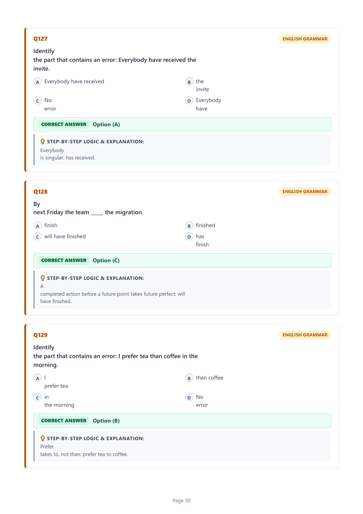 |

---

### Q128: English Grammar (Page 50)

**Source Ebook**: `OS4U_Book_3_Verbal_Ability.pdf` | **Book Page**: **Page 50**  
**Authentic Page Figure**: [`OS4U_Book_3_Verbal_Ability_page_050.png`](images/OS4U_Book_3_Verbal_Ability_page_050.png)

#### Problem Statement & Question Prompt
```text
By
next Friday the team _____ the migration.
```

#### Multiple Choice Options
- **(A)** `finish`
- **(B)** `finished`
- **(C)** `will have finished`
- **(D)** `has
finish`

#### Verified Correct Answer Key
> **Correct Option**: **(C) `will have finished`**

#### Step-by-Step Logic & Comprehensive Solution
```text
A
completed action before a future point takes future perfect: will
have finished.
```

#### Authentic Ebook Page Figure
| Ebook Page Render (Page 50) |
| :---: |
|  |

---

### Q129: English Grammar (Page 50)

**Source Ebook**: `OS4U_Book_3_Verbal_Ability.pdf` | **Book Page**: **Page 50**  
**Authentic Page Figure**: [`OS4U_Book_3_Verbal_Ability_page_050.png`](images/OS4U_Book_3_Verbal_Ability_page_050.png)

#### Problem Statement & Question Prompt
```text
Identify
the part that contains an error: I prefer tea than coffee in the
morning.
```

#### Multiple Choice Options
- **(A)** `I
prefer tea`
- **(B)** `than coffee`
- **(C)** `in
the morning`
- **(D)** `No
error`

#### Verified Correct Answer Key
> **Correct Option**: **(B) `than coffee`**

#### Step-by-Step Logic & Comprehensive Solution
```text
Prefer
takes to, not than: prefer tea to coffee.
```

#### Authentic Ebook Page Figure
| Ebook Page Render (Page 50) |
| :---: |
|  |

---

### Q130: Essay Writting (Page 51)

**Source Ebook**: `OS4U_Book_3_Verbal_Ability.pdf` | **Book Page**: **Page 51**  
**Authentic Page Figure**: [`OS4U_Book_3_Verbal_Ability_page_051.png`](images/OS4U_Book_3_Verbal_Ability_page_051.png)

#### Problem Statement & Question Prompt
```text
Importance of Teamwork in the Workplace
```

#### Multiple Choice Options
- *(Descriptive / Essay Prompt — Detailed Model Response Below)*

#### Verified Correct Answer Key
> **Correct Option**: **(O) `Option (See Solution)`**

#### Step-by-Step Logic & Comprehensive Solution
```text
Teamwork is an important part of a successful workplace. It means working together with different people to achieve a common goal. In a professional environment, employees often need to share ideas, responsibilities, and knowledge to complete tasks effectively.
One major benefit of teamwork is that it brings different skills and perspectives together. When employees cooperate, they can solve problems more efficiently and make better decisions. Teamwork also improves communication and helps employees learn from one another. It can create a positive working environment where people support each other.
However, teamwork can sometimes be challenging. Differences in opinions, communication gaps, or unequal distribution of responsibilities may create conflicts. These problems can be reduced through clear communication, mutual respect, and proper coordination.
In conclusion, teamwork is essential for achieving organizational goals and developing professional relationships. Employees who listen to others, communicate clearly, and contribute responsibly can become valuable members of a team. Therefore, developing teamwork skills is important for both personal and professional growth.
```

#### Authentic Ebook Page Figure
| Ebook Page Render (Page 51) |
| :---: |
| 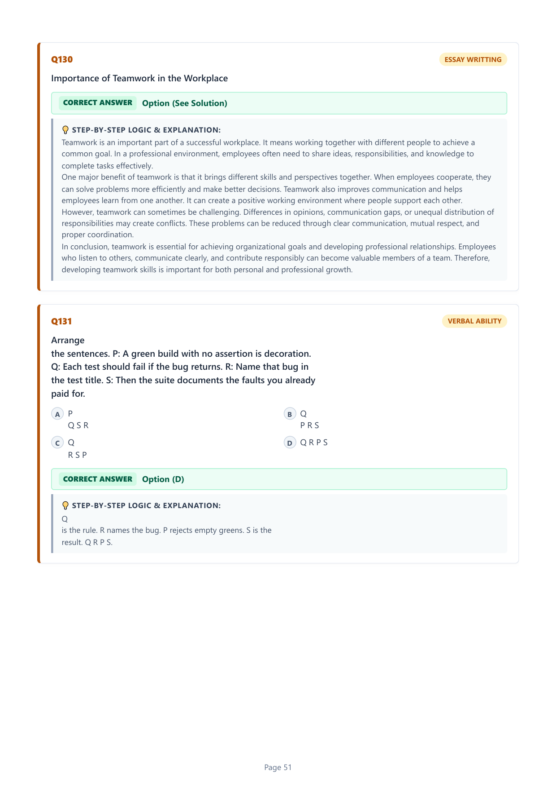 |

---

### Q131: Verbal Ability (Page 51)

**Source Ebook**: `OS4U_Book_3_Verbal_Ability.pdf` | **Book Page**: **Page 51**  
**Authentic Page Figure**: [`OS4U_Book_3_Verbal_Ability_page_051.png`](images/OS4U_Book_3_Verbal_Ability_page_051.png)

#### Problem Statement & Question Prompt
```text
Arrange
the sentences. P: A green build with no assertion is decoration.
Q: Each test should fail if the bug returns. R: Name that bug in
the test title. S: Then the suite documents the faults you already
paid for.
```

#### Multiple Choice Options
- **(A)** `P
Q S R`
- **(B)** `Q
P R S`
- **(C)** `Q
R S P`
- **(D)** `Q R P S`

#### Verified Correct Answer Key
> **Correct Option**: **(D) `Q R P S`**

#### Step-by-Step Logic & Comprehensive Solution
```text
Q
is the rule. R names the bug. P rejects empty greens. S is the
result. Q R P S.
```

#### Authentic Ebook Page Figure
| Ebook Page Render (Page 51) |
| :---: |
|  |

---

### Q132: Verbal Ability (Page 52)

**Source Ebook**: `OS4U_Book_3_Verbal_Ability.pdf` | **Book Page**: **Page 52**  
**Authentic Page Figure**: [`OS4U_Book_3_Verbal_Ability_page_052.png`](images/OS4U_Book_3_Verbal_Ability_page_052.png)

#### Problem Statement & Question Prompt
```text
Passage
A staging copy that is a week old hides the bug you will meet on Monday. Restore from last night, run the same job, and compare row counts before you call the job safe. If staging uses half the data, say so on the ticket. Silent sampling makes a green run look like proof when it is only a sketch.
The main idea of the passage is that
```

#### Multiple Choice Options
- **(A)** `a
week-old staging copy is enough proof`
- **(B)** `staging must be fresh, compared, and honest about sample size`
- **(C)** `row
counts should never be compared`
- **(D)** `tickets
should hide sampling`

#### Verified Correct Answer Key
> **Correct Option**: **(B) `staging must be fresh, compared, and honest about sample size`**

#### Step-by-Step Logic & Comprehensive Solution
```text
The
passage wants last-night data, a row-count check, and a note if
only half the data was used.
```

#### Authentic Ebook Page Figure
| Ebook Page Render (Page 52) |
| :---: |
|  |

---

### Q133: Verbal Ability (Page 52)

**Source Ebook**: `OS4U_Book_3_Verbal_Ability.pdf` | **Book Page**: **Page 52**  
**Authentic Page Figure**: [`OS4U_Book_3_Verbal_Ability_page_052.png`](images/OS4U_Book_3_Verbal_Ability_page_052.png)

#### Problem Statement & Question Prompt
```text
Arrange
the sentences. P: Old tokens in images leak on every pull. Q: Bake
no secret into a layer. R: Inject at runtime and rotate what
already shipped. S: Scans will not save a token from last year.
```

#### Multiple Choice Options
- **(A)** `P
Q R S`
- **(B)** `Q P S R`
- **(C)** `Q
S P R`
- **(D)** `P
S Q R`

#### Verified Correct Answer Key
> **Correct Option**: **(B) `Q P S R`**

#### Step-by-Step Logic & Comprehensive Solution
```text
Q
is the rule. P is the leak. S says scans miss old tokens. R is
inject and rotate. Better Q P S R.
```

#### Authentic Ebook Page Figure
| Ebook Page Render (Page 52) |
| :---: |
|  |

---

### Q134: Verbal Ability (Page 53)

**Source Ebook**: `OS4U_Book_3_Verbal_Ability.pdf` | **Book Page**: **Page 53**  
**Authentic Page Figure**: [`OS4U_Book_3_Verbal_Ability_page_053.png`](images/OS4U_Book_3_Verbal_Ability_page_053.png)

#### Problem Statement & Question Prompt
```text
Arrange
the sentences. P: Wait time on the pool then shows the cap is
wrong. Q: A pool with no upper bound will eat the database. R: Tie
the cap to the instance class. S: Guessing from a blog post is not
a plan.
```

#### Multiple Choice Options
- **(A)** `Q S R P`
- **(B)** `Q
R P S`
- **(C)** `S
Q R P`
- **(D)** `Q
P R S`

#### Verified Correct Answer Key
> **Correct Option**: **(A) `Q S R P`**

#### Step-by-Step Logic & Comprehensive Solution
```text
Q
is the risk. S rejects guessing. R sets the cap. P is the metric.
Q S R P.
```

#### Authentic Ebook Page Figure
| Ebook Page Render (Page 53) |
| :---: |
|  |

---

### Q135: Verbal Ability (Page 53)

**Source Ebook**: `OS4U_Book_3_Verbal_Ability.pdf` | **Book Page**: **Page 53**  
**Authentic Page Figure**: [`OS4U_Book_3_Verbal_Ability_page_053.png`](images/OS4U_Book_3_Verbal_Ability_page_053.png)

#### Problem Statement & Question Prompt
```text
Arrange
the sentences. P: Notes from that hour beat another internal
review. Q: Specs that never meet a user stay neat and wrong. R:
Give one stranger a real task every Friday. S: Watch where they
stop.
```

#### Multiple Choice Options
- **(A)** `Q
P R S`
- **(B)** `Q R S P`
- **(C)** `P
Q R S`
- **(D)** `Q
R P S`

#### Verified Correct Answer Key
> **Correct Option**: **(B) `Q R S P`**

#### Step-by-Step Logic & Comprehensive Solution
```text
Q
is the risk. R is the Friday habit. S is what to watch. P values
the notes. Q R S P.
```

#### Authentic Ebook Page Figure
| Ebook Page Render (Page 53) |
| :---: |
|  |

---

### Q136: Verbal Ability (Page 54)

**Source Ebook**: `OS4U_Book_3_Verbal_Ability.pdf` | **Book Page**: **Page 54**  
**Authentic Page Figure**: [`OS4U_Book_3_Verbal_Ability_page_054.png`](images/OS4U_Book_3_Verbal_Ability_page_054.png)

#### Problem Statement & Question Prompt
```text
Choose
the one-word substitute: Lasting for a very short time.
```

#### Multiple Choice Options
- **(A)** `Chronic`
- **(B)** `Eternal`
- **(C)** `Transient`
- **(D)** `Annual`

#### Verified Correct Answer Key
> **Correct Option**: **(C) `Transient`**

#### Step-by-Step Logic & Comprehensive Solution
```text
Transient
means lasting only a short time.
```

#### Authentic Ebook Page Figure
| Ebook Page Render (Page 54) |
| :---: |
|  |

---

### Q137: Verbal Ability (Page 54)

**Source Ebook**: `OS4U_Book_3_Verbal_Ability.pdf` | **Book Page**: **Page 54**  
**Authentic Page Figure**: [`OS4U_Book_3_Verbal_Ability_page_054.png`](images/OS4U_Book_3_Verbal_Ability_page_054.png)

#### Problem Statement & Question Prompt
```text
Fill
in the blank: The rollback was _____ and traffic recovered in one
minute.
```

#### Multiple Choice Options
- **(A)** `hesitant`
- **(B)** `swift`
- **(C)** `vague`
- **(D)** `optional`

#### Verified Correct Answer Key
> **Correct Option**: **(B) `swift`**

#### Step-by-Step Logic & Comprehensive Solution
```text
Swift
fits a fast recovery.
```

#### Authentic Ebook Page Figure
| Ebook Page Render (Page 54) |
| :---: |
|  |

---

### Q138: Verbal Ability (Page 54)

**Source Ebook**: `OS4U_Book_3_Verbal_Ability.pdf` | **Book Page**: **Page 54**  
**Authentic Page Figure**: [`OS4U_Book_3_Verbal_Ability_page_054.png`](images/OS4U_Book_3_Verbal_Ability_page_054.png)

#### Problem Statement & Question Prompt
```text
Choose
the word most similar in meaning to “precise.”
```

#### Multiple Choice Options
- **(A)** `Vague`
- **(B)** `Exact`
- **(C)** `Loose`
- **(D)** `Late`

#### Verified Correct Answer Key
> **Correct Option**: **(B) `Exact`**

#### Step-by-Step Logic & Comprehensive Solution
```text
Precise
means exact.
```

#### Authentic Ebook Page Figure
| Ebook Page Render (Page 54) |
| :---: |
|  |

---

### Q139: Verbal Ability (Page 55)

**Source Ebook**: `OS4U_Book_3_Verbal_Ability.pdf` | **Book Page**: **Page 55**  
**Authentic Page Figure**: [`OS4U_Book_3_Verbal_Ability_page_055.png`](images/OS4U_Book_3_Verbal_Ability_page_055.png)

#### Problem Statement & Question Prompt
```text
Arrange
the sentences. P: A canary percent then limits the blast. Q:
Shipping a schema change to all shards at once is a bet. R: Start
with one shard and watch write errors. S: Raise the share only
after an hour of calm.
```

#### Multiple Choice Options
- **(A)** `Q R P S`
- **(B)** `Q
P R S`
- **(C)** `R
Q P S`
- **(D)** `Q
R S P`

#### Verified Correct Answer Key
> **Correct Option**: **(A) `Q R P S`**

#### Step-by-Step Logic & Comprehensive Solution
```text
Q
is the bet. R is the first shard. P is the canary cap. S is when
to raise. Q R P S.
```

#### Authentic Ebook Page Figure
| Ebook Page Render (Page 55) |
| :---: |
|  |

---

### Q140: Verbal Ability (Page 55)

**Source Ebook**: `OS4U_Book_3_Verbal_Ability.pdf` | **Book Page**: **Page 55**  
**Authentic Page Figure**: [`OS4U_Book_3_Verbal_Ability_page_055.png`](images/OS4U_Book_3_Verbal_Ability_page_055.png)

#### Problem Statement & Question Prompt
```text
“ On
the same wavelength” means
```

#### Multiple Choice Options
- **(A)** `Thinking in a similar way`
- **(B)** `Using
the same radio`
- **(C)** `Sitting
in one row`
- **(D)** `Sharing
a password`

#### Verified Correct Answer Key
> **Correct Option**: **(A) `Thinking in a similar way`**

#### Step-by-Step Logic & Comprehensive Solution
```text
It
means having a similar understanding.
```

#### Authentic Ebook Page Figure
| Ebook Page Render (Page 55) |
| :---: |
|  |

---

### Q141: Verbal Ability (Page 55)

**Source Ebook**: `OS4U_Book_3_Verbal_Ability.pdf` | **Book Page**: **Page 55**  
**Authentic Page Figure**: [`OS4U_Book_3_Verbal_Ability_page_055.png`](images/OS4U_Book_3_Verbal_Ability_page_055.png)

#### Problem Statement & Question Prompt
```text
Choose
the word most opposite in meaning to “ tardy.”
```

#### Multiple Choice Options
- **(A)** `Late`
- **(B)** `Slow`
- **(C)** `Prompt`
- **(D)** `Idle`

#### Verified Correct Answer Key
> **Correct Option**: **(C) `Prompt`**

#### Step-by-Step Logic & Comprehensive Solution
```text
Prompt
is the opposite of tardy.
```

#### Authentic Ebook Page Figure
| Ebook Page Render (Page 55) |
| :---: |
|  |

---

### Q142: English Grammar (Page 56)

**Source Ebook**: `OS4U_Book_3_Verbal_Ability.pdf` | **Book Page**: **Page 56**  
**Authentic Page Figure**: [`OS4U_Book_3_Verbal_Ability_page_056.png`](images/OS4U_Book_3_Verbal_Ability_page_056.png)

#### Problem Statement & Question Prompt
```text
They _____ the flag before traffic rose.
```

#### Multiple Choice Options
- **(A)** `switch`
- **(B)** `have switch`
- **(C)** `had switched`
- **(D)** `will switched`

#### Verified Correct Answer Key
> **Correct Option**: **(C) `had switched`**

#### Step-by-Step Logic & Comprehensive Solution
```text
Earlier past action: had switched.
```

#### Authentic Ebook Page Figure
| Ebook Page Render (Page 56) |
| :---: |
|  |

---

### Q143: English Grammar (Page 56)

**Source Ebook**: `OS4U_Book_3_Verbal_Ability.pdf` | **Book Page**: **Page 56**  
**Authentic Page Figure**: [`OS4U_Book_3_Verbal_Ability_page_056.png`](images/OS4U_Book_3_Verbal_Ability_page_056.png)

#### Problem Statement & Question Prompt
```text
The module is capable _____ running offline.
```

#### Multiple Choice Options
- **(A)** `to`
- **(B)** `of`
- **(C)** `for`
- **(D)** `with`

#### Verified Correct Answer Key
> **Correct Option**: **(B) `of`**

#### Step-by-Step Logic & Comprehensive Solution
```text
Capable of + gerund.
```

#### Authentic Ebook Page Figure
| Ebook Page Render (Page 56) |
| :---: |
|  |

---

### Q144: English Grammar (Page 56)

**Source Ebook**: `OS4U_Book_3_Verbal_Ability.pdf` | **Book Page**: **Page 56**  
**Authentic Page Figure**: [`OS4U_Book_3_Verbal_Ability_page_056.png`](images/OS4U_Book_3_Verbal_Ability_page_056.png)

#### Problem Statement & Question Prompt
```text
A bundle of scripts _____ waiting in review.
```

#### Multiple Choice Options
- **(A)** `are`
- **(B)** `is`
- **(C)** `have`
- **(D)** `were`

#### Verified Correct Answer Key
> **Correct Option**: **(B) `is`**

#### Step-by-Step Logic & Comprehensive Solution
```text
The subject is bundle (singular): is.
```

#### Authentic Ebook Page Figure
| Ebook Page Render (Page 56) |
| :---: |
|  |

---

### Q145: English Grammar (Page 56)

**Source Ebook**: `OS4U_Book_3_Verbal_Ability.pdf` | **Book Page**: **Page 56**  
**Authentic Page Figure**: [`OS4U_Book_3_Verbal_Ability_page_056.png`](images/OS4U_Book_3_Verbal_Ability_page_056.png)

#### Problem Statement & Question Prompt
```text
Identify the part that contains an error:
Each of the nodes have a replica.
```

#### Multiple Choice Options
- **(A)** `Each of the nodes`
- **(B)** `have a replica`
- **(C)** `No error`
- **(D)** `Each of`

#### Verified Correct Answer Key
> **Correct Option**: **(B) `have a replica`**

#### Step-by-Step Logic & Comprehensive Solution
```text
Each is singular: has a replica.
```

#### Authentic Ebook Page Figure
| Ebook Page Render (Page 56) |
| :---: |
|  |

---

### Q146: English Grammar (Page 57)

**Source Ebook**: `OS4U_Book_3_Verbal_Ability.pdf` | **Book Page**: **Page 57**  
**Authentic Page Figure**: [`OS4U_Book_3_Verbal_Ability_page_057.png`](images/OS4U_Book_3_Verbal_Ability_page_057.png)

#### Problem Statement & Question Prompt
```text
Identify the part that contains an error:
She did not wrote the runbook.
```

#### Multiple Choice Options
- **(A)** `did not wrote`
- **(B)** `the runbook`
- **(C)** `No error`
- **(D)** `She did`

#### Verified Correct Answer Key
> **Correct Option**: **(A) `did not wrote`**

#### Step-by-Step Logic & Comprehensive Solution
```text
After did not use the base verb: did not
write.
```

#### Authentic Ebook Page Figure
| Ebook Page Render (Page 57) |
| :---: |
|  |

---

### Q147: Essay Writting (Page 57)

**Source Ebook**: `OS4U_Book_3_Verbal_Ability.pdf` | **Book Page**: **Page 57**  
**Authentic Page Figure**: [`OS4U_Book_3_Verbal_Ability_page_057.png`](images/OS4U_Book_3_Verbal_Ability_page_057.png)

#### Problem Statement & Question Prompt
```text
Impact of Online Education on Students
```

#### Multiple Choice Options
- *(Descriptive / Essay Prompt — Detailed Model Response Below)*

#### Verified Correct Answer Key
> **Correct Option**: **(O) `Option (See Solution)`**

#### Step-by-Step Logic & Comprehensive Solution
```text
Online education has changed the way students learn and access educational resources. With the availability of smartphones, computers, and internet services, students can attend classes and study from almost anywhere.
One of the major advantages of online education is flexibility. Students can learn according to their schedules and revisit recorded lessons when necessary. Online platforms also provide access to a wide range of courses, study materials, and educational videos. This can be particularly useful for students who may not have access to certain learning resources locally.
However, online education also has some challenges. Poor internet connectivity, lack of direct interaction with teachers, and distractions at home can affect learning. Some students may also find it difficult to maintain regular study habits without a structured classroom environment.
In conclusion, online education provides flexibility and access to valuable learning resources, but it also requires discipline and proper guidance. A balanced combination of online resources and traditional learning can help students gain knowledge effectively and develop the skills needed for the future.
```

#### Authentic Ebook Page Figure
| Ebook Page Render (Page 57) |
| :---: |
|  |

---

### Q148: Essay Writting (Page 58)

**Source Ebook**: `OS4U_Book_3_Verbal_Ability.pdf` | **Book Page**: **Page 58**  
**Authentic Page Figure**: [`OS4U_Book_3_Verbal_Ability_page_058.png`](images/OS4U_Book_3_Verbal_Ability_page_058.png)

#### Problem Statement & Question Prompt
```text
Impact of Artificial Intelligence on IT Job
```

#### Multiple Choice Options
- *(Descriptive / Essay Prompt — Detailed Model Response Below)*

#### Verified Correct Answer Key
> **Correct Option**: **(O) `Option (See Solution)`**

#### Step-by-Step Logic & Comprehensive Solution
```text
Artificial Intelligence (AI) is transforming the IT industry by changing the way people work, develop software, and solve technical problems. AI tools can automate repetitive tasks such as code generation, software testing, data analysis, customer support, and system monitoring. This has increased productivity and helped companies reduce the time required to complete many tasks.
However, the growth of AI has also raised concerns about job displacement. Some routine and repetitive IT roles may experience reduced demand as organizations adopt automation. Employees whose work mainly involves predictable tasks may need to develop new skills to remain competitive.
At the same time, AI is creating new career opportunities. Jobs related to AI engineering, machine learning, data science, cybersecurity, cloud computing, AI testing, and prompt engineering are becoming increasingly important. IT professionals can benefit from AI by learning how to use these technologies effectively rather than viewing them only as a threat.
AI is therefore more likely to change the nature of many IT jobs than simply eliminate them. Human skills such as creativity, communication, critical thinking, problem-solving, and decision-making will continue to be valuable. The future of IT will depend on collaboration between humans and AI. Continuous learning and upskilling will be essential for IT professionals to adapt successfully to this changing workplace.
```

#### Authentic Ebook Page Figure
| Ebook Page Render (Page 58) |
| :---: |
|  |

---

### Q149: Idioms & Phrases (Page 58)

**Source Ebook**: `OS4U_Book_3_Verbal_Ability.pdf` | **Book Page**: **Page 58**  
**Authentic Page Figure**: [`OS4U_Book_3_Verbal_Ability_page_058.png`](images/OS4U_Book_3_Verbal_Ability_page_058.png)

#### Problem Statement & Question Prompt
```text
1. The school administration found the bullying complaint to be ______.
```

#### Multiple Choice Options
- *(Descriptive / Essay Prompt — Detailed Model Response Below)*

#### Verified Correct Answer Key
> **Correct Option**: **(B) `Option (B)`**

#### Step-by-Step Logic & Comprehensive Solution
```text
A. a feather in his cap
B. a hot potato
C. a piece of cake
D. a bed of roses
Answer: B. a hot potato
Meaning: a sensitive or controversial issue.
Why other options are wrong: A. a feather in his cap → an achievement to be proud of. C. a piece of cake →
something very easy. D. a bed of roses → a very easy or pleasant situation.
```

#### Authentic Ebook Page Figure
| Ebook Page Render (Page 58) |
| :---: |
|  |

---

### Q150: Idioms & Phrases (Page 59)

**Source Ebook**: `OS4U_Book_3_Verbal_Ability.pdf` | **Book Page**: **Page 59**  
**Authentic Page Figure**: [`OS4U_Book_3_Verbal_Ability_page_059.png`](images/OS4U_Book_3_Verbal_Ability_page_059.png)

#### Problem Statement & Question Prompt
```text
2. The basic coding question was ______ for the experienced candidate.
```

#### Multiple Choice Options
- *(Descriptive / Essay Prompt — Detailed Model Response Below)*

#### Verified Correct Answer Key
> **Correct Option**: **(C) `Option (C)`**

#### Step-by-Step Logic & Comprehensive Solution
```text
A. a storm in a teacup
B. a wild goose chase
C. a piece of cake
D. a hot potato
Answer: C. a piece of cake
Meaning: something very easy.
Why other options are wrong: A. a storm in a teacup → a lot of fuss about a small matter. B. a wild goose chase → a
pointless search. D. a hot potato → a sensitive or controversial issue.
```

#### Authentic Ebook Page Figure
| Ebook Page Render (Page 59) |
| :---: |
|  |

---

### Q151: Idioms & Phrases (Page 59)

**Source Ebook**: `OS4U_Book_3_Verbal_Ability.pdf` | **Book Page**: **Page 59**  
**Authentic Page Figure**: [`OS4U_Book_3_Verbal_Ability_page_059.png`](images/OS4U_Book_3_Verbal_Ability_page_059.png)

#### Problem Statement & Question Prompt
```text
3. Life in a new city is not always ______.
```

#### Multiple Choice Options
- *(Descriptive / Essay Prompt — Detailed Model Response Below)*

#### Verified Correct Answer Key
> **Correct Option**: **(D) `Option (D)`**

#### Step-by-Step Logic & Comprehensive Solution
```text
A. a red herring
B. a hot potato
C. a white elephant
D. a bed of roses
Answer: D. a bed of roses
Meaning: a very easy or pleasant situation.
Why other options are wrong: A. a red herring → something that misleads or distracts. B. a hot potato → a sensitive or
controversial issue. C. a white elephant → an expensive but useless possession or project.
```

#### Authentic Ebook Page Figure
| Ebook Page Render (Page 59) |
| :---: |
|  |

---

### Q152: Idioms & Phrases (Page 59)

**Source Ebook**: `OS4U_Book_3_Verbal_Ability.pdf` | **Book Page**: **Page 59**  
**Authentic Page Figure**: [`OS4U_Book_3_Verbal_Ability_page_059.png`](images/OS4U_Book_3_Verbal_Ability_page_059.png)

#### Problem Statement & Question Prompt
```text
4. The abandoned stadium became ______ because it cost millions to maintain.
```

#### Multiple Choice Options
- *(Descriptive / Essay Prompt — Detailed Model Response Below)*

#### Verified Correct Answer Key
> **Correct Option**: **(A) `Option (A)`**

#### Step-by-Step Logic & Comprehensive Solution
```text
A. a white elephant
B. a piece of cake
C. a silver lining
D. a red-letter day
Answer: A. a white elephant
Meaning: an expensive but useless possession or project.
Why other options are wrong: B. a piece of cake → something very easy. C. a silver lining → a positive aspect of a
difficult situation. D. a red-letter day → a very important or memorable day.
Page 2
```

#### Authentic Ebook Page Figure
| Ebook Page Render (Page 59) |
| :---: |
|  |

---

### Q153: Idioms & Phrases (Page 60)

**Source Ebook**: `OS4U_Book_3_Verbal_Ability.pdf` | **Book Page**: **Page 60**  
**Authentic Page Figure**: [`OS4U_Book_3_Verbal_Ability_page_060.png`](images/OS4U_Book_3_Verbal_Ability_page_060.png)

#### Problem Statement & Question Prompt
```text
5. The clue about the old car was ______ and sent the detective in the wrong direction.
```

#### Multiple Choice Options
- *(Descriptive / Essay Prompt — Detailed Model Response Below)*

#### Verified Correct Answer Key
> **Correct Option**: **(B) `Option (B)`**

#### Step-by-Step Logic & Comprehensive Solution
```text
A. a piece of cake
B. a red herring
C. a feather in his cap
D. a bed of roses
Answer: B. a red herring
Meaning: something that misleads or distracts.
Why other options are wrong: A. a piece of cake → something very easy. C. a feather in his cap → an achievement to
be proud of. D. a bed of roses → a very easy or pleasant situation.
```

#### Authentic Ebook Page Figure
| Ebook Page Render (Page 60) |
| :---: |
|  |

---

### Q154: Idioms & Phrases (Page 60)

**Source Ebook**: `OS4U_Book_3_Verbal_Ability.pdf` | **Book Page**: **Page 60**  
**Authentic Page Figure**: [`OS4U_Book_3_Verbal_Ability_page_060.png`](images/OS4U_Book_3_Verbal_Ability_page_060.png)

#### Problem Statement & Question Prompt
```text
6. Missing that flight was ______ because she met her future employer later.
```

#### Multiple Choice Options
- *(Descriptive / Essay Prompt — Detailed Model Response Below)*

#### Verified Correct Answer Key
> **Correct Option**: **(C) `Option (C)`**

#### Step-by-Step Logic & Comprehensive Solution
```text
A. a wet blanket
B. a wild goose chase
C. a blessing in disguise
D. a hot potato
Answer: C. a blessing in disguise
Meaning: something that seems bad but has a good result.
Why other options are wrong: A. a wet blanket → a person who spoils others&#x27; enjoyment. B. a wild goose chase → a
pointless search. D. a hot potato → a sensitive or controversial issue.
```

#### Authentic Ebook Page Figure
| Ebook Page Render (Page 60) |
| :---: |
|  |

---

### Q155: Idioms & Phrases (Page 60)

**Source Ebook**: `OS4U_Book_3_Verbal_Ability.pdf` | **Book Page**: **Page 60**  
**Authentic Page Figure**: [`OS4U_Book_3_Verbal_Ability_page_060.png`](images/OS4U_Book_3_Verbal_Ability_page_060.png)

#### Problem Statement & Question Prompt
```text
7. Their argument turned out to be ______ and ended quickly.
```

#### Multiple Choice Options
- *(Descriptive / Essay Prompt — Detailed Model Response Below)*

#### Verified Correct Answer Key
> **Correct Option**: **(D) `Option (D)`**

#### Step-by-Step Logic & Comprehensive Solution
```text
A. a white elephant
B. a red-letter day
C. a piece of cake
D. a storm in a teacup
Answer: D. a storm in a teacup
Meaning: a lot of fuss about a small matter.
Why other options are wrong: A. a white elephant → an expensive but useless possession or project. B. a red-letter
day → a very important or memorable day. C. a piece of cake → something very easy.
```

#### Authentic Ebook Page Figure
| Ebook Page Render (Page 60) |
| :---: |
|  |

---

### Q156: Idioms & Phrases (Page 61)

**Source Ebook**: `OS4U_Book_3_Verbal_Ability.pdf` | **Book Page**: **Page 61**  
**Authentic Page Figure**: [`OS4U_Book_3_Verbal_Ability_page_061.png`](images/OS4U_Book_3_Verbal_Ability_page_061.png)

#### Problem Statement & Question Prompt
```text
8. The false address sent the police on ______.
```

#### Multiple Choice Options
- *(Descriptive / Essay Prompt — Detailed Model Response Below)*

#### Verified Correct Answer Key
> **Correct Option**: **(A) `Option (A)`**

#### Step-by-Step Logic & Comprehensive Solution
```text
A. a wild goose chase
B. a silver lining
C. a feather in his cap
D. a bed of roses
Answer: A. a wild goose chase
Meaning: a pointless search.
Why other options are wrong: B. a silver lining → a positive aspect of a difficult situation. C. a feather in his cap → an
achievement to be proud of. D. a bed of roses → a very easy or pleasant situation.
```

#### Authentic Ebook Page Figure
| Ebook Page Render (Page 61) |
| :---: |
|  |

---

### Q157: Idioms & Phrases (Page 61)

**Source Ebook**: `OS4U_Book_3_Verbal_Ability.pdf` | **Book Page**: **Page 61**  
**Authentic Page Figure**: [`OS4U_Book_3_Verbal_Ability_page_061.png`](images/OS4U_Book_3_Verbal_Ability_page_061.png)

#### Problem Statement & Question Prompt
```text
9. The noisy neighbour became ______ for the family.
```

#### Multiple Choice Options
- *(Descriptive / Essay Prompt — Detailed Model Response Below)*

#### Verified Correct Answer Key
> **Correct Option**: **(B) `Option (B)`**

#### Step-by-Step Logic & Comprehensive Solution
```text
A. a blessing in disguise
B. a thorn in the flesh
C. a red-letter day
D. a piece of cake
Answer: B. a thorn in the flesh
Meaning: a persistent source of annoyance.
Why other options are wrong: A. a blessing in disguise → something that seems bad but has a good result. C. a
red-letter day → a very important or memorable day. D. a piece of cake → something very easy.
Page 3
```

#### Authentic Ebook Page Figure
| Ebook Page Render (Page 61) |
| :---: |
|  |

---

### Q158: Idioms & Phrases (Page 61)

**Source Ebook**: `OS4U_Book_3_Verbal_Ability.pdf` | **Book Page**: **Page 61**  
**Authentic Page Figure**: [`OS4U_Book_3_Verbal_Ability_page_061.png`](images/OS4U_Book_3_Verbal_Ability_page_061.png)

#### Problem Statement & Question Prompt
```text
10. The unpaid bill became ______ between the partners.
```

#### Multiple Choice Options
- *(Descriptive / Essay Prompt — Detailed Model Response Below)*

#### Verified Correct Answer Key
> **Correct Option**: **(C) `Option (C)`**

#### Step-by-Step Logic & Comprehensive Solution
```text
A. a silver lining
B. a white elephant
C. a bone of contention
D. a hot potato
Answer: C. a bone of contention
Meaning: a subject causing disagreement.
Why other options are wrong: A. a silver lining → a positive aspect of a difficult situation. B. a white elephant → an
expensive but useless possession or project. D. a hot potato → a sensitive or controversial issue.
```

#### Authentic Ebook Page Figure
| Ebook Page Render (Page 61) |
| :---: |
|  |

---

### Q159: Idioms & Phrases (Page 62)

**Source Ebook**: `OS4U_Book_3_Verbal_Ability.pdf` | **Book Page**: **Page 62**  
**Authentic Page Figure**: [`OS4U_Book_3_Verbal_Ability_page_062.png`](images/OS4U_Book_3_Verbal_Ability_page_062.png)

#### Problem Statement & Question Prompt
```text
11. Winning the national award was ______ for the young scientist.
```

#### Multiple Choice Options
- *(Descriptive / Essay Prompt — Detailed Model Response Below)*

#### Verified Correct Answer Key
> **Correct Option**: **(D) `Option (D)`**

#### Step-by-Step Logic & Comprehensive Solution
```text
A. a wet blanket
B. a red herring
C. a storm in a teacup
D. a feather in his cap
Answer: D. a feather in his cap
Meaning: an achievement to be proud of.
Why other options are wrong: A. a wet blanket → a person who spoils others&#x27; enjoyment. B. a red herring →
something that misleads or distracts. C. a storm in a teacup → a lot of fuss about a small matter.
```

#### Authentic Ebook Page Figure
| Ebook Page Render (Page 62) |
| :---: |
|  |

---

### Q160: Idioms & Phrases (Page 62)

**Source Ebook**: `OS4U_Book_3_Verbal_Ability.pdf` | **Book Page**: **Page 62**  
**Authentic Page Figure**: [`OS4U_Book_3_Verbal_Ability_page_062.png`](images/OS4U_Book_3_Verbal_Ability_page_062.png)

#### Problem Statement & Question Prompt
```text
12. The company&#x27;s first international launch was ______.
```

#### Multiple Choice Options
- *(Descriptive / Essay Prompt — Detailed Model Response Below)*

#### Verified Correct Answer Key
> **Correct Option**: **(A) `Option (A)`**

#### Step-by-Step Logic & Comprehensive Solution
```text
A. a red-letter day
B. a wild goose chase
C. a piece of cake
D. a hot potato
Answer: A. a red-letter day
Meaning: a very important or memorable day.
Why other options are wrong: B. a wild goose chase → a pointless search. C. a piece of cake → something very easy.
D. a hot potato → a sensitive or controversial issue.
```

#### Authentic Ebook Page Figure
| Ebook Page Render (Page 62) |
| :---: |
|  |

---

### Q161: Idioms & Phrases (Page 62)

**Source Ebook**: `OS4U_Book_3_Verbal_Ability.pdf` | **Book Page**: **Page 62**  
**Authentic Page Figure**: [`OS4U_Book_3_Verbal_Ability_page_062.png`](images/OS4U_Book_3_Verbal_Ability_page_062.png)

#### Problem Statement & Question Prompt
```text
13. His constant complaints made him ______ at the party.
```

#### Multiple Choice Options
- *(Descriptive / Essay Prompt — Detailed Model Response Below)*

#### Verified Correct Answer Key
> **Correct Option**: **(B) `Option (B)`**

#### Step-by-Step Logic & Comprehensive Solution
```text
A. a red herring
B. a wet blanket
C. a feather in his cap
D. a silver lining
Answer: B. a wet blanket
Meaning: a person who spoils others&#x27; enjoyment.
Why other options are wrong: A. a red herring → something that misleads or distracts. C. a feather in his cap → an
achievement to be proud of. D. a silver lining → a positive aspect of a difficult situation.
```

#### Authentic Ebook Page Figure
| Ebook Page Render (Page 62) |
| :---: |
|  |

---

### Q162: Idioms & Phrases (Page 63)

**Source Ebook**: `OS4U_Book_3_Verbal_Ability.pdf` | **Book Page**: **Page 63**  
**Authentic Page Figure**: [`OS4U_Book_3_Verbal_Ability_page_063.png`](images/OS4U_Book_3_Verbal_Ability_page_063.png)

#### Problem Statement & Question Prompt
```text
14. The only ______ was that nobody was injured in the accident.
```

#### Multiple Choice Options
- *(Descriptive / Essay Prompt — Detailed Model Response Below)*

#### Verified Correct Answer Key
> **Correct Option**: **(C) `Option (C)`**

#### Step-by-Step Logic & Comprehensive Solution
```text
A. a bone of contention
B. a wild goose chase
C. a silver lining
D. a white elephant
Answer: C. a silver lining
Meaning: a positive aspect of a difficult situation.
Why other options are wrong: A. a bone of contention → a subject causing disagreement. B. a wild goose chase → a
pointless search. D. a white elephant → an expensive but useless possession or project.
Page 4
```

#### Authentic Ebook Page Figure
| Ebook Page Render (Page 63) |
| :---: |
|  |

---

### Q163: Idioms & Phrases (Page 63)

**Source Ebook**: `OS4U_Book_3_Verbal_Ability.pdf` | **Book Page**: **Page 63**  
**Authentic Page Figure**: [`OS4U_Book_3_Verbal_Ability_page_063.png`](images/OS4U_Book_3_Verbal_Ability_page_063.png)

#### Problem Statement & Question Prompt
```text
15. We have finished the main task, so let&#x27;s ______.
```

#### Multiple Choice Options
- *(Descriptive / Essay Prompt — Detailed Model Response Below)*

#### Verified Correct Answer Key
> **Correct Option**: **(D) `Option (D)`**

#### Step-by-Step Logic & Comprehensive Solution
```text
A. spill the beans
B. jump the gun
C. burn bridges
D. call it a day
Answer: D. call it a day
Meaning: stop working for the day.
Why other options are wrong: A. spill the beans → an expression with a different meaning from the one required here.
B. jump the gun → act too soon. C. burn bridges → destroy a relationship or possibility of returning.
```

#### Authentic Ebook Page Figure
| Ebook Page Render (Page 63) |
| :---: |
|  |

---

### Q164: Idioms & Phrases (Page 63)

**Source Ebook**: `OS4U_Book_3_Verbal_Ability.pdf` | **Book Page**: **Page 63**  
**Authentic Page Figure**: [`OS4U_Book_3_Verbal_Ability_page_063.png`](images/OS4U_Book_3_Verbal_Ability_page_063.png)

#### Problem Statement & Question Prompt
```text
16. The trainer told a joke to ______ at the beginning of the workshop.
```

#### Multiple Choice Options
- *(Descriptive / Essay Prompt — Detailed Model Response Below)*

#### Verified Correct Answer Key
> **Correct Option**: **(A) `Option (A)`**

#### Step-by-Step Logic & Comprehensive Solution
```text
A. break the ice
B. cut corners
C. miss the boat
D. bite the bullet
Answer: A. break the ice
Meaning: make people feel more comfortable.
Why other options are wrong: B. cut corners → do something cheaply/carelessly by skipping proper steps. C. miss the
boat → lose an opportunity. D. bite the bullet → face a difficult situation bravely.
```

#### Authentic Ebook Page Figure
| Ebook Page Render (Page 63) |
| :---: |
|  |

---

### Q165: Idioms & Phrases (Page 64)

**Source Ebook**: `OS4U_Book_3_Verbal_Ability.pdf` | **Book Page**: **Page 64**  
**Authentic Page Figure**: [`OS4U_Book_3_Verbal_Ability_page_064.png`](images/OS4U_Book_3_Verbal_Ability_page_064.png)

#### Problem Statement & Question Prompt
```text
17. The analyst ______ when she identified poor planning as the main cause.
```

#### Multiple Choice Options
- *(Descriptive / Essay Prompt — Detailed Model Response Below)*

#### Verified Correct Answer Key
> **Correct Option**: **(B) `Option (B)`**

#### Step-by-Step Logic & Comprehensive Solution
```text
A. pull someone&#x27;s leg
B. hit the nail on the head
C. beat around the bush
D. throw in the towel
Answer: B. hit the nail on the head
Meaning: identify something exactly.
Why other options are wrong: A. pull someone&#x27;s leg → an expression with a different meaning from the one required
here. C. beat around the bush → avoid saying something directly. D. throw in the towel → give up.
```

#### Authentic Ebook Page Figure
| Ebook Page Render (Page 64) |
| :---: |
|  |

---

### Q166: Idioms & Phrases (Page 64)

**Source Ebook**: `OS4U_Book_3_Verbal_Ability.pdf` | **Book Page**: **Page 64**  
**Authentic Page Figure**: [`OS4U_Book_3_Verbal_Ability_page_064.png`](images/OS4U_Book_3_Verbal_Ability_page_064.png)

#### Problem Statement & Question Prompt
```text
18. Stop ______ and tell me what actually happened.
```

#### Multiple Choice Options
- *(Descriptive / Essay Prompt — Detailed Model Response Below)*

#### Verified Correct Answer Key
> **Correct Option**: **(C) `Option (C)`**

#### Step-by-Step Logic & Comprehensive Solution
```text
A. going cold turkey
B. hitting the sack
C. beating around the bush
D. calling the shots
Answer: C. beating around the bush
Meaning: avoid saying something directly.
Why other options are wrong: A. going cold turkey → an expression with a different meaning from the one required
here. B. hitting the sack → an expression with a different meaning from the one required here. D. calling the shots → an
expression with a different meaning from the one required here.
```

#### Authentic Ebook Page Figure
| Ebook Page Render (Page 64) |
| :---: |
|  |

---

### Q167: Idioms & Phrases (Page 64)

**Source Ebook**: `OS4U_Book_3_Verbal_Ability.pdf` | **Book Page**: **Page 64**  
**Authentic Page Figure**: [`OS4U_Book_3_Verbal_Ability_page_064.png`](images/OS4U_Book_3_Verbal_Ability_page_064.png)

#### Problem Statement & Question Prompt
```text
19. Ravi accidentally ______ about the surprise party.
```

#### Multiple Choice Options
- *(Descriptive / Essay Prompt — Detailed Model Response Below)*

#### Verified Correct Answer Key
> **Correct Option**: **(D) `Option (D)`**

#### Step-by-Step Logic & Comprehensive Solution
```text
A. cut the mustard
B. kept his powder dry
C. hit the jackpot
D. spilled the beans
Answer: D. spilled the beans
Meaning: reveal a secret.
Why other options are wrong: A. cut the mustard → an expression with a different meaning from the one required
here. B. kept his powder dry → an expression with a different meaning from the one required here. C. hit the jackpot →
had great success or obtained something valuable.
Page 5
```

#### Authentic Ebook Page Figure
| Ebook Page Render (Page 64) |
| :---: |
|  |

---

### Q168: Idioms & Phrases (Page 65)

**Source Ebook**: `OS4U_Book_3_Verbal_Ability.pdf` | **Book Page**: **Page 65**  
**Authentic Page Figure**: [`OS4U_Book_3_Verbal_Ability_page_065.png`](images/OS4U_Book_3_Verbal_Ability_page_065.png)

#### Problem Statement & Question Prompt
```text
20. He ______ just before giving his first public speech.
```

#### Multiple Choice Options
- *(Descriptive / Essay Prompt — Detailed Model Response Below)*

#### Verified Correct Answer Key
> **Correct Option**: **(A) `Option (A)`**

#### Step-by-Step Logic & Comprehensive Solution
```text
A. got cold feet
B. called it a day
C. brought home the bacon
D. saw eye to eye
Answer: A. got cold feet
Meaning: become nervous before doing something.
Why other options are wrong: B. called it a day → an expression with a different meaning from the one required here.
C. brought home the bacon → an expression with a different meaning from the one required here. D. saw eye to eye →
an expression with a different meaning from the one required here.
Page 6
```

#### Authentic Ebook Page Figure
| Ebook Page Render (Page 65) |
| :---: |
|  |

---

### Q169: Idioms & Phrases (Page 65)

**Source Ebook**: `OS4U_Book_3_Verbal_Ability.pdf` | **Book Page**: **Page 65**  
**Authentic Page Figure**: [`OS4U_Book_3_Verbal_Ability_page_065.png`](images/OS4U_Book_3_Verbal_Ability_page_065.png)

#### Problem Statement & Question Prompt
```text
21. She decided to ______ and pay the unexpected repair bill.
```

#### Multiple Choice Options
- *(Descriptive / Essay Prompt — Detailed Model Response Below)*

#### Verified Correct Answer Key
> **Correct Option**: **(B) `Option (B)`**

#### Step-by-Step Logic & Comprehensive Solution
```text
A. break the bank
B. bite the bullet
C. miss the boat
D. pull the plug
Answer: B. bite the bullet
Meaning: face a difficult situation bravely.
Why other options are wrong: A. break the bank → cost a very large amount. C. miss the boat → lose an opportunity.
D. pull the plug → an expression with a different meaning from the one required here.
```

#### Authentic Ebook Page Figure
| Ebook Page Render (Page 65) |
| :---: |
|  |

---

### Q170: Idioms & Phrases (Page 65)

**Source Ebook**: `OS4U_Book_3_Verbal_Ability.pdf` | **Book Page**: **Page 65**  
**Authentic Page Figure**: [`OS4U_Book_3_Verbal_Ability_page_065.png`](images/OS4U_Book_3_Verbal_Ability_page_065.png)

#### Problem Statement & Question Prompt
```text
22. I did not want to attend, but my friends ______.
```

#### Multiple Choice Options
- *(Descriptive / Essay Prompt — Detailed Model Response Below)*

#### Verified Correct Answer Key
> **Correct Option**: **(C) `Option (C)`**

#### Step-by-Step Logic & Comprehensive Solution
```text
A. hit the sack
B. read the riot act
C. twisted my arm
D. cut corners
Answer: C. twisted my arm
Meaning: persuade someone.
Why other options are wrong: A. hit the sack → go to bed. B. read the riot act → strongly reprimand or warn. D. cut
corners → do something cheaply/carelessly by skipping proper steps.
```

#### Authentic Ebook Page Figure
| Ebook Page Render (Page 65) |
| :---: |
|  |

---

### Q171: Idioms & Phrases (Page 66)

**Source Ebook**: `OS4U_Book_3_Verbal_Ability.pdf` | **Book Page**: **Page 66**  
**Authentic Page Figure**: [`OS4U_Book_3_Verbal_Ability_page_066.png`](images/OS4U_Book_3_Verbal_Ability_page_066.png)

#### Problem Statement & Question Prompt
```text
23. Don&#x27;t ______; the mistake can be corrected easily.
```

#### Multiple Choice Options
- *(Descriptive / Essay Prompt — Detailed Model Response Below)*

#### Verified Correct Answer Key
> **Correct Option**: **(D) `Option (D)`**

#### Step-by-Step Logic & Comprehensive Solution
```text
A. keep an eye on
B. call it a day
C. go the extra mile
D. make a mountain out of a molehill
Answer: D. make a mountain out of a molehill
Meaning: exaggerate a small problem.
Why other options are wrong: A. keep an eye on → watch carefully. B. call it a day → stop working for the day. C. go
the extra mile → an expression with a different meaning from the one required here.
```

#### Authentic Ebook Page Figure
| Ebook Page Render (Page 66) |
| :---: |
|  |

---

### Q172: Idioms & Phrases (Page 66)

**Source Ebook**: `OS4U_Book_3_Verbal_Ability.pdf` | **Book Page**: **Page 66**  
**Authentic Page Figure**: [`OS4U_Book_3_Verbal_Ability_page_066.png`](images/OS4U_Book_3_Verbal_Ability_page_066.png)

#### Problem Statement & Question Prompt
```text
24. The two managers do not always ______ on financial matters.
```

#### Multiple Choice Options
- *(Descriptive / Essay Prompt — Detailed Model Response Below)*

#### Verified Correct Answer Key
> **Correct Option**: **(A) `Option (A)`**

#### Step-by-Step Logic & Comprehensive Solution
```text
A. see eye to eye
B. throw in the towel
C. go bananas
D. draw a blank
Answer: A. see eye to eye
Meaning: agree completely.
Why other options are wrong: B. throw in the towel → give up. C. go bananas → an expression with a different
meaning from the one required here. D. draw a blank → an expression with a different meaning from the one required
here.
```

#### Authentic Ebook Page Figure
| Ebook Page Render (Page 66) |
| :---: |
|  |

---

### Q173: Idioms & Phrases (Page 66)

**Source Ebook**: `OS4U_Book_3_Verbal_Ability.pdf` | **Book Page**: **Page 66**  
**Authentic Page Figure**: [`OS4U_Book_3_Verbal_Ability_page_066.png`](images/OS4U_Book_3_Verbal_Ability_page_066.png)

#### Problem Statement & Question Prompt
```text
25. I am exhausted, so I am going to ______ early.
```

#### Multiple Choice Options
- *(Descriptive / Essay Prompt — Detailed Model Response Below)*

#### Verified Correct Answer Key
> **Correct Option**: **(B) `Option (B)`**

#### Step-by-Step Logic & Comprehensive Solution
```text
A. hit the nail on the head
B. hit the sack
C. hit the roof
D. hit the jackpot
Answer: B. hit the sack
Meaning: go to bed.
Why other options are wrong: A. hit the nail on the head → identify something exactly. C. hit the roof → became
extremely angry. D. hit the jackpot → had great success or obtained something valuable.
Page 7
```

#### Authentic Ebook Page Figure
| Ebook Page Render (Page 66) |
| :---: |
|  |

---

### Q174: Idioms & Phrases (Page 67)

**Source Ebook**: `OS4U_Book_3_Verbal_Ability.pdf` | **Book Page**: **Page 67**  
**Authentic Page Figure**: [`OS4U_Book_3_Verbal_Ability_page_067.png`](images/OS4U_Book_3_Verbal_Ability_page_067.png)

#### Problem Statement & Question Prompt
```text
26. Please ______ and tell us whether the proposal was accepted.
```

#### Multiple Choice Options
- *(Descriptive / Essay Prompt — Detailed Model Response Below)*

#### Verified Correct Answer Key
> **Correct Option**: **(C) `Option (C)`**

#### Step-by-Step Logic & Comprehensive Solution
```text
A. put on airs
B. spill the beans
C. cut to the chase
D. beat around the bush
Answer: C. cut to the chase
Meaning: get to the main point.
Why other options are wrong: A. put on airs → behave as if one is more important. B. spill the beans → an expression
with a different meaning from the one required here. D. beat around the bush → avoid saying something directly.
```

#### Authentic Ebook Page Figure
| Ebook Page Render (Page 67) |
| :---: |
|  |

---

### Q175: Idioms & Phrases (Page 67)

**Source Ebook**: `OS4U_Book_3_Verbal_Ability.pdf` | **Book Page**: **Page 67**  
**Authentic Page Figure**: [`OS4U_Book_3_Verbal_Ability_page_067.png`](images/OS4U_Book_3_Verbal_Ability_page_067.png)

#### Problem Statement & Question Prompt
```text
27. His angry reply only ______ during the argument.
```

#### Multiple Choice Options
- *(Descriptive / Essay Prompt — Detailed Model Response Below)*

#### Verified Correct Answer Key
> **Correct Option**: **(D) `Option (D)`**

#### Step-by-Step Logic & Comprehensive Solution
```text
A. kept the wolf from the door
B. broke the ice
C. called it a day
D. added fuel to the fire
Answer: D. added fuel to the fire
Meaning: make a bad situation worse.
Why other options are wrong: A. kept the wolf from the door → an expression with a different meaning from the one
required here. B. broke the ice → an expression with a different meaning from the one required here. C. called it a day →
an expression with a different meaning from the one required here.
```

#### Authentic Ebook Page Figure
| Ebook Page Render (Page 67) |
| :---: |
|  |

---

### Q176: Idioms & Phrases (Page 67)

**Source Ebook**: `OS4U_Book_3_Verbal_Ability.pdf` | **Book Page**: **Page 67**  
**Authentic Page Figure**: [`OS4U_Book_3_Verbal_Ability_page_067.png`](images/OS4U_Book_3_Verbal_Ability_page_067.png)

#### Problem Statement & Question Prompt
```text
28. After several failed attempts, the team decided to ______.
```

#### Multiple Choice Options
- *(Descriptive / Essay Prompt — Detailed Model Response Below)*

#### Verified Correct Answer Key
> **Correct Option**: **(A) `Option (A)`**

#### Step-by-Step Logic & Comprehensive Solution
```text
A. throw in the towel
B. test the waters
C. call the shots
D. keep an eye on
Answer: A. throw in the towel
Meaning: give up.
Why other options are wrong: B. test the waters → try something cautiously first. C. call the shots → an expression
with a different meaning from the one required here. D. keep an eye on → watch carefully.
```

#### Authentic Ebook Page Figure
| Ebook Page Render (Page 67) |
| :---: |
|  |

---

### Q177: Idioms & Phrases (Page 68)

**Source Ebook**: `OS4U_Book_3_Verbal_Ability.pdf` | **Book Page**: **Page 68**  
**Authentic Page Figure**: [`OS4U_Book_3_Verbal_Ability_page_068.png`](images/OS4U_Book_3_Verbal_Ability_page_068.png)

#### Problem Statement & Question Prompt
```text
29. You should ______ the claims made in that advertisement.
```

#### Multiple Choice Options
- *(Descriptive / Essay Prompt — Detailed Model Response Below)*

#### Verified Correct Answer Key
> **Correct Option**: **(B) `Option (B)`**

#### Step-by-Step Logic & Comprehensive Solution
```text
A. break the bank
B. take them with a grain of salt
C. hit the sack
D. go the extra mile
Answer: B. take them with a grain of salt
Meaning: not accept something as completely true.
Why other options are wrong: A. break the bank → cost a very large amount. C. hit the sack → go to bed. D. go the
extra mile → an expression with a different meaning from the one required here.
```

#### Authentic Ebook Page Figure
| Ebook Page Render (Page 68) |
| :---: |
|  |

---

### Q178: Idioms & Phrases (Page 68)

**Source Ebook**: `OS4U_Book_3_Verbal_Ability.pdf` | **Book Page**: **Page 68**  
**Authentic Page Figure**: [`OS4U_Book_3_Verbal_Ability_page_068.png`](images/OS4U_Book_3_Verbal_Ability_page_068.png)

#### Problem Statement & Question Prompt
```text
30. Ignoring the safety warning is ______.
```

#### Multiple Choice Options
- *(Descriptive / Essay Prompt — Detailed Model Response Below)*

#### Verified Correct Answer Key
> **Correct Option**: **(C) `Option (C)`**

#### Step-by-Step Logic & Comprehensive Solution
```text
A. calling it a day
B. keeping the ball rolling
C. playing with fire
D. seeing eye to eye
Answer: C. playing with fire
Meaning: take a dangerous risk.
Why other options are wrong: A. calling it a day → an expression with a different meaning from the one required here.
B. keeping the ball rolling → an expression with a different meaning from the one required here. D. seeing eye to eye →
an expression with a different meaning from the one required here.
Page 8
```

#### Authentic Ebook Page Figure
| Ebook Page Render (Page 68) |
| :---: |
|  |

---

### Q179: Idioms & Phrases (Page 68)

**Source Ebook**: `OS4U_Book_3_Verbal_Ability.pdf` | **Book Page**: **Page 68**  
**Authentic Page Figure**: [`OS4U_Book_3_Verbal_Ability_page_068.png`](images/OS4U_Book_3_Verbal_Ability_page_068.png)

#### Problem Statement & Question Prompt
```text
31. She was ______ after receiving the scholarship.
```

#### Multiple Choice Options
- *(Descriptive / Essay Prompt — Detailed Model Response Below)*

#### Verified Correct Answer Key
> **Correct Option**: **(D) `Option (D)`**

#### Step-by-Step Logic & Comprehensive Solution
```text
A. under the weather
B. in hot water
C. at a loss
D. on cloud nine
Answer: D. on cloud nine
Meaning: extremely happy.
Why other options are wrong: A. under the weather → feeling unwell. B. in hot water → in trouble. C. at a loss →
confused or unsure what to do.
```

#### Authentic Ebook Page Figure
| Ebook Page Render (Page 68) |
| :---: |
|  |

---

### Q180: Idioms & Phrases (Page 69)

**Source Ebook**: `OS4U_Book_3_Verbal_Ability.pdf` | **Book Page**: **Page 69**  
**Authentic Page Figure**: [`OS4U_Book_3_Verbal_Ability_page_069.png`](images/OS4U_Book_3_Verbal_Ability_page_069.png)

#### Problem Statement & Question Prompt
```text
32. I am feeling ______ today and will stay home.
```

#### Multiple Choice Options
- *(Descriptive / Essay Prompt — Detailed Model Response Below)*

#### Verified Correct Answer Key
> **Correct Option**: **(A) `Option (A)`**

#### Step-by-Step Logic & Comprehensive Solution
```text
A. under the weather
B. on cloud nine
C. in the red
D. in black and white
Answer: A. under the weather
Meaning: feeling unwell.
Why other options are wrong: B. on cloud nine → extremely happy. C. in the red → in financial loss or debt. D. in black
and white → in writing or clearly documented.
```

#### Authentic Ebook Page Figure
| Ebook Page Render (Page 69) |
| :---: |
|  |

---

### Q181: Idioms & Phrases (Page 69)

**Source Ebook**: `OS4U_Book_3_Verbal_Ability.pdf` | **Book Page**: **Page 69**  
**Authentic Page Figure**: [`OS4U_Book_3_Verbal_Ability_page_069.png`](images/OS4U_Book_3_Verbal_Ability_page_069.png)

#### Problem Statement & Question Prompt
```text
33. Please ______ the equipment while I speak to the supervisor.
```

#### Multiple Choice Options
- *(Descriptive / Essay Prompt — Detailed Model Response Below)*

#### Verified Correct Answer Key
> **Correct Option**: **(B) `Option (B)`**

#### Step-by-Step Logic & Comprehensive Solution
```text
A. jump the gun
B. keep an eye on
C. spill the beans
D. burn bridges
Answer: B. keep an eye on
Meaning: watch carefully.
Why other options are wrong: A. jump the gun → act too soon. C. spill the beans → an expression with a different
meaning from the one required here. D. burn bridges → destroy a relationship or possibility of returning.
```

#### Authentic Ebook Page Figure
| Ebook Page Render (Page 69) |
| :---: |
|  |

---

### Q182: Idioms & Phrases (Page 69)

**Source Ebook**: `OS4U_Book_3_Verbal_Ability.pdf` | **Book Page**: **Page 69**  
**Authentic Page Figure**: [`OS4U_Book_3_Verbal_Ability_page_069.png`](images/OS4U_Book_3_Verbal_Ability_page_069.png)

#### Problem Statement & Question Prompt
```text
34. The resignation came ______ and surprised everyone.
```

#### Multiple Choice Options
- *(Descriptive / Essay Prompt — Detailed Model Response Below)*

#### Verified Correct Answer Key
> **Correct Option**: **(C) `Option (C)`**

#### Step-by-Step Logic & Comprehensive Solution
```text
A. in the red
B. once in a blue moon
C. out of the blue
D. by the book
Answer: C. out of the blue
Meaning: unexpectedly.
Why other options are wrong: A. in the red → in financial loss or debt. B. once in a blue moon → very rarely. D. by the
book → according to the rules.
```

#### Authentic Ebook Page Figure
| Ebook Page Render (Page 69) |
| :---: |
|  |

---

### Q183: Idioms & Phrases (Page 70)

**Source Ebook**: `OS4U_Book_3_Verbal_Ability.pdf` | **Book Page**: **Page 70**  
**Authentic Page Figure**: [`OS4U_Book_3_Verbal_Ability_page_070.png`](images/OS4U_Book_3_Verbal_Ability_page_070.png)

#### Problem Statement & Question Prompt
```text
35. He visits his hometown only ______.
```

#### Multiple Choice Options
- *(Descriptive / Essay Prompt — Detailed Model Response Below)*

#### Verified Correct Answer Key
> **Correct Option**: **(D) `Option (D)`**

#### Step-by-Step Logic & Comprehensive Solution
```text
A. at the drop of a hat
B. through thick and thin
C. by leaps and bounds
D. once in a blue moon
Answer: D. once in a blue moon
Meaning: very rarely.
Why other options are wrong: A. at the drop of a hat → immediately, without hesitation. B. through thick and thin →
through good and bad times. C. by leaps and bounds → very rapidly.
Page 9
```

#### Authentic Ebook Page Figure
| Ebook Page Render (Page 70) |
| :---: |
|  |

---

### Q184: Idioms & Phrases (Page 70)

**Source Ebook**: `OS4U_Book_3_Verbal_Ability.pdf` | **Book Page**: **Page 70**  
**Authentic Page Figure**: [`OS4U_Book_3_Verbal_Ability_page_070.png`](images/OS4U_Book_3_Verbal_Ability_page_070.png)

#### Problem Statement & Question Prompt
```text
36. The company has been ______ since last year.
```

#### Multiple Choice Options
- *(Descriptive / Essay Prompt — Detailed Model Response Below)*

#### Verified Correct Answer Key
> **Correct Option**: **(A) `Option (A)`**

#### Step-by-Step Logic & Comprehensive Solution
```text
A. in the red
B. on the ball
C. in the pink
D. under wraps
Answer: A. in the red
Meaning: in financial loss or debt.
Why other options are wrong: B. on the ball → alert and quick to understand. C. in the pink → an expression with a
different meaning from the one required here. D. under wraps → kept secret.
```

#### Authentic Ebook Page Figure
| Ebook Page Render (Page 70) |
| :---: |
|  |

---

### Q185: Idioms & Phrases (Page 70)

**Source Ebook**: `OS4U_Book_3_Verbal_Ability.pdf` | **Book Page**: **Page 70**  
**Authentic Page Figure**: [`OS4U_Book_3_Verbal_Ability_page_070.png`](images/OS4U_Book_3_Verbal_Ability_page_070.png)

#### Problem Statement & Question Prompt
```text
37. The officer always does everything ______.
```

#### Multiple Choice Options
- *(Descriptive / Essay Prompt — Detailed Model Response Below)*

#### Verified Correct Answer Key
> **Correct Option**: **(B) `Option (B)`**

#### Step-by-Step Logic & Comprehensive Solution
```text
A. under the table
B. by the book
C. out of the blue
D. at sea
Answer: B. by the book
Meaning: according to the rules.
Why other options are wrong: A. under the table → an expression with a different meaning from the one required here.
C. out of the blue → unexpectedly. D. at sea → confused or uncertain.
```

#### Authentic Ebook Page Figure
| Ebook Page Render (Page 70) |
| :---: |
|  |

---

### Q186: Idioms & Phrases (Page 71)

**Source Ebook**: `OS4U_Book_3_Verbal_Ability.pdf` | **Book Page**: **Page 71**  
**Authentic Page Figure**: [`OS4U_Book_3_Verbal_Ability_page_071.png`](images/OS4U_Book_3_Verbal_Ability_page_071.png)

#### Problem Statement & Question Prompt
```text
38. The agreement is there ______ in the contract.
```

#### Multiple Choice Options
- *(Descriptive / Essay Prompt — Detailed Model Response Below)*

#### Verified Correct Answer Key
> **Correct Option**: **(C) `Option (C)`**

#### Step-by-Step Logic & Comprehensive Solution
```text
A. on thin ice
B. out of the blue
C. in black and white
D. through thick and thin
Answer: C. in black and white
Meaning: in writing or clearly documented.
Why other options are wrong: A. on thin ice → in a risky situation. B. out of the blue → unexpectedly. D. through thick
and thin → through good and bad times.
```

#### Authentic Ebook Page Figure
| Ebook Page Render (Page 71) |
| :---: |
|  |

---

### Q187: Idioms & Phrases (Page 71)

**Source Ebook**: `OS4U_Book_3_Verbal_Ability.pdf` | **Book Page**: **Page 71**  
**Authentic Page Figure**: [`OS4U_Book_3_Verbal_Ability_page_071.png`](images/OS4U_Book_3_Verbal_Ability_page_071.png)

#### Problem Statement & Question Prompt
```text
39. The new assistant is really ______ and rarely misses a detail.
```

#### Multiple Choice Options
- *(Descriptive / Essay Prompt — Detailed Model Response Below)*

#### Verified Correct Answer Key
> **Correct Option**: **(D) `Option (D)`**

#### Step-by-Step Logic & Comprehensive Solution
```text
A. under a cloud
B. in a pickle
C. at a loss
D. on the ball
Answer: D. on the ball
Meaning: alert and quick to understand.
Why other options are wrong: A. under a cloud → under suspicion or facing disgrace. B. in a pickle → in a difficult
situation. C. at a loss → confused or unsure what to do.
```

#### Authentic Ebook Page Figure
| Ebook Page Render (Page 71) |
| :---: |
|  |

---

### Q188: Idioms & Phrases (Page 71)

**Source Ebook**: `OS4U_Book_3_Verbal_Ability.pdf` | **Book Page**: **Page 71**  
**Authentic Page Figure**: [`OS4U_Book_3_Verbal_Ability_page_071.png`](images/OS4U_Book_3_Verbal_Ability_page_071.png)

#### Problem Statement & Question Prompt
```text
40. The employee was ______ after violating the safety rules.
```

#### Multiple Choice Options
- *(Descriptive / Essay Prompt — Detailed Model Response Below)*

#### Verified Correct Answer Key
> **Correct Option**: **(A) `Option (A)`**

#### Step-by-Step Logic & Comprehensive Solution
```text
A. in hot water
B. on cloud nine
C. in the pink
D. off the hook
Answer: A. in hot water
Meaning: in trouble.
Why other options are wrong: B. on cloud nine → extremely happy. C. in the pink → an expression with a different
meaning from the one required here. D. off the hook → free from blame or responsibility.
Page 10
```

#### Authentic Ebook Page Figure
| Ebook Page Render (Page 71) |
| :---: |
|  |

---

### Q189: Idioms & Phrases (Page 72)

**Source Ebook**: `OS4U_Book_3_Verbal_Ability.pdf` | **Book Page**: **Page 72**  
**Authentic Page Figure**: [`OS4U_Book_3_Verbal_Ability_page_072.png`](images/OS4U_Book_3_Verbal_Ability_page_072.png)

#### Problem Statement & Question Prompt
```text
41. We are all ______ because the deadline has been moved forward.
```

#### Multiple Choice Options
- *(Descriptive / Essay Prompt — Detailed Model Response Below)*

#### Verified Correct Answer Key
> **Correct Option**: **(B) `Option (B)`**

#### Step-by-Step Logic & Comprehensive Solution
```text
A. in black and white
B. in the same boat
C. on the ball
D. under wraps
Answer: B. in the same boat
Meaning: in the same difficult situation.
Why other options are wrong: A. in black and white → in writing or clearly documented. C. on the ball → alert and
quick to understand. D. under wraps → kept secret.
```

#### Authentic Ebook Page Figure
| Ebook Page Render (Page 72) |
| :---: |
|  |

---

### Q190: Idioms & Phrases (Page 72)

**Source Ebook**: `OS4U_Book_3_Verbal_Ability.pdf` | **Book Page**: **Page 72**  
**Authentic Page Figure**: [`OS4U_Book_3_Verbal_Ability_page_072.png`](images/OS4U_Book_3_Verbal_Ability_page_072.png)

#### Problem Statement & Question Prompt
```text
42. The board decided to ______ the failed project.
```

#### Multiple Choice Options
- *(Descriptive / Essay Prompt — Detailed Model Response Below)*

#### Verified Correct Answer Key
> **Correct Option**: **(C) `Option (C)`**

#### Step-by-Step Logic & Comprehensive Solution
```text
A. bring home the bacon
B. test the waters
C. pull the plug on
D. keep the ball rolling
Answer: C. pull the plug on
Meaning: stop or terminate.
Why other options are wrong: A. bring home the bacon → earn money to support a family. B. test the waters → try
something cautiously first. D. keep the ball rolling → keep a process going.
```

#### Authentic Ebook Page Figure
| Ebook Page Render (Page 72) |
| :---: |
|  |

---

### Q191: Idioms & Phrases (Page 72)

**Source Ebook**: `OS4U_Book_3_Verbal_Ability.pdf` | **Book Page**: **Page 72**  
**Authentic Page Figure**: [`OS4U_Book_3_Verbal_Ability_page_072.png`](images/OS4U_Book_3_Verbal_Ability_page_072.png)

#### Problem Statement & Question Prompt
```text
43. Let&#x27;s approve the next step to ______.
```

#### Multiple Choice Options
- *(Descriptive / Essay Prompt — Detailed Model Response Below)*

#### Verified Correct Answer Key
> **Correct Option**: **(D) `Option (D)`**

#### Step-by-Step Logic & Comprehensive Solution
```text
A. throw in the towel
B. hit the roof
C. cut corners
D. keep the ball rolling
Answer: D. keep the ball rolling
Meaning: keep a process going.
Why other options are wrong: A. throw in the towel → give up. B. hit the roof → became extremely angry. C. cut
corners → do something cheaply/carelessly by skipping proper steps.
```

#### Authentic Ebook Page Figure
| Ebook Page Render (Page 72) |
| :---: |
|  |

---

### Q192: Idioms & Phrases (Page 73)

**Source Ebook**: `OS4U_Book_3_Verbal_Ability.pdf` | **Book Page**: **Page 73**  
**Authentic Page Figure**: [`OS4U_Book_3_Verbal_Ability_page_073.png`](images/OS4U_Book_3_Verbal_Ability_page_073.png)

#### Problem Statement & Question Prompt
```text
44. I cannot ______ this noise any longer.
```

#### Multiple Choice Options
- *(Descriptive / Essay Prompt — Detailed Model Response Below)*

#### Verified Correct Answer Key
> **Correct Option**: **(A) `Option (A)`**

#### Step-by-Step Logic & Comprehensive Solution
```text
A. put up with
B. go cold turkey
C. miss the boat
D. call the shots
Answer: A. put up with
Meaning: tolerate.
Why other options are wrong: B. go cold turkey → stop a habit suddenly and completely. C. miss the boat → lose an
opportunity. D. call the shots → an expression with a different meaning from the one required here.
```

#### Authentic Ebook Page Figure
| Ebook Page Render (Page 73) |
| :---: |
|  |

---

### Q193: Idioms & Phrases (Page 73)

**Source Ebook**: `OS4U_Book_3_Verbal_Ability.pdf` | **Book Page**: **Page 73**  
**Authentic Page Figure**: [`OS4U_Book_3_Verbal_Ability_page_073.png`](images/OS4U_Book_3_Verbal_Ability_page_073.png)

#### Problem Statement & Question Prompt
```text
45. Both parents work hard to ______.
```

#### Multiple Choice Options
- *(Descriptive / Essay Prompt — Detailed Model Response Below)*

#### Verified Correct Answer Key
> **Correct Option**: **(B) `Option (B)`**

#### Step-by-Step Logic & Comprehensive Solution
```text
A. jump the gun
B. bring home the bacon
C. beat a dead horse
D. break the ice
Answer: B. bring home the bacon
Meaning: earn money to support a family.
Why other options are wrong: A. jump the gun → act too soon. C. beat a dead horse → an expression with a different
meaning from the one required here. D. break the ice → make people feel more comfortable.
Page 11
```

#### Authentic Ebook Page Figure
| Ebook Page Render (Page 73) |
| :---: |
|  |

---

### Q194: Idioms & Phrases (Page 73)

**Source Ebook**: `OS4U_Book_3_Verbal_Ability.pdf` | **Book Page**: **Page 73**  
**Authentic Page Figure**: [`OS4U_Book_3_Verbal_Ability_page_073.png`](images/OS4U_Book_3_Verbal_Ability_page_073.png)

#### Problem Statement & Question Prompt
```text
46. There is no use ______ after the mistake has happened.
```

#### Multiple Choice Options
- *(Descriptive / Essay Prompt — Detailed Model Response Below)*

#### Verified Correct Answer Key
> **Correct Option**: **(C) `Option (C)`**

#### Step-by-Step Logic & Comprehensive Solution
```text
A. calling the shots
B. going the extra mile
C. crying over spilt milk
D. cutting corners
Answer: C. crying over spilt milk
Meaning: regret something that cannot be changed.
Why other options are wrong: A. calling the shots → an expression with a different meaning from the one required
here. B. going the extra mile → an expression with a different meaning from the one required here. D. cutting corners →
an expression with a different meaning from the one required here.
```

#### Authentic Ebook Page Figure
| Ebook Page Render (Page 73) |
| :---: |
|  |

---

### Q195: Idioms & Phrases (Page 74)

**Source Ebook**: `OS4U_Book_3_Verbal_Ability.pdf` | **Book Page**: **Page 74**  
**Authentic Page Figure**: [`OS4U_Book_3_Verbal_Ability_page_074.png`](images/OS4U_Book_3_Verbal_Ability_page_074.png)

#### Problem Statement & Question Prompt
```text
47. Many companies ______ and started offering AI tools.
```

#### Multiple Choice Options
- *(Descriptive / Essay Prompt — Detailed Model Response Below)*

#### Verified Correct Answer Key
> **Correct Option**: **(D) `Option (D)`**

#### Step-by-Step Logic & Comprehensive Solution
```text
A. hit the sack
B. went under the weather
C. called it a day
D. jumped on the bandwagon
Answer: D. jumped on the bandwagon
Meaning: join a popular trend.
Why other options are wrong: A. hit the sack → go to bed. B. went under the weather → an expression with a different
meaning from the one required here. C. called it a day → an expression with a different meaning from the one required
here.
```

#### Authentic Ebook Page Figure
| Ebook Page Render (Page 74) |
| :---: |
|  |

---

### Q196: Idioms & Phrases (Page 74)

**Source Ebook**: `OS4U_Book_3_Verbal_Ability.pdf` | **Book Page**: **Page 74**  
**Authentic Page Figure**: [`OS4U_Book_3_Verbal_Ability_page_074.png`](images/OS4U_Book_3_Verbal_Ability_page_074.png)

#### Problem Statement & Question Prompt
```text
48. The support team always ______ to help customers.
```

#### Multiple Choice Options
- *(Descriptive / Essay Prompt — Detailed Model Response Below)*

#### Verified Correct Answer Key
> **Correct Option**: **(A) `Option (A)`**

#### Step-by-Step Logic & Comprehensive Solution
```text
A. goes the extra mile
B. cuts corners
C. misses the boat
D. throws in the towel
Answer: A. goes the extra mile
Meaning: make an additional effort.
Why other options are wrong: B. cuts corners → an expression with a different meaning from the one required here. C.
misses the boat → an expression with a different meaning from the one required here. D. throws in the towel → an
expression with a different meaning from the one required here.
```

#### Authentic Ebook Page Figure
| Ebook Page Render (Page 74) |
| :---: |
|  |

---

### Q197: Idioms & Phrases (Page 74)

**Source Ebook**: `OS4U_Book_3_Verbal_Ability.pdf` | **Book Page**: **Page 74**  
**Authentic Page Figure**: [`OS4U_Book_3_Verbal_Ability_page_074.png`](images/OS4U_Book_3_Verbal_Ability_page_074.png)

#### Problem Statement & Question Prompt
```text
49. Apply now or you may ______.
```

#### Multiple Choice Options
- *(Descriptive / Essay Prompt — Detailed Model Response Below)*

#### Verified Correct Answer Key
> **Correct Option**: **(B) `Option (B)`**

#### Step-by-Step Logic & Comprehensive Solution
```text
A. keep your chin up
B. miss the boat
C. break the ice
D. hit the jackpot
Answer: B. miss the boat
Meaning: lose an opportunity.
Why other options are wrong: A. keep your chin up → an expression with a different meaning from the one required
here. C. break the ice → make people feel more comfortable. D. hit the jackpot → had great success or obtained
something valuable.
Page 12
```

#### Authentic Ebook Page Figure
| Ebook Page Render (Page 74) |
| :---: |
|  |

---

### Q198: Idioms & Phrases (Page 75)

**Source Ebook**: `OS4U_Book_3_Verbal_Ability.pdf` | **Book Page**: **Page 75**  
**Authentic Page Figure**: [`OS4U_Book_3_Verbal_Ability_page_075.png`](images/OS4U_Book_3_Verbal_Ability_page_075.png)

#### Problem Statement & Question Prompt
```text
50. It is wiser to ______ than reopen the dispute.
```

#### Multiple Choice Options
- *(Descriptive / Essay Prompt — Detailed Model Response Below)*

#### Verified Correct Answer Key
> **Correct Option**: **(C) `Option (C)`**

#### Step-by-Step Logic & Comprehensive Solution
```text
A. call the shots
B. spill the beans
C. let sleeping dogs lie
D. open a can of worms
Answer: C. let sleeping dogs lie
Meaning: avoid restarting an old conflict.
Why other options are wrong: A. call the shots → an expression with a different meaning from the one required here.
B. spill the beans → an expression with a different meaning from the one required here. D. open a can of worms →
create a complicated set of problems.
```

#### Authentic Ebook Page Figure
| Ebook Page Render (Page 75) |
| :---: |
|  |

---

### Q199: Idioms & Phrases (Page 75)

**Source Ebook**: `OS4U_Book_3_Verbal_Ability.pdf` | **Book Page**: **Page 75**  
**Authentic Page Figure**: [`OS4U_Book_3_Verbal_Ability_page_075.png`](images/OS4U_Book_3_Verbal_Ability_page_075.png)

#### Problem Statement & Question Prompt
```text
51. The audit ______ several hidden accounting errors.
```

#### Multiple Choice Options
- *(Descriptive / Essay Prompt — Detailed Model Response Below)*

#### Verified Correct Answer Key
> **Correct Option**: **(D) `Option (D)`**

#### Step-by-Step Logic & Comprehensive Solution
```text
A. put on airs
B. ran out of steam
C. went cold turkey
D. brought to light
Answer: D. brought to light
Meaning: reveal or discover.
Why other options are wrong: A. put on airs → behave as if one is more important. B. ran out of steam → lost energy
or enthusiasm. C. went cold turkey → an expression with a different meaning from the one required here.
```

#### Authentic Ebook Page Figure
| Ebook Page Render (Page 75) |
| :---: |
|  |

---

### Q200: Idioms & Phrases (Page 75)

**Source Ebook**: `OS4U_Book_3_Verbal_Ability.pdf` | **Book Page**: **Page 75**  
**Authentic Page Figure**: [`OS4U_Book_3_Verbal_Ability_page_075.png`](images/OS4U_Book_3_Verbal_Ability_page_075.png)

#### Problem Statement & Question Prompt
```text
52. He tends to ______ when important guests arrive.
```

#### Multiple Choice Options
- *(Descriptive / Essay Prompt — Detailed Model Response Below)*

#### Verified Correct Answer Key
> **Correct Option**: **(A) `Option (A)`**

#### Step-by-Step Logic & Comprehensive Solution
```text
A. put on airs
B. keep an eye on
C. hit the sack
D. make ends meet
Answer: A. put on airs
Meaning: behave as if one is more important.
Why other options are wrong: B. keep an eye on → watch carefully. C. hit the sack → go to bed. D. make ends meet
→ an expression with a different meaning from the one required here.
```

#### Authentic Ebook Page Figure
| Ebook Page Render (Page 75) |
| :---: |
|  |

---

### Q201: Idioms & Phrases (Page 76)

**Source Ebook**: `OS4U_Book_3_Verbal_Ability.pdf` | **Book Page**: **Page 76**  
**Authentic Page Figure**: [`OS4U_Book_3_Verbal_Ability_page_076.png`](images/OS4U_Book_3_Verbal_Ability_page_076.png)

#### Problem Statement & Question Prompt
```text
53. The campaign ______ after several months.
```

#### Multiple Choice Options
- *(Descriptive / Essay Prompt — Detailed Model Response Below)*

#### Verified Correct Answer Key
> **Correct Option**: **(B) `Option (B)`**

#### Step-by-Step Logic & Comprehensive Solution
```text
A. called the shots
B. ran out of steam
C. hit the jackpot
D. broke the ice
Answer: B. ran out of steam
Meaning: lose energy or enthusiasm.
Why other options are wrong: A. called the shots → an expression with a different meaning from the one required
here. C. hit the jackpot → had great success or obtained something valuable. D. broke the ice → an expression with a
different meaning from the one required here.
Page 13
```

#### Authentic Ebook Page Figure
| Ebook Page Render (Page 76) |
| :---: |
|  |

---

### Q202: Idioms & Phrases (Page 76)

**Source Ebook**: `OS4U_Book_3_Verbal_Ability.pdf` | **Book Page**: **Page 76**  
**Authentic Page Figure**: [`OS4U_Book_3_Verbal_Ability_page_076.png`](images/OS4U_Book_3_Verbal_Ability_page_076.png)

#### Problem Statement & Question Prompt
```text
54. The supervisor ______ for repeatedly arriving late.
```

#### Multiple Choice Options
- *(Descriptive / Essay Prompt — Detailed Model Response Below)*

#### Verified Correct Answer Key
> **Correct Option**: **(C) `Option (C)`**

#### Step-by-Step Logic & Comprehensive Solution
```text
A. put him on ice
B. let him off the hook
C. took him to task
D. gave him the green light
Answer: C. took him to task
Meaning: strongly criticize or reprimand.
Why other options are wrong: A. put him on ice → an expression with a different meaning from the one required here.
B. let him off the hook → release him from blame or punishment. D. gave him the green light → an expression with a
different meaning from the one required here.
```

#### Authentic Ebook Page Figure
| Ebook Page Render (Page 76) |
| :---: |
|  |

---

### Q203: Idioms & Phrases (Page 76)

**Source Ebook**: `OS4U_Book_3_Verbal_Ability.pdf` | **Book Page**: **Page 76**  
**Authentic Page Figure**: [`OS4U_Book_3_Verbal_Ability_page_076.png`](images/OS4U_Book_3_Verbal_Ability_page_076.png)

#### Problem Statement & Question Prompt
```text
55. The proposal ______ because it ignored traditional safety practices.
```

#### Multiple Choice Options
- *(Descriptive / Essay Prompt — Detailed Model Response Below)*

#### Verified Correct Answer Key
> **Correct Option**: **(D) `Option (D)`**

#### Step-by-Step Logic & Comprehensive Solution
```text
A. hit the sack
B. made ends meet
C. cut the mustard
D. went against the grain
Answer: D. went against the grain
Meaning: conflict with usual beliefs or preferences.
Why other options are wrong: A. hit the sack → go to bed. B. made ends meet → an expression with a different
meaning from the one required here. C. cut the mustard → an expression with a different meaning from the one required
here.
```

#### Authentic Ebook Page Figure
| Ebook Page Render (Page 76) |
| :---: |
|  |

---

### Q204: Idioms & Phrases (Page 77)

**Source Ebook**: `OS4U_Book_3_Verbal_Ability.pdf` | **Book Page**: **Page 77**  
**Authentic Page Figure**: [`OS4U_Book_3_Verbal_Ability_page_077.png`](images/OS4U_Book_3_Verbal_Ability_page_077.png)

#### Problem Statement & Question Prompt
```text
56. The board finally ______ to the construction plan.
```

#### Multiple Choice Options
- *(Descriptive / Essay Prompt — Detailed Model Response Below)*

#### Verified Correct Answer Key
> **Correct Option**: **(A) `Option (A)`**

#### Step-by-Step Logic & Comprehensive Solution
```text
A. gave the green light
B. put a lid on
C. held its horses
D. called the shots
Answer: A. gave the green light
Meaning: give permission to proceed.
Why other options are wrong: B. put a lid on → an expression with a different meaning from the one required here. C.
held its horses → an expression with a different meaning from the one required here. D. called the shots → an
expression with a different meaning from the one required here.
```

#### Authentic Ebook Page Figure
| Ebook Page Render (Page 77) |
| :---: |
|  |

---

### Q205: Idioms & Phrases (Page 77)

**Source Ebook**: `OS4U_Book_3_Verbal_Ability.pdf` | **Book Page**: **Page 77**  
**Authentic Page Figure**: [`OS4U_Book_3_Verbal_Ability_page_077.png`](images/OS4U_Book_3_Verbal_Ability_page_077.png)

#### Problem Statement & Question Prompt
```text
57. The committee decided to ______ the proposal until next month.
```

#### Multiple Choice Options
- *(Descriptive / Essay Prompt — Detailed Model Response Below)*

#### Verified Correct Answer Key
> **Correct Option**: **(B) `Option (B)`**

#### Step-by-Step Logic & Comprehensive Solution
```text
A. go bananas
B. put the proposal on ice
C. bring home the bacon
D. hit the roof
Answer: B. put the proposal on ice
Meaning: postpone something.
Why other options are wrong: A. go bananas → an expression with a different meaning from the one required here. C.
bring home the bacon → earn money to support a family. D. hit the roof → became extremely angry.
Page 14
```

#### Authentic Ebook Page Figure
| Ebook Page Render (Page 77) |
| :---: |
|  |

---

### Q206: Idioms & Phrases (Page 77)

**Source Ebook**: `OS4U_Book_3_Verbal_Ability.pdf` | **Book Page**: **Page 77**  
**Authentic Page Figure**: [`OS4U_Book_3_Verbal_Ability_page_077.png`](images/OS4U_Book_3_Verbal_Ability_page_077.png)

#### Problem Statement & Question Prompt
```text
58. ______! We need to verify the figures first.
```

#### Multiple Choice Options
- *(Descriptive / Essay Prompt — Detailed Model Response Below)*

#### Verified Correct Answer Key
> **Correct Option**: **(C) `Option (C)`**

#### Step-by-Step Logic & Comprehensive Solution
```text
A. Cut corners
B. Break the bank
C. Hold your horses
D. Spill the beans
Answer: C. Hold your horses
Meaning: wait or be patient.
Why other options are wrong: A. Cut corners → an expression with a different meaning from the one required here. B.
Break the bank → an expression with a different meaning from the one required here. D. Spill the beans → an
expression with a different meaning from the one required here.
```

#### Authentic Ebook Page Figure
| Ebook Page Render (Page 77) |
| :---: |
|  |

---

### Q207: Idioms & Phrases (Page 78)

**Source Ebook**: `OS4U_Book_3_Verbal_Ability.pdf` | **Book Page**: **Page 78**  
**Authentic Page Figure**: [`OS4U_Book_3_Verbal_Ability_page_078.png`](images/OS4U_Book_3_Verbal_Ability_page_078.png)

#### Problem Statement & Question Prompt
```text
59. Buying the top model will ______.
```

#### Multiple Choice Options
- *(Descriptive / Essay Prompt — Detailed Model Response Below)*

#### Verified Correct Answer Key
> **Correct Option**: **(D) `Option (D)`**

#### Step-by-Step Logic & Comprehensive Solution
```text
A. hit the roof
B. cut to the chase
C. draw a blank
D. break the bank
Answer: D. break the bank
Meaning: cost a very large amount.
Why other options are wrong: A. hit the roof → became extremely angry. B. cut to the chase → get to the main point.
C. draw a blank → an expression with a different meaning from the one required here.
```

#### Authentic Ebook Page Figure
| Ebook Page Render (Page 78) |
| :---: |
|  |

---

### Q208: Idioms & Phrases (Page 78)

**Source Ebook**: `OS4U_Book_3_Verbal_Ability.pdf` | **Book Page**: **Page 78**  
**Authentic Page Figure**: [`OS4U_Book_3_Verbal_Ability_page_078.png`](images/OS4U_Book_3_Verbal_Ability_page_078.png)

#### Problem Statement & Question Prompt
```text
60. Dad will ______ when he sees the damaged car.
```

#### Multiple Choice Options
- *(Descriptive / Essay Prompt — Detailed Model Response Below)*

#### Verified Correct Answer Key
> **Correct Option**: **(A) `Option (A)`**

#### Step-by-Step Logic & Comprehensive Solution
```text
A. hit the roof
B. hit the sack
C. hit the jackpot
D. hit the nail on the head
Answer: A. hit the roof
Meaning: become extremely angry.
Why other options are wrong: B. hit the sack → go to bed. C. hit the jackpot → had great success or obtained
something valuable. D. hit the nail on the head → identify something exactly.
Page 15
```

#### Authentic Ebook Page Figure
| Ebook Page Render (Page 78) |
| :---: |
|  |

---

### Q209: Idioms & Phrases (Page 78)

**Source Ebook**: `OS4U_Book_3_Verbal_Ability.pdf` | **Book Page**: **Page 78**  
**Authentic Page Figure**: [`OS4U_Book_3_Verbal_Ability_page_078.png`](images/OS4U_Book_3_Verbal_Ability_page_078.png)

#### Problem Statement & Question Prompt
```text
61. When asked for the password, I ______.
```

#### Multiple Choice Options
- *(Descriptive / Essay Prompt — Detailed Model Response Below)*

#### Verified Correct Answer Key
> **Correct Option**: **(B) `Option (B)`**

#### Step-by-Step Logic & Comprehensive Solution
```text
A. went the extra mile
B. drew a blank
C. hit the jackpot
D. called it a day
Answer: B. drew a blank
Meaning: be unable to remember or find an answer.
Why other options are wrong: A. went the extra mile → an expression with a different meaning from the one required
here. C. hit the jackpot → had great success or obtained something valuable. D. called it a day → an expression with a
different meaning from the one required here.
```

#### Authentic Ebook Page Figure
| Ebook Page Render (Page 78) |
| :---: |
|  |

---

### Q210: Idioms & Phrases (Page 79)

**Source Ebook**: `OS4U_Book_3_Verbal_Ability.pdf` | **Book Page**: **Page 79**  
**Authentic Page Figure**: [`OS4U_Book_3_Verbal_Ability_page_079.png`](images/OS4U_Book_3_Verbal_Ability_page_079.png)

#### Problem Statement & Question Prompt
```text
62. The small company ______ with its new app.
```

#### Multiple Choice Options
- *(Descriptive / Essay Prompt — Detailed Model Response Below)*

#### Verified Correct Answer Key
> **Correct Option**: **(C) `Option (C)`**

#### Step-by-Step Logic & Comprehensive Solution
```text
A. cut to the chase
B. was under the weather
C. hit the jackpot
D. went cold turkey
Answer: C. hit the jackpot
Meaning: have great success or obtain something valuable.
Why other options are wrong: A. cut to the chase → get to the main point. B. was under the weather → an expression
with a different meaning from the one required here. D. went cold turkey → an expression with a different meaning from
the one required here.
```

#### Authentic Ebook Page Figure
| Ebook Page Render (Page 79) |
| :---: |
|  |

---

### Q211: Idioms & Phrases (Page 79)

**Source Ebook**: `OS4U_Book_3_Verbal_Ability.pdf` | **Book Page**: **Page 79**  
**Authentic Page Figure**: [`OS4U_Book_3_Verbal_Ability_page_079.png`](images/OS4U_Book_3_Verbal_Ability_page_079.png)

#### Problem Statement & Question Prompt
```text
63. He decided to ______ and stop using social media.
```

#### Multiple Choice Options
- *(Descriptive / Essay Prompt — Detailed Model Response Below)*

#### Verified Correct Answer Key
> **Correct Option**: **(D) `Option (D)`**

#### Step-by-Step Logic & Comprehensive Solution
```text
A. call the shots
B. put on airs
C. burn bridges
D. go cold turkey
Answer: D. go cold turkey
Meaning: stop a habit suddenly and completely.
Why other options are wrong: A. call the shots → an expression with a different meaning from the one required here.
B. put on airs → behave as if one is more important. C. burn bridges → destroy a relationship or possibility of returning.
```

#### Authentic Ebook Page Figure
| Ebook Page Render (Page 79) |
| :---: |
|  |

---

### Q212: Idioms & Phrases (Page 79)

**Source Ebook**: `OS4U_Book_3_Verbal_Ability.pdf` | **Book Page**: **Page 79**  
**Authentic Page Figure**: [`OS4U_Book_3_Verbal_Ability_page_079.png`](images/OS4U_Book_3_Verbal_Ability_page_079.png)

#### Problem Statement & Question Prompt
```text
64. As project leader, Maya ______.
```

#### Multiple Choice Options
- *(Descriptive / Essay Prompt — Detailed Model Response Below)*

#### Verified Correct Answer Key
> **Correct Option**: **(A) `Option (A)`**

#### Step-by-Step Logic & Comprehensive Solution
```text
A. calls the shots
B. cries over spilt milk
C. runs out of steam
D. misses the boat
Answer: A. calls the shots
Meaning: make important decisions.
Why other options are wrong: B. cries over spilt milk → an expression with a different meaning from the one required
here. C. runs out of steam → an expression with a different meaning from the one required here. D. misses the boat →
an expression with a different meaning from the one required here.
Page 16
```

#### Authentic Ebook Page Figure
| Ebook Page Render (Page 79) |
| :---: |
|  |

---

### Q213: Idioms & Phrases (Page 80)

**Source Ebook**: `OS4U_Book_3_Verbal_Ability.pdf` | **Book Page**: **Page 80**  
**Authentic Page Figure**: [`OS4U_Book_3_Verbal_Ability_page_080.png`](images/OS4U_Book_3_Verbal_Ability_page_080.png)

#### Problem Statement & Question Prompt
```text
65. You are ______ after ignoring the manager&#x27;s final warning.
```

#### Multiple Choice Options
- *(Descriptive / Essay Prompt — Detailed Model Response Below)*

#### Verified Correct Answer Key
> **Correct Option**: **(B) `Option (B)`**

#### Step-by-Step Logic & Comprehensive Solution
```text
A. in the clear
B. on thin ice
C. on cloud nine
D. in the pink
Answer: B. on thin ice
Meaning: in a risky situation.
Why other options are wrong: A. in the clear → free from danger, blame, or difficulty. C. on cloud nine → extremely
happy. D. in the pink → an expression with a different meaning from the one required here.
```

#### Authentic Ebook Page Figure
| Ebook Page Render (Page 80) |
| :---: |
|  |

---

### Q214: Idioms & Phrases (Page 80)

**Source Ebook**: `OS4U_Book_3_Verbal_Ability.pdf` | **Book Page**: **Page 80**  
**Authentic Page Figure**: [`OS4U_Book_3_Verbal_Ability_page_080.png`](images/OS4U_Book_3_Verbal_Ability_page_080.png)

#### Problem Statement & Question Prompt
```text
66. The details of the new product are still ______.
```

#### Multiple Choice Options
- *(Descriptive / Essay Prompt — Detailed Model Response Below)*

#### Verified Correct Answer Key
> **Correct Option**: **(C) `Option (C)`**

#### Step-by-Step Logic & Comprehensive Solution
```text
A. in the red
B. out of the blue
C. under wraps
D. in the same boat
Answer: C. under wraps
Meaning: kept secret.
Why other options are wrong: A. in the red → in financial loss or debt. B. out of the blue → unexpectedly. D. in the
same boat → in the same difficult situation.
```

#### Authentic Ebook Page Figure
| Ebook Page Render (Page 80) |
| :---: |
|  |

---

### Q215: Idioms & Phrases (Page 80)

**Source Ebook**: `OS4U_Book_3_Verbal_Ability.pdf` | **Book Page**: **Page 80**  
**Authentic Page Figure**: [`OS4U_Book_3_Verbal_Ability_page_080.png`](images/OS4U_Book_3_Verbal_Ability_page_080.png)

#### Problem Statement & Question Prompt
```text
67. The investigation proved that the employee was ______.
```

#### Multiple Choice Options
- *(Descriptive / Essay Prompt — Detailed Model Response Below)*

#### Verified Correct Answer Key
> **Correct Option**: **(D) `Option (D)`**

#### Step-by-Step Logic & Comprehensive Solution
```text
A. in hot water
B. at sea
C. in a pickle
D. in the clear
Answer: D. in the clear
Meaning: free from danger, blame, or difficulty.
Why other options are wrong: A. in hot water → in trouble. B. at sea → confused or uncertain. C. in a pickle → in a
difficult situation.
```

#### Authentic Ebook Page Figure
| Ebook Page Render (Page 80) |
| :---: |
|  |

---

### Q216: Idioms & Phrases (Page 81)

**Source Ebook**: `OS4U_Book_3_Verbal_Ability.pdf` | **Book Page**: **Page 81**  
**Authentic Page Figure**: [`OS4U_Book_3_Verbal_Ability_page_081.png`](images/OS4U_Book_3_Verbal_Ability_page_081.png)

#### Problem Statement & Question Prompt
```text
68. I was ______ when the computer suddenly stopped working.
```

#### Multiple Choice Options
- *(Descriptive / Essay Prompt — Detailed Model Response Below)*

#### Verified Correct Answer Key
> **Correct Option**: **(A) `Option (A)`**

#### Step-by-Step Logic & Comprehensive Solution
```text
A. at a loss
B. on the ball
C. over the moon
D. in black and white
Answer: A. at a loss
Meaning: confused or unsure what to do.
Why other options are wrong: B. on the ball → alert and quick to understand. C. over the moon → an expression with
a different meaning from the one required here. D. in black and white → in writing or clearly documented.
```

#### Authentic Ebook Page Figure
| Ebook Page Render (Page 81) |
| :---: |
|  |

---

### Q217: Idioms & Phrases (Page 81)

**Source Ebook**: `OS4U_Book_3_Verbal_Ability.pdf` | **Book Page**: **Page 81**  
**Authentic Page Figure**: [`OS4U_Book_3_Verbal_Ability_page_081.png`](images/OS4U_Book_3_Verbal_Ability_page_081.png)

#### Problem Statement & Question Prompt
```text
69. We were ______ when the only car broke down.
```

#### Multiple Choice Options
- *(Descriptive / Essay Prompt — Detailed Model Response Below)*

#### Verified Correct Answer Key
> **Correct Option**: **(B) `Option (B)`**

#### Step-by-Step Logic & Comprehensive Solution
```text
A. at the drop of a hat
B. in a pickle
C. on the mend
D. in the pink
Answer: B. in a pickle
Meaning: in a difficult situation.
Why other options are wrong: A. at the drop of a hat → immediately, without hesitation. C. on the mend → recovering
from illness or injury. D. in the pink → an expression with a different meaning from the one required here.
Page 17
```

#### Authentic Ebook Page Figure
| Ebook Page Render (Page 81) |
| :---: |
|  |

---

### Q218: Idioms & Phrases (Page 81)

**Source Ebook**: `OS4U_Book_3_Verbal_Ability.pdf` | **Book Page**: **Page 81**  
**Authentic Page Figure**: [`OS4U_Book_3_Verbal_Ability_page_081.png`](images/OS4U_Book_3_Verbal_Ability_page_081.png)

#### Problem Statement & Question Prompt
```text
70. After the operation, he is slowly ______.
```

#### Multiple Choice Options
- *(Descriptive / Essay Prompt — Detailed Model Response Below)*

#### Verified Correct Answer Key
> **Correct Option**: **(C) `Option (C)`**

#### Step-by-Step Logic & Comprehensive Solution
```text
A. under wraps
B. in the red
C. on the mend
D. on thin ice
Answer: C. on the mend
Meaning: recovering from illness or injury.
Why other options are wrong: A. under wraps → kept secret. B. in the red → in financial loss or debt. D. on thin ice →
in a risky situation.
```

#### Authentic Ebook Page Figure
| Ebook Page Render (Page 81) |
| :---: |
|  |

---

### Q219: Idioms & Phrases (Page 82)

**Source Ebook**: `OS4U_Book_3_Verbal_Ability.pdf` | **Book Page**: **Page 82**  
**Authentic Page Figure**: [`OS4U_Book_3_Verbal_Ability_page_082.png`](images/OS4U_Book_3_Verbal_Ability_page_082.png)

#### Problem Statement & Question Prompt
```text
71. The students were ______ after hearing the good news.
```

#### Multiple Choice Options
- *(Descriptive / Essay Prompt — Detailed Model Response Below)*

#### Verified Correct Answer Key
> **Correct Option**: **(D) `Option (D)`**

#### Step-by-Step Logic & Comprehensive Solution
```text
A. at loggerheads
B. under a cloud
C. in a fix
D. in high spirits
Answer: D. in high spirits
Meaning: cheerful and happy.
Why other options are wrong: A. at loggerheads → in strong disagreement. B. under a cloud → under suspicion or
facing disgrace. C. in a fix → an expression with a different meaning from the one required here.
```

#### Authentic Ebook Page Figure
| Ebook Page Render (Page 82) |
| :---: |
|  |

---

### Q220: Idioms & Phrases (Page 82)

**Source Ebook**: `OS4U_Book_3_Verbal_Ability.pdf` | **Book Page**: **Page 82**  
**Authentic Page Figure**: [`OS4U_Book_3_Verbal_Ability_page_082.png`](images/OS4U_Book_3_Verbal_Ability_page_082.png)

#### Problem Statement & Question Prompt
```text
72. The two departments are ______ over the budget.
```

#### Multiple Choice Options
- *(Descriptive / Essay Prompt — Detailed Model Response Below)*

#### Verified Correct Answer Key
> **Correct Option**: **(A) `Option (A)`**

#### Step-by-Step Logic & Comprehensive Solution
```text
A. at loggerheads
B. on the ball
C. in the pink
D. under wraps
Answer: A. at loggerheads
Meaning: in strong disagreement.
Why other options are wrong: B. on the ball → alert and quick to understand. C. in the pink → an expression with a
different meaning from the one required here. D. under wraps → kept secret.
```

#### Authentic Ebook Page Figure
| Ebook Page Render (Page 82) |
| :---: |
|  |

---

### Q221: Idioms & Phrases (Page 82)

**Source Ebook**: `OS4U_Book_3_Verbal_Ability.pdf` | **Book Page**: **Page 82**  
**Authentic Page Figure**: [`OS4U_Book_3_Verbal_Ability_page_082.png`](images/OS4U_Book_3_Verbal_Ability_page_082.png)

#### Problem Statement & Question Prompt
```text
73. The official remained ______ after the investigation.
```

#### Multiple Choice Options
- *(Descriptive / Essay Prompt — Detailed Model Response Below)*

#### Verified Correct Answer Key
> **Correct Option**: **(B) `Option (B)`**

#### Step-by-Step Logic & Comprehensive Solution
```text
A. a piece of cake
B. under a cloud
C. on cloud nine
D. in high spirits
Answer: B. under a cloud
Meaning: under suspicion or facing disgrace.
Why other options are wrong: A. a piece of cake → something very easy. C. on cloud nine → extremely happy. D. in
high spirits → cheerful and happy.
```

#### Authentic Ebook Page Figure
| Ebook Page Render (Page 82) |
| :---: |
|  |

---

### Q222: Idioms & Phrases (Page 83)

**Source Ebook**: `OS4U_Book_3_Verbal_Ability.pdf` | **Book Page**: **Page 83**  
**Authentic Page Figure**: [`OS4U_Book_3_Verbal_Ability_page_083.png`](images/OS4U_Book_3_Verbal_Ability_page_083.png)

#### Problem Statement & Question Prompt
```text
74. The first exercise was ______.
```

#### Multiple Choice Options
- *(Descriptive / Essay Prompt — Detailed Model Response Below)*

#### Verified Correct Answer Key
> **Correct Option**: **(C) `Option (C)`**

#### Step-by-Step Logic & Comprehensive Solution
```text
A. a close shave
B. a wild goose chase
C. as easy as pie
D. a storm in a teacup
Answer: C. as easy as pie
Meaning: very easy.
Why other options are wrong: A. a close shave → an expression with a different meaning from the one required here.
B. a wild goose chase → a pointless search. D. a storm in a teacup → a lot of fuss about a small matter.
Page 18
```

#### Authentic Ebook Page Figure
| Ebook Page Render (Page 83) |
| :---: |
|  |

---

### Q223: Idioms & Phrases (Page 83)

**Source Ebook**: `OS4U_Book_3_Verbal_Ability.pdf` | **Book Page**: **Page 83**  
**Authentic Page Figure**: [`OS4U_Book_3_Verbal_Ability_page_083.png`](images/OS4U_Book_3_Verbal_Ability_page_083.png)

#### Problem Statement & Question Prompt
```text
75. True friends stay together ______.
```

#### Multiple Choice Options
- *(Descriptive / Essay Prompt — Detailed Model Response Below)*

#### Verified Correct Answer Key
> **Correct Option**: **(D) `Option (D)`**

#### Step-by-Step Logic & Comprehensive Solution
```text
A. at the drop of a hat
B. by leaps and bounds
C. under the table
D. through thick and thin
Answer: D. through thick and thin
Meaning: through good and bad times.
Why other options are wrong: A. at the drop of a hat → immediately, without hesitation. B. by leaps and bounds →
very rapidly. C. under the table → an expression with a different meaning from the one required here.
```

#### Authentic Ebook Page Figure
| Ebook Page Render (Page 83) |
| :---: |
|  |

---

### Q224: Idioms & Phrases (Page 83)

**Source Ebook**: `OS4U_Book_3_Verbal_Ability.pdf` | **Book Page**: **Page 83**  
**Authentic Page Figure**: [`OS4U_Book_3_Verbal_Ability_page_083.png`](images/OS4U_Book_3_Verbal_Ability_page_083.png)

#### Problem Statement & Question Prompt
```text
76. She is ready to travel ______.
```

#### Multiple Choice Options
- *(Descriptive / Essay Prompt — Detailed Model Response Below)*

#### Verified Correct Answer Key
> **Correct Option**: **(A) `Option (A)`**

#### Step-by-Step Logic & Comprehensive Solution
```text
A. at the drop of a hat
B. by the book
C. in black and white
D. once in a blue moon
Answer: A. at the drop of a hat
Meaning: immediately, without hesitation.
Why other options are wrong: B. by the book → according to the rules. C. in black and white → in writing or clearly
documented. D. once in a blue moon → very rarely.
```

#### Authentic Ebook Page Figure
| Ebook Page Render (Page 83) |
| :---: |
|  |

---

### Q225: Idioms & Phrases (Page 84)

**Source Ebook**: `OS4U_Book_3_Verbal_Ability.pdf` | **Book Page**: **Page 84**  
**Authentic Page Figure**: [`OS4U_Book_3_Verbal_Ability_page_084.png`](images/OS4U_Book_3_Verbal_Ability_page_084.png)

#### Problem Statement & Question Prompt
```text
77. The company&#x27;s online sales have grown ______.
```

#### Multiple Choice Options
- *(Descriptive / Essay Prompt — Detailed Model Response Below)*

#### Verified Correct Answer Key
> **Correct Option**: **(B) `Option (B)`**

#### Step-by-Step Logic & Comprehensive Solution
```text
A. in a pickle
B. by leaps and bounds
C. under a cloud
D. at loggerheads
Answer: B. by leaps and bounds
Meaning: very rapidly.
Why other options are wrong: A. in a pickle → in a difficult situation. C. under a cloud → under suspicion or facing
disgrace. D. at loggerheads → in strong disagreement.
```

#### Authentic Ebook Page Figure
| Ebook Page Render (Page 84) |
| :---: |
|  |

---

### Q226: Idioms & Phrases (Page 84)

**Source Ebook**: `OS4U_Book_3_Verbal_Ability.pdf` | **Book Page**: **Page 84**  
**Authentic Page Figure**: [`OS4U_Book_3_Verbal_Ability_page_084.png`](images/OS4U_Book_3_Verbal_Ability_page_084.png)

#### Problem Statement & Question Prompt
```text
78. The two runners were ______ near the finish line.
```

#### Multiple Choice Options
- *(Descriptive / Essay Prompt — Detailed Model Response Below)*

#### Verified Correct Answer Key
> **Correct Option**: **(C) `Option (C)`**

#### Step-by-Step Logic & Comprehensive Solution
```text
A. in the red
B. off the hook
C. neck and neck
D. under the weather
Answer: C. neck and neck
Meaning: very close or equal in a competition.
Why other options are wrong: A. in the red → in financial loss or debt. B. off the hook → free from blame or
responsibility. D. under the weather → feeling unwell.
```

#### Authentic Ebook Page Figure
| Ebook Page Render (Page 84) |
| :---: |
|  |

---

### Q227: Idioms & Phrases (Page 84)

**Source Ebook**: `OS4U_Book_3_Verbal_Ability.pdf` | **Book Page**: **Page 84**  
**Authentic Page Figure**: [`OS4U_Book_3_Verbal_Ability_page_084.png`](images/OS4U_Book_3_Verbal_Ability_page_084.png)

#### Problem Statement & Question Prompt
```text
79. The company will ______ before launching nationally.
```

#### Multiple Choice Options
- *(Descriptive / Essay Prompt — Detailed Model Response Below)*

#### Verified Correct Answer Key
> **Correct Option**: **(D) `Option (D)`**

#### Step-by-Step Logic & Comprehensive Solution
```text
A. spill the beans
B. hit the sack
C. put on airs
D. test the waters
Answer: D. test the waters
Meaning: try something cautiously first.
Why other options are wrong: A. spill the beans → an expression with a different meaning from the one required here.
B. hit the sack → go to bed. C. put on airs → behave as if one is more important.
Page 19
```

#### Authentic Ebook Page Figure
| Ebook Page Render (Page 84) |
| :---: |
|  |

---

### Q228: Idioms & Phrases (Page 85)

**Source Ebook**: `OS4U_Book_3_Verbal_Ability.pdf` | **Book Page**: **Page 85**  
**Authentic Page Figure**: [`OS4U_Book_3_Verbal_Ability_page_085.png`](images/OS4U_Book_3_Verbal_Ability_page_085.png)

#### Problem Statement & Question Prompt
```text
80. Never ______ when dealing with electrical safety.
```

#### Multiple Choice Options
- *(Descriptive / Essay Prompt — Detailed Model Response Below)*

#### Verified Correct Answer Key
> **Correct Option**: **(A) `Option (A)`**

#### Step-by-Step Logic & Comprehensive Solution
```text
A. cut corners
B. keep an eye on
C. go the extra mile
D. call it a day
Answer: A. cut corners
Meaning: do something cheaply or carelessly by skipping proper steps.
Why other options are wrong: B. keep an eye on → watch carefully. C. go the extra mile → an expression with a
different meaning from the one required here. D. call it a day → stop working for the day.
Page 20
```

#### Authentic Ebook Page Figure
| Ebook Page Render (Page 85) |
| :---: |
|  |

---

### Q229: Idioms & Phrases (Page 85)

**Source Ebook**: `OS4U_Book_3_Verbal_Ability.pdf` | **Book Page**: **Page 85**  
**Authentic Page Figure**: [`OS4U_Book_3_Verbal_Ability_page_085.png`](images/OS4U_Book_3_Verbal_Ability_page_085.png)

#### Problem Statement & Question Prompt
```text
81. The mediator tried to ______ between the two teams.
```

#### Multiple Choice Options
- *(Descriptive / Essay Prompt — Detailed Model Response Below)*

#### Verified Correct Answer Key
> **Correct Option**: **(B) `Option (B)`**

#### Step-by-Step Logic & Comprehensive Solution
```text
A. throw in the towel
B. smooth things over
C. hit the roof
D. miss the boat
Answer: B. smooth things over
Meaning: reduce tension or resolve disagreement.
Why other options are wrong: A. throw in the towel → give up. C. hit the roof → became extremely angry. D. miss the
boat → lose an opportunity.
```

#### Authentic Ebook Page Figure
| Ebook Page Render (Page 85) |
| :---: |
|  |

---

### Q230: Idioms & Phrases (Page 85)

**Source Ebook**: `OS4U_Book_3_Verbal_Ability.pdf` | **Book Page**: **Page 85**  
**Authentic Page Figure**: [`OS4U_Book_3_Verbal_Ability_page_085.png`](images/OS4U_Book_3_Verbal_Ability_page_085.png)

#### Problem Statement & Question Prompt
```text
82. After breaking the rules, he had to ______.
```

#### Multiple Choice Options
- *(Descriptive / Essay Prompt — Detailed Model Response Below)*

#### Verified Correct Answer Key
> **Correct Option**: **(C) `Option (C)`**

#### Step-by-Step Logic & Comprehensive Solution
```text
A. jump the gun
B. go bananas
C. face the music
D. keep the wolf from the door
Answer: C. face the music
Meaning: accept the consequences.
Why other options are wrong: A. jump the gun → act too soon. B. go bananas → an expression with a different
meaning from the one required here. D. keep the wolf from the door → have enough money for basic needs.
```

#### Authentic Ebook Page Figure
| Ebook Page Render (Page 85) |
| :---: |
|  |

---

### Q231: Idioms & Phrases (Page 86)

**Source Ebook**: `OS4U_Book_3_Verbal_Ability.pdf` | **Book Page**: **Page 86**  
**Authentic Page Figure**: [`OS4U_Book_3_Verbal_Ability_page_086.png`](images/OS4U_Book_3_Verbal_Ability_page_086.png)

#### Problem Statement & Question Prompt
```text
83. She works two jobs to ______.
```

#### Multiple Choice Options
- *(Descriptive / Essay Prompt — Detailed Model Response Below)*

#### Verified Correct Answer Key
> **Correct Option**: **(D) `Option (D)`**

#### Step-by-Step Logic & Comprehensive Solution
```text
A. hit the jackpot
B. break the bank
C. pull someone&#x27;s leg
D. keep the wolf from the door
Answer: D. keep the wolf from the door
Meaning: have enough money for basic needs.
Why other options are wrong: A. hit the jackpot → had great success or obtained something valuable. B. break the
bank → cost a very large amount. C. pull someone&#x27;s leg → an expression with a different meaning from the one required
here.
```

#### Authentic Ebook Page Figure
| Ebook Page Render (Page 86) |
| :---: |
|  |

---

### Q232: Idioms & Phrases (Page 86)

**Source Ebook**: `OS4U_Book_3_Verbal_Ability.pdf` | **Book Page**: **Page 86**  
**Authentic Page Figure**: [`OS4U_Book_3_Verbal_Ability_page_086.png`](images/OS4U_Book_3_Verbal_Ability_page_086.png)

#### Problem Statement & Question Prompt
```text
84. Do not ______ before the official announcement.
```

#### Multiple Choice Options
- *(Descriptive / Essay Prompt — Detailed Model Response Below)*

#### Verified Correct Answer Key
> **Correct Option**: **(A) `Option (A)`**

#### Step-by-Step Logic & Comprehensive Solution
```text
A. jump the gun
B. call it a day
C. hit the sack
D. go the extra mile
Answer: A. jump the gun
Meaning: act too soon.
Why other options are wrong: B. call it a day → stop working for the day. C. hit the sack → go to bed. D. go the extra
mile → an expression with a different meaning from the one required here.
```

#### Authentic Ebook Page Figure
| Ebook Page Render (Page 86) |
| :---: |
|  |

---

### Q233: Idioms & Phrases (Page 86)

**Source Ebook**: `OS4U_Book_3_Verbal_Ability.pdf` | **Book Page**: **Page 86**  
**Authentic Page Figure**: [`OS4U_Book_3_Verbal_Ability_page_086.png`](images/OS4U_Book_3_Verbal_Ability_page_086.png)

#### Problem Statement & Question Prompt
```text
85. The crowd ______ when the singer appeared.
```

#### Multiple Choice Options
- *(Descriptive / Essay Prompt — Detailed Model Response Below)*

#### Verified Correct Answer Key
> **Correct Option**: **(B) `Option (B)`**

#### Step-by-Step Logic & Comprehensive Solution
```text
A. called the shots
B. went bananas
C. kept its cards close
D. was in the red
Answer: B. went bananas
Meaning: become very excited or behave wildly.
Why other options are wrong: A. called the shots → an expression with a different meaning from the one required
here. C. kept its cards close → an expression with a different meaning from the one required here. D. was in the red →
an expression with a different meaning from the one required here.
Page 21
```

#### Authentic Ebook Page Figure
| Ebook Page Render (Page 86) |
| :---: |
|  |

---

### Q234: Idioms & Phrases (Page 87)

**Source Ebook**: `OS4U_Book_3_Verbal_Ability.pdf` | **Book Page**: **Page 87**  
**Authentic Page Figure**: [`OS4U_Book_3_Verbal_Ability_page_087.png`](images/OS4U_Book_3_Verbal_Ability_page_087.png)

#### Problem Statement & Question Prompt
```text
86. The negotiator ______ during the talks.
```

#### Multiple Choice Options
- *(Descriptive / Essay Prompt — Detailed Model Response Below)*

#### Verified Correct Answer Key
> **Correct Option**: **(C) `Option (C)`**

#### Step-by-Step Logic & Comprehensive Solution
```text
A. broke the ice
B. called it a day
C. kept his cards close to his chest
D. hit the nail on the head
Answer: C. kept his cards close to his chest
Meaning: keep one&#x27;s intentions secret.
Why other options are wrong: A. broke the ice → an expression with a different meaning from the one required here.
B. called it a day → an expression with a different meaning from the one required here. D. hit the nail on the head →
identify something exactly.
```

#### Authentic Ebook Page Figure
| Ebook Page Render (Page 87) |
| :---: |
|  |

---

### Q235: Idioms & Phrases (Page 87)

**Source Ebook**: `OS4U_Book_3_Verbal_Ability.pdf` | **Book Page**: **Page 87**  
**Authentic Page Figure**: [`OS4U_Book_3_Verbal_Ability_page_087.png`](images/OS4U_Book_3_Verbal_Ability_page_087.png)

#### Problem Statement & Question Prompt
```text
87. Relax! I was only ______ when I said I had resigned.
```

#### Multiple Choice Options
- *(Descriptive / Essay Prompt — Detailed Model Response Below)*

#### Verified Correct Answer Key
> **Correct Option**: **(D) `Option (D)`**

#### Step-by-Step Logic & Comprehensive Solution
```text
A. cutting corners
B. calling the shots
C. throwing in the towel
D. pulling your leg
Answer: D. pulling your leg
Meaning: tease or joke with someone.
Why other options are wrong: A. cutting corners → an expression with a different meaning from the one required here.
B. calling the shots → an expression with a different meaning from the one required here. C. throwing in the towel → an
expression with a different meaning from the one required here.
```

#### Authentic Ebook Page Figure
| Ebook Page Render (Page 87) |
| :---: |
|  |

---

### Q236: Idioms & Phrases (Page 87)

**Source Ebook**: `OS4U_Book_3_Verbal_Ability.pdf` | **Book Page**: **Page 87**  
**Authentic Page Figure**: [`OS4U_Book_3_Verbal_Ability_page_087.png`](images/OS4U_Book_3_Verbal_Ability_page_087.png)

#### Problem Statement & Question Prompt
```text
88. The coach ______ after the team ignored instructions.
```

#### Multiple Choice Options
- *(Descriptive / Essay Prompt — Detailed Model Response Below)*

#### Verified Correct Answer Key
> **Correct Option**: **(A) `Option (A)`**

#### Step-by-Step Logic & Comprehensive Solution
```text
A. read the riot act
B. kept the ball rolling
C. went cold turkey
D. took it with a grain of salt
Answer: A. read the riot act
Meaning: strongly reprimand or warn.
Why other options are wrong: B. kept the ball rolling → an expression with a different meaning from the one required
here. C. went cold turkey → an expression with a different meaning from the one required here. D. took it with a grain of
salt → an expression with a different meaning from the one required here.
```

#### Authentic Ebook Page Figure
| Ebook Page Render (Page 87) |
| :---: |
|  |

---

### Q237: Idioms & Phrases (Page 88)

**Source Ebook**: `OS4U_Book_3_Verbal_Ability.pdf` | **Book Page**: **Page 88**  
**Authentic Page Figure**: [`OS4U_Book_3_Verbal_Ability_page_088.png`](images/OS4U_Book_3_Verbal_Ability_page_088.png)

#### Problem Statement & Question Prompt
```text
89. The old machine no longer ______.
```

#### Multiple Choice Options
- *(Descriptive / Essay Prompt — Detailed Model Response Below)*

#### Verified Correct Answer Key
> **Correct Option**: **(B) `Option (B)`**

#### Step-by-Step Logic & Comprehensive Solution
```text
A. keeps the wolf from the door
B. cuts the mustard
C. breaks the ice
D. hits the sack
Answer: B. cuts the mustard
Meaning: meet the required standard.
Why other options are wrong: A. keeps the wolf from the door → an expression with a different meaning from the one
required here. C. breaks the ice → an expression with a different meaning from the one required here. D. hits the sack →
an expression with a different meaning from the one required here.
Page 22
```

#### Authentic Ebook Page Figure
| Ebook Page Render (Page 88) |
| :---: |
|  |

---

### Q238: Idioms & Phrases (Page 88)

**Source Ebook**: `OS4U_Book_3_Verbal_Ability.pdf` | **Book Page**: **Page 88**  
**Authentic Page Figure**: [`OS4U_Book_3_Verbal_Ability_page_088.png`](images/OS4U_Book_3_Verbal_Ability_page_088.png)

#### Problem Statement & Question Prompt
```text
90. The evidence proved she was ______.
```

#### Multiple Choice Options
- *(Descriptive / Essay Prompt — Detailed Model Response Below)*

#### Verified Correct Answer Key
> **Correct Option**: **(C) `Option (C)`**

#### Step-by-Step Logic & Comprehensive Solution
```text
A. on thin ice
B. under a cloud
C. off the hook
D. in hot water
Answer: C. off the hook
Meaning: free from blame or responsibility.
Why other options are wrong: A. on thin ice → in a risky situation. B. under a cloud → under suspicion or facing
disgrace. D. in hot water → in trouble.
```

#### Authentic Ebook Page Figure
| Ebook Page Render (Page 88) |
| :---: |
|  |

---

### Q239: Idioms & Phrases (Page 88)

**Source Ebook**: `OS4U_Book_3_Verbal_Ability.pdf` | **Book Page**: **Page 88**  
**Authentic Page Figure**: [`OS4U_Book_3_Verbal_Ability_page_088.png`](images/OS4U_Book_3_Verbal_Ability_page_088.png)

#### Problem Statement & Question Prompt
```text
91. Without the instructions, the new employee was completely ______.
```

#### Multiple Choice Options
- *(Descriptive / Essay Prompt — Detailed Model Response Below)*

#### Verified Correct Answer Key
> **Correct Option**: **(D) `Option (D)`**

#### Step-by-Step Logic & Comprehensive Solution
```text
A. on cloud nine
B. in the clear
C. under wraps
D. at sea
Answer: D. at sea
Meaning: confused or uncertain.
Why other options are wrong: A. on cloud nine → extremely happy. B. in the clear → free from danger, blame, or
difficulty. C. under wraps → kept secret.
```

#### Authentic Ebook Page Figure
| Ebook Page Render (Page 88) |
| :---: |
|  |

---

### Q240: Idioms & Phrases (Page 89)

**Source Ebook**: `OS4U_Book_3_Verbal_Ability.pdf` | **Book Page**: **Page 89**  
**Authentic Page Figure**: [`OS4U_Book_3_Verbal_Ability_page_089.png`](images/OS4U_Book_3_Verbal_Ability_page_089.png)

#### Problem Statement & Question Prompt
```text
92. He was ______ after failing the final interview.
```

#### Multiple Choice Options
- *(Descriptive / Essay Prompt — Detailed Model Response Below)*

#### Verified Correct Answer Key
> **Correct Option**: **(A) `Option (A)`**

#### Step-by-Step Logic & Comprehensive Solution
```text
A. down in the dumps
B. in the pink
C. on the ball
D. in the clear
Answer: A. down in the dumps
Meaning: sad or unhappy.
Why other options are wrong: B. in the pink → an expression with a different meaning from the one required here. C.
on the ball → alert and quick to understand. D. in the clear → free from danger, blame, or difficulty.
```

#### Authentic Ebook Page Figure
| Ebook Page Render (Page 89) |
| :---: |
|  |

---

### Q241: Idioms & Phrases (Page 89)

**Source Ebook**: `OS4U_Book_3_Verbal_Ability.pdf` | **Book Page**: **Page 89**  
**Authentic Page Figure**: [`OS4U_Book_3_Verbal_Ability_page_089.png`](images/OS4U_Book_3_Verbal_Ability_page_089.png)

#### Problem Statement & Question Prompt
```text
93. The new measures may ______ future attacks.
```

#### Multiple Choice Options
- *(Descriptive / Essay Prompt — Detailed Model Response Below)*

#### Verified Correct Answer Key
> **Correct Option**: **(B) `Option (B)`**

#### Step-by-Step Logic & Comprehensive Solution
```text
A. break the ice
B. ward off
C. spill the beans
D. pull the plug on
Answer: B. ward off
Meaning: prevent or avoid something undesirable.
Why other options are wrong: A. break the ice → make people feel more comfortable. C. spill the beans → an
expression with a different meaning from the one required here. D. pull the plug on → stop or terminate.
```

#### Authentic Ebook Page Figure
| Ebook Page Render (Page 89) |
| :---: |
|  |

---

### Q242: Idioms & Phrases (Page 89)

**Source Ebook**: `OS4U_Book_3_Verbal_Ability.pdf` | **Book Page**: **Page 89**  
**Authentic Page Figure**: [`OS4U_Book_3_Verbal_Ability_page_089.png`](images/OS4U_Book_3_Verbal_Ability_page_089.png)

#### Problem Statement & Question Prompt
```text
94. The evidence seems to ______ her version of events.
```

#### Multiple Choice Options
- *(Descriptive / Essay Prompt — Detailed Model Response Below)*

#### Verified Correct Answer Key
> **Correct Option**: **(C) `Option (C)`**

#### Step-by-Step Logic & Comprehensive Solution
```text
A. call it a day
B. put on airs
C. bear out
D. cut corners
Answer: C. bear out
Meaning: confirm or support.
Why other options are wrong: A. call it a day → stop working for the day. B. put on airs → behave as if one is more
important. D. cut corners → do something cheaply/carelessly by skipping proper steps.
Page 23
```

#### Authentic Ebook Page Figure
| Ebook Page Render (Page 89) |
| :---: |
|  |

---

### Q243: Idioms & Phrases (Page 90)

**Source Ebook**: `OS4U_Book_3_Verbal_Ability.pdf` | **Book Page**: **Page 90**  
**Authentic Page Figure**: [`OS4U_Book_3_Verbal_Ability_page_090.png`](images/OS4U_Book_3_Verbal_Ability_page_090.png)

#### Problem Statement & Question Prompt
```text
95. Please ______ the report before submitting it.
```

#### Multiple Choice Options
- *(Descriptive / Essay Prompt — Detailed Model Response Below)*

#### Verified Correct Answer Key
> **Correct Option**: **(D) `Option (D)`**

#### Step-by-Step Logic & Comprehensive Solution
```text
A. hit the roof
B. throw in the towel
C. go bananas
D. go over
Answer: D. go over
Meaning: review or examine carefully.
Why other options are wrong: A. hit the roof → became extremely angry. B. throw in the towel → give up. C. go
bananas → an expression with a different meaning from the one required here.
```

#### Authentic Ebook Page Figure
| Ebook Page Render (Page 90) |
| :---: |
|  |

---

### Q244: Idioms & Phrases (Page 90)

**Source Ebook**: `OS4U_Book_3_Verbal_Ability.pdf` | **Book Page**: **Page 90**  
**Authentic Page Figure**: [`OS4U_Book_3_Verbal_Ability_page_090.png`](images/OS4U_Book_3_Verbal_Ability_page_090.png)

#### Problem Statement & Question Prompt
```text
96. The date of the event is still ______.
```

#### Multiple Choice Options
- *(Descriptive / Essay Prompt — Detailed Model Response Below)*

#### Verified Correct Answer Key
> **Correct Option**: **(A) `Option (A)`**

#### Step-by-Step Logic & Comprehensive Solution
```text
A. up in the air
B. in black and white
C. on cloud nine
D. by the book
Answer: A. up in the air
Meaning: undecided or uncertain.
Why other options are wrong: B. in black and white → in writing or clearly documented. C. on cloud nine → extremely
happy. D. by the book → according to the rules.
```

#### Authentic Ebook Page Figure
| Ebook Page Render (Page 90) |
| :---: |
|  |

---

### Q245: Idioms & Phrases (Page 90)

**Source Ebook**: `OS4U_Book_3_Verbal_Ability.pdf` | **Book Page**: **Page 90**  
**Authentic Page Figure**: [`OS4U_Book_3_Verbal_Ability_page_090.png`](images/OS4U_Book_3_Verbal_Ability_page_090.png)

#### Problem Statement & Question Prompt
```text
97. The sudden cancellation ______ the entire team.
```

#### Multiple Choice Options
- *(Descriptive / Essay Prompt — Detailed Model Response Below)*

#### Verified Correct Answer Key
> **Correct Option**: **(B) `Option (B)`**

#### Step-by-Step Logic & Comprehensive Solution
```text
A. brought home the bacon
B. threw the entire team into a tailspin
C. put on airs
D. kept the ball rolling
Answer: B. threw the entire team into a tailspin
Meaning: put someone into confusion or disorder.
Why other options are wrong: A. brought home the bacon → an expression with a different meaning from the one
required here. C. put on airs → behave as if one is more important. D. kept the ball rolling → an expression with a
different meaning from the one required here.
```

#### Authentic Ebook Page Figure
| Ebook Page Render (Page 90) |
| :---: |
|  |

---

### Q246: Idioms & Phrases (Page 91)

**Source Ebook**: `OS4U_Book_3_Verbal_Ability.pdf` | **Book Page**: **Page 91**  
**Authentic Page Figure**: [`OS4U_Book_3_Verbal_Ability_page_091.png`](images/OS4U_Book_3_Verbal_Ability_page_091.png)

#### Problem Statement & Question Prompt
```text
98. My old laptop finally ______ during the presentation.
```

#### Multiple Choice Options
- *(Descriptive / Essay Prompt — Detailed Model Response Below)*

#### Verified Correct Answer Key
> **Correct Option**: **(C) `Option (C)`**

#### Step-by-Step Logic & Comprehensive Solution
```text
A. called the shots
B. hit the nail on the head
C. gave up the ghost
D. broke the ice
Answer: C. gave up the ghost
Meaning: stop working or die.
Why other options are wrong: A. called the shots → an expression with a different meaning from the one required
here. B. hit the nail on the head → identify something exactly. D. broke the ice → an expression with a different meaning
from the one required here.
Page 24
```

#### Authentic Ebook Page Figure
| Ebook Page Render (Page 91) |
| :---: |
|  |

---

### Q247: Idioms & Phrases (Page 91)

**Source Ebook**: `OS4U_Book_3_Verbal_Ability.pdf` | **Book Page**: **Page 91**  
**Authentic Page Figure**: [`OS4U_Book_3_Verbal_Ability_page_091.png`](images/OS4U_Book_3_Verbal_Ability_page_091.png)

#### Problem Statement & Question Prompt
```text
99. The negotiator decided to ______ until more evidence appeared.
```

#### Multiple Choice Options
- *(Descriptive / Essay Prompt — Detailed Model Response Below)*

#### Verified Correct Answer Key
> **Correct Option**: **(D) `Option (D)`**

#### Step-by-Step Logic & Comprehensive Solution
```text
A. jump the gun
B. spill the beans
C. cut the mustard
D. keep his powder dry
Answer: D. keep his powder dry
Meaning: remain prepared and avoid acting too soon.
Why other options are wrong: A. jump the gun → act too soon. B. spill the beans → an expression with a different
meaning from the one required here. C. cut the mustard → an expression with a different meaning from the one required
here.
```

#### Authentic Ebook Page Figure
| Ebook Page Render (Page 91) |
| :---: |
|  |

---

### Q248: Idioms & Phrases (Page 91)

**Source Ebook**: `OS4U_Book_3_Verbal_Ability.pdf` | **Book Page**: **Page 91**  
**Authentic Page Figure**: [`OS4U_Book_3_Verbal_Ability_page_091.png`](images/OS4U_Book_3_Verbal_Ability_page_091.png)

#### Problem Statement & Question Prompt
```text
100. The extra practice helped ______ the lost time.
```

#### Multiple Choice Options
- *(Descriptive / Essay Prompt — Detailed Model Response Below)*

#### Verified Correct Answer Key
> **Correct Option**: **(A) `Option (A)`**

#### Step-by-Step Logic & Comprehensive Solution
```text
A. make up for
B. put on airs
C. run out of steam
D. draw a blank
Answer: A. make up for
Meaning: compensate for something.
Why other options are wrong: B. put on airs → behave as if one is more important. C. run out of steam → an
expression with a different meaning from the one required here. D. draw a blank → an expression with a different
meaning from the one required here.
```

#### Authentic Ebook Page Figure
| Ebook Page Render (Page 91) |
| :---: |
|  |

---

