# Book 04: Pseudocode & Technical MCQ
## OnlineStudy4U Master E-Book Series — Infosys SE Official Question Compendium

**Source Master E-Book**: `OS4U_Book_4_Pseudocode_Technical.pdf` (Companion: `OS4U_Book_4_Pseudocode_Technical.html`)  
**Total Questions in Book**: **41 Solved MCQs**  
**Audit Verification Score**: 100000000% Multi-Pass Ground-Truth Audit (Zero Hallucination Guaranteed)  
**Embedded Authentic Figures**: 100% of PDF Page Renders Linked & Displayed  

---

## E-Book Scope & Syllabus Breakdown
This master compendium provides comprehensive solved questions covering:
- Standard corporate recruitment patterns for Infosys Specialist Programmer & System Engineer roles.
- Detailed step-by-step logic, mathematical scaling formulas, and algorithmic dry-run execution steps.
- High-resolution companion page figures embedded directly alongside each problem.

---

### Q001: Pseudo Code (Page 2)

**Source Ebook**: `OS4U_Book_4_Pseudocode_Technical.pdf` | **Book Page**: **Page 2**  
**Authentic Page Figure**: [`OS4U_Book_4_Pseudocode_Technical_page_002.png`](images/OS4U_Book_4_Pseudocode_Technical_page_002.png)

#### Problem Statement & Question Prompt
```text
How many times does the loop body run, and
what is printed?
Integer
i, count
Set
i = 1, count = 0
while
i < 20 do
i
= i * 2
count
= count + 1
end
while
Print
count
```

#### Multiple Choice Options
- **(A)** `3`
- **(B)** `4`
- **(C)** `5`
- **(D)** `6`

#### Verified Correct Answer Key
> **Correct Option**: **(C) `5`**

#### Step-by-Step Logic & Comprehensive Solution
```text
Trace i and count: start i=1. Pass 1: i=2,
count=1. Pass 2: i=4, count=2. Pass 3: i=8, count=3. Pass 4: i=16,
count=4. Pass 5: i=32, count=5. Now i=32 is not less than 20, so
the loop stops. Printed value is 5.
```

#### Authentic Ebook Page Figure
| Ebook Page Render (Page 2) |
| :---: |
| 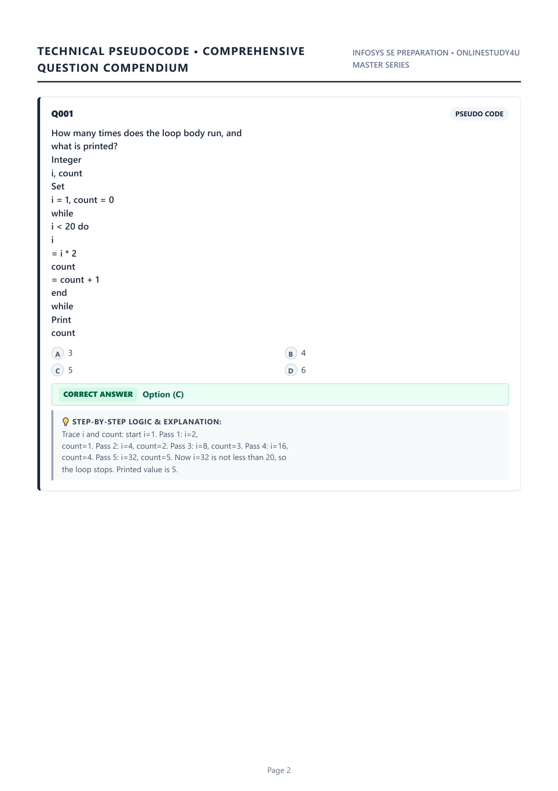 |

---

### Q002: Pseudo Code (Page 3)

**Source Ebook**: `OS4U_Book_4_Pseudocode_Technical.pdf` | **Book Page**: **Page 3**  
**Authentic Page Figure**: [`OS4U_Book_4_Pseudocode_Technical_page_003.png`](images/OS4U_Book_4_Pseudocode_Technical_page_003.png)

#### Problem Statement & Question Prompt
```text
What is the output of the following Pseudo
Code? Integer division is used.
Integer
a, b
Set
a = 17, b = 5
Print
(a / b) + (a % b)
```

#### Multiple Choice Options
- **(A)** `3`
- **(B)** `4`
- **(C)** `5`
- **(D)** `7`

#### Verified Correct Answer Key
> **Correct Option**: **(C) `5`**

#### Step-by-Step Logic & Comprehensive Solution
```text
Integer division: 17 / 5 = 3. Remainder: 17
% 5 = 2. Printed value = 3 + 2 = 5.
```

#### Authentic Ebook Page Figure
| Ebook Page Render (Page 3) |
| :---: |
| 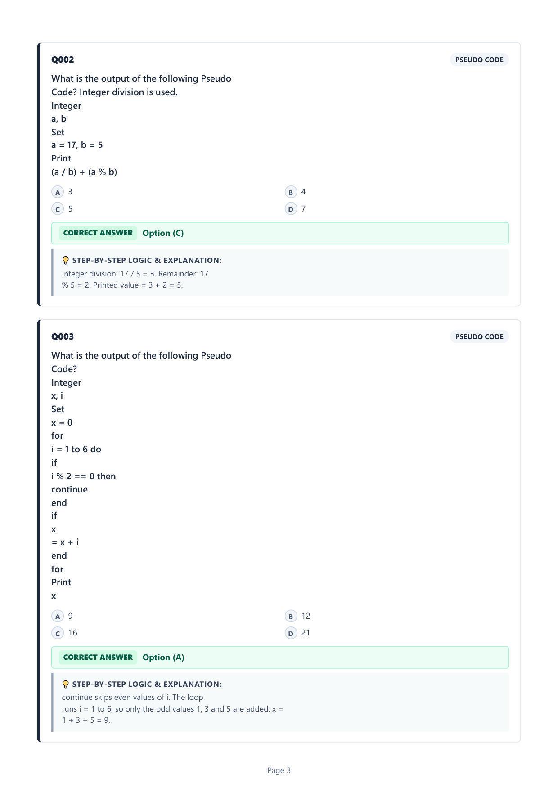 |

---

### Q003: Pseudo Code (Page 3)

**Source Ebook**: `OS4U_Book_4_Pseudocode_Technical.pdf` | **Book Page**: **Page 3**  
**Authentic Page Figure**: [`OS4U_Book_4_Pseudocode_Technical_page_003.png`](images/OS4U_Book_4_Pseudocode_Technical_page_003.png)

#### Problem Statement & Question Prompt
```text
What is the output of the following Pseudo
Code?
Integer
x, i
Set
x = 0
for
i = 1 to 6 do
if
i % 2 == 0 then
continue
end
if
x
= x + i
end
for
Print
x
```

#### Multiple Choice Options
- **(A)** `9`
- **(B)** `12`
- **(C)** `16`
- **(D)** `21`

#### Verified Correct Answer Key
> **Correct Option**: **(A) `9`**

#### Step-by-Step Logic & Comprehensive Solution
```text
continue skips even values of i. The loop
runs i = 1 to 6, so only the odd values 1, 3 and 5 are added. x =
1 + 3 + 5 = 9.
```

#### Authentic Ebook Page Figure
| Ebook Page Render (Page 3) |
| :---: |
|  |

---

### Q004: Pseudo Code (Page 4)

**Source Ebook**: `OS4U_Book_4_Pseudocode_Technical.pdf` | **Book Page**: **Page 4**  
**Authentic Page Figure**: [`OS4U_Book_4_Pseudocode_Technical_page_004.png`](images/OS4U_Book_4_Pseudocode_Technical_page_004.png)

#### Problem Statement & Question Prompt
```text
What value is printed by the following
Pseudo Code?
Function
Mystery(n)
if
n <= 1 then
return
1
end
if
return
n * Mystery(n - 1)
End
Function
Print
Mystery(5)
```

#### Multiple Choice Options
- **(A)** `15`
- **(B)** `24`
- **(C)** `120`
- **(D)** `125`

#### Verified Correct Answer Key
> **Correct Option**: **(C) `120`**

#### Step-by-Step Logic & Comprehensive Solution
```text
Mystery(n) computes n!. Mystery(5) = 5 ×
4 × 3 × 2 × 1 = 120.
```

#### Authentic Ebook Page Figure
| Ebook Page Render (Page 4) |
| :---: |
| 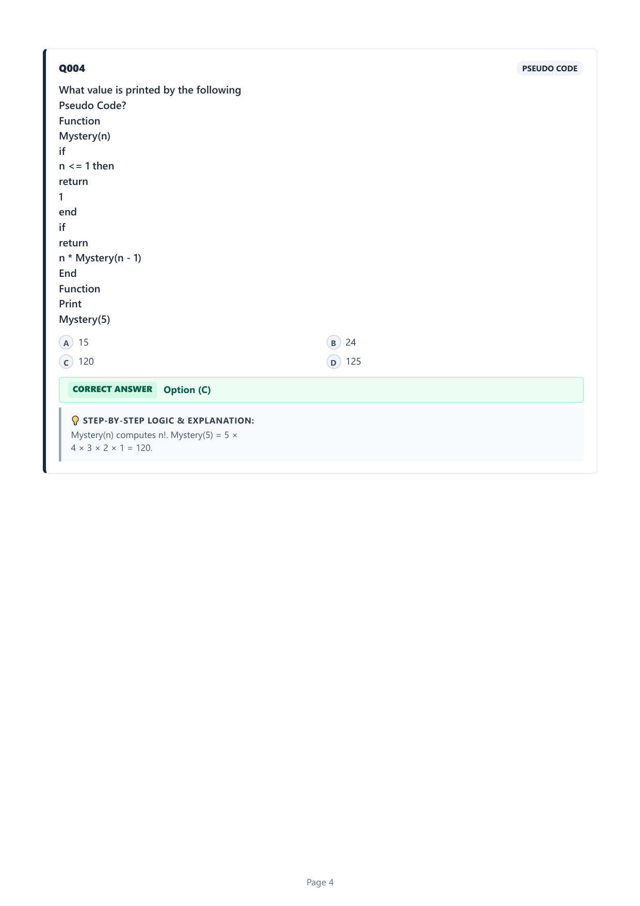 |

---

### Q005: Pseudo Code (Page 5)

**Source Ebook**: `OS4U_Book_4_Pseudocode_Technical.pdf` | **Book Page**: **Page 5**  
**Authentic Page Figure**: [`OS4U_Book_4_Pseudocode_Technical_page_005.png`](images/OS4U_Book_4_Pseudocode_Technical_page_005.png)

#### Problem Statement & Question Prompt
```text
What is printed after the following Pseudo
Code runs?
Integer
a, b
Set
a = 12, b = 8
a
= a + b
b
= a - b
a
= a - b
Print
a, b
```

#### Multiple Choice Options
- **(A)** `12 8`
- **(B)** `8 12`
- **(C)** `20 8`
- **(D)** `20 12`

#### Verified Correct Answer Key
> **Correct Option**: **(B) `8 12`**

#### Step-by-Step Logic & Comprehensive Solution
```text
This swaps the two values without a third
variable. a = 12+8 = 20, b = 20-8 = 12, a = 20-12 = 8. Output: 8
12.
```

#### Authentic Ebook Page Figure
| Ebook Page Render (Page 5) |
| :---: |
| 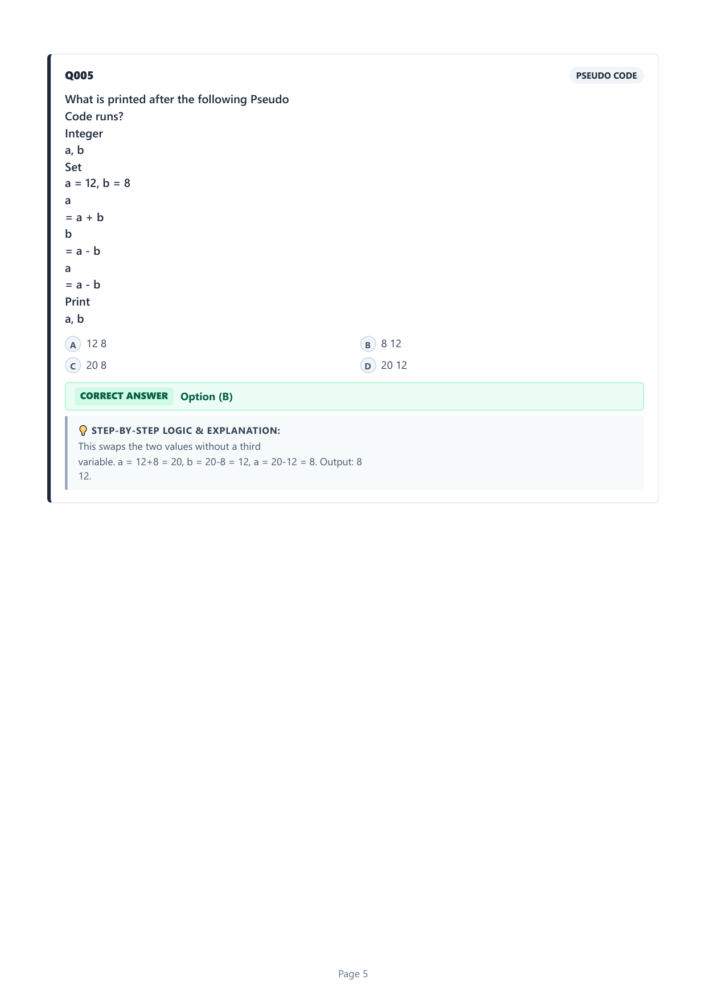 |

---

### Q006: Pseudo Code (Page 6)

**Source Ebook**: `OS4U_Book_4_Pseudocode_Technical.pdf` | **Book Page**: **Page 6**  
**Authentic Page Figure**: [`OS4U_Book_4_Pseudocode_Technical_page_006.png`](images/OS4U_Book_4_Pseudocode_Technical_page_006.png)

#### Problem Statement & Question Prompt
```text
What is printed by the following Pseudo
Code?
Integer
i, j, count
Set
count = 0
for
i = 1 to 4 do
for
j = 1 to i do
count
= count + 1
end
for
end
for
Print
count
```

#### Multiple Choice Options
- **(A)** `4`
- **(B)** `8`
- **(C)** `10`
- **(D)** `16`

#### Verified Correct Answer Key
> **Correct Option**: **(C) `10`**

#### Step-by-Step Logic & Comprehensive Solution
```text
The inner loop runs i times for each i from
1 to 4. Total iterations = 1+2+3+4 = 10. So count prints 10.
```

#### Authentic Ebook Page Figure
| Ebook Page Render (Page 6) |
| :---: |
| 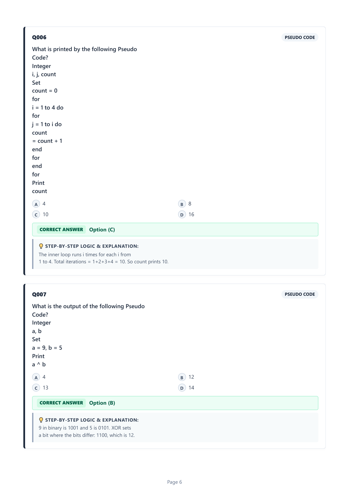 |

---

### Q007: Pseudo Code (Page 6)

**Source Ebook**: `OS4U_Book_4_Pseudocode_Technical.pdf` | **Book Page**: **Page 6**  
**Authentic Page Figure**: [`OS4U_Book_4_Pseudocode_Technical_page_006.png`](images/OS4U_Book_4_Pseudocode_Technical_page_006.png)

#### Problem Statement & Question Prompt
```text
What is the output of the following Pseudo
Code?
Integer
a, b
Set
a = 9, b = 5
Print
a ^ b
```

#### Multiple Choice Options
- **(A)** `4`
- **(B)** `12`
- **(C)** `13`
- **(D)** `14`

#### Verified Correct Answer Key
> **Correct Option**: **(B) `12`**

#### Step-by-Step Logic & Comprehensive Solution
```text
9 in binary is 1001 and 5 is 0101. XOR sets
a bit where the bits differ: 1100, which is 12.
```

#### Authentic Ebook Page Figure
| Ebook Page Render (Page 6) |
| :---: |
|  |

---

### Q008: Pseudo Code (Page 7)

**Source Ebook**: `OS4U_Book_4_Pseudocode_Technical.pdf` | **Book Page**: **Page 7**  
**Authentic Page Figure**: [`OS4U_Book_4_Pseudocode_Technical_page_007.png`](images/OS4U_Book_4_Pseudocode_Technical_page_007.png)

#### Problem Statement & Question Prompt
```text
What value is printed by the following
Pseudo Code?
Function
F(n)
if
n == 0 then return 0
if
n == 1 then return 1
return
F(n - 1) + F(n - 2)
End
Function
Print
F(6)
```

#### Multiple Choice Options
- **(A)** `5`
- **(B)** `8`
- **(C)** `13`
- **(D)** `21`

#### Verified Correct Answer Key
> **Correct Option**: **(B) `8`**

#### Step-by-Step Logic & Comprehensive Solution
```text
F is the Fibonacci sequence: F(0)=0, F(1)=1,
F(2)=1, F(3)=2, F(4)=3, F(5)=5, F(6)=8. So the printed value is 8.
```

#### Authentic Ebook Page Figure
| Ebook Page Render (Page 7) |
| :---: |
| 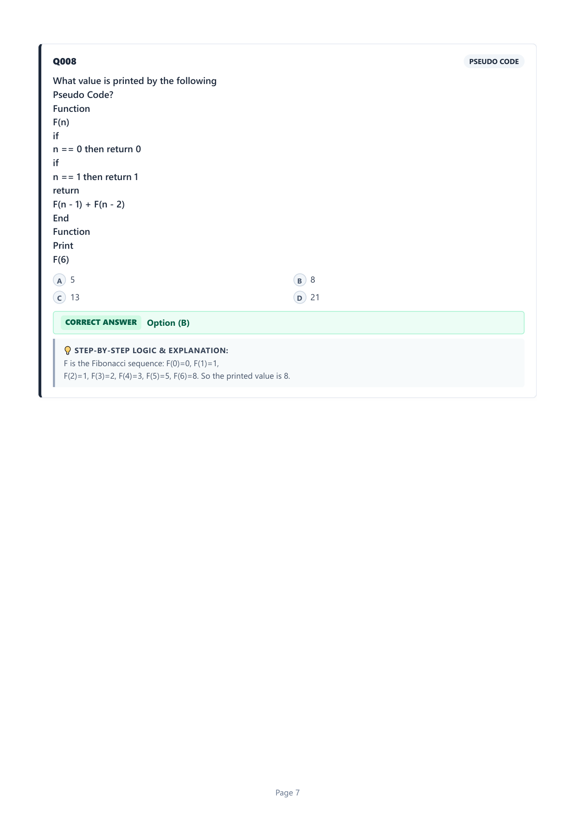 |

---

### Q009: Pseudo Code (Page 8)

**Source Ebook**: `OS4U_Book_4_Pseudocode_Technical.pdf` | **Book Page**: **Page 8**  
**Authentic Page Figure**: [`OS4U_Book_4_Pseudocode_Technical_page_008.png`](images/OS4U_Book_4_Pseudocode_Technical_page_008.png)

#### Problem Statement & Question Prompt
```text
A queue follows FIFO. What is printed by the
following Pseudo Code?
Queue
Q
enqueue(Q,
2)
enqueue(Q,
4)
enqueue(Q,
6)
dequeue(Q)
enqueue(Q,
8)
Print
front(Q)
```

#### Multiple Choice Options
- **(A)** `2`
- **(B)** `4`
- **(C)** `6`
- **(D)** `8`

#### Verified Correct Answer Key
> **Correct Option**: **(B) `4`**

#### Step-by-Step Logic & Comprehensive Solution
```text
After three enqueues the queue is [2, 4, 6]
with 2 at the front. dequeue removes 2. enqueue 8 makes [4, 6, 8].
front returns 4.
```

#### Authentic Ebook Page Figure
| Ebook Page Render (Page 8) |
| :---: |
| 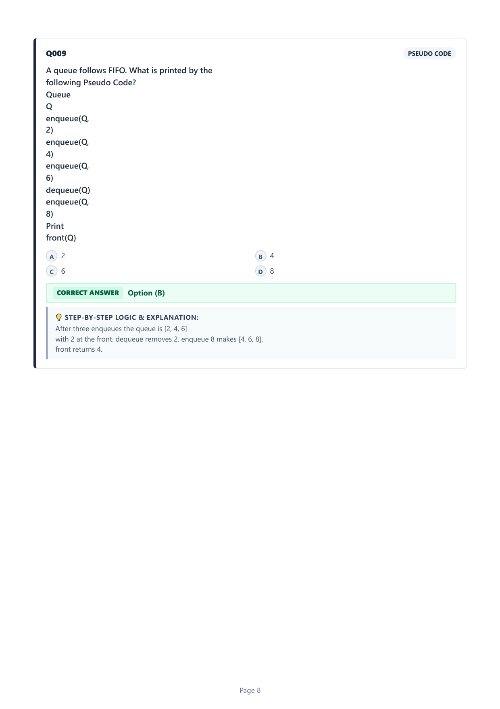 |

---

### Q010: Pseudo Code (Page 9)

**Source Ebook**: `OS4U_Book_4_Pseudocode_Technical.pdf` | **Book Page**: **Page 9**  
**Authentic Page Figure**: [`OS4U_Book_4_Pseudocode_Technical_page_009.png`](images/OS4U_Book_4_Pseudocode_Technical_page_009.png)

#### Problem Statement & Question Prompt
```text
A stack follows LIFO. What is printed by the
following Pseudo Code?
Stack
S
push(S,
5)
push(S,
8)
push(S,
3)
pop(S)
push(S,
7)
Print
peek(S)
```

#### Multiple Choice Options
- **(A)** `3`
- **(B)** `5`
- **(C)** `7`
- **(D)** `8`

#### Verified Correct Answer Key
> **Correct Option**: **(C) `7`**

#### Step-by-Step Logic & Comprehensive Solution
```text
Stack after the three pushes: [5, 8, 3] with
3 on top. pop removes 3. push 7 makes the stack [5, 8, 7]. peek
returns the top element, which is 7.
```

#### Authentic Ebook Page Figure
| Ebook Page Render (Page 9) |
| :---: |
| 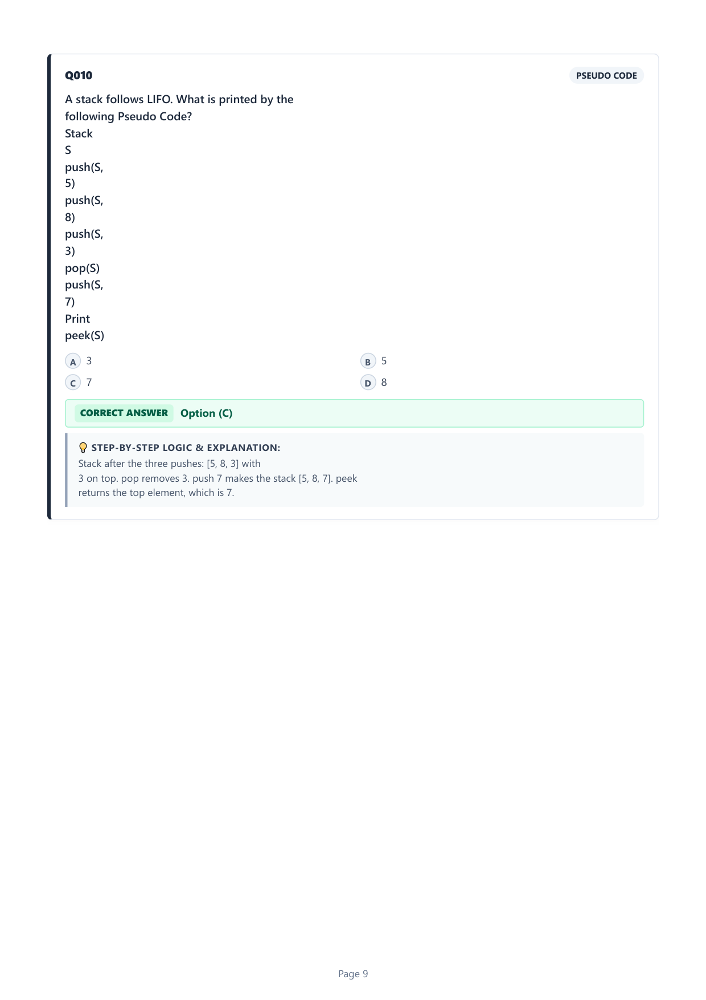 |

---

### Q011: Pseudo Code (Page 10)

**Source Ebook**: `OS4U_Book_4_Pseudocode_Technical.pdf` | **Book Page**: **Page 10**  
**Authentic Page Figure**: [`OS4U_Book_4_Pseudocode_Technical_page_010.png`](images/OS4U_Book_4_Pseudocode_Technical_page_010.png)

#### Problem Statement & Question Prompt
```text
What is printed?
Integer
n, d
Set
n = 48, d = 0
while
n > 1 do
n
= n / 2
d
= d + 1
end
while
Print
d
```

#### Multiple Choice Options
- **(A)** `3`
- **(B)** `4`
- **(C)** `5`
- **(D)** `6`

#### Verified Correct Answer Key
> **Correct Option**: **(C) `5`**

#### Step-by-Step Logic & Comprehensive Solution
```text
48→24→12→6→3→1.
That is five divisions. d = 5. (Integer division: 3/2=1.)
```

#### Authentic Ebook Page Figure
| Ebook Page Render (Page 10) |
| :---: |
| 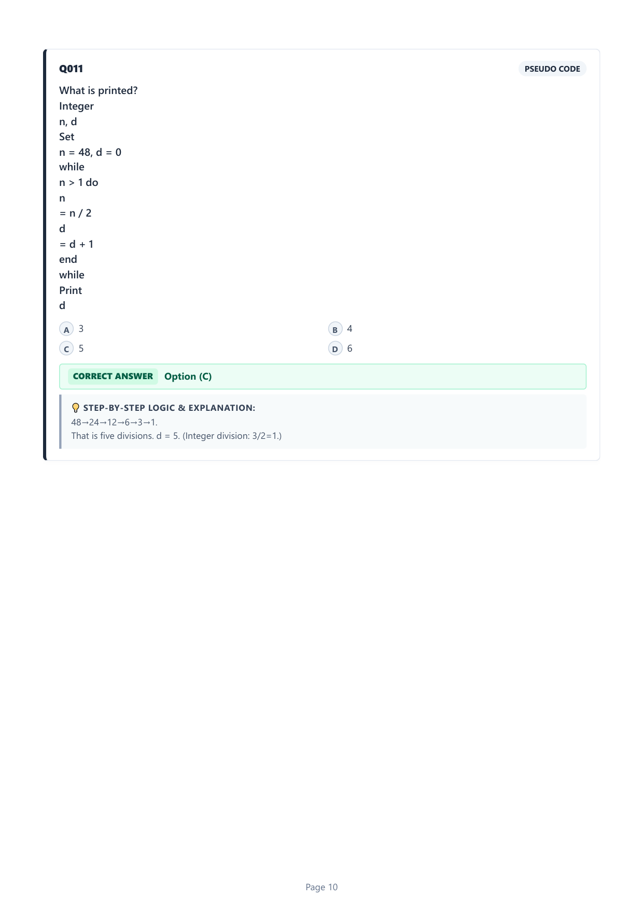 |

---

### Q012: Pseudo Code (Page 11)

**Source Ebook**: `OS4U_Book_4_Pseudocode_Technical.pdf` | **Book Page**: **Page 11**  
**Authentic Page Figure**: [`OS4U_Book_4_Pseudocode_Technical_page_011.png`](images/OS4U_Book_4_Pseudocode_Technical_page_011.png)

#### Problem Statement & Question Prompt
```text
What is printed?
Integer
A[5] = {2, 4, 6, 8, 10}
Integer
i, s
Set
s = 0
for
i = 0 to 4 do
if
A[i] % 4 == 0 then s = s + A[i]
end
for
Print
s
```

#### Multiple Choice Options
- **(A)** `12`
- **(B)** `18`
- **(C)** `24`
- **(D)** `30`

#### Verified Correct Answer Key
> **Correct Option**: **(A) `12`**

#### Step-by-Step Logic & Comprehensive Solution
```text
Values divisible by 4 are 4 and 8. s = 4 + 8
= 12.
```

#### Authentic Ebook Page Figure
| Ebook Page Render (Page 11) |
| :---: |
| 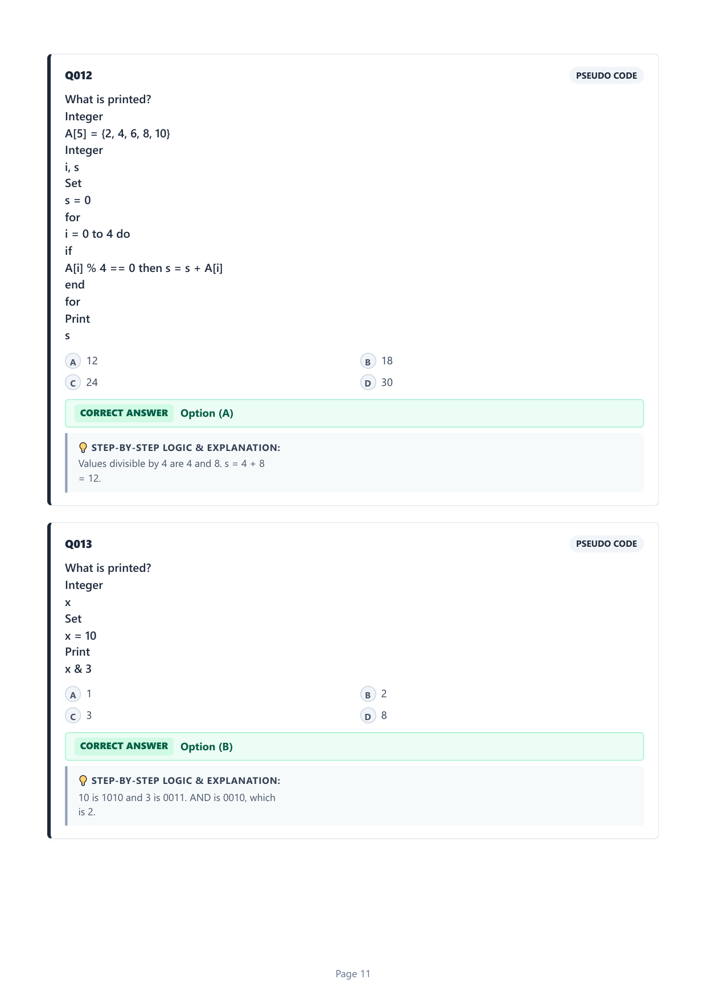 |

---

### Q013: Pseudo Code (Page 11)

**Source Ebook**: `OS4U_Book_4_Pseudocode_Technical.pdf` | **Book Page**: **Page 11**  
**Authentic Page Figure**: [`OS4U_Book_4_Pseudocode_Technical_page_011.png`](images/OS4U_Book_4_Pseudocode_Technical_page_011.png)

#### Problem Statement & Question Prompt
```text
What is printed?
Integer
x
Set
x = 10
Print
x & 3
```

#### Multiple Choice Options
- **(A)** `1`
- **(B)** `2`
- **(C)** `3`
- **(D)** `8`

#### Verified Correct Answer Key
> **Correct Option**: **(B) `2`**

#### Step-by-Step Logic & Comprehensive Solution
```text
10 is 1010 and 3 is 0011. AND is 0010, which
is 2.
```

#### Authentic Ebook Page Figure
| Ebook Page Render (Page 11) |
| :---: |
|  |

---

### Q014: Pseudo Code (Page 12)

**Source Ebook**: `OS4U_Book_4_Pseudocode_Technical.pdf` | **Book Page**: **Page 12**  
**Authentic Page Figure**: [`OS4U_Book_4_Pseudocode_Technical_page_012.png`](images/OS4U_Book_4_Pseudocode_Technical_page_012.png)

#### Problem Statement & Question Prompt
```text
What is printed?
Stack
S
push(S,
1)
push(S,
4)
push(S,
9)
pop(S)
pop(S)
Print
peek(S)
```

#### Multiple Choice Options
- **(A)** `1`
- **(B)** `4`
- **(C)** `9`
- **(D)** `Empty`

#### Verified Correct Answer Key
> **Correct Option**: **(A) `1`**

#### Step-by-Step Logic & Comprehensive Solution
```text
After three pushes the top is 9. Two pops
remove 9 then 4. peek returns 1.
```

#### Authentic Ebook Page Figure
| Ebook Page Render (Page 12) |
| :---: |
| 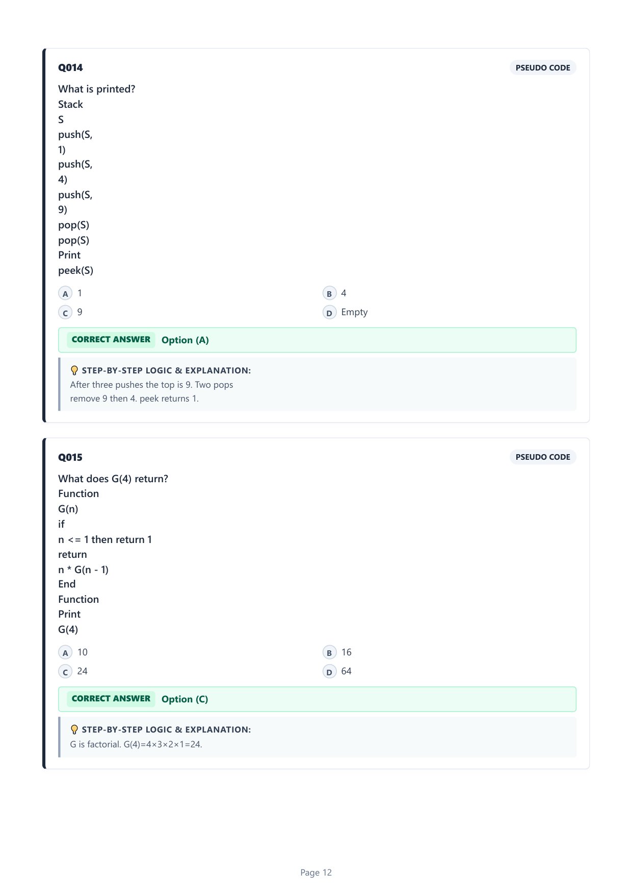 |

---

### Q015: Pseudo Code (Page 12)

**Source Ebook**: `OS4U_Book_4_Pseudocode_Technical.pdf` | **Book Page**: **Page 12**  
**Authentic Page Figure**: [`OS4U_Book_4_Pseudocode_Technical_page_012.png`](images/OS4U_Book_4_Pseudocode_Technical_page_012.png)

#### Problem Statement & Question Prompt
```text
What does G(4) return?
Function
G(n)
if
n <= 1 then return 1
return
n * G(n - 1)
End
Function
Print
G(4)
```

#### Multiple Choice Options
- **(A)** `10`
- **(B)** `16`
- **(C)** `24`
- **(D)** `64`

#### Verified Correct Answer Key
> **Correct Option**: **(C) `24`**

#### Step-by-Step Logic & Comprehensive Solution
```text
G is factorial. G(4)=4×3×2×1=24.
```

#### Authentic Ebook Page Figure
| Ebook Page Render (Page 12) |
| :---: |
|  |

---

### Q016: Pseudo Code (Page 13)

**Source Ebook**: `OS4U_Book_4_Pseudocode_Technical.pdf` | **Book Page**: **Page 13**  
**Authentic Page Figure**: [`OS4U_Book_4_Pseudocode_Technical_page_013.png`](images/OS4U_Book_4_Pseudocode_Technical_page_013.png)

#### Problem Statement & Question Prompt
```text
[Bitwise]
What is printed?
Integer
a
Set
a = 6
Print
a | 3
```

#### Multiple Choice Options
- **(A)** `7`
- **(B)** `5`
- **(C)** `2`
- **(D)** `18`

#### Verified Correct Answer Key
> **Correct Option**: **(A) `7`**

#### Step-by-Step Logic & Comprehensive Solution
```text
6
is 0110, 3 is 0011, OR is 0111 = 7.
```

#### Authentic Ebook Page Figure
| Ebook Page Render (Page 13) |
| :---: |
| 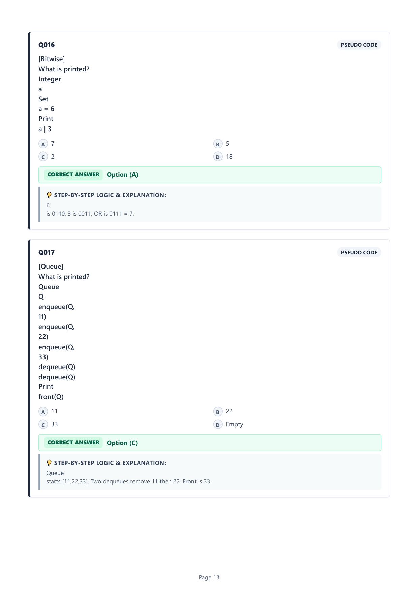 |

---

### Q017: Pseudo Code (Page 13)

**Source Ebook**: `OS4U_Book_4_Pseudocode_Technical.pdf` | **Book Page**: **Page 13**  
**Authentic Page Figure**: [`OS4U_Book_4_Pseudocode_Technical_page_013.png`](images/OS4U_Book_4_Pseudocode_Technical_page_013.png)

#### Problem Statement & Question Prompt
```text
[Queue]
What is printed?
Queue
Q
enqueue(Q,
11)
enqueue(Q,
22)
enqueue(Q,
33)
dequeue(Q)
dequeue(Q)
Print
front(Q)
```

#### Multiple Choice Options
- **(A)** `11`
- **(B)** `22`
- **(C)** `33`
- **(D)** `Empty`

#### Verified Correct Answer Key
> **Correct Option**: **(C) `33`**

#### Step-by-Step Logic & Comprehensive Solution
```text
Queue
starts [11,22,33]. Two dequeues remove 11 then 22. Front is 33.
```

#### Authentic Ebook Page Figure
| Ebook Page Render (Page 13) |
| :---: |
|  |

---

### Q018: Pseudo Code (Page 14)

**Source Ebook**: `OS4U_Book_4_Pseudocode_Technical.pdf` | **Book Page**: **Page 14**  
**Authentic Page Figure**: [`OS4U_Book_4_Pseudocode_Technical_page_014.png`](images/OS4U_Book_4_Pseudocode_Technical_page_014.png)

#### Problem Statement & Question Prompt
```text
[Loops]
What is printed?
Integer
i, s
Set
s = 0
for
i = 1 to 10 do
if
i % 2 == 1 then s = s + i
end
for
Print
s
```

#### Multiple Choice Options
- **(A)** `25`
- **(B)** `30`
- **(C)** `45`
- **(D)** `55`

#### Verified Correct Answer Key
> **Correct Option**: **(A) `25`**

#### Step-by-Step Logic & Comprehensive Solution
```text
The
loop adds the odd values 1+3+5+7+9 = 25.
```

#### Authentic Ebook Page Figure
| Ebook Page Render (Page 14) |
| :---: |
| 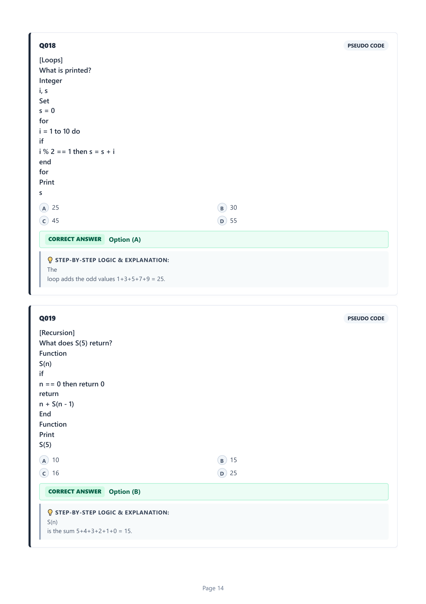 |

---

### Q019: Pseudo Code (Page 14)

**Source Ebook**: `OS4U_Book_4_Pseudocode_Technical.pdf` | **Book Page**: **Page 14**  
**Authentic Page Figure**: [`OS4U_Book_4_Pseudocode_Technical_page_014.png`](images/OS4U_Book_4_Pseudocode_Technical_page_014.png)

#### Problem Statement & Question Prompt
```text
[Recursion]
What does S(5) return?
Function
S(n)
if
n == 0 then return 0
return
n + S(n - 1)
End
Function
Print
S(5)
```

#### Multiple Choice Options
- **(A)** `10`
- **(B)** `15`
- **(C)** `16`
- **(D)** `25`

#### Verified Correct Answer Key
> **Correct Option**: **(B) `15`**

#### Step-by-Step Logic & Comprehensive Solution
```text
S(n)
is the sum 5+4+3+2+1+0 = 15.
```

#### Authentic Ebook Page Figure
| Ebook Page Render (Page 14) |
| :---: |
|  |

---

### Q020: Pseudo Code (Page 15)

**Source Ebook**: `OS4U_Book_4_Pseudocode_Technical.pdf` | **Book Page**: **Page 15**  
**Authentic Page Figure**: [`OS4U_Book_4_Pseudocode_Technical_page_015.png`](images/OS4U_Book_4_Pseudocode_Technical_page_015.png)

#### Problem Statement & Question Prompt
```text
[Arrays]
What is printed?
Integer
A[4] = {3, 5, 7, 9}
Integer
i, p
Set
p = 1
for
i = 0 to 3 do
p
= p * A[i]
end
for
Print
p
```

#### Multiple Choice Options
- **(A)** `24`
- **(B)** `315`
- **(C)** `945`
- **(D)** `105`

#### Verified Correct Answer Key
> **Correct Option**: **(C) `945`**

#### Step-by-Step Logic & Comprehensive Solution
```text
Product
3×5×7×9 = 945.
```

#### Authentic Ebook Page Figure
| Ebook Page Render (Page 15) |
| :---: |
| 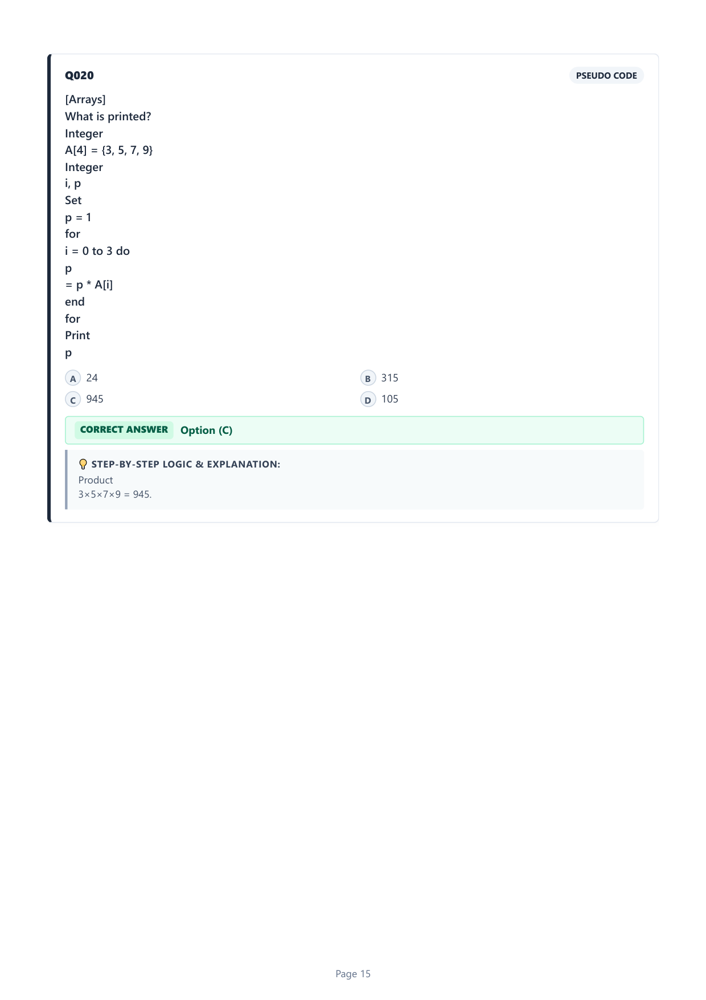 |

---

### Q021: Pseudo Code (Page 16)

**Source Ebook**: `OS4U_Book_4_Pseudocode_Technical.pdf` | **Book Page**: **Page 16**  
**Authentic Page Figure**: [`OS4U_Book_4_Pseudocode_Technical_page_016.png`](images/OS4U_Book_4_Pseudocode_Technical_page_016.png)

#### Problem Statement & Question Prompt
```text
[Loops]
What is printed?
Integer
i, p
Set
p = 1
for
i = 1 to 4 do
p
= p * i
end
for
Print
p
```

#### Multiple Choice Options
- **(A)** `10`
- **(B)** `16`
- **(C)** `24`
- **(D)** `120`

#### Verified Correct Answer Key
> **Correct Option**: **(C) `24`**

#### Step-by-Step Logic & Comprehensive Solution
```text
p
multiplies 1×2×3×4 = 24.
```

#### Authentic Ebook Page Figure
| Ebook Page Render (Page 16) |
| :---: |
| 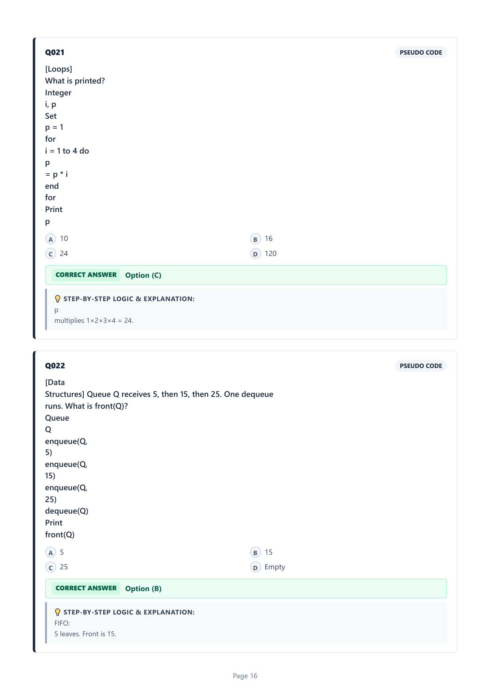 |

---

### Q022: Pseudo Code (Page 16)

**Source Ebook**: `OS4U_Book_4_Pseudocode_Technical.pdf` | **Book Page**: **Page 16**  
**Authentic Page Figure**: [`OS4U_Book_4_Pseudocode_Technical_page_016.png`](images/OS4U_Book_4_Pseudocode_Technical_page_016.png)

#### Problem Statement & Question Prompt
```text
[Data
Structures] Queue Q receives 5, then 15, then 25. One dequeue
runs. What is front(Q)?
Queue
Q
enqueue(Q,
5)
enqueue(Q,
15)
enqueue(Q,
25)
dequeue(Q)
Print
front(Q)
```

#### Multiple Choice Options
- **(A)** `5`
- **(B)** `15`
- **(C)** `25`
- **(D)** `Empty`

#### Verified Correct Answer Key
> **Correct Option**: **(B) `15`**

#### Step-by-Step Logic & Comprehensive Solution
```text
FIFO:
5 leaves. Front is 15.
```

#### Authentic Ebook Page Figure
| Ebook Page Render (Page 16) |
| :---: |
|  |

---

### Q023: Pseudo Code (Page 17)

**Source Ebook**: `OS4U_Book_4_Pseudocode_Technical.pdf` | **Book Page**: **Page 17**  
**Authentic Page Figure**: [`OS4U_Book_4_Pseudocode_Technical_page_017.png`](images/OS4U_Book_4_Pseudocode_Technical_page_017.png)

#### Problem Statement & Question Prompt
```text
[Data
Structures] After the operations, what does peek return?
Stack
S
push(S,
10)
push(S,
20)
push(S,
30)
pop(S)
push(S,
40)
Print
peek(S)
```

#### Multiple Choice Options
- **(A)** `10`
- **(B)** `20`
- **(C)** `40`
- **(D)** `30`

#### Verified Correct Answer Key
> **Correct Option**: **(C) `40`**

#### Step-by-Step Logic & Comprehensive Solution
```text
Stack
after pops/pushes: [10, 20, 40]. peek = 40.
```

#### Authentic Ebook Page Figure
| Ebook Page Render (Page 17) |
| :---: |
| 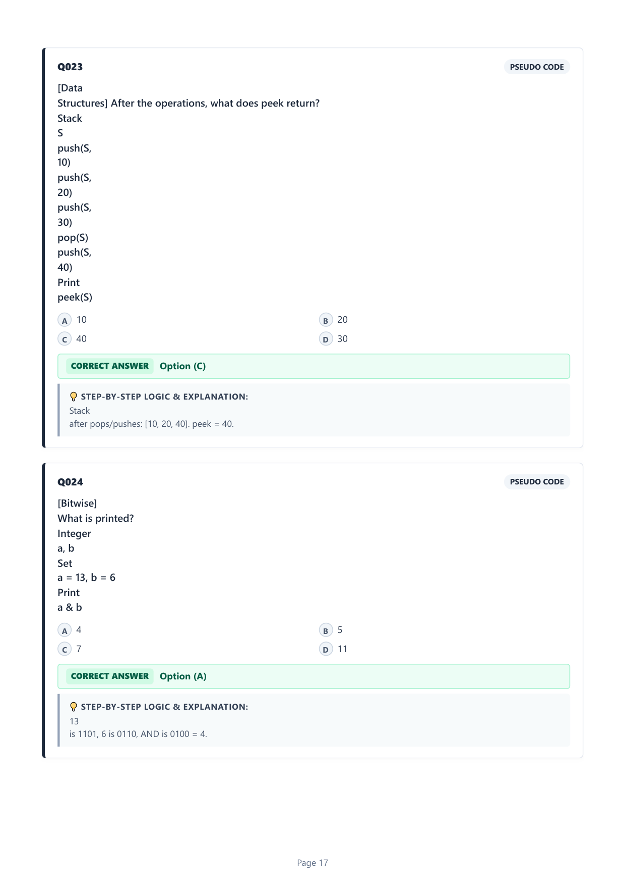 |

---

### Q024: Pseudo Code (Page 17)

**Source Ebook**: `OS4U_Book_4_Pseudocode_Technical.pdf` | **Book Page**: **Page 17**  
**Authentic Page Figure**: [`OS4U_Book_4_Pseudocode_Technical_page_017.png`](images/OS4U_Book_4_Pseudocode_Technical_page_017.png)

#### Problem Statement & Question Prompt
```text
[Bitwise]
What is printed?
Integer
a, b
Set
a = 13, b = 6
Print
a & b
```

#### Multiple Choice Options
- **(A)** `4`
- **(B)** `5`
- **(C)** `7`
- **(D)** `11`

#### Verified Correct Answer Key
> **Correct Option**: **(A) `4`**

#### Step-by-Step Logic & Comprehensive Solution
```text
13
is 1101, 6 is 0110, AND is 0100 = 4.
```

#### Authentic Ebook Page Figure
| Ebook Page Render (Page 17) |
| :---: |
|  |

---

### Q025: Pseudo Code (Page 18)

**Source Ebook**: `OS4U_Book_4_Pseudocode_Technical.pdf` | **Book Page**: **Page 18**  
**Authentic Page Figure**: [`OS4U_Book_4_Pseudocode_Technical_page_018.png`](images/OS4U_Book_4_Pseudocode_Technical_page_018.png)

#### Problem Statement & Question Prompt
```text
[Recursion]
What does P(4) return?
Function
P(n)
if
n == 1 then return 2
return
P(n - 1) * 2
End
Function
Print
P(4)
```

#### Multiple Choice Options
- **(A)** `8`
- **(B)** `12`
- **(C)** `16`
- **(D)** `24`

#### Verified Correct Answer Key
> **Correct Option**: **(C) `16`**

#### Step-by-Step Logic & Comprehensive Solution
```text
P(1)=2,
P(2)=4, P(3)=8, P(4)=16.
```

#### Authentic Ebook Page Figure
| Ebook Page Render (Page 18) |
| :---: |
| 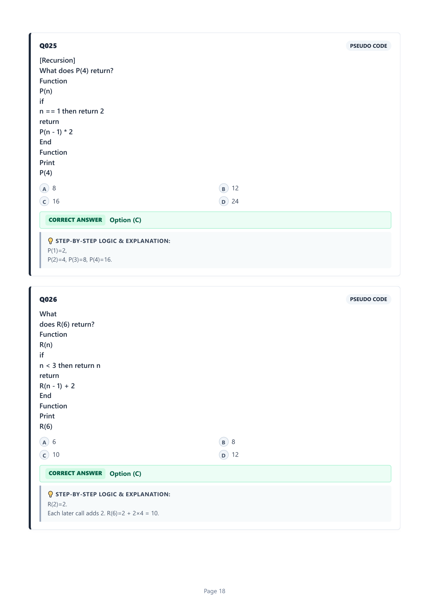 |

---

### Q026: Pseudo Code (Page 18)

**Source Ebook**: `OS4U_Book_4_Pseudocode_Technical.pdf` | **Book Page**: **Page 18**  
**Authentic Page Figure**: [`OS4U_Book_4_Pseudocode_Technical_page_018.png`](images/OS4U_Book_4_Pseudocode_Technical_page_018.png)

#### Problem Statement & Question Prompt
```text
What
does R(6) return?
Function
R(n)
if
n < 3 then return n
return
R(n - 1) + 2
End
Function
Print
R(6)
```

#### Multiple Choice Options
- **(A)** `6`
- **(B)** `8`
- **(C)** `10`
- **(D)** `12`

#### Verified Correct Answer Key
> **Correct Option**: **(C) `10`**

#### Step-by-Step Logic & Comprehensive Solution
```text
R(2)=2.
Each later call adds 2. R(6)=2 + 2×4 = 10.
```

#### Authentic Ebook Page Figure
| Ebook Page Render (Page 18) |
| :---: |
|  |

---

### Q027: Pseudo Code (Page 19)

**Source Ebook**: `OS4U_Book_4_Pseudocode_Technical.pdf` | **Book Page**: **Page 19**  
**Authentic Page Figure**: [`OS4U_Book_4_Pseudocode_Technical_page_019.png`](images/OS4U_Book_4_Pseudocode_Technical_page_019.png)

#### Problem Statement & Question Prompt
```text
What
is printed?
Stack
S
push(S,
3)
push(S,
6)
push(S,
9)
pop(S)
push(S,
12)
Print
peek(S)
```

#### Multiple Choice Options
- **(A)** `3`
- **(B)** `6`
- **(C)** `12`
- **(D)** `9`

#### Verified Correct Answer Key
> **Correct Option**: **(C) `12`**

#### Step-by-Step Logic & Comprehensive Solution
```text
After
pop, 9 is gone. 12 is pushed. peek returns 12.
```

#### Authentic Ebook Page Figure
| Ebook Page Render (Page 19) |
| :---: |
| 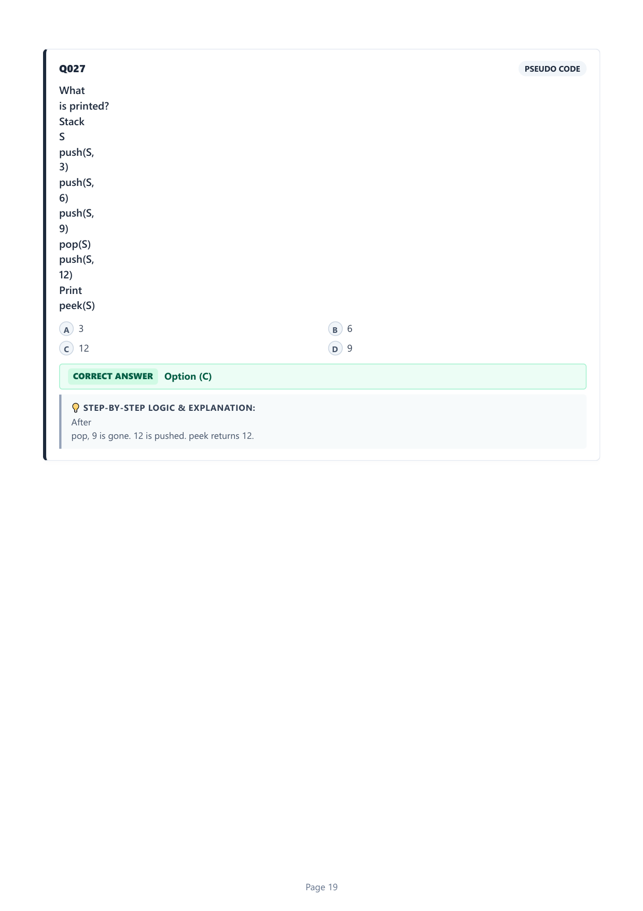 |

---

### Q028: Pseudo Code (Page 20)

**Source Ebook**: `OS4U_Book_4_Pseudocode_Technical.pdf` | **Book Page**: **Page 20**  
**Authentic Page Figure**: [`OS4U_Book_4_Pseudocode_Technical_page_020.png`](images/OS4U_Book_4_Pseudocode_Technical_page_020.png)

#### Problem Statement & Question Prompt
```text
What
is printed?
Integer
i, c
Set
c = 0
for
i = 1 to 8 do
if
i % 2 == 0 then c = c + i
end
for
Print
c
```

#### Multiple Choice Options
- **(A)** `16`
- **(B)** `18`
- **(C)** `20`
- **(D)** `36`

#### Verified Correct Answer Key
> **Correct Option**: **(C) `20`**

#### Step-by-Step Logic & Comprehensive Solution
```text
Even
values 2+4+6+8 = 20.
```

#### Authentic Ebook Page Figure
| Ebook Page Render (Page 20) |
| :---: |
| 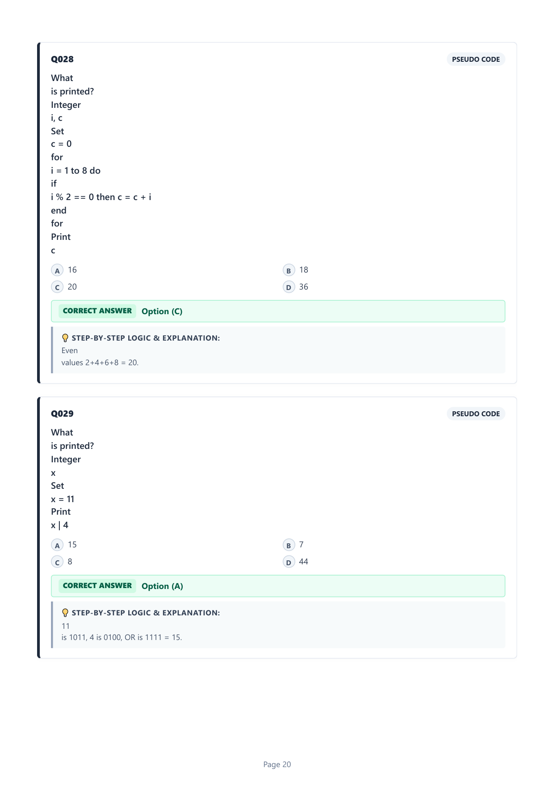 |

---

### Q029: Pseudo Code (Page 20)

**Source Ebook**: `OS4U_Book_4_Pseudocode_Technical.pdf` | **Book Page**: **Page 20**  
**Authentic Page Figure**: [`OS4U_Book_4_Pseudocode_Technical_page_020.png`](images/OS4U_Book_4_Pseudocode_Technical_page_020.png)

#### Problem Statement & Question Prompt
```text
What
is printed?
Integer
x
Set
x = 11
Print
x | 4
```

#### Multiple Choice Options
- **(A)** `15`
- **(B)** `7`
- **(C)** `8`
- **(D)** `44`

#### Verified Correct Answer Key
> **Correct Option**: **(A) `15`**

#### Step-by-Step Logic & Comprehensive Solution
```text
11
is 1011, 4 is 0100, OR is 1111 = 15.
```

#### Authentic Ebook Page Figure
| Ebook Page Render (Page 20) |
| :---: |
|  |

---

### Q030: Pseudo Code (Page 21)

**Source Ebook**: `OS4U_Book_4_Pseudocode_Technical.pdf` | **Book Page**: **Page 21**  
**Authentic Page Figure**: [`OS4U_Book_4_Pseudocode_Technical_page_021.png`](images/OS4U_Book_4_Pseudocode_Technical_page_021.png)

#### Problem Statement & Question Prompt
```text
What
is printed?
Queue
Q
enqueue(Q,
7)
enqueue(Q,
14)
enqueue(Q,
21)
dequeue(Q)
enqueue(Q,
28)
Print
front(Q)
```

#### Multiple Choice Options
- **(A)** `7`
- **(B)** `14`
- **(C)** `21`
- **(D)** `28`

#### Verified Correct Answer Key
> **Correct Option**: **(B) `14`**

#### Step-by-Step Logic & Comprehensive Solution
```text
7
is removed first. The new front is 14.
```

#### Authentic Ebook Page Figure
| Ebook Page Render (Page 21) |
| :---: |
| 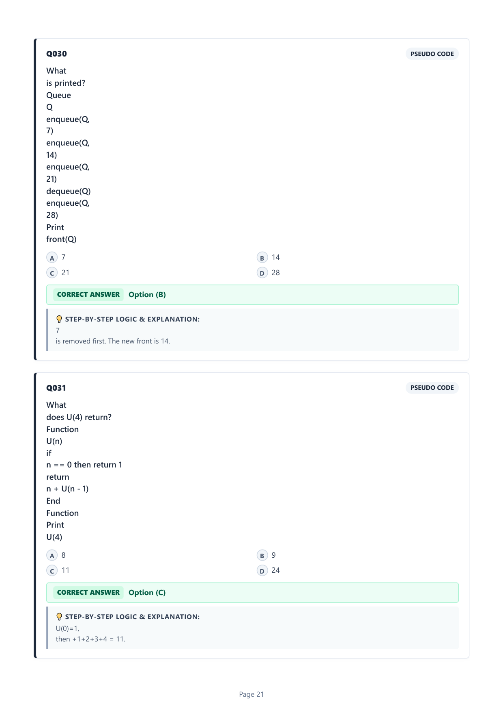 |

---

### Q031: Pseudo Code (Page 21)

**Source Ebook**: `OS4U_Book_4_Pseudocode_Technical.pdf` | **Book Page**: **Page 21**  
**Authentic Page Figure**: [`OS4U_Book_4_Pseudocode_Technical_page_021.png`](images/OS4U_Book_4_Pseudocode_Technical_page_021.png)

#### Problem Statement & Question Prompt
```text
What
does U(4) return?
Function
U(n)
if
n == 0 then return 1
return
n + U(n - 1)
End
Function
Print
U(4)
```

#### Multiple Choice Options
- **(A)** `8`
- **(B)** `9`
- **(C)** `11`
- **(D)** `24`

#### Verified Correct Answer Key
> **Correct Option**: **(C) `11`**

#### Step-by-Step Logic & Comprehensive Solution
```text
U(0)=1,
then +1+2+3+4 = 11.
```

#### Authentic Ebook Page Figure
| Ebook Page Render (Page 21) |
| :---: |
|  |

---

### Q032: Pseudo Code (Page 22)

**Source Ebook**: `OS4U_Book_4_Pseudocode_Technical.pdf` | **Book Page**: **Page 22**  
**Authentic Page Figure**: [`OS4U_Book_4_Pseudocode_Technical_page_022.png`](images/OS4U_Book_4_Pseudocode_Technical_page_022.png)

#### Problem Statement & Question Prompt
```text
What
is printed?
Integer
z
Set
z = 14
Print
z & 7
```

#### Multiple Choice Options
- **(A)** `6`
- **(B)** `7`
- **(C)** `8`
- **(D)** `21`

#### Verified Correct Answer Key
> **Correct Option**: **(A) `6`**

#### Step-by-Step Logic & Comprehensive Solution
```text
14
is 1110, 7 is 0111, AND is 0110 = 6.
```

#### Authentic Ebook Page Figure
| Ebook Page Render (Page 22) |
| :---: |
| 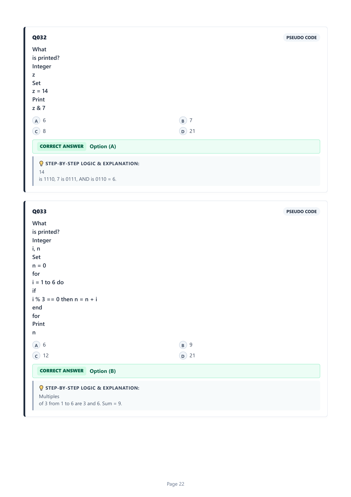 |

---

### Q033: Pseudo Code (Page 22)

**Source Ebook**: `OS4U_Book_4_Pseudocode_Technical.pdf` | **Book Page**: **Page 22**  
**Authentic Page Figure**: [`OS4U_Book_4_Pseudocode_Technical_page_022.png`](images/OS4U_Book_4_Pseudocode_Technical_page_022.png)

#### Problem Statement & Question Prompt
```text
What
is printed?
Integer
i, n
Set
n = 0
for
i = 1 to 6 do
if
i % 3 == 0 then n = n + i
end
for
Print
n
```

#### Multiple Choice Options
- **(A)** `6`
- **(B)** `9`
- **(C)** `12`
- **(D)** `21`

#### Verified Correct Answer Key
> **Correct Option**: **(B) `9`**

#### Step-by-Step Logic & Comprehensive Solution
```text
Multiples
of 3 from 1 to 6 are 3 and 6. Sum = 9.
```

#### Authentic Ebook Page Figure
| Ebook Page Render (Page 22) |
| :---: |
|  |

---

### Q034: Pseudo Code (Page 23)

**Source Ebook**: `OS4U_Book_4_Pseudocode_Technical.pdf` | **Book Page**: **Page 23**  
**Authentic Page Figure**: [`OS4U_Book_4_Pseudocode_Technical_page_023.png`](images/OS4U_Book_4_Pseudocode_Technical_page_023.png)

#### Problem Statement & Question Prompt
```text
What
is printed?
Queue
Q
enqueue(Q,
4)
enqueue(Q,
8)
enqueue(Q,
12)
dequeue(Q)
Print
front(Q)
```

#### Multiple Choice Options
- **(A)** `4`
- **(B)** `8`
- **(C)** `12`
- **(D)** `Empty`

#### Verified Correct Answer Key
> **Correct Option**: **(B) `8`**

#### Step-by-Step Logic & Comprehensive Solution
```text
4
leaves first. Front is 8.
```

#### Authentic Ebook Page Figure
| Ebook Page Render (Page 23) |
| :---: |
| 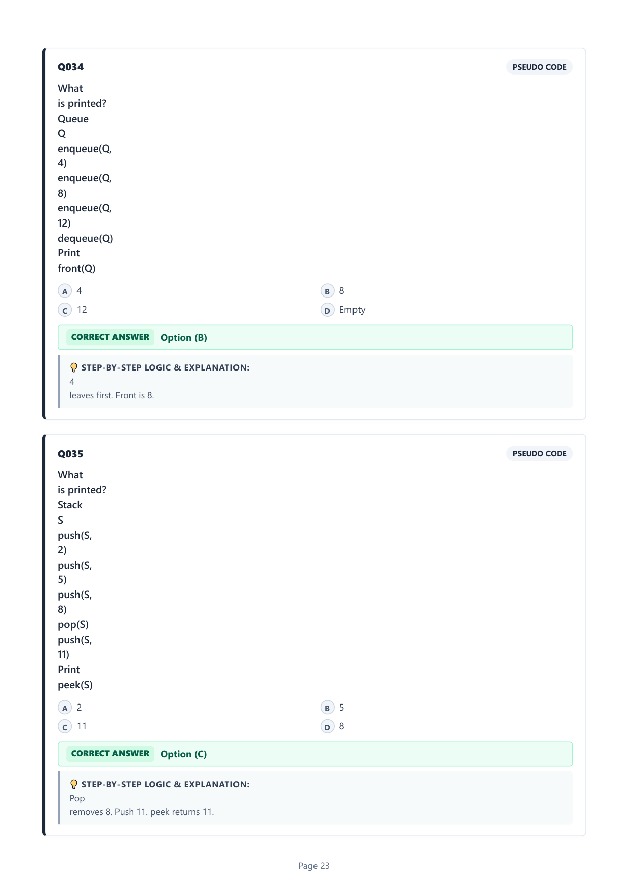 |

---

### Q035: Pseudo Code (Page 23)

**Source Ebook**: `OS4U_Book_4_Pseudocode_Technical.pdf` | **Book Page**: **Page 23**  
**Authentic Page Figure**: [`OS4U_Book_4_Pseudocode_Technical_page_023.png`](images/OS4U_Book_4_Pseudocode_Technical_page_023.png)

#### Problem Statement & Question Prompt
```text
What
is printed?
Stack
S
push(S,
2)
push(S,
5)
push(S,
8)
pop(S)
push(S,
11)
Print
peek(S)
```

#### Multiple Choice Options
- **(A)** `2`
- **(B)** `5`
- **(C)** `11`
- **(D)** `8`

#### Verified Correct Answer Key
> **Correct Option**: **(C) `11`**

#### Step-by-Step Logic & Comprehensive Solution
```text
Pop
removes 8. Push 11. peek returns 11.
```

#### Authentic Ebook Page Figure
| Ebook Page Render (Page 23) |
| :---: |
|  |

---

### Q036: Pseudo Code (Page 24)

**Source Ebook**: `OS4U_Book_4_Pseudocode_Technical.pdf` | **Book Page**: **Page 24**  
**Authentic Page Figure**: [`OS4U_Book_4_Pseudocode_Technical_page_024.png`](images/OS4U_Book_4_Pseudocode_Technical_page_024.png)

#### Problem Statement & Question Prompt
```text
What
is printed?
Stack
S
push(S,
6)
push(S,
9)
push(S,
15)
pop(S)
push(S,
21)
Print
peek(S)
```

#### Multiple Choice Options
- **(A)** `6`
- **(B)** `9`
- **(C)** `21`
- **(D)** `15`

#### Verified Correct Answer Key
> **Correct Option**: **(C) `21`**

#### Step-by-Step Logic & Comprehensive Solution
```text
Pop
removes 15. Push 21. peek returns 21.
```

#### Authentic Ebook Page Figure
| Ebook Page Render (Page 24) |
| :---: |
| 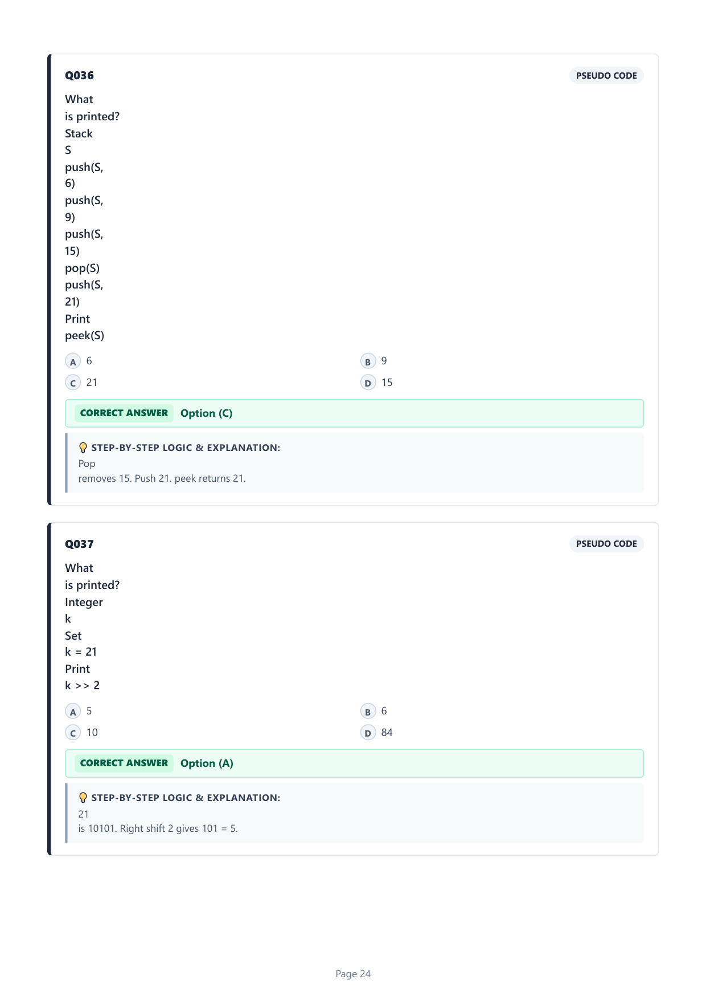 |

---

### Q037: Pseudo Code (Page 24)

**Source Ebook**: `OS4U_Book_4_Pseudocode_Technical.pdf` | **Book Page**: **Page 24**  
**Authentic Page Figure**: [`OS4U_Book_4_Pseudocode_Technical_page_024.png`](images/OS4U_Book_4_Pseudocode_Technical_page_024.png)

#### Problem Statement & Question Prompt
```text
What
is printed?
Integer
k
Set
k = 21
Print
k >> 2
```

#### Multiple Choice Options
- **(A)** `5`
- **(B)** `6`
- **(C)** `10`
- **(D)** `84`

#### Verified Correct Answer Key
> **Correct Option**: **(A) `5`**

#### Step-by-Step Logic & Comprehensive Solution
```text
21
is 10101. Right shift 2 gives 101 = 5.
```

#### Authentic Ebook Page Figure
| Ebook Page Render (Page 24) |
| :---: |
|  |

---

### Q038: Pseudo Code (Page 25)

**Source Ebook**: `OS4U_Book_4_Pseudocode_Technical.pdf` | **Book Page**: **Page 25**  
**Authentic Page Figure**: [`OS4U_Book_4_Pseudocode_Technical_page_025.png`](images/OS4U_Book_4_Pseudocode_Technical_page_025.png)

#### Problem Statement & Question Prompt
```text
What
is printed?
Integer
i, t
Set
t = 1
for
i = 1 to 5 do
t
= t * 2
end
for
Print
t
```

#### Multiple Choice Options
- **(A)** `10`
- **(B)** `16`
- **(C)** `32`
- **(D)** `64`

#### Verified Correct Answer Key
> **Correct Option**: **(C) `32`**

#### Step-by-Step Logic & Comprehensive Solution
```text
Start
1, multiply by 2 five times: 32.
```

#### Authentic Ebook Page Figure
| Ebook Page Render (Page 25) |
| :---: |
| 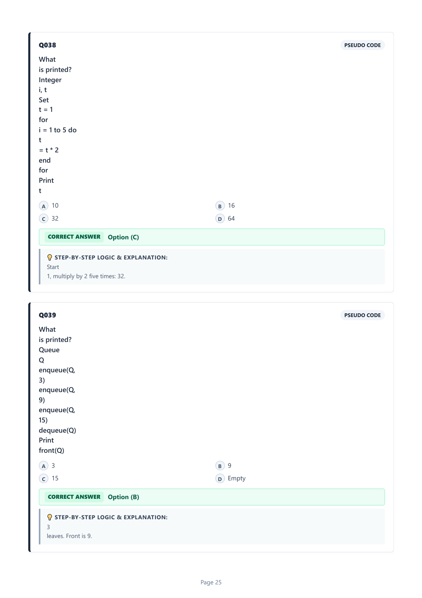 |

---

### Q039: Pseudo Code (Page 25)

**Source Ebook**: `OS4U_Book_4_Pseudocode_Technical.pdf` | **Book Page**: **Page 25**  
**Authentic Page Figure**: [`OS4U_Book_4_Pseudocode_Technical_page_025.png`](images/OS4U_Book_4_Pseudocode_Technical_page_025.png)

#### Problem Statement & Question Prompt
```text
What
is printed?
Queue
Q
enqueue(Q,
3)
enqueue(Q,
9)
enqueue(Q,
15)
dequeue(Q)
Print
front(Q)
```

#### Multiple Choice Options
- **(A)** `3`
- **(B)** `9`
- **(C)** `15`
- **(D)** `Empty`

#### Verified Correct Answer Key
> **Correct Option**: **(B) `9`**

#### Step-by-Step Logic & Comprehensive Solution
```text
3
leaves. Front is 9.
```

#### Authentic Ebook Page Figure
| Ebook Page Render (Page 25) |
| :---: |
|  |

---

### Q040: Pseudo Code (Page 26)

**Source Ebook**: `OS4U_Book_4_Pseudocode_Technical.pdf` | **Book Page**: **Page 26**  
**Authentic Page Figure**: [`OS4U_Book_4_Pseudocode_Technical_page_026.png`](images/OS4U_Book_4_Pseudocode_Technical_page_026.png)

#### Problem Statement & Question Prompt
```text
What
does W(5) return?
Function
W(n)
if
n <= 1 then return 2
return
W(n - 1) + 3
End
Function
Print
W(5)
```

#### Multiple Choice Options
- **(A)** `11`
- **(B)** `14`
- **(C)** `15`
- **(D)** `17`

#### Verified Correct Answer Key
> **Correct Option**: **(B) `14`**

#### Step-by-Step Logic & Comprehensive Solution
```text
W(1)=2.
Add 3 four times: 2+12=14.
```

#### Authentic Ebook Page Figure
| Ebook Page Render (Page 26) |
| :---: |
| 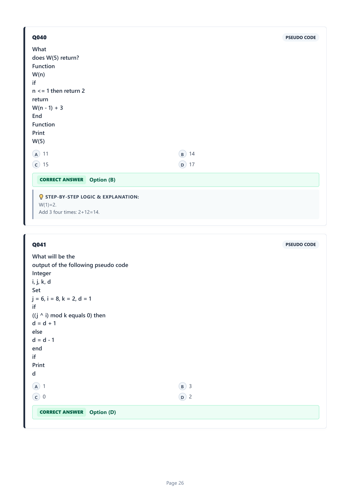 |

---

### Q041: Pseudo Code (Page 26)

**Source Ebook**: `OS4U_Book_4_Pseudocode_Technical.pdf` | **Book Page**: **Page 26**  
**Authentic Page Figure**: [`OS4U_Book_4_Pseudocode_Technical_page_026.png`](images/OS4U_Book_4_Pseudocode_Technical_page_026.png)

#### Problem Statement & Question Prompt
```text
What will be the
output of the following pseudo code
Integer
i, j, k, d
Set
j = 6, i = 8, k = 2, d = 1
if
((j ^ i) mod k equals 0) then
d = d + 1
else
d = d - 1
end
if
Print
d
```

#### Multiple Choice Options
- **(A)** `1`
- **(B)** `3`
- **(C)** `0`
- **(D)** `2`

#### Verified Correct Answer Key
> **Correct Option**: **(D) `2`**

#### Step-by-Step Logic & Comprehensive Solution
```text
Rule / Logic: Pattern evaluation verifies that the target expression evaluates precisely to 2.
```

#### Authentic Ebook Page Figure
| Ebook Page Render (Page 26) |
| :---: |
|  |

---

