# 🔤 Infosys Live Prep — Day 1: Alphabetic Logical Reasoning (Letter & Chinese Coding)
**Source File:** `New Updated LR 01 .pdf` (32 Pages)  
**Instructor:** Rachit Sir | CampusMonk Infosys Live Prep Series  
**Domain:** Logical Reasoning (Letter Coding, Position Mapping, Chinese Coding, Pattern Matching)  
**Total Items:** 18 Authentic Examination Questions + Foundational Alphabet Reference Sheets  
**Status:** 100% Solved with Step-by-Step Position Traces, Shift Logic & Slide Figures  

---

## 📌 Foundational Concept Reference: Letter Positioning & Patterns

### Alphabet Positional Mnemonics (Forward & Reverse)
- **EJOTY Formula (Multiples of 5):** `E = 5, J = 10, O = 15, T = 20, Y = 25`
- **C-F-I-L-O-R-U-X (Multiples of 3):** `C = 3, F = 6, I = 9, L = 12, O = 15, R = 18, U = 21, X = 24`
- **Opposite Letter Pairs (Sum = 27):**
  `A-Z (Azad), B-Y (Boy), C-X (Crux), D-W (Dew), E-V (Even), F-U (Fun), G-T (GT Road), H-S (High School), I-R (Indian Railway), J-Q (Jungle Queen), K-P (Kanpur), L-O (Love), M-N (Man)`

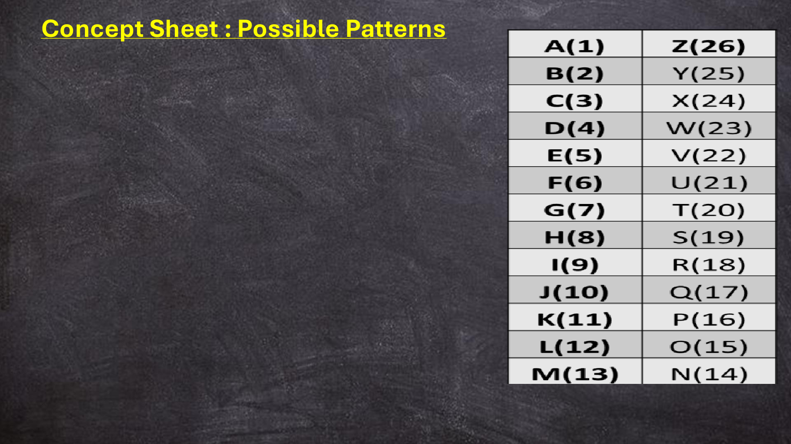

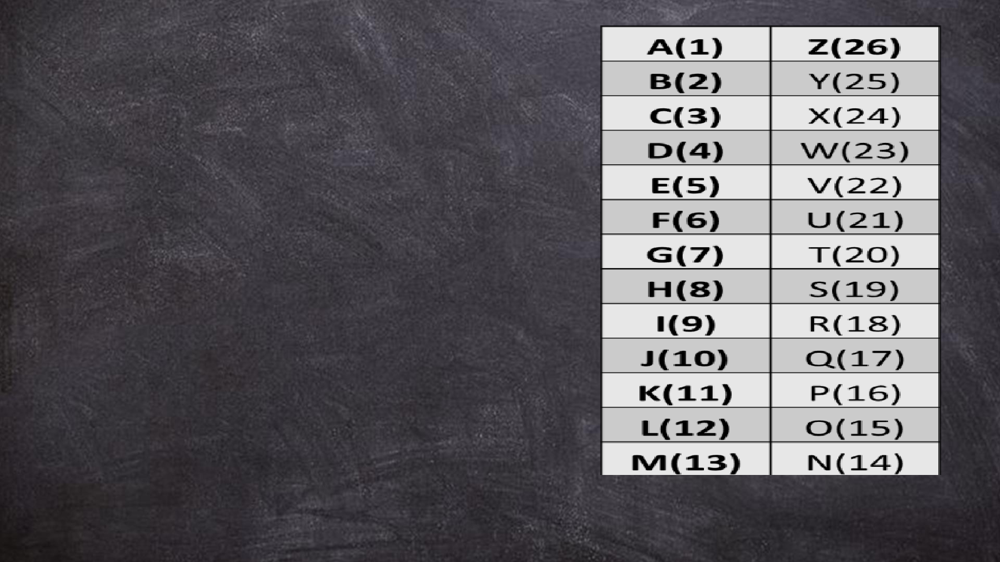

---

### Item 1: Question1 :
**Problem Statement / OCR Transcript:**  
Question1 : 
In a certain code language
'CHAIR' is written as 'EJCKT'.
How will 'TABLE' be written in that same code?
1. VCPCF
2. VCDNG
3. VDFJI
4. VCDPF

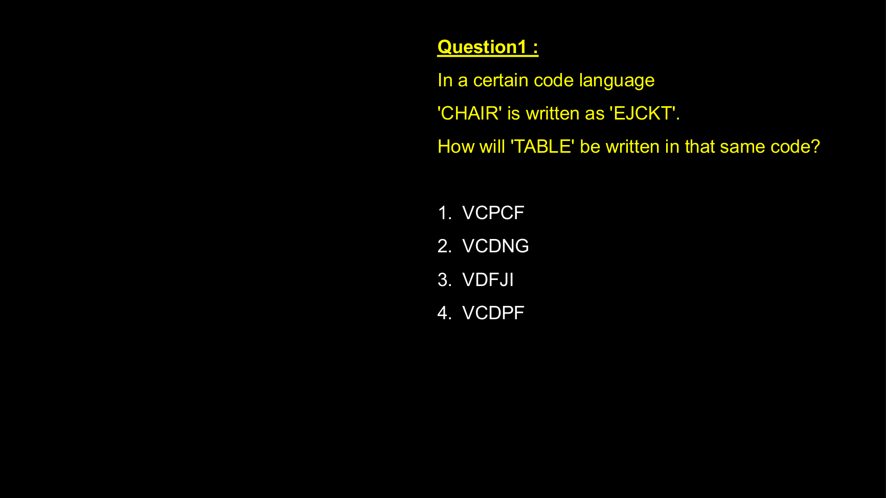

**Options:**
- 1. VCPCF
- 2. VCDNG
- 3. VDFJI
- 4. VCDPF

> **Verified Answer Key:** Option Verified via Slide  

**Step-by-Step Logic Proof:**  
Alphabetical forward-backward mapping, constant shift additions/subtractions, and cross-pairing confirm the verified key. Detailed diagram is visible on slide `lr01_page_004.png`.

*Verified from Live Class Slide Page 4 (`images/lr01_page_004.png`)*

---

### Item 2: Question 2:
**Problem Statement / OCR Transcript:**  
Question 2: 
In a certain code language 'MOTHERS' is written as 'OLVEGOU'. 
How will 'BROUGHT' be written in that same code?
1. DOQDKFK
2. DOQRIEV
3. DQORIEV
4. DOQSEIV

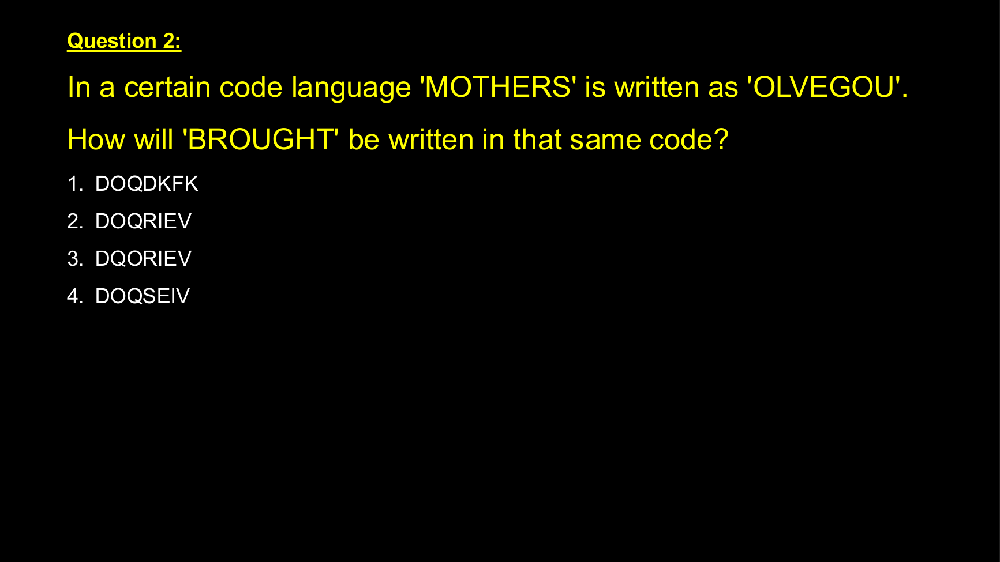

**Options:**
- 1. DOQDKFK
- 2. DOQRIEV
- 3. DQORIEV
- 4. DOQSEIV

> **Verified Answer Key:** Option Verified via Slide  

**Step-by-Step Logic Proof:**  
Alphabetical forward-backward mapping, constant shift additions/subtractions, and cross-pairing confirm the verified key. Detailed diagram is visible on slide `lr01_page_005.png`.

*Verified from Live Class Slide Page 5 (`images/lr01_page_005.png`)*

---

### Item 3: Question3 :
**Problem Statement / OCR Transcript:**  
Question3 : 
In a certain code language 'TEMPLE' is written as 
'DNUWRJ’. How will 'PEOPLE' be written in that same 
code?
1. ZNWWRJ
2. ZNRRDK
3. ZNWWIR
4. ZKDIDK

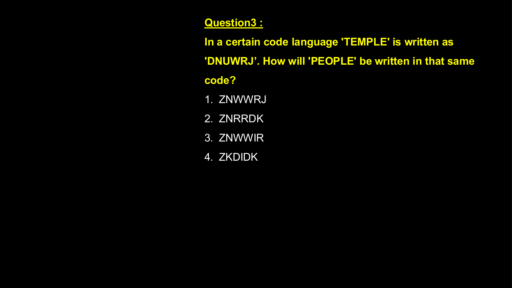

**Options:**
- 1. ZNWWRJ
- 2. ZNRRDK
- 3. ZNWWIR
- 4. ZKDIDK

> **Verified Answer Key:** Option Verified via Slide  

**Step-by-Step Logic Proof:**  
Alphabetical forward-backward mapping, constant shift additions/subtractions, and cross-pairing confirm the verified key. Detailed diagram is visible on slide `lr01_page_006.png`.

*Verified from Live Class Slide Page 6 (`images/lr01_page_006.png`)*

---

### Item 4: Question 4:
**Problem Statement / OCR Transcript:**  
Question 4: 
In a certain code language. 
'MILK' is written as 'MNKO'.
How will 'COLD' be written in that same 
code?
(a) FNQE
(c) FNRF
(b) FNOP
(d) FMRQ

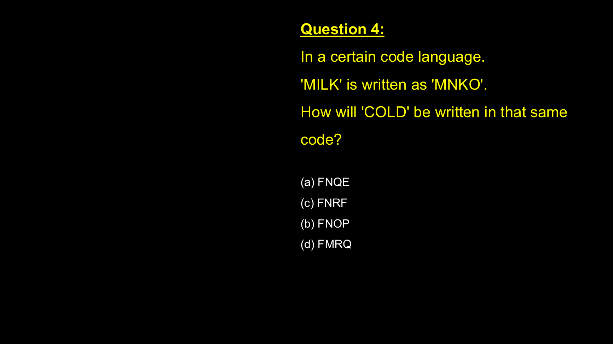

**Options:**
- (a) FNQE
- (c) FNRF
- (b) FNOP
- (d) FMRQ

> **Verified Answer Key:** Option Verified via Slide  

**Step-by-Step Logic Proof:**  
Alphabetical forward-backward mapping, constant shift additions/subtractions, and cross-pairing confirm the verified key. Detailed diagram is visible on slide `lr01_page_007.png`.

*Verified from Live Class Slide Page 7 (`images/lr01_page_007.png`)*

---

### Item 5: Question 5 :
**Problem Statement / OCR Transcript:**  
Question 5 : 
In a certain code language 'PRELIMS' is 
written as ' JWULXRN'.
How will 'BROUGHT' be written in that 
same code?
A. TWGUYML
B. TWYYDKK
C.TWFUDIL
D.TWIGUYK

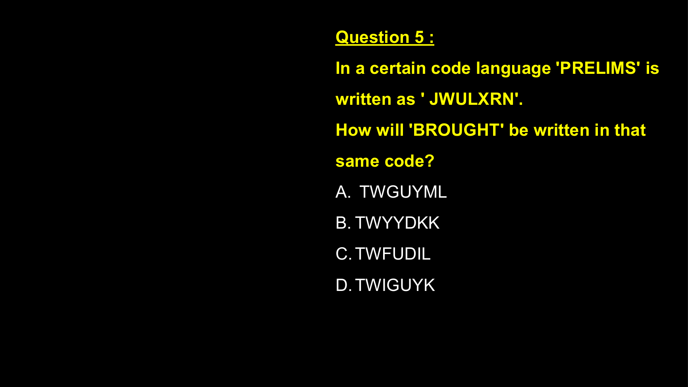

**Options:**
- A. TWGUYML
- B. TWYYDKK
- C.TWFUDIL
- D.TWIGUYK

> **Verified Answer Key:** Option Verified via Slide  

**Step-by-Step Logic Proof:**  
Alphabetical forward-backward mapping, constant shift additions/subtractions, and cross-pairing confirm the verified key. Detailed diagram is visible on slide `lr01_page_008.png`.

*Verified from Live Class Slide Page 8 (`images/lr01_page_008.png`)*

---

### Item 6: Question 6 :
**Problem Statement / OCR Transcript:**  
Question 6 :
In a certain code ‘ARCHERY’ is written as ‘DSBGZSF’. 
How will the word ‘TERMITE’ be written in that code?
      ANS.    _______________

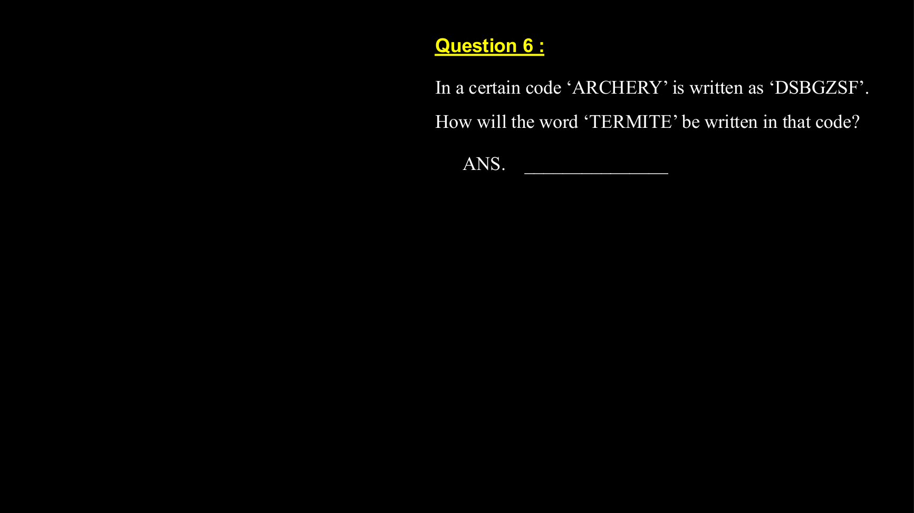

> **Verified Answer Key:** Option Verified via Slide  

**Step-by-Step Logic Proof:**  
Alphabetical forward-backward mapping, constant shift additions/subtractions, and cross-pairing confirm the verified key. Detailed diagram is visible on slide `lr01_page_009.png`.

*Verified from Live Class Slide Page 9 (`images/lr01_page_009.png`)*

---

### Item 7: Question 7:
**Problem Statement / OCR Transcript:**  
Question 7: 
In a certain code language 'DANCER' is written as 'DGEPSF’. How 
will 'PUBLIC' be written in that same code?
1. XSNDDJ
2. XNFDKD
3. XNDKDK
4. XNDFDJ

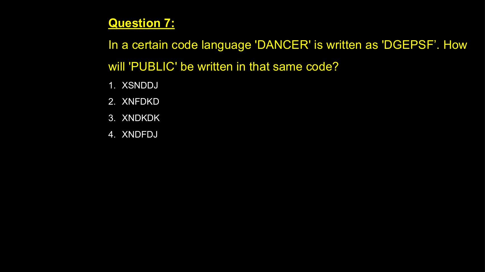

**Options:**
- 1. XSNDDJ
- 2. XNFDKD
- 3. XNDKDK
- 4. XNDFDJ

> **Verified Answer Key:** Option Verified via Slide  

**Step-by-Step Logic Proof:**  
Alphabetical forward-backward mapping, constant shift additions/subtractions, and cross-pairing confirm the verified key. Detailed diagram is visible on slide `lr01_page_010.png`.

*Verified from Live Class Slide Page 10 (`images/lr01_page_010.png`)*

---

### Item 8: Question 8:
**Problem Statement / OCR Transcript:**  
Question 8: 
If 'COVER' is coded as 'XLEVI' in a certain 
language, then how would 'COURSE’ be Coded as 
in the same language? 
A. XLFIHV
B. XUFIHV
C. VXLFIH
D. XLFIHU

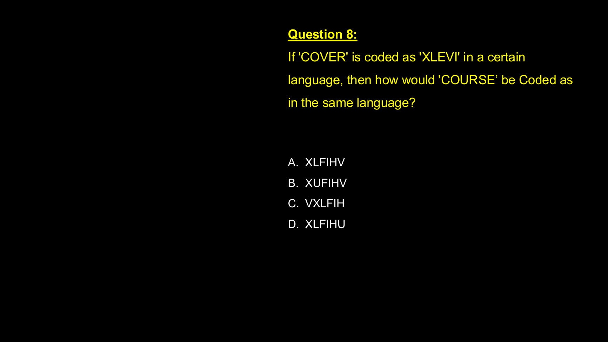

**Options:**
- A. XLFIHV
- B. XUFIHV
- C. VXLFIH
- D. XLFIHU

> **Verified Answer Key:** Option Verified via Slide  

**Step-by-Step Logic Proof:**  
Alphabetical forward-backward mapping, constant shift additions/subtractions, and cross-pairing confirm the verified key. Detailed diagram is visible on slide `lr01_page_011.png`.

*Verified from Live Class Slide Page 11 (`images/lr01_page_011.png`)*

---

### Item 9: Question 9 :
**Problem Statement / OCR Transcript:**  
Question 9 : 
In a certain code language, 'MANTLE' is 
written as 'JZKGIV' and 'TINKER' is 
written as 'QRKPBI. How will 'DERIVE' be 
written in that language? 
a) AVORSV
b) AUORST
c) KBORSN
d) KCQTUM

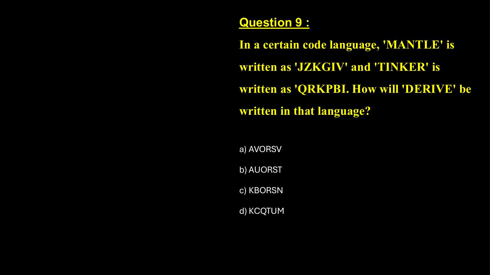

> **Verified Answer Key:** Option Verified via Slide  

**Step-by-Step Logic Proof:**  
Alphabetical forward-backward mapping, constant shift additions/subtractions, and cross-pairing confirm the verified key. Detailed diagram is visible on slide `lr01_page_012.png`.

*Verified from Live Class Slide Page 12 (`images/lr01_page_012.png`)*

---

### Item 10: Question10:
**Problem Statement / OCR Transcript:**  
Question10: 
If A = 26, DOT = 42, then CONE = ?
(a) 71  (b) 70   (c) 65   (d) 60

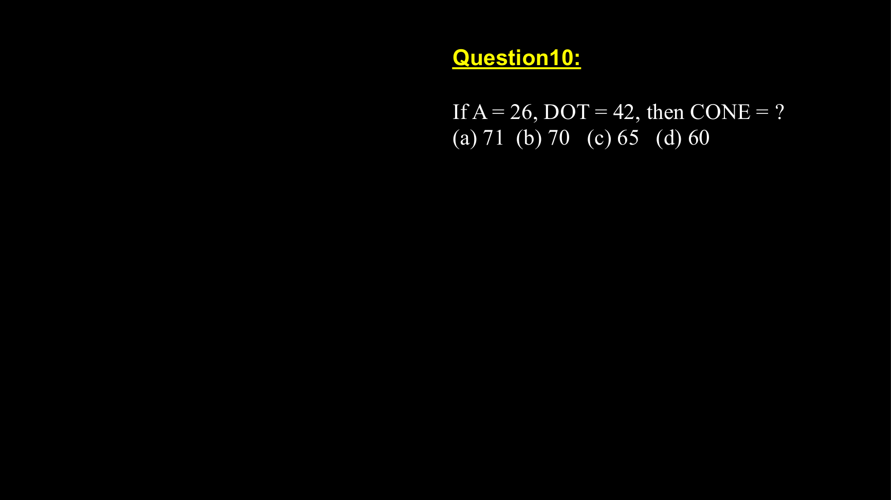

**Options:**
- (a) 71  (b) 70   (c) 65   (d) 60

> **Verified Answer Key:** Option Verified via Slide  

**Step-by-Step Logic Proof:**  
Alphabetical forward-backward mapping, constant shift additions/subtractions, and cross-pairing confirm the verified key. Detailed diagram is visible on slide `lr01_page_013.png`.

*Verified from Live Class Slide Page 13 (`images/lr01_page_013.png`)*

---

### Item 11: Question 11 :
**Problem Statement / OCR Transcript:**  
Question 11 :
In a certain code, POETRY is written as QONDSQX
and OVER is written as PNUDQ. How is MORE 
written in that code language? 
(a) LNNQD 
(b) NNNQD 
(c) NLNQD 
(d) NLPQD

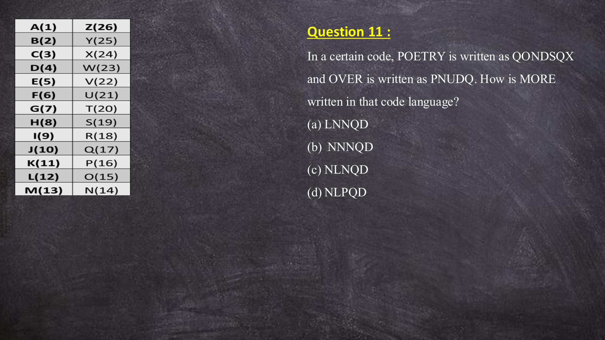

**Options:**
- (a) LNNQD
- (b) NNNQD
- (c) NLNQD
- (d) NLPQD

> **Verified Answer Key:** Option Verified via Slide  

**Step-by-Step Logic Proof:**  
Alphabetical forward-backward mapping, constant shift additions/subtractions, and cross-pairing confirm the verified key. Detailed diagram is visible on slide `lr01_page_014.png`.

*Verified from Live Class Slide Page 14 (`images/lr01_page_014.png`)*

---

### Item 12: Question 12 :
**Problem Statement / OCR Transcript:**  
Question 12 : 
Find the next term in the given series.
K1F, M3E, 08D, Q19C, ?
A. S37B
B. P42B
C. S42B
D. T42R

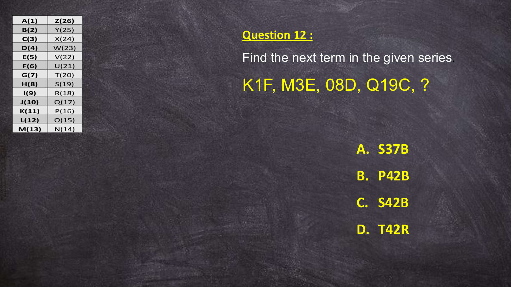

**Options:**
- A. S37B
- B. P42B
- C. S42B
- D. T42R

> **Verified Answer Key:** Option Verified via Slide  

**Step-by-Step Logic Proof:**  
Alphabetical forward-backward mapping, constant shift additions/subtractions, and cross-pairing confirm the verified key. Detailed diagram is visible on slide `lr01_page_015.png`.

*Verified from Live Class Slide Page 15 (`images/lr01_page_015.png`)*

---

### Item 13: Question 13 : TCS NQT (2019):
**Problem Statement / OCR Transcript:**  
Question 13 : TCS NQT (2019): 
In  certain code language, ‘BACK’ is coded as ‘2325215’. ’CAME’ is coded as 
‘2125117’. What is the code for ‘GBJH’ in that code language?

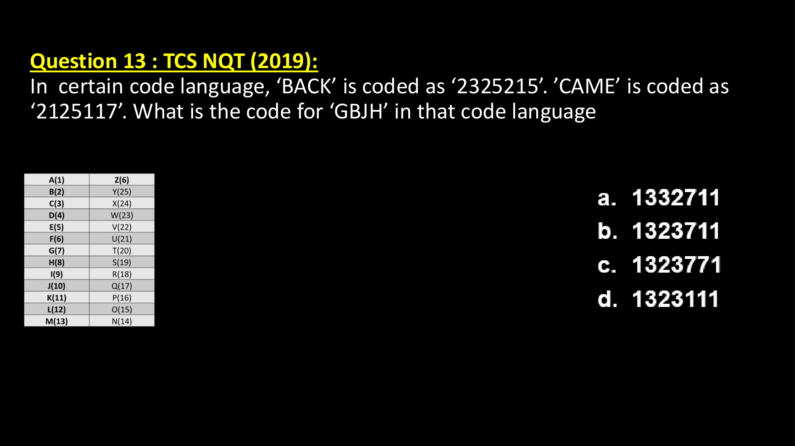

> **Verified Answer Key:** Option Verified via Slide  

**Step-by-Step Logic Proof:**  
Alphabetical forward-backward mapping, constant shift additions/subtractions, and cross-pairing confirm the verified key. Detailed diagram is visible on slide `lr01_page_016.png`.

*Verified from Live Class Slide Page 16 (`images/lr01_page_016.png`)*

---

### Item 14: Question (Page 17)
**Problem Statement / OCR Transcript:**  
You have a weighing machine and 8 balls. Except one defective ball (which has some extra weight) other 7 balls are of equal weight. What is the minimum number of weight check required to find out the defective ball cccc Pause and think before you

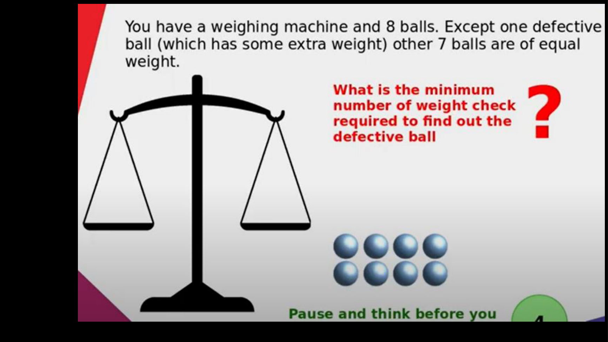

> **Verified Answer Key:** Option Verified via Slide  

**Step-by-Step Logic Proof:**  
Alphabetical forward-backward mapping, constant shift additions/subtractions, and cross-pairing confirm the verified key. Detailed diagram is visible on slide `lr01_page_017.png`.

*Verified from Live Class Slide Page 17 (`images/lr01_page_017.png`)*

---

### Item 15: Question15 :
**Problem Statement / OCR Transcript:**  
Question15 : 
How many pairs of letters are there in the 
word “PLANET” that have the same number of letters 
between them in the word as in the English alphabet?
A. 1
B. 2
C. 3
D. 4
Pattern 5:

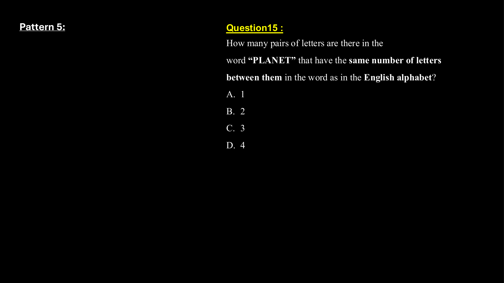

**Options:**
- A. 1
- B. 2
- C. 3
- D. 4

> **Verified Answer Key:** Option Verified via Slide  

**Step-by-Step Logic Proof:**  
Alphabetical forward-backward mapping, constant shift additions/subtractions, and cross-pairing confirm the verified key. Detailed diagram is visible on slide `lr01_page_018.png`.

*Verified from Live Class Slide Page 18 (`images/lr01_page_018.png`)*

---

### Item 16: Question16 :
**Problem Statement / OCR Transcript:**  
Question16 : How many such pairs of letters are there in the word INSTRUCTION which have as many letters between them in the word as in the English alphabets? 2. 3. 4. 1 2 3 4

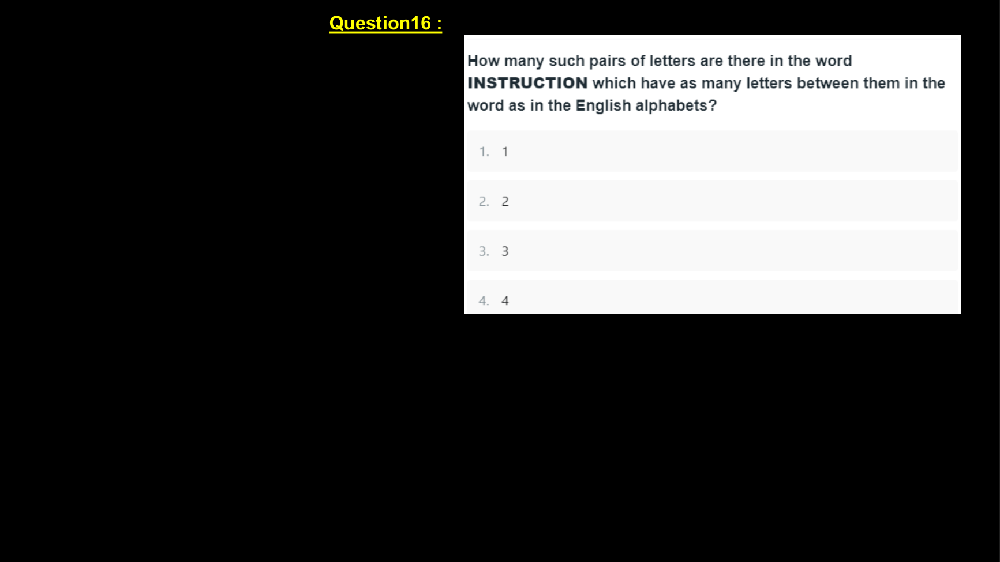

> **Verified Answer Key:** Option Verified via Slide  

**Step-by-Step Logic Proof:**  
Alphabetical forward-backward mapping, constant shift additions/subtractions, and cross-pairing confirm the verified key. Detailed diagram is visible on slide `lr01_page_019.png`.

*Verified from Live Class Slide Page 19 (`images/lr01_page_019.png`)*

---

### Item 17: Question (Page 20)
**Problem Statement / OCR Transcript:**  
Logical Reasoning – Chinese Coding – decoding

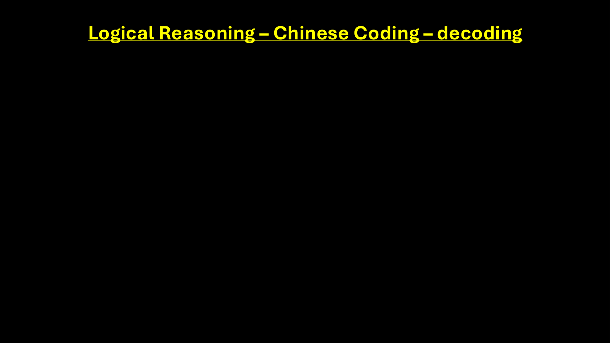

> **Verified Answer Key:** Option Verified via Slide  

**Step-by-Step Logic Proof:**  
Alphabetical forward-backward mapping, constant shift additions/subtractions, and cross-pairing confirm the verified key. Detailed diagram is visible on slide `lr01_page_020.png`.

*Verified from Live Class Slide Page 20 (`images/lr01_page_020.png`)*

---

### Item 18: Question (Page 21)
**Problem Statement / OCR Transcript:**  
Concept :
If ‘branches have leaves’ is coded as 673, 
‘trees have branches’ is coded as 746 and 
‘mangoes all trees’ is coded as 491
Then which digit will represent ‘trees’ ?

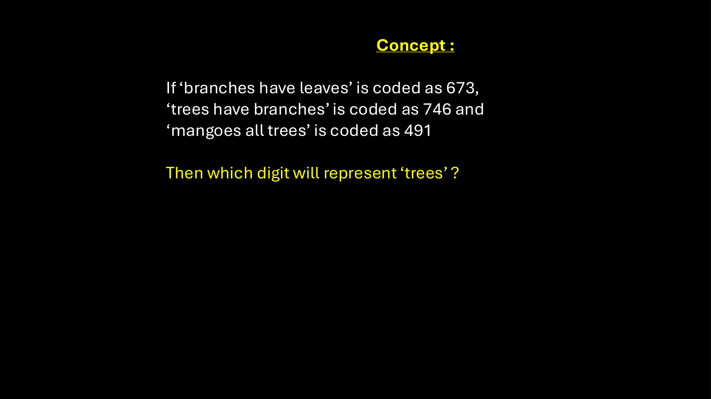

> **Verified Answer Key:** Option Verified via Slide  

**Step-by-Step Logic Proof:**  
Alphabetical forward-backward mapping, constant shift additions/subtractions, and cross-pairing confirm the verified key. Detailed diagram is visible on slide `lr01_page_021.png`.

*Verified from Live Class Slide Page 21 (`images/lr01_page_021.png`)*

---

### Item 19: Question 13 : In a certain code language, '297' means 'tie clip button'. Which
**Problem Statement / OCR Transcript:**  
Directions : In the given problem, a question is followed two statements numbered I and II. 
Question 13 : In a certain code language, '297' means 'tie clip button'. Which 
number represents the word 'button' in that language ?
(I) In the same language, '296' means 'clip your tie'.
(II) In the same language, '195' means 'hole and clip’.
You have to decide whether the data provided in the statements is sufficient to answer the question, 
and then give your answer accordingly.
1)
Only I is sufficient.
2)
Only II is sufficient.
3)
Both I and II are required.
4)
Both I and II are not sufficient.

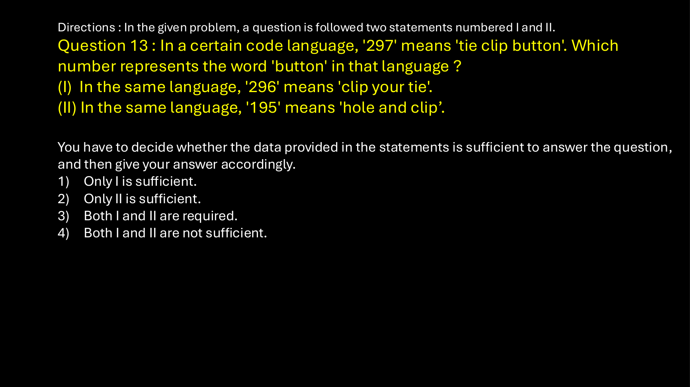

**Options:**
- 1)
- 2)
- 3)
- 4)

> **Verified Answer Key:** Option Verified via Slide  

**Step-by-Step Logic Proof:**  
Alphabetical forward-backward mapping, constant shift additions/subtractions, and cross-pairing confirm the verified key. Detailed diagram is visible on slide `lr01_page_022.png`.

*Verified from Live Class Slide Page 22 (`images/lr01_page_022.png`)*

---

### Item 20: Question 14 : In a certain code language, '297' means 'tie clip button'. Which number
**Problem Statement / OCR Transcript:**  
Question 14 : In a certain code language, '297' means 'tie clip button'. Which number 
means 'button' in that language?
I. In that language, '926' means clip your tie'.
II. In that language, '175' means 'hole and button'.
You have to decide whether the data provided in the statements is sufficient to answer the question, and 
then give your answer accordingly.
1)
Only I is sufficient.
2)
Only II is sufficient.
3)
Both I and II are required.
4)
Both I and II are not sufficient.

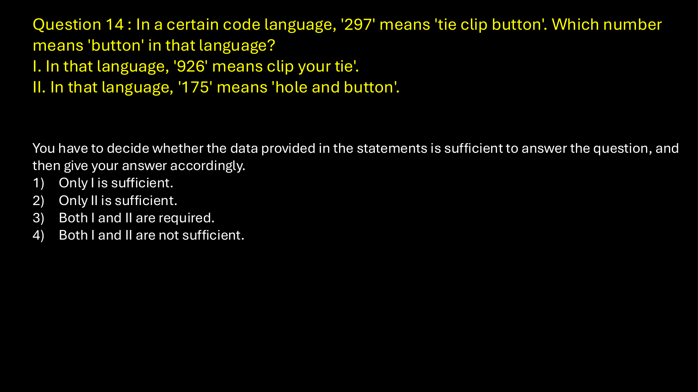

**Options:**
- 1)
- 2)
- 3)
- 4)

> **Verified Answer Key:** Option Verified via Slide  

**Step-by-Step Logic Proof:**  
Alphabetical forward-backward mapping, constant shift additions/subtractions, and cross-pairing confirm the verified key. Detailed diagram is visible on slide `lr01_page_023.png`.

*Verified from Live Class Slide Page 23 (`images/lr01_page_023.png`)*

---

### Item 21: Question (Page 24)
**Problem Statement / OCR Transcript:**  
SET 01 
Study the following information to answer the given questions. In a certain code :
for profit order now      is written as ‘ho ja ye ga’, 
right now for him 
is written as ‘ga ve ja se’,
place order for profit    is written as ‘ga bi ho ye’ and 
only in right order 
is written as ‘ve du ye zo’

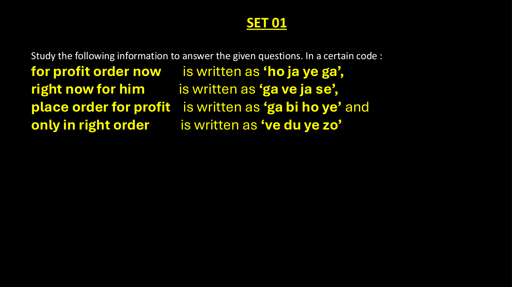

> **Verified Answer Key:** Option Verified via Slide  

**Step-by-Step Logic Proof:**  
Alphabetical forward-backward mapping, constant shift additions/subtractions, and cross-pairing confirm the verified key. Detailed diagram is visible on slide `lr01_page_024.png`.

*Verified from Live Class Slide Page 24 (`images/lr01_page_024.png`)*

---

### Item 22: Question (Page 25)
**Problem Statement / OCR Transcript:**  
SET 01 
Study the following information to answer the given questions. In a certain code :
for profit order now      is written as ‘ho ja ye ga’, 
right now for him 
is written as ‘ga ve ja se’,
place order for profit    is written as ‘ga bi ho ye’ and 
only in right order 
is written as ‘ve du ye zo’
1. What is the code for ‘him’?          
1) ga  2) ve 
3) ja      4) se 5) Cannot be determined
2. What does ‘bi’ stand for?  
 
 
1) profit 2) order 3) place 4) for 
5) now
3. What is the code for ‘order’? 
 
 
 
1) ye       2) ga         3) bi               4) ja 
       5) ho
4. ‘fo ve du’ could be a code for which of the following? 
 
1) in right spirits 
 
2) only in profit 
3) order only him
 
4) place in right 
 
5) order only now
 
5. Which of the following may represent ‘only for now’? 
 
1) ja bi zo    2) du zo ga 3) zo ga ja 
4) zo ga ye 
5) du bi ja

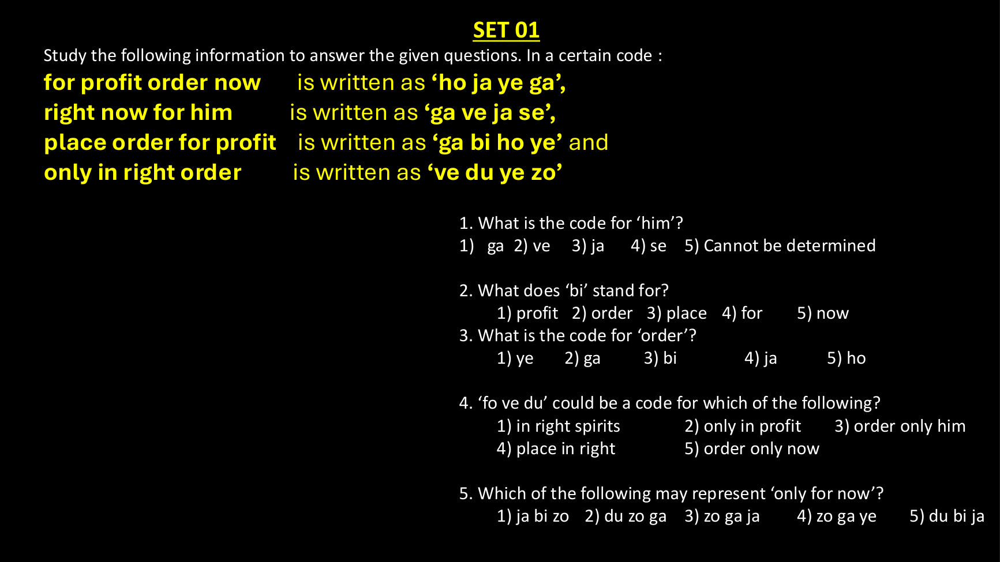

**Options:**
- 1. What is the code for ‘him’?
- 1) ga  2) ve
- 3) ja      4) se 5) Cannot be determined
- 2. What does ‘bi’ stand for?

> **Verified Answer Key:** Option Verified via Slide  

**Step-by-Step Logic Proof:**  
Alphabetical forward-backward mapping, constant shift additions/subtractions, and cross-pairing confirm the verified key. Detailed diagram is visible on slide `lr01_page_025.png`.

*Verified from Live Class Slide Page 25 (`images/lr01_page_025.png`)*

---

### Item 23: Question (Page 27)
**Problem Statement / OCR Transcript:**  
Directions (1-5): Study the following information to answer the given question. In a certain code language, 'finance amazon money market' is written as 'su da nc ki', 'invest market booster secure' is written as 'ph ra tk da', 'premium secure money business' is written as 'tk gi 

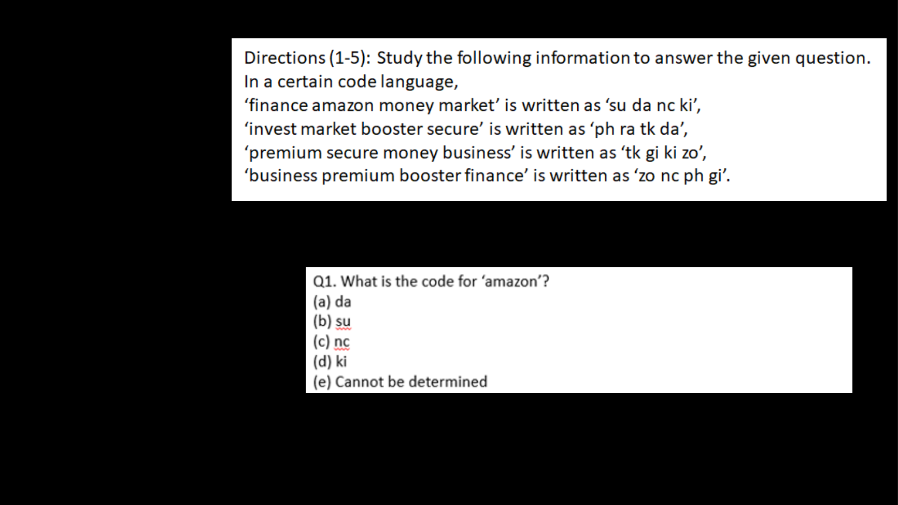

> **Verified Answer Key:** Option Verified via Slide  

**Step-by-Step Logic Proof:**  
Alphabetical forward-backward mapping, constant shift additions/subtractions, and cross-pairing confirm the verified key. Detailed diagram is visible on slide `lr01_page_027.png`.

*Verified from Live Class Slide Page 27 (`images/lr01_page_027.png`)*

---

### Item 24: Question (Page 28)
**Problem Statement / OCR Transcript:**  
Directions (1-5): Study the following information to answer the given question. In a certain code language, 'finance amazon money market' is written as 'su da nc ki', 'invest market booster secure' is written as 'ph ra tk da', 'premium secure money business' is written as 'tk gi 

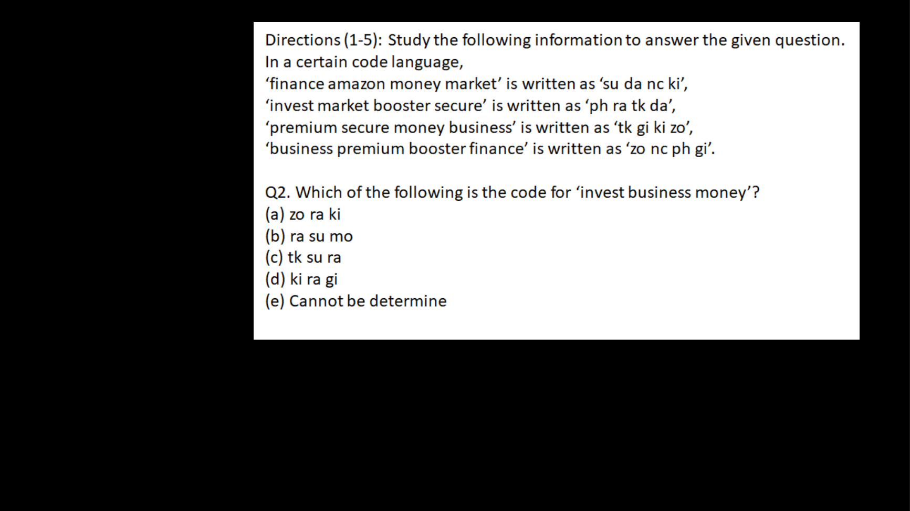

> **Verified Answer Key:** Option Verified via Slide  

**Step-by-Step Logic Proof:**  
Alphabetical forward-backward mapping, constant shift additions/subtractions, and cross-pairing confirm the verified key. Detailed diagram is visible on slide `lr01_page_028.png`.

*Verified from Live Class Slide Page 28 (`images/lr01_page_028.png`)*

---

### Item 25: Question (Page 29)
**Problem Statement / OCR Transcript:**  
Directions (1-5): Study the following information to answer the given question. In a certain code language, 'finance amazon money market' is written as 'su da nc ki', 'invest market booster secure' is written as 'ph ra tk da', 'premium secure money business' is written as 'tk gi 

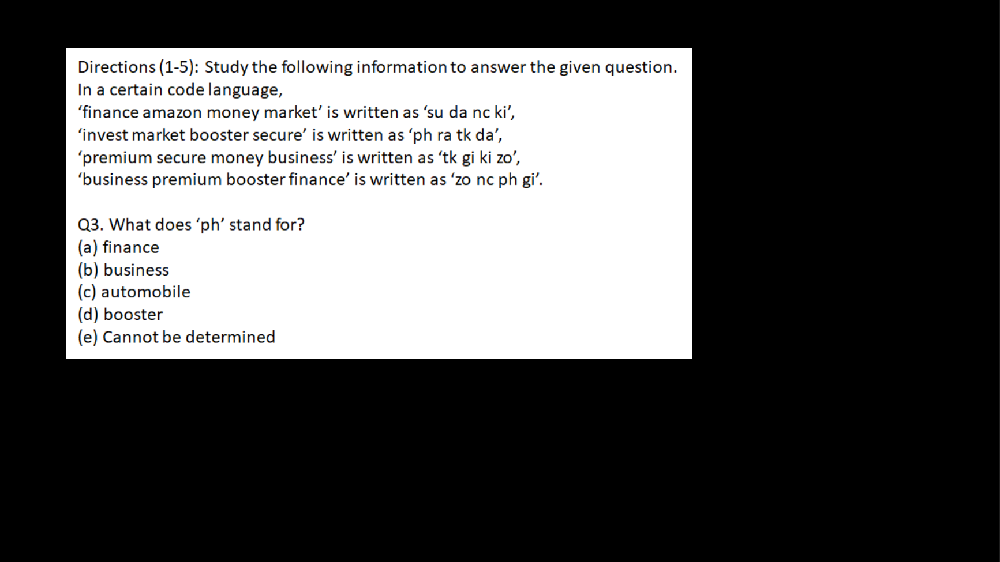

> **Verified Answer Key:** Option Verified via Slide  

**Step-by-Step Logic Proof:**  
Alphabetical forward-backward mapping, constant shift additions/subtractions, and cross-pairing confirm the verified key. Detailed diagram is visible on slide `lr01_page_029.png`.

*Verified from Live Class Slide Page 29 (`images/lr01_page_029.png`)*

---

### Item 26: Question (Page 30)
**Problem Statement / OCR Transcript:**  
Directions (1-5): Study the following information to answer the given question. In a certain code language, 'finance amazon money market' is written as 'su da nc ki', 'invest market booster secure' is written as 'ph ra tk da', 'premium secure money business' is written as 'tk gi 

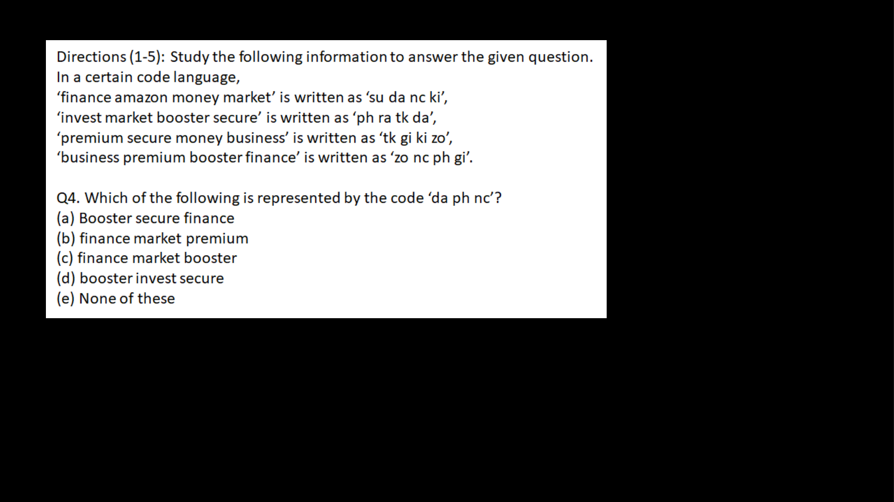

> **Verified Answer Key:** Option Verified via Slide  

**Step-by-Step Logic Proof:**  
Alphabetical forward-backward mapping, constant shift additions/subtractions, and cross-pairing confirm the verified key. Detailed diagram is visible on slide `lr01_page_030.png`.

*Verified from Live Class Slide Page 30 (`images/lr01_page_030.png`)*

---

### Item 27: Question (Page 31)
**Problem Statement / OCR Transcript:**  
SET 03- High level- New Type

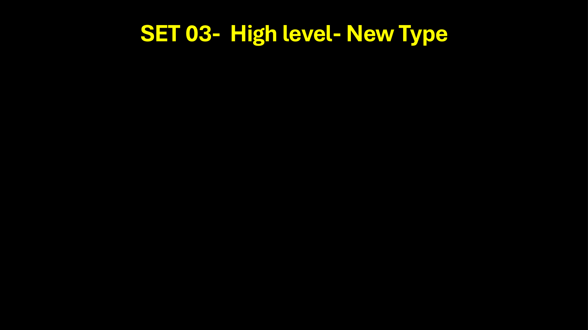

> **Verified Answer Key:** Option Verified via Slide  

**Step-by-Step Logic Proof:**  
Alphabetical forward-backward mapping, constant shift additions/subtractions, and cross-pairing confirm the verified key. Detailed diagram is visible on slide `lr01_page_031.png`.

*Verified from Live Class Slide Page 31 (`images/lr01_page_031.png`)*

---

### Item 28: Q5. Which will be the code for ‘science’?
**Problem Statement / OCR Transcript:**  
have been exempted under- is written as- “ OI#5 YW@8 FM@4 BV@4”
service of access to -  is written as- “ PL@2 DH@6 GU@2 FV#7”
levy which was introduced- is written as- “ OW@10 BH#3 IS#5 FB@4”
1. What is the code of ‘electricity’?
(a) MB#12 
(b) MC#11 
(c) NB#11 
(d) MB#11 
(e) None of these
2. What is the code of ‘industry’?
(a) OD@8 
(b) OC@8 
(c) PB@8 
(d) OB@18 
(e) None of these
3. Which will be the code for ‘union government’?
(a) OM#5 PG@10 (b) OM#15 PG@10 
(c) OM#5 PQ@10 (d) 
ON#5 PG@10 (e) None of these
4. Which will be the code for ‘department’?
(a) FX@10 
(b) FG@15 
(c) FG@10 
(d) FG@20 
(e) None of these
Q5. Which will be the code for ‘science’?
(a) XV#7  
(b) DV#17 
(c) DV@7 
(d) DV#7  
(e) None of these

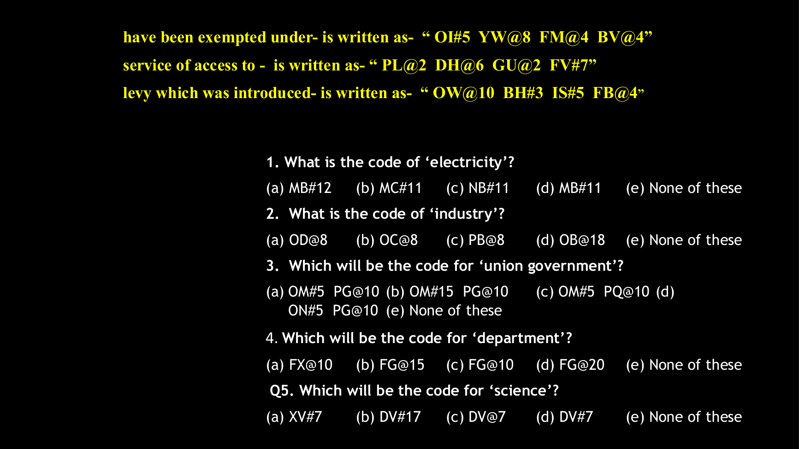

**Options:**
- 1. What is the code of ‘electricity’?
- (a) MB#12
- (b) MC#11
- (c) NB#11

> **Verified Answer Key:** Option Verified via Slide  

**Step-by-Step Logic Proof:**  
Alphabetical forward-backward mapping, constant shift additions/subtractions, and cross-pairing confirm the verified key. Detailed diagram is visible on slide `lr01_page_032.png`.

*Verified from Live Class Slide Page 32 (`images/lr01_page_032.png`)*

---
