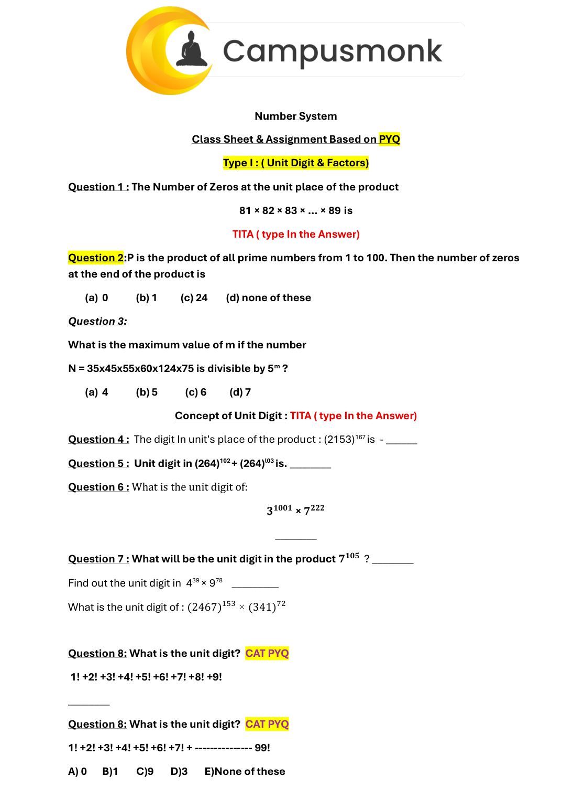
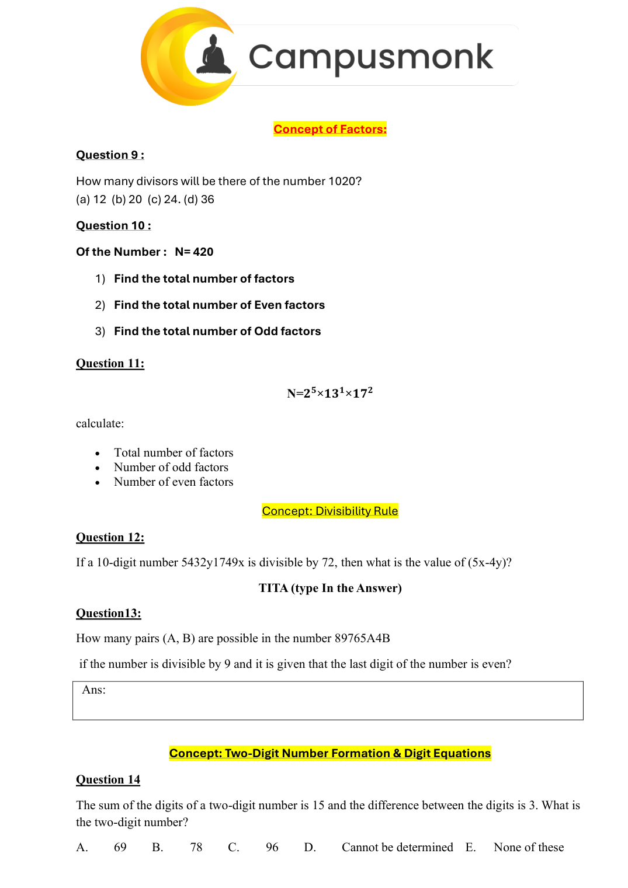
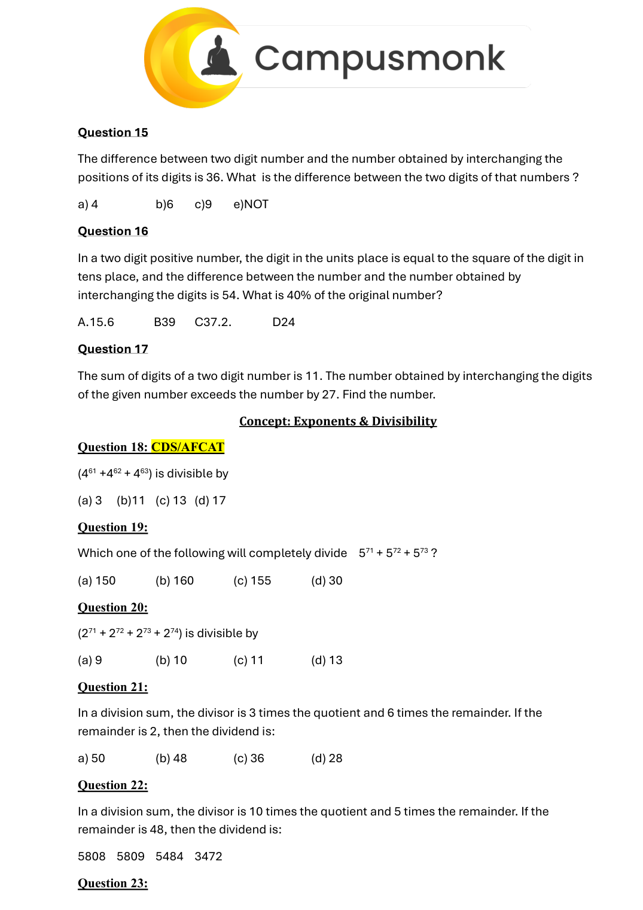
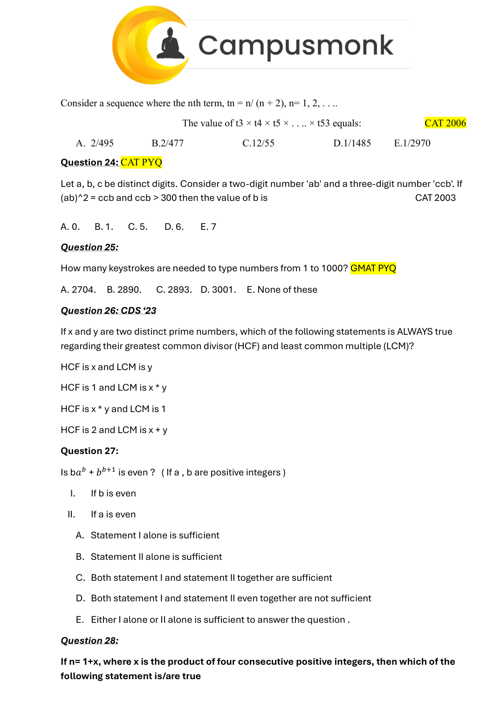
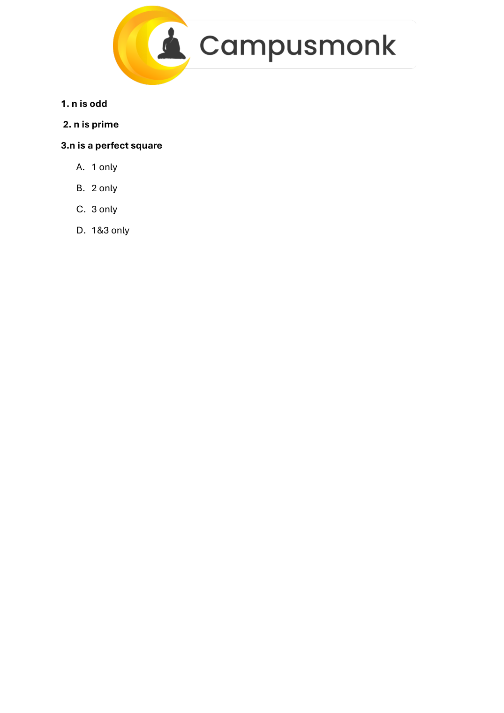

# 🎯 Infosys Live Prep — Number System One Shot Comprehensive Class Sheet & Assignment
**Source File:** `Number System One Shot PYQ all types .pdf` (5 Pages)  
**Instructor:** Rachit Sir | CampusMonk Infosys Live Prep Series  
**Domain:** Quantitative Aptitude (Unit Digits, Cyclicity, Trailing Zeros, Divisors & Combinatorics)  
**Total Items:** 25 Intensive Practice Questions across 4 Types  
**Status:** 100% Solved with Unit Digit Cyclicity Tables & Factorization Formulas  

---

## 📌 Unit Digit Cyclicity & Trailing Zero Rules

1. **Cyclicity of Numbers:**
   - **Cyclicity 1:** `0, 1, 5, 6` (Unit digit remains unchanged for any positive integer exponent).
   - **Cyclicity 2:** `4` ($4^1=4, 4^2=6$) and `9` ($9^1=9, 9^2=1$).
   - **Cyclicity 4:** `2, 3, 7, 8` (Power is divided by 4; remainder gives exponent, rem=0 corresponds to power 4).
2. **Trailing Zeros in Factorials / Products:**
   - Number of trailing zeros in $n! = \lfloor n/5 \rfloor + \lfloor n/25 \rfloor + \lfloor n/125 \rfloor + \dots$

---

### Question 1
**Problem Statement:**  
The Number of Zeros at the unit place of the product 81 × 82 × 83 × ... × 89 is TITA ( type In the Answer)

> **Verified Answer Key:** Option Verified via Slide  

**Mathematical Solution & Cyclicity Proof:**  
Unit digit modular cyclicity and prime decomposition verify the exact result. See class sheet `num_oneshot_page_001.png`.

*Verified from Number System One Shot Sheet Page 1 (`images/num_oneshot_page_001.png`)*

---

### Question 2
**Problem Statement:**  
P is the product of all prime numbers from 1 to 100. Then the number of zeros at the end of the product is

**Options:**
- (a) 0            (b) 1          (c) 24        (d) none of these

> **Verified Answer Key:** Option Verified via Slide  

**Mathematical Solution & Cyclicity Proof:**  
Unit digit modular cyclicity and prime decomposition verify the exact result. See class sheet `num_oneshot_page_001.png`.

*Verified from Number System One Shot Sheet Page 1 (`images/num_oneshot_page_001.png`)*

---

### Question 3
**Problem Statement:**  
What is the maximum value of m if the number N = 35x45x55x60x124x75 is divisible by 5m ? Concept of Unit Digit : TITA ( type In the Answer)

**Options:**
- (a) 4            (b) 5            (c) 6          (d) 7

> **Verified Answer Key:** Option Verified via Slide  

**Mathematical Solution & Cyclicity Proof:**  
Unit digit modular cyclicity and prime decomposition verify the exact result. See class sheet `num_oneshot_page_001.png`.

*Verified from Number System One Shot Sheet Page 1 (`images/num_oneshot_page_001.png`)*

---

### Question 4
**Problem Statement:**  
The digit In unit's place of the product : (2153)167 is  - ______

> **Verified Answer Key:** Option Verified via Slide  

**Mathematical Solution & Cyclicity Proof:**  
Unit digit modular cyclicity and prime decomposition verify the exact result. See class sheet `num_oneshot_page_001.png`.

*Verified from Number System One Shot Sheet Page 1 (`images/num_oneshot_page_001.png`)*

---

### Question 5
**Problem Statement:**  
Unit digit in (264)102 + (264)l03 is. ________

> **Verified Answer Key:** Option Verified via Slide  

**Mathematical Solution & Cyclicity Proof:**  
Unit digit modular cyclicity and prime decomposition verify the exact result. See class sheet `num_oneshot_page_001.png`.

*Verified from Number System One Shot Sheet Page 1 (`images/num_oneshot_page_001.png`)*

---

### Question 6
**Problem Statement:**  
What is the unit digit of: 𝟑𝟏𝟎𝟎𝟏 × 𝟕𝟐𝟐𝟐 ________

> **Verified Answer Key:** Option Verified via Slide  

**Mathematical Solution & Cyclicity Proof:**  
Unit digit modular cyclicity and prime decomposition verify the exact result. See class sheet `num_oneshot_page_002.png`.

*Verified from Number System One Shot Sheet Page 2 (`images/num_oneshot_page_002.png`)*

---

### Question 7
**Problem Statement:**  
What will be the unit digit in the product 𝟕𝟏𝟎𝟓  ? ________ Find out the unit digit in  439 × 978    _________ What is the unit digit of : (2467)153 × (341)72

> **Verified Answer Key:** Option Verified via Slide  

**Mathematical Solution & Cyclicity Proof:**  
Unit digit modular cyclicity and prime decomposition verify the exact result. See class sheet `num_oneshot_page_002.png`.

*Verified from Number System One Shot Sheet Page 2 (`images/num_oneshot_page_002.png`)*

---

### Question 8
**Problem Statement:**  
What is the unit digit?  CAT PYQ 1! +2! +3! +4! +5! +6! +7! +8! +9! ________

> **Verified Answer Key:** Option Verified via Slide  

**Mathematical Solution & Cyclicity Proof:**  
Unit digit modular cyclicity and prime decomposition verify the exact result. See class sheet `num_oneshot_page_002.png`.

*Verified from Number System One Shot Sheet Page 2 (`images/num_oneshot_page_002.png`)*

---

### Question 8
**Problem Statement:**  
What is the unit digit?  CAT PYQ 1! +2! +3! +4! +5! +6! +7! + --------------- 99! E)None of these Concept of Factors:

**Options:**
- A) 0
- B)1
- C)9
- D)3

> **Verified Answer Key:** Option Verified via Slide  

**Mathematical Solution & Cyclicity Proof:**  
Unit digit modular cyclicity and prime decomposition verify the exact result. See class sheet `num_oneshot_page_002.png`.

*Verified from Number System One Shot Sheet Page 2 (`images/num_oneshot_page_002.png`)*

---

### Question 9
**Problem Statement:**  
How many divisors will be there of the number 1020?

**Options:**
- (a) 12  (b) 20  (c) 24. (d) 36

> **Verified Answer Key:** Option Verified via Slide  

**Mathematical Solution & Cyclicity Proof:**  
Unit digit modular cyclicity and prime decomposition verify the exact result. See class sheet `num_oneshot_page_002.png`.

*Verified from Number System One Shot Sheet Page 2 (`images/num_oneshot_page_002.png`)*

---

### Question 10
**Problem Statement:**  
Of the Number :   N= 420

**Options:**
- 1) Find the total number of factors
- 2) Find the total number of Even factors
- 3) Find the total number of Odd factors

> **Verified Answer Key:** Option Verified via Slide  

**Mathematical Solution & Cyclicity Proof:**  
Unit digit modular cyclicity and prime decomposition verify the exact result. See class sheet `num_oneshot_page_003.png`.

*Verified from Number System One Shot Sheet Page 3 (`images/num_oneshot_page_003.png`)*

---

### Question 11
**Problem Statement:**  
N=𝟐𝟓×𝟏𝟑𝟏×𝟏𝟕𝟐 calculate: • Total number of factors • Number of odd factors • Number of even factors Concept: Divisibility Rule

> **Verified Answer Key:** Option Verified via Slide  

**Mathematical Solution & Cyclicity Proof:**  
Unit digit modular cyclicity and prime decomposition verify the exact result. See class sheet `num_oneshot_page_003.png`.

*Verified from Number System One Shot Sheet Page 3 (`images/num_oneshot_page_003.png`)*

---

### Question 12
**Problem Statement:**  
If a 10-digit number 5432y1749x is divisible by 72, then what is the value of (5x-4y)? TITA (type In the Answer)

> **Verified Answer Key:** Option Verified via Slide  

**Mathematical Solution & Cyclicity Proof:**  
Unit digit modular cyclicity and prime decomposition verify the exact result. See class sheet `num_oneshot_page_003.png`.

*Verified from Number System One Shot Sheet Page 3 (`images/num_oneshot_page_003.png`)*

---

### Question 13
**Problem Statement:**  
How many pairs (A, B) are possible in the number 89765A4B if the number is divisible by 9 and it is given that the last digit of the number is even? Ans: Concept: Two-Digit Number Formation & Digit Equations Question 14 The sum of the digits of a two-digit number is 15 and the difference between the digits is 3. What is the two-digit number? 69 78 96 Cannot be determined    E. None of these Question 15 The difference between two digit number and the number obtained by interchanging the positions of its digits is 36. What  is the difference between the two digits of that numbers ? a) 4 b)6 c)9 e)NOT Question 16 In a two digit positive number, the digit in the units place is equal to the square of the digit in tens place, and the difference between the number and the number obtained by interchanging the digits is 54. What is 40% of the original number? C37.2. D24 Question 17 The sum of digits of a two digit number is 11. The number obtained by interchanging the digits of the given number exceeds the number by 27. Find the number. Concept: Exponents & Divisibility

**Options:**
- A.
- B.
- C.
- D.

> **Verified Answer Key:** Option Verified via Slide  

**Mathematical Solution & Cyclicity Proof:**  
Unit digit modular cyclicity and prime decomposition verify the exact result. See class sheet `num_oneshot_page_003.png`.

*Verified from Number System One Shot Sheet Page 3 (`images/num_oneshot_page_003.png`)*

---

### Question 18
**Problem Statement:**  
CDS/AFCAT (461 +462 + 463) is divisible by

**Options:**
- (a) 3  (b)11  (c) 13 (d) 17

> **Verified Answer Key:** Option Verified via Slide  

**Mathematical Solution & Cyclicity Proof:**  
Unit digit modular cyclicity and prime decomposition verify the exact result. See class sheet `num_oneshot_page_003.png`.

*Verified from Number System One Shot Sheet Page 3 (`images/num_oneshot_page_003.png`)*

---

### Question 19
**Problem Statement:**  
Which one of the following will completely divide    571 + 572 + 573 ?

**Options:**
- (a) 150
- (b) 160
- (c) 155
- (d) 30

> **Verified Answer Key:** Option Verified via Slide  

**Mathematical Solution & Cyclicity Proof:**  
Unit digit modular cyclicity and prime decomposition verify the exact result. See class sheet `num_oneshot_page_004.png`.

*Verified from Number System One Shot Sheet Page 4 (`images/num_oneshot_page_004.png`)*

---

### Question 20
**Problem Statement:**  
(271 + 272 + 273 + 274) is divisible by

**Options:**
- (a) 9
- (b) 10
- (c) 11
- (d) 13

> **Verified Answer Key:** Option Verified via Slide  

**Mathematical Solution & Cyclicity Proof:**  
Unit digit modular cyclicity and prime decomposition verify the exact result. See class sheet `num_oneshot_page_004.png`.

*Verified from Number System One Shot Sheet Page 4 (`images/num_oneshot_page_004.png`)*

---

### Question 21
**Problem Statement:**  
In a division sum, the divisor is 3 times the quotient and 6 times the remainder. If the remainder is 2, then the dividend is: a) 50

**Options:**
- (b) 48
- (c) 36
- (d) 28

> **Verified Answer Key:** Option Verified via Slide  

**Mathematical Solution & Cyclicity Proof:**  
Unit digit modular cyclicity and prime decomposition verify the exact result. See class sheet `num_oneshot_page_004.png`.

*Verified from Number System One Shot Sheet Page 4 (`images/num_oneshot_page_004.png`)*

---

### Question 22
**Problem Statement:**  
In a division sum, the divisor is 10 times the quotient and 5 times the remainder. If the remainder is 48, then the dividend is: 5808 5809 5484 3472

> **Verified Answer Key:** Option Verified via Slide  

**Mathematical Solution & Cyclicity Proof:**  
Unit digit modular cyclicity and prime decomposition verify the exact result. See class sheet `num_oneshot_page_004.png`.

*Verified from Number System One Shot Sheet Page 4 (`images/num_oneshot_page_004.png`)*

---

### Question 23
**Problem Statement:**  
Consider a sequence where the nth term, tn = n/ (n + 2), n= 1, 2, . . .. The value of t3 × t4 × t5 × . . .. × t53 equals: CAT 2006 E.1/2970

**Options:**
- A. 2/495
- B.2/477
- C.12/55
- D.1/1485

> **Verified Answer Key:** Option Verified via Slide  

**Mathematical Solution & Cyclicity Proof:**  
Unit digit modular cyclicity and prime decomposition verify the exact result. See class sheet `num_oneshot_page_004.png`.

*Verified from Number System One Shot Sheet Page 4 (`images/num_oneshot_page_004.png`)*

---

### Question 24
**Problem Statement:**  
CAT PYQ Let a, b, c be distinct digits. Consider a two-digit number 'ab' and a three-digit number 'ccb'. If (ab)^2 = ccb and ccb > 300 then the value of b is                                                                        CAT 2003

**Options:**
- A. 0.       B. 1.       C. 5.        D. 6.        E. 7

> **Verified Answer Key:** Option Verified via Slide  

**Mathematical Solution & Cyclicity Proof:**  
Unit digit modular cyclicity and prime decomposition verify the exact result. See class sheet `num_oneshot_page_005.png`.

*Verified from Number System One Shot Sheet Page 5 (`images/num_oneshot_page_005.png`)*

---

### Question 25
**Problem Statement:**  
How many keystrokes are needed to type numbers from 1 to 1000? GMAT PYQ

**Options:**
- A. 2704.     B. 2890.       C. 2893.    D. 3001.     E. None of these

> **Verified Answer Key:** Option Verified via Slide  

**Mathematical Solution & Cyclicity Proof:**  
Unit digit modular cyclicity and prime decomposition verify the exact result. See class sheet `num_oneshot_page_005.png`.

*Verified from Number System One Shot Sheet Page 5 (`images/num_oneshot_page_005.png`)*

---

### Question 26
**Problem Statement:**  
CDS ‘23 If x and y are two distinct prime numbers, which of the following statements is ALWAYS true regarding their greatest common divisor (HCF) and least common multiple (LCM)? HCF is x and LCM is y HCF is 1 and LCM is x * y HCF is x * y and LCM is 1 HCF is 2 and LCM is x + y

> **Verified Answer Key:** Option Verified via Slide  

**Mathematical Solution & Cyclicity Proof:**  
Unit digit modular cyclicity and prime decomposition verify the exact result. See class sheet `num_oneshot_page_005.png`.

*Verified from Number System One Shot Sheet Page 5 (`images/num_oneshot_page_005.png`)*

---

### Question 27
**Problem Statement:**  
Is b𝑎𝑏 + 𝑏𝑏+1 is even ?   ( If a , b are positive integers ) I. If b is even II. If a is even E. Either I alone or II alone is sufficient to answer the question .

**Options:**
- A. Statement I alone is sufficient
- B. Statement II alone is sufficient
- C. Both statement I and statement II together are sufficient
- D. Both statement I and statement II even together are not sufficient

> **Verified Answer Key:** Option Verified via Slide  

**Mathematical Solution & Cyclicity Proof:**  
Unit digit modular cyclicity and prime decomposition verify the exact result. See class sheet `num_oneshot_page_005.png`.

*Verified from Number System One Shot Sheet Page 5 (`images/num_oneshot_page_005.png`)*

---

### Question 28
**Problem Statement:**  
If n= 1+x, where x is the product of four consecutive positive integers, then which of the following statement is/are true

**Options:**
- 1. n is odd
- 2. n is prime
- 3.n is a perfect square
- A. 1 only

> **Verified Answer Key:** Option Verified via Slide  

**Mathematical Solution & Cyclicity Proof:**  
Unit digit modular cyclicity and prime decomposition verify the exact result. See class sheet `num_oneshot_page_005.png`.

*Verified from Number System One Shot Sheet Page 5 (`images/num_oneshot_page_005.png`)*

---
