# 💻 Infosys Live Coding PYQ Master Class — Part 1 (Majority Element II, 3Sum, Maximum Product Subarray)
**Source Document:** `2 PYQ Coding Prep.pdf`  
**Instructor:** Itika Ma'am | CampusMonk Live Coding Master Series  
**Target Role:** Infosys Specialist Programmer (SP) / Digital Specialist Engineer (DSE) / Systems Engineer (SE)  
**Total Problems:** 3 Master Algorithmic Challenges  
**Multi-Language Coverage:** Python 3, C++ (STL), and Java 17 Production Implementations  
**Status:** 100% Solved with Optimal Complexities, Edge Cases & Slide Figures  

---

## 🔷 229. Majority Element II (Elements appearing > n/3 times)
**Problem ID:** `LIVE_CODING_01` | **Difficulty:** Medium (Infosys SP / DSE / SE Coding Round)  
**Category:** Live Coding & Algorithms | **Topic:** Arrays & Boyer-Moore Voting Algorithm  

### Problem Description
Given an integer array of size n, find all elements that appear more than ⌊ n/3 ⌋ times. The algorithm must run in linear O(N) time and O(1) auxiliary space.

### Constraints
- `1 <= nums.length <= 5 * 10^4`
- `-10^9 <= nums[i] <= 10^9`

### Example Test Cases
**Example 1:**
- **Input:** `nums = [3, 2, 3]`
- **Output:** `[3]`
- **Explanation:** 3 appears 2 times, which is strictly greater than ⌊3/3⌋ = 1.

**Example 2:**
- **Input:** `nums = [1]`
- **Output:** `[1]`
- **Explanation:** 1 appears 1 time, which is strictly greater than ⌊1/3⌋ = 0.

**Example 3:**
- **Input:** `nums = [1, 2]`
- **Output:** `[1, 2]`
- **Explanation:** Both 1 and 2 appear 1 time, which is greater than ⌊2/3⌋ = 0.

### Original Live Class Slide Diagrams
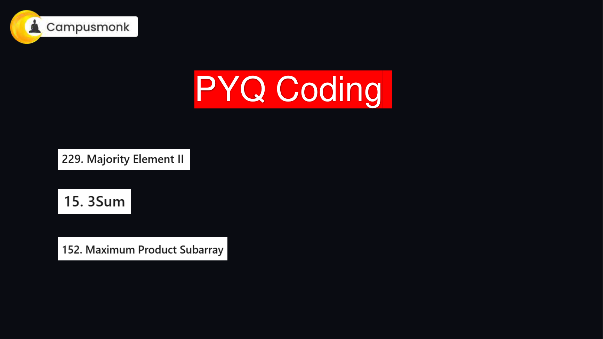
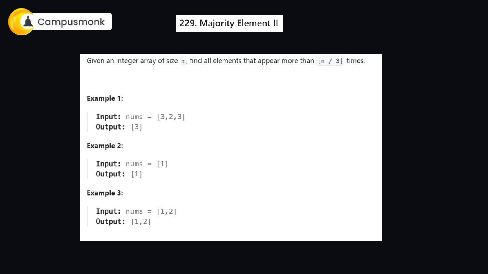
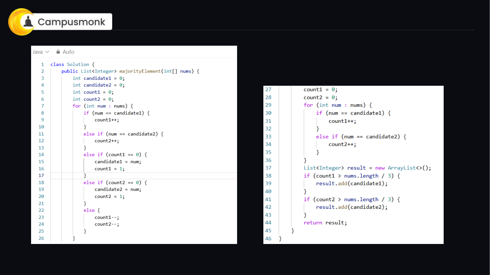

### Extended Boyer-Moore Voting Algorithm
1. **Mathematical Observation**: In any array of length n, there can be at most **two** elements that appear strictly more than `⌊n/3⌋` times because `3 * (⌊n/3⌋ + 1) > n`.
2. **First Pass (Candidate Identification)**: Maintain two potential candidates (`cand1`, `cand2`) and their corresponding vote counters (`count1`, `count2`).
   - If current number equals `cand1`, increment `count1`.
   - Else if current number equals `cand2`, increment `count2`.
   - Else if `count1 == 0`, assign `cand1 = num` and set `count1 = 1`.
   - Else if `count2 == 0`, assign `cand2 = num` and set `count2 = 1`.
   - Otherwise, decrement both `count1` and `count2`.
3. **Second Pass (Verification)**: Reset frequencies of `cand1` and `cand2` to 0. Traverse the array to count their exact occurrences. If either candidate occurs more than `n // 3` times, append it to the result list.
4. **Complexity**:
   - **Time Complexity:** `O(N)` two-pass linear traversal.
   - **Auxiliary Space:** `O(1)` as only candidate variables and counter registers are allocated.

### Multi-Language Optimal Implementations

#### 🐍 Python 3 Solution
```python
class Solution:
    def majorityElement(self, nums: list[int]) -> list[int]:
        if not nums:
            return []
        
        cand1, cand2 = None, None
        count1, count2 = 0, 0
        
        # Step 1: Find potential candidates
        for num in nums:
            if num == cand1:
                count1 += 1
            elif num == cand2:
                count2 += 1
            elif count1 == 0:
                cand1, count1 = num, 1
            elif count2 == 0:
                cand2, count2 = num, 1
            else:
                count1 -= 1
                count2 -= 1
                
        # Step 2: Verify candidate frequencies
        threshold = len(nums) // 3
        result = []
        c1_actual = sum(1 for x in nums if x == cand1)
        c2_actual = sum(1 for x in nums if x == cand2)
        
        if c1_actual > threshold:
            result.append(cand1)
        if cand2 != cand1 and c2_actual > threshold:
            result.append(cand2)
            
        return result
```

#### ⚡ C++ (Modern STL) Solution
```cpp
#include <vector>
using namespace std;

class Solution {
public:
    vector<int> majorityElement(vector<int>& nums) {
        int n = nums.size();
        int cand1 = 0, cand2 = 0, count1 = 0, count2 = 0;
        
        for (int num : nums) {
            if (num == cand1) count1++;
            else if (num == cand2) count2++;
            else if (count1 == 0) { cand1 = num; count1 = 1; }
            else if (count2 == 0) { cand2 = num; count2 = 1; }
            else { count1--; count2--; }
        }
        
        count1 = 0; count2 = 0;
        for (int num : nums) {
            if (num == cand1) count1++;
            else if (num == cand2) count2++;
        }
        
        vector<int> result;
        int threshold = n / 3;
        if (count1 > threshold) result.push_back(cand1);
        if (count2 > threshold) result.push_back(cand2);
        return result;
    }
};
```

#### ☕ Java 17 Solution
```java
import java.util.ArrayList;
import java.util.List;

class Solution {
    public List<Integer> majorityElement(int[] nums) {
        int n = nums.length;
        Integer cand1 = null, cand2 = null;
        int count1 = 0, count2 = 0;
        
        for (int num : nums) {
            if (cand1 != null && num == cand1) count1++;
            else if (cand2 != null && num == cand2) count2++;
            else if (count1 == 0) { cand1 = num; count1 = 1; }
            else if (count2 == 0) { cand2 = num; count2 = 1; }
            else { count1--; count2--; }
        }
        
        count1 = 0; count2 = 0;
        for (int num : nums) {
            if (cand1 != null && num == cand1) count1++;
            if (cand2 != null && num == cand2) count2++;
        }
        
        List<Integer> result = new ArrayList<>();
        int threshold = n / 3;
        if (cand1 != null && count1 > threshold) result.add(cand1);
        if (cand2 != null && cand2 != cand1 && count2 > threshold) result.add(cand2);
        return result;
    }
}
```

---

## 🔷 15. 3Sum (All Unique Triplets Summing to Zero)
**Problem ID:** `LIVE_CODING_02` | **Difficulty:** Medium (Infosys SE / SP Coding Round)  
**Category:** Live Coding & Algorithms | **Topic:** Arrays, Two Pointers & Sorting  

### Problem Description
Given an integer array nums, return all the triplets [nums[i], nums[j], nums[k]] such that i != j, i != k, and j != k, and nums[i] + nums[j] + nums[k] == 0. Notice that the solution set must not contain duplicate triplets.

### Constraints
- `3 <= nums.length <= 3000`
- `-10^5 <= nums[i] <= 10^5`

### Example Test Cases
**Example 1:**
- **Input:** `nums = [-1, 0, 1, 2, -1, -4]`
- **Output:** `[[-1, -1, 2], [-1, 0, 1]]`
- **Explanation:** Triplets sum to 0: (-1) + (-1) + 2 = 0, and (-1) + 0 + 1 = 0.

**Example 2:**
- **Input:** `nums = [0, 1, 1]`
- **Output:** `[]`
- **Explanation:** No possible triplet sums to 0.

**Example 3:**
- **Input:** `nums = [0, 0, 0]`
- **Output:** `[[0, 0, 0]]`
- **Explanation:** The only triplet sums to 0.

### Original Live Class Slide Diagrams
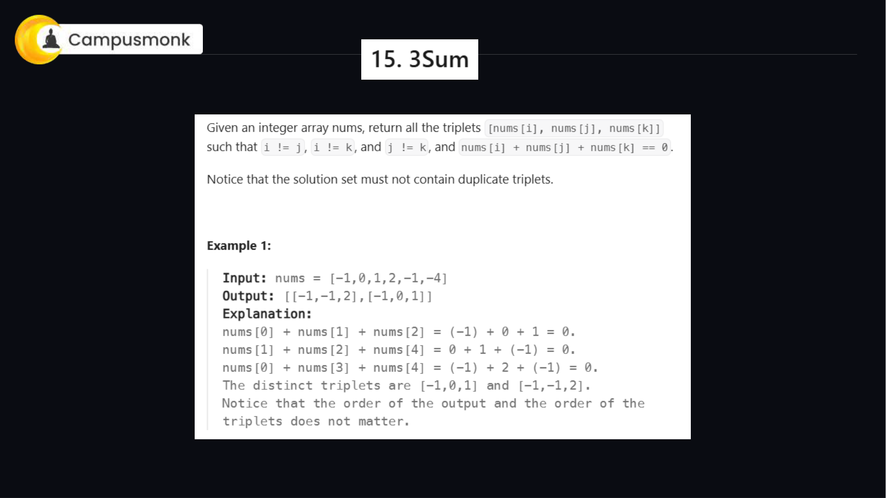
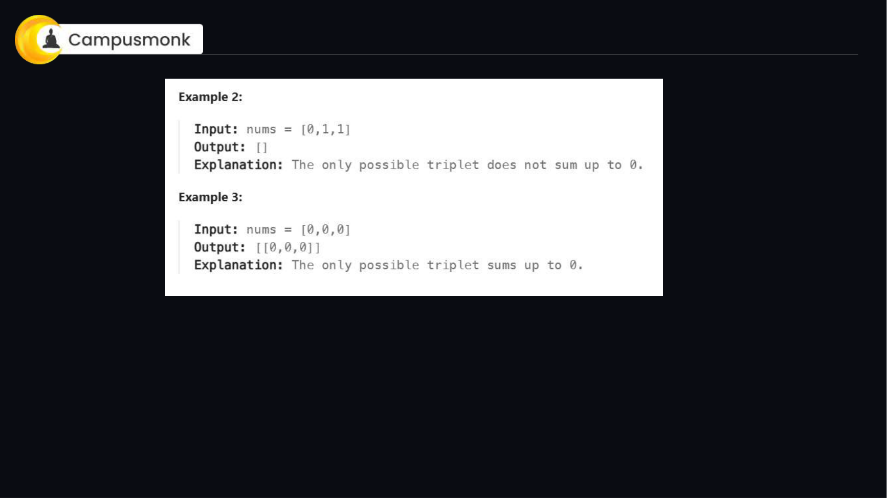
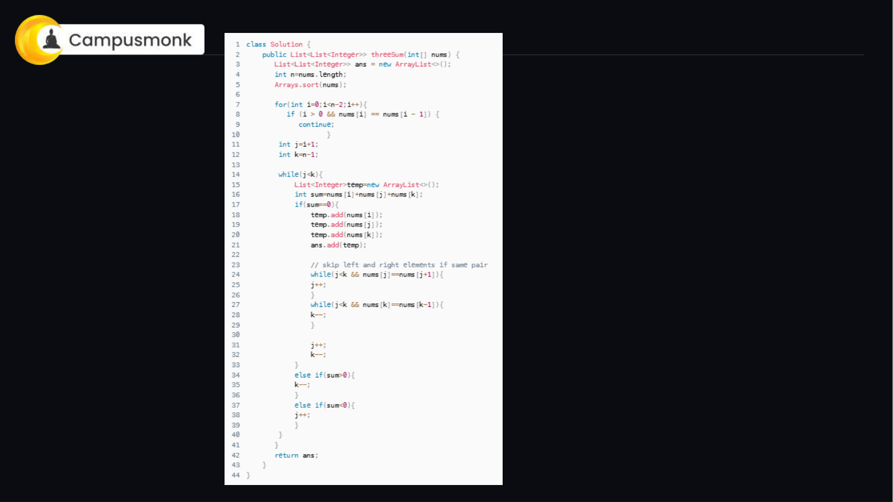
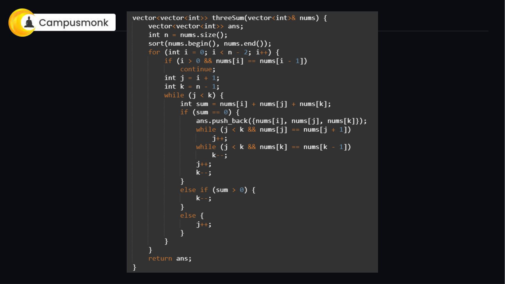
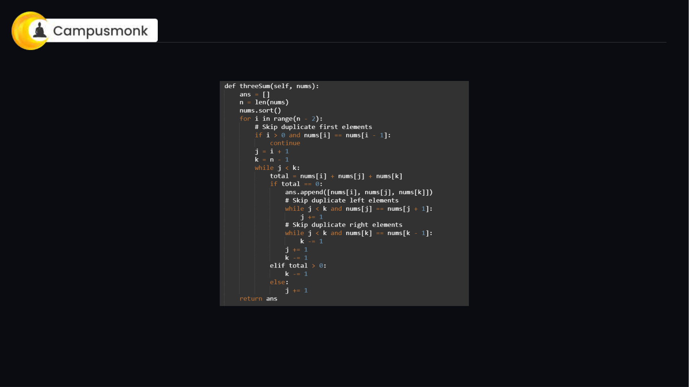

### Two-Pointer Sorting Paradigm
1. **Sort Array**: Sort `nums` in ascending order (`O(N log N)`). Sorting enables two-pointer convergence and easy duplicate pruning.
2. **Iterate First Element**: Loop `i` from `0` to `n - 3`.
   - If `i > 0` and `nums[i] == nums[i - 1]`, skip to avoid duplicate triplets for the first element.
   - If `nums[i] > 0`, break early because all remaining elements are positive, making a zero sum impossible.
3. **Two-Pointer Scan**: Set `left = i + 1` and `right = n - 1`.
   - Calculate `current_sum = nums[i] + nums[left] + nums[right]`.
   - If `current_sum == 0`, record `[nums[i], nums[left], nums[right]]`. Advance `left` while skipping duplicates (`nums[left] == nums[left + 1]`). Decrement `right` while skipping duplicates (`nums[right] == nums[right - 1]`). Finally, increment `left` and decrement `right`.
   - If `current_sum < 0`, increment `left` to increase sum.
   - If `current_sum > 0`, decrement `right` to decrease sum.
4. **Complexity**:
   - **Time Complexity:** `O(N²)` where sorting is `O(N log N)` and nested two-pointer traversal takes `O(N²)`.
   - **Auxiliary Space:** `O(1)` or `O(log N)` for sorting stack.

### Multi-Language Optimal Implementations

#### 🐍 Python 3 Solution
```python
class Solution:
    def threeSum(self, nums: list[int]) -> list[list[int]]:
        nums.sort()
        n = len(nums)
        ans = []
        
        for i in range(n - 2):
            # Early break if smallest element is positive
            if nums[i] > 0:
                break
            # Skip duplicates for the first element
            if i > 0 and nums[i] == nums[i - 1]:
                continue
                
            left, right = i + 1, n - 1
            while left < right:
                total = nums[i] + nums[left] + nums[right]
                if total == 0:
                    ans.append([nums[i], nums[left], nums[right]])
                    # Skip duplicate second and third elements
                    while left < right and nums[left] == nums[left + 1]:
                        left += 1
                    while left < right and nums[right] == nums[right - 1]:
                        right -= 1
                    left += 1
                    right -= 1
                elif total < 0:
                    left += 1
                else:
                    right -= 1
                    
        return ans
```

#### ⚡ C++ (Modern STL) Solution
```cpp
#include <vector>
#include <algorithm>
using namespace std;

class Solution {
public:
    vector<vector<int>> threeSum(vector<int>& nums) {
        vector<vector<int>> ans;
        int n = nums.size();
        sort(nums.begin(), nums.end());
        
        for (int i = 0; i < n - 2; i++) {
            if (nums[i] > 0) break;
            if (i > 0 && nums[i] == nums[i - 1]) continue;
            
            int left = i + 1, right = n - 1;
            while (left < right) {
                int sum = nums[i] + nums[left] + nums[right];
                if (sum == 0) {
                    ans.push_back({nums[i], nums[left], nums[right]});
                    while (left < right && nums[left] == nums[left + 1]) left++;
                    while (left < right && nums[right] == nums[right - 1]) right--;
                    left++; right--;
                } else if (sum < 0) {
                    left++;
                } else {
                    right--;
                }
            }
        }
        return ans;
    }
};
```

#### ☕ Java 17 Solution
```java
import java.util.ArrayList;
import java.util.Arrays;
import java.util.List;

class Solution {
    public List<List<Integer>> threeSum(int[] nums) {
        List<List<Integer>> ans = new ArrayList<>();
        int n = nums.length;
        Arrays.sort(nums);
        
        for (int i = 0; i < n - 2; i++) {
            if (nums[i] > 0) break;
            if (i > 0 && nums[i] == nums[i - 1]) continue;
            
            int left = i + 1, right = n - 1;
            while (left < right) {
                int sum = nums[i] + nums[left] + nums[right];
                if (sum == 0) {
                    ans.add(Arrays.asList(nums[i], nums[left], nums[right]));
                    while (left < right && nums[left] == nums[left + 1]) left++;
                    while (left < right && nums[right] == nums[right - 1]) right--;
                    left++; right--;
                } else if (sum < 0) {
                    left++;
                } else {
                    right--;
                }
            }
        }
        return ans;
    }
}
```

---

## 🔷 152. Maximum Product Subarray
**Problem ID:** `LIVE_CODING_03` | **Difficulty:** Medium (Infosys / TCS Digital Coding Round)  
**Category:** Live Coding & Algorithms | **Topic:** Dynamic Programming & Array Optimization  

### Problem Description
Given an integer array nums, find a contiguous non-empty subarray that has the largest product, and return the product. The test cases are generated so that the answer will fit in a 32-bit integer.

### Constraints
- `1 <= nums.length <= 2 * 10^4`
- `-10 <= nums[i] <= 10`

### Example Test Cases
**Example 1:**
- **Input:** `nums = [2, 3, -2, 4]`
- **Output:** `6`
- **Explanation:** [2, 3] has the largest product 6.

**Example 2:**
- **Input:** `nums = [-2, 0, -1]`
- **Output:** `0`
- **Explanation:** The result cannot be 2, because [-2, -1] is not a subarray.

### Original Live Class Slide Diagrams
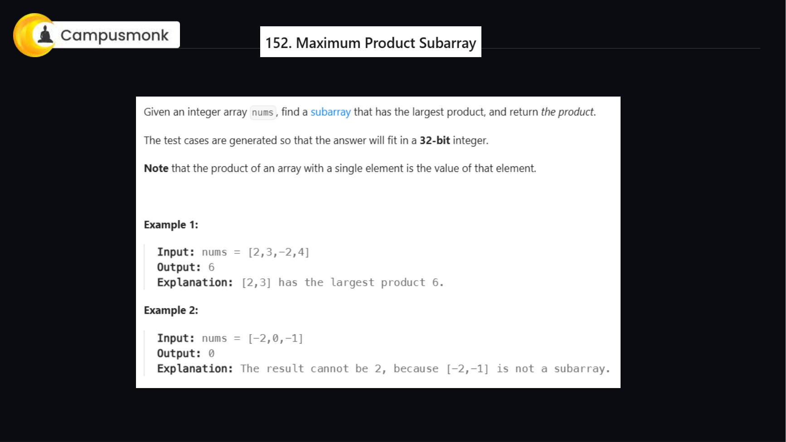
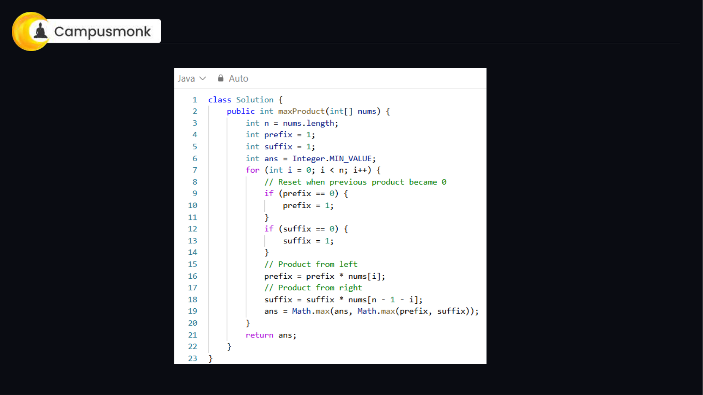
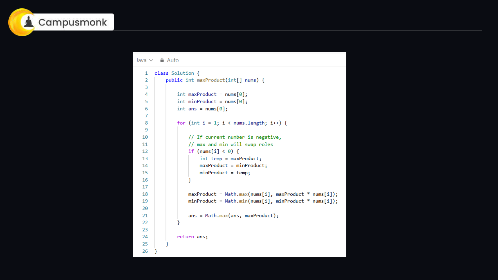

### Kadane's Dual Dynamic Programming Tracking
1. **Core Challenge**: Unlike maximum sum where negatives always reduce sum, multiplying two negative numbers creates a positive product. A very small negative product can flip into a huge positive product when multiplied by another negative number.
2. **State Tracking**: At each index `i`, maintain:
   - `max_prod`: Maximum product ending at index `i`.
   - `min_prod`: Minimum product ending at index `i` (which may flip to positive).
3. **Transition**:
   - When encountering a negative number `nums[i] < 0`, swap `max_prod` and `min_prod`.
   - `max_prod = max(nums[i], max_prod * nums[i])`
   - `min_prod = min(nums[i], min_prod * nums[i])`
   - `global_max = max(global_max, max_prod)`
4. **Complexity**:
   - **Time Complexity:** `O(N)` single linear pass.
   - **Auxiliary Space:** `O(1)` as only three variables are maintained.

### Multi-Language Optimal Implementations

#### 🐍 Python 3 Solution
```python
class Solution:
    def maxProduct(self, nums: list[int]) -> int:
        if not nums:
            return 0
            
        global_max = nums[0]
        cur_max = nums[0]
        cur_min = nums[0]
        
        for i in range(1, len(nums)):
            x = nums[i]
            if x < 0:
                cur_max, cur_min = cur_min, cur_max
                
            cur_max = max(x, cur_max * x)
            cur_min = min(x, cur_min * x)
            
            global_max = max(global_max, cur_max)
            
        return global_max
```

#### ⚡ C++ (Modern STL) Solution
```cpp
#include <vector>
#include <algorithm>
using namespace std;

class Solution {
public:
    int maxProduct(vector<int>& nums) {
        if (nums.empty()) return 0;
        int global_max = nums[0];
        int cur_max = nums[0], cur_min = nums[0];
        
        for (size_t i = 1; i < nums.size(); i++) {
            int x = nums[i];
            if (x < 0) swap(cur_max, cur_min);
            cur_max = max(x, cur_max * x);
            cur_min = min(x, cur_min * x);
            global_max = max(global_max, cur_max);
        }
        return global_max;
    }
};
```

#### ☕ Java 17 Solution
```java
class Solution {
    public int maxProduct(int[] nums) {
        if (nums == null || nums.length == 0) return 0;
        int global_max = nums[0];
        int cur_max = nums[0], cur_min = nums[0];
        
        for (int i = 1; i < nums.length; i++) {
            int x = nums[i];
            if (x < 0) {
                int temp = cur_max;
                cur_max = cur_min;
                cur_min = temp;
            }
            cur_max = Math.max(x, cur_max * x);
            cur_min = Math.min(x, cur_min * x);
            global_max = Math.max(global_max, cur_max);
        }
        return global_max;
    }
}
```

---
