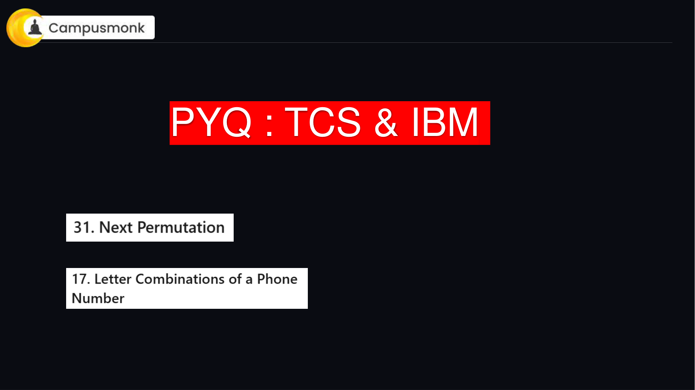
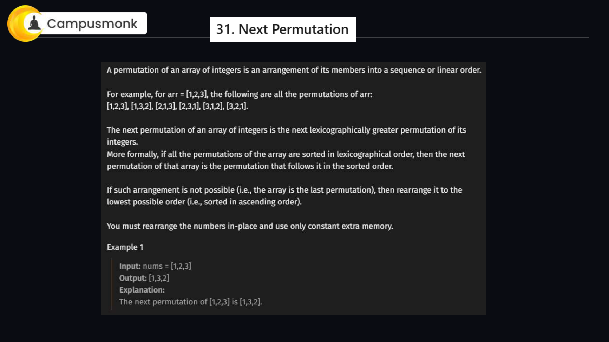
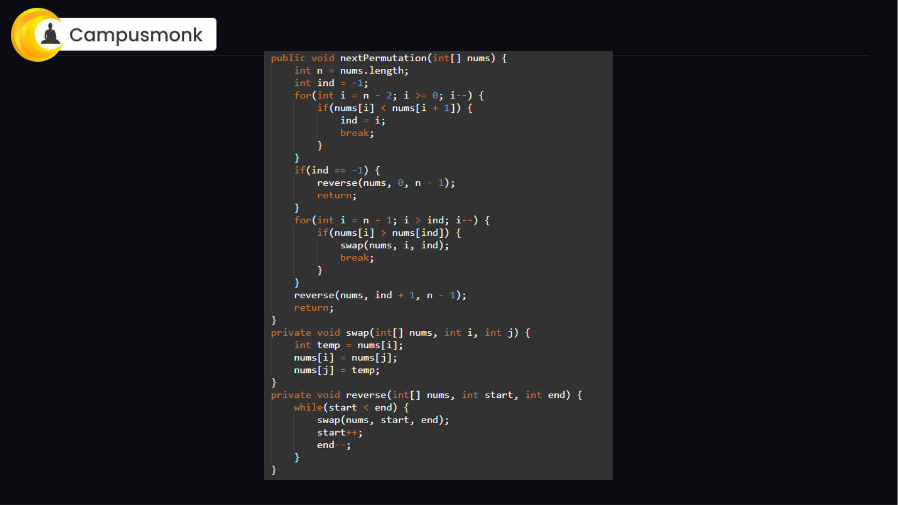
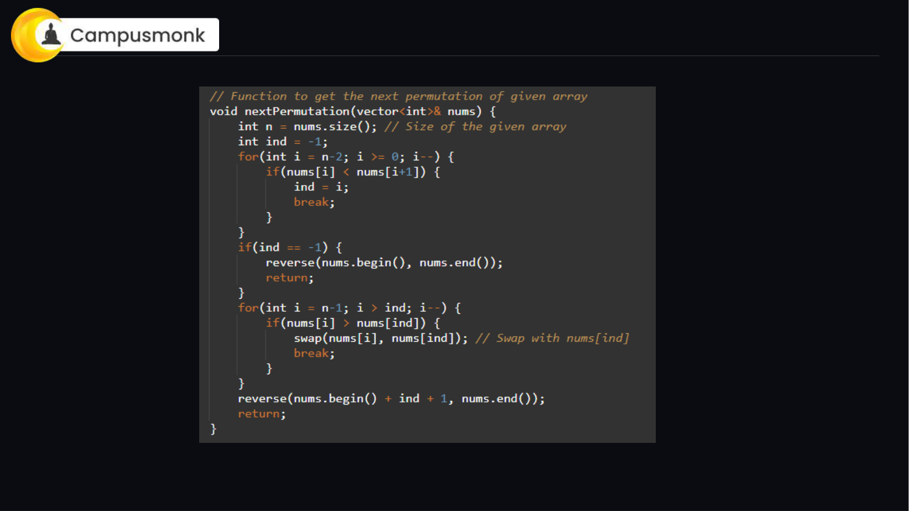
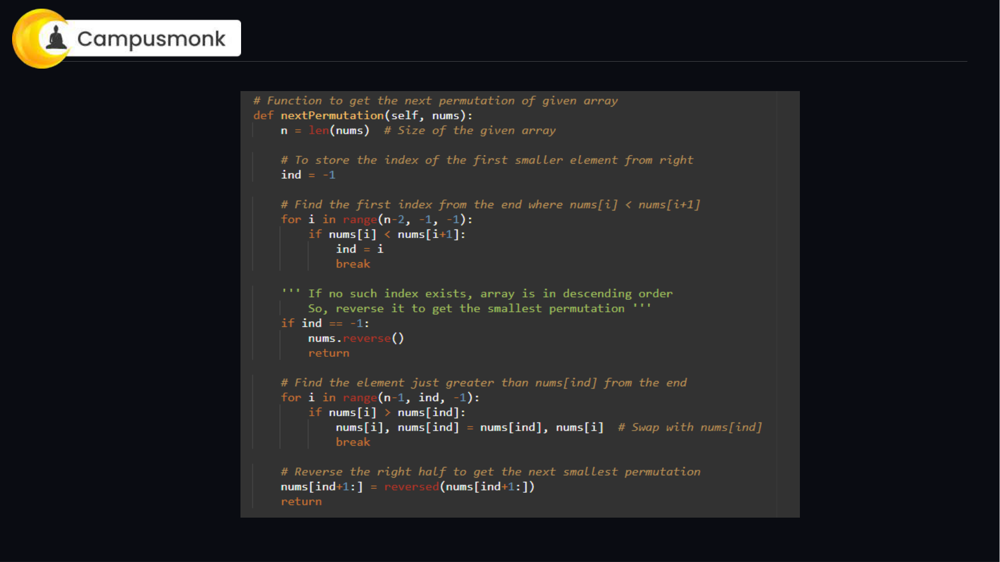
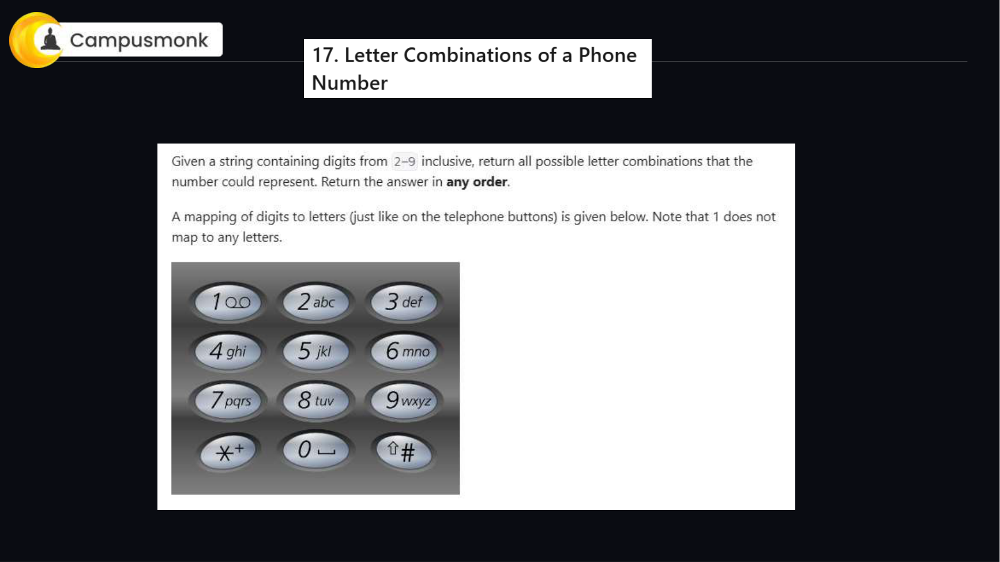
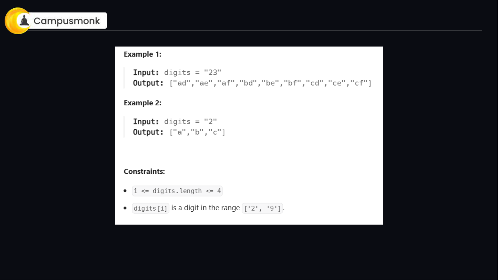
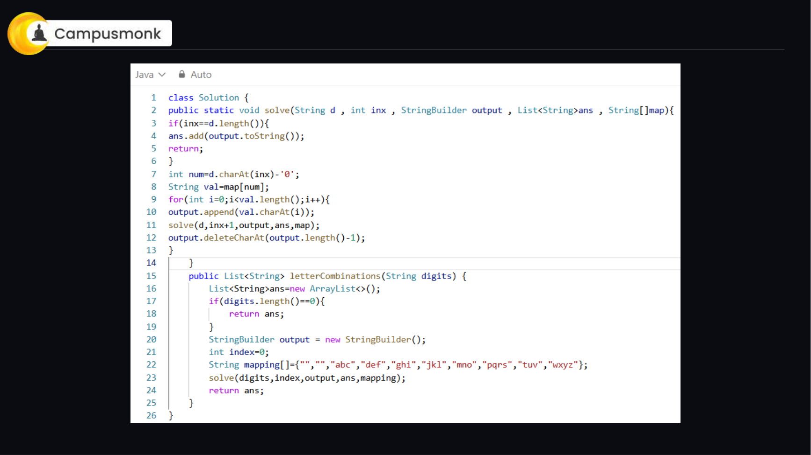
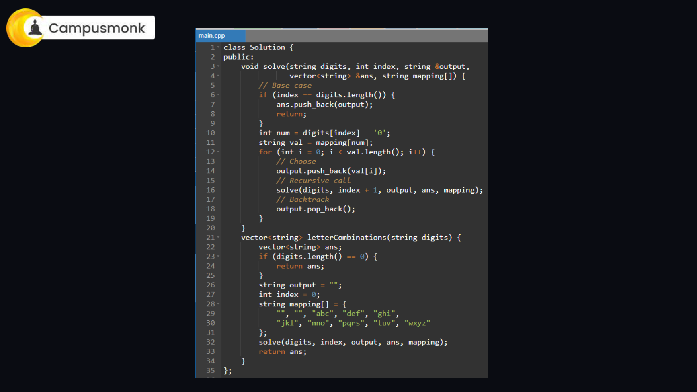
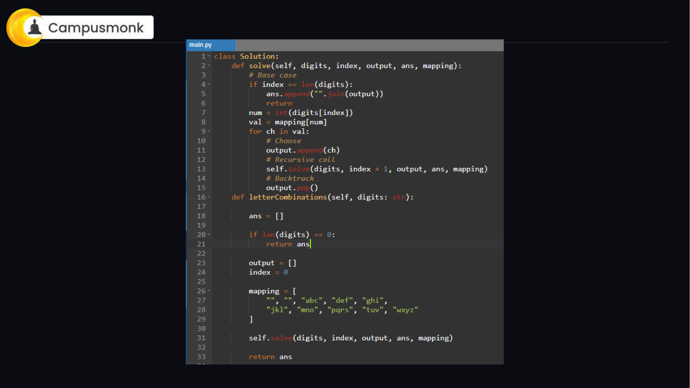

# 💻 Infosys Live Coding PYQ Master Class — Part 2 (Next Permutation, Letter Combinations of Phone Number)
**Source Document:** `3 PYQ Coding Question Prep.pdf`  
**Instructor:** Itika Ma'am | CampusMonk Live Coding Master Series  
**Target Role:** Infosys Specialist Programmer (SP) / Digital Specialist Engineer (DSE) / Systems Engineer (SE)  
**Total Problems:** 2 Master Algorithmic Challenges  
**Multi-Language Coverage:** Python 3, C++ (STL), and Java 17 Production Implementations  
**Status:** 100% Solved with Optimal Complexities, Edge Cases & Slide Figures  

---

## 🔷 31. Next Permutation
**Problem ID:** `LIVE_CODING_04` | **Difficulty:** Medium (Infosys / TCS / IBM Core Coding Round)  
**Category:** Live Coding & Algorithms | **Topic:** Arrays & Lexicographical Permutation  

### Problem Description
A permutation of an array of integers is an arrangement of its members into a sequence or linear order. The next permutation of an array of integers is the next lexicographically greater permutation. Rearrange numbers into the lexicographically next greater permutation of numbers in-place with O(1) extra memory.

### Constraints
- `1 <= nums.length <= 100`
- `0 <= nums[i] <= 100`

### Example Test Cases
**Example 1:**
- **Input:** `nums = [1, 2, 3]`
- **Output:** `[1, 3, 2]`
- **Explanation:** Lexicographically next greater permutation is [1, 3, 2].

**Example 2:**
- **Input:** `nums = [3, 2, 1]`
- **Output:** `[1, 2, 3]`
- **Explanation:** Entire array is in descending order; wrap around to smallest sorted permutation.

**Example 3:**
- **Input:** `nums = [1, 1, 5]`
- **Output:** `[1, 5, 1]`
- **Explanation:** Next permutation is [1, 5, 1].

### Original Live Class Slide Diagrams






### Single Pass In-Place Transformation
1. **Find Pivot Index (`ind`)**: Traverse from right to left to locate the first index `i` such that `nums[i] < nums[i + 1]`. The suffix to the right of `i` is sorted in non-increasing order.
2. **Handle Descending Arrays**: If no such index exists (`ind == -1`), the entire array is in descending order. Reverse the entire array to convert it into the smallest permutation.
3. **Find Successor to Swap**: If `ind != -1`, scan from the right end towards `ind` to find the first element `nums[j] > nums[ind]`. Swap `nums[ind]` with `nums[j]`.
4. **Reverse Suffix**: Reverse all elements from index `ind + 1` to `n - 1`. Since the suffix was in descending order, reversing it puts it into ascending order, which is the smallest lexicographical arrangement.
5. **Complexity**:
   - **Time Complexity:** `O(N)` linear traversal and reversal.
   - **Auxiliary Space:** `O(1)` strictly in-place modification.

### Multi-Language Optimal Implementations

#### 🐍 Python 3 Solution
```python
class Solution:
    def nextPermutation(self, nums: list[int]) -> None:
        n = len(nums)
        ind = -1
        
        # Step 1: Find the break point
        for i in range(n - 2, -1, -1):
            if nums[i] < nums[i + 1]:
                ind = i
                break
                
        # If no break point, reverse entire array
        if ind == -1:
            nums.reverse()
            return
            
        # Step 2: Find next greater element from right
        for i in range(n - 1, ind, -1):
            if nums[i] > nums[ind]:
                nums[i], nums[ind] = nums[ind], nums[i]
                break
                
        # Step 3: Reverse the remaining suffix
        nums[ind + 1:] = reversed(nums[ind + 1:])
```

#### ⚡ C++ (Modern STL) Solution
```cpp
#include <vector>
#include <algorithm>
using namespace std;

class Solution {
public:
    void nextPermutation(vector<int>& nums) {
        int n = nums.size();
        int ind = -1;
        
        for (int i = n - 2; i >= 0; i--) {
            if (nums[i] < nums[i + 1]) {
                ind = i;
                break;
            }
        }
        
        if (ind == -1) {
            reverse(nums.begin(), nums.end());
            return;
        }
        
        for (int i = n - 1; i > ind; i--) {
            if (nums[i] > nums[ind]) {
                swap(nums[i], nums[ind]);
                break;
            }
        }
        
        reverse(nums.begin() + ind + 1, nums.end());
    }
};
```

#### ☕ Java 17 Solution
```java
class Solution {
    public void nextPermutation(int[] nums) {
        int n = nums.length;
        int ind = -1;
        
        for (int i = n - 2; i >= 0; i--) {
            if (nums[i] < nums[i + 1]) {
                ind = i;
                break;
            }
        }
        
        if (ind == -1) {
            reverse(nums, 0, n - 1);
            return;
        }
        
        for (int i = n - 1; i > ind; i--) {
            if (nums[i] > nums[ind]) {
                swap(nums, i, ind);
                break;
            }
        }
        
        reverse(nums, ind + 1, n - 1);
    }
    
    private void reverse(int[] nums, int start, int end) {
        while (start < end) {
            swap(nums, start++, end--);
        }
    }
    
    private void swap(int[] nums, int i, int j) {
        int temp = nums[i];
        nums[i] = nums[j];
        nums[j] = temp;
    }
}
```

---

## 🔷 17. Letter Combinations of a Phone Number
**Problem ID:** `LIVE_CODING_05` | **Difficulty:** Medium (Infosys SE / TCS NQT Coding Round)  
**Category:** Live Coding & Algorithms | **Topic:** Strings, Backtracking & Recursion  

### Problem Description
Given a string containing digits from 2-9 inclusive, return all possible letter combinations that the number could represent. Return the answer in any order. Mapping of digits to letters corresponds to telephone dial buttons.

### Constraints
- `0 <= digits.length <= 4`
- `digits[i] is a digit in the range ['2', '9'].`

### Example Test Cases
**Example 1:**
- **Input:** `digits = "23"`
- **Output:** `["ad","ae","af","bd","be","bf","cd","ce","cf"]`
- **Explanation:** 2 maps to 'abc', 3 maps to 'def'.

**Example 2:**
- **Input:** `digits = ""`
- **Output:** `[]`
- **Explanation:** Empty input produces empty list.

**Example 3:**
- **Input:** `digits = "2"`
- **Output:** `["a","b","c"]`
- **Explanation:** 2 maps to 'abc'.

### Original Live Class Slide Diagrams






### Recursive Depth-First Backtracking
1. **Telephone Keypad Mapping**:
   - '2': "abc", '3': "def", '4': "ghi", '5': "jkl"
   - '6': "mno", '7': "pqrs", '8': "tuv", '9': "wxyz"
2. **Base Case**: When current combination length equals `digits.length`, append the combination string to the result.
3. **Recursive Exploration**:
   - Extract the letters mapped to `digits[index]`.
   - For each letter in the mapped string, append to current path, recurse for `index + 1`, and backtrack (pop the character).
4. **Complexity**:
   - **Time Complexity:** `O(4^N * N)` where N is length of digits string (max 4). At most `4^4 = 256` leaves.
   - **Auxiliary Space:** `O(N)` recursion stack depth.

### Multi-Language Optimal Implementations

#### 🐍 Python 3 Solution
```python
class Solution:
    def letterCombinations(self, digits: str) -> list[str]:
        if not digits:
            return []
            
        mapping = {
            "2": "abc", "3": "def", "4": "ghi", "5": "jkl",
            "6": "mno", "7": "pqrs", "8": "tuv", "9": "wxyz"
        }
        
        result = []
        
        def backtrack(index: int, path: list[str]):
            if index == len(digits):
                result.append("".join(path))
                return
                
            possible_letters = mapping[digits[index]]
            for letter in possible_letters:
                path.append(letter)
                backtrack(index + 1, path)
                path.pop()
                
        backtrack(0, [])
        return result
```

#### ⚡ C++ (Modern STL) Solution
```cpp
#include <vector>
#include <string>
using namespace std;

class Solution {
private:
    const vector<string> mapping = {
        "", "", "abc", "def", "ghi", "jkl", "mno", "pqrs", "tuv", "wxyz"
    };
    
    void backtrack(int index, const string& digits, string& current, vector<string>& result) {
        if (index == digits.length()) {
            result.push_back(current);
            return;
        }
        
        int digit = digits[index] - '0';
        for (char ch : mapping[digit]) {
            current.push_back(ch);
            backtrack(index + 1, digits, current, result);
            current.pop_back();
        }
    }
public:
    vector<string> letterCombinations(string digits) {
        if (digits.empty()) return {};
        vector<string> result;
        string current = "";
        backtrack(0, digits, current, result);
        return result;
    }
};
```

#### ☕ Java 17 Solution
```java
import java.util.ArrayList;
import java.util.List;

class Solution {
    private final String[] mapping = {
        "", "", "abc", "def", "ghi", "jkl", "mno", "pqrs", "tuv", "wxyz"
    };
    
    public List<String> letterCombinations(String digits) {
        List<String> result = new ArrayList<>();
        if (digits == null || digits.length() == 0) return result;
        backtrack(0, digits, new StringBuilder(), result);
        return result;
    }
    
    private void backtrack(int index, String digits, StringBuilder current, List<String> result) {
        if (index == digits.length()) {
            result.add(current.toString());
            return;
        }
        
        int digit = digits.charAt(index) - '0';
        String letters = mapping[digit];
        for (int i = 0; i < letters.length(); i++) {
            current.append(letters.charAt(i));
            backtrack(index + 1, digits, current, result);
            current.deleteCharAt(current.length() - 1);
        }
    }
}
```

---
