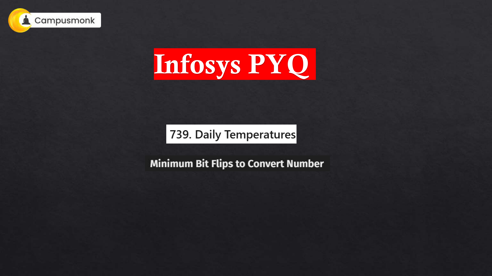
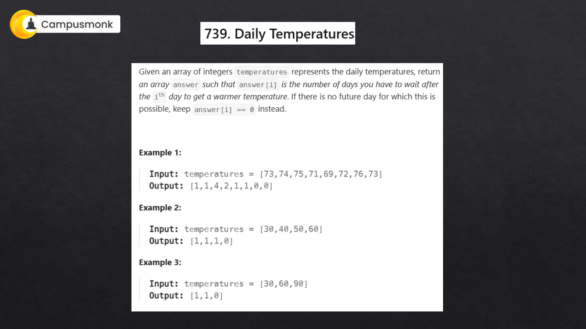
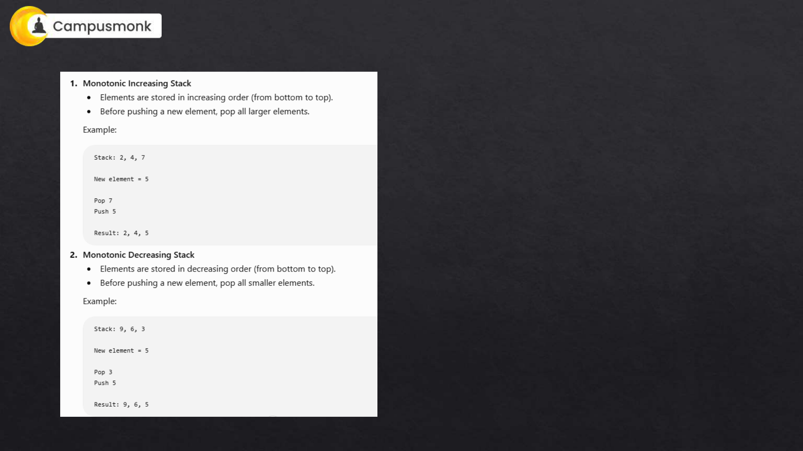
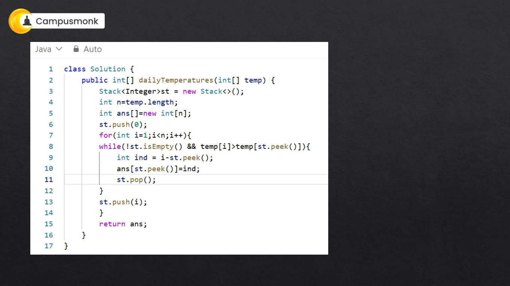
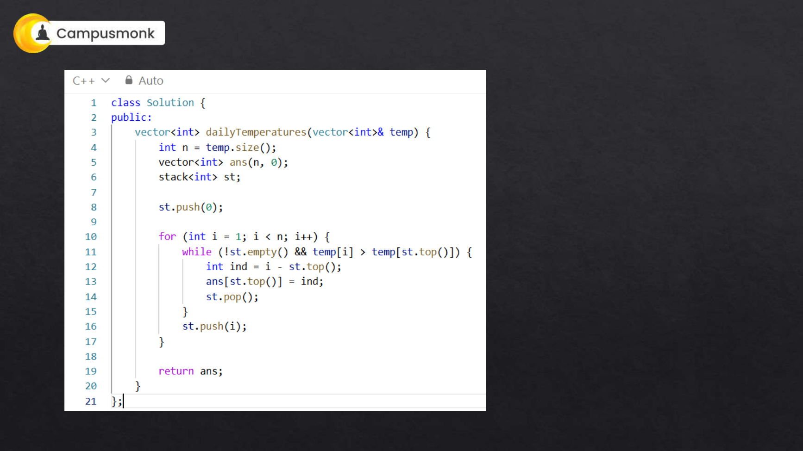
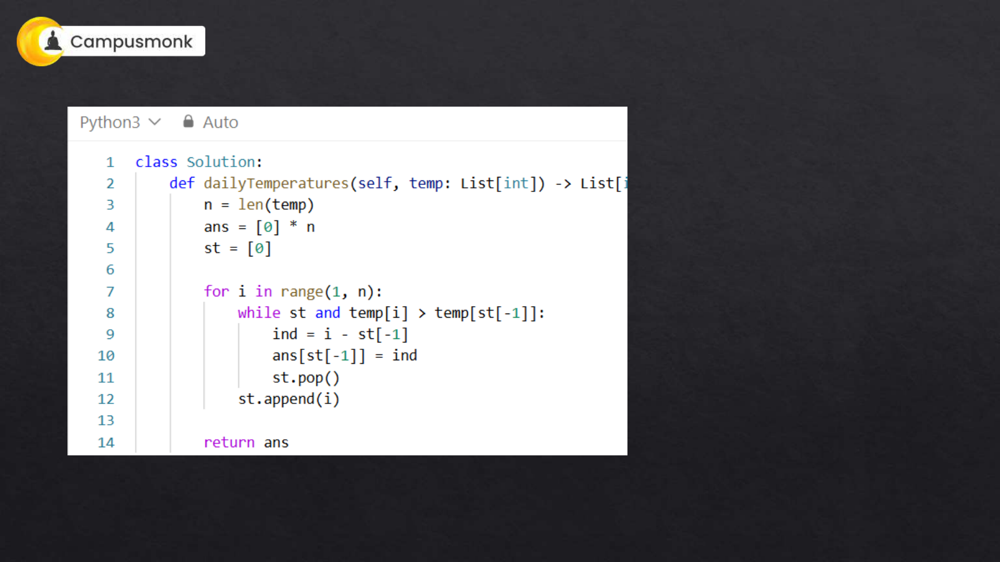
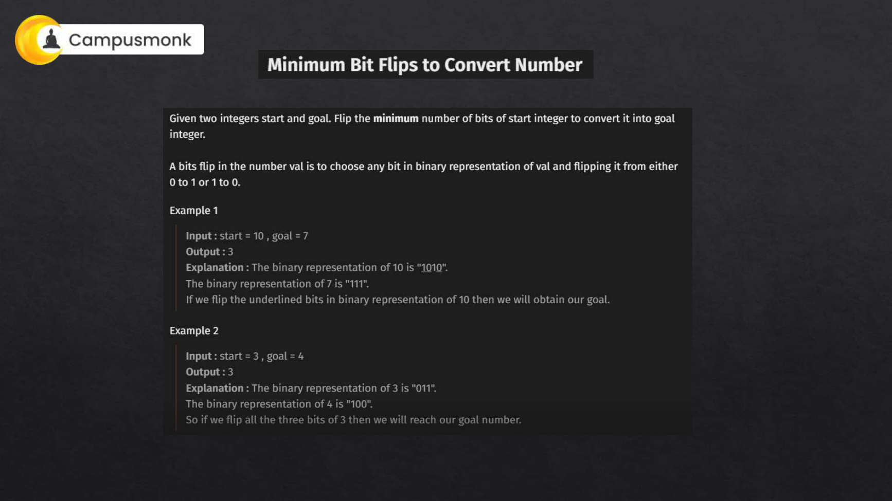
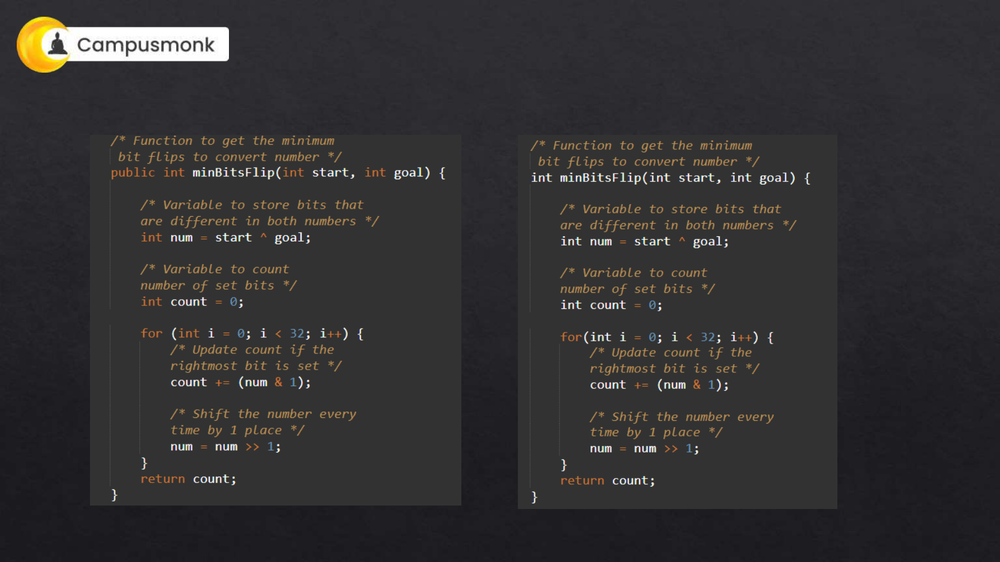
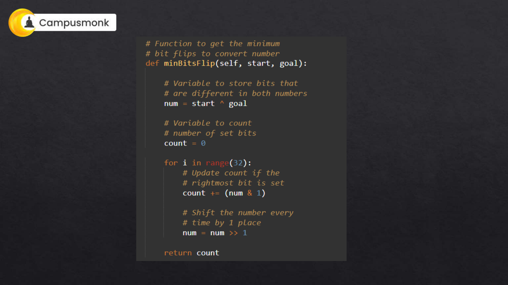

# 💻 Infosys Live Coding PYQ Master Class — Part 3 (Daily Temperatures, Minimum Bit Flips to Convert Number)
**Source Document:** `Infosys , TCS & OTHER_PYQ.pdf`  
**Instructor:** Itika Ma'am | CampusMonk Live Coding Master Series  
**Target Role:** Infosys Specialist Programmer (SP) / Digital Specialist Engineer (DSE) / Systems Engineer (SE)  
**Total Problems:** 2 Master Algorithmic Challenges  
**Multi-Language Coverage:** Python 3, C++ (STL), and Java 17 Production Implementations  
**Status:** 100% Solved with Optimal Complexities, Edge Cases & Slide Figures  

---

## 🔷 739. Daily Temperatures (Next Warmer Day)
**Problem ID:** `LIVE_CODING_06` | **Difficulty:** Medium (Infosys SE Actual Exam / TCS Digital Coding)  
**Category:** Live Coding & Algorithms | **Topic:** Arrays & Monotonic Decreasing Stack  

### Problem Description
Given an array of integers temperatures represents the daily temperatures, return an array answer such that answer[i] is the number of days you have to wait after the ith day to get a warmer temperature. If there is no future day for which this is possible, keep answer[i] == 0 instead.

### Constraints
- `1 <= temperatures.length <= 10^5`
- `30 <= temperatures[i] <= 100`

### Example Test Cases
**Example 1:**
- **Input:** `temperatures = [73, 74, 75, 71, 69, 72, 76, 73]`
- **Output:** `[1, 1, 4, 2, 1, 1, 0, 0]`
- **Explanation:** Day 0 (73) waits 1 day for 74. Day 2 (75) waits 4 days for 76.

**Example 2:**
- **Input:** `temperatures = [30, 40, 50, 60]`
- **Output:** `[1, 1, 1, 0]`
- **Explanation:** Each day waits 1 day except the last.

**Example 3:**
- **Input:** `temperatures = [30, 60, 90]`
- **Output:** `[1, 1, 0]`
- **Explanation:** Day 0 waits 1 day, Day 1 waits 1 day.

### Original Live Class Slide Diagrams







### Monotonic Decreasing Stack Technique
1. **Core Problem Pattern**: This is a classic "Next Greater Element" problem. A naive nested loop takes `O(N²)`, causing Time Limit Exceeded for `N = 10^5`.
2. **Monotonic Stack Structure**: Maintain a stack of indices whose temperatures have not yet found a warmer future day. The temperatures corresponding to indices in the stack remain in strictly decreasing order.
3. **Execution Steps**:
   - Initialize `answer = [0] * n` and an empty stack `st`.
   - Iterate index `i` from `0` to `n - 1`:
     - While `st` is non-empty and `temperatures[i] > temperatures[st.top()]`:
       - Pop `prev_index = st.pop()`.
       - `answer[prev_index] = i - prev_index`.
     - Push `i` onto `st`.
4. **Complexity**:
   - **Time Complexity:** `O(N)` because each index is pushed and popped at most once.
   - **Auxiliary Space:** `O(N)` in the worst case where temperatures are monotonically decreasing.

### Multi-Language Optimal Implementations

#### 🐍 Python 3 Solution
```python
class Solution:
    def dailyTemperatures(self, temperatures: list[int]) -> list[int]:
        n = len(temperatures)
        ans = [0] * n
        stack = []  # Stores indices
        
        for i, temp in enumerate(temperatures):
            while stack and temp > temperatures[stack[-1]]:
                prev_idx = stack.pop()
                ans[prev_idx] = i - prev_idx
            stack.append(i)
            
        return ans
```

#### ⚡ C++ (Modern STL) Solution
```cpp
#include <vector>
#include <stack>
using namespace std;

class Solution {
public:
    vector<int> dailyTemperatures(vector<int>& temperatures) {
        int n = temperatures.size();
        vector<int> ans(n, 0);
        stack<int> st; // Stores indices
        
        for (int i = 0; i < n; i++) {
            while (!st.empty() && temperatures[i] > temperatures[st.top()]) {
                int prev_idx = st.top();
                st.pop();
                ans[prev_idx] = i - prev_idx;
            }
            st.push(i);
        }
        return ans;
    }
};
```

#### ☕ Java 17 Solution
```java
import java.util.Stack;

class Solution {
    public int[] dailyTemperatures(int[] temperatures) {
        int n = temperatures.length;
        int[] ans = new int[n];
        Stack<Integer> st = new Stack<>();
        
        for (int i = 0; i < n; i++) {
            while (!st.isEmpty() && temperatures[i] > temperatures[st.peek()]) {
                int prev_idx = st.pop();
                ans[prev_idx] = i - prev_idx;
            }
            st.push(i);
        }
        return ans;
    }
}
```

---

## 🔷 2220. Minimum Bit Flips to Convert Number
**Problem ID:** `LIVE_CODING_07` | **Difficulty:** Easy (Infosys SE Coding Assessment)  
**Category:** Live Coding & Algorithms | **Topic:** Bit Manipulation & Brian Kernighan's Algorithm  

### Problem Description
A bit flip of a number x is choosing a bit in the binary representation of x and flipping it from either 0 to 1 or 1 to 0. Given two integers start and goal, return the minimum number of bit flips to convert start to goal.

### Constraints
- `0 <= start, goal <= 10^9`

### Example Test Cases
**Example 1:**
- **Input:** `start = 10, goal = 7`
- **Output:** `3`
- **Explanation:** Binary of 10 is 1010, binary of 7 is 0111. Flipping the 1st, 2nd, and 4th bits converts 10 to 7.

**Example 2:**
- **Input:** `start = 3, goal = 4`
- **Output:** `3`
- **Explanation:** Binary of 3 is 011, binary of 4 is 100. 3 bit flips are required.

### Original Live Class Slide Diagrams




### Bitwise XOR & Brian Kernighan's Popcount
1. **Bitwise Difference via XOR**:
   - The bitwise XOR operation (`start ^ goal`) sets a bit to `1` if and only if the corresponding bits in `start` and `goal` differ.
   - Therefore, the problem reduces to calculating the **Hamming weight** (number of set bits `1`) in `diff = start ^ goal`.
2. **Brian Kernighan's Algorithm**:
   - `diff = diff & (diff - 1)` clears the lowest set bit in `diff`.
   - Counting how many times this operation runs until `diff == 0` yields the exact number of set bits.
   - It runs in `O(K)` iterations where `K` is the number of differing bits (`K <= 30`), running faster than standard bitwise shifts.
3. **Complexity**:
   - **Time Complexity:** `O(1)` or `O(log(max(start, goal)))` since integers are at most 32 bits.
   - **Auxiliary Space:** `O(1)` zero extra space.

### Multi-Language Optimal Implementations

#### 🐍 Python 3 Solution
```python
class Solution:
    def minBitFlips(self, start: int, goal: int) -> int:
        diff = start ^ goal
        count = 0
        
        # Brian Kernighan's algorithm to count set bits
        while diff > 0:
            diff &= (diff - 1)
            count += 1
            
        return count
```

#### ⚡ C++ (Modern STL) Solution
```cpp
class Solution {
public:
    int minBitFlips(int start, int goal) {
        int diff = start ^ goal;
        int count = 0;
        
        while (diff > 0) {
            diff &= (diff - 1);
            count++;
        }
        return count;
    }
};
```

#### ☕ Java 17 Solution
```java
class Solution {
    public int minBitFlips(int start, int goal) {
        int diff = start ^ goal;
        int count = 0;
        
        while (diff > 0) {
            diff &= (diff - 1);
            count++;
        }
        return count;
    }
}
```

---
