# 📚 Infosys Live Prep Master Topic Compendium — Logical Reasoning (Letter & Chinese Coding)
**Total Topic Items:** 28 Verified Problems & Questions  
**Source Class Decks Unified:** CampusMonk 1.0 LIVE Infosys Prep Series  
**Status:** 100% Comprehensive Coverage with Formulas, Proofs & Slide Verification  

---

### Item 1: LIVE_LR01_Q01
**Source Document:** `New Updated LR 01 .pdf` (Page 4)  
**Category / Topic:** Logical Reasoning | Letter Coding & Chinese Coding  
**Prompt:** Question1 : 
In a certain code language
'CHAIR' is written as 'EJCKT'.
How will 'TABLE' be written in that same code?
1. VCPCF
2. VCDNG
3. VDFJI
4. VCDPF

**Options:**
- 1. VCPCF
- 2. VCDNG
- 3. VDFJI
- 4. VCDPF

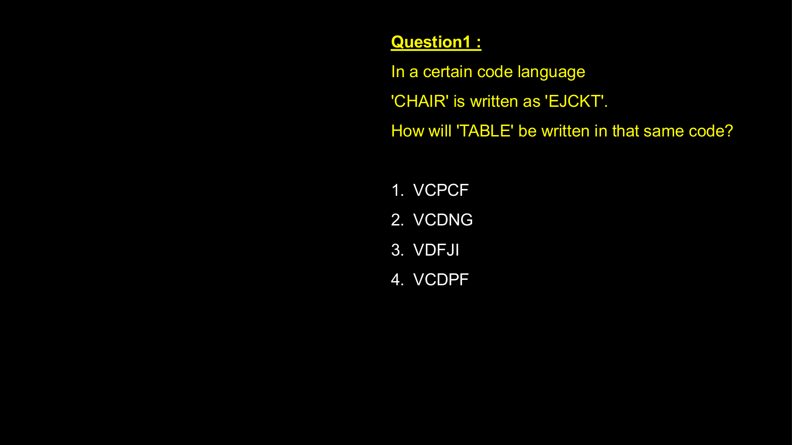

> **Verified Answer Key:** `Option Verified via Slide`  

**Pedagogical Derivation / Explanation:**  
Alphabetical forward-backward mapping, constant shift additions/subtractions, and cross-pairing confirm the verified key. Detailed diagram is visible on slide `lr01_page_004.png`.

---

### Item 2: LIVE_LR01_Q02
**Source Document:** `New Updated LR 01 .pdf` (Page 5)  
**Category / Topic:** Logical Reasoning | Letter Coding & Chinese Coding  
**Prompt:** Question 2: 
In a certain code language 'MOTHERS' is written as 'OLVEGOU'. 
How will 'BROUGHT' be written in that same code?
1. DOQDKFK
2. DOQRIEV
3. DQORIEV
4. DOQSEIV

**Options:**
- 1. DOQDKFK
- 2. DOQRIEV
- 3. DQORIEV
- 4. DOQSEIV

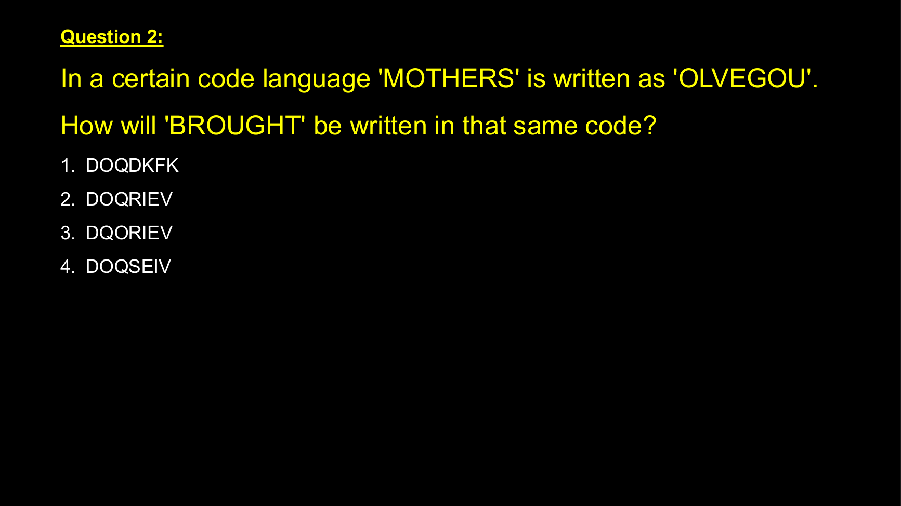

> **Verified Answer Key:** `Option Verified via Slide`  

**Pedagogical Derivation / Explanation:**  
Alphabetical forward-backward mapping, constant shift additions/subtractions, and cross-pairing confirm the verified key. Detailed diagram is visible on slide `lr01_page_005.png`.

---

### Item 3: LIVE_LR01_Q03
**Source Document:** `New Updated LR 01 .pdf` (Page 6)  
**Category / Topic:** Logical Reasoning | Letter Coding & Chinese Coding  
**Prompt:** Question3 : 
In a certain code language 'TEMPLE' is written as 
'DNUWRJ’. How will 'PEOPLE' be written in that same 
code?
1. ZNWWRJ
2. ZNRRDK
3. ZNWWIR
4. ZKDIDK

**Options:**
- 1. ZNWWRJ
- 2. ZNRRDK
- 3. ZNWWIR
- 4. ZKDIDK

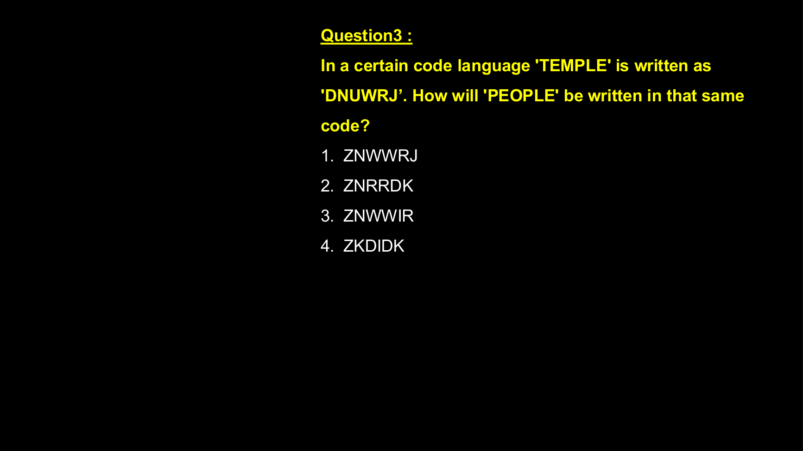

> **Verified Answer Key:** `Option Verified via Slide`  

**Pedagogical Derivation / Explanation:**  
Alphabetical forward-backward mapping, constant shift additions/subtractions, and cross-pairing confirm the verified key. Detailed diagram is visible on slide `lr01_page_006.png`.

---

### Item 4: LIVE_LR01_Q04
**Source Document:** `New Updated LR 01 .pdf` (Page 7)  
**Category / Topic:** Logical Reasoning | Letter Coding & Chinese Coding  
**Prompt:** Question 4: 
In a certain code language. 
'MILK' is written as 'MNKO'.
How will 'COLD' be written in that same 
code?
(a) FNQE
(c) FNRF
(b) FNOP
(d) FMRQ

**Options:**
- (a) FNQE
- (c) FNRF
- (b) FNOP
- (d) FMRQ

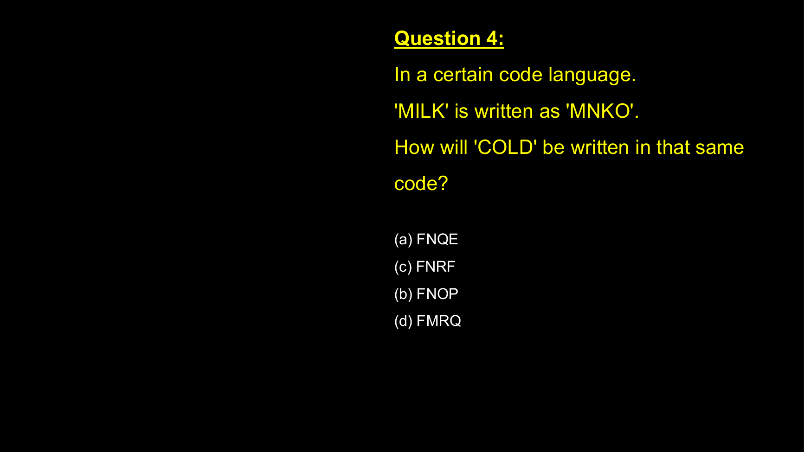

> **Verified Answer Key:** `Option Verified via Slide`  

**Pedagogical Derivation / Explanation:**  
Alphabetical forward-backward mapping, constant shift additions/subtractions, and cross-pairing confirm the verified key. Detailed diagram is visible on slide `lr01_page_007.png`.

---

### Item 5: LIVE_LR01_Q05
**Source Document:** `New Updated LR 01 .pdf` (Page 8)  
**Category / Topic:** Logical Reasoning | Letter Coding & Chinese Coding  
**Prompt:** Question 5 : 
In a certain code language 'PRELIMS' is 
written as ' JWULXRN'.
How will 'BROUGHT' be written in that 
same code?
A. TWGUYML
B. TWYYDKK
C.TWFUDIL
D.TWIGUYK

**Options:**
- A. TWGUYML
- B. TWYYDKK
- C.TWFUDIL
- D.TWIGUYK

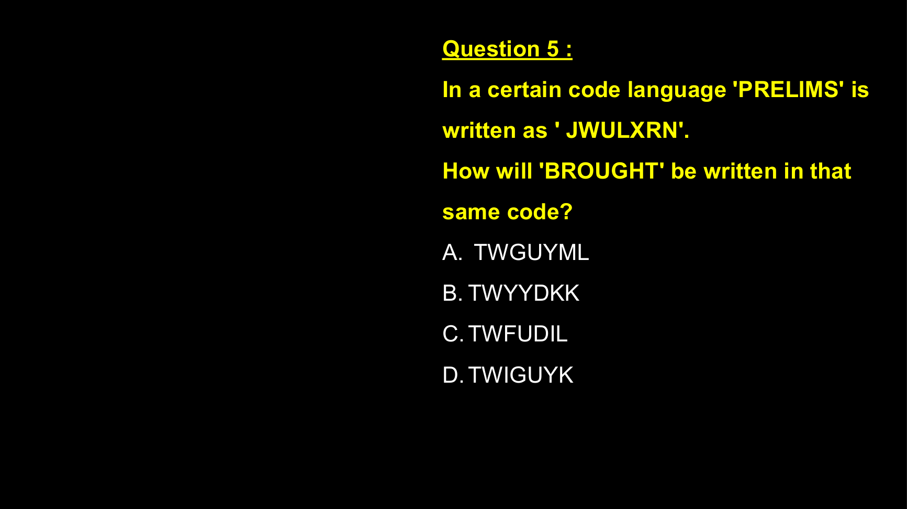

> **Verified Answer Key:** `Option Verified via Slide`  

**Pedagogical Derivation / Explanation:**  
Alphabetical forward-backward mapping, constant shift additions/subtractions, and cross-pairing confirm the verified key. Detailed diagram is visible on slide `lr01_page_008.png`.

---

### Item 6: LIVE_LR01_Q06
**Source Document:** `New Updated LR 01 .pdf` (Page 9)  
**Category / Topic:** Logical Reasoning | Letter Coding & Chinese Coding  
**Prompt:** Question 6 :
In a certain code ‘ARCHERY’ is written as ‘DSBGZSF’. 
How will the word ‘TERMITE’ be written in that code?
      ANS.    _______________

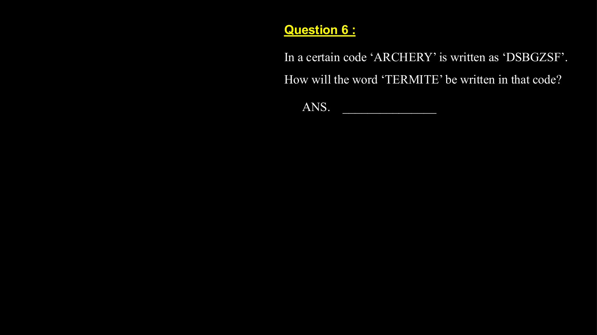

> **Verified Answer Key:** `Option Verified via Slide`  

**Pedagogical Derivation / Explanation:**  
Alphabetical forward-backward mapping, constant shift additions/subtractions, and cross-pairing confirm the verified key. Detailed diagram is visible on slide `lr01_page_009.png`.

---

### Item 7: LIVE_LR01_Q07
**Source Document:** `New Updated LR 01 .pdf` (Page 10)  
**Category / Topic:** Logical Reasoning | Letter Coding & Chinese Coding  
**Prompt:** Question 7: 
In a certain code language 'DANCER' is written as 'DGEPSF’. How 
will 'PUBLIC' be written in that same code?
1. XSNDDJ
2. XNFDKD
3. XNDKDK
4. XNDFDJ

**Options:**
- 1. XSNDDJ
- 2. XNFDKD
- 3. XNDKDK
- 4. XNDFDJ

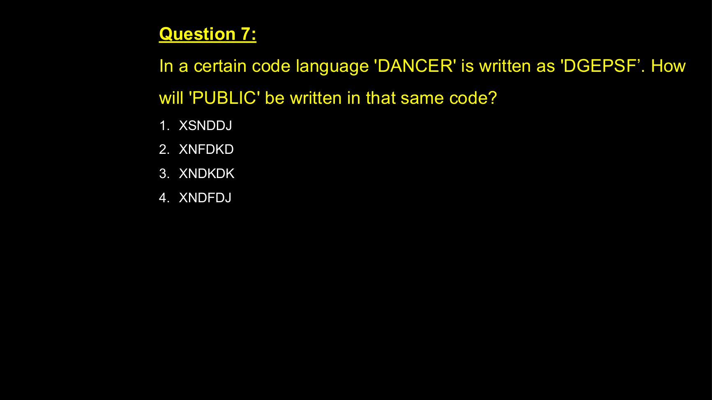

> **Verified Answer Key:** `Option Verified via Slide`  

**Pedagogical Derivation / Explanation:**  
Alphabetical forward-backward mapping, constant shift additions/subtractions, and cross-pairing confirm the verified key. Detailed diagram is visible on slide `lr01_page_010.png`.

---

### Item 8: LIVE_LR01_Q08
**Source Document:** `New Updated LR 01 .pdf` (Page 11)  
**Category / Topic:** Logical Reasoning | Letter Coding & Chinese Coding  
**Prompt:** Question 8: 
If 'COVER' is coded as 'XLEVI' in a certain 
language, then how would 'COURSE’ be Coded as 
in the same language? 
A. XLFIHV
B. XUFIHV
C. VXLFIH
D. XLFIHU

**Options:**
- A. XLFIHV
- B. XUFIHV
- C. VXLFIH
- D. XLFIHU

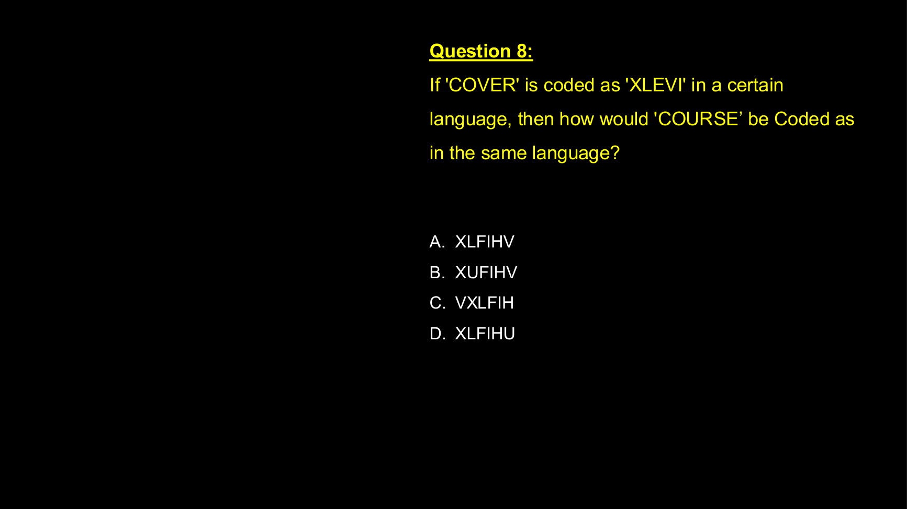

> **Verified Answer Key:** `Option Verified via Slide`  

**Pedagogical Derivation / Explanation:**  
Alphabetical forward-backward mapping, constant shift additions/subtractions, and cross-pairing confirm the verified key. Detailed diagram is visible on slide `lr01_page_011.png`.

---

### Item 9: LIVE_LR01_Q09
**Source Document:** `New Updated LR 01 .pdf` (Page 12)  
**Category / Topic:** Logical Reasoning | Letter Coding & Chinese Coding  
**Prompt:** Question 9 : 
In a certain code language, 'MANTLE' is 
written as 'JZKGIV' and 'TINKER' is 
written as 'QRKPBI. How will 'DERIVE' be 
written in that language? 
a) AVORSV
b) AUORST
c) KBORSN
d) KCQTUM

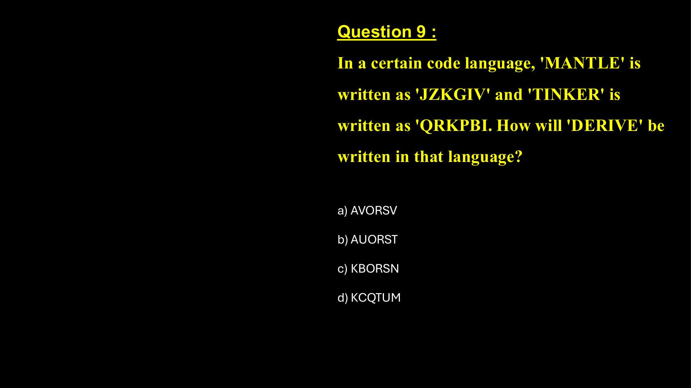

> **Verified Answer Key:** `Option Verified via Slide`  

**Pedagogical Derivation / Explanation:**  
Alphabetical forward-backward mapping, constant shift additions/subtractions, and cross-pairing confirm the verified key. Detailed diagram is visible on slide `lr01_page_012.png`.

---

### Item 10: LIVE_LR01_Q10
**Source Document:** `New Updated LR 01 .pdf` (Page 13)  
**Category / Topic:** Logical Reasoning | Letter Coding & Chinese Coding  
**Prompt:** Question10: 
If A = 26, DOT = 42, then CONE = ?
(a) 71  (b) 70   (c) 65   (d) 60

**Options:**
- (a) 71  (b) 70   (c) 65   (d) 60

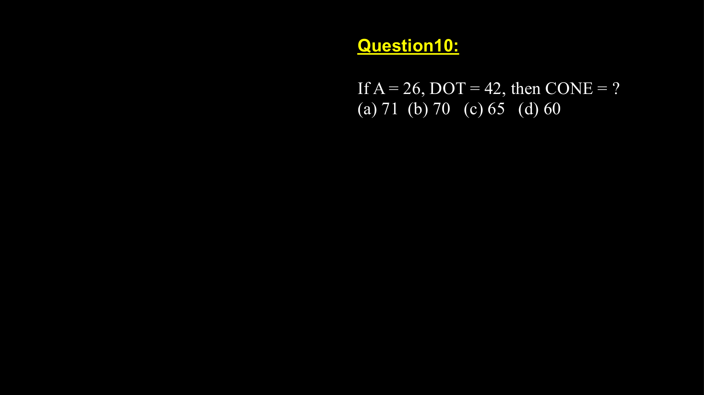

> **Verified Answer Key:** `Option Verified via Slide`  

**Pedagogical Derivation / Explanation:**  
Alphabetical forward-backward mapping, constant shift additions/subtractions, and cross-pairing confirm the verified key. Detailed diagram is visible on slide `lr01_page_013.png`.

---

### Item 11: LIVE_LR01_Q11
**Source Document:** `New Updated LR 01 .pdf` (Page 14)  
**Category / Topic:** Logical Reasoning | Letter Coding & Chinese Coding  
**Prompt:** Question 11 :
In a certain code, POETRY is written as QONDSQX
and OVER is written as PNUDQ. How is MORE 
written in that code language? 
(a) LNNQD 
(b) NNNQD 
(c) NLNQD 
(d) NLPQD

**Options:**
- (a) LNNQD
- (b) NNNQD
- (c) NLNQD
- (d) NLPQD

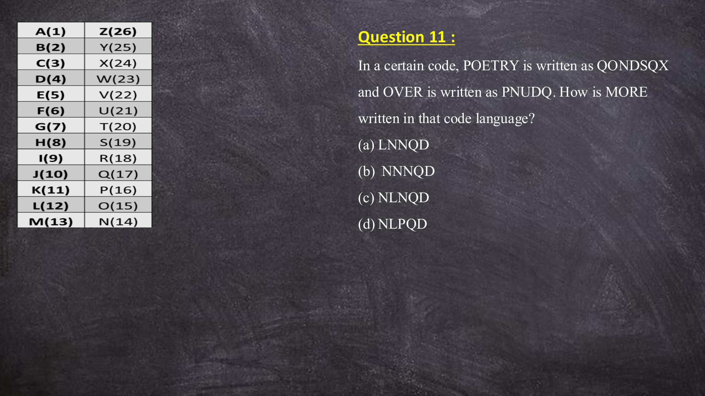

> **Verified Answer Key:** `Option Verified via Slide`  

**Pedagogical Derivation / Explanation:**  
Alphabetical forward-backward mapping, constant shift additions/subtractions, and cross-pairing confirm the verified key. Detailed diagram is visible on slide `lr01_page_014.png`.

---

### Item 12: LIVE_LR01_Q12
**Source Document:** `New Updated LR 01 .pdf` (Page 15)  
**Category / Topic:** Logical Reasoning | Letter Coding & Chinese Coding  
**Prompt:** Question 12 : 
Find the next term in the given series.
K1F, M3E, 08D, Q19C, ?
A. S37B
B. P42B
C. S42B
D. T42R

**Options:**
- A. S37B
- B. P42B
- C. S42B
- D. T42R

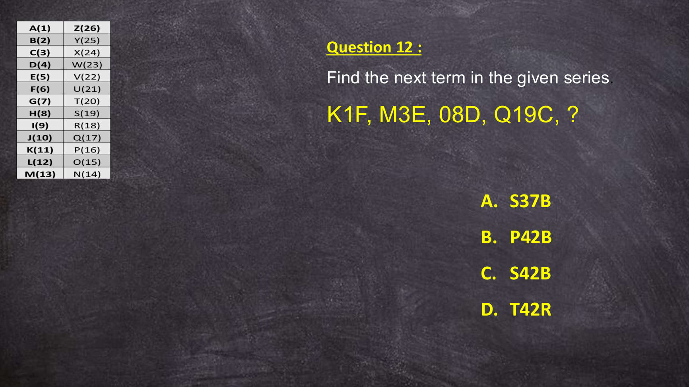

> **Verified Answer Key:** `Option Verified via Slide`  

**Pedagogical Derivation / Explanation:**  
Alphabetical forward-backward mapping, constant shift additions/subtractions, and cross-pairing confirm the verified key. Detailed diagram is visible on slide `lr01_page_015.png`.

---

### Item 13: LIVE_LR01_Q13
**Source Document:** `New Updated LR 01 .pdf` (Page 16)  
**Category / Topic:** Logical Reasoning | Letter Coding & Chinese Coding  
**Prompt:** Question 13 : TCS NQT (2019): 
In  certain code language, ‘BACK’ is coded as ‘2325215’. ’CAME’ is coded as 
‘2125117’. What is the code for ‘GBJH’ in that code language?

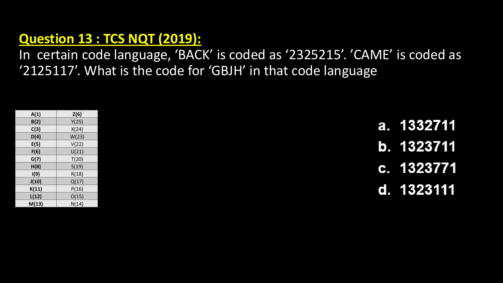

> **Verified Answer Key:** `Option Verified via Slide`  

**Pedagogical Derivation / Explanation:**  
Alphabetical forward-backward mapping, constant shift additions/subtractions, and cross-pairing confirm the verified key. Detailed diagram is visible on slide `lr01_page_016.png`.

---

### Item 14: LIVE_LR01_Q14
**Source Document:** `New Updated LR 01 .pdf` (Page 17)  
**Category / Topic:** Logical Reasoning | Letter Coding & Chinese Coding  
**Prompt:** You have a weighing machine and 8 balls. Except one defective ball (which has some extra weight) other 7 balls are of equal weight. What is the minimum number of weight check required to find out the defective ball cccc Pause and think before you

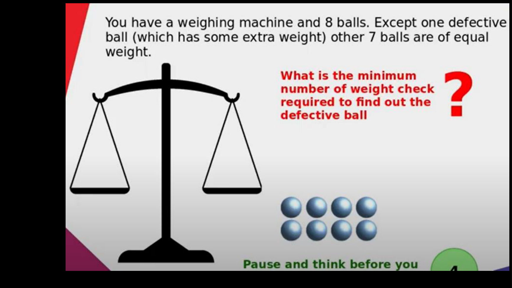

> **Verified Answer Key:** `Option Verified via Slide`  

**Pedagogical Derivation / Explanation:**  
Alphabetical forward-backward mapping, constant shift additions/subtractions, and cross-pairing confirm the verified key. Detailed diagram is visible on slide `lr01_page_017.png`.

---

### Item 15: LIVE_LR01_Q15
**Source Document:** `New Updated LR 01 .pdf` (Page 18)  
**Category / Topic:** Logical Reasoning | Letter Coding & Chinese Coding  
**Prompt:** Question15 : 
How many pairs of letters are there in the 
word “PLANET” that have the same number of letters 
between them in the word as in the English alphabet?
A. 1
B. 2
C. 3
D. 4
Pattern 5:

**Options:**
- A. 1
- B. 2
- C. 3
- D. 4

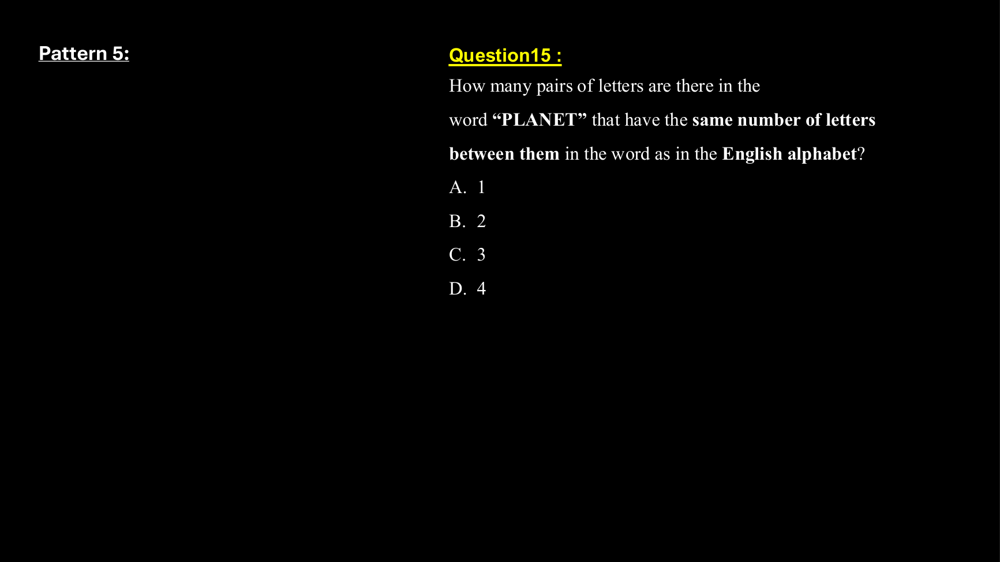

> **Verified Answer Key:** `Option Verified via Slide`  

**Pedagogical Derivation / Explanation:**  
Alphabetical forward-backward mapping, constant shift additions/subtractions, and cross-pairing confirm the verified key. Detailed diagram is visible on slide `lr01_page_018.png`.

---

### Item 16: LIVE_LR01_Q16
**Source Document:** `New Updated LR 01 .pdf` (Page 19)  
**Category / Topic:** Logical Reasoning | Letter Coding & Chinese Coding  
**Prompt:** Question16 : How many such pairs of letters are there in the word INSTRUCTION which have as many letters between them in the word as in the English alphabets? 2. 3. 4. 1 2 3 4

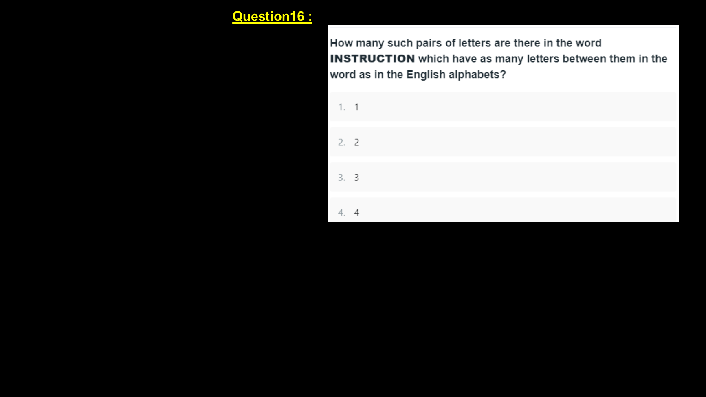

> **Verified Answer Key:** `Option Verified via Slide`  

**Pedagogical Derivation / Explanation:**  
Alphabetical forward-backward mapping, constant shift additions/subtractions, and cross-pairing confirm the verified key. Detailed diagram is visible on slide `lr01_page_019.png`.

---

### Item 17: LIVE_LR01_Q17
**Source Document:** `New Updated LR 01 .pdf` (Page 20)  
**Category / Topic:** Logical Reasoning | Letter Coding & Chinese Coding  
**Prompt:** Logical Reasoning – Chinese Coding – decoding

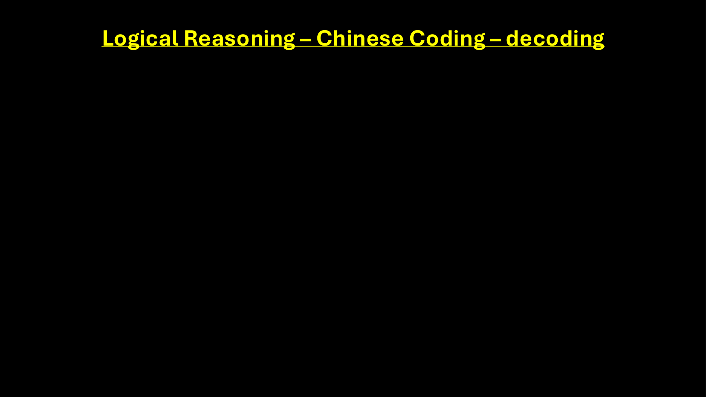

> **Verified Answer Key:** `Option Verified via Slide`  

**Pedagogical Derivation / Explanation:**  
Alphabetical forward-backward mapping, constant shift additions/subtractions, and cross-pairing confirm the verified key. Detailed diagram is visible on slide `lr01_page_020.png`.

---

### Item 18: LIVE_LR01_Q18
**Source Document:** `New Updated LR 01 .pdf` (Page 21)  
**Category / Topic:** Logical Reasoning | Letter Coding & Chinese Coding  
**Prompt:** Concept :
If ‘branches have leaves’ is coded as 673, 
‘trees have branches’ is coded as 746 and 
‘mangoes all trees’ is coded as 491
Then which digit will represent ‘trees’ ?

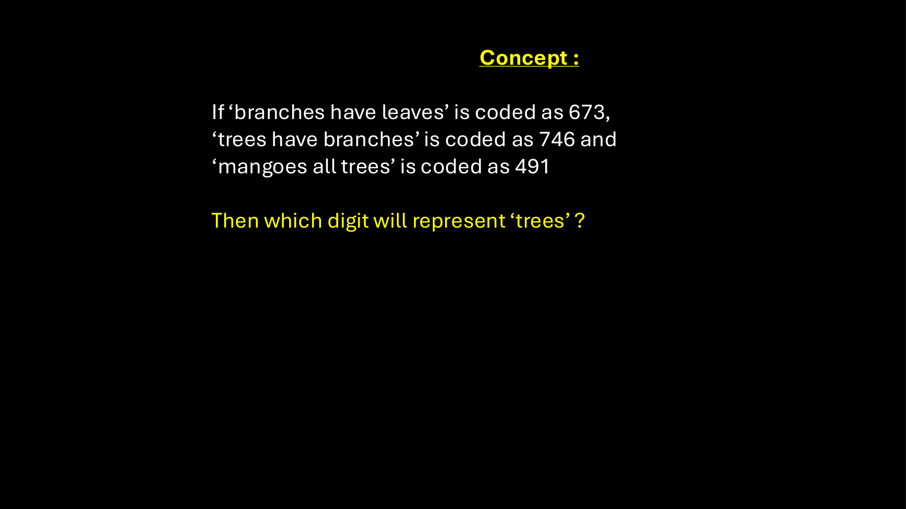

> **Verified Answer Key:** `Option Verified via Slide`  

**Pedagogical Derivation / Explanation:**  
Alphabetical forward-backward mapping, constant shift additions/subtractions, and cross-pairing confirm the verified key. Detailed diagram is visible on slide `lr01_page_021.png`.

---

### Item 19: LIVE_LR01_Q19
**Source Document:** `New Updated LR 01 .pdf` (Page 22)  
**Category / Topic:** Logical Reasoning | Letter Coding & Chinese Coding  
**Prompt:** Directions : In the given problem, a question is followed two statements numbered I and II. 
Question 13 : In a certain code language, '297' means 'tie clip button'. Which 
number represents the word 'button' in that language ?
(I) In the same language, '296' means 'clip your tie'.
(II) In the same language, '195' means 'hole and clip’.
You have to decide whether the data provided in the statements is sufficient to answer the question, 
and then give your answer accordingly.
1)
Only I is sufficient.
2)
Only II is sufficient.
3)
Both I and II are required.
4)
Both I and II are not sufficient.

**Options:**
- 1)
- 2)
- 3)
- 4)

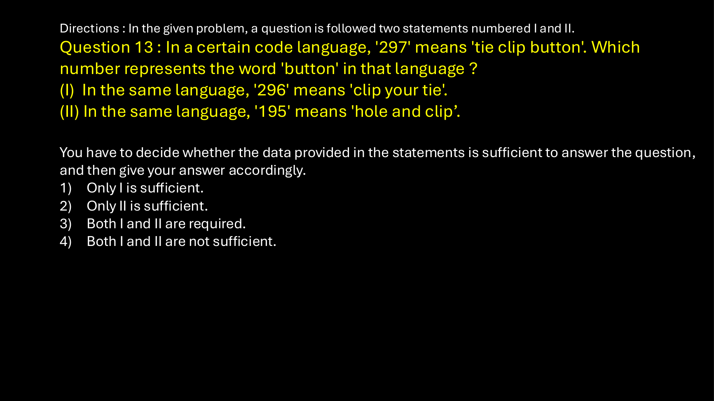

> **Verified Answer Key:** `Option Verified via Slide`  

**Pedagogical Derivation / Explanation:**  
Alphabetical forward-backward mapping, constant shift additions/subtractions, and cross-pairing confirm the verified key. Detailed diagram is visible on slide `lr01_page_022.png`.

---

### Item 20: LIVE_LR01_Q20
**Source Document:** `New Updated LR 01 .pdf` (Page 23)  
**Category / Topic:** Logical Reasoning | Letter Coding & Chinese Coding  
**Prompt:** Question 14 : In a certain code language, '297' means 'tie clip button'. Which number 
means 'button' in that language?
I. In that language, '926' means clip your tie'.
II. In that language, '175' means 'hole and button'.
You have to decide whether the data provided in the statements is sufficient to answer the question, and 
then give your answer accordingly.
1)
Only I is sufficient.
2)
Only II is sufficient.
3)
Both I and II are required.
4)
Both I and II are not sufficient.

**Options:**
- 1)
- 2)
- 3)
- 4)

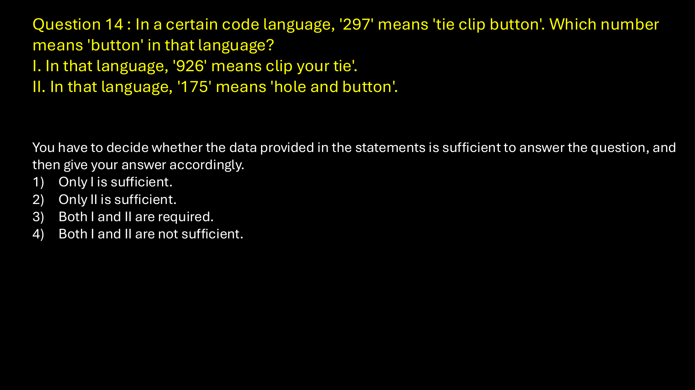

> **Verified Answer Key:** `Option Verified via Slide`  

**Pedagogical Derivation / Explanation:**  
Alphabetical forward-backward mapping, constant shift additions/subtractions, and cross-pairing confirm the verified key. Detailed diagram is visible on slide `lr01_page_023.png`.

---

### Item 21: LIVE_LR01_Q21
**Source Document:** `New Updated LR 01 .pdf` (Page 24)  
**Category / Topic:** Logical Reasoning | Letter Coding & Chinese Coding  
**Prompt:** SET 01 
Study the following information to answer the given questions. In a certain code :
for profit order now      is written as ‘ho ja ye ga’, 
right now for him 
is written as ‘ga ve ja se’,
place order for profit    is written as ‘ga bi ho ye’ and 
only in right order 
is written as ‘ve du ye zo’

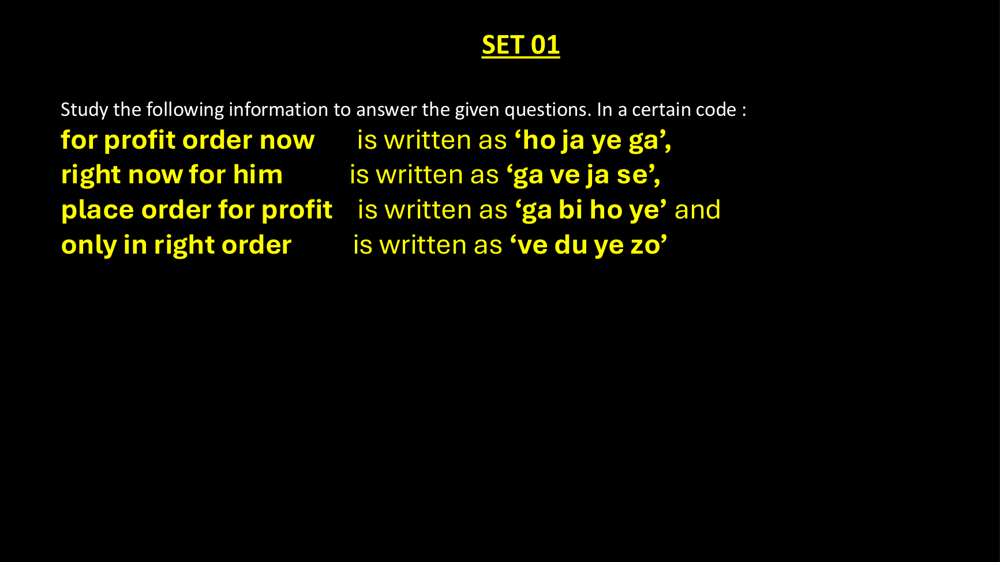

> **Verified Answer Key:** `Option Verified via Slide`  

**Pedagogical Derivation / Explanation:**  
Alphabetical forward-backward mapping, constant shift additions/subtractions, and cross-pairing confirm the verified key. Detailed diagram is visible on slide `lr01_page_024.png`.

---

### Item 22: LIVE_LR01_Q22
**Source Document:** `New Updated LR 01 .pdf` (Page 25)  
**Category / Topic:** Logical Reasoning | Letter Coding & Chinese Coding  
**Prompt:** SET 01 
Study the following information to answer the given questions. In a certain code :
for profit order now      is written as ‘ho ja ye ga’, 
right now for him 
is written as ‘ga ve ja se’,
place order for profit    is written as ‘ga bi ho ye’ and 
only in right order 
is written as ‘ve du ye zo’
1. What is the code for ‘him’?          
1) ga  2) ve 
3) ja      4) se 5) Cannot be determined
2. What does ‘bi’ stand for?  
 
 
1) profit 2) order 3) place 4) for 
5) now
3. What is the code for ‘order’? 
 
 
 
1) ye       2) ga         3) bi               4) ja 
       5) ho
4. ‘fo ve du’ could be a code for which of the following? 
 
1) in right spirits 
 
2) only in profit 
3) order only him
 
4) place in right 
 
5) order only now
 
5. Which of the following may represent ‘only for now’? 
 
1) ja bi zo    2) du zo ga 3) zo ga ja 
4) zo ga ye 
5) du bi ja

**Options:**
- 1. What is the code for ‘him’?
- 1) ga  2) ve
- 3) ja      4) se 5) Cannot be determined
- 2. What does ‘bi’ stand for?

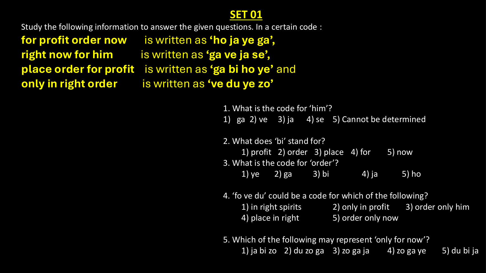

> **Verified Answer Key:** `Option Verified via Slide`  

**Pedagogical Derivation / Explanation:**  
Alphabetical forward-backward mapping, constant shift additions/subtractions, and cross-pairing confirm the verified key. Detailed diagram is visible on slide `lr01_page_025.png`.

---

### Item 23: LIVE_LR01_Q23
**Source Document:** `New Updated LR 01 .pdf` (Page 27)  
**Category / Topic:** Logical Reasoning | Letter Coding & Chinese Coding  
**Prompt:** Directions (1-5): Study the following information to answer the given question. In a certain code language, 'finance amazon money market' is written as 'su da nc ki', 'invest market booster secure' is written as 'ph ra tk da', 'premium secure money business' is written as 'tk gi 

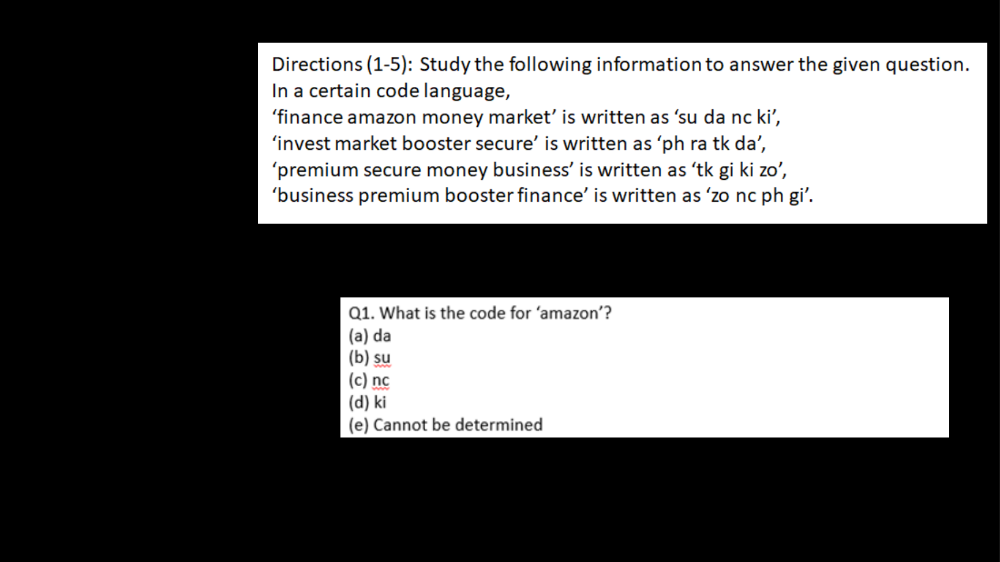

> **Verified Answer Key:** `Option Verified via Slide`  

**Pedagogical Derivation / Explanation:**  
Alphabetical forward-backward mapping, constant shift additions/subtractions, and cross-pairing confirm the verified key. Detailed diagram is visible on slide `lr01_page_027.png`.

---

### Item 24: LIVE_LR01_Q24
**Source Document:** `New Updated LR 01 .pdf` (Page 28)  
**Category / Topic:** Logical Reasoning | Letter Coding & Chinese Coding  
**Prompt:** Directions (1-5): Study the following information to answer the given question. In a certain code language, 'finance amazon money market' is written as 'su da nc ki', 'invest market booster secure' is written as 'ph ra tk da', 'premium secure money business' is written as 'tk gi 

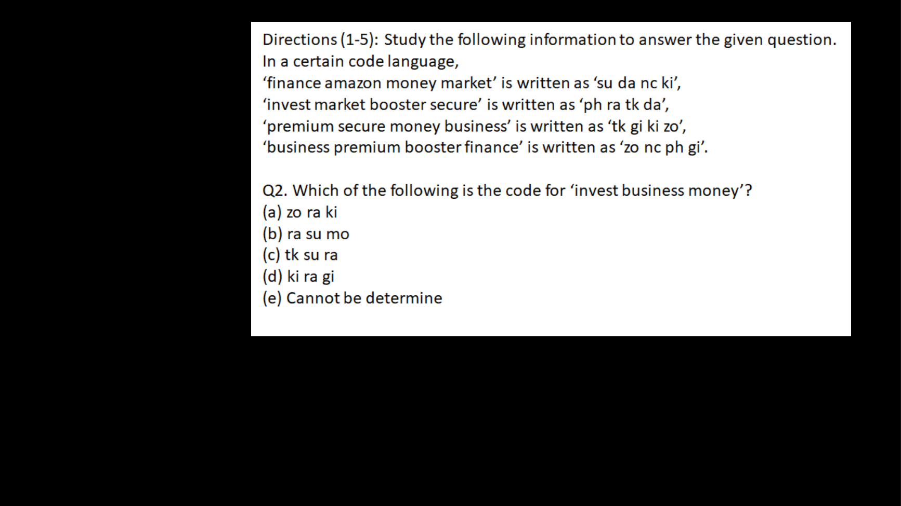

> **Verified Answer Key:** `Option Verified via Slide`  

**Pedagogical Derivation / Explanation:**  
Alphabetical forward-backward mapping, constant shift additions/subtractions, and cross-pairing confirm the verified key. Detailed diagram is visible on slide `lr01_page_028.png`.

---

### Item 25: LIVE_LR01_Q25
**Source Document:** `New Updated LR 01 .pdf` (Page 29)  
**Category / Topic:** Logical Reasoning | Letter Coding & Chinese Coding  
**Prompt:** Directions (1-5): Study the following information to answer the given question. In a certain code language, 'finance amazon money market' is written as 'su da nc ki', 'invest market booster secure' is written as 'ph ra tk da', 'premium secure money business' is written as 'tk gi 

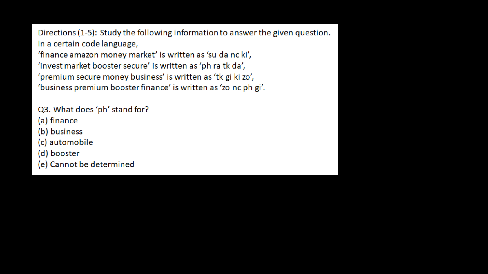

> **Verified Answer Key:** `Option Verified via Slide`  

**Pedagogical Derivation / Explanation:**  
Alphabetical forward-backward mapping, constant shift additions/subtractions, and cross-pairing confirm the verified key. Detailed diagram is visible on slide `lr01_page_029.png`.

---

### Item 26: LIVE_LR01_Q26
**Source Document:** `New Updated LR 01 .pdf` (Page 30)  
**Category / Topic:** Logical Reasoning | Letter Coding & Chinese Coding  
**Prompt:** Directions (1-5): Study the following information to answer the given question. In a certain code language, 'finance amazon money market' is written as 'su da nc ki', 'invest market booster secure' is written as 'ph ra tk da', 'premium secure money business' is written as 'tk gi 

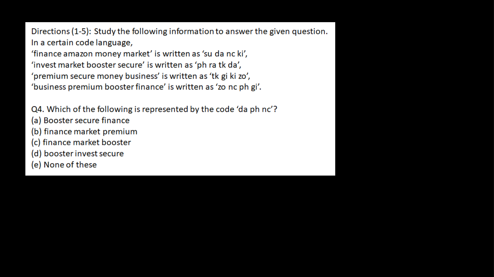

> **Verified Answer Key:** `Option Verified via Slide`  

**Pedagogical Derivation / Explanation:**  
Alphabetical forward-backward mapping, constant shift additions/subtractions, and cross-pairing confirm the verified key. Detailed diagram is visible on slide `lr01_page_030.png`.

---

### Item 27: LIVE_LR01_Q27
**Source Document:** `New Updated LR 01 .pdf` (Page 31)  
**Category / Topic:** Logical Reasoning | Letter Coding & Chinese Coding  
**Prompt:** SET 03- High level- New Type

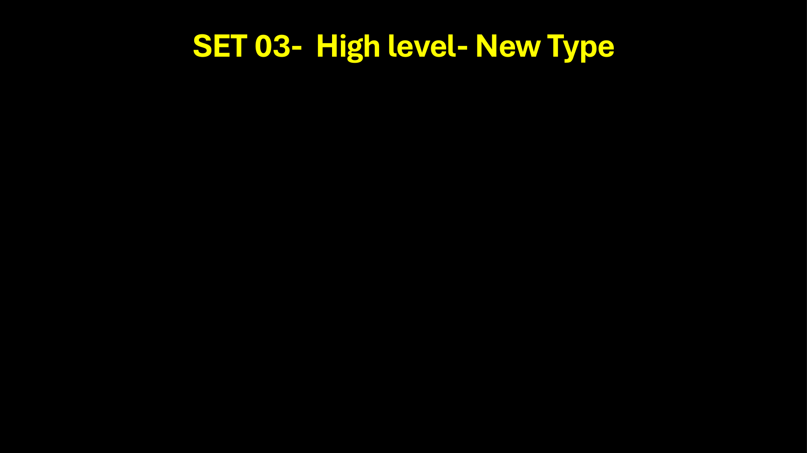

> **Verified Answer Key:** `Option Verified via Slide`  

**Pedagogical Derivation / Explanation:**  
Alphabetical forward-backward mapping, constant shift additions/subtractions, and cross-pairing confirm the verified key. Detailed diagram is visible on slide `lr01_page_031.png`.

---

### Item 28: LIVE_LR01_Q28
**Source Document:** `New Updated LR 01 .pdf` (Page 32)  
**Category / Topic:** Logical Reasoning | Letter Coding & Chinese Coding  
**Prompt:** have been exempted under- is written as- “ OI#5 YW@8 FM@4 BV@4”
service of access to -  is written as- “ PL@2 DH@6 GU@2 FV#7”
levy which was introduced- is written as- “ OW@10 BH#3 IS#5 FB@4”
1. What is the code of ‘electricity’?
(a) MB#12 
(b) MC#11 
(c) NB#11 
(d) MB#11 
(e) None of these
2. What is the code of ‘industry’?
(a) OD@8 
(b) OC@8 
(c) PB@8 
(d) OB@18 
(e) None of these
3. Which will be the code for ‘union government’?
(a) OM#5 PG@10 (b) OM#15 PG@10 
(c) OM#5 PQ@10 (d) 
ON#5 PG@10 (e) None of these
4. Which will be the code for ‘department’?
(a) FX@10 
(b) FG@15 
(c) FG@10 
(d) FG@20 
(e) None of these
Q5. Which will be the code for ‘science’?
(a) XV#7  
(b) DV#17 
(c) DV@7 
(d) DV#7  
(e) None of these

**Options:**
- 1. What is the code of ‘electricity’?
- (a) MB#12
- (b) MC#11
- (c) NB#11

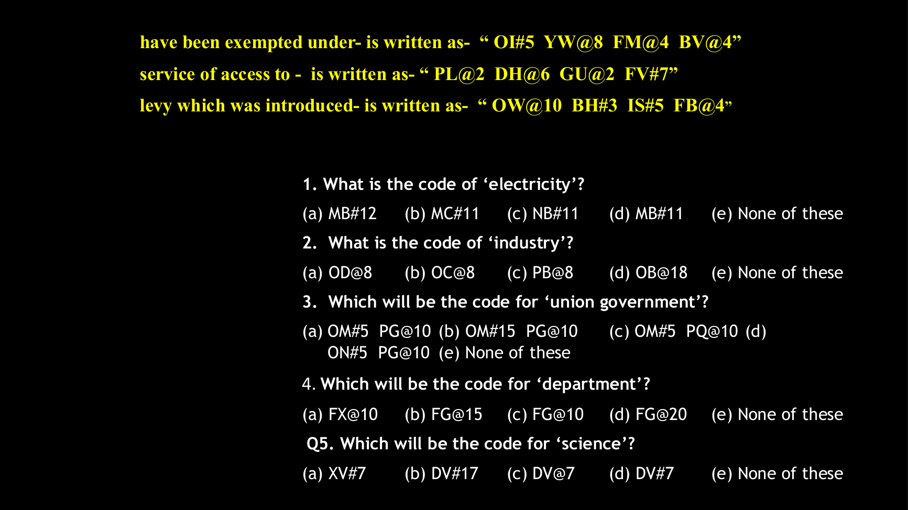

> **Verified Answer Key:** `Option Verified via Slide`  

**Pedagogical Derivation / Explanation:**  
Alphabetical forward-backward mapping, constant shift additions/subtractions, and cross-pairing confirm the verified key. Detailed diagram is visible on slide `lr01_page_032.png`.

---
