# 📚 Infosys Live Prep Master Topic Compendium — Number Systems (Divisibility, Remainders & Factors)
**Total Topic Items:** 95 Verified Problems & Questions  
**Source Class Decks Unified:** CampusMonk 1.0 LIVE Infosys Prep Series  
**Status:** 100% Comprehensive Coverage with Formulas, Proofs & Slide Verification  

---

### Item 1: LIVE_NUM_DIV_Q01
**Source Document:** `Divisibility Rule  , Consecutive No One Shot PYQ .pdf` (Page 6)  
**Category / Topic:** Quantitative Aptitude | Number Systems - Divisibility & Consecutive Numbers  
**Prompt:** Question 1:
What least value must be assigned to *  so that 
the number 451*603 is exactly divisible by 9?
(a) 7 
(b) 8 
(c) 5           (d) 9
Question 2:
If 5432*7 is divisible by 9, then the 
digit is place of * is ?
(a) 0 (b) 1 (c)6 
(d) 9

**Options:**
- (a) 7
- (b) 8
- (c) 5           (d) 9
- (a) 0 (b) 1 (c)6

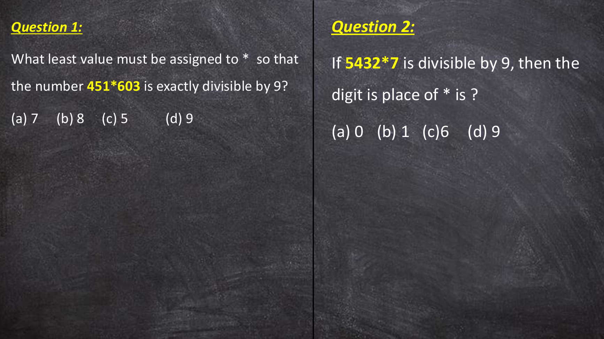

> **Verified Answer Key:** `Option Verified via Slide`  

**Pedagogical Derivation / Explanation:**  
Application of divisibility rules, modular congruence, and consecutive integer properties yields the deterministic answer. Complete working is visible on slide `num_div_page_006.png`.

---

### Item 2: LIVE_NUM_DIV_Q02
**Source Document:** `Divisibility Rule  , Consecutive No One Shot PYQ .pdf` (Page 7)  
**Category / Topic:** Quantitative Aptitude | Number Systems - Divisibility & Consecutive Numbers  
**Prompt:** Question 3:
Find the value of k in the number 
9314k8025 so that the number is divisible 
by 11

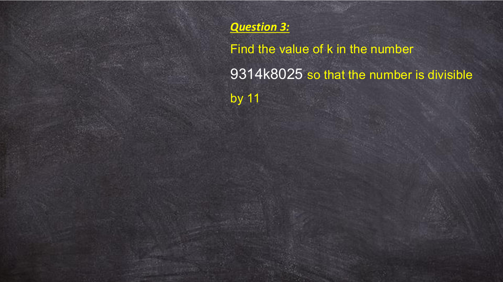

> **Verified Answer Key:** `Option Verified via Slide`  

**Pedagogical Derivation / Explanation:**  
Application of divisibility rules, modular congruence, and consecutive integer properties yields the deterministic answer. Complete working is visible on slide `num_div_page_007.png`.

---

### Item 3: LIVE_NUM_DIV_Q03
**Source Document:** `Divisibility Rule  , Consecutive No One Shot PYQ .pdf` (Page 8)  
**Category / Topic:** Quantitative Aptitude | Number Systems - Divisibility & Consecutive Numbers  
**Prompt:** Question 4:
If the nine-digit number 259876P05 is completely 
divisible by 11, then what is the value of (𝑝2 + 5)?
A. 58
B. 56
C. 76
D. 54

**Options:**
- A. 58
- B. 56
- C. 76
- D. 54

> **Verified Answer Key:** `Option Verified via Slide`  

**Pedagogical Derivation / Explanation:**  
Application of divisibility rules, modular congruence, and consecutive integer properties yields the deterministic answer. Complete working is visible on slide `num_div_page_008.png`.

---

### Item 4: LIVE_NUM_DIV_Q04
**Source Document:** `Divisibility Rule  , Consecutive No One Shot PYQ .pdf` (Page 9)  
**Category / Topic:** Quantitative Aptitude | Number Systems - Divisibility & Consecutive Numbers  
**Prompt:** Question 5:
Which of the given values Is divisible by 15?
A. 2365 
B. 1375 
C. 4365 
D. 2275

**Options:**
- A. 2365
- B. 1375
- C. 4365
- D. 2275

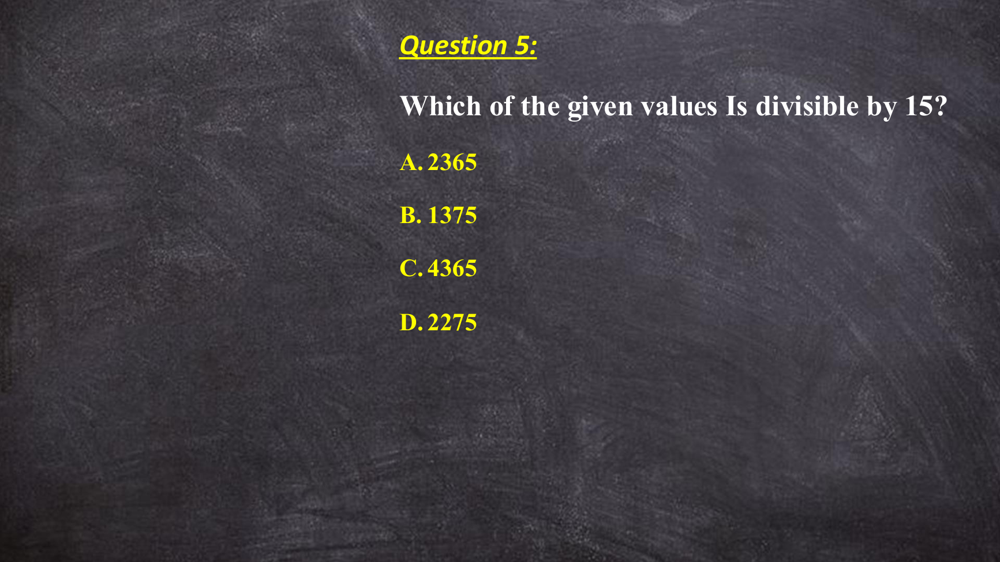

> **Verified Answer Key:** `Option Verified via Slide`  

**Pedagogical Derivation / Explanation:**  
Application of divisibility rules, modular congruence, and consecutive integer properties yields the deterministic answer. Complete working is visible on slide `num_div_page_009.png`.

---

### Item 5: LIVE_NUM_DIV_Q05
**Source Document:** `Divisibility Rule  , Consecutive No One Shot PYQ .pdf` (Page 10)  
**Category / Topic:** Quantitative Aptitude | Number Systems - Divisibility & Consecutive Numbers  
**Prompt:** Question 6:
Which of the given values Is NOT divisible 
by 18?
A. 54036 
B. 50436 
C. 34056 
D. 65043

**Options:**
- A. 54036
- B. 50436
- C. 34056
- D. 65043

> **Verified Answer Key:** `Option Verified via Slide`  

**Pedagogical Derivation / Explanation:**  
Application of divisibility rules, modular congruence, and consecutive integer properties yields the deterministic answer. Complete working is visible on slide `num_div_page_010.png`.

---

### Item 6: LIVE_NUM_DIV_Q06
**Source Document:** `Divisibility Rule  , Consecutive No One Shot PYQ .pdf` (Page 11)  
**Category / Topic:** Quantitative Aptitude | Number Systems - Divisibility & Consecutive Numbers  
**Prompt:** Question 7:
Which of the following number is divisible by 24 ?
A. 35718 
 
B. 63810 
 
C. 537804 
 
D. 3125736

**Options:**
- A. 35718
- B. 63810
- C. 537804
- D. 3125736

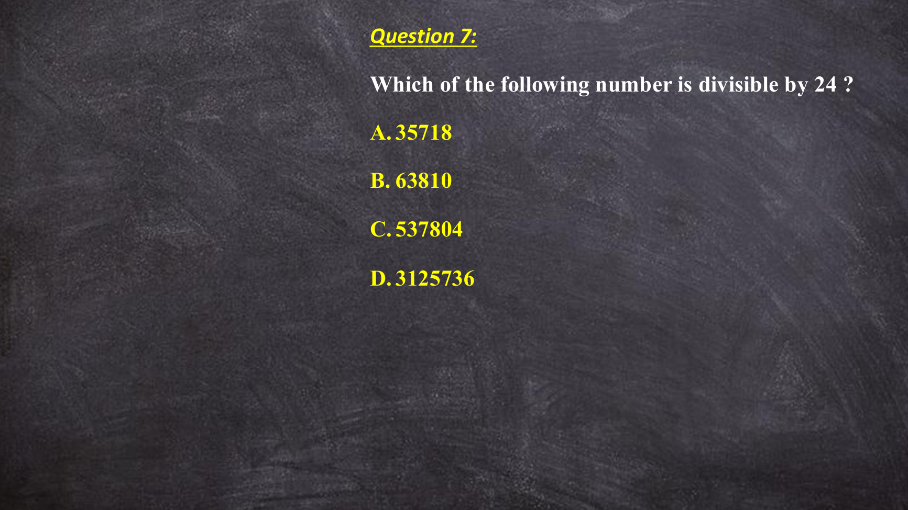

> **Verified Answer Key:** `Option Verified via Slide`  

**Pedagogical Derivation / Explanation:**  
Application of divisibility rules, modular congruence, and consecutive integer properties yields the deterministic answer. Complete working is visible on slide `num_div_page_011.png`.

---

### Item 7: LIVE_NUM_DIV_Q07
**Source Document:** `Divisibility Rule  , Consecutive No One Shot PYQ .pdf` (Page 12)  
**Category / Topic:** Quantitative Aptitude | Number Systems - Divisibility & Consecutive Numbers  
**Prompt:** Concept Clarity Sheet- 7 , 13
10920
6489
380247

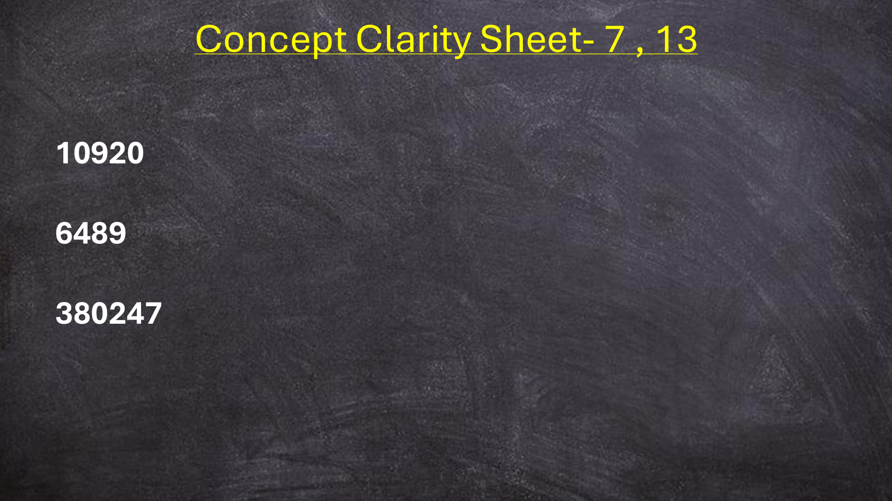

> **Verified Answer Key:** `Option Verified via Slide`  

**Pedagogical Derivation / Explanation:**  
Application of divisibility rules, modular congruence, and consecutive integer properties yields the deterministic answer. Complete working is visible on slide `num_div_page_012.png`.

---

### Item 8: LIVE_NUM_DIV_Q08
**Source Document:** `Divisibility Rule  , Consecutive No One Shot PYQ .pdf` (Page 13)  
**Category / Topic:** Quantitative Aptitude | Number Systems - Divisibility & Consecutive Numbers  
**Prompt:** Question 8:
The least number of 5 digits which 
exactly divided by 52, 56, 78 and 91?
A. 10290
B. 10860
C. 10920
D. 10580

**Options:**
- A. 10290
- B. 10860
- C. 10920
- D. 10580

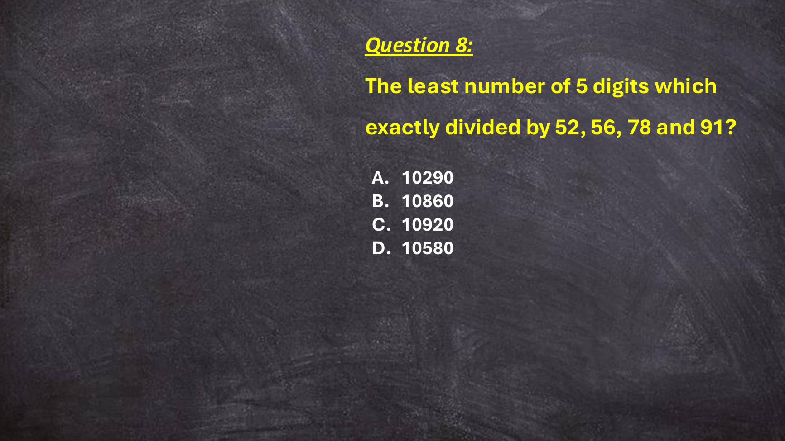

> **Verified Answer Key:** `Option Verified via Slide`  

**Pedagogical Derivation / Explanation:**  
Application of divisibility rules, modular congruence, and consecutive integer properties yields the deterministic answer. Complete working is visible on slide `num_div_page_013.png`.

---

### Item 9: LIVE_NUM_DIV_Q09
**Source Document:** `Divisibility Rule  , Consecutive No One Shot PYQ .pdf` (Page 14)  
**Category / Topic:** Quantitative Aptitude | Number Systems - Divisibility & Consecutive Numbers  
**Prompt:** Question 9:
 The Largest number of four digits exactly 
divisible by 88 is ?
A. 9988 
B. 9944
C. 8888 
D. 9768

**Options:**
- A. 9988
- B. 9944
- C. 8888
- D. 9768

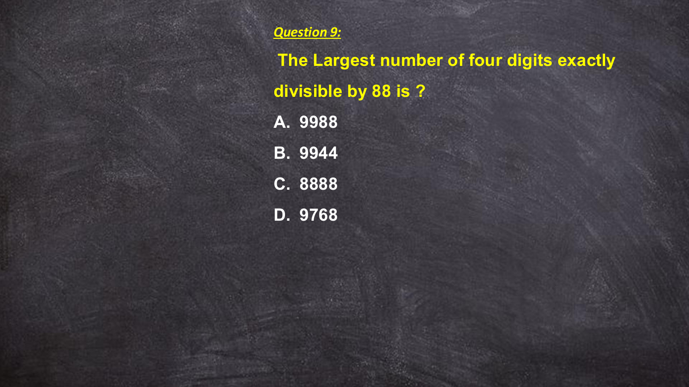

> **Verified Answer Key:** `Option Verified via Slide`  

**Pedagogical Derivation / Explanation:**  
Application of divisibility rules, modular congruence, and consecutive integer properties yields the deterministic answer. Complete working is visible on slide `num_div_page_014.png`.

---

### Item 10: LIVE_NUM_DIV_Q10
**Source Document:** `Divisibility Rule  , Consecutive No One Shot PYQ .pdf` (Page 15)  
**Category / Topic:** Quantitative Aptitude | Number Systems - Divisibility & Consecutive Numbers  
**Prompt:** Question 10:
If a 10-digit number 5432y1749x is 
divisible by 72, then what is the value 
of (5x-4y)?

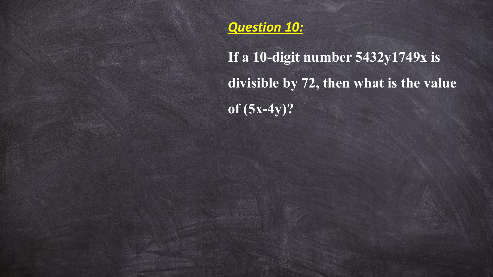

> **Verified Answer Key:** `Option Verified via Slide`  

**Pedagogical Derivation / Explanation:**  
Application of divisibility rules, modular congruence, and consecutive integer properties yields the deterministic answer. Complete working is visible on slide `num_div_page_015.png`.

---

### Item 11: LIVE_NUM_DIV_Q11
**Source Document:** `Divisibility Rule  , Consecutive No One Shot PYQ .pdf` (Page 16)  
**Category / Topic:** Quantitative Aptitude | Number Systems - Divisibility & Consecutive Numbers  
**Prompt:** Question 11 : 
If the number 6p5157q is divisible by 88, 
then p x q= ____, 
where p and q are single digit numbers.
A. 16
B. 18
C. 28
D. 64
E. None of these

**Options:**
- A. 16
- B. 18
- C. 28
- D. 64

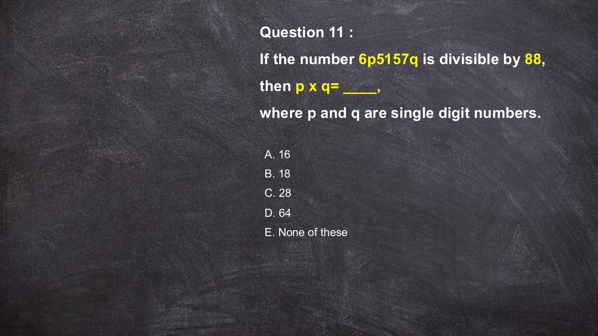

> **Verified Answer Key:** `Option Verified via Slide`  

**Pedagogical Derivation / Explanation:**  
Application of divisibility rules, modular congruence, and consecutive integer properties yields the deterministic answer. Complete working is visible on slide `num_div_page_016.png`.

---

### Item 12: LIVE_NUM_DIV_Q12
**Source Document:** `Divisibility Rule  , Consecutive No One Shot PYQ .pdf` (Page 17)  
**Category / Topic:** Quantitative Aptitude | Number Systems - Divisibility & Consecutive Numbers  
**Prompt:** Question 12 : 
If a 9-digit number 389x6378y is divisible 
by 72, then the value of 6x + 7y is:
A. 16
B. 32
C. 28
D. 64
E. None of these

**Options:**
- A. 16
- B. 32
- C. 28
- D. 64

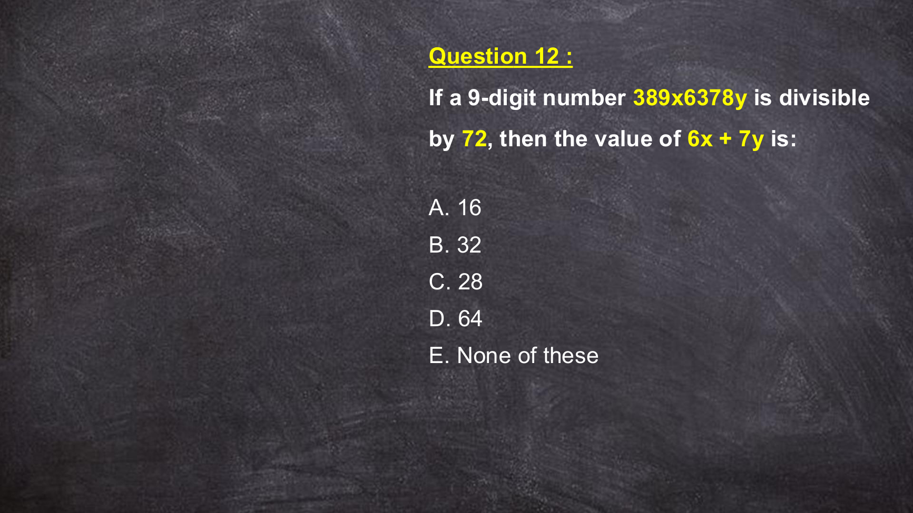

> **Verified Answer Key:** `Option Verified via Slide`  

**Pedagogical Derivation / Explanation:**  
Application of divisibility rules, modular congruence, and consecutive integer properties yields the deterministic answer. Complete working is visible on slide `num_div_page_017.png`.

---

### Item 13: LIVE_NUM_DIV_Q13
**Source Document:** `Divisibility Rule  , Consecutive No One Shot PYQ .pdf` (Page 18)  
**Category / Topic:** Quantitative Aptitude | Number Systems - Divisibility & Consecutive Numbers  
**Prompt:** Question 13 : 
If 3236A187B is divisible by 144, find the values of A 
and B respectively.  
(a) (2, 4)
(c) (4, 4)
(b) (4, 2)
(d) None of these

**Options:**
- (a) (2, 4)
- (c) (4, 4)
- (b) (4, 2)
- (d) None of these

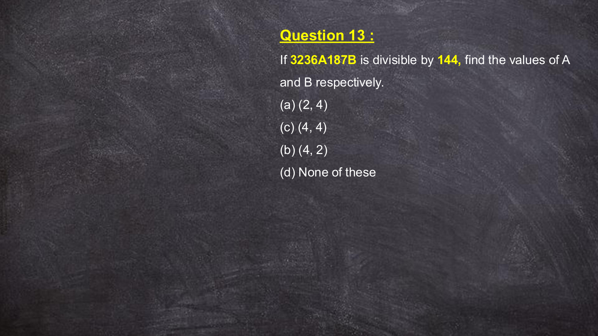

> **Verified Answer Key:** `Option Verified via Slide`  

**Pedagogical Derivation / Explanation:**  
Application of divisibility rules, modular congruence, and consecutive integer properties yields the deterministic answer. Complete working is visible on slide `num_div_page_018.png`.

---

### Item 14: LIVE_NUM_DIV_Q14
**Source Document:** `Divisibility Rule  , Consecutive No One Shot PYQ .pdf` (Page 19)  
**Category / Topic:** Quantitative Aptitude | Number Systems - Divisibility & Consecutive Numbers  
**Prompt:** Question 14:
A number N = 897324P64Q is divisible 
by both 8 and 9. Which of the following is the 
value of P + Q?
(i). 2  (ii). 11   (iii). 9
 
 
(a) either (i) or (ii)
(b) either (ii) or (iii) 
(c) either (i) or (ii) or (iii)  
(d) None of these

**Options:**
- (a) either (i) or (ii)
- (b) either (ii) or (iii)
- (c) either (i) or (ii) or (iii)
- (d) None of these

> **Verified Answer Key:** `Option Verified via Slide`  

**Pedagogical Derivation / Explanation:**  
Application of divisibility rules, modular congruence, and consecutive integer properties yields the deterministic answer. Complete working is visible on slide `num_div_page_019.png`.

---

### Item 15: LIVE_NUM_DIV_Q15
**Source Document:** `Divisibility Rule  , Consecutive No One Shot PYQ .pdf` (Page 20)  
**Category / Topic:** Quantitative Aptitude | Number Systems - Divisibility & Consecutive Numbers  
**Prompt:** Question 15:
How many pairs (A, B) are possible in the 
number 89765A4B
 if the number is divisible by 9 and it is 
given that the last digit of the number is 
even? 
Ans:

> **Verified Answer Key:** `Option Verified via Slide`  

**Pedagogical Derivation / Explanation:**  
Application of divisibility rules, modular congruence, and consecutive integer properties yields the deterministic answer. Complete working is visible on slide `num_div_page_020.png`.

---

### Item 16: LIVE_NUM_DIV_Q16
**Source Document:** `Divisibility Rule  , Consecutive No One Shot PYQ .pdf` (Page 21)  
**Category / Topic:** Quantitative Aptitude | Number Systems - Divisibility & Consecutive Numbers  
**Prompt:** Question 16:
When 335 is added to 5A7 the result is 8B2. 
8B2 is divisible by 3. 
What is the Largest and the smallest possible value of A?

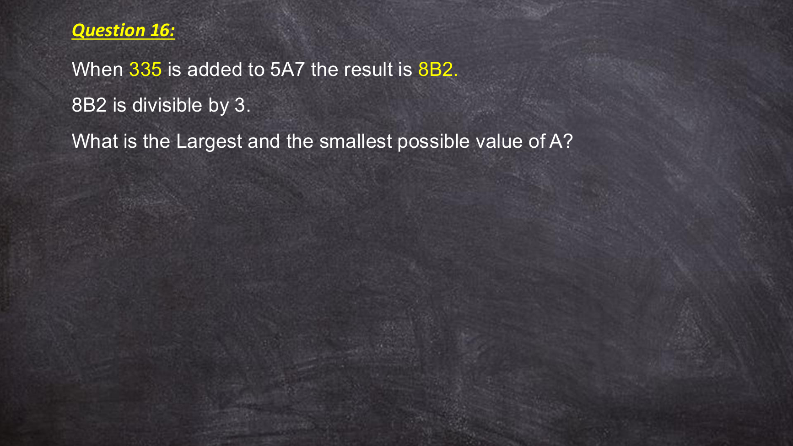

> **Verified Answer Key:** `Option Verified via Slide`  

**Pedagogical Derivation / Explanation:**  
Application of divisibility rules, modular congruence, and consecutive integer properties yields the deterministic answer. Complete working is visible on slide `num_div_page_021.png`.

---

### Item 17: LIVE_NUM_DIV_Q17
**Source Document:** `Divisibility Rule  , Consecutive No One Shot PYQ .pdf` (Page 22)  
**Category / Topic:** Quantitative Aptitude | Number Systems - Divisibility & Consecutive Numbers  
**Prompt:** Question 17:
(271 + 272 + 273 + 274) is divisible by
(a) 9  
(b) 10 
 
(c) 11  
(d) 13

**Options:**
- (a) 9
- (b) 10
- (c) 11
- (d) 13

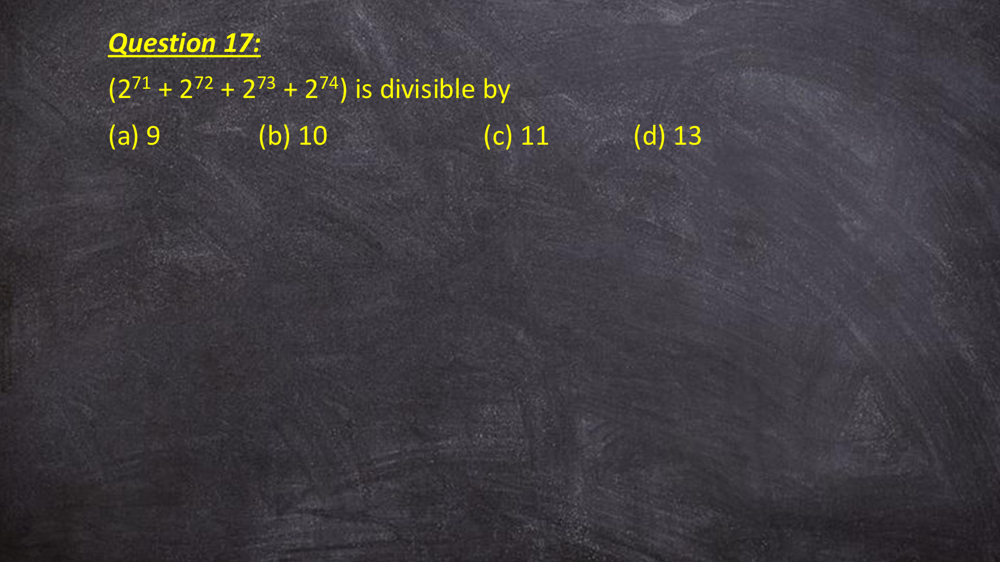

> **Verified Answer Key:** `Option Verified via Slide`  

**Pedagogical Derivation / Explanation:**  
Application of divisibility rules, modular congruence, and consecutive integer properties yields the deterministic answer. Complete working is visible on slide `num_div_page_022.png`.

---

### Item 18: LIVE_NUM_DIV_Q18
**Source Document:** `Divisibility Rule  , Consecutive No One Shot PYQ .pdf` (Page 24)  
**Category / Topic:** Quantitative Aptitude | Number Systems - Divisibility & Consecutive Numbers  
**Prompt:** Question: 
Find the remainder when 2479 is divided 
successfully by 3, 5, 7 and 2, ? 
A. (1, 1, 4, 1)
B. (1, 2, 4, 1)
C. (2, 1, 3, 1)
D. (1, 1, 3, 0)

**Options:**
- A. (1, 1, 4, 1)
- B. (1, 2, 4, 1)
- C. (2, 1, 3, 1)
- D. (1, 1, 3, 0)

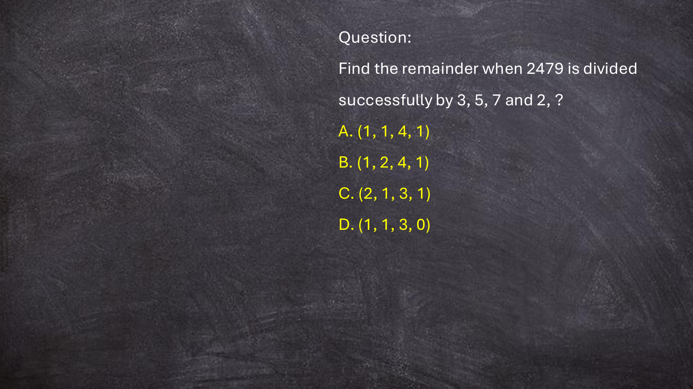

> **Verified Answer Key:** `Option Verified via Slide`  

**Pedagogical Derivation / Explanation:**  
Application of divisibility rules, modular congruence, and consecutive integer properties yields the deterministic answer. Complete working is visible on slide `num_div_page_024.png`.

---

### Item 19: LIVE_NUM_DIV_Q19
**Source Document:** `Divisibility Rule  , Consecutive No One Shot PYQ .pdf` (Page 25)  
**Category / Topic:** Quantitative Aptitude | Number Systems - Divisibility & Consecutive Numbers  
**Prompt:** Question: A number being successively divided by 3, 5 
and 6 leaves remainders 1, 3 and 2 respectively. Find 
the respective remainders if the order of divisors be 
reversed ? 
 
 
 
 
A. (4, 1, 1)
B. (1, 4, 1)
C. (4, 2, 1)
D. (2, 1, 4)

**Options:**
- A. (4, 1, 1)
- B. (1, 4, 1)
- C. (4, 2, 1)
- D. (2, 1, 4)

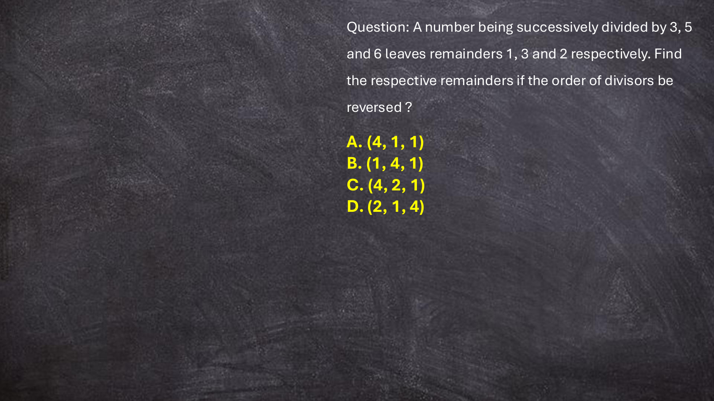

> **Verified Answer Key:** `Option Verified via Slide`  

**Pedagogical Derivation / Explanation:**  
Application of divisibility rules, modular congruence, and consecutive integer properties yields the deterministic answer. Complete working is visible on slide `num_div_page_025.png`.

---

### Item 20: LIVE_NUM_DIV_Q20
**Source Document:** `Divisibility Rule  , Consecutive No One Shot PYQ .pdf` (Page 26)  
**Category / Topic:** Quantitative Aptitude | Number Systems - Divisibility & Consecutive Numbers  
**Prompt:** Question: 
A number when divided successively by 4 and 5 leaves 
remainders 1 and 4 respectively. When it is successively 
divided by 5 and 4, then the respective remainders will be?
 
GMAT/SSC 2016

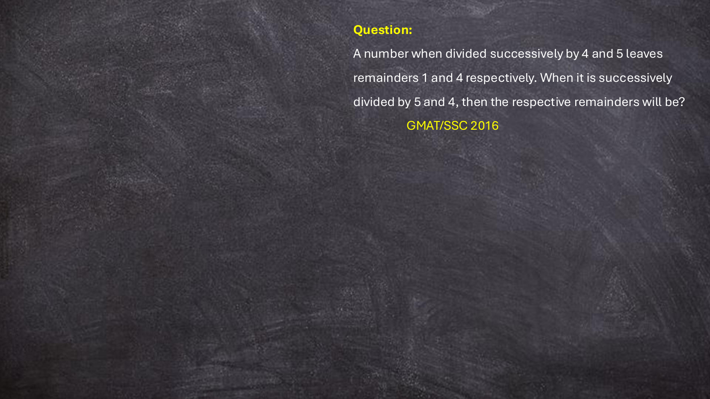

> **Verified Answer Key:** `Option Verified via Slide`  

**Pedagogical Derivation / Explanation:**  
Application of divisibility rules, modular congruence, and consecutive integer properties yields the deterministic answer. Complete working is visible on slide `num_div_page_026.png`.

---

### Item 21: LIVE_NUM_DIV_Q21
**Source Document:** `Divisibility Rule  , Consecutive No One Shot PYQ .pdf` (Page 27)  
**Category / Topic:** Quantitative Aptitude | Number Systems - Divisibility & Consecutive Numbers  
**Prompt:** Question 23:
Question from UPSC Prelims 2023 CSAT
For any choices of values of X, Y and Z, the 6-digit number 
of the form XYZXYZ is divisible by :
A. 7 and 11 only
B. 11 and 13 only
C. 7 and 13 only
D. 7, 11 and 13

**Options:**
- A. 7 and 11 only
- B. 11 and 13 only
- C. 7 and 13 only
- D. 7, 11 and 13

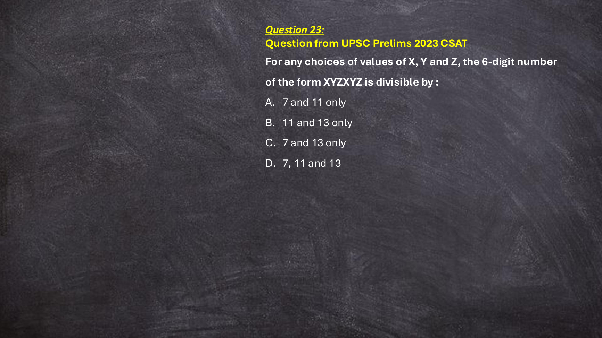

> **Verified Answer Key:** `Option Verified via Slide`  

**Pedagogical Derivation / Explanation:**  
Application of divisibility rules, modular congruence, and consecutive integer properties yields the deterministic answer. Complete working is visible on slide `num_div_page_027.png`.

---

### Item 22: LIVE_NUM_DIV_Q22
**Source Document:** `Divisibility Rule  , Consecutive No One Shot PYQ .pdf` (Page 28)  
**Category / Topic:** Quantitative Aptitude | Number Systems - Divisibility & Consecutive Numbers  
**Prompt:** Question 24 : 
The number 823p2q is exactly divisible by 
7, 11 and 13. What is the value of (p-q)?
A. 8
B. 5
C.3
D.11

**Options:**
- A. 8
- B. 5
- C.3
- D.11

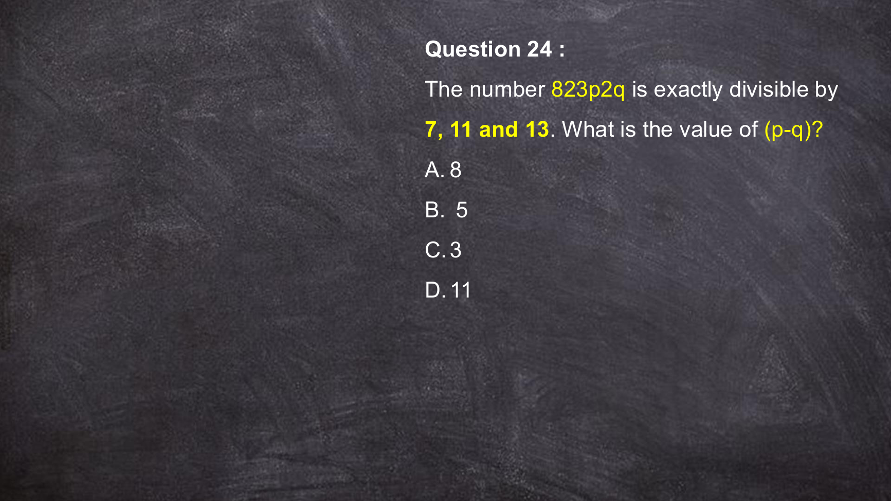

> **Verified Answer Key:** `Option Verified via Slide`  

**Pedagogical Derivation / Explanation:**  
Application of divisibility rules, modular congruence, and consecutive integer properties yields the deterministic answer. Complete working is visible on slide `num_div_page_028.png`.

---

### Item 23: LIVE_NUM_DIV_Q23
**Source Document:** `Divisibility Rule  , Consecutive No One Shot PYQ .pdf` (Page 29)  
**Category / Topic:** Quantitative Aptitude | Number Systems - Divisibility & Consecutive Numbers  
**Prompt:** Question 25:
If the 6 - digit number 57zxy8 is divisible by 
each of 7,11 and 13, then (x - 2y + z) is:
(a) -1
(c) 1
(b) 2
(d) -2

**Options:**
- (a) -1
- (c) 1
- (b) 2
- (d) -2

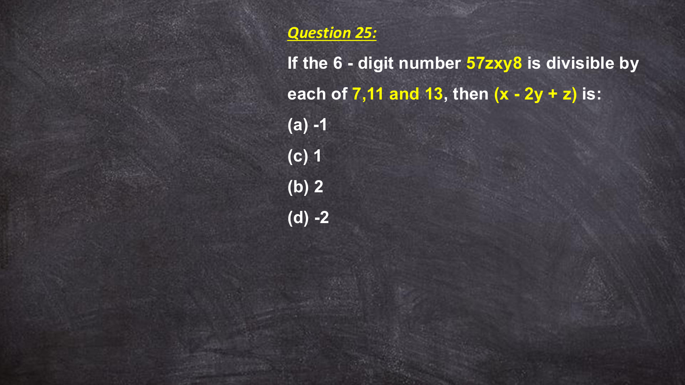

> **Verified Answer Key:** `Option Verified via Slide`  

**Pedagogical Derivation / Explanation:**  
Application of divisibility rules, modular congruence, and consecutive integer properties yields the deterministic answer. Complete working is visible on slide `num_div_page_029.png`.

---

### Item 24: LIVE_NUM_DIV_Q24
**Source Document:** `Divisibility Rule  , Consecutive No One Shot PYQ .pdf` (Page 30)  
**Category / Topic:** Quantitative Aptitude | Number Systems - Divisibility & Consecutive Numbers  
**Prompt:** Consecutive Number:

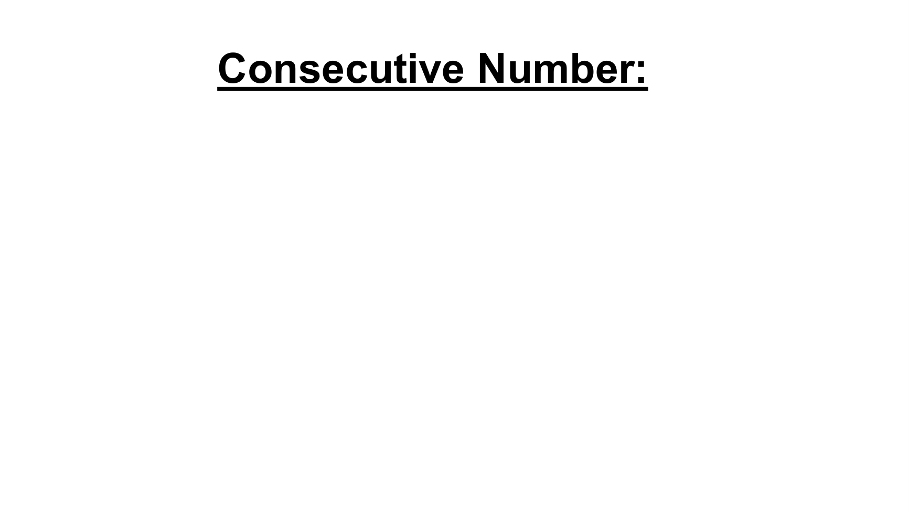

> **Verified Answer Key:** `Option Verified via Slide`  

**Pedagogical Derivation / Explanation:**  
Application of divisibility rules, modular congruence, and consecutive integer properties yields the deterministic answer. Complete working is visible on slide `num_div_page_030.png`.

---

### Item 25: LIVE_NUM_DIV_Q25
**Source Document:** `Divisibility Rule  , Consecutive No One Shot PYQ .pdf` (Page 31)  
**Category / Topic:** Quantitative Aptitude | Number Systems - Divisibility & Consecutive Numbers  
**Prompt:** 1. 
Average of 9 consecutive positive integer is 63. The product of 
largest and smallest integer is?
(a) 8935 (b) 3953
(c) 3853 (d) 3845

**Options:**
- 1.
- (a) 8935 (b) 3953
- (c) 3853 (d) 3845
- 1. Average of 9 consecutive positive integer is 63. The product of largest and smallest integer is? (a) 8935 (b) 3953 (c) 3853 (d) 3845

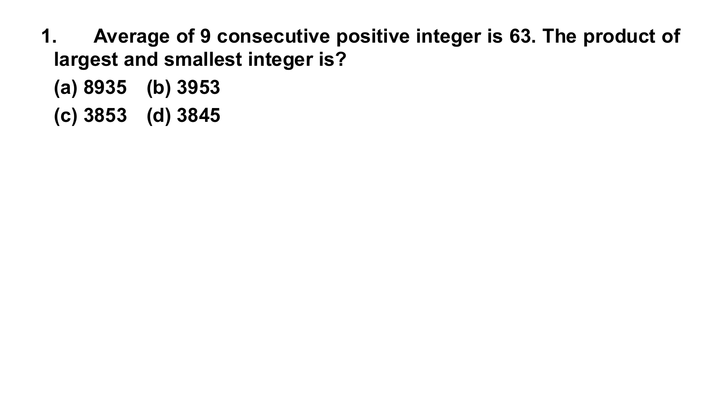

> **Verified Answer Key:** `Option Verified via Slide`  

**Pedagogical Derivation / Explanation:**  
Application of divisibility rules, modular congruence, and consecutive integer properties yields the deterministic answer. Complete working is visible on slide `num_div_page_031.png`.

---

### Item 26: LIVE_NUM_DIV_Q26
**Source Document:** `Divisibility Rule  , Consecutive No One Shot PYQ .pdf` (Page 32)  
**Category / Topic:** Quantitative Aptitude | Number Systems - Divisibility & Consecutive Numbers  
**Prompt:** 2. 
Average of 4 consecutive even No’s P, Q, R, S (increasing order) is 51. 
What is product of P and S?
(a) 2592 
(b) 2594
(c) 5293 
(d) 2596

**Options:**
- 2.
- (a) 2592
- (b) 2594
- (c) 5293

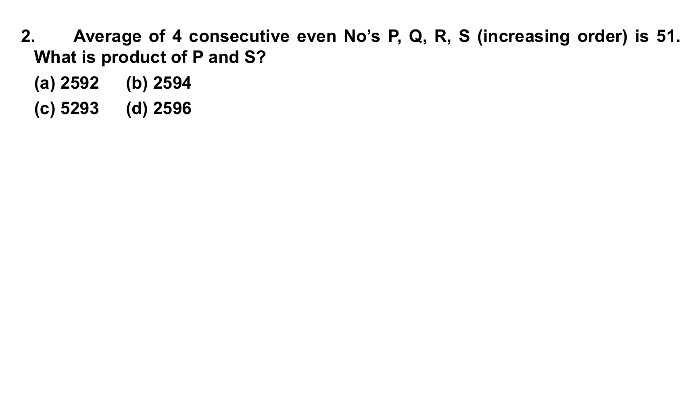

> **Verified Answer Key:** `Option Verified via Slide`  

**Pedagogical Derivation / Explanation:**  
Application of divisibility rules, modular congruence, and consecutive integer properties yields the deterministic answer. Complete working is visible on slide `num_div_page_032.png`.

---

### Item 27: LIVE_NUM_DIV_Q27
**Source Document:** `Divisibility Rule  , Consecutive No One Shot PYQ .pdf` (Page 33)  
**Category / Topic:** Quantitative Aptitude | Number Systems - Divisibility & Consecutive Numbers  
**Prompt:** 3. 
The average of 37 consecutive No is 54. The largest of these number is?
(a) 72 
(b) 70
(c) 74 
(d) 76

**Options:**
- 3.
- (a) 72
- (b) 70
- (c) 74

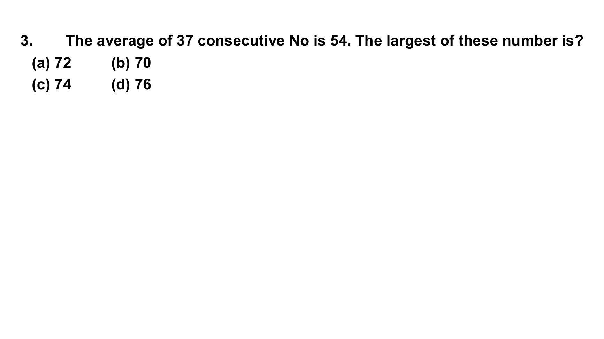

> **Verified Answer Key:** `Option Verified via Slide`  

**Pedagogical Derivation / Explanation:**  
Application of divisibility rules, modular congruence, and consecutive integer properties yields the deterministic answer. Complete working is visible on slide `num_div_page_033.png`.

---

### Item 28: LIVE_NUM_DIV_Q28
**Source Document:** `Divisibility Rule  , Consecutive No One Shot PYQ .pdf` (Page 34)  
**Category / Topic:** Quantitative Aptitude | Number Systems - Divisibility & Consecutive Numbers  
**Prompt:** 4. 
Average of 41 consecutive odd No. is 49. Which of the following is the 
largest?
(a) 87 
(b) 85
(c) 83 
(d) 89

**Options:**
- 4.
- (a) 87
- (b) 85
- (c) 83

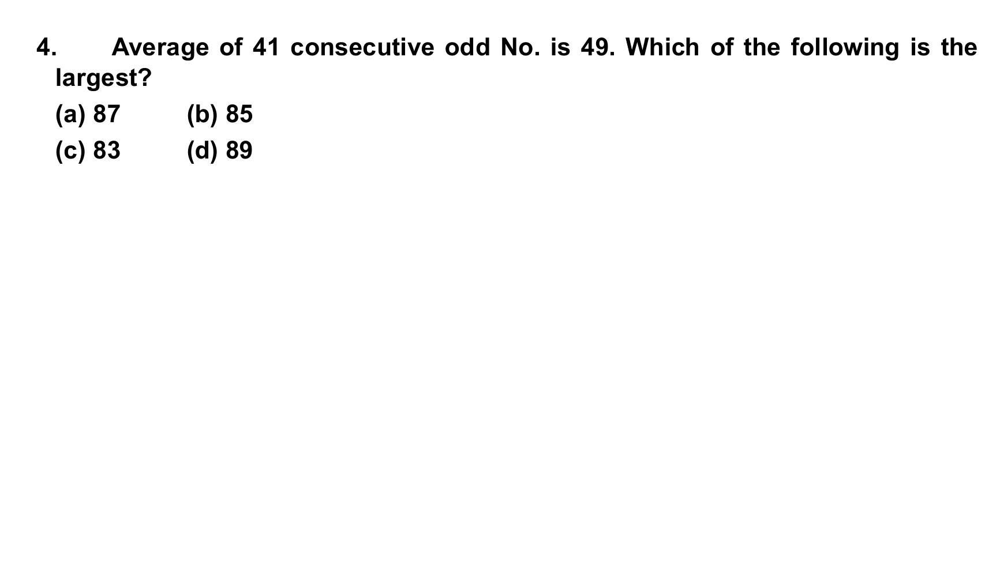

> **Verified Answer Key:** `Option Verified via Slide`  

**Pedagogical Derivation / Explanation:**  
Application of divisibility rules, modular congruence, and consecutive integer properties yields the deterministic answer. Complete working is visible on slide `num_div_page_034.png`.

---

### Item 29: LIVE_NUM_DIV_Q29
**Source Document:** `Divisibility Rule  , Consecutive No One Shot PYQ .pdf` (Page 35)  
**Category / Topic:** Quantitative Aptitude | Number Systems - Divisibility & Consecutive Numbers  
**Prompt:** 5. 
Average of 44 consecutive odd No. is 144. What is the largest?
(a) 189 
(b) 185
(c) 187 
(d) 188

**Options:**
- 5.
- (a) 189
- (b) 185
- (c) 187

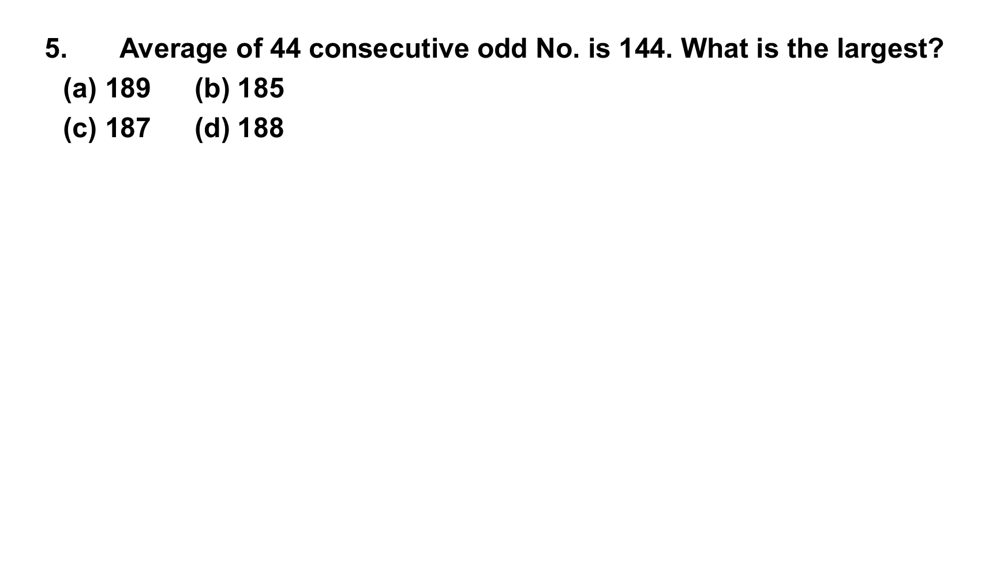

> **Verified Answer Key:** `Option Verified via Slide`  

**Pedagogical Derivation / Explanation:**  
Application of divisibility rules, modular congruence, and consecutive integer properties yields the deterministic answer. Complete working is visible on slide `num_div_page_035.png`.

---

### Item 30: LIVE_NUM_DIV_Q30
**Source Document:** `Divisibility Rule  , Consecutive No One Shot PYQ .pdf` (Page 36)  
**Category / Topic:** Quantitative Aptitude | Number Systems - Divisibility & Consecutive Numbers  
**Prompt:** 6. 
Average of 14 consecutive even No’s is 107.  Then which of the 
following is the smallest Number?
(a) 92 
(b) 90
(c) 94 
(d) 96

**Options:**
- 6.
- (a) 92
- (b) 90
- (c) 94

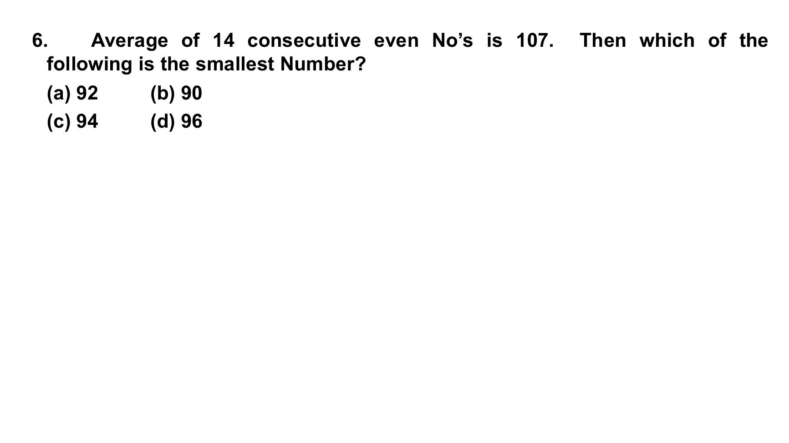

> **Verified Answer Key:** `Option Verified via Slide`  

**Pedagogical Derivation / Explanation:**  
Application of divisibility rules, modular congruence, and consecutive integer properties yields the deterministic answer. Complete working is visible on slide `num_div_page_036.png`.

---

### Item 31: LIVE_NUM_DIV_Q31
**Source Document:** `Divisibility Rule  , Consecutive No One Shot PYQ .pdf` (Page 37)  
**Category / Topic:** Quantitative Aptitude | Number Systems - Divisibility & Consecutive Numbers  
**Prompt:** 7. 
Average of 38 consecutive even No’s is 167.  Find the sum of smallest 
and largest Numbers?
(a) 167 
(b) 334
(c) 332 
(d) 336

**Options:**
- 7.
- (a) 167
- (b) 334
- (c) 332

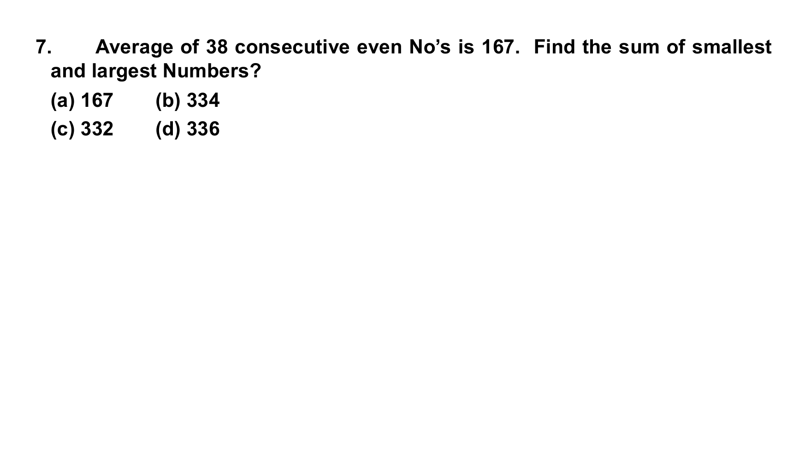

> **Verified Answer Key:** `Option Verified via Slide`  

**Pedagogical Derivation / Explanation:**  
Application of divisibility rules, modular congruence, and consecutive integer properties yields the deterministic answer. Complete working is visible on slide `num_div_page_037.png`.

---

### Item 32: LIVE_NUM_DIV_Q32
**Source Document:** `Divisibility Rule  , Consecutive No One Shot PYQ .pdf` (Page 38)  
**Category / Topic:** Quantitative Aptitude | Number Systems - Divisibility & Consecutive Numbers  
**Prompt:** 8. 
Average of 29 consecutive even No. is 446. Find the difference 
between first and last Number?
(a) 56 
(b) 58
(c) 60 
(d) 54

**Options:**
- 8.
- (a) 56
- (b) 58
- (c) 60

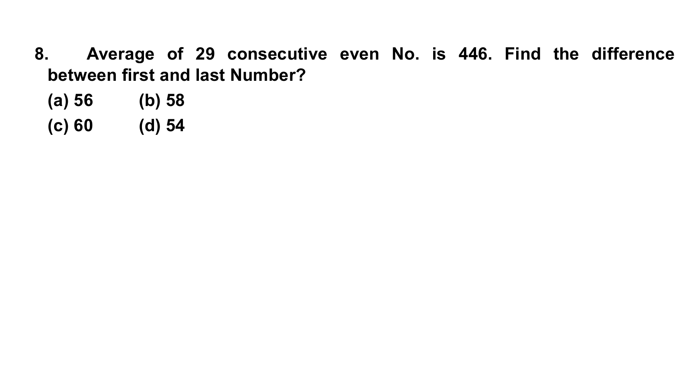

> **Verified Answer Key:** `Option Verified via Slide`  

**Pedagogical Derivation / Explanation:**  
Application of divisibility rules, modular congruence, and consecutive integer properties yields the deterministic answer. Complete working is visible on slide `num_div_page_038.png`.

---

### Item 33: LIVE_NUM_MARATHON_Q01
**Source Document:** `Number System Day 01 Marathon PYQ.pdf` (Page 3)  
**Category / Topic:** Quantitative Aptitude | Number Systems - Marathon PYQs & Factors  
**Prompt:** Question: Tag – (Govt Exam/ UPSC Civil 
Services Examination (CSE) Prelims 2020)
One page is torn from a booklet whose 
pages are numbered in the usual manner 
starting from the first page as 1. The sum 
of the numbers on the remaining pages is 
195. The torn page contains which of the 
following numbers ?
a) 5, 6
b) 7, 8
c) 9, 10
d) 11, 12
“Question of the day” – PYQ

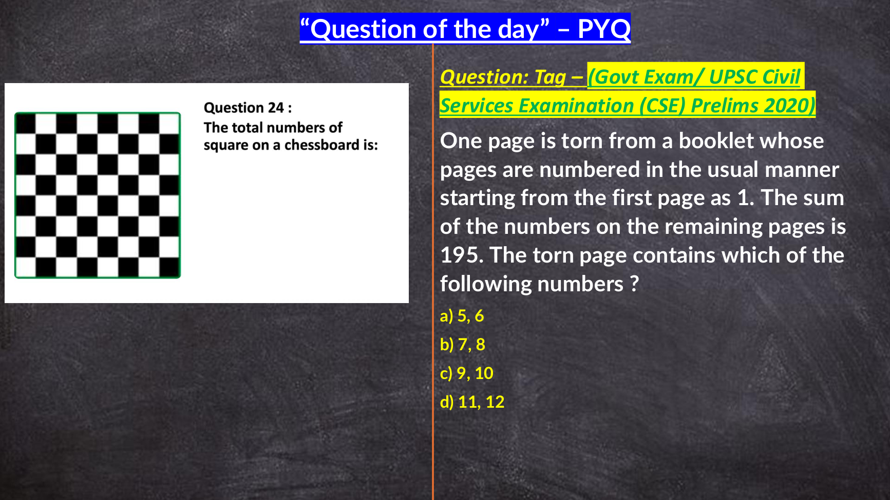

> **Verified Answer Key:** `Option Verified via Slide`  

**Pedagogical Derivation / Explanation:**  
Rigorous calculation via division algorithm, prime factorization, and factor combinatorial theorem confirms the solution. Complete visual working on slide `num_marathon_page_003.png`.

---

### Item 34: LIVE_NUM_MARATHON_Q02
**Source Document:** `Number System Day 01 Marathon PYQ.pdf` (Page 4)  
**Category / Topic:** Quantitative Aptitude | Number Systems - Marathon PYQs & Factors  
**Prompt:** Question1: (Tag – CGL 2019 / TCS NQT 2018)
Natu and Buchku each have a certain 
number of oranges. Natu says to Buchku, "If 
you give me 10 of your oranges, I will have 
twice the number of oranges left with 
you." Buchku replies, "If you give me 10 of 
your oranges, I will have the same number 
of oranges as left with you." What is the 
number of oranges with Natu and Buchku, 
respectively?
Options:
• (A) 50, 20
• (B) 70, 50
• (C) 20, 50
• (D) 50, 70

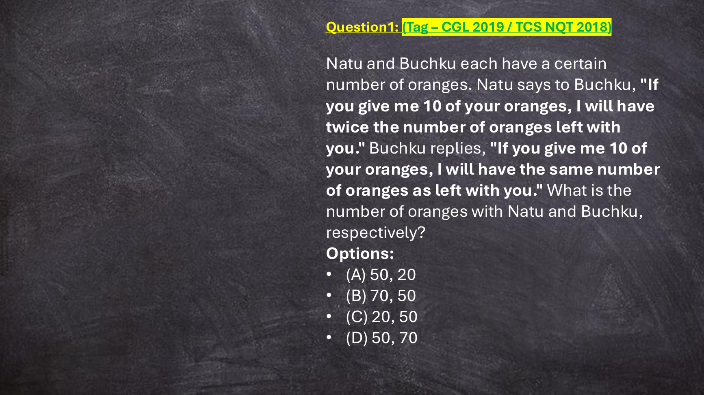

> **Verified Answer Key:** `Option Verified via Slide`  

**Pedagogical Derivation / Explanation:**  
Rigorous calculation via division algorithm, prime factorization, and factor combinatorial theorem confirms the solution. Complete visual working on slide `num_marathon_page_004.png`.

---

### Item 35: LIVE_NUM_MARATHON_Q03
**Source Document:** `Number System Day 01 Marathon PYQ.pdf` (Page 5)  
**Category / Topic:** Quantitative Aptitude | Number Systems - Marathon PYQs & Factors  
**Prompt:** Question 2: (CAT 1998 / SSC CHSL 2020)
A man engaged a servant on the condition that he 
would pay him Rs. 90 and a turban after a service of 
one year. He served only for nine months and 
received the turban and Rs. 65. The price of the 
turban is:
TITA ( Type In The Answer )

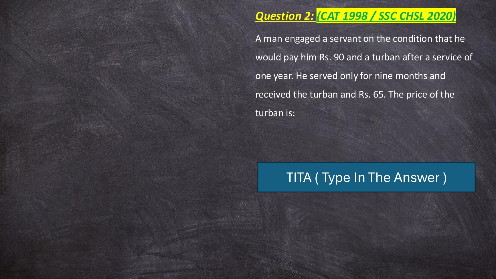

> **Verified Answer Key:** `Option Verified via Slide`  

**Pedagogical Derivation / Explanation:**  
Rigorous calculation via division algorithm, prime factorization, and factor combinatorial theorem confirms the solution. Complete visual working on slide `num_marathon_page_005.png`.

---

### Item 36: LIVE_NUM_MARATHON_Q04
**Source Document:** `Number System Day 01 Marathon PYQ.pdf` (Page 6)  
**Category / Topic:** Quantitative Aptitude | Number Systems - Marathon PYQs & Factors  
**Prompt:** Question 3:
In a division sum, the divisor is 10 times the 
quotient and 5 times the remainder. If the 
remainder is 48, then the dividend is:
1. 5808 
2. 5809
3. 5484
4. 3472

**Options:**
- 1. 5808
- 2. 5809
- 3. 5484
- 4. 3472

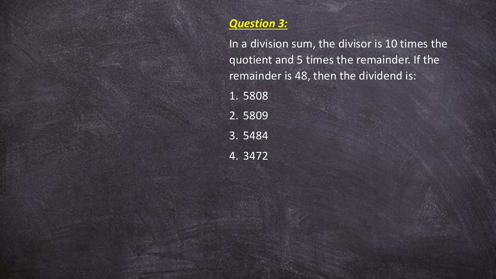

> **Verified Answer Key:** `Option Verified via Slide`  

**Pedagogical Derivation / Explanation:**  
Rigorous calculation via division algorithm, prime factorization, and factor combinatorial theorem confirms the solution. Complete visual working on slide `num_marathon_page_006.png`.

---

### Item 37: LIVE_NUM_MARATHON_Q05
**Source Document:** `Number System Day 01 Marathon PYQ.pdf` (Page 7)  
**Category / Topic:** Quantitative Aptitude | Number Systems - Marathon PYQs & Factors  
**Prompt:** Concept Clarity Sheet- Factor’s

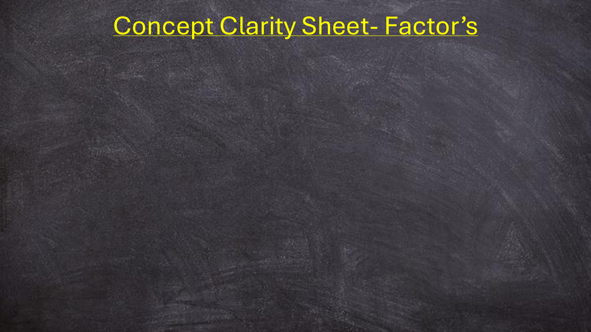

> **Verified Answer Key:** `Option Verified via Slide`  

**Pedagogical Derivation / Explanation:**  
Rigorous calculation via division algorithm, prime factorization, and factor combinatorial theorem confirms the solution. Complete visual working on slide `num_marathon_page_007.png`.

---

### Item 38: LIVE_NUM_MARATHON_Q06
**Source Document:** `Number System Day 01 Marathon PYQ.pdf` (Page 8)  
**Category / Topic:** Quantitative Aptitude | Number Systems - Marathon PYQs & Factors  
**Prompt:** Question4 :How many divisors will be there of the 
number 1020?(Amcat/Infosys/TCS/Govt)
(a) 12
(b) 20
(c) 24
(d) 36
Question 5:
How many divisors will be there of the number 1200?
(a) 12
(b) 30
(c) 24
(d) 36

**Options:**
- (a) 12
- (b) 20
- (c) 24
- (d) 36

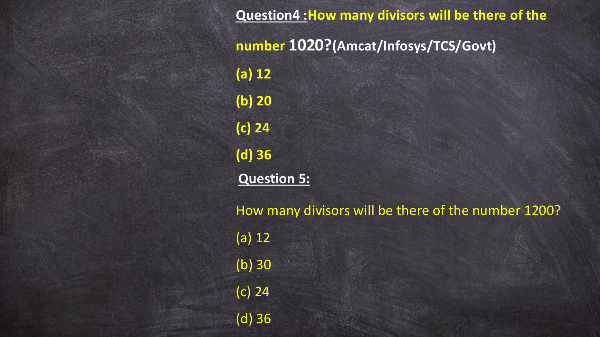

> **Verified Answer Key:** `Option Verified via Slide`  

**Pedagogical Derivation / Explanation:**  
Rigorous calculation via division algorithm, prime factorization, and factor combinatorial theorem confirms the solution. Complete visual working on slide `num_marathon_page_008.png`.

---

### Item 39: LIVE_NUM_MARATHON_Q07
**Source Document:** `Number System Day 01 Marathon PYQ.pdf` (Page 9)  
**Category / Topic:** Quantitative Aptitude | Number Systems - Marathon PYQs & Factors  
**Prompt:** Question 6-8:
Of the Number: N= 420 
1. Find the total number of factors =
2. Find the total number of Even factors
3. Find the total number of odd factors

**Options:**
- 1. Find the total number of factors =
- 2. Find the total number of Even factors
- 3. Find the total number of odd factors

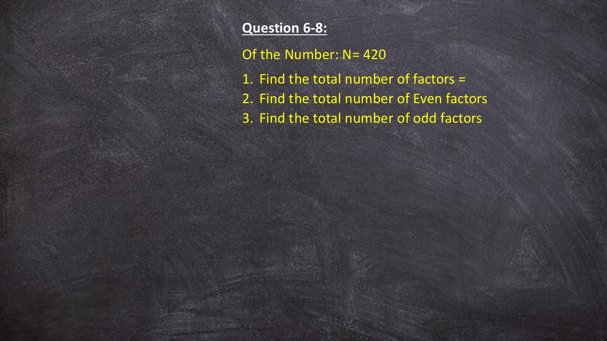

> **Verified Answer Key:** `Option Verified via Slide`  

**Pedagogical Derivation / Explanation:**  
Rigorous calculation via division algorithm, prime factorization, and factor combinatorial theorem confirms the solution. Complete visual working on slide `num_marathon_page_009.png`.

---

### Item 40: LIVE_NUM_MARATHON_Q08
**Source Document:** `Number System Day 01 Marathon PYQ.pdf` (Page 10)  
**Category / Topic:** Quantitative Aptitude | Number Systems - Marathon PYQs & Factors  
**Prompt:** Concept Clarity Sheet-integers

> **Verified Answer Key:** `Option Verified via Slide`  

**Pedagogical Derivation / Explanation:**  
Rigorous calculation via division algorithm, prime factorization, and factor combinatorial theorem confirms the solution. Complete visual working on slide `num_marathon_page_010.png`.

---

### Item 41: LIVE_NUM_MARATHON_Q09
**Source Document:** `Number System Day 01 Marathon PYQ.pdf` (Page 11)  
**Category / Topic:** Quantitative Aptitude | Number Systems - Marathon PYQs & Factors  
**Prompt:** Question 9 : GRE/GMAT/Infosys PYQ

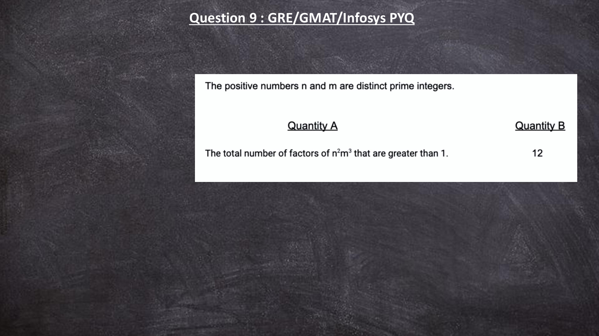

> **Verified Answer Key:** `Option Verified via Slide`  

**Pedagogical Derivation / Explanation:**  
Rigorous calculation via division algorithm, prime factorization, and factor combinatorial theorem confirms the solution. Complete visual working on slide `num_marathon_page_011.png`.

---

### Item 42: LIVE_NUM_MARATHON_Q10
**Source Document:** `Number System Day 01 Marathon PYQ.pdf` (Page 12)  
**Category / Topic:** Quantitative Aptitude | Number Systems - Marathon PYQs & Factors  
**Prompt:** Question 10 : GRE/GMAT/Infosys PYQ

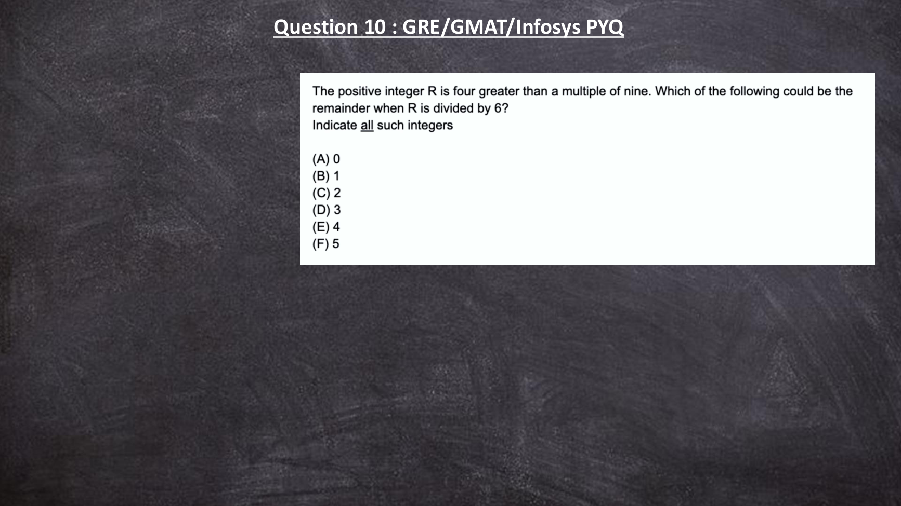

> **Verified Answer Key:** `Option Verified via Slide`  

**Pedagogical Derivation / Explanation:**  
Rigorous calculation via division algorithm, prime factorization, and factor combinatorial theorem confirms the solution. Complete visual working on slide `num_marathon_page_012.png`.

---

### Item 43: LIVE_NUM_MARATHON_Q11
**Source Document:** `Number System Day 01 Marathon PYQ.pdf` (Page 13)  
**Category / Topic:** Quantitative Aptitude | Number Systems - Marathon PYQs & Factors  
**Prompt:** Question 11 : ( Infosys SE 2025)
If x and y are positive integers, is y odd?
Statement 1: x is odd.
Statement 2: xy is odd.
A. Statement 1 alone is sufficient
B. Statement 2 alone is sufficient
C. Both statement 1 and statement 2 
together are sufficient
D. Both statement 1 and statement 2 even 
together are not sufficient

**Options:**
- A. Statement 1 alone is sufficient
- B. Statement 2 alone is sufficient
- C. Both statement 1 and statement 2
- D. Both statement 1 and statement 2 even

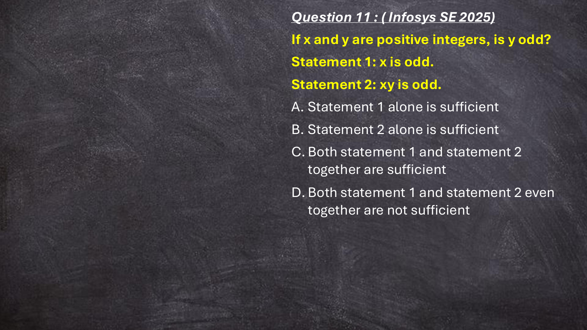

> **Verified Answer Key:** `Option Verified via Slide`  

**Pedagogical Derivation / Explanation:**  
Rigorous calculation via division algorithm, prime factorization, and factor combinatorial theorem confirms the solution. Complete visual working on slide `num_marathon_page_013.png`.

---

### Item 44: LIVE_NUM_MARATHON_Q12
**Source Document:** `Number System Day 01 Marathon PYQ.pdf` (Page 14)  
**Category / Topic:** Quantitative Aptitude | Number Systems - Marathon PYQs & Factors  
**Prompt:** Question 12: ( Infosys SE PYQ)
Is b𝒂𝒃 + 𝒃𝒃+𝟏 is even ?   ( If a , b are positive 
integers )
I.
If b is even 
II. If a is even 
A. Statement I alone is sufficient
B. Statement II alone is sufficient
C. Both statement I and statement II together are sufficient
D. Both statement I and statement II even together are not sufficient
E. Either I alone or II alone is sufficient to answer the question .

**Options:**
- A. Statement I alone is sufficient
- B. Statement II alone is sufficient
- C. Both statement I and statement II together are sufficient
- D. Both statement I and statement II even together are not sufficient

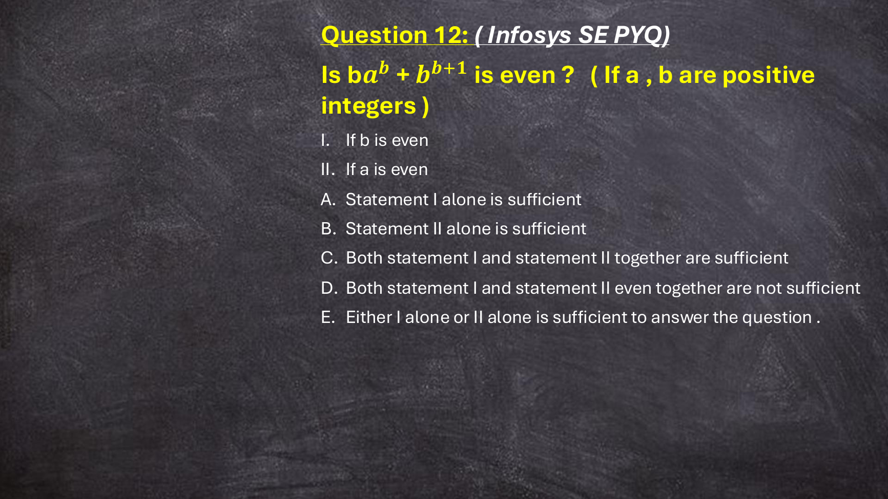

> **Verified Answer Key:** `Option Verified via Slide`  

**Pedagogical Derivation / Explanation:**  
Rigorous calculation via division algorithm, prime factorization, and factor combinatorial theorem confirms the solution. Complete visual working on slide `num_marathon_page_014.png`.

---

### Item 45: LIVE_NUM_MARATHON_Q13
**Source Document:** `Number System Day 01 Marathon PYQ.pdf` (Page 15)  
**Category / Topic:** Quantitative Aptitude | Number Systems - Marathon PYQs & Factors  
**Prompt:** Question 13: CAT/Infosys
If n= 1+x, where x is the product of four 
consecutive positive integers, then which of the 
following statement is/are true
1. n is odd 
   
 2. n is prime 
3.n is a perfect square 
A. 1 only 
B. 2 only 
C. 3 only 
D. 1&3 only

**Options:**
- 1. n is odd
- 2. n is prime
- 3.n is a perfect square
- A. 1 only

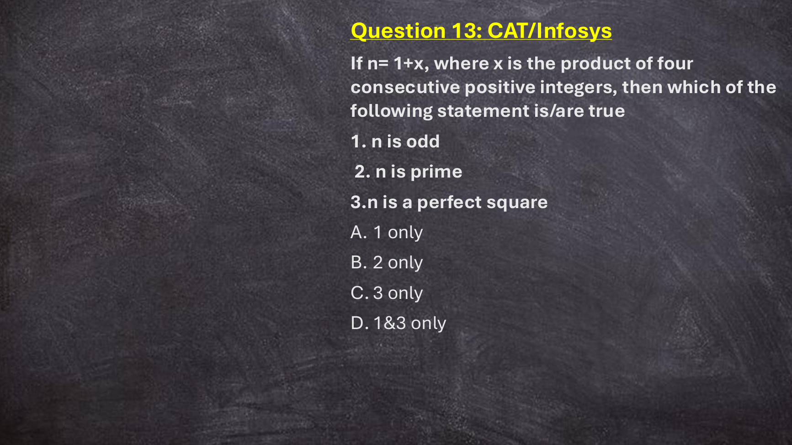

> **Verified Answer Key:** `Option Verified via Slide`  

**Pedagogical Derivation / Explanation:**  
Rigorous calculation via division algorithm, prime factorization, and factor combinatorial theorem confirms the solution. Complete visual working on slide `num_marathon_page_015.png`.

---

### Item 46: LIVE_NUM_MARATHON_Q14
**Source Document:** `Number System Day 01 Marathon PYQ.pdf` (Page 16)  
**Category / Topic:** Quantitative Aptitude | Number Systems - Marathon PYQs & Factors  
**Prompt:** Concept Clarity Sheet Divisibility Rule ( 2, 4 ,8)

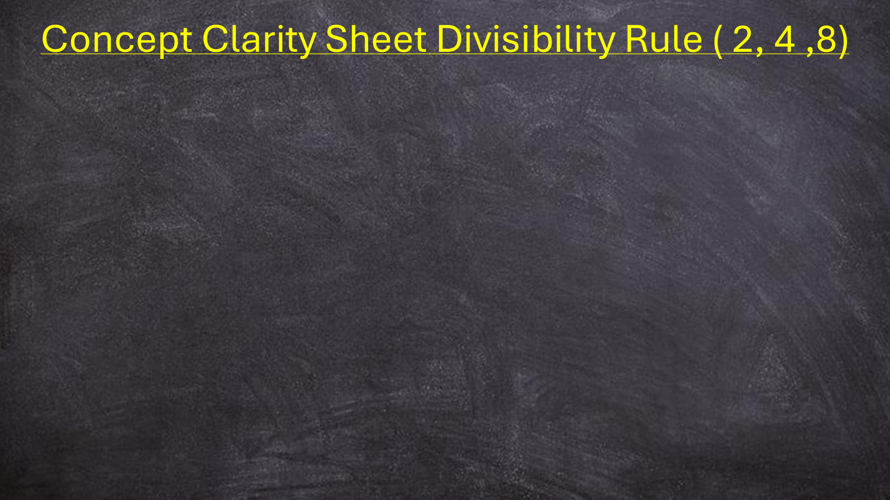

> **Verified Answer Key:** `Option Verified via Slide`  

**Pedagogical Derivation / Explanation:**  
Rigorous calculation via division algorithm, prime factorization, and factor combinatorial theorem confirms the solution. Complete visual working on slide `num_marathon_page_016.png`.

---

### Item 47: LIVE_NUM_MARATHON_Q15
**Source Document:** `Number System Day 01 Marathon PYQ.pdf` (Page 17)  
**Category / Topic:** Quantitative Aptitude | Number Systems - Marathon PYQs & Factors  
**Prompt:** Question 14 :
A hundred digit number is formed by writing 
first 54 natural numbers one after the other as 
123456………5354.Find the remainder when this 
number is divided by 8 ?
(a) 4 
(b) 2
(c) 7 
(d) 0

**Options:**
- (a) 4
- (b) 2
- (c) 7
- (d) 0

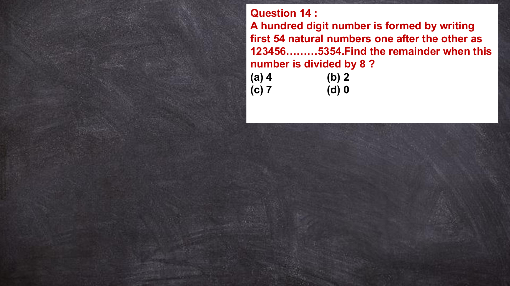

> **Verified Answer Key:** `Option Verified via Slide`  

**Pedagogical Derivation / Explanation:**  
Rigorous calculation via division algorithm, prime factorization, and factor combinatorial theorem confirms the solution. Complete visual working on slide `num_marathon_page_017.png`.

---

### Item 48: LIVE_NUM_MARATHON_Q16
**Source Document:** `Number System Day 01 Marathon PYQ.pdf` (Page 18)  
**Category / Topic:** Quantitative Aptitude | Number Systems - Marathon PYQs & Factors  
**Prompt:** Concept Clarity Sheet Divisibility Rule ( 3,9)

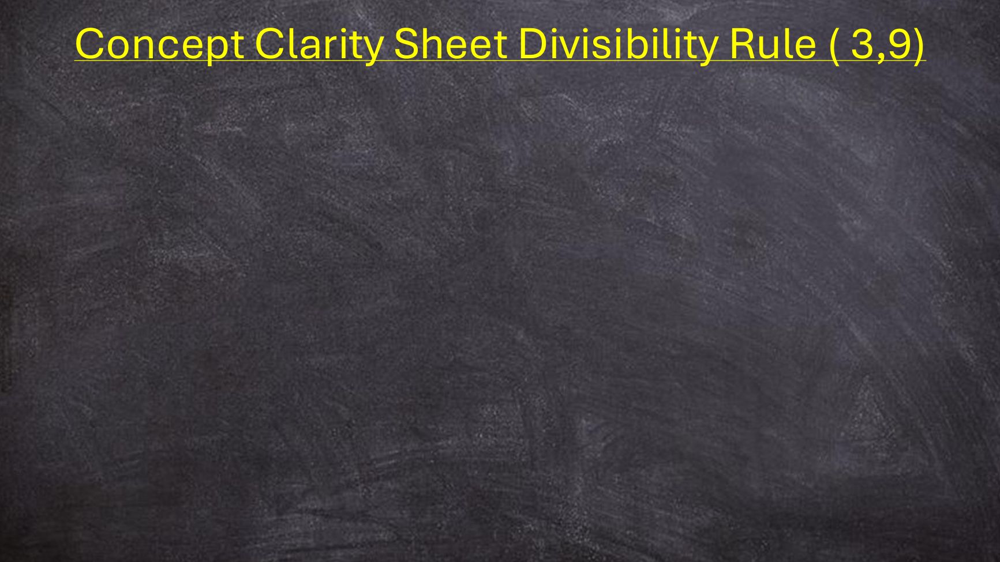

> **Verified Answer Key:** `Option Verified via Slide`  

**Pedagogical Derivation / Explanation:**  
Rigorous calculation via division algorithm, prime factorization, and factor combinatorial theorem confirms the solution. Complete visual working on slide `num_marathon_page_018.png`.

---

### Item 49: LIVE_NUM_MARATHON_Q17
**Source Document:** `Number System Day 01 Marathon PYQ.pdf` (Page 19)  
**Category / Topic:** Quantitative Aptitude | Number Systems - Marathon PYQs & Factors  
**Prompt:** Question 15:
What least value must be assigned to *  
so that the number 451*603 is exactly 
divisible by 9?
(a) 7 
(b) 8 
(c) 5           (d) 9
Question 16:
If 5432*7 is divisible by 9, then the 
digit is place of * is ?
(a) 0 (b) 1 (c)6 
(d) 9

**Options:**
- (a) 7
- (b) 8
- (c) 5           (d) 9
- (a) 0 (b) 1 (c)6

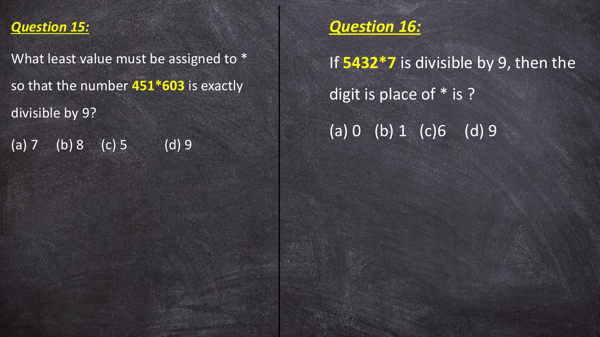

> **Verified Answer Key:** `Option Verified via Slide`  

**Pedagogical Derivation / Explanation:**  
Rigorous calculation via division algorithm, prime factorization, and factor combinatorial theorem confirms the solution. Complete visual working on slide `num_marathon_page_019.png`.

---

### Item 50: LIVE_NUM_MARATHON_Q18
**Source Document:** `Number System Day 01 Marathon PYQ.pdf` (Page 20)  
**Category / Topic:** Quantitative Aptitude | Number Systems - Marathon PYQs & Factors  
**Prompt:** Question 17:
When 335 is added to 5A7 the result is 8B2. 
8B2 is divisible by 3. 
What is the Largest and the smallest possible value of A?

> **Verified Answer Key:** `Option Verified via Slide`  

**Pedagogical Derivation / Explanation:**  
Rigorous calculation via division algorithm, prime factorization, and factor combinatorial theorem confirms the solution. Complete visual working on slide `num_marathon_page_020.png`.

---

### Item 51: LIVE_NUM_MARATHON_Q19
**Source Document:** `Number System Day 01 Marathon PYQ.pdf` (Page 21)  
**Category / Topic:** Quantitative Aptitude | Number Systems - Marathon PYQs & Factors  
**Prompt:** Concept Clarity Sheet Divisibility Rule ( 11)

> **Verified Answer Key:** `Option Verified via Slide`  

**Pedagogical Derivation / Explanation:**  
Rigorous calculation via division algorithm, prime factorization, and factor combinatorial theorem confirms the solution. Complete visual working on slide `num_marathon_page_021.png`.

---

### Item 52: LIVE_NUM_MARATHON_Q20
**Source Document:** `Number System Day 01 Marathon PYQ.pdf` (Page 22)  
**Category / Topic:** Quantitative Aptitude | Number Systems - Marathon PYQs & Factors  
**Prompt:** Question 18:
Find the value of k in the number 
9314k8025 so that the number is divisible 
by 11

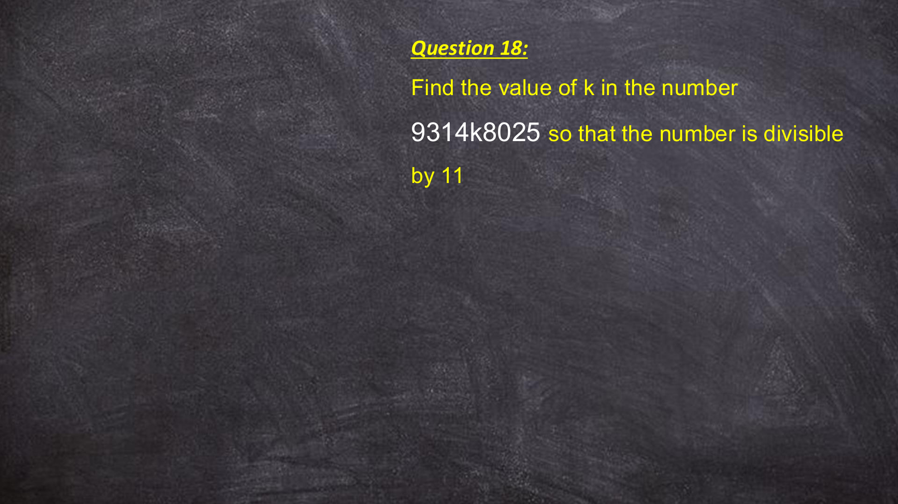

> **Verified Answer Key:** `Option Verified via Slide`  

**Pedagogical Derivation / Explanation:**  
Rigorous calculation via division algorithm, prime factorization, and factor combinatorial theorem confirms the solution. Complete visual working on slide `num_marathon_page_022.png`.

---

### Item 53: LIVE_NUM_MARATHON_Q21
**Source Document:** `Number System Day 01 Marathon PYQ.pdf` (Page 23)  
**Category / Topic:** Quantitative Aptitude | Number Systems - Marathon PYQs & Factors  
**Prompt:** Question 19:
If the nine-digit number 259876P05 is completely 
divisible by 11, then what is the value of (𝑝2 + 5)?
A. 58
B. 56
C. 76
D. 54

**Options:**
- A. 58
- B. 56
- C. 76
- D. 54

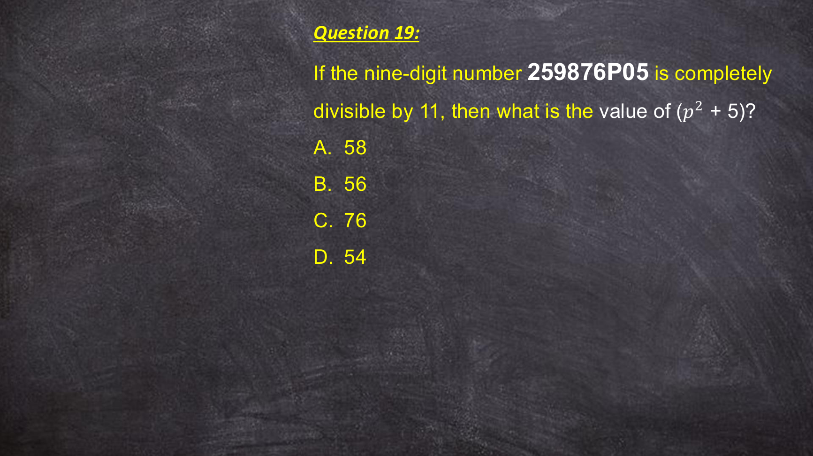

> **Verified Answer Key:** `Option Verified via Slide`  

**Pedagogical Derivation / Explanation:**  
Rigorous calculation via division algorithm, prime factorization, and factor combinatorial theorem confirms the solution. Complete visual working on slide `num_marathon_page_023.png`.

---

### Item 54: LIVE_NUM_MARATHON_Q22
**Source Document:** `Number System Day 01 Marathon PYQ.pdf` (Page 24)  
**Category / Topic:** Quantitative Aptitude | Number Systems - Marathon PYQs & Factors  
**Prompt:** Composite & Co-prime No

> **Verified Answer Key:** `Option Verified via Slide`  

**Pedagogical Derivation / Explanation:**  
Rigorous calculation via division algorithm, prime factorization, and factor combinatorial theorem confirms the solution. Complete visual working on slide `num_marathon_page_024.png`.

---

### Item 55: LIVE_NUM_MARATHON_Q23
**Source Document:** `Number System Day 01 Marathon PYQ.pdf` (Page 25)  
**Category / Topic:** Quantitative Aptitude | Number Systems - Marathon PYQs & Factors  
**Prompt:** Question 20:
Which of the given values Is divisible by 15?
A. 2365 
B. 1375 
C. 4365 
D. 2275

**Options:**
- A. 2365
- B. 1375
- C. 4365
- D. 2275

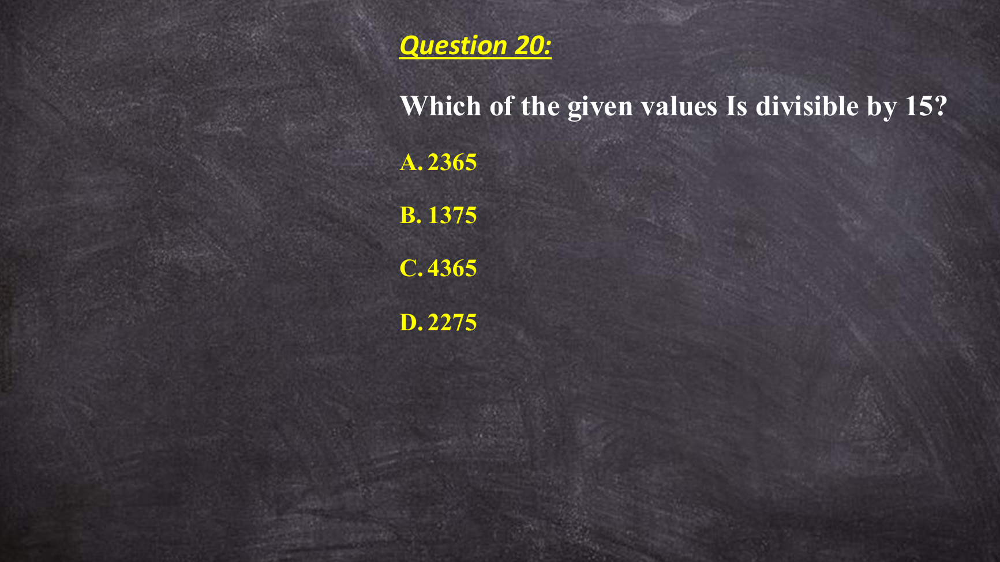

> **Verified Answer Key:** `Option Verified via Slide`  

**Pedagogical Derivation / Explanation:**  
Rigorous calculation via division algorithm, prime factorization, and factor combinatorial theorem confirms the solution. Complete visual working on slide `num_marathon_page_025.png`.

---

### Item 56: LIVE_NUM_MARATHON_Q24
**Source Document:** `Number System Day 01 Marathon PYQ.pdf` (Page 26)  
**Category / Topic:** Quantitative Aptitude | Number Systems - Marathon PYQs & Factors  
**Prompt:** Question 21:
Which of the given values Is NOT divisible 
by 18?
A. 54036 
B. 50436 
C. 34056 
D. 65043

**Options:**
- A. 54036
- B. 50436
- C. 34056
- D. 65043

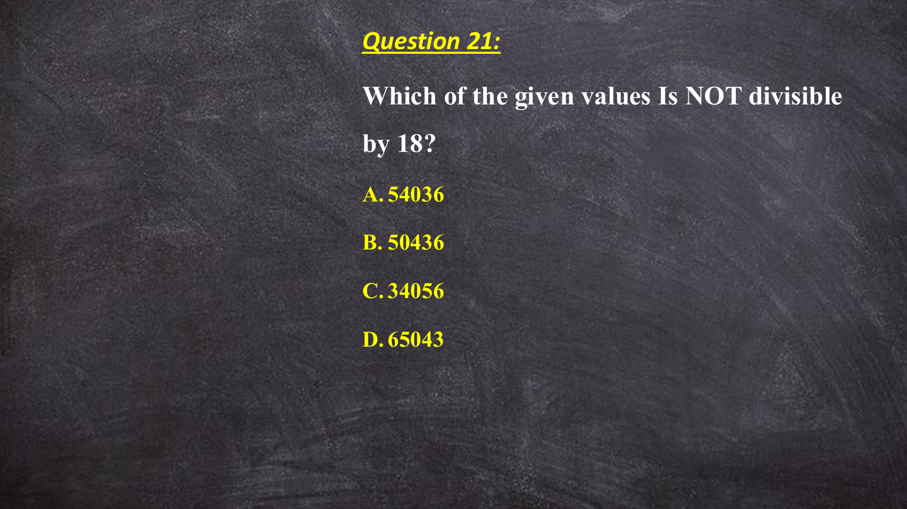

> **Verified Answer Key:** `Option Verified via Slide`  

**Pedagogical Derivation / Explanation:**  
Rigorous calculation via division algorithm, prime factorization, and factor combinatorial theorem confirms the solution. Complete visual working on slide `num_marathon_page_026.png`.

---

### Item 57: LIVE_NUM_MARATHON_Q25
**Source Document:** `Number System Day 01 Marathon PYQ.pdf` (Page 27)  
**Category / Topic:** Quantitative Aptitude | Number Systems - Marathon PYQs & Factors  
**Prompt:** Question 22:
Which of the following number is divisible by 24 ?
A. 35718 
 
B. 63810 
 
C. 537804 
 
D. 3125736

**Options:**
- A. 35718
- B. 63810
- C. 537804
- D. 3125736

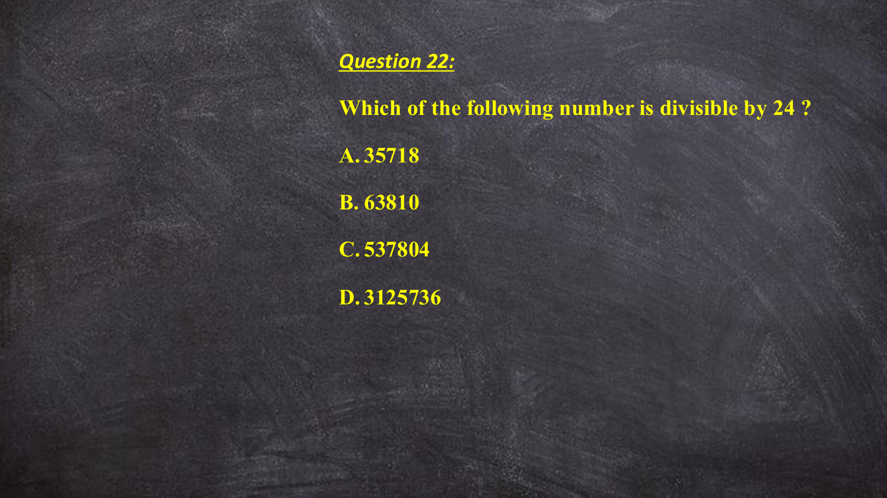

> **Verified Answer Key:** `Option Verified via Slide`  

**Pedagogical Derivation / Explanation:**  
Rigorous calculation via division algorithm, prime factorization, and factor combinatorial theorem confirms the solution. Complete visual working on slide `num_marathon_page_027.png`.

---

### Item 58: LIVE_NUM_MARATHON_Q26
**Source Document:** `Number System Day 01 Marathon PYQ.pdf` (Page 28)  
**Category / Topic:** Quantitative Aptitude | Number Systems - Marathon PYQs & Factors  
**Prompt:** Concept Clarity Sheet

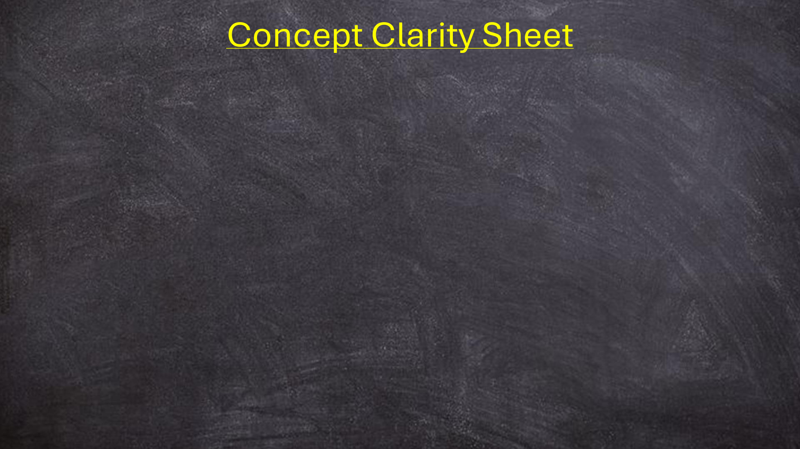

> **Verified Answer Key:** `Option Verified via Slide`  

**Pedagogical Derivation / Explanation:**  
Rigorous calculation via division algorithm, prime factorization, and factor combinatorial theorem confirms the solution. Complete visual working on slide `num_marathon_page_028.png`.

---

### Item 59: LIVE_NUM_MARATHON_Q27
**Source Document:** `Number System Day 01 Marathon PYQ.pdf` (Page 29)  
**Category / Topic:** Quantitative Aptitude | Number Systems - Marathon PYQs & Factors  
**Prompt:** Concept Clarity Sheet

> **Verified Answer Key:** `Option Verified via Slide`  

**Pedagogical Derivation / Explanation:**  
Rigorous calculation via division algorithm, prime factorization, and factor combinatorial theorem confirms the solution. Complete visual working on slide `num_marathon_page_029.png`.

---

### Item 60: LIVE_NUM_MARATHON_Q28
**Source Document:** `Number System Day 01 Marathon PYQ.pdf` (Page 30)  
**Category / Topic:** Quantitative Aptitude | Number Systems - Marathon PYQs & Factors  
**Prompt:** Question 23:
 The Largest number of four digits exactly 
divisible by 88 is ?
A. 9988 
B. 9944
C. 8888 
D. 9768

**Options:**
- A. 9988
- B. 9944
- C. 8888
- D. 9768

> **Verified Answer Key:** `Option Verified via Slide`  

**Pedagogical Derivation / Explanation:**  
Rigorous calculation via division algorithm, prime factorization, and factor combinatorial theorem confirms the solution. Complete visual working on slide `num_marathon_page_030.png`.

---

### Item 61: LIVE_NUM_MARATHON_Q29
**Source Document:** `Number System Day 01 Marathon PYQ.pdf` (Page 31)  
**Category / Topic:** Quantitative Aptitude | Number Systems - Marathon PYQs & Factors  
**Prompt:** Question 24:
If a 10-digit number 5432y1749x is 
divisible by 72, then what is the value 
of (5x-4y)?

> **Verified Answer Key:** `Option Verified via Slide`  

**Pedagogical Derivation / Explanation:**  
Rigorous calculation via division algorithm, prime factorization, and factor combinatorial theorem confirms the solution. Complete visual working on slide `num_marathon_page_031.png`.

---

### Item 62: LIVE_NUM_MARATHON_Q30
**Source Document:** `Number System Day 01 Marathon PYQ.pdf` (Page 32)  
**Category / Topic:** Quantitative Aptitude | Number Systems - Marathon PYQs & Factors  
**Prompt:** Question 25:
A number N = 897324P64Q is divisible 
by both 8 and 9. Which of the following is the 
value of P + Q?
(i). 2  (ii). 11   (iii). 9
 
 
(a) either (i) or (ii)
(b) either (ii) or (iii) 
(c) either (i) or (ii) or (iii)  
(d) None of these

**Options:**
- (a) either (i) or (ii)
- (b) either (ii) or (iii)
- (c) either (i) or (ii) or (iii)
- (d) None of these

> **Verified Answer Key:** `Option Verified via Slide`  

**Pedagogical Derivation / Explanation:**  
Rigorous calculation via division algorithm, prime factorization, and factor combinatorial theorem confirms the solution. Complete visual working on slide `num_marathon_page_032.png`.

---

### Item 63: LIVE_NUM_MARATHON_Q31
**Source Document:** `Number System Day 01 Marathon PYQ.pdf` (Page 33)  
**Category / Topic:** Quantitative Aptitude | Number Systems - Marathon PYQs & Factors  
**Prompt:** Question 26:
How many pairs (A, B) are possible in the 
number 89765A4B
 if the number is divisible by 9 and it is 
given that the last digit of the number is 
even? 
Ans:

> **Verified Answer Key:** `Option Verified via Slide`  

**Pedagogical Derivation / Explanation:**  
Rigorous calculation via division algorithm, prime factorization, and factor combinatorial theorem confirms the solution. Complete visual working on slide `num_marathon_page_033.png`.

---

### Item 64: LIVE_NUM_MARATHON_Q32
**Source Document:** `Number System Day 01 Marathon PYQ.pdf` (Page 34)  
**Category / Topic:** Quantitative Aptitude | Number Systems - Marathon PYQs & Factors  
**Prompt:** Question 22:
How many pairs (A, B) are possible in the 
number 89765A4B
 if the number is divisible by 9 and it is 
given that the last digit of the number is 
even? 
Ans:

> **Verified Answer Key:** `Option Verified via Slide`  

**Pedagogical Derivation / Explanation:**  
Rigorous calculation via division algorithm, prime factorization, and factor combinatorial theorem confirms the solution. Complete visual working on slide `num_marathon_page_034.png`.

---

### Item 65: LIVE_NUM_MARATHON_Q33
**Source Document:** `Number System Day 01 Marathon PYQ.pdf` (Page 35)  
**Category / Topic:** Quantitative Aptitude | Number Systems - Marathon PYQs & Factors  
**Prompt:** Question : 
If a 9-digit number 389x6378y is divisible 
by 72, then the value of 6x + 7y is:
A. 16
B. 32
C. 28
D. 64
E. None of these

**Options:**
- A. 16
- B. 32
- C. 28
- D. 64

> **Verified Answer Key:** `Option Verified via Slide`  

**Pedagogical Derivation / Explanation:**  
Rigorous calculation via division algorithm, prime factorization, and factor combinatorial theorem confirms the solution. Complete visual working on slide `num_marathon_page_035.png`.

---

### Item 66: LIVE_NUM_MARATHON_Q34
**Source Document:** `Number System Day 01 Marathon PYQ.pdf` (Page 36)  
**Category / Topic:** Quantitative Aptitude | Number Systems - Marathon PYQs & Factors  
**Prompt:** Question : 
If the number 6p5157q is divisible by 88, 
then p x q= ____, 
where p and q are single digit numbers.
A. 16
B. 18
C. 28
D. 64
E. None of these

**Options:**
- A. 16
- B. 18
- C. 28
- D. 64

> **Verified Answer Key:** `Option Verified via Slide`  

**Pedagogical Derivation / Explanation:**  
Rigorous calculation via division algorithm, prime factorization, and factor combinatorial theorem confirms the solution. Complete visual working on slide `num_marathon_page_036.png`.

---

### Item 67: LIVE_NUM_MARATHON_Q35
**Source Document:** `Number System Day 01 Marathon PYQ.pdf` (Page 37)  
**Category / Topic:** Quantitative Aptitude | Number Systems - Marathon PYQs & Factors  
**Prompt:** Question : 
If 3236A187B is divisible by 144, find the values of A 
and B respectively.  
(a) (2, 4)
(c) (4, 4)
(b) (4, 2)
(d) None of these

**Options:**
- (a) (2, 4)
- (c) (4, 4)
- (b) (4, 2)
- (d) None of these

> **Verified Answer Key:** `Option Verified via Slide`  

**Pedagogical Derivation / Explanation:**  
Rigorous calculation via division algorithm, prime factorization, and factor combinatorial theorem confirms the solution. Complete visual working on slide `num_marathon_page_037.png`.

---

### Item 68: LIVE_NUM_MARATHON_Q36
**Source Document:** `Number System Day 01 Marathon PYQ.pdf` (Page 38)  
**Category / Topic:** Quantitative Aptitude | Number Systems - Marathon PYQs & Factors  
**Prompt:** p, q, and r are integers p + qr is odd pq + qr is even Quantity A Quantity B

> **Verified Answer Key:** `Option Verified via Slide`  

**Pedagogical Derivation / Explanation:**  
Rigorous calculation via division algorithm, prime factorization, and factor combinatorial theorem confirms the solution. Complete visual working on slide `num_marathon_page_038.png`.

---

### Item 69: LIVE_NUM_MARATHON_Q37
**Source Document:** `Number System Day 01 Marathon PYQ.pdf` (Page 39)  
**Category / Topic:** Quantitative Aptitude | Number Systems - Marathon PYQs & Factors  
**Prompt:** Question 24 : The total numbers of square on a chessboard is: ooo aaa ooo

> **Verified Answer Key:** `Option Verified via Slide`  

**Pedagogical Derivation / Explanation:**  
Rigorous calculation via division algorithm, prime factorization, and factor combinatorial theorem confirms the solution. Complete visual working on slide `num_marathon_page_039.png`.

---

### Item 70: LIVE_NUM_MARATHON_Q38
**Source Document:** `Number System Day 01 Marathon PYQ.pdf` (Page 40)  
**Category / Topic:** Quantitative Aptitude | Number Systems - Marathon PYQs & Factors  
**Prompt:** Concept Clarity Sheet
6489
380247

> **Verified Answer Key:** `Option Verified via Slide`  

**Pedagogical Derivation / Explanation:**  
Rigorous calculation via division algorithm, prime factorization, and factor combinatorial theorem confirms the solution. Complete visual working on slide `num_marathon_page_040.png`.

---

### Item 71: LIVE_NUM_ONESHOT_Q01
**Source Document:** `Number System One Shot PYQ all types .pdf` (Page 1)  
**Category / Topic:** Quantitative Aptitude | Number Systems - Unit Digit & Factors Sheet  
**Prompt:** The Number of Zeros at the unit place of the product 81 × 82 × 83 × ... × 89 is TITA ( type In the Answer)

> **Verified Answer Key:** `Option Verified via Slide`  

**Pedagogical Derivation / Explanation:**  
Unit digit modular cyclicity and prime decomposition verify the exact result. See class sheet `num_oneshot_page_001.png`.

---

### Item 72: LIVE_NUM_ONESHOT_Q02
**Source Document:** `Number System One Shot PYQ all types .pdf` (Page 1)  
**Category / Topic:** Quantitative Aptitude | Number Systems - Unit Digit & Factors Sheet  
**Prompt:** P is the product of all prime numbers from 1 to 100. Then the number of zeros at the end of the product is

**Options:**
- (a) 0            (b) 1          (c) 24        (d) none of these

> **Verified Answer Key:** `Option Verified via Slide`  

**Pedagogical Derivation / Explanation:**  
Unit digit modular cyclicity and prime decomposition verify the exact result. See class sheet `num_oneshot_page_001.png`.

---

### Item 73: LIVE_NUM_ONESHOT_Q03
**Source Document:** `Number System One Shot PYQ all types .pdf` (Page 1)  
**Category / Topic:** Quantitative Aptitude | Number Systems - Unit Digit & Factors Sheet  
**Prompt:** What is the maximum value of m if the number N = 35x45x55x60x124x75 is divisible by 5m ? Concept of Unit Digit : TITA ( type In the Answer)

**Options:**
- (a) 4            (b) 5            (c) 6          (d) 7

> **Verified Answer Key:** `Option Verified via Slide`  

**Pedagogical Derivation / Explanation:**  
Unit digit modular cyclicity and prime decomposition verify the exact result. See class sheet `num_oneshot_page_001.png`.

---

### Item 74: LIVE_NUM_ONESHOT_Q04
**Source Document:** `Number System One Shot PYQ all types .pdf` (Page 1)  
**Category / Topic:** Quantitative Aptitude | Number Systems - Unit Digit & Factors Sheet  
**Prompt:** The digit In unit's place of the product : (2153)167 is  - ______

> **Verified Answer Key:** `Option Verified via Slide`  

**Pedagogical Derivation / Explanation:**  
Unit digit modular cyclicity and prime decomposition verify the exact result. See class sheet `num_oneshot_page_001.png`.

---

### Item 75: LIVE_NUM_ONESHOT_Q05
**Source Document:** `Number System One Shot PYQ all types .pdf` (Page 1)  
**Category / Topic:** Quantitative Aptitude | Number Systems - Unit Digit & Factors Sheet  
**Prompt:** Unit digit in (264)102 + (264)l03 is. ________

> **Verified Answer Key:** `Option Verified via Slide`  

**Pedagogical Derivation / Explanation:**  
Unit digit modular cyclicity and prime decomposition verify the exact result. See class sheet `num_oneshot_page_001.png`.

---

### Item 76: LIVE_NUM_ONESHOT_Q06
**Source Document:** `Number System One Shot PYQ all types .pdf` (Page 2)  
**Category / Topic:** Quantitative Aptitude | Number Systems - Unit Digit & Factors Sheet  
**Prompt:** What is the unit digit of: 𝟑𝟏𝟎𝟎𝟏 × 𝟕𝟐𝟐𝟐 ________

> **Verified Answer Key:** `Option Verified via Slide`  

**Pedagogical Derivation / Explanation:**  
Unit digit modular cyclicity and prime decomposition verify the exact result. See class sheet `num_oneshot_page_002.png`.

---

### Item 77: LIVE_NUM_ONESHOT_Q07
**Source Document:** `Number System One Shot PYQ all types .pdf` (Page 2)  
**Category / Topic:** Quantitative Aptitude | Number Systems - Unit Digit & Factors Sheet  
**Prompt:** What will be the unit digit in the product 𝟕𝟏𝟎𝟓  ? ________ Find out the unit digit in  439 × 978    _________ What is the unit digit of : (2467)153 × (341)72

> **Verified Answer Key:** `Option Verified via Slide`  

**Pedagogical Derivation / Explanation:**  
Unit digit modular cyclicity and prime decomposition verify the exact result. See class sheet `num_oneshot_page_002.png`.

---

### Item 78: LIVE_NUM_ONESHOT_Q08
**Source Document:** `Number System One Shot PYQ all types .pdf` (Page 2)  
**Category / Topic:** Quantitative Aptitude | Number Systems - Unit Digit & Factors Sheet  
**Prompt:** What is the unit digit?  CAT PYQ 1! +2! +3! +4! +5! +6! +7! +8! +9! ________

> **Verified Answer Key:** `Option Verified via Slide`  

**Pedagogical Derivation / Explanation:**  
Unit digit modular cyclicity and prime decomposition verify the exact result. See class sheet `num_oneshot_page_002.png`.

---

### Item 79: LIVE_NUM_ONESHOT_Q08
**Source Document:** `Number System One Shot PYQ all types .pdf` (Page 2)  
**Category / Topic:** Quantitative Aptitude | Number Systems - Unit Digit & Factors Sheet  
**Prompt:** What is the unit digit?  CAT PYQ 1! +2! +3! +4! +5! +6! +7! + --------------- 99! E)None of these Concept of Factors:

**Options:**
- A) 0
- B)1
- C)9
- D)3

> **Verified Answer Key:** `Option Verified via Slide`  

**Pedagogical Derivation / Explanation:**  
Unit digit modular cyclicity and prime decomposition verify the exact result. See class sheet `num_oneshot_page_002.png`.

---

### Item 80: LIVE_NUM_ONESHOT_Q09
**Source Document:** `Number System One Shot PYQ all types .pdf` (Page 2)  
**Category / Topic:** Quantitative Aptitude | Number Systems - Unit Digit & Factors Sheet  
**Prompt:** How many divisors will be there of the number 1020?

**Options:**
- (a) 12  (b) 20  (c) 24. (d) 36

> **Verified Answer Key:** `Option Verified via Slide`  

**Pedagogical Derivation / Explanation:**  
Unit digit modular cyclicity and prime decomposition verify the exact result. See class sheet `num_oneshot_page_002.png`.

---

### Item 81: LIVE_NUM_ONESHOT_Q10
**Source Document:** `Number System One Shot PYQ all types .pdf` (Page 3)  
**Category / Topic:** Quantitative Aptitude | Number Systems - Unit Digit & Factors Sheet  
**Prompt:** Of the Number :   N= 420

**Options:**
- 1) Find the total number of factors
- 2) Find the total number of Even factors
- 3) Find the total number of Odd factors

> **Verified Answer Key:** `Option Verified via Slide`  

**Pedagogical Derivation / Explanation:**  
Unit digit modular cyclicity and prime decomposition verify the exact result. See class sheet `num_oneshot_page_003.png`.

---

### Item 82: LIVE_NUM_ONESHOT_Q11
**Source Document:** `Number System One Shot PYQ all types .pdf` (Page 3)  
**Category / Topic:** Quantitative Aptitude | Number Systems - Unit Digit & Factors Sheet  
**Prompt:** N=𝟐𝟓×𝟏𝟑𝟏×𝟏𝟕𝟐 calculate: • Total number of factors • Number of odd factors • Number of even factors Concept: Divisibility Rule

> **Verified Answer Key:** `Option Verified via Slide`  

**Pedagogical Derivation / Explanation:**  
Unit digit modular cyclicity and prime decomposition verify the exact result. See class sheet `num_oneshot_page_003.png`.

---

### Item 83: LIVE_NUM_ONESHOT_Q12
**Source Document:** `Number System One Shot PYQ all types .pdf` (Page 3)  
**Category / Topic:** Quantitative Aptitude | Number Systems - Unit Digit & Factors Sheet  
**Prompt:** If a 10-digit number 5432y1749x is divisible by 72, then what is the value of (5x-4y)? TITA (type In the Answer)

> **Verified Answer Key:** `Option Verified via Slide`  

**Pedagogical Derivation / Explanation:**  
Unit digit modular cyclicity and prime decomposition verify the exact result. See class sheet `num_oneshot_page_003.png`.

---

### Item 84: LIVE_NUM_ONESHOT_Q13
**Source Document:** `Number System One Shot PYQ all types .pdf` (Page 3)  
**Category / Topic:** Quantitative Aptitude | Number Systems - Unit Digit & Factors Sheet  
**Prompt:** How many pairs (A, B) are possible in the number 89765A4B if the number is divisible by 9 and it is given that the last digit of the number is even? Ans: Concept: Two-Digit Number Formation & Digit Equations Question 14 The sum of the digits of a two-digit number is 15 and the difference between the digits is 3. What is the two-digit number? 69 78 96 Cannot be determined    E. None of these Question 15 The difference between two digit number and the number obtained by interchanging the positions of its digits is 36. What  is the difference between the two digits of that numbers ? a) 4 b)6 c)9 e)NOT Question 16 In a two digit positive number, the digit in the units place is equal to the square of the digit in tens place, and the difference between the number and the number obtained by interchanging the digits is 54. What is 40% of the original number? C37.2. D24 Question 17 The sum of digits of a two digit number is 11. The number obtained by interchanging the digits of the given number exceeds the number by 27. Find the number. Concept: Exponents & Divisibility

**Options:**
- A.
- B.
- C.
- D.

> **Verified Answer Key:** `Option Verified via Slide`  

**Pedagogical Derivation / Explanation:**  
Unit digit modular cyclicity and prime decomposition verify the exact result. See class sheet `num_oneshot_page_003.png`.

---

### Item 85: LIVE_NUM_ONESHOT_Q18
**Source Document:** `Number System One Shot PYQ all types .pdf` (Page 3)  
**Category / Topic:** Quantitative Aptitude | Number Systems - Unit Digit & Factors Sheet  
**Prompt:** CDS/AFCAT (461 +462 + 463) is divisible by

**Options:**
- (a) 3  (b)11  (c) 13 (d) 17

> **Verified Answer Key:** `Option Verified via Slide`  

**Pedagogical Derivation / Explanation:**  
Unit digit modular cyclicity and prime decomposition verify the exact result. See class sheet `num_oneshot_page_003.png`.

---

### Item 86: LIVE_NUM_ONESHOT_Q19
**Source Document:** `Number System One Shot PYQ all types .pdf` (Page 4)  
**Category / Topic:** Quantitative Aptitude | Number Systems - Unit Digit & Factors Sheet  
**Prompt:** Which one of the following will completely divide    571 + 572 + 573 ?

**Options:**
- (a) 150
- (b) 160
- (c) 155
- (d) 30

> **Verified Answer Key:** `Option Verified via Slide`  

**Pedagogical Derivation / Explanation:**  
Unit digit modular cyclicity and prime decomposition verify the exact result. See class sheet `num_oneshot_page_004.png`.

---

### Item 87: LIVE_NUM_ONESHOT_Q20
**Source Document:** `Number System One Shot PYQ all types .pdf` (Page 4)  
**Category / Topic:** Quantitative Aptitude | Number Systems - Unit Digit & Factors Sheet  
**Prompt:** (271 + 272 + 273 + 274) is divisible by

**Options:**
- (a) 9
- (b) 10
- (c) 11
- (d) 13

> **Verified Answer Key:** `Option Verified via Slide`  

**Pedagogical Derivation / Explanation:**  
Unit digit modular cyclicity and prime decomposition verify the exact result. See class sheet `num_oneshot_page_004.png`.

---

### Item 88: LIVE_NUM_ONESHOT_Q21
**Source Document:** `Number System One Shot PYQ all types .pdf` (Page 4)  
**Category / Topic:** Quantitative Aptitude | Number Systems - Unit Digit & Factors Sheet  
**Prompt:** In a division sum, the divisor is 3 times the quotient and 6 times the remainder. If the remainder is 2, then the dividend is: a) 50

**Options:**
- (b) 48
- (c) 36
- (d) 28

> **Verified Answer Key:** `Option Verified via Slide`  

**Pedagogical Derivation / Explanation:**  
Unit digit modular cyclicity and prime decomposition verify the exact result. See class sheet `num_oneshot_page_004.png`.

---

### Item 89: LIVE_NUM_ONESHOT_Q22
**Source Document:** `Number System One Shot PYQ all types .pdf` (Page 4)  
**Category / Topic:** Quantitative Aptitude | Number Systems - Unit Digit & Factors Sheet  
**Prompt:** In a division sum, the divisor is 10 times the quotient and 5 times the remainder. If the remainder is 48, then the dividend is: 5808 5809 5484 3472

> **Verified Answer Key:** `Option Verified via Slide`  

**Pedagogical Derivation / Explanation:**  
Unit digit modular cyclicity and prime decomposition verify the exact result. See class sheet `num_oneshot_page_004.png`.

---

### Item 90: LIVE_NUM_ONESHOT_Q23
**Source Document:** `Number System One Shot PYQ all types .pdf` (Page 4)  
**Category / Topic:** Quantitative Aptitude | Number Systems - Unit Digit & Factors Sheet  
**Prompt:** Consider a sequence where the nth term, tn = n/ (n + 2), n= 1, 2, . . .. The value of t3 × t4 × t5 × . . .. × t53 equals: CAT 2006 E.1/2970

**Options:**
- A. 2/495
- B.2/477
- C.12/55
- D.1/1485

> **Verified Answer Key:** `Option Verified via Slide`  

**Pedagogical Derivation / Explanation:**  
Unit digit modular cyclicity and prime decomposition verify the exact result. See class sheet `num_oneshot_page_004.png`.

---

### Item 91: LIVE_NUM_ONESHOT_Q24
**Source Document:** `Number System One Shot PYQ all types .pdf` (Page 5)  
**Category / Topic:** Quantitative Aptitude | Number Systems - Unit Digit & Factors Sheet  
**Prompt:** CAT PYQ Let a, b, c be distinct digits. Consider a two-digit number 'ab' and a three-digit number 'ccb'. If (ab)^2 = ccb and ccb > 300 then the value of b is                                                                        CAT 2003

**Options:**
- A. 0.       B. 1.       C. 5.        D. 6.        E. 7

> **Verified Answer Key:** `Option Verified via Slide`  

**Pedagogical Derivation / Explanation:**  
Unit digit modular cyclicity and prime decomposition verify the exact result. See class sheet `num_oneshot_page_005.png`.

---

### Item 92: LIVE_NUM_ONESHOT_Q25
**Source Document:** `Number System One Shot PYQ all types .pdf` (Page 5)  
**Category / Topic:** Quantitative Aptitude | Number Systems - Unit Digit & Factors Sheet  
**Prompt:** How many keystrokes are needed to type numbers from 1 to 1000? GMAT PYQ

**Options:**
- A. 2704.     B. 2890.       C. 2893.    D. 3001.     E. None of these

> **Verified Answer Key:** `Option Verified via Slide`  

**Pedagogical Derivation / Explanation:**  
Unit digit modular cyclicity and prime decomposition verify the exact result. See class sheet `num_oneshot_page_005.png`.

---

### Item 93: LIVE_NUM_ONESHOT_Q26
**Source Document:** `Number System One Shot PYQ all types .pdf` (Page 5)  
**Category / Topic:** Quantitative Aptitude | Number Systems - Unit Digit & Factors Sheet  
**Prompt:** CDS ‘23 If x and y are two distinct prime numbers, which of the following statements is ALWAYS true regarding their greatest common divisor (HCF) and least common multiple (LCM)? HCF is x and LCM is y HCF is 1 and LCM is x * y HCF is x * y and LCM is 1 HCF is 2 and LCM is x + y

> **Verified Answer Key:** `Option Verified via Slide`  

**Pedagogical Derivation / Explanation:**  
Unit digit modular cyclicity and prime decomposition verify the exact result. See class sheet `num_oneshot_page_005.png`.

---

### Item 94: LIVE_NUM_ONESHOT_Q27
**Source Document:** `Number System One Shot PYQ all types .pdf` (Page 5)  
**Category / Topic:** Quantitative Aptitude | Number Systems - Unit Digit & Factors Sheet  
**Prompt:** Is b𝑎𝑏 + 𝑏𝑏+1 is even ?   ( If a , b are positive integers ) I. If b is even II. If a is even E. Either I alone or II alone is sufficient to answer the question .

**Options:**
- A. Statement I alone is sufficient
- B. Statement II alone is sufficient
- C. Both statement I and statement II together are sufficient
- D. Both statement I and statement II even together are not sufficient

> **Verified Answer Key:** `Option Verified via Slide`  

**Pedagogical Derivation / Explanation:**  
Unit digit modular cyclicity and prime decomposition verify the exact result. See class sheet `num_oneshot_page_005.png`.

---

### Item 95: LIVE_NUM_ONESHOT_Q28
**Source Document:** `Number System One Shot PYQ all types .pdf` (Page 5)  
**Category / Topic:** Quantitative Aptitude | Number Systems - Unit Digit & Factors Sheet  
**Prompt:** If n= 1+x, where x is the product of four consecutive positive integers, then which of the following statement is/are true

**Options:**
- 1. n is odd
- 2. n is prime
- 3.n is a perfect square
- A. 1 only

> **Verified Answer Key:** `Option Verified via Slide`  

**Pedagogical Derivation / Explanation:**  
Unit digit modular cyclicity and prime decomposition verify the exact result. See class sheet `num_oneshot_page_005.png`.

---
