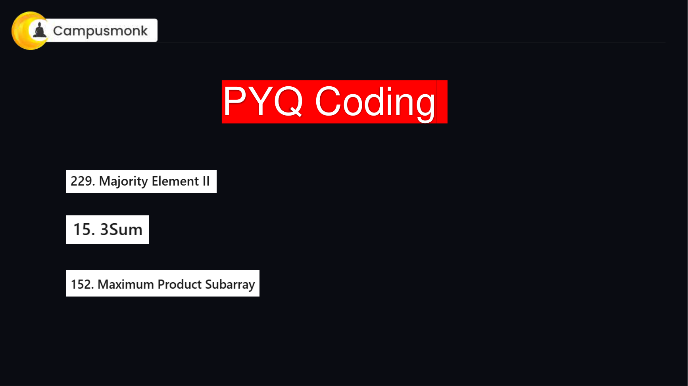
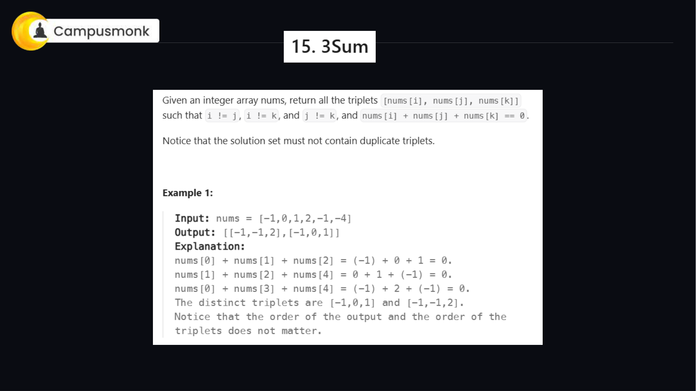
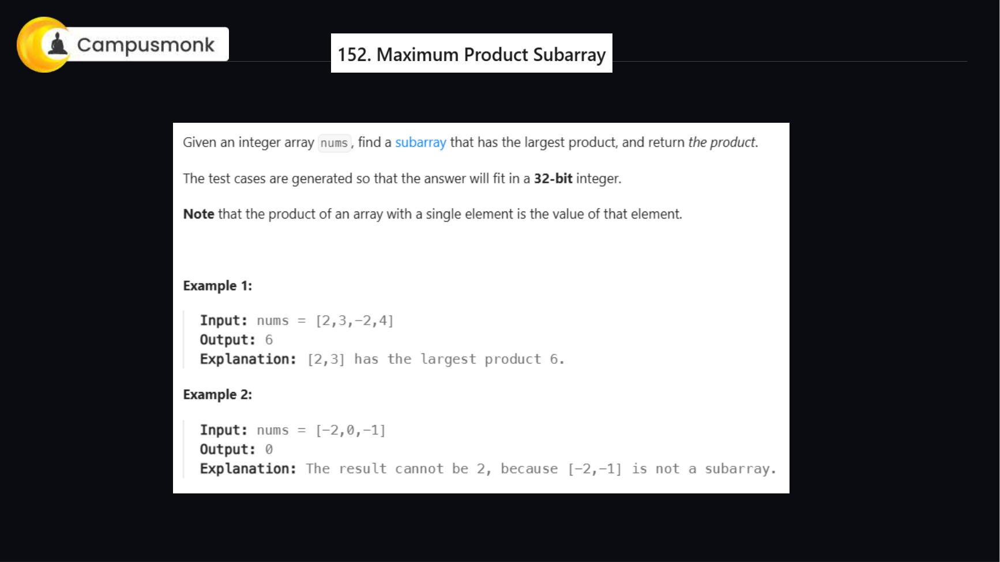
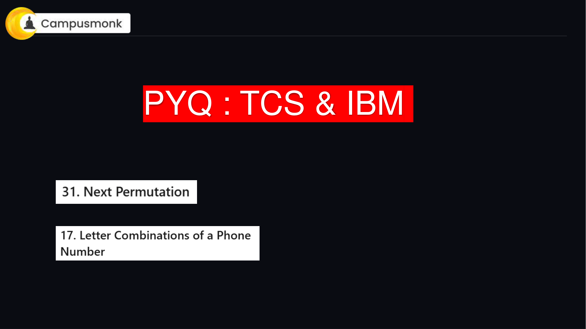
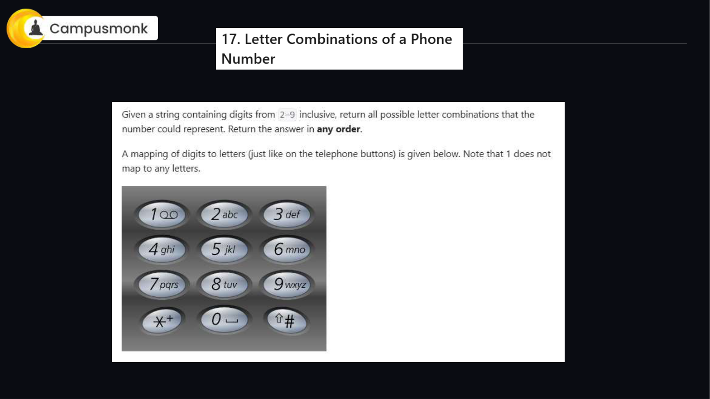
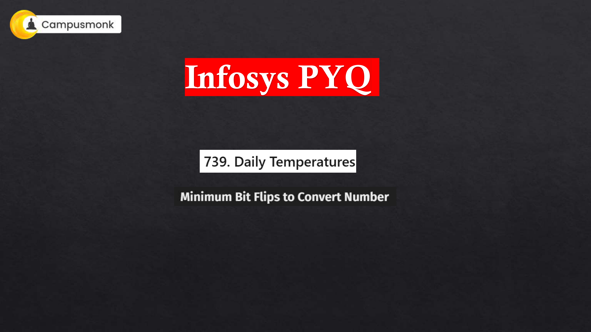
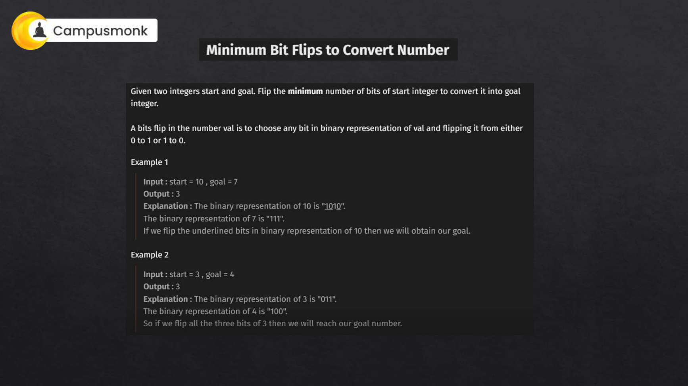

# 📚 Infosys Live Prep Master Topic Compendium — Live Coding & Algorithmic Problem Solving
**Total Topic Items:** 7 Verified Problems & Questions  
**Source Class Decks Unified:** CampusMonk 1.0 LIVE Infosys Prep Series  
**Status:** 100% Comprehensive Coverage with Formulas, Proofs & Slide Verification  

---

### Item 1: LIVE_CODING_01
**Source Document:** `2 PYQ Coding Prep.pdf` (Page 1)  
**Category / Topic:** Live Coding & Algorithms | Arrays & Boyer-Moore Voting Algorithm  
**Prompt:** Given an integer array of size n, find all elements that appear more than ⌊ n/3 ⌋ times. The algorithm must run in linear O(N) time and O(1) auxiliary space.

> **Verified Answer Key:** `Optimal Solution (229. Majority Element II (Elements appearing > n/3 times))`  

**Pedagogical Derivation / Explanation:**  
### Extended Boyer-Moore Voting Algorithm
1. **Mathematical Observation**: In any array of length n, there can be at most **two** elements that appear strictly more than `⌊n/3⌋` times because `3 * (⌊n/3⌋ + 1) > n`.
2. **First Pass (Candidate Identification)**: Maintain two potential candidates (`cand1`, `cand2`) and their corresponding vote counters (`count1`, `count2`).
   - If current number equals `cand1`, increment `count1`.
   - Else if current number equals `cand2`, increment `count2`.
   - Else if `count1 == 0`, assign `cand1 = num` and set `count1 = 1`.
   - Else if `count2 == 0`, assign `cand2 = num` and set `count2 = 1`.
   - Otherwise, decrement both `count1` and `count2`.
3. **Second Pass (Verification)**: Reset frequencies of `cand1` and `cand2` to 0. Traverse the array to count their exact occurrences. If either candidate occurs more than `n // 3` times, append it to the result list.
4. **Complexity**:
   - **Time Complexity:** `O(N)` two-pass linear traversal.
   - **Auxiliary Space:** `O(1)` as only candidate variables and counter registers are allocated.

---

### Item 2: LIVE_CODING_02
**Source Document:** `2 PYQ Coding Prep.pdf` (Page 4)  
**Category / Topic:** Live Coding & Algorithms | Arrays, Two Pointers & Sorting  
**Prompt:** Given an integer array nums, return all the triplets [nums[i], nums[j], nums[k]] such that i != j, i != k, and j != k, and nums[i] + nums[j] + nums[k] == 0. Notice that the solution set must not contain duplicate triplets.

> **Verified Answer Key:** `Optimal Solution (15. 3Sum (All Unique Triplets Summing to Zero))`  

**Pedagogical Derivation / Explanation:**  
### Two-Pointer Sorting Paradigm
1. **Sort Array**: Sort `nums` in ascending order (`O(N log N)`). Sorting enables two-pointer convergence and easy duplicate pruning.
2. **Iterate First Element**: Loop `i` from `0` to `n - 3`.
   - If `i > 0` and `nums[i] == nums[i - 1]`, skip to avoid duplicate triplets for the first element.
   - If `nums[i] > 0`, break early because all remaining elements are positive, making a zero sum impossible.
3. **Two-Pointer Scan**: Set `left = i + 1` and `right = n - 1`.
   - Calculate `current_sum = nums[i] + nums[left] + nums[right]`.
   - If `current_sum == 0`, record `[nums[i], nums[left], nums[right]]`. Advance `left` while skipping duplicates (`nums[left] == nums[left + 1]`). Decrement `right` while skipping duplicates (`nums[right] == nums[right - 1]`). Finally, increment `left` and decrement `right`.
   - If `current_sum < 0`, increment `left` to increase sum.
   - If `current_sum > 0`, decrement `right` to decrease sum.
4. **Complexity**:
   - **Time Complexity:** `O(N²)` where sorting is `O(N log N)` and nested two-pointer traversal takes `O(N²)`.
   - **Auxiliary Space:** `O(1)` or `O(log N)` for sorting stack.

---

### Item 3: LIVE_CODING_03
**Source Document:** `2 PYQ Coding Prep.pdf` (Page 9)  
**Category / Topic:** Live Coding & Algorithms | Dynamic Programming & Array Optimization  
**Prompt:** Given an integer array nums, find a contiguous non-empty subarray that has the largest product, and return the product. The test cases are generated so that the answer will fit in a 32-bit integer.

> **Verified Answer Key:** `Optimal Solution (152. Maximum Product Subarray)`  

**Pedagogical Derivation / Explanation:**  
### Kadane's Dual Dynamic Programming Tracking
1. **Core Challenge**: Unlike maximum sum where negatives always reduce sum, multiplying two negative numbers creates a positive product. A very small negative product can flip into a huge positive product when multiplied by another negative number.
2. **State Tracking**: At each index `i`, maintain:
   - `max_prod`: Maximum product ending at index `i`.
   - `min_prod`: Minimum product ending at index `i` (which may flip to positive).
3. **Transition**:
   - When encountering a negative number `nums[i] < 0`, swap `max_prod` and `min_prod`.
   - `max_prod = max(nums[i], max_prod * nums[i])`
   - `min_prod = min(nums[i], min_prod * nums[i])`
   - `global_max = max(global_max, max_prod)`
4. **Complexity**:
   - **Time Complexity:** `O(N)` single linear pass.
   - **Auxiliary Space:** `O(1)` as only three variables are maintained.

---

### Item 4: LIVE_CODING_04
**Source Document:** `3 PYQ Coding Question Prep.pdf` (Page 1)  
**Category / Topic:** Live Coding & Algorithms | Arrays & Lexicographical Permutation  
**Prompt:** A permutation of an array of integers is an arrangement of its members into a sequence or linear order. The next permutation of an array of integers is the next lexicographically greater permutation. Rearrange numbers into the lexicographically next greater permutation of numbers in-place with O(1) extra memory.

> **Verified Answer Key:** `Optimal Solution (31. Next Permutation)`  

**Pedagogical Derivation / Explanation:**  
### Single Pass In-Place Transformation
1. **Find Pivot Index (`ind`)**: Traverse from right to left to locate the first index `i` such that `nums[i] < nums[i + 1]`. The suffix to the right of `i` is sorted in non-increasing order.
2. **Handle Descending Arrays**: If no such index exists (`ind == -1`), the entire array is in descending order. Reverse the entire array to convert it into the smallest permutation.
3. **Find Successor to Swap**: If `ind != -1`, scan from the right end towards `ind` to find the first element `nums[j] > nums[ind]`. Swap `nums[ind]` with `nums[j]`.
4. **Reverse Suffix**: Reverse all elements from index `ind + 1` to `n - 1`. Since the suffix was in descending order, reversing it puts it into ascending order, which is the smallest lexicographical arrangement.
5. **Complexity**:
   - **Time Complexity:** `O(N)` linear traversal and reversal.
   - **Auxiliary Space:** `O(1)` strictly in-place modification.

---

### Item 5: LIVE_CODING_05
**Source Document:** `3 PYQ Coding Question Prep.pdf` (Page 6)  
**Category / Topic:** Live Coding & Algorithms | Strings, Backtracking & Recursion  
**Prompt:** Given a string containing digits from 2-9 inclusive, return all possible letter combinations that the number could represent. Return the answer in any order. Mapping of digits to letters corresponds to telephone dial buttons.

> **Verified Answer Key:** `Optimal Solution (17. Letter Combinations of a Phone Number)`  

**Pedagogical Derivation / Explanation:**  
### Recursive Depth-First Backtracking
1. **Telephone Keypad Mapping**:
   - '2': "abc", '3': "def", '4': "ghi", '5': "jkl"
   - '6': "mno", '7': "pqrs", '8': "tuv", '9': "wxyz"
2. **Base Case**: When current combination length equals `digits.length`, append the combination string to the result.
3. **Recursive Exploration**:
   - Extract the letters mapped to `digits[index]`.
   - For each letter in the mapped string, append to current path, recurse for `index + 1`, and backtrack (pop the character).
4. **Complexity**:
   - **Time Complexity:** `O(4^N * N)` where N is length of digits string (max 4). At most `4^4 = 256` leaves.
   - **Auxiliary Space:** `O(N)` recursion stack depth.

---

### Item 6: LIVE_CODING_06
**Source Document:** `Infosys , TCS & OTHER_PYQ.pdf` (Page 1)  
**Category / Topic:** Live Coding & Algorithms | Arrays & Monotonic Decreasing Stack  
**Prompt:** Given an array of integers temperatures represents the daily temperatures, return an array answer such that answer[i] is the number of days you have to wait after the ith day to get a warmer temperature. If there is no future day for which this is possible, keep answer[i] == 0 instead.

> **Verified Answer Key:** `Optimal Solution (739. Daily Temperatures (Next Warmer Day))`  

**Pedagogical Derivation / Explanation:**  
### Monotonic Decreasing Stack Technique
1. **Core Problem Pattern**: This is a classic "Next Greater Element" problem. A naive nested loop takes `O(N²)`, causing Time Limit Exceeded for `N = 10^5`.
2. **Monotonic Stack Structure**: Maintain a stack of indices whose temperatures have not yet found a warmer future day. The temperatures corresponding to indices in the stack remain in strictly decreasing order.
3. **Execution Steps**:
   - Initialize `answer = [0] * n` and an empty stack `st`.
   - Iterate index `i` from `0` to `n - 1`:
     - While `st` is non-empty and `temperatures[i] > temperatures[st.top()]`:
       - Pop `prev_index = st.pop()`.
       - `answer[prev_index] = i - prev_index`.
     - Push `i` onto `st`.
4. **Complexity**:
   - **Time Complexity:** `O(N)` because each index is pushed and popped at most once.
   - **Auxiliary Space:** `O(N)` in the worst case where temperatures are monotonically decreasing.

---

### Item 7: LIVE_CODING_07
**Source Document:** `Infosys , TCS & OTHER_PYQ.pdf` (Page 7)  
**Category / Topic:** Live Coding & Algorithms | Bit Manipulation & Brian Kernighan's Algorithm  
**Prompt:** A bit flip of a number x is choosing a bit in the binary representation of x and flipping it from either 0 to 1 or 1 to 0. Given two integers start and goal, return the minimum number of bit flips to convert start to goal.

> **Verified Answer Key:** `Optimal Solution (2220. Minimum Bit Flips to Convert Number)`  

**Pedagogical Derivation / Explanation:**  
### Bitwise XOR & Brian Kernighan's Popcount
1. **Bitwise Difference via XOR**:
   - The bitwise XOR operation (`start ^ goal`) sets a bit to `1` if and only if the corresponding bits in `start` and `goal` differ.
   - Therefore, the problem reduces to calculating the **Hamming weight** (number of set bits `1`) in `diff = start ^ goal`.
2. **Brian Kernighan's Algorithm**:
   - `diff = diff & (diff - 1)` clears the lowest set bit in `diff`.
   - Counting how many times this operation runs until `diff == 0` yields the exact number of set bits.
   - It runs in `O(K)` iterations where `K` is the number of differing bits (`K <= 30`), running faster than standard bitwise shifts.
3. **Complexity**:
   - **Time Complexity:** `O(1)` or `O(log(max(start, goal)))` since integers are at most 32 bits.
   - **Auxiliary Space:** `O(1)` zero extra space.

---
