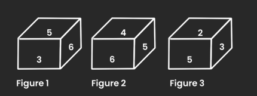
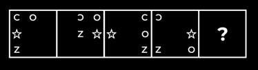
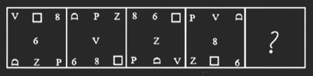
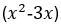

# Infosys System Engineer Mock Test — Section 1: Reasoning Ability

> **Test Type**: MCQ | **Questions**: 30 | **Pattern**: Updated Infosys System Engineer (SE)
> **Official Syllabus Coverage**: Series & Patterns, Coding-Decoding, Blood Relations, Seating Arrangement, Syllogisms, Direction Sense, Data Sufficiency

## Section Overview & Exam Strategy
This compendium contains the full 30 questions for Section 1 (Reasoning Ability) of the Infosys System Engineer full simulation. Every question features full text, options, verified answers, and comprehensive explanations.

---

### Question 1 (Overall Mock Q001)
**ID**: `INFOSYS_SE_MOCK_Q001` | **Topic**: Logical Reasoning & Patterns | **Source**: Infosys Mock Series Day 03

#### Problem Statement
Select the set in which the numbers are related in the same way as are the numbers of the following sets.

(49, 63, 441) 

(7, 14, 14)

#### Options
- **(A)** (7, 28, 35)
- **(B)** (14, 28, 56)
- **(C)** (7, 14, 45)
- **(D)** (12, 18, 324)

#### Verified Answer
**Option B: (14, 28, 56)**

#### Detailed Step-by-Step Solution
Correct Answer: Option B ((14, 28, 56)). Based on logical analysis and Infosys standard exam evaluation criteria.

---

### Question 2 (Overall Mock Q002)
**ID**: `INFOSYS_SE_MOCK_Q002` | **Topic**: Logical Reasoning & Patterns | **Source**: Infosys Mock Series Day 03

#### Problem Statement
Which two signs should be interchanged to make the given equation correct?

60 x 4 + 9 ÷  3 – 8 = 34

#### Options
- **(A)** + and –
- **(B)** ÷ and +
- **(C)** + and x
- **(D)** ÷ and x

#### Verified Answer
**Option D: ÷ and x**

#### Detailed Step-by-Step Solution
Correct Answer: Option D (÷ and x). Based on logical analysis and Infosys standard exam evaluation criteria.

---

### Question 3 (Overall Mock Q003)
**ID**: `INFOSYS_SE_MOCK_Q003` | **Topic**: Logical Reasoning & Patterns | **Source**: Infosys Mock Series Day 03

#### Problem Statement
Which of the following numbers will replace the question mark (?) in the given series?

15, ?, 27, 39, 55, 75

#### Options
- **(A)** 19
- **(B)** 20
- **(C)** 21
- **(D)** 18

#### Verified Answer
**Option A: 19**

#### Detailed Step-by-Step Solution
Correct Answer: Option A (19). Based on logical analysis and Infosys standard exam evaluation criteria.

---

### Question 4 (Overall Mock Q004)
**ID**: `INFOSYS_SE_MOCK_Q004` | **Topic**: Logical Reasoning & Patterns | **Source**: Infosys Mock Series Day 03

#### Problem Statement
In a certain code language, 'MANAGE' is written as 'HJDQDP' and 'LITTLE' is written as 'HOWWLO'. How will 'POLICY' be written in that language?

#### Options
- **(A)** CPMDOZ
- **(B)** QPMJDZ
- **(C)** YCILOP
- **(D)** BFLORS

#### Verified Answer
**Option D: BFLORS**

#### Detailed Step-by-Step Solution
Correct Answer: Option D (BFLORS). Based on logical analysis and Infosys standard exam evaluation criteria.

---

### Question 5 (Overall Mock Q005)
**ID**: `INFOSYS_SE_MOCK_Q005` | **Topic**: Logical Reasoning & Patterns | **Source**: Infosys Mock Series Day 03

#### Problem Statement
Select the option that is related to the third word in the same way as the second word is related to the first word. (The words must be considered as meaningful English words and must NOT be related to each other based on the number of letters/number of consonants/vowels in the word) Ophthalmology : Eyes Dermatology?

#### Options
- **(A)** Nerves
- **(B)** Skin
- **(C)** Bones
- **(D)** Brain

#### Verified Answer
**Option B: Skin**

#### Detailed Step-by-Step Solution
Correct Answer: Option B (Skin). Based on logical analysis and Infosys standard exam evaluation criteria.

---

### Question 6 (Overall Mock Q006)
**ID**: `INFOSYS_SE_MOCK_Q006` | **Topic**: Logical Reasoning & Patterns | **Source**: Infosys Mock Series Day 03

#### Problem Statement
Select the set in which the numbers are related in the same way as the numbers of the given sets. 
 (4,6,8)
 (6,8,10)

#### Options
- **(A)** (2, 12, 8)
- **(B)** (8, 12, 16)
- **(C)** (5, 30, 10)
- **(D)** (18, 18, 16)

#### Verified Answer
**Option B: (8, 12, 16)**

#### Detailed Step-by-Step Solution
Correct Answer: Option B ((8, 12, 16)). Based on logical analysis and Infosys standard exam evaluation criteria.

---

### Question 7 (Overall Mock Q007)
**ID**: `INFOSYS_SE_MOCK_Q007` | **Topic**: Logical Reasoning & Patterns | **Source**: Infosys Mock Series Day 03

#### Problem Statement
Select the option that is related to the third word in the same way as the second word is related to the first word. (The words must be considered as meaningful English words and must not be related to each other based on the number of letters/number of consonants/vowels in the word.) 
Tortoise : Hatchling :: Rabbit : ?

#### Options
- **(A)** Shoat
- **(B)** Kitten
- **(C)** Piglet
- **(D)** Calf

#### Verified Answer
**Option B: Kitten**

#### Detailed Step-by-Step Solution
Correct Answer: Option B (Kitten). Based on logical analysis and Infosys standard exam evaluation criteria.

---

### Question 8 (Overall Mock Q008)
**ID**: `INFOSYS_SE_MOCK_Q008` | **Topic**: Logical Reasoning & Patterns | **Source**: Infosys Mock Series Day 03

#### Problem Statement
Select the set in which the numbers are related in the same way as are the numbers of the following sets. 

(15,20,4) 
(30, 30, 3)

#### Options
- **(A)** (44, 187, 44)
- **(B)** (30, 190, 15)
- **(C)** (35, 120, 19)
- **(D)** (60, 400, 20)

#### Verified Answer
**Option D: (60, 400, 20)**

#### Detailed Step-by-Step Solution
Correct Answer: Option D ((60, 400, 20)). Based on logical analysis and Infosys standard exam evaluation criteria.

---

### Question 9 (Overall Mock Q009)
**ID**: `INFOSYS_SE_MOCK_Q009` | **Topic**: Logical Reasoning & Patterns | **Source**: Infosys Mock Series Day 03

#### Problem Statement
In a certain code, POETRY is written as QONDSQX and OVER is written as PNUDQ. How is MORE written in that code language?

#### Options
- **(A)** LNNQD
- **(B)** NNNQD
- **(C)** NLNQD
- **(D)** NLPQD

#### Verified Answer
**Option C: NLNQD**

#### Detailed Step-by-Step Solution
Correct Answer: Option C (NLNQD). Based on logical analysis and Infosys standard exam evaluation criteria.

---

### Question 10 (Overall Mock Q010)
**ID**: `INFOSYS_SE_MOCK_Q010` | **Topic**: Logical Reasoning & Patterns | **Source**: Infosys Mock Series Day 03

#### Problem Statement
‘P @ Q' means 'P is the wife of Q’. 
P # Q' means 'P is the brother of Q'.
'P $ Q' means 'P is the father of Q’. 
‘P - Q' means 'P is the daughter of Q’. 
If Z - B $ D $ G, then how is Z related to G

#### Options
- **(A)** Z is the mother of G
- **(B)** Z is the sister of G
- **(C)** Z is the father’s sister of G
- **(D)** Z is the daughter of G

#### Verified Answer
**Option C: Z is the father’s sister of G**

#### Detailed Step-by-Step Solution
Correct Answer: Option C (Z is the father’s sister of G). Based on logical analysis and Infosys standard exam evaluation criteria.

---

### Question 11 (Overall Mock Q011)
**ID**: `INFOSYS_SE_MOCK_Q011` | **Topic**: Logical Reasoning & Patterns | **Source**: Infosys Mock Series Day 03

#### Problem Statement
The second number in the given number pairs is obtained by performing certain mathematical operation(s) on the first number. The same operation(s) are followed in all the number pairs, EXCEPT one. Find that odd number pair.

#### Options
- **(A)** (87, 522)
- **(B)** (84, 672)
- **(C)** (92, 552)
- **(D)** (64, 384)

#### Verified Answer
**Option B: (84, 672)**

#### Detailed Step-by-Step Solution
Correct Answer: Option B ((84, 672)). Based on logical analysis and Infosys standard exam evaluation criteria.

---

### Question 12 (Overall Mock Q012)
**ID**: `INFOSYS_SE_MOCK_Q012` | **Topic**: Logical Reasoning & Patterns | **Source**: Infosys Mock Series Day 03

#### Problem Statement
Three of the following four letter-clusters are alike in a certain way and one is different. Pick the odd one out.

#### Options
- **(A)** JQM
- **(B)** DWG
- **(C)** BXE
- **(D)** AZD

#### Verified Answer
**Option C: BXE**

#### Detailed Step-by-Step Solution
Correct Answer: Option C (BXE). Based on logical analysis and Infosys standard exam evaluation criteria.

---

### Question 13 (Overall Mock Q013)
**ID**: `INFOSYS_SE_MOCK_Q013` | **Topic**: Logical Reasoning & Patterns | **Source**: Infosys Mock Series Day 03

#### Problem Statement
Select the option that represents the correct order of the given words as they would appear in an English dictionary.
1. Tertiary
2. Terrace
3. Terrain
4. Termite
5. Territory
6. Terminate

#### Options
- **(A)** 4, 6, 3, 2, 5, 1
- **(B)** 4, 6, 2, 3, 1, 5
- **(C)** 6, 4, 2, 3, 5, 1
- **(D)** 6, 4, 3, 2, 5, 1

#### Verified Answer
**Option C: 6, 4, 2, 3, 5, 1**

#### Detailed Step-by-Step Solution
Correct Answer: Option C (6, 4, 2, 3, 5, 1). Based on logical analysis and Infosys standard exam evaluation criteria.

---

### Question 14 (Overall Mock Q014)
**ID**: `INFOSYS_SE_MOCK_Q014` | **Topic**: Logical Reasoning & Patterns | **Source**: Infosys Mock Series Day 03

#### Problem Statement
Select the combination of letters that when sequentially placed in the blanks of the given series will complete the series.
A _ M P S A C _ P S A C O _ S A C P P _

#### Options
- **(A)** S M P A
- **(B)** S C A N
- **(C)** C M A S
- **(D)** C N P S

#### Verified Answer
**Option D: C N P S**

#### Detailed Step-by-Step Solution
Correct Answer: Option D (C N P S). Based on logical analysis and Infosys standard exam evaluation criteria.

---

### Question 15 (Overall Mock Q015)
**ID**: `INFOSYS_SE_MOCK_Q015` | **Topic**: Logical Reasoning & Patterns | **Source**: Infosys Mock Series Day 03

#### Problem Statement
Which of the following terms will replace the question mark (?) in the given series? OTLN, MSJM, KRHL, IQFK, ?

#### Options
- **(A)** HPDK
- **(B)** GQDJ
- **(C)** GPDJ
- **(D)** GPDK

#### Verified Answer
**Option C: GPDJ**

#### Detailed Step-by-Step Solution
Correct Answer: Option C (GPDJ). Based on logical analysis and Infosys standard exam evaluation criteria.

---

### Question 16 (Overall Mock Q016)
**ID**: `INFOSYS_SE_MOCK_Q016` | **Topic**: Logical Reasoning & Patterns | **Source**: Infosys Mock Series Day 03

#### Problem Statement
Which two signs should be interchanged to make the given equation correct? 
117 ÷ 13 + 16 x 540 - 40 = 644

#### Options
- **(A)** ÷ and +
- **(B)** + and x
- **(C)** - and +
- **(D)** ÷ and -

#### Verified Answer
**Option B: + and x**

#### Detailed Step-by-Step Solution
Correct Answer: Option B (+ and x). Based on logical analysis and Infosys standard exam evaluation criteria.

---

### Question 17 (Overall Mock Q017)
**ID**: `INFOSYS_SE_MOCK_Q017` | **Topic**: Logical Reasoning & Patterns | **Source**: Infosys Mock Series Day 03

#### Problem Statement
Three different positions of the same dice are shown. Find the number on the face opposite the face showing ‘5’.

#### Options
- **(A)** 2
- **(B)** 3
- **(C)** 4
- **(D)** 1

#### Verified Answer
**Option D: 1**

#### Detailed Step-by-Step Solution
Correct Answer: Option D (1). Based on logical analysis and Infosys standard exam evaluation criteria.

---

### Question 18 (Overall Mock Q018)
**ID**: `INFOSYS_SE_MOCK_Q018` | **Topic**: Logical Reasoning & Patterns | **Source**: Infosys Mock Series Day 03

#### Problem Statement
Which of the answer figures is the exact mirror image of the given problem figure when the mirror is held at the right side?

Problem figure:

#### Options
- **(A)** 
- **(B)** 
- **(C)** 
- **(D)** 

#### Verified Answer
**Option D**

#### Detailed Step-by-Step Solution
Correct Answer: Option D (). Based on logical analysis and Infosys standard exam evaluation criteria.

---

### Question 19 (Overall Mock Q019)
**ID**: `INFOSYS_SE_MOCK_Q019` | **Topic**: Logical Reasoning & Patterns | **Source**: Infosys Mock Series Day 03

#### Problem Statement
Select the Veen diagram that best illustration the relationship between the following classes.
Women, Professor, Players

#### Options
- **(A)** 
- **(B)** 
- **(C)** 
- **(D)** 

#### Verified Answer
**Option C**

#### Detailed Step-by-Step Solution
Correct Answer: Option C (). Based on logical analysis and Infosys standard exam evaluation criteria.

---

### Question 20 (Overall Mock Q020)
**ID**: `INFOSYS_SE_MOCK_Q020` | **Topic**: Logical Reasoning & Patterns | **Source**: Infosys Mock Series Day 03

#### Problem Statement
Select the option figure which is embedded in the given figure (rotation is NOT allowed)

#### Options
- **(A)** 
- **(B)** 
- **(C)** 
- **(D)** 

#### Verified Answer
**Option C**

#### Detailed Step-by-Step Solution
Correct Answer: Option C (). Based on logical analysis and Infosys standard exam evaluation criteria.

---

### Question 21 (Overall Mock Q021)
**ID**: `INFOSYS_SE_MOCK_Q021` | **Topic**: Logical Reasoning & Patterns | **Source**: Infosys Mock Series Day 03

#### Problem Statement
Select the figure that will replace the question mark (?) in the following figure series.

#### Options
- **(A)** 
- **(B)** 
- **(C)** 
- **(D)** 

#### Verified Answer
**Option B**

#### Detailed Step-by-Step Solution
Correct Answer: Option B (). Based on logical analysis and Infosys standard exam evaluation criteria.

---

### Question 22 (Overall Mock Q022)
**ID**: `INFOSYS_SE_MOCK_Q022` | **Topic**: Logical Reasoning & Patterns | **Source**: Infosys Mock Series Day 03

#### Problem Statement
Select the figure among the given options that can replace the question mark (?) in the following series.

#### Options
- **(A)** 
- **(B)** 
- **(C)** 
- **(D)** 

#### Verified Answer
**Option B**

#### Detailed Step-by-Step Solution
Correct Answer: Option B (). Based on logical analysis and Infosys standard exam evaluation criteria.

---

### Question 23 (Overall Mock Q023)
**ID**: `INFOSYS_SE_MOCK_Q023` | **Topic**: Logical Reasoning & Patterns | **Source**: Infosys Mock Series Day 03

#### Problem Statement
Find the Missing Number 

      ?           9          16           51          200         1005

#### Options
- **(A)** 6
- **(B)** 7
- **(C)** 8
- **(D)** 9
- **(E)** None of these

#### Verified Answer
**Option C: 8**

#### Detailed Step-by-Step Solution
Correct Answer: Option C (8). Based on logical analysis and Infosys standard exam evaluation criteria.

---

### Question 24 (Overall Mock Q024)
**ID**: `INFOSYS_SE_MOCK_Q024` | **Topic**: Logical Reasoning & Patterns | **Source**: Infosys Mock Series Day 03

#### Problem Statement
Find the Missing Term :

        23       12        13        21         44        ?

#### Options
- **(A)** 102.5
- **(B)** 112.5
- **(C)** 123
- **(D)** 103.5
- **(E)** None Of These

#### Verified Answer
**Option B: 112.5**

#### Detailed Step-by-Step Solution
Correct Answer: Option B (112.5). Based on logical analysis and Infosys standard exam evaluation criteria.

---

### Question 25 (Overall Mock Q025)
**ID**: `INFOSYS_SE_MOCK_Q025` | **Topic**: Logical Reasoning & Patterns | **Source**: Infosys Mock Series Day 03

#### Problem Statement
Find the Missing Term :

        12       7        9        21         88        ?

#### Options
- **(A)** 702
- **(B)** 709
- **(C)** 809
- **(D)** 158
- **(E)** None Of These

#### Verified Answer
**Option B: 709**

#### Detailed Step-by-Step Solution
Correct Answer: Option B (709). Based on logical analysis and Infosys standard exam evaluation criteria.

---

### Question 26 (Overall Mock Q026)
**ID**: `INFOSYS_SE_MOCK_Q026` | **Topic**: Logical Reasoning & Patterns | **Source**: Infosys Mock Series Day 03

#### Problem Statement
Statement: India cricket team is is performing very well.  Particularly the batting line-up is the best in the world.

Courses of action:
1. There should be least changes in the present team.
2. The Indian cricket board should take an action to improve the bowling standard.

#### Options
- **(A)** Only I follows
- **(B)** Only II follows
- **(C)** Neither I nor II follows
- **(D)** Both I and II follow

#### Verified Answer
**Option A: Only I follows**

#### Detailed Step-by-Step Solution
Correct Answer: Option A (Only I follows). Based on logical analysis and Infosys standard exam evaluation criteria.

---

### Question 27 (Overall Mock Q027)
**ID**: `INFOSYS_SE_MOCK_Q027` | **Topic**: Logical Reasoning & Patterns | **Source**: Infosys Mock Series Day 03

#### Problem Statement
Statement: “Look at his audacity. Rohan has not replied to my letter” - A tells B.

Assumptions:
1. Rohan received his letter.
2. Rohan did not receive his letter.
3. The letter was sent only by post.

#### Options
- **(A)** Only I  is implicit
- **(B)** Only II is implicit
- **(C)** Only III is implicit
- **(D)** All are implicit
- **(E)** None is implicit

#### Verified Answer
**Option A: Only I  is implicit**

#### Detailed Step-by-Step Solution
Correct Answer: Option A (Only I  is implicit). Based on logical analysis and Infosys standard exam evaluation criteria.

---

### Question 28 (Overall Mock Q028)
**ID**: `INFOSYS_SE_MOCK_Q028` | **Topic**: Logical Reasoning & Patterns | **Source**: Infosys Mock Series Day 03

#### Problem Statement
Statement: A major retail store announced thirty percent reduction on all food items during the weekend.
Assumption
I. People may still prefer buying food items from other stores.
II.  A large number of customers may visit the retail store and buy food items.

#### Options
- **(A)** Only I is implicit
- **(B)** Only II is implicit
- **(C)** All are implicit
- **(D)** None is implicit

#### Verified Answer
**Option B: Only II is implicit**

#### Detailed Step-by-Step Solution
Correct Answer: Option B (Only II is implicit). Based on logical analysis and Infosys standard exam evaluation criteria.

---

### Question 29 (Overall Mock Q029)
**ID**: `INFOSYS_SE_MOCK_Q029` | **Topic**: Logical Reasoning & Patterns | **Source**: Infosys Mock Series Day 03

#### Problem Statement
Statement : The state government has abolished the scheme of Providing concessional air ticket to students.
Assumptions :
I. Students will not travel by air in future.
II. The students who resort so travel by air can bear the expenses of air ticket.

#### Options
- **(A)** Only I is implicit
- **(B)** Only II is implicit
- **(C)** Both are implicit
- **(D)** None is implicit

#### Verified Answer
**Option B: Only II is implicit**

#### Detailed Step-by-Step Solution
Correct Answer: Option B (Only II is implicit). Based on logical analysis and Infosys standard exam evaluation criteria.

---

### Question 30 (Overall Mock Q030)
**ID**: `INFOSYS_SE_MOCK_Q030` | **Topic**: Series & Analogies | **Source**: Infosys Mock Series Day 04

#### Problem Statement
Select the figure that will replace the question mark (?) in the following figure series.

#### Options
- **(A)** 
- **(B)** 
- **(C)** 
- **(D)** 

#### Verified Answer
**Option C**

#### Detailed Step-by-Step Solution
Correct Answer: Option C (). Based on logical analysis and Infosys standard exam evaluation criteria.

---

