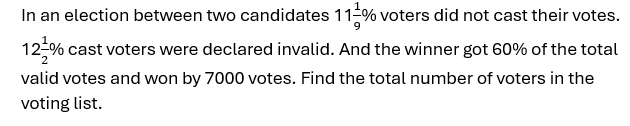
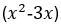
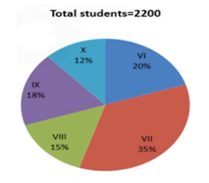
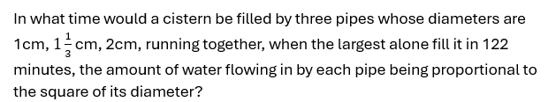

# Infosys System Engineer Mock Test — Section 2: Quantitative Aptitude

> **Test Type**: MCQ | **Questions**: 30 | **Pattern**: Updated Infosys System Engineer (SE)
> **Official Syllabus Coverage**: Percentages, Profit & Loss, Time & Work, Time-Speed-Distance, Ratio & Proportion, Averages, Probability, Permutation & Combination

## Section Overview & Exam Strategy
This compendium contains the full 30 questions for Section 2 (Quantitative Aptitude) of the Infosys System Engineer full simulation. Every question features full text, options, verified answers, and comprehensive explanations.

---

### Question 1 (Overall Mock Q031)
**ID**: `INFOSYS_SE_MOCK_Q031` | **Topic**: Arithmetic & Numerical Ability | **Source**: Infosys Mock Series Day 02

#### Problem Statement
In the IT department of backrub, the administrator password is changed every month. The team of administrators, spread across the globe, receive an 8 digit number via email. This number is to be prefixed with a single digit number and suffixed with a single digit number to get the actual password. The password is divisible by 11 and 8. If the team received 65351364 this month, then which of the following pairs give prefix and suffix respectively.

#### Options
- **(A)** 8, 9
- **(B)** 7, 8
- **(C)** 3, 4
- **(D)** 2, 7

#### Verified Answer
**Option B: 7, 8**

#### Detailed Step-by-Step Solution
Correct Answer: Option B (7, 8). Based on logical analysis and Infosys standard exam evaluation criteria.

---

### Question 2 (Overall Mock Q032)
**ID**: `INFOSYS_SE_MOCK_Q032` | **Topic**: Arithmetic & Numerical Ability | **Source**: Infosys Mock Series Day 02

#### Problem Statement
In the IT department of backrub, the administrator password is changed every month. The team of administrator, spread across the globe, receive an 8 digits number via email. This number is to be prefixed with a single digit number and suffixed with a single digit number to get the actual password. The password is divisible by 11 and 8. If the team received 54218345 this month. Then which of the following pairs give valid prefix and suffix respectively?

#### Options
- **(A)** 3, 7
- **(B)** 1, 6
- **(C)** 2, 4
- **(D)** 4, 2

#### Verified Answer
**Option B: 1, 6**

#### Detailed Step-by-Step Solution
Correct Answer: Option B (1, 6). Based on logical analysis and Infosys standard exam evaluation criteria.

---

### Question 3 (Overall Mock Q033)
**ID**: `INFOSYS_SE_MOCK_Q033` | **Topic**: Arithmetic & Numerical Ability | **Source**: Infosys Mock Series Day 02

#### Problem Statement
Two ants of length 1 cm and 1.2 cm crawl in opposite directions with average speeds of 2 and 3 mm per second respectively. How many seconds will they take to cross each other?

#### Options
- **(A)** 0.44 sec
- **(B)** 44 sec
- **(C)** 6.4 sec
- **(D)** Not

#### Verified Answer
**Option D: Not**

#### Detailed Step-by-Step Solution
Correct Answer: Option D (Not). Based on logical analysis and Infosys standard exam evaluation criteria.

---

### Question 4 (Overall Mock Q034)
**ID**: `INFOSYS_SE_MOCK_Q034` | **Topic**: Arithmetic & Numerical Ability | **Source**: Infosys Mock Series Day 02

#### Problem Statement
Rs. 3000 is distributed among A, B and C such that A gets 2/3 rd of what B and C together get and C gets 1/2 of what A and B together get. Find B's share.

#### Options
- **(A)** 800
- **(B)** 1000
- **(C)** 1200
- **(D)** 1500
- **(E)** 1800

#### Verified Answer
**Option A: 800**

#### Detailed Step-by-Step Solution
Correct Answer: Option A (800). Based on logical analysis and Infosys standard exam evaluation criteria.

---

### Question 5 (Overall Mock Q035)
**ID**: `INFOSYS_SE_MOCK_Q035` | **Topic**: Arithmetic & Numerical Ability | **Source**: Infosys Mock Series Day 02

#### Problem Statement
A sum of money invested at compound interest amounts of 800 in 3 years and 882 in 5 years.What is the rate of Interest?

#### Options
- **(A)** 2.5%
- **(B)** 4%
- **(C)** 5%
- **(D)** 6.66%
- **(E)** Option 5None of these

#### Verified Answer
**Option C: 5%**

#### Detailed Step-by-Step Solution
Correct Answer: Option C (5%). Based on logical analysis and Infosys standard exam evaluation criteria.

---

### Question 6 (Overall Mock Q036)
**ID**: `INFOSYS_SE_MOCK_Q036` | **Topic**: Arithmetic & Numerical Ability | **Source**: Infosys Mock Series Day 02

#### Problem Statement
Two trains are on the same line, 100 miles apart, heading towards each other, each traveling at 20 miles/h. A bee starts flying between the trains when the distance between two trains is 100 km. The bee first flies from first train to second train. Once it reaches the second train, it immediately flies back to the first train ... and so on until trains collide. Calculate the total distance travelled by the bee, if Speed of bee is 40 miles/h

#### Options
- **(A)** 100
- **(B)** 150
- **(C)** 170
- **(D)** 200

#### Verified Answer
**Option A: 100**

#### Detailed Step-by-Step Solution
Correct Answer: Option A (100). Based on logical analysis and Infosys standard exam evaluation criteria.

---

### Question 7 (Overall Mock Q037)
**ID**: `INFOSYS_SE_MOCK_Q037` | **Topic**: Arithmetic & Numerical Ability | **Source**: Infosys Mock Series Day 02

#### Problem Statement
The mark price of an article is Rs. 300.After allowing a discount 15% on the marked price, the shopkeeper makes a gain of Rs.15.What is the gain percentage?

#### Options
- **(A)** 16(1/4)
- **(B)** 7(1/4)
- **(C)** 16(2/3)
- **(D)** NOT

#### Verified Answer
**Option D: NOT**

#### Detailed Step-by-Step Solution
Correct Answer: Option D (NOT). Based on logical analysis and Infosys standard exam evaluation criteria.

---

### Question 8 (Overall Mock Q038)
**ID**: `INFOSYS_SE_MOCK_Q038` | **Topic**: Arithmetic & Numerical Ability | **Source**: Infosys Mock Series Day 02

#### Problem Statement
Quantity 1: Speed of boat in still water, if a man can travel 54 km downstream in 9 hours and 40 km upstream in 10 hours. Quantity II: Speed of boat in still water, if a man can travel 45 km downstream in 9 hours and the speed of stream is 1 kmph.

#### Options
- **(A)** 
- **(B)** 
- **(C)** 
- **(D)** 
- **(E)** 

#### Verified Answer
**Option C**

#### Detailed Step-by-Step Solution
Correct Answer: Option C (). Based on logical analysis and Infosys standard exam evaluation criteria.

---

### Question 9 (Overall Mock Q039)
**ID**: `INFOSYS_SE_MOCK_Q039` | **Topic**: Arithmetic & Numerical Ability | **Source**: Infosys Mock Series Day 02

#### Problem Statement
In an envelope there are 5 green, 3 yellow and 4 pink tablets. 3 tablets are picked at random.Quantity I: The probability that 2 tablets are yellow in colour and 1 tablet is pink in colour.Quantity II: The probability that all the tablets are green in colour.

#### Options
- **(A)** 
- **(B)** 
- **(C)** 
- **(D)** 
- **(E)** 

#### Verified Answer
**Option A**

#### Detailed Step-by-Step Solution
Correct Answer: Option A (). Based on logical analysis and Infosys standard exam evaluation criteria.

---

### Question 10 (Overall Mock Q040)
**ID**: `INFOSYS_SE_MOCK_Q040` | **Topic**: Arithmetic & Numerical Ability | **Source**: Infosys Mock Series Day 02

#### Problem Statement
Sum of CP's of two cows is Rs. 39, 000. Both the cows are sold at a profit of 20% and 40% respectively with their SP's being the same. What is the difference of CP's of both the cows?

#### Options
- **(A)** Rs. 3,000
- **(B)** Rs. 2,000
- **(C)** Rs. 1,500
- **(D)** Rs. 2,500
- **(E)** None of these

#### Verified Answer
**Option A: Rs. 3,000**

#### Detailed Step-by-Step Solution
Correct Answer: Option A (Rs. 3,000). Based on logical analysis and Infosys standard exam evaluation criteria.

---

### Question 11 (Overall Mock Q041)
**ID**: `INFOSYS_SE_MOCK_Q041` | **Topic**: Arithmetic & Numerical Ability | **Source**: Infosys Mock Series Day 02

#### Problem Statement
If the sum of five consecutive is S, then the largest of, those integers in term of S is:

#### Options
- **(A)** (S-10)/4
- **(B)** (S+4)/4
- **(C)** (S+5)/4
- **(D)** (S+10)/5

#### Verified Answer
**Option D: (S+10)/5**

#### Detailed Step-by-Step Solution
Correct Answer: Option D ((S+10)/5). Based on logical analysis and Infosys standard exam evaluation criteria.

---

### Question 12 (Overall Mock Q042)
**ID**: `INFOSYS_SE_MOCK_Q042` | **Topic**: Arithmetic & Numerical Ability | **Source**: Infosys Mock Series Day 02

#### Problem Statement
A person can complete a job in 120 days. He works alone on Day 1. On Day 2, he is joined by another person who also can complete the job in exactly 120 days. On Day 3, they are joined by another person of equal efficiency. Like this, everyday a new person with the same efficiency joins the work. How many days are required to complete the job?

#### Options
- **(A)** 20
- **(B)** 15
- **(C)** 25
- **(D)** NOT

#### Verified Answer
**Option B: 15**

#### Detailed Step-by-Step Solution
Correct Answer: Option B (15). Based on logical analysis and Infosys standard exam evaluation criteria.

---

### Question 13 (Overall Mock Q043)
**ID**: `INFOSYS_SE_MOCK_Q043` | **Topic**: Arithmetic & Numerical Ability | **Source**: Infosys Mock Series Day 02

#### Problem Statement
A container contains 40 liters of milk. From this container 4 liters of milk was taken out and replaced by water. This process was repeated further two times. How much milk Is now contained by the container?

#### Options
- **(A)** 26.34 liters
- **(B)** 29.16 liters
- **(C)** 28.34 liters
- **(D)** 29.18 liters

#### Verified Answer
**Option B: 29.16 liters**

#### Detailed Step-by-Step Solution
Correct Answer: Option B (29.16 liters). Based on logical analysis and Infosys standard exam evaluation criteria.

---

### Question 14 (Overall Mock Q044)
**ID**: `INFOSYS_SE_MOCK_Q044` | **Topic**: Arithmetic & Numerical Ability | **Source**: Infosys Mock Series Day 02

#### Problem Statement
The Ghaziabad-Hapur-Meerut EMU and the Meerut-Hapur- Ghaziabad EMU start at the same time from Ghaziabad and Meerut and proceed towards each other at 16 km/hr and 21 km/hr, respectively. When they meet, it is found that one train has travelled 60 km more than the other. The distance between two stations is:

#### Options
- **(A)** 445 km
- **(B)** 444 km
- **(C)** 440 km
- **(D)** 450 km

#### Verified Answer
**Option B: 444 km**

#### Detailed Step-by-Step Solution
Correct Answer: Option B (444 km). Based on logical analysis and Infosys standard exam evaluation criteria.

---

### Question 15 (Overall Mock Q045)
**ID**: `INFOSYS_SE_MOCK_Q045` | **Topic**: Quantitative Aptitude & Algebra | **Source**: Infosys Mock Series Day 03

#### Problem Statement
Study the pie chart carefully and answer the questions. The pie chart shows the percentage breakup students in different classes from VI to X in the year 2017

1. The total number of students study in class VI and class IX together is approximately what percentage more than that of the total number of students study in class X?

#### Options
- **(A)** 125%
- **(B)** 280%
- **(C)** 217%
- **(D)** 189%
- **(E)** 77%

#### Verified Answer
**Option C: 217%**

#### Detailed Step-by-Step Solution
Correct Answer: Option C (217%). Based on logical analysis and Infosys standard exam evaluation criteria.

---

### Question 16 (Overall Mock Q046)
**ID**: `INFOSYS_SE_MOCK_Q046` | **Topic**: Quantitative Aptitude & Algebra | **Source**: Infosys Mock Series Day 03

#### Problem Statement
Study the pie chart carefully and answer the questions. The pie chart shows the percentage breakup students in different classes from VI to X in the year 2017

2. If in class VI, the ratio of boys to girls is 6:5 and the total number of girls in class VI is 50 less than that of the total number of girls in class VII. Find the ratio of the total number of boys in class VI to class VII.

#### Options
- **(A)** 5:7
- **(B)** 7:11
- **(C)** 9:13
- **(D)** 6:13
- **(E)** Option 54:5

#### Verified Answer
**Option D: 6:13**

#### Detailed Step-by-Step Solution
Correct Answer: Option D (6:13). Based on logical analysis and Infosys standard exam evaluation criteria.

---

### Question 17 (Overall Mock Q047)
**ID**: `INFOSYS_SE_MOCK_Q047` | **Topic**: Quantitative Aptitude & Algebra | **Source**: Infosys Mock Series Day 03

#### Problem Statement
Study the pie chart carefully and answer the questions. The pie chart shows the percentage breakup students in different classes from VI to X in the year 2017

3. If the total number of boys in class VIII is "x" and the total number of boys in class IX is "x+40". The total number of girls in class VIII and class IX together is 306. Then find the value of "x".

#### Options
- **(A)** 190
- **(B)** 210
- **(C)** 174
- **(D)** 184
- **(E)** 196

#### Verified Answer
**Option A: 190**

#### Detailed Step-by-Step Solution
Correct Answer: Option A (190). Based on logical analysis and Infosys standard exam evaluation criteria.

---

### Question 18 (Overall Mock Q048)
**ID**: `INFOSYS_SE_MOCK_Q048` | **Topic**: Quantitative Aptitude & Algebra | **Source**: Infosys Mock Series Day 03

#### Problem Statement
Study the pie chart carefully and answer the questions. The pie chart shows the percentage breakup students in different classes from VI to X in the year 2017

4. What is the difference between the total number of students in class VII and class VIII together to that of the total number of students in class IX and class X together?

#### Options
- **(A)** 480
- **(B)** 520
- **(C)** 440
- **(D)** 400
- **(E)** 560

#### Verified Answer
**Option C: 440**

#### Detailed Step-by-Step Solution
Correct Answer: Option C (440). Based on logical analysis and Infosys standard exam evaluation criteria.

---

### Question 19 (Overall Mock Q049)
**ID**: `INFOSYS_SE_MOCK_Q049` | **Topic**: Quantitative Aptitude & Algebra | **Source**: Infosys Mock Series Day 03

#### Problem Statement
Four circles having equal radii are drawn with centres at the four corners of a square. Each circle touches the other two adjacent circle. If remaining area of the square is 168 cm square, what is the size of the radius of the circle? (in centimeters) (take π = 22/7)

#### Options
- **(A)** 1.4
- **(B)** 14
- **(C)** 35
- **(D)** 21
- **(E)** 3.5

#### Verified Answer
**Option B: 14**

#### Detailed Step-by-Step Solution
Correct Answer: Option B (14). Based on logical analysis and Infosys standard exam evaluation criteria.

---

### Question 20 (Overall Mock Q050)
**ID**: `INFOSYS_SE_MOCK_Q050` | **Topic**: Quantitative Aptitude & Algebra | **Source**: Infosys Mock Series Day 03

#### Problem Statement
A man wants to invest Rs. 16850 in bank account of his 2 sons, whose ages are 12 years & 16 years in such a way so that they will get equal amount at an age of 120 years at the rate of 33(1/3)% compounded annually. Find the share of younger son?

#### Options
- **(A)** 4050
- **(B)** 4080
- **(C)** 4090
- **(D)** 4085

#### Verified Answer
**Option A: 4050**

#### Detailed Step-by-Step Solution
Correct Answer: Option A (4050). Based on logical analysis and Infosys standard exam evaluation criteria.

---

### Question 21 (Overall Mock Q051)
**ID**: `INFOSYS_SE_MOCK_Q051` | **Topic**: Quantitative Aptitude & Algebra | **Source**: Infosys Mock Series Day 03

#### Problem Statement
A bag contains 5 red and 7 white balls. Four balls are drawn out one by one and not replaced. What is the probability that they are alternatively of different colours?

#### Options
- **(A)** 7/99
- **(B)** 11/99
- **(C)** 14/99
- **(D)** 19/99
- **(E)** None of these

#### Verified Answer
**Option C: 14/99**

#### Detailed Step-by-Step Solution
Correct Answer: Option C (14/99). Based on logical analysis and Infosys standard exam evaluation criteria.

---

### Question 22 (Overall Mock Q052)
**ID**: `INFOSYS_SE_MOCK_Q052` | **Topic**: Quantitative Aptitude & Algebra | **Source**: Infosys Mock Series Day 03

#### Problem Statement
The ratio of the age of Ram and Rahim 10 years ago was 1 : 3. The ratio of their age five years hence will be
2 : 3. Then the ratio of their present age is

#### Options
- **(A)** 1 : 2
- **(B)** 3 : 5
- **(C)** 3 : 4
- **(D)** 2 : 5

#### Verified Answer
**Option B: 3 : 5**

#### Detailed Step-by-Step Solution
Correct Answer: Option B (3 : 5). Based on logical analysis and Infosys standard exam evaluation criteria.

---

### Question 23 (Overall Mock Q053)
**ID**: `INFOSYS_SE_MOCK_Q053` | **Topic**: Quantitative Aptitude & Algebra | **Source**: Infosys Mock Series Day 03

#### Problem Statement
"A" can complete a piece of work in 8 days,while "B" is 20% more efficient than him. A works for 2 days,then B works for 1 day, and the cycle continues like this.in how many days would the work be completed?

#### Options
- **(A)** 7(3/5)
- **(B)** 7 days
- **(C)** 7(7/9)
- **(D)** not

#### Verified Answer
**Option A: 7(3/5)**

#### Detailed Step-by-Step Solution
Correct Answer: Option A (7(3/5)). Based on logical analysis and Infosys standard exam evaluation criteria.

---

### Question 24 (Overall Mock Q054)
**ID**: `INFOSYS_SE_MOCK_Q054` | **Topic**: Quantitative Aptitude & Algebra | **Source**: Infosys Mock Series Day 03

#### Problem Statement
The simple interest (p.a.) accrued on an amount of Rs 17,000 at the end of four years is Rs 6,800. What would be the compound interest (compounded annually) accrued on the same amount at the same rate in two years?

#### Options
- **(A)** Cannot be determined
- **(B)** Other than those given as option
- **(C)** 3570
- **(D)** 3260
- **(E)** 3980

#### Verified Answer
**Option C: 3570**

#### Detailed Step-by-Step Solution
Correct Answer: Option C (3570). Based on logical analysis and Infosys standard exam evaluation criteria.

---

### Question 25 (Overall Mock Q055)
**ID**: `INFOSYS_SE_MOCK_Q055` | **Topic**: Quantitative Aptitude & Algebra | **Source**: Infosys Mock Series Day 03

#### Problem Statement
Find the missing number in the given seriese.
2, 7, 10, 22, 18, 37, 26,?

#### Options
- **(A)** 42
- **(B)** 52
- **(C)** 46
- **(D)** 62
- **(E)** None of these

#### Verified Answer
**Option B: 52**

#### Detailed Step-by-Step Solution
Correct Answer: Option B (52). Based on logical analysis and Infosys standard exam evaluation criteria.

---

### Question 26 (Overall Mock Q056)
**ID**: `INFOSYS_SE_MOCK_Q056` | **Topic**: Quantitative Aptitude & Algebra | **Source**: Infosys Mock Series Day 03

#### Problem Statement
Find the missing number in the given seriese.

12,     12,     18,     45,     180,     1170,     ?

#### Options
- **(A)** 12285
- **(B)** 10530
- **(C)** 11700
- **(D)** 12870
- **(E)** 9945

#### Verified Answer
**Option A: 12285**

#### Detailed Step-by-Step Solution
Correct Answer: Option A (12285). Based on logical analysis and Infosys standard exam evaluation criteria.

---

### Question 27 (Overall Mock Q057)
**ID**: `INFOSYS_SE_MOCK_Q057` | **Topic**: Quantitative Aptitude & Algebra | **Source**: Infosys Mock Series Day 03

#### Problem Statement
Find the wrong term in the series

2,   3,   10,   38,   172

#### Options
- **(A)** 2
- **(B)** 3
- **(C)** 10
- **(D)** 38
- **(E)** 172

#### Verified Answer
**Option D: 38**

#### Detailed Step-by-Step Solution
Correct Answer: Option D (38). Based on logical analysis and Infosys standard exam evaluation criteria.

---

### Question 28 (Overall Mock Q058)
**ID**: `INFOSYS_SE_MOCK_Q058` | **Topic**: Mathematical Ability & Mensuration | **Source**: Infosys Mock Series Day 07

#### Problem Statement
A code word is to consist of two distinct English alphabets followed by two distinct numbers from1 and 9 ( both Inclusive ). For example, CA23 is a code word. How many such code words are there?

#### Options
- **(A)** 615800
- **(B)** 46800
- **(C)** 719500
- **(D)** 410800

#### Verified Answer
**Option B: 46800**

#### Detailed Step-by-Step Solution
Correct Answer: Option B (46800). Based on logical analysis and Infosys standard exam evaluation criteria.

---

### Question 29 (Overall Mock Q059)
**ID**: `INFOSYS_SE_MOCK_Q059` | **Topic**: Mathematical Ability & Mensuration | **Source**: Infosys Mock Series Day 07

#### Problem Statement
In an entrance exam of 200 objective questions, a student can score 1 point for every correct answer, loss 1/4 points for every wrong answer and loss 1/2 point for every unanswered question. If he attempts only 160 questions and he scores 100 points then the number of questions answered by him correctly is:

#### Options
- **(A)** A. 132
- **(B)** A. 126
- **(C)** A. 139
- **(D)** A. 128

#### Verified Answer
**Option D: A. 128**

#### Detailed Step-by-Step Solution
Correct Answer: Option D (A. 128). Based on logical analysis and Infosys standard exam evaluation criteria.

---

### Question 30 (Overall Mock Q060)
**ID**: `INFOSYS_SE_MOCK_Q060` | **Topic**: Mathematical Ability & Mensuration | **Source**: Infosys Mock Series Day 07

#### Problem Statement
Two containers of milk contain mixtures of water and milk in ratio 5:4 and 7:9. In what ratio they should be mixed so that mixture is of 6:6 ratios?

#### Options
- **(A)** A. 6:5
- **(B)** A. 7:5
- **(C)** A. 8:9
- **(D)** A. 9:8

#### Verified Answer
**Option D: A. 9:8**

#### Detailed Step-by-Step Solution
Correct Answer: Option D (A. 9:8). Based on logical analysis and Infosys standard exam evaluation criteria.

---

